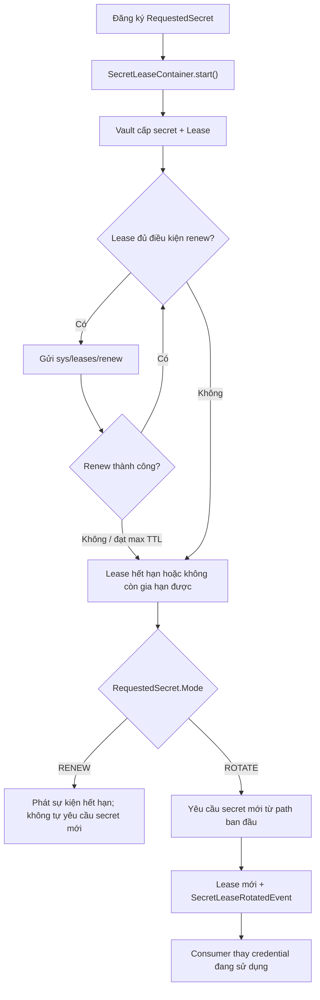
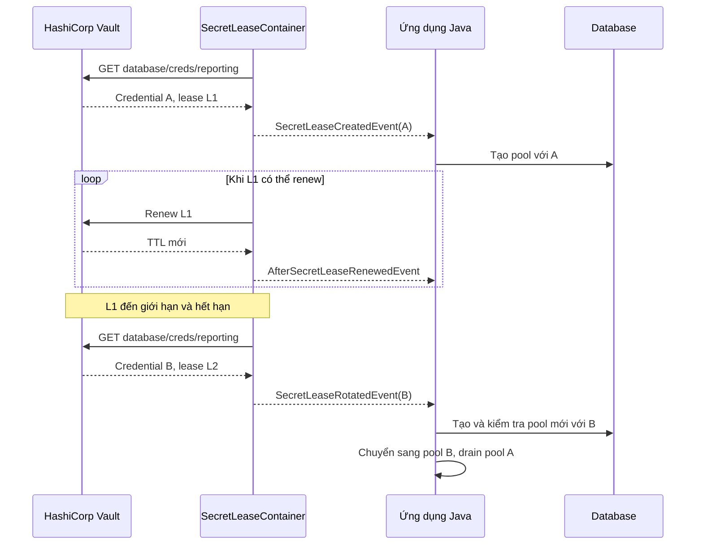

# RequestedSecret với chế độ gia hạn hoặc xoay vòng

Trong một ứng dụng Java sử dụng **Spring Vault**, đọc một secret từ HashiCorp Vault mới chỉ là bước đầu. Nếu secret là thông tin đăng nhập động cho PostgreSQL, MySQL, MongoDB hoặc một dịch vụ khác, Vault thường gắn với nó một **lease**: thời hạn sử dụng, mã định danh lease và khả năng gia hạn. Khi lease hết hạn hoặc bị thu hồi, credential có thể không còn hợp lệ dù ứng dụng vẫn giữ nguyên username/password trong bộ nhớ.

Spring Vault cung cấp `RequestedSecret` để mô tả **đường dẫn secret cần quản lý và cách xử lý sau khi lease hết hạn**. Có hai chế độ là **`RENEW` (gia hạn)** và **`ROTATE` (xoay vòng)**. `SecretLeaseContainer` nhận yêu cầu này, lấy secret, lên lịch renew và phát sự kiện để ứng dụng biết khi nào credential mới xuất hiện hoặc lease có vấn đề.

Bài học thuộc chương **Vòng đời lease**, trong module **SPRING_VAULT**: dùng `VaultTemplate` truy cập Vault, xác thực theo workload, cấp quyền tối thiểu và quản lý an toàn vòng đời token/lease. Trọng tâm là **lựa chọn và vận hành `RequestedSecret`**, với database credentials làm ví dụ xuyên suốt; các tác vụ Transit encryption và PKI có vòng đời riêng cần phân biệt.

## 1. Mục tiêu học tập

Sau bài này, bạn có thể:

1. Phân biệt **secret value**, **secret lease**, **Vault login token**, **TTL**, **renew** và **rotation**.
2. Tạo `RequestedSecret.renewable(path)` hoặc `RequestedSecret.rotating(path)` và đọc ý nghĩa của `RequestedSecret.Mode.RENEW`/`ROTATE`.
3. Đăng ký `RequestedSecret` với `SecretLeaseContainer`, quan sát sự kiện tạo mới, gia hạn, hết hạn và xoay vòng.
4. Nắm điểm khác nhau giữa **gia hạn cùng một credential** và **lấy credential mới rồi cập nhật ứng dụng**.
5. Phân tích lỗi do lease/token hết hạn, chính sách Vault, kết nối mạng hoặc database pool vẫn dùng credential cũ.
6. Thiết kế kiểm thử tích hợp cho cả hai mode mà không làm lộ thông tin xác thực.

## 2. Những khái niệm nền tảng

### 2.1. Secret có lease trông như thế nào?

Với Vault Database secrets engine được mount tại `database/`, một ứng dụng có quyền có thể yêu cầu credential tại `database/creds/reporting`. Phản hồi HTTP minh họa (giá trị thật đã được thay bằng placeholder):

```json
{
  "request_id": "<request-id>",
  "lease_id": "database/creds/reporting/<lease-identifier>",
  "renewable": true,
  "lease_duration": 3600,
  "data": {
    "username": "v-reporting-<generated>",
    "password": "<sensitive-password>"
  }
}
```

Ba trường quan trọng:

- `lease_id`: định danh mà Vault dùng để quản lý vòng đời **credential động được cấp**. Đây không phải `Vault token`.
- `lease_duration`: TTL được cấp, thường tính bằng **giây**; ví dụ `3600` tương ứng một giờ.
- `renewable`: cho biết lease **có khả năng được yêu cầu gia hạn**. Gia hạn thực tế còn chịu giới hạn engine, role, max TTL và trạng thái token.

Khi lease được gia hạn thành công, Vault cập nhật thời hạn lease; **username/password thường giữ nguyên**. Khi ứng dụng **lấy một bộ credential mới**, Vault có thể trả username/password và `lease_id` khác. Đây mới là một lần **rotation** ở cấp credential.

### 2.2. Lease của secret khác Vault login token

| Đối tượng | Lấy từ đâu? | Dùng để làm gì? | Vòng đời |
| --- | --- | --- | --- |
| **Vault login token** | AppRole, Kubernetes, AWS, Token auth... | Cho phép ứng dụng gọi `VaultTemplate` với các ACL policies | TTL, renew, re-login, revoke riêng |
| **Secret lease** | Vault phát hành cùng dynamic secret | Theo dõi và giới hạn thời gian sống của credential | TTL, renew, expire, revoke riêng |
| **Dynamic credential** | Ví dụ `database/creds/reporting` | Đăng nhập vào database đích | Chỉ còn tin cậy khi lease còn hợp lệ |
| **RequestedSecret** | Ứng dụng Spring Vault tạo | Mô tả secret nào cần theo dõi và mode xử lý | Không tự là token, credential hoặc lease |

**Đừng nhầm renew Vault token với renew secret lease.** Token đăng nhập có thể được `LifecycleAwareSessionManager` quản lý; secret lease được `SecretLeaseContainer` quản lý. Nếu Vault token cấp ra lease hết hiệu lực hoặc bị thu hồi, các lease gắn với nó cũng có thể bị thu hồi, khiến việc gia hạn secret riêng lẻ không thể cứu credential.

### 2.3. Khi nào có lease?

Các secrets engine tạo credential động, như Database, thường trả lease có khả năng gia hạn. Trái lại, đọc một giá trị KV v2 tĩnh không có nghĩa Vault sẽ tạo **renewable dynamic lease** cho giá trị đó. Không giả định mọi secret đều có `lease_id` hay có thể được renew/rotate theo cùng cơ chế.

## 3. `RequestedSecret` là gì?

Lớp `org.springframework.vault.core.lease.domain.RequestedSecret` là **đặc tả bất biến về một secret cần theo dõi**. Nó gồm:

- **`path`**: đường dẫn Vault để lấy secret, ví dụ `database/creds/reporting`, **không bắt đầu bằng dấu `/`**.
- **`mode`**: chiến lược khi lease không thể kéo dài nữa, là `RENEW` hoặc `ROTATE`.

Spring Vault cung cấp các factory:

```java
import org.springframework.vault.core.lease.domain.RequestedSecret;

RequestedSecret renewable =
        RequestedSecret.renewable("database/creds/reporting");

RequestedSecret rotating =
        RequestedSecret.rotating("database/creds/reporting");

RequestedSecret explicit =
        RequestedSecret.from(RequestedSecret.Mode.ROTATE,
                             "database/creds/reporting");
```

Trong ví dụ trên có **ba lựa chọn minh họa độc lập**. Ứng dụng thực thường chỉ đăng ký **một mode cho một nguồn credential** để tránh quản lý hai vòng đời cạnh tranh trên cùng đường dẫn.

Bạn có thể kiểm tra `requestedSecret.getPath()`, `requestedSecret.getMode()`. Các constant đúng tên Java là `RequestedSecret.Mode.RENEW` và `RequestedSecret.Mode.ROTATE`.

**Lưu ý:** đối tượng `RequestedSecret` chỉ ghi nhận yêu cầu. Chỉ gọi `RequestedSecret.rotating(...)` sẽ **không** tạo credential, gia hạn lease hay chạy job nền. Cần đăng ký nó với một `SecretLeaseContainer` đang hoạt động.

## 4. So sánh `RENEW` và `ROTATE`

Hai mode **đều thử gia hạn** nếu lease đủ điều kiện renewal. Sự khác nhau quan trọng nằm ở **hành vi khi lease đạt giới hạn và hết hạn**:

| Tiêu chí | `RequestedSecret.Mode.RENEW` | `RequestedSecret.Mode.ROTATE` |
| --- | --- | --- |
| Ý nghĩa | Cố giữ lease/credential hiện có sống lâu nhất có thể | Cố giữ lease hiện có, sau đó lấy secret mới |
| Khi bắt đầu container | Lấy secret lần đầu | Lấy secret lần đầu |
| Khi `renewable=true` và còn khả năng renew | Gửi yêu cầu renew | Gửi yêu cầu renew |
| Khi lease hết hạn tối đa | Phát hiện hết hạn; **không tự lấy credential thay thế** theo mode | Phát hiện hết hạn và **yêu cầu secret mới kèm lease mới** |
| Username/password lúc renew thành công | Thường không đổi | Thường không đổi |
| Username/password sau một rotation thành công | Không có vòng lấy mới tự động | Có thể thay đổi hoàn toàn |
| Khi service phải chạy lâu hơn max TTL | Cần một cơ chế khác xử lý hết hạn | Có thể tự tiếp tục bằng credential mới nếu consumer áp dụng được |
| Bài toán phù hợp | Workflow có điểm kết thúc rõ, credential cần ổn định trong lease | Database/service cần thay credential liên tục trong runtime |

**`ROTATE` không đồng nghĩa “không renew”.** Chính xác hơn: với lease có thể gia hạn, `ROTATE` **vẫn renew trước**, nhưng khi không thể kéo dài nữa và lease hết hạn, container tìm cách **lấy secret mới**. Không có bảo đảm rotation xảy ra vào thời điểm nhất định hoặc không có khoảng trống giữa hai credential; điều đó còn phụ thuộc Vault, scheduler, mạng và consumer.

### Timeline minh họa

Giả sử Vault cấp một database credential `A` lúc 09:00, TTL 30 phút, có thể renew nhưng tổng vòng đời bị giới hạn đến 11:00:

| Mốc | `RENEW` | `ROTATE` |
| --- | --- | --- |
| 09:00 | Nhận credential A và lease L1 | Nhận credential A và lease L1 |
| 09:25 | Container có thể renew L1 khi đủ điều kiện | Container có thể renew L1 khi đủ điều kiện |
| 10:30 | Tiếp tục renew A nếu Vault cho phép | Tiếp tục renew A nếu Vault cho phép |
| Khoảng 11:00 | L1 hết hạn, A không còn được đảm bảo hợp lệ | L1 hết hạn; container cố lấy credential B và lease L2 |
| Sau giới hạn | Phải có cơ chế cấp lại riêng nếu vẫn cần kết nối | Consumer nhận thông báo đổi sang B, chuẩn bị kết nối mới |

Các mốc này chỉ minh họa **cơ chế**, không phải lịch mặc định của Spring Vault. Một số secrets engine, role hoặc token áp giới hạn khác; sự kiện expiry có thể được phát muộn hơn thời điểm hết hạn thực tế.



Trên thực tế, lỗi mạng tạm thời trong quá trình renew có thể được xử lý theo `LeaseStrategy` thay vì lập tức coi là hết hạn. Sơ đồ cố ý rút gọn nhánh lỗi để dễ phân biệt hai mode.

## 5. `SecretLeaseContainer` thực thi những gì?

`org.springframework.vault.core.lease.SecretLeaseContainer` là thành phần có lifecycle của Spring (triển khai `SmartLifecycle`) quản lý nhiều `RequestedSecret`. Container:

1. Nhận đăng ký secret cần theo dõi.
2. Khi `start()`, lấy secret và thông tin lease từ Vault.
3. Lên lịch renew trên thread của `TaskScheduler` khi lease đủ điều kiện.
4. Áp dụng `minRenewal`, `expiryThreshold` và `LeaseStrategy` để xử lý thời gian/lỗi.
5. Phát sự kiện cho `LeaseListener` và `LeaseErrorListener`.
6. Với mode `ROTATE`, yêu cầu secret mới sau khi lease cũ hết hạn, tiếp tục theo dõi lease mới.

### Cách đăng ký

```java
import org.springframework.vault.core.VaultOperations;
import org.springframework.vault.core.lease.SecretLeaseContainer;
import org.springframework.vault.core.lease.domain.RequestedSecret;
import org.springframework.scheduling.TaskScheduler;

// vaultOperations và scheduler được inject từ Spring configuration.
SecretLeaseContainer container =
        new SecretLeaseContainer(vaultOperations, scheduler);

RequestedSecret secret =
        RequestedSecret.rotating("database/creds/reporting");

container.addRequestedSecret(secret);
container.afterPropertiesSet();
container.start();
```

**Chỉ dùng đoạn code trên khi tự quản lý lifecycle** của container. Nếu container là bean của Spring hoặc Spring Cloud Vault đã tự cấu hình một bean, để framework phụ trách initialization/start/stop và tránh dựng thêm container song song. Sau khi `start()`, container có thể phát sự kiện lấy secret đầu tiên ngay; listener phải đăng ký trước thời điểm đó.

Container còn có các phương thức thuận tiện:

```java
RequestedSecret s1 =
        container.requestRenewableSecret("database/creds/readonly");

RequestedSecret s2 =
        container.requestRotatingSecret("database/creds/reporting");
```

Hai lời gọi trên **đăng ký secret** và trả về `RequestedSecret` đã được theo dõi; không cần gọi thêm `addRequestedSecret(...)` cho chính những object đó.

Ở Spring Vault 4.1+, còn có API `register(RequestedSecret, LeaseListener)` và `unregister(RequestedSecret)` qua `SecretsRegistry`. Đăng ký trùng một `RequestedSecret` được container coi là một registration, nhưng không nên dựa vào đó để tự tạo nhiều vòng đời khác mode cho cùng path.

## 6. Nhận biết sự kiện để cập nhật credential

Các sự kiện thường gặp:

| Event | Khi nào phát? | Ứng dụng nên làm gì? |
| --- | --- | --- |
| `SecretLeaseCreatedEvent` | Container nhận secret lần đầu | Nhận và áp dụng credential ban đầu |
| `AfterSecretLeaseRenewedEvent` | Renew lease thành công | Cập nhật trạng thái TTL/metric, không tự giả định credential đã đổi |
| `SecretLeaseExpiredEvent` | Container xác định lease hết hạn | Đánh dấu credential cũ không đáng tin cậy |
| `SecretLeaseRotatedEvent` | Lấy secret mới theo mode `ROTATE` | Đổi credential và làm mới tài nguyên phụ thuộc |
| `SecretNotFoundEvent` | Không tìm thấy secret ở path | Cảnh báo sai path/role hoặc secret bị xóa |
| `SecretLeaseErrorEvent` | Vault trả lỗi hoặc I/O lỗi khi lấy/renew/revoke secret | Ghi nhận lỗi, xử lý theo chính sách vận hành |
| `BeforeSecretLeaseRevocationEvent` / `AfterSecretLeaseRevocationEvent` | Trước/sau revoke | Theo dõi cleanup, điều phối ngắt kết nối nếu cần |

**Chú ý:** `SecretLeaseRotatedEvent` **kế thừa** `SecretLeaseCreatedEvent`. Nếu code kiểm tra `instanceof SecretLeaseCreatedEvent` trước, sự kiện rotation cũng khớp điều kiện và dễ bị đếm hai lần hoặc xử lý nhầm là lần cấp đầu tiên.

### Ví dụ Java nhận credential và sự kiện renew/rotate

Đoạn code này dùng Java 11+ và API Spring Vault trong nhóm `org.springframework.vault.core.lease`. Callback nhận map secret, **không ghi nội dung map ra log**:

```java
import java.util.Map;
import java.util.function.Consumer;

import org.springframework.scheduling.TaskScheduler;
import org.springframework.vault.core.VaultOperations;
import org.springframework.vault.core.lease.SecretLeaseContainer;
import org.springframework.vault.core.lease.domain.RequestedSecret;
import org.springframework.vault.core.lease.event.*;

public final class DatabaseSecretLifecycle {

    public static SecretLeaseContainer start(
            VaultOperations vaultOperations,
            TaskScheduler scheduler,
            Consumer<Map<String, Object>> applyCredentials) throws Exception {

        SecretLeaseContainer container =
                new SecretLeaseContainer(vaultOperations, scheduler);

        RequestedSecret requested =
                RequestedSecret.rotating("database/creds/reporting");

        LeaseListenerAdapter listener = new LeaseListenerAdapter() {
            @Override
            public void onLeaseEvent(SecretLeaseEvent event) {
                if (!requested.equals(event.getSource())) {
                    return;
                }
                if (event instanceof SecretLeaseRotatedEvent) {
                    // Credential mới sau khi lease trước kết thúc.
                    applyCredentials.accept(
                            ((SecretLeaseRotatedEvent) event).getSecrets());
                } else if (event instanceof SecretLeaseCreatedEvent) {
                    // Credential ban đầu; RotatedEvent đã xử lý ở trên.
                    applyCredentials.accept(
                            ((SecretLeaseCreatedEvent) event).getSecrets());
                } else if (event instanceof SecretLeaseExpiredEvent) {
                    // Đánh dấu credential cũ hết hiệu lực, kích hoạt cảnh báo.
                } else if (event instanceof AfterSecretLeaseRenewedEvent) {
                    // Cập nhật metrics; credential vẫn là bộ hiện hành.
                }
            }

            @Override
            public void onLeaseError(SecretLeaseEvent event, Exception error) {
                if (requested.equals(event.getSource())) {
                    // Alert theo loại lỗi; tránh log token/password hay response body.
                }
            }
        };

        // Register listeners TRƯỚC khi container chạy.
        container.addLeaseListener(listener);
        container.addErrorListener(listener);
        container.addRequestedSecret(requested);
        container.afterPropertiesSet();
        container.start();
        return container;
    }
}
```

`applyCredentials` là callback **do ứng dụng hiện thực**, ví dụ tạo một connection pool mới rồi chuyển traffic sang pool mới. Đoạn code trên minh họa phần quản lý lease, **không bảo đảm tự động cập nhật mọi DataSource hay connection hiện hữu**. Đối với chương trình dùng Spring Boot, có thể dùng cơ chế `ManagedSecret.rotating(...)` ở Spring Vault mới để đăng ký và áp dụng dữ liệu rõ ràng hơn; cần kiểm tra API theo version.

## 7. Gia hạn không đồng nghĩa xoay vòng

Xét credential `A` có username/password do Vault tạo:

### Renewal

```text
09:00  Vault cấp credential A, lease L1, TTL 1 giờ
09:50  Spring Vault yêu cầu renew L1
09:50  Vault gia hạn L1 thành công
       Ứng dụng tiếp tục dùng credential A
```

Renew không làm xuất hiện một bộ username/password mới; ý nghĩa của nó là **kéo dài hiệu lực lease nếu Vault cho phép**.

### Rotation

```text
09:00  Vault cấp credential A, lease L1
...    Gia hạn L1 khi còn được phép
11:00  L1 đến giới hạn hiệu lực
11:00+ Container nhận credential B, lease L2
       Ứng dụng cập nhật nơi đang giữ credential
```

Trong trường hợp database credentials, Vault có thể đã xóa/revoke user cũ khi lease hết hạn. Kết nối đang tồn tại có hành vi phụ thuộc database và cấu hình connection pool; không được giả định tất cả kết nối cũ biến mất ngay, hoặc mọi kết nối mới sẽ tự nhận credential B.

Với `ROTATE`, yêu cầu **mới** có thể cần quyền `read` lên path cấp credential và sử dụng Vault token còn hợp lệ. Nếu request mới bị lỗi sau khi lease cũ hết hạn, ứng dụng phải xử lý khoảng thời gian không có credential hợp lệ.

## 8. Tích hợp database pool: nơi rotation thực sự có tác dụng

Với ứng dụng Java sử dụng HikariCP/JDBC:

1. Container lấy credential A và phát `SecretLeaseCreatedEvent`.
2. Thành phần cấu hình DataSource khởi tạo pool A bằng credential A.
3. Khi `SecretLeaseRotatedEvent` xuất hiện với credential B, ứng dụng chuẩn bị pool B và **xác minh kết nối B thành công**.
4. Chuyển traffic sang pool B một cách có kiểm soát.
5. Drain/đóng pool A, theo dõi lỗi xác thực và cleanup lease.

Chỉ gọi `dataSource.setUsername(...)`/`setPassword(...)` lên một object đã có pool không nhất thiết thay credential cho những connection đang tồn tại. Rotation thành công ở Vault **không bảo đảm service đã dùng credential mới**.



Để giảm gián đoạn, hệ thống cần đánh giá **thời điểm chuyển pool, thời gian kết nối, timeout, grace period**, chính sách revoke và khả năng cấp credential mới trước khi credential cũ mất hiệu lực. Mode `ROTATE` tự động lấy secret mới sau expiry nhưng **không tự tạo khoảng chồng lấp an toàn**; nếu cần zero-downtime thực sự, phải thiết kế consumer/rotation strategy phù hợp với database.

## 9. TTL tuning: `expiryThreshold` và `minRenewal`

`SecretLeaseContainer` cần quyết định **khi nào** renew. Nó dùng `TaskScheduler` và thời gian còn lại trên lease.

| Tham số | Vai trò | Mặc định theo Spring Vault reference 4.1 |
| --- | --- | --- |
| `expiryThreshold` | Mốc renew trước thời điểm lease hết hạn | Khoảng **1 phút** |
| `minRenewal` | Tránh thực hiện renew dồn dập khi TTL quá ngắn | Khoảng **10 giây** |
| `LeaseStrategy` | Xử lý lease khi lỗi renew | Phụ thuộc cấu hình chiến lược |
| `TaskScheduler` | Lên lịch thao tác chạy nền | Dùng clock/scheduler của ứng dụng |

Ví dụ chỉnh tham số khi tự tạo container:

```java
import java.time.Duration;

container.setExpiryThreshold(Duration.ofSeconds(30));
container.setMinRenewal(Duration.ofSeconds(10));
```

Các giá trị trên **chỉ minh họa**; cần căn cứ TTL thực tế, thời gian network, độ ổn định Vault, tải scheduler và thời gian tạo DataSource. Nếu role chỉ cấp TTL 20 giây thì đặt `expiryThreshold=1m` có thể khiến việc xác định renew/expiry xảy ra quá sớm; cần thử nghiệm với TTL thực tế.

**Không suy ra “chắc chắn renew đúng phút 25”** từ `expiryThreshold`: tác vụ có thể bị hoãn vì scheduler bận, clock lệch, I/O chậm hoặc Vault bị mất kết nối. Thiết kế health/readiness dựa trên tình trạng credential thực tế thay vì chỉ dựa vào lịch dự kiến.

### Spring Cloud Vault cấu hình ví dụ

Nếu ứng dụng dùng Spring Cloud Vault, có các thuộc tính lifecycle riêng cho secret:

```yaml
spring:
  cloud:
    vault:
      uri: https://vault.internal.example:8200
      config:
        lifecycle:
          enabled: true
          min-renewal: 10s
          expiry-threshold: 1m
      session:
        lifecycle:
          enabled: true
          refresh-before-expiry: 5s
          expiry-threshold: 7s
```

`spring.cloud.vault.config.lifecycle.*` quản lý **secret lease**, còn `spring.cloud.vault.session.lifecycle.*` quản lý **login token**. Đây là hai nhóm cấu hình độc lập. Khi dùng Spring Cloud Vault auto-configuration, tránh tạo trùng `SecretLeaseContainer` cho cùng secret trong application code nếu framework đã đăng ký.

## 10. Lỗi renewal và `LeaseStrategy`

Renew có thể thất bại vì nhiều lý do không liên quan đến việc hết TTL:

| Lỗi | Có thể do | Hướng xử lý |
| --- | --- | --- |
| HTTP timeout khi renew | Network/TLS, Vault quá tải | Retry có giới hạn, cảnh báo và kiểm tra TTL còn lại |
| Lease không tìm thấy | Lease đã bị revoke, hết hạn hoặc ID sai | Không tiếp tục dùng credential như còn hợp lệ |
| Renew bị từ chối | Role/lease không renewable, đạt max TTL | `ROTATE` sẽ cần xin secret mới khi lease hết hạn |
| Token không còn quyền | Vault login token hết hạn/thu hồi, ACL sai | Khôi phục session, xác minh các lease phụ thuộc |
| Fetch credential mới thất bại | Path sai, backend database lỗi, thiếu `read` | Giữ trạng thái lỗi, báo động, không tuyên bố rotation thành công |
| Pool tiếp tục lỗi sau rotate | Consumer chưa cập nhật credential hoặc pool chưa thay | Kiểm tra việc chuyển pool và kết nối mới |

Spring Vault có `LeaseStrategy` để quyết định **giữ hay loại bỏ trạng thái lease sau lỗi renew**. Các chiến lược khác nhau (`DropOnError`, `RetainOnError`, `RetainOnIoError` trong những phiên bản phù hợp) có thể thay đổi cách container phản ứng với lỗi. Chọn chiến lược dựa trên mục tiêu sẵn sàng và quy tắc an toàn: **giữ lease trong state không đồng nghĩa credential còn hợp lệ ở Vault**.

Ví dụ, khi gặp lỗi mạng tạm thời, giữ trạng thái rồi thử lại có thể hợp lý nếu lease còn thời gian. Với lỗi lease đã bị thu hồi, tiếp tục dùng credential cũ có thể gây 403/DB authentication failure. Cần xử lý `LeaseErrorListener` và kiểm tra expiry thực tế, không phụ thuộc duy nhất vào exception message.

## 11. Tương tác với vòng đời Vault token

Giả sử `database/creds/reporting` được lấy bằng Vault token `T1` với TTL ngắn. Secret lease `L1` có thể có TTL dài hơn, nhưng nếu `T1` hết hiệu lực và Vault thu hồi các lease gắn với `T1`, `L1` cũng có thể mất hiệu lực.

Điều này có ba hệ quả:

1. Renewal của `L1` và renewal của `T1` là hai công việc khác nhau, cần cùng hoạt động.
2. Sau re-login với Vault token `T2`, application có thể cần lấy lại dynamic secret và bắt đầu lease mới; không mặc định `L1` còn sử dụng được.
3. `SecretLeaseContainer` có các `AuthenticationListener`/`AuthenticationErrorListener` để phối hợp với session manager trong các phiên bản Spring Vault phù hợp. Khi tự cấu hình, kiểm tra wiring để secret được quản lý lại sau sự kiện re-login.

Tài liệu Spring Vault mô tả `SessionLeaseContainer` cung cấp listener xác thực để hỗ trợ restart secret sau re-login. Trong thiết kế production, phải kiểm tra hành vi của đúng phiên bản thư viện và role/token policy.

**Không đánh đồng lease của database secret với Transit encryption:** Transit thường thực hiện phép mã hóa/giải mã qua API và không cấp database-style dynamic credential lease cho mỗi kết quả mã hóa. Với PKI certificate, có thể cần `CertificateContainer` hoặc cơ chế tái phát hành theo thời hạn chứng thư; chứng thư không mặc nhiên có lease renewable giống database credentials.

## 12. ACL tối thiểu và thao tác kiểm tra

Một workload chỉ cần lấy dynamic credential từ một role:

```hcl
path "database/creds/reporting" {
  capabilities = ["read"]
}
```

Khi container cần thao tác quản lý lease, xác định quyền phù hợp cho các API renew/revoke trong Vault và policy của môi trường. Ví dụ endpoint hiện đại là `sys/leases/renew` và `sys/leases/revoke`; quyền có thể cần `update` trên đường dẫn tương ứng. Không cấp `sys/leases/*` hoặc toàn bộ `database/*` chỉ vì cần renew một lease.

Ví dụ CLI để **quan sát** trong môi trường thử nghiệm:

```bash
# Lấy dữ liệu động. Lệnh có thể in password; không chạy trong log chia sẻ.
vault read database/creds/reporting

# Thay <lease-id> bằng lease_id thực từ phản hồi Vault.
vault lease lookup <lease-id>
vault lease renew <lease-id>
```

**Không đưa lệnh cấp credential trên vào CI logs công khai**. `vault lease revoke <lease-id>` sẽ thu hồi credential có lease tương ứng; chỉ dùng trong bài lab với lease do bạn kiểm soát, không thử trên credential của dịch vụ production.

Thông thường path `RequestedSecret` là **đường đọc secret**, không phải path `sys/leases/renew`. Chính container dùng lease ID để gọi endpoint renewal, trong khi Vault ACL chịu trách nhiệm kiểm tra quyền.

## 13. Lifecycle khi khởi động, dừng và hủy container

Một chuỗi vận hành đúng cần xét cả startup/shutdown:

- **Trước `start()`:** đăng ký `RequestedSecret`, listener và error listener. Đảm bảo token đăng nhập đã sẵn sàng.
- **Trong `start()`:** container có thể fetch secret và phát sự kiện ngay. Thành phần cần credential tại `@PostConstruct` phải xử lý thứ tự khởi tạo: có thể chưa có dữ liệu nếu sự kiện chưa được phát.
- **Khi đang chạy:** theo dõi renew và rotate bằng event, không mặc định secret sẽ được cập nhật trong mọi bean đã được khởi tạo.
- **`stop()`:** dừng lịch renew/rotation và event publishing; **không có nghĩa toàn bộ lease hiện hoạt lập tức hết hiệu lực**.
- **`destroy()`:** dọn container và **revoke những lease được quản lý** theo lifecycle/điều kiện phù hợp. Cần kiểm tra shutdown policy vì việc revoke có thể vô hiệu hóa database account ngay.
- **`unregister(...)` (API mới):** bỏ một đăng ký để dừng theo dõi renew/rotation cho secret đó. Không nên hiểu unregister là lệnh revoke lease vô điều kiện.

Trong một deployment có nhiều replica, mỗi replica thường nên có lease/credential riêng. Không dùng một dynamic credential cấp cho replica A làm secret chia sẻ vô hạn cho toàn cụm nếu muốn giữ tính cô lập và kiểm soát revoke theo workload.

## 14. Bộ kiểm thử tích hợp theo hành vi

Nên chạy với **Vault thử nghiệm** và một database test instance dùng role cấp credential động. Rút ngắn TTL/max TTL hợp lý để quan sát renewal/rotation; không test trực tiếp trên credential đang phục vụ production.

| Ca kiểm thử | Thiết lập/thao tác | Kỳ vọng |
| --- | --- | --- |
| 1. RENEW khởi tạo | `RequestedSecret.renewable(path)`, Vault token hợp lệ | Container lấy secret lần đầu, phát `SecretLeaseCreatedEvent` |
| 2. ROTATE khởi tạo | `RequestedSecret.rotating(path)` | Lấy một credential và lease ban đầu |
| 3. Renew được | Lease renewable, chưa đạt max TTL | `AfterSecretLeaseRenewedEvent`, credential không bị coi là đã đổi |
| 4. RENEW hết hạn | Chờ max TTL | Phát `SecretLeaseExpiredEvent`, không tự cấp bộ credential mới |
| 5. ROTATE hết hạn | Chờ max TTL, backend vẫn hoạt động | `SecretLeaseRotatedEvent`, secret và lease mới được lấy |
| 6. Non-renewable | Vault trả lease không renewable | Không có renew thành công; ứng xử sau expiry theo mode |
| 7. Token hết hạn | Token bị revoke hoặc chạm max TTL | Lease phụ thuộc có thể bị revoke; cảnh báo và recovery session |
| 8. Vault mất kết nối | Chặn tạm thời network khi renew | Event lỗi được xử lý; không log secret |
| 9. Path sai | `database/creds/no-role` | `SecretNotFoundEvent` hoặc lease error phù hợp, không có credential mới |
| 10. ACL thiếu | Token thiếu quyền đọc path | Request thất bại, không che giấu bằng credential cũ |
| 11. Database pool đổi credential | Consumer thay pool trên `SecretLeaseRotatedEvent` | Kết nối mới dùng credential mới; pool cũ được drain |
| 12. Sự kiện nhanh ở startup | Register listener trước `start()` | Không bỏ qua `SecretLeaseCreatedEvent` đầu tiên |
| 13. Shutdown | Dừng/hủy theo contract | Renew dừng; kiểm tra trạng thái lease/revoke theo vòng đời được chọn |
| 14. Đăng ký trùng | Đăng ký lại cùng `RequestedSecret` | Container chỉ quản lý một registration tương đương |

Chỉ dùng assertions về **event type, lease ID/TTL, timestamp, kết nối DB thành công/thất bại**. Không so sánh bằng cách in plaintext password vào test report. Nên kiểm thử thực tế khi thiết kế chuyển pool, vì API lease có thể đúng trong khi kết nối ứng dụng vẫn giữ credential đã hết hạn.

## 15. Các lựa chọn thường gặp

| Nhu cầu | Lựa chọn | Ghi chú |
| --- | --- | --- |
| Job ngắn hạn cần giữ credential ổn định cho tới hết lease | `RequestedSecret.renewable(path)` | Job phải xử lý khi lease cuối cùng hết hạn |
| Service sống lâu, secret dynamic cần thay định kỳ | `RequestedSecret.rotating(path)` | Cần listener/consumer áp dụng credential mới |
| Chỉ đọc một secret KV v2 tĩnh | `VaultTemplate.opsForKeyValue(...)` | Không giả định có renewable lease |
| Muốn quản lý secret dưới dạng cấu hình Spring Cloud Vault | Bật `spring.cloud.vault.config.lifecycle.*` | Cần hiểu thời điểm property/source và bean được refresh |
| Dùng Spring Vault 4.1+ với API quản lý secret tiện hơn | `ManagedSecret.rotating(...)` | Có callback áp secret vào component, giảm code event thủ công |
| Quản lý chứng thư PKI | `CertificateContainer`/cơ chế phát hành lại | X.509 validity khác lease của database dynamic secret |

## 16. Câu hỏi tự kiểm tra

1. `RequestedSecret.rotating(path)` có yêu cầu secret mới mỗi khi `expiryThreshold` được chạm tới không? Vì sao?
2. Khi mode `RENEW` đến max lease TTL, container có tự tạo username/password mới cho database hay không?
3. Vì sao `SecretLeaseRotatedEvent` cần được kiểm tra trước `SecretLeaseCreatedEvent` trong listener?
4. Nếu listener nhận credential B nhưng Hikari pool vẫn dùng A, hệ thống có thực sự rotate thành công ở tầng ứng dụng không?
5. Vault token T1 hết hạn có thể tác động thế nào tới secret lease L1?
6. `stop()`, `destroy()` và `unregister(...)` khác nhau như thế nào?
7. Vì sao không nên thử nghiệm renew/revoke trên một lease production?

**Ghi nhớ:** `RequestedSecret` mô tả **path + mode**, `SecretLeaseContainer` mới thực hiện công việc lấy/renew/rotate và phát sự kiện. **`RENEW` giữ credential hiện tại cho tới khi lease hết hạn; `ROTATE` cũng gia hạn khi có thể, rồi yêu cầu credential mới sau khi lease hết hạn.** Muốn ứng dụng tiếp tục chạy ổn định, phải cập nhật các thành phần thực sự dùng credential, bảo đảm Vault login token còn hợp lệ và xử lý lỗi/TTL đúng cách.

## Tài liệu tham khảo

- [Spring Vault Reference — Credential Rotation và SecretLeaseContainer](https://docs.spring.io/spring-vault/reference/vault/credential-rotation.html)
- [Spring Vault Javadoc — RequestedSecret](https://docs.spring.io/spring-vault/reference/api/java/org/springframework/vault/core/lease/domain/RequestedSecret.html)
- [Spring Vault Javadoc — RequestedSecret.Mode](https://docs.spring.io/spring-vault/reference/api/java/org/springframework/vault/core/lease/domain/RequestedSecret.Mode.html)
- [Spring Vault Javadoc — SecretLeaseContainer](https://docs.spring.io/spring-vault/reference/api/java/org/springframework/vault/core/lease/SecretLeaseContainer.html)
- [Spring Vault Javadoc — SecretLeaseCreatedEvent](https://docs.spring.io/spring-vault/reference/api/java/org/springframework/vault/core/lease/event/SecretLeaseCreatedEvent.html)
- [Spring Vault Javadoc — SecretLeaseRotatedEvent](https://docs.spring.io/spring-vault/reference/api/java/org/springframework/vault/core/lease/event/SecretLeaseRotatedEvent.html)
- [Spring Cloud Vault — Lease lifecycle management](https://docs.spring.io/spring-cloud-vault/reference/lease-renewal.html)
- [HashiCorp Vault — Lease, Renew, and Revoke](https://developer.hashicorp.com/vault/docs/concepts/lease)
