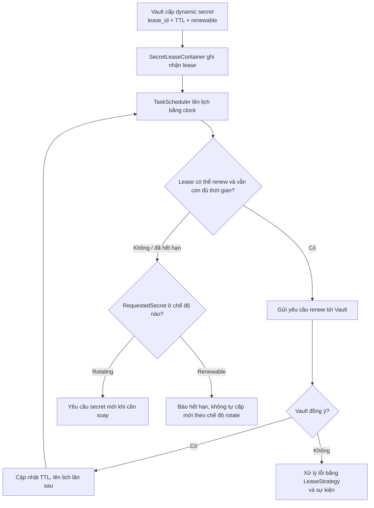
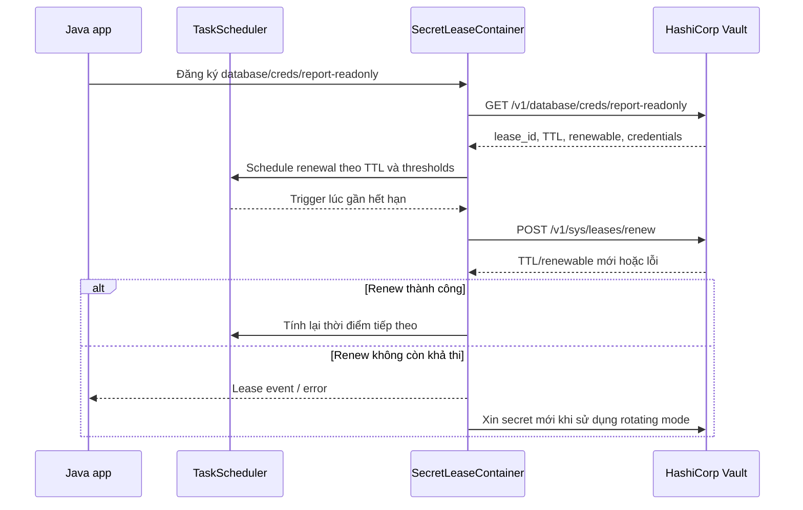

# TaskScheduler, ngưỡng sắp hết hạn và khoảng gia hạn tối thiểu

Trong ứng dụng Java sử dụng **Spring Vault** để lấy credential động từ HashiCorp Vault, thông tin như tên người dùng và mật khẩu database thường chỉ có hiệu lực trong một khoảng thời gian. Vault trả về **lease** với thời gian sống (TTL), khả năng gia hạn và mã định danh `lease_id`. Nếu ứng dụng không quản lý lease, credential có thể bị thu hồi trong khi connection pool vẫn cố sử dụng nó. Nếu gia hạn quá thường xuyên, ứng dụng có thể tạo tải không cần thiết cho Vault.

Chương **Vòng đời lease** tập trung vào ba yếu tố phối hợp trong `SecretLeaseContainer`: **`TaskScheduler`** dùng để lên lịch tác vụ nền, **`expiryThreshold`** xác định khoảng thời gian trước khi lease hết hạn để chủ động xử lý, và **`minRenewal`** tránh việc gia hạn liên tiếp quá sát nhau. Các cơ chế này hỗ trợ dịch vụ Java lấy secret qua `VaultTemplate`, nhưng khác với vòng đời **Vault login token** do `SessionManager` quản lý. Bài còn liên hệ với KV secrets, Transit encryption, PKI, policy, xử lý lỗi và kiểm thử tích hợp.

## 1. Lease là gì và dữ liệu nào cần lập lịch?

Giả sử Vault database secrets engine được mount ở `database`, role `report-readonly` có quyền cấp tài khoản database tạm thời. Ứng dụng truy cập `GET /v1/database/creds/report-readonly` và nhận phản hồi dạng:

```json
{
  "lease_id": "database/creds/report-readonly/example-lease-id",
  "lease_duration": 300,
  "renewable": true,
  "data": {
    "username": "v_demo_reader",
    "password": "fake-secret-for-test-only"
  }
}
```

Các trường có ý nghĩa riêng:

| Trường | Ý nghĩa | Cách ứng dụng sử dụng |
| --- | --- | --- |
| `lease_id` | Định danh lease để gia hạn hoặc thu hồi qua API | Không phải `X-Vault-Token`, không phải tên role |
| `lease_duration` | TTL còn hiệu lực, tính bằng **giây**, tại thời điểm cấp/renew | Cơ sở tính thời điểm cần lập lịch tiếp theo |
| `renewable` | Vault cho biết có thể thử gia hạn lease | `true` không bảo đảm renew vô hạn; còn phụ thuộc max TTL/role/policy |
| `data.username`, `data.password` | Credential động của hệ thống đích | Cần bảo vệ và cập nhật nơi đang sử dụng nếu credential bị thay |

**Lease của secret khác token đăng nhập Vault.** Token được gửi trong `X-Vault-Token` có TTL riêng. Khi token cha hết hạn/bị thu hồi, Vault có thể thu hồi các lease con gắn với token đó. Gia hạn Vault token không đồng nghĩa mọi credential động đã được gia hạn; ngược lại, một lease hợp lệ cũng không thay thế quyền của Vault token dùng để gọi renew/revoke. Ngoài ra, **KV v2 tĩnh** không mặc nhiên có renewable lease; đọc một secret tĩnh qua `VaultTemplate.opsForKeyValue` không biến nó thành dynamic credential.

## 2. Ba thành phần quyết định thời điểm xử lý



| Yếu tố | API Spring Vault | Vai trò |
| --- | --- | --- |
| Bộ lập lịch | `TaskScheduler`; truyền vào constructor hoặc `setTaskScheduler(...)` | Thực thi các lần kiểm tra/gia hạn trên luồng nền |
| Ngưỡng gần hết hạn | `setExpiryThreshold(Duration)` | Đặt khoảng đệm trước thời điểm hết TTL để bắt đầu xử lý |
| Khoảng gia hạn tối thiểu | `setMinRenewal(Duration)` | Ngăn lịch renew được đặt quá thường xuyên |
| Quy tắc khi renew lỗi | `setLeaseStrategy(LeaseStrategy)` | Quyết định giữ hay bỏ lease sau lỗi |
| Đối tượng được quản lý | `RequestedSecret`, `requestRenewableSecret`, `requestRotatingSecret` | Xác định path cần theo dõi và hành vi với secret |

Theo tài liệu Spring Vault hiện hành, `SecretLeaseContainer` có **`expiryThreshold` mặc định 1 phút** và **`minRenewal` mặc định 10 giây**. Khi ghi cấu hình riêng, hai giá trị đều là `Duration` không âm. `TaskScheduler` quyết định clock và khả năng thực thi tác vụ theo thời gian; nó không cấp lease và không tự thay đổi policy Vault.

### `expiryThreshold`: chuẩn bị trước khi hết TTL

Giả sử Vault cấp lease 5 phút lúc 10:00:00, và ứng dụng chọn `expiryThreshold=45s`. Lịch dự kiến có thể hướng đến khoảng **10:04:15**, tức còn 45 giây trước hạn 10:05:00. Nếu renew thành công và Vault trả TTL mới, phải tính lại lịch theo **TTL mới**, không cứ lặp một khoảng cố định từ khi ứng dụng khởi động.

```text
10:00:00                      10:04:15            10:05:00
   |----------------------------|---------------------|
   Nhận lease TTL 300s          Cửa sổ renew         Hạn cũ
                              (còn 45 giây)
```

Đây là **mô hình để hiểu ngưỡng**, không phải cam kết Spring Vault sẽ gửi request chính xác đến mili giây đó. Thời điểm thực tế phụ thuộc bộ lập lịch, `minRenewal`, độ trễ HTTP, TTL thực nhận và tình trạng quá tải. Nếu Vault renew từ chối vì max TTL hoặc role thay đổi, `expiryThreshold` không thể kéo dài tuổi thọ credential.

### `minRenewal`: tránh vòng gia hạn dày đặc

Với lease TTL rất ngắn, đặt `expiryThreshold` lớn hơn TTL có thể khiến hệ thống luôn nhìn thấy lease đang “gần hết hạn”. `minRenewal` giúp giữ một khoảng tối thiểu trước khi thực hiện renew tiếp theo, hạn chế gửi hàng loạt request liên tục.

Ví dụ minh họa:

| TTL ban đầu | Expiry threshold | Min renewal | Điều cần chú ý |
| --- | --- | --- | --- |
| 30 phút | 1 phút | 10 giây | Cửa sổ chuẩn bị rộng, thường ít gây áp lực |
| 5 phút | 45 giây | 10 giây | Có khoảng đệm xử lý lỗi mạng và thử lại hợp lý |
| 30 giây | 1 phút | 10 giây | Threshold lớn hơn TTL; phải kiểm tra lịch thực tế, tránh renew quá sớm hoặc quá dày |
| 8 giây | 5 giây | 10 giây | Lease ngắn hơn min renewal; có nguy cơ hết hạn trước lần xử lý tiếp |

Không có một cặp số áp dụng cho mọi ứng dụng. Nên dựa trên TTL do **Vault thật trả về**, network latency, mức độ quan trọng của credential và giới hạn renew của secrets engine. Với lease cực ngắn, trước tiên xem lại TTL/role của Vault thay vì chỉ hạ `minRenewal` về 0.

## 3. `TaskScheduler` thực sự làm gì?

`TaskScheduler` là interface của Spring Framework, có thể thực thi tác vụ tại một thời điểm được chỉ định. `SecretLeaseContainer` dùng scheduler để lên lịch các công việc renewal/rotation **ở background thread**. Việc chỉ tạo `TaskScheduler` không tự động đăng ký secret hay gửi renew request; cần một container quản lý `RequestedSecret` và khởi chạy lifecycle.

Với ứng dụng Spring, `ThreadPoolTaskScheduler` là lựa chọn dễ cấu hình:

```java
import org.springframework.context.annotation.Bean;
import org.springframework.context.annotation.Configuration;
import org.springframework.scheduling.concurrent.ThreadPoolTaskScheduler;

@Configuration
class LeaseSchedulerConfiguration {

    @Bean("vaultLeaseScheduler")
    ThreadPoolTaskScheduler vaultLeaseScheduler() {
        ThreadPoolTaskScheduler scheduler = new ThreadPoolTaskScheduler();
        scheduler.setPoolSize(2);
        scheduler.setThreadNamePrefix("vault-lease-");
        scheduler.setRemoveOnCancelPolicy(true);
        return scheduler;
    }
}
```

Khi là Spring bean, `ThreadPoolTaskScheduler` được container quản lý khởi tạo và đóng lại theo lifecycle thông thường. Pool size `2` **chỉ là minh họa**: hãy đo số secret đang theo dõi, độ trễ Vault và hoạt động listener để điều chỉnh. Nếu scheduler có một luồng bị chặn bởi HTTP chậm hay một listener nặng, các lease khác có thể được renew muộn.

Một số lưu ý:

- Bộ lập lịch dựa vào **đồng hồ máy chạy ứng dụng**. Sai lệch clock, CPU starvation hoặc máy ngủ làm thay đổi thời điểm kiểm tra lease.
- Không viết listener gọi database chậm hoặc truy vấn API bất đồng bộ không kiểm soát trên chính thread đang renew.
- Không dùng scheduler chung với các batch task kéo dài nếu độ trễ có thể làm trễ renew lease.
- Đặt timeout hữu hạn cho HTTP client gọi Vault; một request treo có thể giữ worker lâu.
- Nhiều instance ứng dụng có thể có lease riêng. Không suy ra hai scheduler trong hai pod cùng quản lý một lease giống nhau trừ khi đã cố ý chia sẻ lease ID.

## 4. Cấu hình `SecretLeaseContainer` bằng Java

Ví dụ dưới đây giả định dự án Spring Vault đã có bean `VaultOperations` được xác thực an toàn qua workload. Container theo dõi dynamic database credentials tại `database/creds/report-readonly`. Sử dụng import theo Spring Vault 3.2+/4.x:

```java
import java.time.Duration;
import org.springframework.beans.factory.annotation.Qualifier;
import org.springframework.context.annotation.Bean;
import org.springframework.context.annotation.Configuration;
import org.springframework.scheduling.TaskScheduler;
import org.springframework.vault.core.VaultOperations;
import org.springframework.vault.core.lease.SecretLeaseContainer;
import org.springframework.vault.core.lease.domain.RequestedSecret;
import org.springframework.vault.core.lease.event.AfterSecretLeaseRenewedEvent;
import org.springframework.vault.core.lease.event.LeaseListenerAdapter;
import org.springframework.vault.core.lease.event.SecretLeaseCreatedEvent;
import org.springframework.vault.core.lease.event.SecretLeaseEvent;
import org.springframework.vault.core.lease.event.SecretLeaseExpiredEvent;
import org.springframework.vault.support.LeaseStrategy;

@Configuration
class DatabaseLeaseConfiguration {

    @Bean
    SecretLeaseContainer databaseSecretLeaseContainer(
            VaultOperations vaultOperations,
            @Qualifier("vaultLeaseScheduler") TaskScheduler scheduler) {

        SecretLeaseContainer container =
                new SecretLeaseContainer(vaultOperations, scheduler);

        container.setExpiryThreshold(Duration.ofSeconds(45));
        container.setMinRenewal(Duration.ofSeconds(10));
        container.setLeaseStrategy(LeaseStrategy.retainOnIoError());

        RequestedSecret requested = container
                .requestRotatingSecret("database/creds/report-readonly");

        container.addLeaseListener(new LeaseListenerAdapter() {
            @Override
            public void onLeaseEvent(SecretLeaseEvent event) {
                if (!requested.equals(event.getSource())) {
                    return;
                }

                if (event instanceof SecretLeaseCreatedEvent) {
                    // Đã nhận secret; chuyển credential qua thành phần quản lý riêng.
                }
                if (event instanceof AfterSecretLeaseRenewedEvent) {
                    // Renewal thành công; ghi metric, không log lease/credential.
                }
                if (event instanceof SecretLeaseExpiredEvent) {
                    // Phát cảnh báo; ngừng dùng credential không còn hiệu lực.
                }
            }
        });

        return container;
    }
}
```

Trong môi trường Spring, `SecretLeaseContainer` implement `SmartLifecycle` và `InitializingBean`; framework quản lý việc initialize/start/stop của bean. **Không tự gọi `afterPropertiesSet()` và `start()` thêm lần nữa** trên bean đã thuộc ApplicationContext. Nếu khởi tạo container thủ công trong một chương trình không dùng Spring lifecycle, cần tự gọi các bước initialize/start và destroy theo hợp đồng API.

Nên gắn listener **trước khi container start** để không bỏ lỡ `SecretLeaseCreatedEvent` đầu tiên. Khi một đường dẫn được đăng ký trùng, container hợp nhất các đăng ký `RequestedSecret` giống nhau; tuy nhiên nếu bạn tạo nhiều container khác nhau cho cùng path, mỗi container có thể yêu cầu và quản lý **lease riêng**.

**Quan trọng khi dùng Spring Cloud Vault:** Starter có thể đã đăng ký `SecretLeaseContainer` qua auto-configuration để quản lý property sources. Không thêm bean thứ hai cho cùng secret khi chưa biết bean nào sở hữu việc renew/rotate. Ví dụ trên dành cho trường hợp bạn chủ động quản lý container riêng; kiểm tra graph bean và cách áp dụng credential trước khi đưa vào ứng dụng thật.

### Renewable khác Rotating

`SecretLeaseContainer` cho hai lựa chọn tiện ích:

```java
RequestedSecret a = container
        .requestRenewableSecret("database/creds/report-readonly");

RequestedSecret b = container
        .requestRotatingSecret("database/creds/report-readonly");
```

Hai lệnh trên là **hai chế độ thay thế để minh họa**, không nên đăng ký cả hai cho cùng ứng dụng rồi kỳ vọng chúng cộng tác để quản lý một lease duy nhất.

| Chế độ | Khi lease còn hợp lệ và renewable | Khi lease hết hạn |
| --- | --- | --- |
| Renewable | Gia hạn khi thích hợp | Phát sự kiện hết hạn; không tự chuyển sang secret mới theo chế độ rotating |
| Rotating | Vẫn thử gia hạn khi có thể | Xin secret mới theo chính sách xoay của container, sau khi xác định hết hạn |

Với dynamic database credentials, rotating thường hữu ích nếu credential không còn renew được sau max TTL. Nhưng **việc nhận credential mới không tự cập nhật mọi kết nối database đang mở**: listener hoặc thành phần `ManagedSecret` phải áp dụng username/password mới vào client/pool và làm mới connection theo phương án phù hợp.

## 5. Cấu hình Spring Cloud Vault bằng YAML

Nếu ứng dụng sử dụng **Spring Cloud Vault Config**, các thuộc tính tương ứng nằm trong `spring.cloud.vault.config.lifecycle`:

```yaml
spring:
  config:
    import: vault://
  cloud:
    vault:
      uri: https://vault.internal.example:8200
      authentication: KUBERNETES
      kubernetes:
        role: reporting-service
        kubernetes-path: kubernetes
      config:
        lifecycle:
          enabled: true
          expiry-threshold: 45s
          min-renewal: 10s
      database:
        enabled: true
        backend: database
        role: report-readonly
```

Giải thích:

| Property | Áp dụng cho | Vai trò |
| --- | --- | --- |
| `spring.cloud.vault.config.lifecycle.enabled` | Lifecycle secret/property sources | Cho phép quản lý lease và rotation; thường bật theo mặc định |
| `spring.cloud.vault.config.lifecycle.expiry-threshold` | Secret lease | Gia hạn trước khi TTL hết, tính bằng `Duration` |
| `spring.cloud.vault.config.lifecycle.min-renewal` | Secret lease | Tránh renew quá liên tục |
| `spring.cloud.vault.database.backend` | Database secrets engine | Mount Vault chứa database credential |
| `spring.cloud.vault.database.role` | Database secrets engine | Role cấp credential động |
| `spring.cloud.vault.authentication` | Vault session/login | Chọn workload authentication; ở đây Kubernetes |

Đây là **nhóm thuộc tính riêng cho lease của secret**. `spring.cloud.vault.session.lifecycle.refresh-before-expiry` và `spring.cloud.vault.session.lifecycle.expiry-threshold` thuộc vòng đời **Vault login token**, không phải cấu hình đồng nghĩa với `config.lifecycle.*`. Không dùng nhầm một nhóm để điều chỉnh nhóm kia.

Việc property source cập nhật credential trong Spring Environment cũng không tự bảo đảm mọi bean hoặc connection pool được cấu hình lại. Kiểm tra khả năng làm mới của client cụ thể, ví dụ HikariCP hoặc datasource có hỗ trợ thay credential ở runtime, trước khi tuyên bố rotation hoạt động end-to-end.

Tùy phiên bản Spring Cloud Vault, `config.lifecycle.lease-strategy` cũng được công bố để chọn cách xử lý renew lỗi. Hãy đối chiếu phiên bản thư viện được resolve; không tự đặt property mới theo Java method khi nhánh Spring Cloud Vault đang chạy chưa hỗ trợ binding.

## 6. Cách scheduler phối hợp với Vault renewal API

Một vòng đời dynamic lease tiêu biểu:



Với Vault hiện đại, endpoint gia hạn lease thường là `POST /v1/sys/leases/renew`; tên endpoint thực tế Spring Vault sử dụng được trừu tượng qua `LeaseEndpoints` để tương thích các phiên bản Vault. Ví dụ request HTTP để hiểu dữ liệu, không nên tự dựng thủ công khi `SecretLeaseContainer` đã quản lý:

```http
POST /v1/sys/leases/renew HTTP/1.1
Host: vault.internal.example:8200
X-Vault-Token: <VALID_VAULT_CLIENT_TOKEN>
Content-Type: application/json

{
  "lease_id": "database/creds/report-readonly/example-lease-id",
  "increment": "60s"
}
```

Vault có quyền cấp thời gian gia hạn **ngắn hơn yêu cầu**, từ chối renew hoặc chỉ cho lease sống đến max TTL. Trong test, không được giả định `increment=60s` sẽ chắc chắn trả TTL 60 giây. Khi lease không renewable, không có `lease_id` hoặc hết hạn, ứng dụng phải chuyển sang chiến lược thích hợp; đổi `expiryThreshold` không thể làm lease không renewable trở thành renewable.

**Tương tác với token:** Vault dùng token hiện tại để xác minh quyền thực hiện renew; token hết hiệu lực có thể khiến renew thất bại, đồng thời lease gắn với token có thể bị thu hồi. Với các ứng dụng chạy dài hạn, cần phối hợp `SessionManager`/token re-login và cơ chế lease restart. Spring Vault có các authentication listeners trên `SecretLeaseContainer` từ các phiên bản tương ứng để kết nối với sự kiện login token; không nên tự giả định cứ login lại là lease cũ sống tiếp.

## 7. Khi gia hạn thất bại: đừng tăng tốc scheduler vô hạn

`LeaseStrategy` cho phép `SecretLeaseContainer` quyết định **giữ hay bỏ** thông tin lease sau khi gặp lỗi:

```java
container.setLeaseStrategy(LeaseStrategy.dropOnError());
container.setLeaseStrategy(LeaseStrategy.retainOnError());
container.setLeaseStrategy(LeaseStrategy.retainOnIoError());
```

Các dòng trên biểu diễn **ba phương án để lựa chọn**, không gọi cả ba liên tiếp trong cấu hình thật. `retainOnIoError()` thường là hướng cân nhắc khi muốn giữ lease sau lỗi mạng tạm thời nhưng loại bỏ theo chính sách với lỗi khác; quyết định cuối cùng phụ thuộc loại credential và độ nhạy của ứng dụng.

| Trường hợp | Dấu hiệu | Cách xử lý đáng cân nhắc |
| --- | --- | --- |
| Vault renew thành công | Trả TTL mới | Cập nhật lịch, tiếp tục dùng credential |
| Timeout hoặc I/O tạm thời | Request không đến Vault hoặc mất response | Giữ trạng thái một cách có kiểm soát nếu lease chưa thực sự hết hạn; retry có giới hạn |
| Vault trả `403` | Token thiếu quyền, token bị revoke hoặc lease không hợp lệ | Phân loại token/session, policy và lease; không retry vô hạn |
| Lease hết max TTL | Vault không cho tăng TTL thêm | Chuyển sang rotation nếu cần credential mới |
| Lease không renewable | `renewable=false` | Không lặp renew; dùng chiến lược rotate hoặc cấp mới qua cơ chế riêng |
| Scheduler bị chặn/đồng hồ lệch | Không có renew trước hạn dù Vault khỏe | Kiểm tra pool, clock, queue latency, HTTP timeout |
| Ứng dụng shutdown | `destroy`/lifecycle dừng container | Xác minh việc revoke theo hợp đồng Spring Vault và cách giải phóng tài nguyên |

`LeaseStrategy` quyết định xử lý sau **lỗi renew** chứ không biến một lease đã bị Vault thu hồi thành hợp lệ. Với credential dùng để truy cập database production, phải có phương án không sử dụng credential đã hết hạn ngay cả khi cấu hình giữ lease trong bộ nhớ.

Các lease events có thể được phát ra trên **thread khởi động container** hoặc thread nền. Không in toàn bộ đối tượng event vì có thể chứa bí mật hoặc metadata nhạy cảm. Thay vào đó, theo dõi tên auth method, loại engine, loại event, độ trễ và số lần lỗi đã được kiểm duyệt.

## 8. Theo dõi `SecretLeaseEvent` và cập nhật tài nguyên

Những loại sự kiện quan trọng:

| Sự kiện | Khi nào xuất hiện | Hành động ứng dụng |
| --- | --- | --- |
| `SecretLeaseCreatedEvent` | Đã lấy secret và (nếu có) lease mới | Cài credential vào client an toàn; không log password |
| `AfterSecretLeaseRenewedEvent` | Lease renew thành công | Cập nhật metric TTL và trạng thái |
| `SecretLeaseExpiredEvent` | Container xác định lease hết hạn theo TTL/predicate | Ngừng dùng credential cũ, chuyển trạng thái unhealthy nếu cần |
| `SecretLeaseRotatedEvent` | Đã lấy secret mới trong luồng rotating | Thay credential ở nơi dùng; làm mới connection cần thiết |
| `SecretLeaseErrorEvent` | Lỗi Vault hoặc I/O khi làm việc với lease | Phát metric/cảnh báo, phân loại nguyên nhân |
| `SecretNotFoundEvent` | Không tìm được secret ở path đã đăng ký | Kiểm tra path/mount/role/policy |

Với database connection pool, listener nhận `SecretLeaseRotatedEvent` mới chỉ là **tín hiệu**. Việc đổi `username/password` cho DataSource không đảm bảo các kết nối cũ đã dùng credential cũ được thay thế hoặc kết nối đang mở không bị cắt khi tài khoản hết hạn. Cần kiểm tra behavior của driver/pool, có thể yêu cầu tái tạo pool hoặc cơ chế credential rotation chuyên dụng.

Với KV v2 tĩnh, không nên dùng event renewal để suy ra có bản secret mới; KV v2 version metadata và cập nhật secrets là câu chuyện khác. Với Transit encryption, ciphertext không có lease tự động gia hạn. PKI certificate có **thời điểm hết hạn X.509** riêng; các phiên bản Spring Vault mới có `CertificateContainer` để quản lý certificate re-issuance, không thể thay thế mọi tình huống PKI bằng secret lease renewal.

## 9. Những phép thử cần làm

### Kiểm thử thông số không cần Vault thật

Đối với cấu hình Java, có thể xác minh các giá trị set trên container:

```java
import static org.junit.jupiter.api.Assertions.assertEquals;
import static org.mockito.Mockito.mock;
import java.time.Duration;
import org.junit.jupiter.api.Test;
import org.springframework.vault.core.VaultOperations;
import org.springframework.vault.core.lease.SecretLeaseContainer;

class LeaseTuningTest {

    @Test
    void appliesExpiryAndRenewalDurations() {
        VaultOperations vaultOperations = mock(VaultOperations.class);
        SecretLeaseContainer container = new SecretLeaseContainer(vaultOperations);
        container.setExpiryThreshold(Duration.ofSeconds(45));
        container.setMinRenewal(Duration.ofSeconds(10));

        assertEquals(Duration.ofSeconds(45), container.getExpiryThreshold());
        assertEquals(Duration.ofSeconds(10), container.getMinRenewal());
    }
}
```

Đoạn test dùng JUnit 5 và Mockito, chỉ kiểm tra giá trị cấu hình. Nó không chứng minh scheduler gửi HTTP request đúng hạn. Để kiểm thử hành vi cần fake HTTP server và scheduler/clock có thể kiểm soát.

### HTTP contract test và integration test

Một fake Vault HTTP server có thể cung cấp chuỗi đáp ứng sau:

```text
GET  /v1/database/creds/report-readonly -> lease_id=A, TTL=300, renewable=true
POST /v1/sys/leases/renew                -> lease_id=A, TTL=120, renewable=true
POST /v1/sys/leases/renew                -> 403, lease không còn gia hạn được
GET  /v1/database/creds/report-readonly -> lease_id=B, TTL=300, credential mới
```

Hãy dùng lịch thử nghiệm **thực sự điều khiển thời gian** hoặc giới hạn chờ hợp lý để xác nhận số lần gọi, thứ tự request và sự kiện lease. Mock `VaultOperations` trả sẵn secret không xác minh đúng thời điểm `TaskScheduler` kích hoạt.

| Kịch bản | Điều cần xác nhận |
| --- | --- |
| TTL dài hơn expiry threshold | Renew xảy ra trước hạn với khoảng đệm mong muốn |
| TTL ngắn hơn expiry threshold | Không lập lịch renew dày đặc; xử lý đúng ngưỡng min renewal |
| Renew trả TTL khác kỳ vọng | Tính lịch sau theo TTL **Vault thực trả** |
| `renewable=false` | Không thực hiện chuỗi renew vô hạn |
| Renewal bị `403` | Error event/LeaseStrategy hoạt động; không âm thầm sử dụng credential chết |
| Network timeout | Scheduler không bị khóa vô hạn; hoạt động phục hồi có giới hạn |
| Rotating mode | Secret B được yêu cầu khi A hết hạn; downstream nhận credential mới |
| Nhiều requested secrets | Một job trễ không kéo các lease khác qua hạn |
| Token gốc bị revoke | Hệ thống nhận biết token/session mới và xử lý các lease con thích hợp |
| Shutdown | Dừng tác vụ nền và thu hồi lease theo contract, không giữ thread chạy mãi |

Với Vault integration test cô lập, cấu hình một database secrets engine thật hoặc môi trường thử nghiệm tương đương, đặt TTL phù hợp, dùng policy chỉ đủ quyền lấy/renew/revoke credential. Quan sát lease expiration, tác động lên database user và khả năng tạo lại kết nối sau rotation. Không dùng credential hay database production trong test, và luôn dọn lease, token, role và tài nguyên test.

## 10. Cách chọn threshold trong vận hành

Một cách ra quyết định thực tế:

1. **Đo TTL được Vault cấp** theo từng engine/role; đừng suy từ cấu hình role vì Vault có thể áp dụng giới hạn thấp hơn.
2. **Đo thời gian renew** ở p95/p99 và độ trễ scheduler dưới tải, kể cả lúc Vault bị chậm.
3. **Chọn expiry threshold** lớn hơn ngân sách cho network latency, scheduler drift và một số lần xử lý lỗi được phép; đồng thời nhỏ hơn TTL thường thấy để tránh renew ngay khi vừa cấp.
4. **Chọn min renewal** đủ lớn để ngăn vòng renew liên tục; nếu TTL chỉ vài giây, ưu tiên thay đổi cấu hình TTL tại Vault.
5. **Xem lại chính sách rotation:** credential không renewable hoặc hết max TTL cần được cấp mới, và downstream phải nhận giá trị mới.
6. **Theo dõi số liệu** sau rollout; điều chỉnh dựa trên renew success rate, số request/giây, late renew và mức độ sẵn sàng của ứng dụng.

Metric hữu ích gồm số lease active, renew attempts/success/failure theo engine, thời gian còn lại lúc renew, scheduler execution delay, rotating events, database authentication failures và số lần re-login Vault token. Không dùng `lease_id`, Vault token hoặc username/password thực làm label metric vì có thể tiết lộ bí mật và gây cardinality lớn.

Khi một lease đến hạn mà tác vụ chạy trễ, lý do có thể là pool quá nhỏ, listener chạy lâu, CPU thiếu, clock drift, kết nối Vault lỗi hoặc thời gian renew của chính Vault. **Không mặc định tăng `expiryThreshold`** sẽ giải quyết mọi trường hợp; trước tiên xác định độ trễ nằm ở đâu.

## 11. Bài thực hành

**Bối cảnh:** dịch vụ Java lấy database credentials từ `database/creds/report-readonly`. Vault cấp lease TTL 5 phút, `renewable=true`. Ứng dụng dùng Spring Cloud Vault hoặc Spring Vault Core với `SecretLeaseContainer`, và đôi lúc Vault trả chậm 2–5 giây.

1. Giải thích khác nhau giữa `TaskScheduler`, `expiryThreshold` và `minRenewal`; vì sao ba thành phần này không thay thế nhau.
2. Cấu hình `expiryThreshold=45s`, `minRenewal=10s`. Đánh dấu cửa sổ gia hạn dự kiến trên timeline TTL 5 phút, ghi rõ vì sao đây chỉ là ước lượng.
3. Tạo `ThreadPoolTaskScheduler` riêng, thêm `SecretLeaseContainer` ở rotating mode; đăng ký listener trước khi lifecycle start.
4. Tạo fixture lease A, renew thành công, renew bị từ chối và lease B; xác minh scheduler, event và ứng dụng đổi credential khi quay vòng.
5. Đặt TTL 8 giây trong test để quan sát tương tác với `minRenewal=10s`; đề xuất cách sửa ở Vault role hoặc cấu hình ứng dụng.
6. Thu hồi Vault login token gốc trong môi trường thử nghiệm, kiểm tra các lease phụ thuộc và khôi phục qua workflow auth/token lifecycle phù hợp.
7. Ghi metric thành công/thất bại và độ trễ renew, tránh lộ `lease_id`, Vault token hoặc database password.

**Tiêu chí hoàn thành:** học viên cấu hình đúng `TaskScheduler`/lease thresholds, phân biệt renew và rotate, biết vì sao renew không bảo đảm thành công, phát hiện được scheduler bị trễ và kiểm thử được hành vi khi credential cần được thay mới.

## Tài liệu tham khảo

- Spring Vault — [Credential Rotation, TTL Tuning và SecretLeaseContainer](https://docs.spring.io/spring-vault/reference/vault/credential-rotation.html).
- Spring Vault — [SecretLeaseContainer JavaDoc](https://docs.spring.io/spring-vault/reference/api/java/org/springframework/vault/core/lease/SecretLeaseContainer.html).
- Spring Vault — [LeaseStrategy JavaDoc](https://docs.spring.io/spring-vault/reference/api/java/org/springframework/vault/support/LeaseStrategy.html).
- Spring Cloud Vault — [Application Properties: config.lifecycle](https://docs.spring.io/spring-cloud-vault/reference/appendix.html).
- HashiCorp Vault — [Lease, Renew, Revoke](https://developer.hashicorp.com/vault/docs/concepts/lease).
- HashiCorp Vault — [System Lease API](https://developer.hashicorp.com/vault/api-docs/system/leases).
