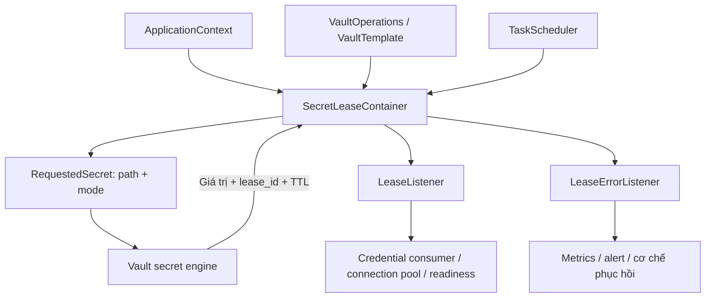
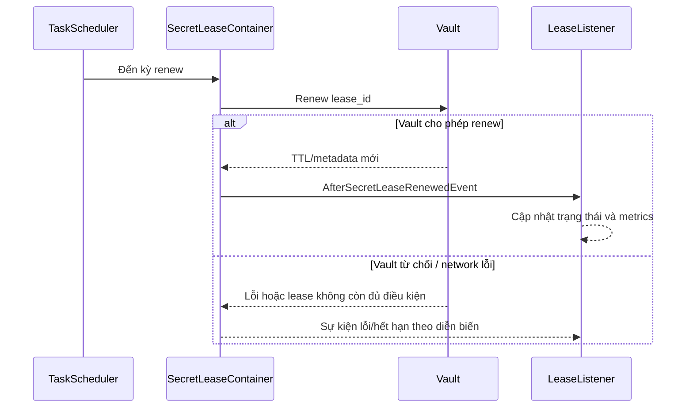
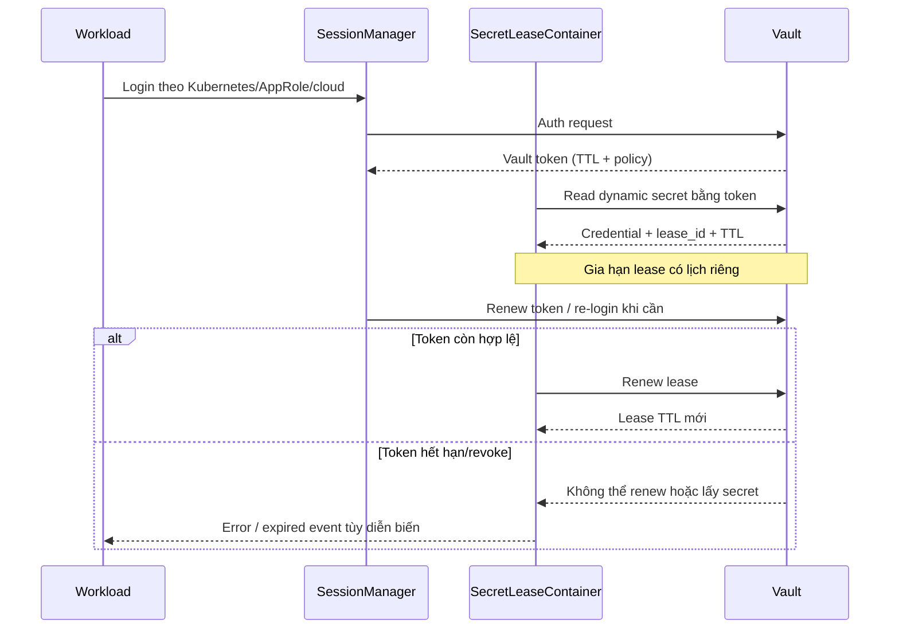
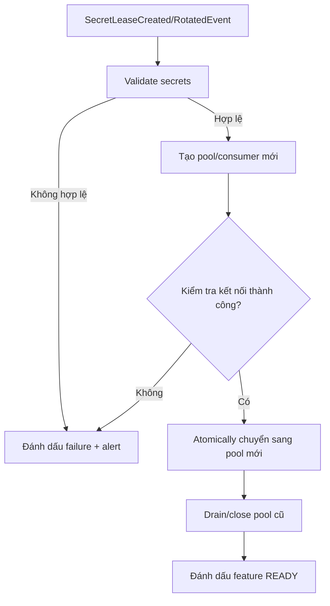

# LeaseListener và các sự kiện tạo, gia hạn, hết hạn

Trong **SPRING_VAULT**, ứng dụng Java dùng `VaultTemplate`/`VaultOperations` để lấy secret từ HashiCorp Vault. Một số secret, đặc biệt là **database credentials động**, được Vault cấp kèm **lease** và thời hạn sử dụng. Khi thời gian trôi qua, lease có thể được **renew** (gia hạn), **expire** (hết hạn), **revoke** (thu hồi) hoặc ứng dụng phải **rotate** (nhận bộ credential mới). Nếu client chỉ đọc secret một lần rồi giữ mãi trong connection pool, các request sau có thể tiếp tục dùng credential đã mất hiệu lực.

Spring Vault cung cấp `SecretLeaseContainer` để theo dõi những secret đã đăng ký, lên lịch gia hạn và phát sự kiện cho `LeaseListener`. Bài thuộc chương **Vòng đời lease**, tập trung vào ý nghĩa và thứ tự quan sát các sự kiện **tạo, gia hạn, hết hạn**, đồng thời giải thích sự kiện rotation, revocation và lỗi liên quan. Các ví dụ cho thấy cách xử lý credential an toàn và kiểm thử tích hợp trong ứng dụng Java; KV secrets tĩnh, Transit encryption và PKI được nhắc đến để phân biệt đúng phạm vi của lease.

## 1. Phân biệt token, secret và lease trước khi đăng ký listener

Ba đối tượng có vòng đời khác nhau:

| Đối tượng | Dữ liệu điển hình | Được quản lý bởi | Lưu ý |
| --- | --- | --- | --- |
| **Vault token** | Token do Kubernetes/AppRole/cloud auth cấp, có policy và TTL | `ClientAuthentication`, `SessionManager` và Vault auth/token backend | Token có thể còn sống nhưng không có quyền đọc đúng path; token hết hạn hoặc revoke có thể khiến lease liên quan bị ảnh hưởng |
| **Secret có lease** | Username/password tạm cho database, token tạm của backend khác | Vault secrets engine; phía Spring có thể theo dõi bằng `SecretLeaseContainer` | Credential có `lease_id`, TTL, `renewable` và phạm vi thu hồi riêng |
| **Secret tĩnh** | KV v2 chứa cấu hình, API key do đội vận hành cập nhật | KV engine và quy trình quản lý rotation của ứng dụng | KV v2 có version nhưng bản thân một lần đọc **không tự tạo lease động** |
| **Transit encryption** | Mã hóa/giải mã dữ liệu qua Vault Transit key | Transit engine và Vault policy | Ciphertext không phải dynamic secret lease chỉ vì API trả thành công |
| **PKI certificate** | Chứng chỉ X.509 có `notBefore`/`notAfter` | PKI engine, quy trình cấp mới/rotate chứng chỉ | TTL certificate và lease không hoàn toàn tương đương; nên dùng cơ chế quản lý chứng chỉ phù hợp khi cert không gắn lease |

Ví dụ khi đọc secret động tại `database/creds/orders-readonly`, phản hồi Vault có thể chứa metadata tương tự:

```json
{
  "request_id": "demo-request-id",
  "lease_id": "database/creds/orders-readonly/unique-lease",
  "renewable": true,
  "lease_duration": 900,
  "data": {
    "username": "v-orders-readonly-xxxx",
    "password": "<redacted>"
  }
}
```

Đây là response **minh họa**, không dùng làm credential thật. `lease_duration: 900` nghĩa là Vault cấp TTL ban đầu khoảng **900 giây**; sau đó TTL giảm dần. `renewable: true` cho biết lease có thể đủ điều kiện gia hạn, không bảo đảm được renew mãi: còn giới hạn max TTL, policy, token/session và trạng thái secrets engine.

Cần nhớ: **LeaseListener nhận sự kiện của lease mà client đang theo dõi**, không phải hệ thống thông báo toàn cục về mọi lease trong Vault. Vault **không push** sự kiện hết hạn tới ứng dụng thông qua listener; `SecretLeaseContainer` tính toán thời điểm và tương tác với Vault để phát hiện tình trạng. Vì vậy `SecretLeaseExpiredEvent` có thể đến **sau** thời điểm lease thực sự hết hạn.

## 2. SecretLeaseContainer và đường đi sự kiện

`SecretLeaseContainer` là thành phần quản lý `RequestedSecret` và lease gắn với từng secret. Nó sử dụng `VaultOperations` để đọc secret hoặc gọi renew/revoke, và `TaskScheduler` để thực hiện công việc theo thời gian. Container là thành phần có vòng đời Spring (`SmartLifecycle` ở các phiên bản hiện hành), có thể khởi động/dừng cùng `ApplicationContext`.



Trình tự tổng quát:

1. **Đăng ký**: tạo `RequestedSecret` với path và mode `renewable` hoặc `rotating`, sau đó gắn các listener trước khi container bắt đầu.
2. **Khởi chạy**: container yêu cầu secret từ Vault, lưu metadata lease và phát sự kiện tạo khi lấy được dữ liệu.
3. **Trong thời gian còn hiệu lực**: container tính lịch nền, tìm cách renew lease nếu phù hợp; renew thành công dẫn tới sự kiện gia hạn.
4. **Khi không thể renew hoặc đến giới hạn**: container quan sát lease đã hết hạn; với chế độ rotation, nó có thể yêu cầu secret mới rồi phát sự kiện đã xoay vòng.
5. **Khi thao tác lỗi**: callback lỗi nhận thông tin về yêu cầu thất bại; ứng dụng phải quyết định readiness, retry hoặc dừng chức năng phụ thuộc secret.
6. **Khi dừng**: container ngừng quản lý lịch, có thể revoke lease đang sở hữu theo hợp đồng lifecycle và phiên bản đang sử dụng.

Các event callback có thể được dispatch trên **thread đang start container** hoặc **background worker thread** của scheduler. Do đó listener không nên thực hiện I/O chậm, sleep vô hạn hay xử lý nặng trực tiếp trong callback.

### Hai chế độ RequestedSecret

| Cấu hình | Ý nghĩa | Sau khi lease hết hạn |
| --- | --- | --- |
| `requestRenewableSecret("database/creds/orders-readonly")` | Theo dõi secret có lease và gia hạn khi còn đủ điều kiện | Secret cũ không còn được coi là hợp lệ; đừng mặc định tự động có credential mới |
| `requestRotatingSecret("database/creds/orders-readonly")` | Gia hạn lease trong khi được phép, sau đó lấy secret **mới** khi đến lúc rotate | Có thể nhận `SecretLeaseRotatedEvent` kèm secret mới; consumer phải thay credential đang dùng |

Trong cả hai chế độ, gia hạn hay rotation thực tế vẫn phụ thuộc Vault, thời gian và quyền của token đang sử dụng. Đăng ký cùng một `RequestedSecret` nhiều lần trong cùng container được quản lý như một yêu cầu duy nhất; không tạo nhiều lịch độc lập chỉ vì có nhiều listener.

**Lưu ý về thời điểm đăng ký:** đặt listener **trước khi** container `start()`; listener được thêm sau startup có thể bỏ lỡ sự kiện tạo đầu tiên. Với Spring IoC, đăng ký `RequestedSecret` và listener ngay trong phương thức khởi tạo bean container trước khi trả bean về context.

## 3. LeaseListener là gì?

Giao diện chính của Spring Vault có dạng:

```java
package org.springframework.vault.core.lease.event;

@FunctionalInterface
public interface LeaseListener {
    void onLeaseEvent(SecretLeaseEvent leaseEvent);
}
```

`SecretLeaseEvent` là lớp cha chứa **nguồn** `RequestedSecret` và tham chiếu `Lease` (một số loại sự kiện có thể không có lease). Listener được phép lọc theo `event.getSource()` trước khi phân loại loại sự kiện.

```java
import org.springframework.vault.core.lease.domain.RequestedSecret;
import org.springframework.vault.core.lease.event.LeaseListener;
import org.springframework.vault.core.lease.event.SecretLeaseEvent;

RequestedSecret requested = RequestedSecret.rotating("database/creds/orders-readonly");

LeaseListener listener = (SecretLeaseEvent event) -> {
    if (!requested.equals(event.getSource())) {
        return;
    }
    // Chỉ xử lý các sự kiện thuộc requested secret này.
};
```

`LeaseListenerAdapter` cung cấp implementation rỗng cho cả `LeaseListener` và `LeaseErrorListener`, hữu ích khi bạn muốn override từng callback trong một lớp kế thừa. Có thể dùng lambda cho `LeaseListener` khi chỉ xử lý sự kiện bình thường.

Đừng dùng `event.toString()` để log tùy tiện: một số event, nhất là `SecretLeaseCreatedEvent`, chứa `Map` có username/password hoặc dữ liệu nhạy cảm. Để quan sát, log **loại event**, đường dẫn đã được kiểm soát, trạng thái xử lý và correlation ID; tránh log raw secrets hoặc lease ID nếu hệ thống không cần.

## 4. Các loại sự kiện và hành vi chính xác

| Event Spring Vault | Khi phát | Thông tin quan trọng | Hành vi nên triển khai |
| --- | --- | --- | --- |
| `SecretLeaseCreatedEvent` | Đã lấy secret và metadata lease | `getSource()`, `getLease()`, `getSecrets()` | Khởi tạo consumer hoặc cập nhật thông tin credential đầu tiên |
| `AfterSecretLeaseRenewedEvent` | Renew lease thành công | Lease đã được cập nhật | Cập nhật health/expiry metric, **không giả định credential đổi** |
| `SecretLeaseExpiredEvent` | Container **quan sát** lease đã hết hạn | Lease cũ có thể sắp hoặc đã mất hiệu lực | Đánh dấu credential cũ không đáng tin cậy, xử lý dependency và readiness |
| `SecretLeaseRotatedEvent` | Đã xoay vòng lấy secret mới | Là **subclass của `SecretLeaseCreatedEvent`**, chứa secret mới | Thay credential trong consumer, thiết lập kết nối mới và ngừng dùng pool cũ |
| `BeforeSecretLeaseRevocationEvent` | Trước khi container kích hoạt revoke | Lease sắp bị thu hồi | Chuẩn bị ngừng sử dụng credential liên quan |
| `AfterSecretLeaseRevocationEvent` | Sau khi revoke thành công | Lease bị thu hồi | Hoàn tất cleanup/ghi nhận trạng thái |
| `SecretNotFoundEvent` | Đã thử đọc secret nhưng không tìm thấy | `RequestedSecret` tương ứng | Báo thiếu secret, kiểm tra mount/path/role; không báo READY giả |
| `SecretLeaseErrorEvent` | Có lỗi khi đọc, renew, rotate hoặc revoke | Thông tin về lỗi và requested secret | Xử lý qua `LeaseErrorListener`, metrics/alert/retry theo chính sách |

### 4.1. Sự kiện tạo — SecretLeaseCreatedEvent

Tại lần fetch đầu tiên, container nhận dữ liệu từ Vault và phát `SecretLeaseCreatedEvent`. Event có `getSecrets()` trả về `Map<String, Object>`. Đối với database engine, những key phổ biến có thể là `username` và `password`.

Phản ứng an toàn của consumer:

- Kiểm tra dữ liệu đã nhận **đủ field và đúng kiểu**, tránh NPE hoặc nhận secret trống.
- Đưa credential vào cơ chế tiêu thụ phù hợp với chính sách bảo mật; **không** in secret ra log.
- Nếu credential để tạo JDBC connection pool, cấu hình pool mới hoặc quy trình chuyển đổi có kiểm soát; một pool đang giữ connection cũ có thể cần được thay/tái tạo.
- Chỉ báo tính năng sử dụng secret là `READY` sau khi đã xác minh consumer có thể thực sự hoạt động, không chỉ sau khi nhận event.

`SecretLeaseRotatedEvent` **kế thừa** `SecretLeaseCreatedEvent`, nên khi phân nhánh Java cần xét `rotated` **trước** `created` để không xử lý một sự kiện rotation hai lần hoặc phân loại sai.

### 4.2. Sự kiện gia hạn — AfterSecretLeaseRenewedEvent

`AfterSecretLeaseRenewedEvent` được phát **sau khi** Vault chấp nhận renew. Lease khi đó tiếp tục có hiệu lực theo TTL được cập nhật; consumer thường có thể giữ credential cũ và không cần reset pool chỉ vì có sự kiện renew.



Sự kiện gia hạn là **sự kiện về lease**, không phải sự kiện “đã cấp password mới”. Nếu secrets engine có chính sách rotation độc lập, hoặc backend đã revoke credential, không dựa một mình vào việc vừa renew để kết luận mọi kết nối cũ vẫn hợp lệ.

### 4.3. Sự kiện hết hạn — SecretLeaseExpiredEvent

`SecretLeaseExpiredEvent` là tín hiệu **client nhận thấy lease đã hết hạn**, không phải thông điệp server gửi chính xác vào thời điểm TTL trở về 0. Scheduler có thể bị trễ do JVM pause, network, queue, Pod tạm bị treo hoặc các ngưỡng thời gian của container.

Phản ứng phù hợp:

1. Đánh dấu credential/secret liên quan là **không còn đủ tin cậy** để cấp cho tác vụ mới.
2. Ngừng hoặc cô lập operation dựa trên credential cũ nếu tính năng bắt buộc cần lease hợp lệ.
3. Nếu mode là rotating, xử lý quá trình nhận credential mới; chỉ cập nhật trạng thái ready khi consumer áp dụng được.
4. Nếu cần rollback/cleanup resource, tiến hành có kiểm soát nhưng không cho rằng mọi connection đã bị server đóng đúng lúc event phát.
5. Ghi metric/alert có giới hạn và kiểm tra nguyên nhân nếu rotation liên tục thất bại.

**Không dùng sự kiện expiry làm cách duy nhất để ngăn dùng credential hết hạn**. Mốc TTL tại Vault có thể đến trước event. Thiết kế readiness/credential consumer phải xét TTL, failure detection, server rejection và giới hạn an toàn riêng.

## 5. Mã Java: theo dõi đầy đủ tạo, renew, expire và rotate

Ví dụ dùng Spring Framework và Spring Vault core trong ứng dụng Java. Nó tạo `SecretLeaseContainer`, đăng ký một dynamic secret ở chế độ **rotating** và gắn hai callback: sự kiện vòng đời và lỗi. Spring sẽ quản lý lifecycle của bean được tạo.

```java
import java.util.Map;

import org.springframework.beans.factory.annotation.Qualifier;
import org.springframework.context.annotation.Bean;
import org.springframework.context.annotation.Configuration;
import org.springframework.scheduling.TaskScheduler;
import org.springframework.scheduling.concurrent.ThreadPoolTaskScheduler;
import org.springframework.vault.core.VaultOperations;
import org.springframework.vault.core.lease.SecretLeaseContainer;
import org.springframework.vault.core.lease.domain.RequestedSecret;
import org.springframework.vault.core.lease.event.AfterSecretLeaseRenewedEvent;
import org.springframework.vault.core.lease.event.SecretLeaseCreatedEvent;
import org.springframework.vault.core.lease.event.SecretLeaseExpiredEvent;
import org.springframework.vault.core.lease.event.SecretLeaseRotatedEvent;

@Configuration
public class LeaseEventsConfig {

    @Bean(name = "vaultLeaseScheduler")
    ThreadPoolTaskScheduler vaultLeaseScheduler() {
        ThreadPoolTaskScheduler scheduler = new ThreadPoolTaskScheduler();
        scheduler.setPoolSize(2);
        scheduler.setThreadNamePrefix("vault-lease-");
        return scheduler;
    }

    @Bean
    SecretLeaseContainer secretLeaseContainer(
            VaultOperations vaultOperations,
            @Qualifier("vaultLeaseScheduler") TaskScheduler scheduler,
            CredentialConsumer consumer) {

        SecretLeaseContainer container =
                new SecretLeaseContainer(vaultOperations, scheduler);

        RequestedSecret secret =
                container.requestRotatingSecret("database/creds/orders-readonly");

        // Listener được đăng ký TRƯỚC khi container start.
        container.addLeaseListener(event -> {
            if (!secret.equals(event.getSource())) {
                return;
            }

            // Rotated là subclass của Created: kiểm tra trước.
            if (event instanceof SecretLeaseRotatedEvent rotated) {
                consumer.replace(rotated.getSecrets());
            } else if (event instanceof SecretLeaseCreatedEvent created) {
                consumer.replace(created.getSecrets());
            } else if (event instanceof AfterSecretLeaseRenewedEvent) {
                consumer.renewed();
            } else if (event instanceof SecretLeaseExpiredEvent) {
                consumer.expired();
            }
        });

        container.addErrorListener((event, exception) -> {
            if (secret.equals(event.getSource())) {
                // Không log exception message/body nếu có thể chứa credential.
                consumer.error(exception.getClass().getSimpleName());
            }
        });

        // Spring sẽ gọi init và start qua lifecycle của bean.
        return container;
    }

    public interface CredentialConsumer {
        void replace(Map<String, Object> secrets);
        void renewed();
        void expired();
        void error(String errorType);
    }
}
```

Ở ví dụ này, `CredentialConsumer` là **hợp đồng do ứng dụng tự định nghĩa**, chưa có implementation; cần cung cấp một bean thật xử lý connection pool hay tài nguyên cần secret. Nó phải kiểm tra username/password, cấu hình pool mới, kiểm tra kết nối trước khi chuyển luồng, đóng pool cũ có kiểm soát và xử lý lỗi mà không làm lộ credential. **Không** cập nhật JDBC pool bằng cách thay password rồi mặc định mọi connection đã mở sẽ dùng password mới.

Mã sử dụng API `SecretLeaseContainer(VaultOperations, TaskScheduler)`, `requestRotatingSecret(...)`, `addLeaseListener(...)` và `addErrorListener(...)`. Trong một ứng dụng dùng **Spring Cloud Vault**, có thể đã có `SecretLeaseContainer` được auto-configured. Khi đó hãy **tái sử dụng và gắn listener lên container sẵn có** theo cơ chế framework, tránh tạo container trùng quản lý cùng lease.

### Về thứ tự callback và tính an toàn thread

- `SecretLeaseContainer` phát event trên thread gọi `start()` hoặc background worker; callback có thể xử lý **bất đồng bộ với request HTTP nghiệp vụ**.
- Không giữ state mutable không đồng bộ khi cập nhật trạng thái credential giữa listener và service. Dùng một cơ chế chuyển đổi atomically và bảo đảm request nhìn thấy credential version nhất quán.
- Nếu việc thay pool có thể mất thời gian, tách khỏi thread xử lý lease bằng queue/executor có bounded capacity; bảo đảm thứ tự event và loại bỏ bản cập nhật cũ nếu rotation đến nhanh.
- Nếu consumer xử lý `SecretLeaseExpiredEvent` rồi ngay sau đó nhận `SecretLeaseRotatedEvent`, chỉ chuyển `READY` khi secret mới đã được áp dụng và kiểm tra thành công.
- Phân biệt `SecretNotFoundEvent` và lỗi ngoại lệ; trong cả hai trường hợp không cho consumer tiếp tục giả định source credential chắc chắn sẵn sàng.

## 6. Timeline một vòng đời secret động

Giả sử Vault cấp credential cho database với TTL **15 phút**, có thể renew, nhưng lease có giới hạn vòng đời tối đa. Container đăng ký chế độ rotating, ứng dụng sử dụng JDBC pool `ordersReadOnlyPool`.

| Mốc minh họa | Vault và Spring Vault | Sự kiện | Việc consumer nên làm |
| --- | --- | --- | --- |
| **10:00** | Đọc `database/creds/orders-readonly`, nhận credential A/lease A | `SecretLeaseCreatedEvent` | Tạo pool A và xác minh kết nối rồi báo READY |
| **10:10** | Đến lịch renew sớm (mốc giả định), Vault cho gia hạn lease A | `AfterSecretLeaseRenewedEvent` | Ghi nhận TTL mới, giữ pool A nếu credential còn hiệu lực |
| **10:25** | Vault từ chối renew tiếp vì lease đạt giới hạn | Có thể có lỗi và sau đó sự kiện hết hạn | Ngừng phụ thuộc vô điều kiện vào credential A |
| **10:26** | Container quan sát lease A hết hạn | `SecretLeaseExpiredEvent` | Chuyển component trạng thái không sẵn sàng/chuẩn bị thay pool |
| **10:27** | Container lấy credential B/lease B mới | `SecretLeaseRotatedEvent` | Tạo pool B, chuyển giao an toàn, dừng dùng pool A |
| **10:35** | Pod rolling shutdown | Các callback revoke có thể xảy ra | Dừng tác vụ mới và giải phóng connection/resources |

Toàn bộ thời điểm chỉ để hình dung; thời gian thực tế phụ thuộc TTL, expiry threshold, min renewal, độ trễ scheduler, response từ Vault và policy. Không kết luận `ExpiredEvent` chắc chắn đến **trước** `RotatedEvent` trong mọi tình huống lỗi hoặc mọi phiên bản; consumer phải chịu được callback trễ, thất bại hoặc quan sát trạng thái khác thứ tự “đẹp” trong bảng.

## 7. Lịch nền và ngưỡng TTL

Spring Vault tính lịch gia hạn dựa trên lease TTL và đồng hồ của `TaskScheduler`. Các tham số quan trọng:

| Tham số | Ý nghĩa |
| --- | --- |
| `minRenewal` / `minRenewalSeconds` | Tránh quá nhiều request renew liên tiếp nếu lease có TTL quá ngắn |
| `expiryThreshold` / `expiryThresholdSeconds` | Ngưỡng được xét khi quyết định lease đến gần/hết thời hạn để xử lý |
| `setExpiryPredicate(...)` | Cho phép tùy biến tiêu chí quan sát lease hết hạn theo API hỗ trợ |
| `setLeaseStrategy(...)` | Tùy biến chiến lược xử lý lỗi renew lease |
| `TaskScheduler` | Bộ thực thi tác vụ dựa trên thời gian; pool có thể bị chậm/bị nghẽn |

Theo tài liệu Spring Vault **4.1.x**, giá trị mặc định được mô tả cho `expiryThreshold` là **1 phút**, còn `minRenewal` là **10 giây**. Các mặc định và chữ ký API có thể thay đổi theo phiên bản; đối chiếu dependency thực tế trước khi tuning. Ngưỡng không phải cam kết “Vault sẽ phát event đúng phút thứ 14” khi lease được cấp 15 phút.

Trên lease quá ngắn (ví dụ TTL 30 giây), expiry threshold lớn so với TTL có thể khiến container quyết định rotation hoặc expiry sớm hơn ý định. Ngược lại, threshold quá nhỏ có thể làm renew sát thời điểm expiry và bỏ lỡ deadline vì network hoặc GC pause. Cấu hình cần dựa trên TTL của secrets engine, tải Vault, HA và yêu cầu ứng dụng.

Không tùy ý set `TaskScheduler` với pool dùng chung cho tác vụ chậm/blocking khác. Scheduler riêng cho Vault lease sẽ dễ theo dõi latency và shutdown hơn. Retry cũng cần backoff/jitter có giới hạn, tránh hàng chục replica liên tiếp request renew/rotate khi Vault tạm lỗi.

## 8. Token và secret lease tương tác ra sao?

`SecretLeaseContainer` dùng `VaultOperations`, tức là các request lấy/renew/revoke secret **cần Vault token hợp lệ**. Vì thế có hai vòng đời độc lập nhưng phụ thuộc lẫn nhau:



Khi Vault token đã hết TTL hoặc bị revoke, các lease gắn với session token đó có thể bị Vault thu hồi. Renewal token thành công **không tự thay** renewal của từng lease, và renewal lease thành công **không tự gia hạn** Vault token.

Một số phiên bản Spring Vault cung cấp cách lắng nghe sự kiện authentication để khởi động lại quản lý secret sau khi re-login thành công, ví dụ `getAuthenticationListener()`/`getAuthenticationErrorListener()` trên container. Khi dùng cơ chế này, phải **đăng ký listener với session manager** theo hướng dẫn của phiên bản đang sử dụng; chỉ gọi getter không tự nối hai vòng đời. Không tự dựng scheduler thứ hai cạnh tranh với `LifecycleAwareSessionManager`.

### KV, Transit, PKI có cần LeaseListener không?

- **KV v2**: thường là secret tĩnh có version; muốn refresh khi có rotation phải xây nguồn thay đổi/cơ chế đọc lại phù hợp. `SecretLeaseContainer` không phải hệ thống thông báo thay đổi tất cả KV version.
- **Transit**: mã hóa/giải mã qua key trong Vault, không nhận dynamic secret lease cho mỗi ciphertext; cần kiểm soát Vault ACL và vòng đời token.
- **PKI**: chứng chỉ có thời hạn độc lập. Tài liệu Spring Vault mới có `CertificateContainer`/`CertificateListener` để quản lý chứng chỉ; không nên coi mọi chứng chỉ PKI đều dùng `LeaseListener` của database credential.

Những cơ chế này liên quan đến module Spring Vault nhưng cần **owner vòng đời riêng**; dùng một listener cho tất cả có thể khiến ứng dụng nhầm renew token, renew lease và rotate chứng chỉ.

## 9. SecretLeaseErrorEvent và LeaseErrorListener

`LeaseListener` nhận những sự kiện lease thông thường. Lỗi từ tương tác Vault được xử lý chuyên biệt bằng `LeaseErrorListener`:

```java
import org.springframework.vault.core.lease.event.LeaseErrorListener;

LeaseErrorListener errors = (event, exception) -> {
    // Chỉ ví dụ phân loại exception; không in credential hoặc raw body.
    String errorType = exception.getClass().getSimpleName();
    // metrics.increment(errorType);
    // readiness.markDegraded(event.getSource());
};

container.addErrorListener(errors);
```

`container` ở ví dụ là `SecretLeaseContainer` đã cấu hình. Đăng ký error listener **trước khi container start**. Bên trong callback, kiểm tra nguồn `event.getSource()` khi có nhiều requested secret cùng container; không để lỗi của path không liên quan làm toàn ứng dụng `DOWN` nếu tính năng đó có thể hoạt động độc lập.

| Lỗi quan sát | Nguyên nhân có thể | Hành vi |
| --- | --- | --- |
| `403 permission denied` khi đọc secret ban đầu | Vault token thiếu `read` tại path hoặc role sai | Sửa Vault policy/auth role, không retry vô hạn |
| `403` khi renew/revoke lease | Token thiếu capability cần thiết, token bị revoke hoặc lease không đủ điều kiện | Kiểm tra đúng endpoint + TTL + Vault ACL; có thể cần credential mới |
| `404`/`SecretNotFoundEvent` | Secret engine/path không tồn tại hoặc thiếu role cấp dynamic secret | Kiểm tra mount và path, trạng thái role engine; không giả định có lease |
| Timeout/TLS/DNS/Vault `5xx` | Vault, network hoặc truststore gặp sự cố | Retry/backoff có ngân sách; alert nếu kéo dài; readiness theo mức độ phụ thuộc |
| Lease đã hết hạn | Hết TTL/max TTL, renew không thành công hoặc không được phép | Không sử dụng credential cũ; rotating secret nếu mode và backend cho phép |
| Secret mới đã nhận nhưng pool vẫn lỗi | Consumer chưa cập nhật hoặc connection cũ chưa được thay | Kiểm tra chiến lược bàn giao pool và sức khỏe kết nối, tránh leak secret |

Lưu ý `SecretLeaseErrorEvent` mang thông tin về sự kiện lỗi; callback trên `LeaseErrorListener` nhận **cả event và Exception**. Tránh log raw `exception.getMessage()` nếu HTTP client có thể đính kèm payload nhạy cảm. Nên log loại lỗi, phase, mount/path đã được kiểm soát và correlation ID.

## 10. Xử lý thay credential mà không mất an toàn

Khi nhận `SecretLeaseCreatedEvent` hoặc `SecretLeaseRotatedEvent` cho dynamic database credential, có ít nhất bốn trách nhiệm:

1. **Parse và validate**: dữ liệu có `username`, `password` đúng kiểu, không rỗng; secret thuộc requested path mong đợi.
2. **Chuẩn bị consumer mới**: khởi tạo datasource/pool hoặc credential provider mới; giới hạn số kết nối và timeout cho việc kiểm tra.
3. **Chuyển giao atomically**: đưa pool mới vào phục vụ sau khi xác minh connection hoạt động; các request đã nhận pool cũ cần cơ chế drain/close phù hợp.
4. **Xóa bỏ state cũ**: ngừng cấp credential A, đóng pool A, giới hạn tồn tại trong memory; báo trạng thái đã chuyển đổi thành công.



**Không nên** thay password trên đối tượng config rồi coi đó là password của mọi connection đã mở: nhiều JDBC connection vẫn đang được xác thực bằng credential cũ. Với database credentials động, người dùng mới hoặc connection mới có thể bị từ chối sau lease expiry. Nếu cần zero-downtime rotation, phải thiết kế overlap window và điều kiện chuyển giao phù hợp với TTL thực tế, không đợi sự kiện expired đến mới bắt đầu chuẩn bị.

Đối với credential nhạy cảm, tránh xếp các `Map` chứa password trong queue không giới hạn hoặc đưa chúng vào distributed event bus. Nếu phải giao việc qua executor, sử dụng cấu trúc in-memory có giới hạn, kiểm soát quyền đọc, loại bỏ version cũ và không serialize ra logs/traces.

## 11. Giám sát sự kiện và readiness

Một ứng dụng có thể báo JVM **UP** trong khi credential đã hết hạn và kết nối tới database bắt đầu thất bại. Do đó nên theo dõi:

| Nhóm metric | Ví dụ | Ý nghĩa |
| --- | --- | --- |
| **Lifecycle events** | `lease_created_total`, `lease_renewed_total`, `lease_expired_total`, `lease_rotated_total` | Tần suất chuyển trạng thái, phát hiện rotation bất thường |
| **Error events** | `lease_operation_failures_total{phase="renew"}` | Nhận diện lỗi Vault hoặc lỗi cấu hình riêng theo thao tác |
| **Latency/schedule** | Thời gian từ lần renew dự kiến đến lúc hoàn tất | Phát hiện scheduler bị nghẽn hoặc network chậm |
| **Remaining TTL** | Thời hạn còn lại đã được xử lý thành số tổng hợp | Xác định sớm nguy cơ secret mất hiệu lực |
| **Consumer readiness** | `db_pool_credential_ready` bằng 0/1 | Theo dõi credential đã thực sự áp dụng thành công chưa |
| **Session correlation** | Lỗi authentication/re-login khi renew secret | Phân biệt lỗi token với lỗi lease |

Tên metric ở bảng chỉ là **đề xuất của ứng dụng**, không phải tên mặc định được Spring Vault xuất ra.

Nên dùng **readiness** để ngừng nhận request phụ thuộc database nếu không có credential hợp lệ hoặc pool mới không hoạt động. Không gắn liveness trực tiếp vào Vault: Vault outage tạm thời không nên tự động gây vòng lặp restart hàng loạt. Khi chỉ một tính năng cần dynamic credential, trạng thái degraded có thể áp dụng cho riêng tính năng đó.

Không đưa `lease_id`, username/password, full secret path có tenant ID hoặc token vào metric label có cardinality cao; chọn nhãn như logical service, engine type, event type và outcome đã được kiểm soát.

## 12. Kiểm thử LeaseListener và vòng đời lease

Có hai mức kiểm thử hữu ích: **unit test** cho logic xử lý event và **integration test** cho đường đi thật từ Vault đến listener. Không cần chờ TTL production; dùng auth role/lease settings test với TTL ngắn trong Vault cô lập.

| Tình huống | Cách dựng trong môi trường test | Điều cần xác nhận |
| --- | --- | --- |
| Secret được tạo | Tạo database secrets engine test và đăng ký requested path | Có `SecretLeaseCreatedEvent`, consumer nhận đúng dữ liệu và không log secrets |
| Renew thành công | Lease test renewable với TTL ngắn | Nhận `AfterSecretLeaseRenewedEvent` sau renew; không thay credential vô cớ |
| Lease hết hạn | Cấu hình TTL/max TTL ngắn hoặc điều kiện expiry có kiểm soát | Có `SecretLeaseExpiredEvent` khi container quan sát; consumer không tiếp tục dùng credential cũ |
| Rotation | `requestRotatingSecret` và backend cấp credential mới | Nhận `SecretLeaseRotatedEvent`, consumer thay pool và đóng pool cũ |
| 403 khi đọc | Policy test thiếu capability `read` | `LeaseErrorListener` nhận lỗi; trạng thái không READY, không rò rỉ token |
| Vault mất kết nối | Proxy test cắt network trong lúc renew | Quan sát lỗi/backoff, không có vô hạn retry; khôi phục theo chính sách |
| Thiếu path | Đăng ký path không tồn tại | `SecretNotFoundEvent` hoặc lỗi phù hợp theo phản hồi thực tế |
| JWT/token hết hiệu lực | Token test bị revoke trước lần renew | Nhận diện lỗi session; cơ chế auth/re-login không bị nhầm với lỗi JDBC |
| Callback đến muộn | Giữ scheduler bận hoặc giả lập clock/latency trong test | Ứng dụng không đợi event để ngăn credential đã hết TTL |
| Shutdown/revocation | Đóng Spring context khi có lease test đang quản lý | Dừng background tasks, cleanup/revoke phù hợp ownership, không lộ secret |

### Unit test phân loại sự kiện

Với một listener thuần, bạn có thể tạo `RequestedSecret` và các event để kiểm tra branch. Ví dụ cho lớp handler do ứng dụng triển khai:

```java
import static org.junit.jupiter.api.Assertions.assertEquals;
import org.junit.jupiter.api.Test;
import org.springframework.vault.core.lease.domain.RequestedSecret;
import org.springframework.vault.core.lease.event.SecretLeaseEvent;
import org.springframework.vault.core.lease.event.SecretLeaseExpiredEvent;
import org.springframework.vault.core.lease.domain.Lease;

// Giả sử LeaseEventClassifier là lớp do ứng dụng triển khai.
class LeaseEventClassifierTest {

    @Test
    void expiredEventMustBeClassifiedAsExpired() {
        RequestedSecret request =
            RequestedSecret.rotating("database/creds/orders-readonly");

        // Tạo Lease fixture theo factory/constructor của Spring Vault version dùng trong test.
        Lease lease = testLeaseFixture();

        SecretLeaseEvent event = new SecretLeaseExpiredEvent(request, lease);
        assertEquals("EXPIRED", LeaseEventClassifier.classify(event));
    }
}
```

Đây là **test sketch**: `testLeaseFixture()` và `LeaseEventClassifier` là thành phần do ứng dụng/test fixture cung cấp; cần hoàn thiện theo Spring Vault version thực tế trước khi chạy. Nó dùng để kiểm tra hành vi phân loại của code tự viết, **không** thay thế integration test chứng minh scheduler, Vault renewal và event dispatch thực sự hoạt động.

Với integration test, token quản trị Vault dev chỉ dùng để dựng fixture; ứng dụng phải chạy bằng token/auth role ít quyền, cấp đúng các capability cần thiết. Không kết nối tới database sản xuất hoặc dùng secrets thật. Test expiry cần deadline và khoảng dao động scheduler đủ rộng; đừng kiểm tra sự kiện phải phát đúng tuyệt đối tại mili-giây hết TTL.

## 13. Những lỗi thiết kế cần tránh

1. **Đọc secret bằng `VaultTemplate.read(...)` rồi giả định nó tự đăng ký lease.** Phải sử dụng cơ chế đăng ký `RequestedSecret`/container hoặc abstraction tương ứng.
2. **Đăng ký listener quá muộn.** Có thể bỏ lỡ `SecretLeaseCreatedEvent` đầu tiên vì container đã start.
3. **Nhầm `AfterSecretLeaseRenewedEvent` với rotation.** Renew TTL thành công không đồng nghĩa username/password được thay.
4. **Chờ `SecretLeaseExpiredEvent` mới ngừng sử dụng secret.** Event có thể đến sau TTL thực tế.
5. **Xử lý `SecretLeaseRotatedEvent` như một created event khác và xử lý hai lần.** Vì rotated là subclass của created, xét rotated trước.
6. **Không gắn `LeaseErrorListener`.** Chỉ lắng nghe thành công sẽ bỏ qua lỗi read/renew/revoke/rotate quan trọng.
7. **Giữ credential trong pool mãi.** Connection đã mở có thể tiếp tục dùng thông tin xác thực cũ và fail sau rotation.
8. **Log `event.getSecrets()` hoặc full exception.** Làm lộ username/password, token hoặc payload nhạy cảm.
9. **Dùng một container trùng lặp trên cùng lease không có owner rõ ràng.** Hai thành phần cạnh tranh renew/revoke làm khó điều tra sự cố.
10. **Dùng LeaseListener để quản lý mọi loại secret.** KV static, Transit key và chứng chỉ PKI có vòng đời và abstraction riêng.

## 14. Câu hỏi tự kiểm tra

**Câu 1.** Nếu Vault trả dynamic database credentials với TTL 15 phút, ứng dụng chỉ đọc qua `VaultTemplate` rồi cache vĩnh viễn, điều gì có thể xảy ra?  
**Trả lời:** Credential có thể hết hạn hoặc bị revoke dù ứng dụng vẫn chạy. Phải thiết kế lease renewal/rotation và cập nhật consumer.

**Câu 2.** `AfterSecretLeaseRenewedEvent` chứng minh điều gì?  
**Trả lời:** Lease liên quan vừa được Vault gia hạn thành công; **không** chứng minh có username/password mới.

**Câu 3.** Vì sao `SecretLeaseExpiredEvent` có thể đến muộn?  
**Trả lời:** Client phải quan sát TTL hoặc tương tác với Vault; Vault không push event, còn scheduler có thể trễ.

**Câu 4.** Khi phân loại event, vì sao phải xét `SecretLeaseRotatedEvent` trước `SecretLeaseCreatedEvent`?  
**Trả lời:** Rotated là subclass của Created, nên kiểm tra Created trước sẽ bắt luôn event Rotated.

**Câu 5.** Vì sao cần `LeaseErrorListener` riêng?  
**Trả lời:** Lỗi read, renew, revoke hoặc rotate có callback `onLeaseError(event, exception)`, cung cấp ngữ cảnh khác với sự kiện thành công.

**Câu 6.** Token Vault được renew thành công có đủ bảo đảm database credential còn hoạt động không?  
**Trả lời:** Không. Token và lease có TTL/giới hạn riêng; credential cần renew hoặc rotate, consumer cần áp dụng thay đổi.

**Câu 7.** Một Pod ngừng đột ngột khi lease đang sống thì callback Java có chắc được gọi không?  
**Trả lời:** Không. TTL, khả năng Vault revoke, giới hạn quyền và thiết kế ownership phải bảo đảm an toàn cả khi process chết.

`LeaseListener` là điểm nối giữa **lifecycle event do `SecretLeaseContainer` quan sát** và **hành vi thật của ứng dụng**. Khi phân biệt đúng sự kiện tạo, renew, expiry, rotation và lỗi, ứng dụng Spring Vault có thể cập nhật database credentials an toàn, duy trì khả năng phục vụ và xử lý chính xác các tình huống TTL hoặc token thay đổi mà không phụ thuộc vào một callback xảy ra đúng thời điểm lý tưởng.

### Tài liệu tham khảo

- [Spring Vault Reference – Credential Rotation](https://docs.spring.io/spring-vault/reference/vault/credential-rotation.html)
- [Spring Vault API – SecretLeaseContainer](https://docs.spring.io/spring-vault/reference/api/java/org/springframework/vault/core/lease/SecretLeaseContainer.html)
- [Spring Vault API – LeaseListener](https://docs.spring.io/spring-vault/reference/api/java/org/springframework/vault/core/lease/event/LeaseListener.html)
- [Spring Vault API – Lease Events](https://docs.spring.io/spring-vault/reference/api/java/org/springframework/vault/core/lease/event/package-summary.html)
- [Spring Vault API – RequestedSecret](https://docs.spring.io/spring-vault/reference/api/java/org/springframework/vault/core/lease/domain/RequestedSecret.html)

