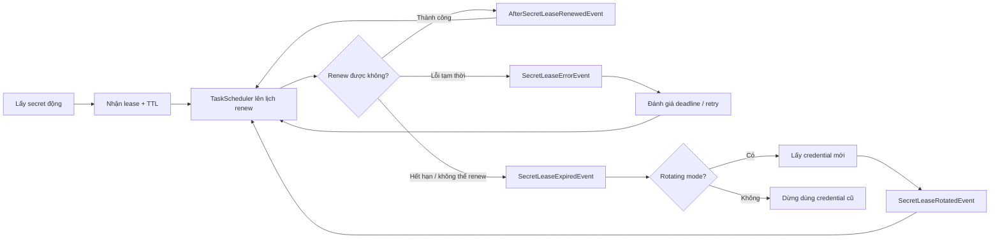
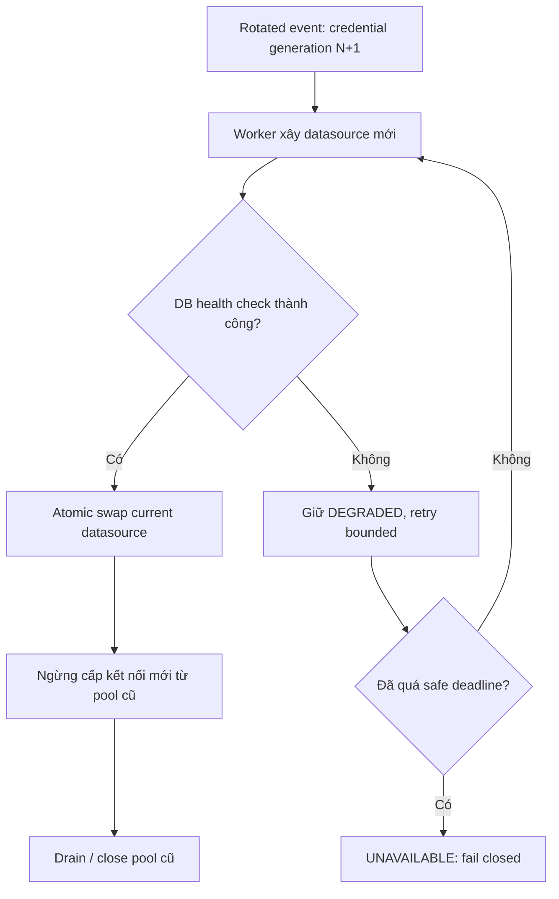

# Sự kiện phía client và độ trễ phát hiện secret đã hết hạn

## 1. Bối cảnh: Vì sao secret đã hết hạn mà Java vẫn chưa biết?

Một service Java dùng **Spring Vault** lấy username/password động từ **HashiCorp Vault Database secrets engine** để kết nối PostgreSQL. Vault cấp một **lease** có thời hạn sử dụng (TTL) 60 giây. Ứng dụng đăng ký `SecretLeaseContainer` để gia hạn lease hoặc cấp lại credential khi cần.

Giả sử thời hạn lease kết thúc lúc 10:01:00, nhưng thread của ứng dụng xử lý renewal bị tắc vì GC pause và timeout mạng. Mãi 10:01:12 ứng dụng mới quan sát lease hết hạn và nhận `SecretLeaseExpiredEvent`. Trong khoảng đó, Java có thể vẫn dùng password cũ, tạo kết nối mới thất bại hoặc tiếp tục sử dụng kết nối cũ không còn được bảo đảm.

**Cốt lõi:** HashiCorp Vault **không gửi push event báo lease hết hạn trực tiếp** tới Java client. Spring Vault chủ động theo dõi lease, lập lịch renew/rotate và phát event **theo trạng thái mà client quan sát**. Vì vậy thời điểm nhận event có thể **khác thời điểm lease thực sự hết hiệu lực**.

Trong chương **Vòng đời lease** của module **SPRING_VAULT**, bài này kết nối kiến thức VaultTemplate, phân quyền, token/lease, Database secrets, PKI và xử lý lỗi. Bạn sẽ học:

- Phân biệt thời điểm secret được cấp, hết hạn, được phát hiện và thực sự bị ngừng sử dụng.
- Nhận diện `SecretLeaseCreatedEvent`, `SecretLeaseExpiredEvent`, `SecretLeaseRotatedEvent`, `AfterSecretLeaseRenewedEvent` và `SecretLeaseErrorEvent`.
- Sử dụng `SecretLeaseContainer`, `LeaseListener`, `LeaseErrorListener` và lựa chọn renewable/rotating.
- Giảm cửa sổ ứng dụng dùng credential quá hạn, đo scheduler lag và detection lag.
- Kiểm thử Java, Vault và dependency thực tế trong cả tình huống mạng chậm, token bị revoke, pool chưa cập nhật.

## 2. Cần phân biệt bốn mốc thời gian

| Mốc | Ký hiệu | Nguồn thông tin | Ý nghĩa |
| --- | --- | --- | --- |
| Vault cấp secret | `t_issue` | Phản hồi secret chứa `lease_duration` | Mốc client nhận thông tin lease ban đầu. |
| Lease đến hạn | `t_expire` | TTL và trạng thái lease ở Vault | Sau mốc này không thể tin rằng credential còn hợp lệ. |
| Java phát hiện hết hạn | `t_detect` | `SecretLeaseContainer`, scheduler, event | Lúc listener quan sát trạng thái expired. |
| Ứng dụng ngừng dùng secret cũ | `t_stop` | Pool manager / business logic | Không cho request mới lấy credential cũ. |
| Secret mới sử dụng được | `t_ready` | Rotation + kiểm chứng downstream | Pool/SSL context mới đã được thay và kiểm tra thành công. |

Độ trễ được đo:

```text
detection_lag = max(0, t_detect - t_expire)
stale_usage_window = max(0, t_stop - t_expire)
recovery_lag = max(0, t_ready - t_expire)
```

Không nên chỉ đo event lag. **Detection lag nhỏ** chưa chắc tốt nếu JDBC pool tiếp tục cấp password cũ trong 30 giây nữa. Ngược lại, ứng dụng có thể chủ động chặn secret cũ **trước** khi event được phát.

### Timeline minh họa

```text
10:00:00  Nhận credential, lease_duration = 60 s
10:00:30  Dự kiến gia hạn khi còn 30 s
10:00:30  Scheduler bị kẹt do GC pause / HTTP timeout
10:01:00  Hết TTL theo thời gian lease
10:01:12  Client phát hiện / SecretLeaseExpiredEvent
10:01:14  App ngừng cấp credential cũ cho kết nối mới
10:01:17  Credential mới + JDBC pool đã kiểm chứng
```

Trong ví dụ giả định: **detection lag 12 giây**, **stale usage window 14 giây**, **recovery lag 17 giây**. Đây là số liệu học tập, không phải SLO hay cấu hình mặc định của Spring Vault.

## 3. TTL, lease, token và trạng thái ở backend

Secret động từ Vault thường có các trường như sau; payload được che để tránh lộ credential:

```json
{
  "lease_id": "database/creds/report-read/<LEASE_ID>",
  "lease_duration": 60,
  "renewable": true,
  "data": {
    "username": "<REDACTED>",
    "password": "<REDACTED>"
  }
}
```

- `lease_id`: định danh lease để lookup, renew hoặc revoke nếu được cấp quyền.
- `lease_duration`: khoảng TTL tính bằng giây, **không phải timestamp UTC tuyệt đối**.
- `renewable`: lease **có thể** gia hạn theo chính sách, không cam kết lần renew nào cũng thành công.
- `data`: nội dung secret; không log hoặc đưa vào message broker/metrics.

**Lease hết hạn không có nghĩa backend xử lý thu hồi tức thời ở cùng một mili giây.** Vault và database có thể thực thi revoke bất đồng bộ. Một kết nối DB đã mở vẫn có thể tiếp tục hoạt động trong thời gian ngắn, trong khi kết nối mới thất bại. Ở phía client, điều đúng đắn là **ngừng tin vào credential đã quá hạn**, thay vì lấy thành công của kết nối cũ làm bằng chứng lease còn dùng được.

### Những đối tượng không nên đánh đồng

| Đối tượng | Vòng đời | Cần theo dõi bằng |
| --- | --- | --- |
| Database dynamic secret | Lease cấp cho username/password động, renew/revoke tùy role | `SecretLeaseContainer` và kiểm chứng database. |
| PKI certificate | Lease và hạn chứng thư `notBefore` / `notAfter` tùy secrets engine và role | Lease + hạn chứng thư + cơ chế reload TLS context. |
| KV v2 versioned secret | Thường không có renewable lease như Database | KV metadata/version, cơ chế reload hoặc polling riêng. |
| Transit encrypt/decrypt | Lời gọi cryptographic API, không có secret lease trên mỗi request | Token policy, health và các quy trình rotation key riêng. |
| Vault client token | TTL và giới hạn token, renew/re-login | `LifecycleAwareSessionManager` hoặc cơ chế xác thực tương ứng. |

**Gia hạn Vault login token không tự động gia hạn mọi secret lease**; đây là hai lifecycle độc lập.

## 4. Spring Vault quan sát lease bằng cơ chế nào?

`org.springframework.vault.core.lease.SecretLeaseContainer` quản lý tập `RequestedSecret`. Khi khởi chạy, nó lấy secret và lease qua `VaultOperations`, sau đó dùng `TaskScheduler` lên lịch renew hoặc rotate theo TTL. Container có thể phát các sự kiện qua `LeaseListener` và lỗi qua `LeaseErrorListener`.

Có hai cách yêu cầu secret:

- `requestRenewableSecret(path)`: ưu tiên **giữ credential hiện có bằng renew** khi lease còn đủ điều kiện; hết hạn thì credential không còn được bảo đảm nếu không có cơ chế cấp lại.
- `requestRotatingSecret(path)`: thử renew khi được phép; khi lease hết hạn, container **yêu cầu secret mới**, tạo cơ sở cho credential rotation.

Dù container có khả năng xin secret mới, **ứng dụng vẫn cần cập nhật các thành phần giữ secret**, chẳng hạn HikariCP datasource, database connection, TLS context hoặc service client.



Sơ đồ là cách nhìn tổng quát. **Không phải mọi lỗi renew sẽ lập tức biến thành expired event**: hành vi cụ thể phụ thuộc thời điểm, `LeaseStrategy`, expiry predicate và kết quả tương tác với Vault.

### Điều kiện phát event không phải xác nhận server theo thời gian thực

Tài liệu Spring Vault nói rõ: Vault yêu cầu **client chủ động tương tác** để nhận biết lease đã hết; server **không gửi sự kiện**. `SecretLeaseExpiredEvent` có thể được phát **sau TTL thực tế**, hoặc **trước mốc TTL** nếu client coi lease đang ở ngưỡng cận hết theo `Predicate<Lease>`.

Do đó:

- **Có expired event**: ứng dụng nên thận trọng ngừng sử dụng credential này và chuyển sang rotation.
- **Chưa có expired event**: **không đủ** để khẳng định credential vẫn còn hiệu lực.
- **Có renew event**: thời hạn lease đã được Vault xác nhận renew, nhưng dữ liệu liên quan chưa chắc đã được đưa vào pool/client phù hợp.
- **Có rotated event**: đã có secret mới, nhưng **không có nghĩa tất cả kết nối cũ đã bị dừng**.

## 5. Bảng sự kiện và hành động phía client

| Sự kiện/callback | Ý nghĩa | Phản ứng an toàn |
| --- | --- | --- |
| `SecretLeaseCreatedEvent` | Đã lấy được secret, thường là lần đầu | Xây resource mới, kiểm chứng với backend, rồi đánh dấu sẵn sàng. |
| `AfterSecretLeaseRenewedEvent` | Renew lease đã thành công | Cập nhật deadline, metrics; không tự cho rằng password đổi. |
| `SecretLeaseRotatedEvent` | Container đã lấy secret khác khi rotate | Tạo generation/pool mới, kiểm chứng, atomic swap, drain pool cũ. |
| `SecretLeaseExpiredEvent` | Client quan sát lease hết hoặc gần hết theo logic container | Chặn cấp credential cũ, đánh dấu unavailable nếu cần. |
| `SecretNotFoundEvent` | Không tìm thấy secret theo đường Vault khi được yêu cầu | Kiểm tra path, policy, provisioning; không tiếp tục dựa vô hạn vào credential cũ. |
| `SecretLeaseErrorEvent` / `onLeaseError` | Lỗi đọc/renew/revoke hoặc tương tác Vault | Theo dõi mã lỗi và deadline, retry có giới hạn; lỗi này không chứng minh secret expired. |
| `BeforeSecretLeaseRevocationEvent` | Container sắp thực hiện revoke lease | Chuẩn bị dừng cấp phát credential cũ và đóng resource. |
| `AfterSecretLeaseRevocationEvent` | Container xử lý revoke thành công | Cập nhật trạng thái và dọn resource liên quan. |

**Thứ tự kiểm tra event trong Java:** `SecretLeaseRotatedEvent` là một **subclass của `SecretLeaseCreatedEvent`**. Khi dùng `instanceof`, phải xét **rotated trước created** để không bỏ qua logic xoay vòng.

Event được phát từ **thread khởi động hoặc background scheduler**. Listener phải hoạt động nhanh và thread-safe; nếu nó block chờ I/O, chính việc xử lý event sẽ làm các lần renew kế tiếp chậm thêm.

## 6. Ví dụ Java: bắt sự kiện bằng `LeaseListener`

Đoạn sau minh họa Spring Vault 4.x, Java 17+. Nó quan sát một secret Database động và cập nhật trạng thái ở **client**. Chỉ đánh dấu AVAILABLE khi phần ứng dụng đã **thay credential và xác nhận kết nối thật**; event không tự làm việc đó.

```java
import java.time.Duration;
import java.util.concurrent.atomic.AtomicReference;

import org.springframework.scheduling.TaskScheduler;
import org.springframework.vault.core.VaultOperations;
import org.springframework.vault.core.lease.SecretLeaseContainer;
import org.springframework.vault.core.lease.domain.RequestedSecret;
import org.springframework.vault.core.lease.event.AfterSecretLeaseRenewedEvent;
import org.springframework.vault.core.lease.event.LeaseListenerAdapter;
import org.springframework.vault.core.lease.event.SecretLeaseCreatedEvent;
import org.springframework.vault.core.lease.event.SecretLeaseEvent;
import org.springframework.vault.core.lease.event.SecretLeaseExpiredEvent;
import org.springframework.vault.core.lease.event.SecretLeaseRotatedEvent;
import org.springframework.vault.core.lease.event.SecretNotFoundEvent;

public final class ReportDbLeaseObserver {

    public enum Health {
        STARTING, AVAILABLE, DEGRADED, UNAVAILABLE
    }

    private final AtomicReference<Health> health =
            new AtomicReference<>(Health.STARTING);

    public Health health() {
        return health.get();
    }

    public SecretLeaseContainer start(
            VaultOperations vault, TaskScheduler scheduler) throws Exception {

        SecretLeaseContainer container =
                new SecretLeaseContainer(vault, scheduler);

        container.setExpiryThreshold(Duration.ofSeconds(30));
        container.setMinRenewal(Duration.ofSeconds(10));

        RequestedSecret requested = container.requestRotatingSecret(
                "database/creds/report-read");

        LeaseListenerAdapter listener = new LeaseListenerAdapter() {

            @Override
            public void onLeaseEvent(SecretLeaseEvent event) {
                if (!requested.equals(event.getSource())) {
                    return;
                }

                if (event instanceof SecretLeaseRotatedEvent) {
                    health.set(Health.DEGRADED);
                    // Chuyển credential mới sang resource manager riêng.
                    return;
                }
                if (event instanceof SecretLeaseCreatedEvent) {
                    health.set(Health.DEGRADED);
                    // Tạo và kiểm chứng pool lần đầu.
                    return;
                }
                if (event instanceof AfterSecretLeaseRenewedEvent) {
                    // Lease gia hạn, cập nhật safe deadline ở thành phần riêng.
                    return;
                }
                if (event instanceof SecretLeaseExpiredEvent
                        || event instanceof SecretNotFoundEvent) {
                    health.set(Health.UNAVAILABLE);
                }
            }

            @Override
            public void onLeaseError(
                    SecretLeaseEvent event, Exception error) {
                if (!requested.equals(event.getSource())) {
                    return;
                }
                // Không log error object chứa dữ liệu nhạy cảm.
                health.set(Health.DEGRADED);
            }
        };

        // Đăng ký listener trước khi khởi động container.
        container.addLeaseListener(listener);
        container.addErrorListener(listener);

        container.afterPropertiesSet();
        container.start();
        return container;
    }

    public void markCredentialVerified() {
        health.set(Health.AVAILABLE);
    }
}
```

Lưu ý:

1. Nếu ứng dụng đã dùng `AbstractVaultConfiguration` hoặc Spring Cloud Vault và có bean `SecretLeaseContainer`, **tái sử dụng bean được quản lý** thay vì khởi tạo hai container cùng theo dõi một path.
2. Cần cung cấp `TaskScheduler` đã cấu hình phù hợp (pool size, thread naming, thời gian timeout). Container tự tạo ngoài Spring context cần được gọi `destroy()` khi kết thúc; nếu scheduler cũng được tạo thủ công thì phải đóng scheduler đó.
3. `onLeaseError` chỉ đánh dấu DEGRADED. Cần so với **deadline do ứng dụng tính**: nếu đã tới ngưỡng không an toàn, chuyển UNAVAILABLE ngay cả khi chưa có expired event.
4. Code chỉ xử lý **state và quan sát**. Để triển khai sản xuất, phải gắn callback với một resource manager nhận secret mới, xây pool, kiểm chứng và hoán đổi atomically. Không tạo pool/chạy retry dài trực tiếp trong listener thread.
5. `markCredentialVerified()` là hook minh họa. Việc đánh dấu AVAILABLE thực tế cần ràng buộc với **generation và safe deadline** để callback cũ không làm trạng thái sai sau một lần rotation mới.

### Renew hay rotate?

```java
// Chỉ yêu cầu renew credential đến khi lease không thể duy trì:
RequestedSecret keepLease =
    container.requestRenewableSecret("database/creds/report-read");

// Hoặc yêu cầu rotation khi lease đến hạn:
RequestedSecret rotateLease =
    container.requestRotatingSecret("database/creds/report-read");
```

Đây là **hai cách thay thế nhau** để so sánh. Trong ứng dụng thật hãy chọn một mode cho một secret path, tránh đăng ký cùng path hai kiểu và dự đoán sai thứ tự event.

## 7. Nguồn gây trễ phát hiện sự kiện

| Nhóm nguyên nhân | Triệu chứng | Cách giảm tác động |
| --- | --- | --- |
| Scheduler starvation | Task chờ lâu, queue tăng | Dùng scheduler riêng, đủ thread, listener nhanh. |
| GC pause / CPU throttling | JVM dừng, timer không chạy | Quan sát GC pause và CPU; giữ safety margin. |
| Vault timeout, mạng chập chờn | Renew request chậm, `5xx`/`429` | Timeout, retry có giới hạn và exponential backoff. |
| Đồng hồ tường bị chỉnh | Deadline theo `currentTimeMillis` dịch chuyển | Dùng `nanoTime` hoặc monotonic clock cho TTL cục bộ. |
| Lease bị revoke sớm | Credential bị từ chối dù TTL dự tính còn | Kiểm tra audit, parent token, policy, lỗi downstream. |
| Listener đăng ký sau start | Bỏ lỡ event khởi tạo | Gắn listener trước khi `start()`. |
| Event handler block | Một callback khiến renew của secret khác bị trì hoãn | Đưa tác vụ dài sang worker queue và giữ callback ngắn. |
| Pool/JDBC giữ credential cũ | Event đúng nhưng request vẫn lỗi | Atomic swap pool, drain connection cũ, health check. |

### Dự trù thời gian renew trước hạn

Spring Vault có các API:

- `setExpiryThreshold(Duration)`: đưa việc renew tới thời điểm **trước khi lease hết hạn**.
- `setMinRenewal(Duration)`: giới hạn nhịp tối thiểu, tránh renew quá thường xuyên.
- `setExpiryPredicate(Predicate<Lease>)` (3.2+): tự xác định thế nào là lease đã đến ngưỡng expiry.
- `setLeaseStrategy(LeaseStrategy)`: lựa chọn giữ/bỏ lease khi renew xảy ra lỗi (tùy chiến lược được dùng).

Cấu hình không thể xóa sạch trễ scheduler. Đặt margin dựa vào độ trễ thực tế, không dựa trên số tùy ý:

```text
safety_margin >= P99(network_renew_latency)
              + P99(scheduler_delay_and_GC_pause)
              + bounded_retry_budget
              + P99(credential_rotation_and_pool_warmup)
              + additional_clock_or_network_reserve
```

Đây là **công thức ước lượng phòng vệ** của ứng dụng, không phải công thức nội bộ của `SecretLeaseContainer`. Nếu thời gian tạo pool lớn hơn TTL tối thiểu, cần thay đổi TTL hoặc kiến trúc.

### Minh họa lựa chọn deadline cục bộ

Giả sử Vault cho TTL 120 giây, measured p99 renew latency 3 giây, scheduler lag 2 giây, retry budget 10 giây, pool warm-up 5 giây. Chọn margin **ít nhất 20 giây cộng thêm dự phòng**. Ứng dụng chỉ nhận công việc mới bằng credential hiện tại khi thời gian còn lại **lớn hơn margin** và backend đã được kiểm chứng.

Tuy nhiên Vault có thể revoke lease trước hạn, nên ngoài deadline còn phải theo dõi lỗi xác thực downstream. **Số TTL 120 giây không bảo đảm kết nối luôn thành công 120 giây.**

## 8. Thiết kế Java tránh dùng credential cũ khi chưa có event

### 8.1. Safe deadline độc lập với event

Đối với mỗi generation credential:

1. Lưu thời gian cục bộ khi bắt đầu request và khi nhận response. Từ `lease_duration` tính deadline **bảo thủ**, trừ an toàn cho network latency và margin.
2. Dùng **monotonic clock** cho khoảng thời gian trên cùng process để không bị thay đổi khi NTP chỉnh đồng hồ. `System.nanoTime()` phù hợp với đo duration, không dùng làm timestamp tuyệt đối để gửi qua mạng.
3. Gắn một **generation ID cục bộ tăng dần** cho credential. Callback cũ không được ghi đè generation mới.
4. Kiểm tra deadline khi cấp kết nối hoặc khởi động tác vụ mới. Nếu hết margin, từ chối / chuyển readiness theo thiết kế thay vì tiếp tục dùng secret.
5. Khi nhận secret mới, **tạo resource mới**, kiểm chứng connectivity, **atomic swap**, sau đó drain/đóng resource cũ trong hạn cho phép.
6. Nếu renew hoặc rotation lỗi, chỉ giữ trạng thái DEGRADED tới safe deadline; sau đó chuyển UNAVAILABLE.

Một chuỗi xử lý nên như sau:



Đừng chỉ thay `username`/`password` trong một object chia sẻ mutable. HikariCP và các client có thể đã giữ connection hoặc configuration cũ; nhiều request đồng thời có thể đọc lệch username của generation mới với password của generation cũ.

### 8.2. “Đã rotate” chưa chắc “đã phục vụ ổn”

Với Database, lệnh renew thường **kéo dài credential cũ**; rotate có thể cấp credential mới. Nếu pool đã tồn tại, phải thiết kế cách đưa connection cũ ra khỏi sử dụng có kiểm soát. Với PKI, thay secret material không tự cập nhật mọi `SSLContext` hoặc connection TLS cũ; cần reload context và xác minh chuỗi chứng thư, SNI, trust.

Không đặt payload secret hoặc nguyên event `SecretLeaseRotatedEvent` vào log. Event có thể chứa nội dung bí mật. Tránh gửi event nguyên bản vào queue/telemetry không được bảo vệ.

## 9. Spring Cloud Vault: cấu hình vòng đời secret

Spring Cloud Vault hỗ trợ các thuộc tính vòng đời cho secret property sources:

```yaml
spring:
  cloud:
    vault:
      uri: https://vault.internal.example:8200
      config:
        lifecycle:
          enabled: true
          min-renewal: 10s
          expiry-threshold: 30s
```

Các property dưới `spring.cloud.vault.config.lifecycle` điều khiển **lease của secrets**. Chúng khác với `spring.cloud.vault.session.lifecycle` là vòng đời **token xác thực đăng nhập Vault**.

- `enabled: true`: bật quản lý lease secret mà Spring Cloud Vault nhận diện.
- `min-renewal`: khoảng tối thiểu trước một lần renew tiếp theo.
- `expiry-threshold`: mốc thời gian renew trước expiry.

Kiểm tra phiên bản Spring Cloud Vault trước khi dùng thêm `lease-strategy` hoặc `lease-endpoints`; API của Vault thay đổi qua phiên bản. Các engine có thể không renewable; container vẫn cần xử lý rotation nếu loại secret được quản lý yêu cầu.

**Dễ nhầm:** `LeaseAwareVaultPropertySource` có thể cập nhật property sau rotation, nhưng biến Java đã được inject vào bean lúc startup bằng `@Value("${db.password}")` hoặc datasource đã khởi tạo **không mặc nhiên tự cập nhật**. Cần rõ cơ chế refresh/rebind/pool replacement.

Tắt lifecycle có thể khiến ứng dụng giữ dynamic credentials đến khi hết hạn; đừng dùng `enabled: false` để che lỗi renewal mà không có hệ thống quản lý thay thế.

## 10. Đo và giám sát sự kiện client

| Metric khuyến nghị | Tính toán/ghi nhận | Mục đích |
| --- | --- | --- |
| `vault_lease_remaining_seconds` | Giây tới safe deadline cục bộ | Cảnh báo trước khi secret mất hiệu lực. |
| `vault_lease_renew_total{result}` | Đếm renew success/failure | Phát hiện vấn đề Vault/network. |
| `vault_lease_rotation_total{result}` | Đếm rotation và áp dụng generation mới | Thấy tần suất cấp lại secret. |
| `vault_lease_detection_lag_seconds` | `max(0, t_detect - t_expire)` | Đánh giá event phát trễ so với deadline. |
| `vault_lease_scheduler_lag_seconds` | Thời điểm task chạy trừ thời điểm đã hẹn | Phân biệt nghẽn JVM với chậm API Vault. |
| `vault_credential_generation_age_seconds` | Thời gian đã sử dụng generation hiện tại | Phát hiện secret cũ chưa rotate. |
| `vault_dependency_auth_failure_total` | Lỗi xác thực DB/TLS sau renew/rotate | Đối chiếu hiệu lực thực với backend. |
| `vault_lease_health` | AVAILABLE / DEGRADED / UNAVAILABLE | Cung cấp readiness/alert. |

Ghi metrics và events theo **role, engine, loại sự kiện**, tránh gắn token, password, lease ID đầy đủ hoặc username động vào label. Những trường này vừa có thể lộ bí mật vừa gây cardinality cao.

**Quan trọng:** khi scheduler chết hoặc mất mạng dài, có thể **không có event nào được phát**. Chính metric **remaining time** và kiểm tra deadline trong request path mới giúp chuyển health khi event im lặng.

### Đo bằng một ví dụ SLO

Một nhóm có thể chọn SLO thí nghiệm: “P99 detection lag không quá 5 giây” trên secret TTL ít nhất 2 phút; đồng thời “không có request mới được cấp credential sau safe deadline”. SLO là do hệ thống đặt, không có trong hợp đồng mặc định của Vault/Spring Vault. Phải đo cả `t_detect`, `t_stop` và `t_ready`, không chỉ số event được phát.

## 11. Thực hành Vault CLI trên môi trường test

Ví dụ yêu cầu Vault đã có **Database secrets engine** và role `report-read` để cấp credential thử nghiệm. Không dùng data, lease hay tài khoản sản xuất.

```bash
# Mỗi lần gọi sẽ cấp một dynamic credential mới.
# jq chỉ hiển thị metadata, không in username/password.
vault read -format=json database/creds/report-read \
  | jq '{lease_duration, renewable, has_lease_id: (.lease_id != "")}'

# Dùng lease ID thật của credential test, bảo quản an toàn:
vault lease lookup "<DEMO_LEASE_ID>"
vault lease renew "<DEMO_LEASE_ID>"

# Chỉ dùng trên lease test và sau khi hoàn tất bài thực hành:
vault lease revoke "<DEMO_LEASE_ID>"
```

`vault read database/creds/...` có thể tạo secret mới **mỗi lần gọi**, vì thế không polling liên tục để kiểm tra. Để xem hành vi sự kiện, nên cho `SecretLeaseContainer` lấy secret, ghi timestamp trong listener, và đưa lỗi/revoke vào thử nghiệm có kiểm soát.

Thử một timeline đơn giản:

```text
t0   Container nhận secret (TTL 45 giây)
t1   Scheduler hẹn renew trước deadline 15 giây
t2   Chặn Vault traffic trong 20 giây (chỉ môi trường test)
t3   Lease hết hạn
t4   Khôi phục mạng, listener quan sát hết hạn
t5   Container có secret mới, app thay pool xong
```

Mục tiêu đo `t4-t3` và `t5-t3`, đồng thời xác nhận ứng dụng **ngừng cấp credential trước deadline an toàn** ngay cả khi event bị trì hoãn.

## 12. Các kịch bản kiểm thử bắt buộc

| Ca | Gây ra | Điều cần xác minh |
| --- | --- | --- |
| A — Renew bình thường | Renewable lease, Vault hoạt động | `AfterSecretLeaseRenewedEvent`, credential chưa bị rotate không cần thiết. |
| B — Secret rotation | Chọn mode rotating, lease không thể renew | Có `SecretLeaseRotatedEvent` và generation/pool mới hoạt động. |
| C — Scheduler chậm | Làm nghẽn thread trước giờ renew | Event có thể trễ; safe deadline chặn credential cũ. |
| D — Vault outage | Cắt network trước renewal | Có error event, degraded rồi unavailable nếu quá deadline. |
| E — Expiry predicate sớm | Đánh dấu sớm bằng `setExpiryPredicate` | Event không chứng minh Vault đã revoke tại thời điểm callback. |
| F — Revoke từ bên ngoài | Quản trị viên revoke lease test | Credential có thể hỏng trước TTL; phát hiện cả từ DB auth errors. |
| G — Listener đăng ký muộn | Add listener sau `start()` | Có thể bỏ lỡ created event; test thứ tự đăng ký. |
| H — Handler block | Chèn delay vào listener (test only) | Scheduler lag tăng; phân tách worker queue cải thiện. |
| I — Race rotation | Generation N hoàn thành sau N+1 | Callback cũ không overwrite resource mới. |
| J — JDBC pool giữ mật khẩu cũ | Nhận rotated event nhưng chưa replace pool | Không coi event là bằng chứng pool đã đổi. |
| K — Clock adjustment | Mô phỏng wall clock nhảy | Monotonic deadline ổn định trong cùng JVM. |
| L — Token renew nhưng lease secret không renew | Giữ token sống, cho Database TTL ngắn | DB credential hết hạn độc lập với login token. |
| M — KV v2 không có lease | Đọc KV entry versioned | Không kỳ vọng event expired như Database credential. |
| N — PKI | Cấp cert thử nghiệm hết hạn ngắn | Kiểm tra `notAfter` và reload SSL context ngoài lease event. |

**Unit test:** giả lập clock/scheduler và event, kiểm thử trạng thái AVAILABLE/DEGRADED/UNAVAILABLE, deadline, generation ordering, retry budget. Không dùng mock `SecretLeaseExpiredEvent` làm bằng chứng backend thực sự đã revoke.

**Integration test:** dùng Vault dev/Testcontainers và Database test với TTL ngắn, đo timeline, inject network fault, test revoke và tạo kết nối thật. Bảo đảm role test có policy hẹp, không log credential, dọn lease test. Việc xác minh secret đã hết hiệu lực thực tế phải thực hiện trên backend thử nghiệm, không chỉ khẳng định từ Java event.

## 13. Lỗi tư duy dễ gặp

1. **“Vault push event lease-expired tới Java.”** Sai: container **tự quan sát** và có thể phát event trễ.
2. **“Callback expired đúng bằng mili giây secret hết hạn.”** Sai: có thể sớm theo predicate hoặc muộn vì scheduler/network.
3. **“Chưa có expired event nghĩa là secret còn dùng được.”** Sai: còn phải kiểm tra deadline và lỗi backend.
4. **“Renew thành công nghĩa là username/password mới.”** Sai: renew có thể giữ nguyên credential và chỉ kéo dài lease.
5. **“Rotated event tự cập nhật mọi connection.”** Sai: phải tạo/cập nhật resource, kiểm chứng và atomic swap.
6. **“Gia hạn Vault login token cũng gia hạn database lease.”** Sai: hai lifecycle tách biệt.
7. **“KV v2 entry có lease renewable như database.”** Sai: KV v2 tập trung vào version, metadata, retention.
8. **“JDBC connection cũ còn sống nghĩa là TTL không còn quan trọng.”** Sai: không có bảo đảm secret vẫn được chấp nhận cho kết nối mới.
9. **“Log nguyên SecretLeaseEvent để debug.”** Không an toàn vì event có thể mang secret payload hoặc thông tin lease nhạy cảm.

## 14. Câu hỏi tự kiểm tra

1. Vì sao `SecretLeaseExpiredEvent` có thể phát **sau** thời điểm hết TTL của Vault?
2. Giải thích sự khác nhau của `t_expire`, `t_detect`, `t_stop` và `t_ready`. Đại lượng nào biểu thị app thực sự dùng credential cũ quá lâu?
3. Khi kiểm tra `instanceof`, tại sao cần xử lý `SecretLeaseRotatedEvent` trước `SecretLeaseCreatedEvent`?
4. `SecretLeaseErrorEvent` có đồng nghĩa secret đã hết hạn không? Phải đối chiếu thêm yếu tố nào?
5. Ba nguyên nhân scheduler lag thường gặp trên JVM là gì?
6. Tại sao phải hoán đổi JDBC pool an toàn thay vì chỉ thay password trong biến?
7. Khác nhau giữa `setMinRenewal` và `setExpiryThreshold`? Tại sao không chọn ngưỡng mà bỏ qua TTL thực?
8. Khi Vault login token vẫn renewable nhưng credential Database đã hết hạn, Spring Vault cần theo dõi những gì?
9. Vì sao không dùng `SecretLeaseExpiredEvent` để phát hiện một KV v2 version vừa bị xóa?
10. Cần phát cảnh báo thế nào khi **không có event** nhưng deadline sắp đến?

**Ghi nhớ:** `SecretLeaseContainer` giúp ứng dụng quản lý lease bằng renew/rotate và event **do client phát**. Vì Vault không push expiration event, listener có thể chậm hơn sự kiện thực. Ứng dụng phải kết hợp TTL, deadline bảo thủ, scheduler đủ khỏe, rotation có kiểm chứng, quan sát độ trễ và cơ chế không sử dụng secret quá hạn.

## 15. Tài liệu tham khảo

- Spring Vault, [Credential Rotation / SecretLeaseContainer](https://docs.spring.io/spring-vault/reference/vault/credential-rotation.html): cấu hình container, renew/rotate, sự kiện và listener.
- Spring Vault Javadoc, [SecretLeaseContainer](https://docs.spring.io/spring-vault/reference/api/java/org/springframework/vault/core/lease/SecretLeaseContainer.html): `setMinRenewal`, `setExpiryThreshold`, `setLeaseStrategy`, ghi chú sự kiện có thể tới muộn.
- Spring Vault Javadoc, [Event package](https://docs.spring.io/spring-vault/reference/api/java/org/springframework/vault/core/lease/event/package-summary.html): các lớp event và interface listener.
- Spring Vault Javadoc, [SecretLeaseExpiredEvent](https://docs.spring.io/spring-vault/reference/api/java/org/springframework/vault/core/lease/event/SecretLeaseExpiredEvent.html): client quan sát lease hết hoặc gần đến hạn.
- Spring Vault Javadoc, [LeaseAwareVaultPropertySource](https://docs.spring.io/spring-vault/reference/api/java/org/springframework/vault/core/env/LeaseAwareVaultPropertySource.html): property source cập nhật theo lease.
- Spring Cloud Vault, [Configuration properties — lifecycle](https://docs.spring.io/spring-cloud-vault/reference/appendix.html): `spring.cloud.vault.config.lifecycle`.
- HashiCorp Vault, [Lease, Renew and Revoke](https://developer.hashicorp.com/vault/docs/concepts/lease): lease TTL và lifecycle trong Vault.
- HashiCorp Vault, [Lease API](https://developer.hashicorp.com/vault/api-docs/system/leases): renew/lookup/revoke lease.
