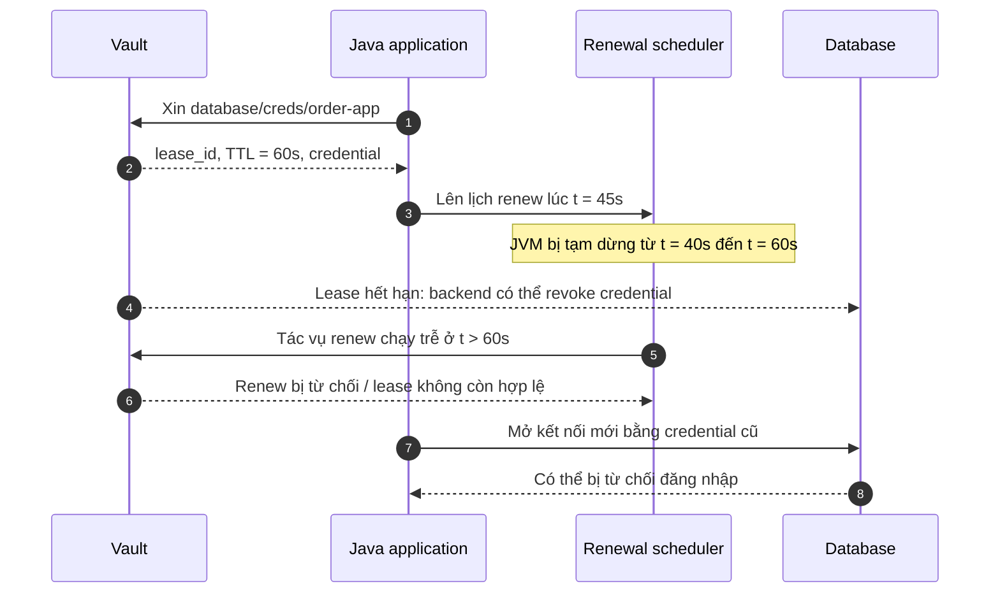

# Ảnh hưởng của sai lệch đồng hồ và tác vụ nền bị chậm

## 1. Bối cảnh: một lease có thể hết hạn ngay khi ứng dụng còn đang chạy

Trong **Spring Vault**, ứng dụng Java dùng `VaultTemplate` hoặc `VaultOperations` để truy cập HashiCorp Vault. Với một số secrets engine như **Database**, Vault có thể cấp một bí mật **động** kèm `lease_id`, `lease_duration` và cờ `renewable`. Ví dụ, ứng dụng đặt hàng được cấp username/password tạm thời cho database để thiết lập connection pool.

Một lease không tồn tại mãi: Vault quyết định thời điểm credential hết hiệu lực theo chính sách của backend. Trong khi đó, ứng dụng thường dựa vào lịch của **tác vụ nền** để gia hạn lease hoặc xin credential mới. Nếu đồng hồ máy ứng dụng lệch, hệ thống bị tạm dừng lâu, HTTP request chậm hoặc scheduler không được thực thi đúng lúc, credential có thể hết hạn trước khi ứng dụng kịp xử lý.

Điều nguy hiểm nhất không phải chỉ là API gia hạn trả lỗi. Ứng dụng có thể **tiếp tục đưa credential cũ vào các kết nối mới** sau khi Vault đã thu hồi quyền, khiến request nghiệp vụ đồng loạt thất bại. Cần phân biệt ba yếu tố:

- **Thời hạn do Vault kiểm soát:** server và secrets engine quyết định tính hợp lệ cuối cùng của lease.
- **Ước lượng cục bộ:** ứng dụng dùng TTL và thời gian đã trôi qua để dự đoán khi nào cần renew/rotate.
- **Khả năng thực thi nền:** thread, scheduler, mạng và hệ điều hành có bảo đảm tác vụ diễn ra đủ sớm hay không.

Bài thuộc chương **Vòng đời lease**, tập trung vào ảnh hưởng của **clock skew/clock adjustment** và **scheduled/background task delay**; đồng thời chỉ ra cách tổ chức renew, rotation, giám sát và kiểm thử với Spring Vault.

> TTL do Vault trả về là thông tin để **lập lịch an toàn**, không phải lời hứa ứng dụng có thể dùng bí mật tới sát giây cuối. Vault có thể revoke lease sớm theo yêu cầu quản trị, token bị thu hồi hoặc backend thay đổi.

## 2. Phân biệt lease, token và giá trị secret

| Đối tượng | Ví dụ | Ai quản lý vòng đời? | Khi hết hạn |
| --- | --- | --- | --- |
| **Vault client token** | Token từ Kubernetes/AppRole/AWS auth | Auth/session manager, Vault token subsystem | Các request Vault mang token đó bị từ chối |
| **Dynamic secret lease** | `database/creds/order-app` cấp database username/password | Vault secrets engine và lease manager của ứng dụng | Credential có thể bị revoke, kết nối mới có thể không đăng nhập được |
| **KV v2 secret** | `kv/apps/order-service` | Chính sách xoay vòng giá trị KV, không phải cơ chế lease của dynamic secret | KV value không tự động trở thành lease có thể renew |
| **PKI certificate** | Chứng chỉ được cấp bởi PKI engine | Thời hạn chứng chỉ, quản lý cấp lại/thu hồi theo backend | Chứng chỉ có `NotAfter` và có thể bị bên xác minh từ chối |
| **Transit ciphertext** | Bản mã trả về từ `transit/encrypt/...` | Chính sách key/version Transit | Ciphertext không phải một lease cần renew |

`VaultSessionManager` quản lý phiên **token dùng để gọi Vault**. Những bí mật động mà ứng dụng đã lấy có **vòng đời lease khác**. Token còn hiệu lực không chứng minh database credential vẫn hợp lệ; ngược lại, token hết hạn có thể làm việc renew lease thất bại dù database credential chưa đến TTL.

Với **dynamic secret**, một phản hồi minh họa có dạng:

```json
{
  "lease_id": "database/creds/order-app/opaque-lease-id",
  "lease_duration": 90,
  "renewable": true,
  "data": {
    "username": "generated-user",
    "password": "<redacted>"
  }
}
```

`lease_duration` trong ví dụ là **số giây**. Giá trị này chỉ minh họa; đừng ghi mật khẩu hoặc cả payload vào log. Trong thực tế, TTL được giới hạn bởi backend role, mount, token và cấu hình Vault; quyền renew có thể bị từ chối bất cứ lúc nào.

## 3. Sai lệch đồng hồ ảnh hưởng đến lease như thế nào?

Hãy hình dung Vault cấp credential có TTL 90 giây tại thời điểm server là 12:00:00 UTC. Máy Java đang lệch giờ +2 phút và hiển thị 12:02:00. Nếu ứng dụng tự đặt “lease hết hạn lúc 12:03:30 theo đồng hồ máy” rồi sử dụng phép so sánh với đồng hồ wall-clock dễ bị chỉnh lại, lịch renew và các quyết định an toàn có thể bị sai khi hệ thống đồng bộ thời gian.

Quan trọng: **Clock skew không tự làm Vault kéo dài TTL theo đồng hồ client**. Vault xác định hiệu lực lease phía server. Sai lệch đồng hồ ảnh hưởng tới **cách ứng dụng ước lượng và lập lịch**, cũng như TLS/JWT/metadata có timestamp nếu cơ chế xác thực phụ thuộc thời gian.

### 3.1. Ba nguồn thời gian cần tách biệt

| Nguồn | Dùng cho | Rủi ro |
| --- | --- | --- |
| **Vault/server clock** | TTL thực tế, thời điểm lease hết hạn, kiểm tra token/credential | Độ chính xác và đồng bộ server/cluster ảnh hưởng hệ thống |
| **Wall-clock của ứng dụng** (`Instant.now()`, `System.currentTimeMillis()`) | Timestamp log, audit, hiển thị thời gian tuyệt đối | Có thể nhảy tiến/lùi vì NTP, thay đổi đồng hồ thủ công hoặc lỗi cấu hình |
| **Monotonic elapsed time** (`System.nanoTime()`) | Đo khoảng thời gian đã trôi qua trong một tiến trình | Không phải UTC; không bền qua restart, hành vi sleep/suspend phụ thuộc nền tảng |

**Quy tắc:** Khi cần biết “đã trôi qua bao lâu kể từ lúc bắt đầu request xin lease?”, ưu tiên đồng hồ đo **elapsed time**. Không lấy timestamp UTC của server rồi trừ trực tiếp `Instant.now()` phía client mà bỏ qua clock skew và thời gian truyền mạng.

Đồng bộ NTP/chrony cho cả Vault và ứng dụng vẫn quan trọng vì TLS, JWT, event timestamps, audit correlation và các thành phần có so sánh thời gian tuyệt đối. Tuy nhiên, đồng bộ tốt **không thay thế** chiến lược renew sớm và khả năng phục hồi khi scheduler trễ.

### 3.2. Lệch đồng hồ tiến và lùi

Giả sử code sai như sau:

```java
// Chỉ minh họa lỗi thiết kế: deadline bằng wall-clock rồi so sánh về sau.
Instant expiresAt = Instant.now().plusSeconds(leaseDurationSeconds);

// Trong lần kiểm tra tiếp theo:
boolean expired = Instant.now().isAfter(expiresAt);
```

- Nếu hệ thống **chỉnh đồng hồ tiến** sau lúc nhận lease, code có thể cho rằng lease đã hết hạn quá sớm; gây renew/rotate không cần thiết.
- Nếu hệ thống **chỉnh đồng hồ lùi**, code có thể tưởng lease còn lâu, trì hoãn renew cho tới khi Vault đã hết hạn.
- Nếu ứng dụng **restart**, một deadline chỉ lưu trong memory của tiến trình trước không thể được phục hồi bằng `System.nanoTime()` của tiến trình mới.

Các trường hợp trên lý giải vì sao không nên xây toàn bộ vòng đời dynamic secret bằng một phép so sánh wall-clock đơn giản.

### 3.3. Độ trễ phản hồi cũng làm sai ước lượng

Một server có thể bắt đầu cấp lease trước khi response tới Java. Nếu request mất 5 giây, TTL 60 giây **không còn nguyên 60 giây** khi client vừa nhận response. Bắt đầu đếm TTL từ thời điểm xử lý response và đợi đến sát 100% sẽ ăn mất phần an toàn do thời gian trên mạng.

Cách bảo thủ là tính thời gian đã trôi qua **từ trước khi gửi request** rồi dành khoảng đệm cho mạng, backend, scheduler và failover. Không suy rằng trễ 5 giây nghĩa là Vault chắc chắn đã dùng hết đúng 5 giây TTL; đây là cách ước lượng cẩn trọng khi không biết chính xác thời điểm server tạo lease.

## 4. Tác vụ nền bị chậm: vì sao lịch renew có thể trượt?

Spring Vault có thành phần hỗ trợ quản lý dynamic secret lease như `SecretLeaseContainer`. Nó có thể được dùng để theo dõi secret được yêu cầu và xử lý các sự kiện vòng đời tương ứng. Nhưng dù thư viện có scheduler, **tác vụ vẫn cần tài nguyên CPU, thread và mạng** để thực thi. Không có bảo đảm tác vụ renew luôn chạy đúng thời điểm mong muốn.

Các nguyên nhân phổ biến:

| Nguồn chậm | Biểu hiện | Hậu quả có thể xảy ra |
| --- | --- | --- |
| **GC stop-the-world** | JVM tạm dừng tất cả thread trong một khoảng thời gian | Tác vụ renew bỏ lỡ thời điểm dự kiến |
| **CPU throttling / quá tải** | Container thiếu CPU quota; host nhiều workload | Scheduler được đánh thức trễ |
| **Thread starvation** | Pool executor bị job blocking chiếm hết | Công việc renew xếp hàng chờ |
| **I/O mạng chậm** | DNS, TLS, proxy, Vault HA failover, timeouts | Renewal request khởi chạy nhưng chưa hoàn tất |
| **Vault tạm thời lỗi** | Vault standby chuyển hướng, leader election, 429/5xx | Tác vụ phải retry trong giới hạn TTL |
| **Pod suspend/host sleep** | VM bị tạm dừng, máy dev sleep hoặc process frozen | Không có tác vụ nào chạy trong lúc bị treo |
| **Đồng loạt renew** | Nhiều replica được cấp lease gần cùng lúc | Vault/backend bị tăng tải theo từng đợt |
| **Shutdown/redeploy** | Đang dừng scheduler hoặc đóng client Vault | Renewal bị hủy, lease cleanup có thể không chạy |

**Lưu ý:** một `ScheduledExecutorService` hoặc Spring `TaskScheduler` có thể chạy đúng logic được lập trình nhưng vẫn **không đáp ứng deadline** khi thread không được cấp CPU hoặc network mất thời gian. Cần giám sát **độ trễ thực tế** chứ không chỉ kiểm tra job đã được đăng ký.

## 5. Dòng thời gian: có lịch nhưng vẫn hết hạn

Xét credential database có TTL 60 giây. Ứng dụng dự định renew sau **45 giây** (75% TTL). Nhưng một GC pause kéo dài 20 giây bắt đầu từ giây 40.



Ngay cả khi tác vụ bắt đầu ở đúng giây 45, request có thể mất 20 giây vì mạng hoặc Vault failover và không hoàn tất trước khi lease hết hạn. Do đó cần dành **khoảng đệm dành cho độ trễ tối đa dự kiến**, không chỉ một tỷ lệ TTL cố định.

Khi renew thất bại vì lease đã không còn hợp lệ, retry vô hạn cùng `lease_id` thường không giúp được. Ứng dụng phải **xin credential mới và cập nhật nơi đang sử dụng credential**, chẳng hạn thay thế datasource/connection pool theo quy trình an toàn. Đừng giả định renew API tự phục hồi một username/password đã bị Vault revoke.

## 6. Thiết kế lịch renew có khoảng đệm

Một thiết kế vận hành cần lập kế hoạch quanh ba mốc:

1. **Thời điểm có lease:** nhận metadata gồm `lease_id`, TTL và `renewable`; ghi nhận monotonic timestamp từ trước lúc bắt đầu request.
2. **Thời điểm bắt đầu renew hoặc rotation:** chạy **sớm hơn** hạn cuối, để có thời gian cho pause, mạng, retry và xác nhận.
3. **Hạn chót sử dụng an toàn:** nếu đã qua budget mà chưa có lease mới hợp lệ, không phát thêm công việc mới phụ thuộc vào credential có nguy cơ hết hạn.

Công thức khái niệm:

\[
\text{thời gian còn lại an toàn}
\approx \text{lease TTL}
- \text{thời gian đã trôi qua}
- \text{khoảng đệm rủi ro}.
\]

Khoảng đệm cần xem xét network latency, Vault HA failover, giới hạn CPU, GC pauses, retry budget, thời gian tạo credential mới và thời gian cập nhật connection pool.

### 6.1. Minh họa bằng con số

| Thông số | Giá trị ví dụ |
| --- | ---: |
| TTL ban đầu | 120 giây |
| Thời gian từ lúc bắt đầu request tới khi nhận response | 2 giây |
| Ngưỡng **bắt đầu** renew | Tại khoảng 60 giây tính từ lúc bắt đầu request |
| Dự phòng renew/reissue/retry | 30 giây |
| Ngưỡng không cấp thêm kết nối mới bằng credential cũ nếu chưa xác nhận | Trước hạn server, theo budget đã đo được |

Một lựa chọn bắt đầu renew ở **50% TTL** dành nhiều hơn 50% cho bất thường. Đây là **ví dụ nguyên tắc**, không phải giá trị mặc định của `SecretLeaseContainer` hay chuẩn cố định cho mọi hệ thống. Backend có TTL 15 giây, mạng có p99 latency 5 giây hoặc rotation cần 2 phút sẽ yêu cầu thiết kế khác.

Nếu credential **không renewable**, không gọi renew chỉ vì tới ngưỡng. Thay vào đó, **cấp credential mới trước khi credential cũ hết hạn**, thử kết nối mới với credential mới, chuyển tải và dọn kết nối cũ theo quy trình.

### 6.2. Pseudocode cho vòng đời an toàn

```text
sau khi nhận dynamic secret:
    lưu lease_id, lease_duration, renewable và credential trong vùng bảo vệ
    ước lượng elapsed-time từ trước request; đặt deadline bảo thủ
    lập lịch tác vụ trước deadline với khoảng đệm

khi tác vụ chạy:
    tính lại thời gian còn lại (không tin rằng lịch đã chạy đúng giờ)
    nếu renewable và còn đủ thời gian:
        thử renew có timeout, retry giới hạn
        nếu thành công: cập nhật TTL/lease metadata được Vault trả về
    nếu renew không được hoặc lease không renewable:
        xin credential mới
        kiểm tra credential mới trên connection thử
        chuyển consumer sang credential mới theo cách nguyên tử/có kiểm soát
        đóng/drain connection cũ, xử lý lease cũ theo quyền sở hữu

nếu không còn bảo đảm credential hợp lệ:
    dừng mở kết nối mới bằng credential cũ
    báo trạng thái degraded/readiness theo khả năng phục vụ
    cảnh báo, thử phục hồi theo chính sách, không trả secret ra log
```

Pseudocode phân tách việc **renew lease** và việc **đưa secret mới vào sử dụng**. Spring Vault hỗ trợ một phần vòng đời, nhưng cập nhật datasource và quản lý business traffic vẫn là trách nhiệm thiết kế ứng dụng/tích hợp phù hợp.

## 7. Dùng monotonic time để đo thời gian còn lại

Khi muốn đo khoảng thời gian giữa hai mốc **trong cùng một tiến trình**, có thể dùng `System.nanoTime()`. Ví dụ dưới đây là **bộ đo thời gian an toàn phục vụ giám sát và quyết định cục bộ**, không phải một lease manager thay thế Spring Vault:

```java
import java.time.Duration;
import java.util.concurrent.TimeUnit;

public final class LeaseTimeBudget {

    private final long requestStartedNanos;
    private final long leaseTtlNanos;

    // requestStartedNanos phải được chụp TRƯỚC lúc gửi request cấp lease.
    public LeaseTimeBudget(long requestStartedNanos, long leaseDurationSeconds) {
        if (leaseDurationSeconds <= 0) {
            throw new IllegalArgumentException("Lease TTL must be positive");
        }
        this.requestStartedNanos = requestStartedNanos;
        this.leaseTtlNanos = TimeUnit.SECONDS.toNanos(leaseDurationSeconds);
    }

    public Duration estimatedRemaining(Duration safetyMargin) {
        long elapsed = Math.max(0L, System.nanoTime() - requestStartedNanos);
        long margin = Math.max(0L, safetyMargin.toNanos());

        // Tránh tràn số khi cộng; dùng phép trừ theo từng bước.
        long remaining = Math.max(0L, leaseTtlNanos - elapsed);
        remaining = Math.max(0L, remaining - margin);
        return Duration.ofNanos(remaining);
    }
}
```

Cách sử dụng khi nhận lease:

```java
long requestStartedNanos = System.nanoTime();

// Thực hiện request xin credential qua client đã cấu hình.
// Chỉ minh họa: response do tầng tích hợp Spring Vault cung cấp.
LeaseResponse response = leaseClient.issueDatabaseCredentials();

LeaseTimeBudget budget = new LeaseTimeBudget(
        requestStartedNanos,
        response.leaseDurationSeconds()
);

Duration remaining = budget.estimatedRemaining(Duration.ofSeconds(20));
if (remaining.isZero()) {
    // Không đưa credential vào phục vụ request mới;
    // cần refresh/reissue trước khi coi nó có thể dùng an toàn.
}
```

`LeaseResponse` và `leaseClient` trong đoạn sử dụng là **kiểu/adapter minh họa của ứng dụng**, không phải API công bố sẵn của Spring Vault. Phần tính toán dùng Java chuẩn. Đối với hệ thống thực, phải tích hợp với response/secret lease event thật và xử lý lỗi khi issuer không cấp credential.

Các giới hạn quan trọng:

- `System.nanoTime()` đo elapsed-time; **không dùng giá trị này làm timestamp UTC** hoặc lưu qua restart.
- Monotonic time giúp tránh lỗi do đồng hồ wall-clock được chỉnh tiến/lùi, nhưng **không ngăn JVM pause, network delay hoặc hết hạn server-side**.
- Sau khi restart, mất trạng thái hay quá trình ngủ/tạm dừng dài, cần **xác minh lại hoặc cấp lại credential**, không phục hồi lease chỉ từ một deadline đã lưu.
- Nếu TTL bị Vault giảm sau renewal, phải cập nhật metadata với giá trị mới; không tự dùng TTL cũ.
- Giá trị thời gian còn lại tính được chỉ là **ước lượng bảo thủ**. Đối với credential bị revoke sớm, kết quả có thể dương dù credential đã mất hiệu lực.

## 8. Spring Vault và SecretLeaseContainer

Trong Spring Vault, `SecretLeaseContainer` hỗ trợ quản lý vòng đời của secrets có lease, phối hợp renew và những sự kiện về lease/secret. Đây là nơi phù hợp để tập trung quản lý các dynamic secrets thay vì tự viết một `ScheduledExecutorService` trong từng service nghiệp vụ.

Một cấu hình khái niệm cho database credential động:

```java
import org.springframework.context.annotation.Bean;
import org.springframework.context.annotation.Configuration;
import org.springframework.vault.core.VaultOperations;
import org.springframework.vault.core.lease.SecretLeaseContainer;
import org.springframework.vault.core.lease.domain.RequestedSecret;

@Configuration
public class DynamicCredentialLeases {

    @Bean(initMethod = "start", destroyMethod = "stop")
    SecretLeaseContainer databaseLeaseContainer(VaultOperations vault) {
        SecretLeaseContainer leases = new SecretLeaseContainer(vault);

        // database/creds/order-app phải tồn tại trong Vault backend.
        leases.addRequestedSecret(
                RequestedSecret.renewable("database/creds/order-app"));

        // Trong hệ thống thật: đăng ký listener/handler sự kiện secret/lease
        // và cập nhật datasource hoặc connection pool phù hợp.
        return leases;
    }
}
```

Ví dụ thể hiện **hướng tổ chức bean**; tên API và lifecycle hook cần đối chiếu với phiên bản Spring Vault dùng trong dự án. Nếu Spring Cloud Vault hoặc cấu hình khác đã tạo `SecretLeaseContainer`, không đăng ký container trùng chỉ vì cần thêm listener. Hãy sử dụng cơ chế tích hợp hiện có để tránh nhiều scheduler cùng renew một lease.

`RequestedSecret.renewable(...)` mô tả nhu cầu quản lý secret có thể renew; khả năng renew thực tế còn tùy metadata `renewable`, engine policy và trạng thái Vault. Không xem phương thức factory này như bảo đảm bất kỳ lease nào cũng được gia hạn thành công.

### 8.1. Event cập nhật credential phải được xử lý rõ ràng

Các loại sự kiện về secret/lease trong thư viện có thể chỉ ra secret được tạo, thay mới, hết hạn hoặc xảy ra lỗi. Khi nhận một credential mới, ứng dụng phải quyết định **cách áp dụng**:

- Xây dựng datasource/connection pool mới với username/password mới.
- Kiểm tra kết nối mới thành công, sau đó chuyển luồng request sang pool mới một cách có kiểm soát.
- Đợi/hủy các giao dịch đang dùng pool cũ theo chính sách nghiệp vụ.
- Đóng pool cũ, xóa tham chiếu đến secret cũ và xử lý lease cũ theo quyền sở hữu.

Không gán lại mật khẩu vào một trường Java rồi giả định connection pool đang dùng sẽ nhận mật khẩu mới. Nhiều pool giữ credential ở thời điểm tạo connection, nên cần cơ chế cập nhật cụ thể.

### 8.2. Tách scheduler renew khỏi tác vụ blocking nặng

Nếu một listener khi nhận event làm công việc nặng (ví dụ đóng hàng nghìn kết nối hoặc gọi API ngoài chậm), nó có thể ảnh hưởng đường xử lý sự kiện khác. Cần có ranh giới thực thi, deadline, retry giới hạn và giám sát queue/lag. Tránh giữ khóa dùng chung khi thực hiện network I/O.

Đừng khởi tạo một lease container cho **mỗi HTTP request**. Một yêu cầu truy cập dữ liệu không nên tạo thêm secret động và lịch renewal riêng nếu mô hình chỉ cần một credential theo service/pool.

## 9. Phân biệt lỗi cần retry với lease đã hết hiệu lực

| Sự cố | Hành vi khuyến nghị |
| --- | --- |
| HTTP timeout trong lần renew nhưng lease vẫn còn thời gian an toàn | Retry với backoff ngắn và giới hạn số lần; có thể tra cứu trạng thái lease nếu đủ quyền và backend hỗ trợ |
| Vault trả lỗi tạm thời `5xx`/rate limit | Có thể retry hữu hạn trong time budget; cảnh báo nếu budget gần cạn |
| `permission denied` (`403`) khi renew | Kiểm tra token policy, lease owner, endpoint và token TTL; login lặp mù không tự sửa policy |
| `lease not found` hoặc lease đã hết hạn | Ngừng dùng credential cũ cho kết nối mới; xin credential mới |
| Lease không renewable | Thiết kế reissue/rotation; không ép gọi renew vô hạn |
| Token phiên hết hạn | Phục hồi token qua auth/session manager, sau đó đánh giá lại trạng thái lease |
| Issuer/DB backend không tạo credential mới | Readiness/degradation theo nhu cầu ứng dụng, retry có giới hạn, không phơi bày secret |
| Scheduler đã chậm quá deadline | Xử lý như trường hợp credential không còn đáng tin; ưu tiên rotation và kiểm tra thực tế |

**Không dùng một bộ retry chung** cho mọi thao tác Vault. Renew một lease, cấp credential mới, tạo chứng chỉ PKI và gọi Transit có tính chất khác nhau; cần cân nhắc idempotency, khả năng tạo nhiều tài nguyên và tác động khi request timeout nhưng server đã xử lý.

Đặc biệt, một request renew bị timeout có thể đã được Vault chấp nhận. Không nên mặc định cứ timeout là tạo credential mới ngay mà không quan sát chính sách/khả năng xác định trạng thái, trừ khi thiết kế đã cho phép làm vậy.

## 10. Khi quá muộn: chuyển sang trạng thái an toàn

Đừng cố “cứ chạy tiếp” khi không còn bảo đảm database credential còn hiệu lực. Tùy loại ứng dụng, hành vi nên được lựa chọn rõ:

- **API đồng bộ:** ngừng cấp kết nối mới bằng credential cũ; có thể trả lỗi service unavailable có kiểm soát cho endpoint cần database, đồng thời giữ các endpoint không phụ thuộc database hoạt động.
- **Background worker:** tạm dừng nhận job mới, retry trong budget và chỉ nhận lại khi có credential đã kiểm thử.
- **Transaction in-flight:** không tự động cắt mọi giao dịch ngay lập tức nếu có thể làm hỏng trạng thái; áp dụng chính sách deadline, hoàn tất/rollback và observability.
- **Readiness/liveness:** readiness có thể báo không sẵn sàng nếu dependency thiết yếu chưa phục hồi; liveness không nên tự gây restart loop vô tận khi Vault tạm gián đoạn.
- **Recovery:** xin secret mới, khởi tạo resource mới, xác minh rồi mới chuyển tải. Sau đó dọn resource cũ; xử lý credential/lease cũ theo quyền sở hữu và trạng thái Vault.

Một lease đã quá hạn có thể vẫn có kết nối database cũ hoạt động trong một số backend hoặc pool, nhưng **không được lấy hiện tượng đó làm bằng chứng credential còn an toàn**. Hành vi revoke phụ thuộc database integration và cách Vault thực hiện; kiểm thử bằng connection mới và quy trình rotation thật.

## 11. Quan sát độ trễ scheduler và khoảng đệm

Chỉ đo số lần renew thành công là chưa đủ. Cần thấy **tác vụ có bị chạy trễ trước khi thất bại hay không**.

| Metric / log được khuyến nghị | Mục đích | Lưu ý |
| --- | --- | --- |
| `vault_lease_remaining_seconds` | Ước lượng thời gian còn lại theo từng lease class/role | Không dùng `lease_id` làm nhãn có cardinality cao |
| `vault_lease_renewal_duration_seconds` | Độ trễ từ request renew tới response | Phân biệt network với xử lý listener |
| `vault_lease_scheduler_lag_seconds` | Chênh giữa giờ dự kiến và giờ thực thi | Giúp nhận diện CPU/GC/thread starvation |
| `vault_lease_renewal_failures_total` | Đếm lỗi theo nguyên nhân nhóm | Không đưa token/secret vào label |
| `vault_lease_rotation_duration_seconds` | Thời gian xin, kiểm thử, thay pool | Phát hiện rotation quá chậm so với TTL |
| `vault_lease_unsafe_window_events_total` | Số lần bị cạn safety margin | Cần cảnh báo trước khi connection lỗi |
| JVM GC pause / CPU throttling / thread pool queue | Truy nguyên scheduler delay | Liên hệ timestamp giữa JVM, Vault và hạ tầng |

Ví dụ log an toàn:

```text
WARN lease-renewal-slow backend=database role=order-app
     planned_interval_ms=45000 actual_delay_ms=62000
     remaining_budget_ms=0 action=rotate-credential
```

Không in `lease_id` nếu không có nhu cầu điều tra và kênh log được kiểm soát; tuyệt đối không in username/password động, Vault client token, response body, ciphertext hoặc bí mật ứng dụng. Khi đối soát audit với Vault, dùng correlation ID phù hợp và giữ dữ liệu nhạy cảm trong hệ thống giới hạn quyền.

### Watchdog đơn giản quan sát độ trễ

Một watchdog có thể ghi nhận lần thực thi thực tế của scheduler, nhưng **không thay thế lease manager**:

```java
import java.util.concurrent.TimeUnit;
import java.util.concurrent.atomic.AtomicLong;

public final class SchedulerLagWatchdog {

    private final long expectedPeriodNanos;
    private final AtomicLong lastTick = new AtomicLong(System.nanoTime());

    public SchedulerLagWatchdog(long expectedPeriodSeconds) {
        this.expectedPeriodNanos =
                TimeUnit.SECONDS.toNanos(expectedPeriodSeconds);
    }

    // Gọi định kỳ từ một scheduler được theo dõi.
    public long tickAndMeasureLagMillis() {
        long now = System.nanoTime();
        long previous = lastTick.getAndSet(now);
        long actualInterval = now - previous;
        long excess = Math.max(0L, actualInterval - expectedPeriodNanos);
        return TimeUnit.NANOSECONDS.toMillis(excess);
    }
}
```

Nếu JVM bị stop-the-world 30 giây, watchdog cũng ngừng trong khoảng đó; **nó chỉ phát hiện lag khi được thực thi trở lại**. Vì vậy còn cần giám sát từ bên ngoài (container health/metrics, Vault audit, database connection errors), không chỉ trông chờ watchdog cùng tiến trình.

## 12. Kiểm thử tình huống clock skew và tác vụ trễ

Bài thực hành nên dùng Vault thử nghiệm cô lập, database test có khả năng cấp dynamic credential và một ứng dụng Spring. Không chạy thao tác xoay vòng/revoke trên production database chỉ để kiểm tra timeout.

### Kịch bản chuẩn bị

1. Cấu hình một database secrets engine và role `order-app` với TTL thử nghiệm ngắn (ví dụ 60–120 giây, nếu backend cho phép).
2. Cấp policy tối thiểu cho workload: quyền xin credential và quản lý lease trong phạm vi cần thiết. Không sử dụng root token trong service Java.
3. Sử dụng `VaultOperations` và `SecretLeaseContainer` hoặc cơ chế quản lý lease tương ứng của bản Spring Vault đã chọn.
4. Đưa credential động vào một datasource test, có luồng đổi credential và đóng pool cũ.
5. Gắn metric cho thời gian còn lại ước lượng, renew latency, scheduler lag, rotation, lỗi kết nối mới và phiên token.

### Ma trận kiểm thử

| Tình huống | Cách mô phỏng trong môi trường test | Kết quả cần kiểm chứng |
| --- | --- | --- |
| **Không có sự cố** | Renew với TTL bình thường | Credential không bị dùng quá hạn; số renew/rotation hợp lý |
| **Wall-clock tiến 2 phút** | Dùng Clock giả trong logic ước lượng, hoặc môi trường thời gian cô lập | Lịch dựa trên elapsed-time không nhảy theo `Instant.now()` |
| **Wall-clock lùi 2 phút** | Tương tự, điều chỉnh Clock giả | Không trì hoãn renewal vô hạn vì giờ lùi |
| **GC/CPU pause** | Fake scheduler bị trễ hoặc JVM test chịu pause có kiểm soát | Khi chạy lại kiểm tra deadline; không coi task đến muộn là hợp lệ |
| **Vault response chậm** | Proxy latency/toxiproxy hoặc test HTTP stub | Safety margin tính cả RTT và retry budget |
| **Vault tạm không sẵn sàng** | Ngắt kết nối thử nghiệm trong ngưỡng đã định | Retry hữu hạn, cảnh báo và degrade nếu budget cạn |
| **Lease không renewable** | Role/backend trả `renewable=false` | Ứng dụng reissue và chuyển credential mới, không spam renew |
| **Lease bị revoke sớm** | Admin test revoke đúng lease | Ứng dụng phản ứng với lỗi và cấp credential mới |
| **Token phiên hết hạn** | Dùng auth token TTL ngắn và kế hoạch re-auth | Tách lỗi token khỏi lỗi lease; phục hồi đúng tầng |
| **Nhiều replica cùng gia hạn** | Khởi động đồng thời nhiều instance thử nghiệm | Quan sát đỉnh tải/lag và giới hạn concurrency |
| **Restart giữa vòng đời** | Restart tiến trình trước renew | Không khôi phục deadline bằng `nanoTime` cũ; bootstrap an toàn |

### Những assertion quan trọng

**Unit test:** dùng clock/scheduler có thể điều khiển để kiểm tra chính sách bắt đầu renew, safety margin và chuyển trạng thái khi task chạy sau deadline. Với code đo elapsed time, cần trừu tượng hóa nguồn thời gian để kiểm thử; không đổi đồng hồ máy thật một cách tùy tiện.

**Integration test:** dùng Vault và database thật trong test environment để xác minh renew/revoke có hiệu lực server-side. Mock `VaultOperations` chỉ chứng minh ứng dụng đã gọi phương thức, không chứng minh DB credential vẫn đăng nhập được sau TTL.

**Load test:** đặt áp lực request và CPU trong giới hạn được phép, đo p95/p99 GC pause, scheduler lag, Vault latency, thời gian thay connection pool. Từ số đo đó chọn budget và cảnh báo phù hợp thay vì lấy một tỷ lệ TTL cố định cho mọi nơi.

**Failure test:** tắt Vault/auth backend hoặc làm renew timeout gần deadline. Xác nhận ứng dụng không trả secret trong lỗi và không tiếp tục mở kết nối mới bằng credential mà hệ thống không còn xác minh được.

## 13. Checklist trước khi đưa vào production

- Nhận diện đúng **dynamic secret có lease**; không áp dụng renew lease cho KV v2, Transit ciphertext hay xem thời hạn PKI chỉ là `lease_duration`.
- Ghi nhận `lease_id`, `lease_duration` và `renewable` trong thành phần được quyền quản lý; không để lộ payload bí mật.
- Dùng TTL phía Vault làm nguồn chuẩn, sử dụng **monotonic elapsed-time** cho ước lượng trong tiến trình và đồng bộ NTP/chrony để vận hành.
- Lập lịch renew/reissue **sớm hơn hạn** với budget cho request RTT, CPU pause, GC, scheduler lag, retry và thời gian cập nhật datasource.
- Không tin rằng scheduler đã chạy đúng giờ chỉ vì job được đăng ký; đo **planned vs actual execution time**.
- Nếu lease không renewable, bị revoke hoặc đã quá deadline an toàn, thực hiện **credential rotation** và kiểm thử trước khi chuyển tải.
- Tách **Vault client token/session TTL** và **dynamic secret lease TTL**; bảo đảm token có thể dùng khi renew và có đường re-auth khi cần.
- Quản lý bean `SecretLeaseContainer` theo vòng đời ứng dụng, tránh nhiều listener/scheduler trùng nhau và tránh để listener blocking quá lâu.
- Khi không còn credential đáng tin, dừng mở kết nối mới bằng giá trị cũ; áp dụng degraded/readiness và retry có giới hạn.
- Thu thập lease remaining, scheduler lag, renewal latency, error rate, thời gian rotation; không ghi token, lease secret hoặc database password vào log.
- Kiểm thử clock adjustment, GC/CPU pause, network failure, lease revoke, restart và concurrent replicas với Vault + database thử nghiệm.

**Ghi nhớ:** Sai lệch đồng hồ và tác vụ nền bị chậm không thay đổi quyền quyết định hết hạn của Vault, nhưng có thể làm **lịch renew của Spring Vault chạy quá muộn**. Hãy lập lịch theo elapsed-time với khoảng đệm bảo thủ, đo scheduler lag, kiểm tra trạng thái lease khi phục hồi và chuẩn bị đường cấp credential mới trước khi secret cũ hết hiệu lực.

