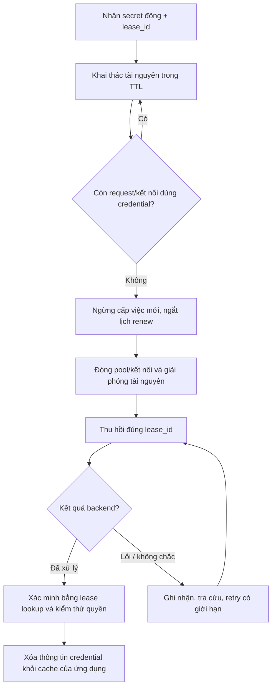

# Thu hồi lease khi không còn sử dụng trong Spring Vault

## 1. Vì sao phải chủ động thu hồi lease?

Một ứng dụng Java sử dụng **Spring Vault** có thể đăng nhập bằng AppRole, Kubernetes Auth hoặc chứng thư, rồi dùng `VaultTemplate` để đọc KV secrets, gọi Transit encryption, lấy chứng thư từ PKI hoặc nhận **thông tin xác thực động** từ Vault. Với nhiều secret động, Vault cấp một **lease** có thời hạn. Lease thể hiện việc Vault còn quản lý hiệu lực và khả năng thu hồi của credential đã phát hành.

Tình huống thực tế: `order-service` nhận tài khoản PostgreSQL động từ `database/creds/orders-readonly` để chạy một tác vụ nhập dữ liệu. Sau khi tác vụ kết thúc, không còn kết nối nào dùng tài khoản này. Nếu chỉ chờ TTL tự hết, tài khoản động có thể tiếp tục tồn tại trong một khoảng thời gian không cần thiết. **Thu hồi lease ngay khi không còn sử dụng** giúp giảm thời gian credential còn hiệu lực, thu dọn tài nguyên và hạn chế tác động nếu credential bị lộ.

Bài thuộc chương **Vòng đời lease**, tập trung vào một quy trình an toàn: xác định đúng lease → ngừng sử dụng tài nguyên → yêu cầu Vault thu hồi → xác minh trạng thái. Sau bài học, bạn có thể:

- Phân biệt lease của **dynamic secret**, Vault token và dữ liệu KV tĩnh.
- Xác định lúc nào nên gọi `vault lease revoke` thay vì `renew` hoặc đợi hết TTL.
- Thu hồi chính xác một lease bằng Vault CLI, HTTP API và Spring Vault `VaultTemplate`.
- Phân biệt **thu hồi đã được xếp hàng** với **thu hồi đồng bộ đã hoàn tất**.
- Hiểu cách `SecretLeaseContainer` quản lý renewal, rotation và đóng vòng đời secret.
- Thiết kế ACL, quy trình cleanup, retry và kiểm thử tích hợp không ảnh hưởng lease của workload khác.

## 2. Lease là gì và khi nào nó tồn tại?

Khi một secret engine phát hành credential động, phản hồi có thể mang:

```json
{
  "lease_id": "database/creds/orders-readonly/EXAMPLE_LEASE_ID",
  "lease_duration": 3600,
  "renewable": true,
  "data": {
    "username": "v-orders-EXAMPLE",
    "password": "<SECRET>"
  }
}
```

Đây là **mẫu minh họa**, không phải output của môi trường đang chạy. Trường `lease_id` là định danh duy nhất mà ứng dụng cần lưu để gọi API quản lý lease. `lease_duration` là TTL được tính theo giây tại thời điểm phát hành; `renewable` cho biết lease có thể được yêu cầu gia hạn hay không. Nội dung `data` chứa credential thật, cần giữ trong bộ nhớ hoặc secret provider được bảo vệ.

| Loại tài nguyên | Có lease để gọi `sys/leases/revoke`? | Hành vi cần nhớ |
|---|---|---|
| Database dynamic credentials | **Có** | Vault dùng lease để quản lý và thu hồi tài khoản được tạo |
| Cloud credentials động | **Có**, theo engine/role | Vault xử lý thu hồi quyền/khóa tại dịch vụ bên ngoài |
| Secret động từ engine khác | Theo cơ chế của engine | Kiểm tra `lease_id` và khả năng revoke trong tài liệu engine |
| KV v1/v2 tĩnh | **Không có lease động** | Không gọi `lease revoke` để xóa/khôi phục một bản KV |
| Transit encrypt/decrypt | Không tạo lease secret động cho kết quả thông thường | Khóa Transit có API quản lý riêng |
| Chứng thư từ PKI | Tùy engine/role; nhiều chứng thư **không gắn lease** | Thu hồi chứng thư cần cơ chế PKI thích hợp (serial/CRL/OCSP), không tự suy có lease |
| Service token | Có vòng đời token/TTL riêng | Thu hồi token dùng API `auth/token`; có thể tác động tới lease do token cấp |

**Không suy ra có lease chỉ từ `lease_duration`.** Ví dụ KV có thể trả giá trị TTL nhưng không phát hành lease có thể thu hồi. Với dynamic secret, lấy `lease_id` thực sự từ phản hồi trước khi thực hiện thao tác.

### 2.1. Thu hồi, gia hạn và hết hạn khác nhau thế nào?

- **Gia hạn (`renew`):** yêu cầu kéo dài thời hạn secret khi vẫn còn được sử dụng và backend cho phép.
- **Thu hồi (`revoke`):** yêu cầu Vault kết thúc hiệu lực credential trước TTL vì không còn nhu cầu hoặc có sự cố.
- **Hết hạn (`expiry`):** Vault chủ động đưa lease hết thời hạn vào xử lý thu hồi; ứng dụng không nên tiếp tục dùng credential.
- **Cấp lại/rotation:** lấy credential mới với lease mới; ứng dụng cần chuyển kết nối sang credential mới trước khi dọn credential cũ.

Thành công ở tầng HTTP **không luôn có nghĩa credential đã biến mất ở backend** nếu thao tác chỉ được **đưa vào hàng đợi**. Vault hỗ trợ chế độ thu hồi đồng bộ để chờ xử lý hoàn tất, nhưng tình trạng các kết nối đã mở sẵn vẫn phụ thuộc cơ sở dữ liệu hoặc hệ thống đích.

## 3. Khi nào nên thu hồi lease sớm?

Một số thời điểm thường phù hợp:

1. **Hoàn tất job:** worker ngắn hạn đã ghi kết quả, đóng kết nối và không còn dùng credential được cấp.
2. **Đổi sang credential mới:** pool kết nối mới đã sẵn sàng, không còn request sử dụng pool cũ.
3. **Tắt thành phần ứng dụng:** một instance sở hữu lease riêng đang shutdown có kiểm soát.
4. **Quyền không còn cần thiết:** người vận hành thu hồi credential đã cấp cho hoạt động tạm thời.
5. **Xử lý sự cố:** nghi ngờ credential bị lộ và cần làm mất hiệu lực sớm hơn TTL, theo runbook.

Ngược lại, **không thu hồi** khi:

- Một kết nối, transaction hoặc request bất đồng bộ vẫn cần credential.
- Lease đang được dùng chung giữa nhiều consumer mà chưa có cơ chế quản lý chủ sở hữu.
- Bạn chỉ biết một tiền tố đường dẫn và chưa xác minh các lease cụ thể thuộc quyền dọn dẹp.
- Chưa thay thế được credential cũ nhưng hệ thống cần duy trì tính sẵn sàng.

**Nguyên tắc ownership:** chỉ bộ phận sở hữu lease hoặc cleanup service được ủy quyền mới quyết định thời điểm revoke. Một service không nên thu hồi lease của ứng dụng khác chỉ vì biết `lease_id` của nó.

## 4. Quy trình thu hồi an toàn



Thứ tự quan trọng ở đây là **ngừng sử dụng → đóng tài nguyên → thu hồi**. Nếu pool vẫn còn kết nối sống, việc revoke có thể gây lỗi SQL giữa giao dịch. Nếu ứng dụng vẫn chạy bộ gia hạn lease trong khi một luồng khác revoke, sẽ xảy ra race condition hoặc renewal failure không rõ nguyên nhân.

Một kế hoạch cleanup tốt cần biết:

- **Lease owner:** instance/job nào được phát credential.
- **Lease ID:** định danh cụ thể; khác tên role như `orders-readonly`.
- **Resource handle:** pool kết nối, database session, cloud SDK client hoặc đối tượng đang dùng credential.
- **Thời điểm hết hạn:** dựa trên TTL để phát hiện secret đã tự hết hạn trước khi dọn.
- **Cleanup state:** `ACTIVE → DRAINING → REVOKING → REVOKED` hoặc `REQUIRES_RECONCILIATION` nếu xử lý lỗi.

Đối với tài nguyên có nhiều người dùng, chỉ thu hồi khi reference count về 0 và mọi hoạt động đang chạy đã hoàn tất. Nếu nhiều instance cùng dùng một lease, cần một bộ quản lý ownership chung hoặc chuyển sang mỗi instance một lease riêng.

## 5. Chuẩn bị môi trường kiểm thử

Ví dụ bên dưới giả định môi trường **Vault thử nghiệm riêng** đã được quản trị viên cấu hình:

| Thành phần | Giá trị ví dụ |
|---|---|
| Vault URL | `https://vault-test.internal:8200` |
| Database secrets engine | `database/` |
| Dynamic role | `orders-readonly` |
| Endpoint phát credential | `database/creds/orders-readonly` |
| Thời hạn demo | Ví dụ 30–60 phút tùy cấu hình role |
| PostgreSQL | Database test không chứa dữ liệu thật |

Tạo một role database có quyền thích hợp cần kết nối Vault với PostgreSQL và cung cấp cấu hình phát/thu hồi credential, thuộc trách nhiệm **người quản trị môi trường thử nghiệm**. Bài này không tự tạo connection đến database production hay áp dụng quyền quản trị rộng. Nếu môi trường chưa có dynamic role, cần cấu hình một fixture DB độc lập trước khi chạy các ví dụ revoke.

Dùng Vault CLI với endpoint HTTPS đã được xác minh và token có quyền **đọc dynamic credentials** để phát một secret thử nghiệm:

```bash
# Có thể in username/password; chỉ chạy trong terminal test được bảo vệ.
vault read database/creds/orders-readonly
```

Phản hồi mẫu:

```text
lease_id         database/creds/orders-readonly/EXAMPLE_LEASE_ID
lease_duration   30m
lease_renewable  true
username         v-orders-EXAMPLE
password         <SECRET>
```

Hãy lấy **lease ID thực tế** từ phản hồi mà hệ thống test thu thập an toàn và giao đúng lease đó cho bước dọn. Không ghi mật khẩu, token, connection string hoặc nguyên response vào mã nguồn, ticket và CI artifacts.

## 6. Thu hồi đúng một lease bằng Vault CLI

Với một lease cụ thể do test vừa cấp, đặt `LEASE_ID` bằng cơ chế inject của hệ thống thử nghiệm:

```bash
# Xem trạng thái trước khi dọn, khi token có quyền lookup:
vault lease lookup "$LEASE_ID"

# Chỉ thu hồi lease cụ thể và chờ backend xử lý xong:
vault lease revoke -sync "$LEASE_ID"
```

Ý nghĩa:

- `vault lease revoke <lease-id>` yêu cầu Vault xử lý **một lease**.
- Cờ `-sync` yêu cầu thực hiện đồng bộ và chỉ trả về khi Vault xử lý xong hoặc gặp lỗi; nếu bỏ cờ, Vault có thể **xếp hàng revocation bất đồng bộ**.
- `vault lease lookup` cho biết lease còn tồn tại hay không, nhưng chỉ được gọi nếu token có quyền phù hợp. Sau khi đã revoke, tra cứu có thể báo không tìm thấy; đây là một tín hiệu cần kết hợp kiểm chứng ở backend.
- Không đưa giá trị lease ID vào màn hình điều khiển công khai nếu quy trình vận hành yêu cầu bảo vệ định danh của tài nguyên.

Đối với database credential, sau khi revoke và có bằng chứng xử lý thành công, hãy kiểm tra bằng **kết nối mới** rằng username/password thử nghiệm cũ không còn đăng nhập được. Tùy database và cách plugin dọn tài khoản, **kết nối đã thiết lập trước đó có thể chưa bị đóng tức thì**; vì vậy quy trình phải đóng pool ở phía ứng dụng.

### 6.1. Tránh thao tác hàng loạt và force

Vault cũng hỗ trợ:

```text
vault lease revoke -prefix database/creds/orders-readonly
vault lease revoke -force -prefix database/creds/orders-readonly
```

**Đây là minh họa các lệnh cần nhận diện, không phải bài thực hành khuyến nghị.** `-prefix` có thể thu hồi **nhiều lease của nhiều instance**; `-force` có thể loại bỏ lease khỏi Vault dù thao tác thu hồi ở backend thất bại, khiến tài nguyên bên ngoài còn hiệu lực mà Vault không còn theo dõi. API hàng loạt/force cần quyền `sudo` và chỉ dùng trong quy trình vận hành được phê duyệt, không đặt trong cleanup thông thường của ứng dụng.

## 7. HTTP API: revoke và lookup

Theo Vault HTTP API, thu hồi lease theo định danh dùng:

```http
POST /v1/sys/leases/revoke
X-Vault-Token: <TOKEN_CÓ_QUYỀN>
Content-Type: application/json

{
  "lease_id": "database/creds/orders-readonly/EXAMPLE_LEASE_ID",
  "sync": true
}
```

Với `sync=true`, Vault xử lý yêu cầu theo hướng đồng bộ; nếu backend không thu hồi được, Vault có thể trả lỗi và giữ lease để xử lý tiếp. Với giá trị mặc định `sync=false`, request có thể chỉ đưa tác vụ vào hàng đợi. **Không đánh dấu đã dọn xong chỉ dựa trên HTTP 2xx của request bất đồng bộ.**

Tra cứu lease dùng:

```http
POST /v1/sys/leases/lookup
X-Vault-Token: <TOKEN_CÓ_QUYỀN>
Content-Type: application/json

{"lease_id": "database/creds/orders-readonly/EXAMPLE_LEASE_ID"}
```

Kết quả tra cứu trước khi revoke có thể có `issue_time`, `expire_time`, `ttl`, `renewable`. Sau revoke, không thấy lease có thể nghĩa là đã được xử lý hoặc lease đã hết hạn tự nhiên. Nếu cần chắc chắn credential đã vô hiệu hóa tại đích, phải xác minh **backend tương ứng**, ví dụ thử kết nối PostgreSQL mới bằng credential cũ trong fixture cô lập.

Trong ứng dụng thật, không cần viết `curl` chứa token hoặc password để xác minh; để `VaultTemplate` gửi request qua kết nối TLS được cấu hình và bảo vệ kết quả kiểm thử.

## 8. Java: thu hồi lease với `VaultTemplate`

Giả định Spring Vault đã được cấu hình với endpoint Vault, workload authentication, TLS và một `VaultTemplate` hợp lệ. Ví dụ sau tách **lấy lease ID** khỏi **thu hồi lease**, nhằm không đụng chạm trực tiếp các kết nối DB do application quản lý.

```java
import java.util.Map;

import org.springframework.stereotype.Service;
import org.springframework.vault.core.VaultOperations;
import org.springframework.vault.support.VaultResponse;

@Service
public class DynamicLeaseService {

    private static final String CREDENTIALS_PATH =
            "database/creds/orders-readonly";

    private final VaultOperations vault;

    public DynamicLeaseService(VaultOperations vault) {
        this.vault = vault;
    }

    public LeaseHandle issueForJob() {
        VaultResponse response = vault.read(CREDENTIALS_PATH);

        if (response == null
                || response.getLeaseId() == null
                || response.getLeaseId().isBlank()) {
            throw new IllegalStateException(
                    "Vault did not return a dynamic-secret lease");
        }

        // Chỉ trả metadata; không đưa mật khẩu vào log hoặc record này.
        return new LeaseHandle(
                response.getLeaseId(),
                response.getLeaseDuration(),
                response.isRenewable());
    }

    public void revokeWhenUnused(String leaseId) {
        if (leaseId == null || leaseId.isBlank()) {
            throw new IllegalArgumentException("Missing lease ID");
        }

        // Mỗi lần chỉ revoke đúng lease ID đã được chủ sở hữu xác minh.
        vault.write("sys/leases/revoke", Map.of(
                "lease_id", leaseId,
                "sync", true));
    }

    public record LeaseHandle(
            String leaseId, long ttlSeconds, boolean renewable) {}
}
```

**Giới hạn quan trọng của đoạn mã:** `issueForJob()` minh họa cách **lấy metadata lease từ response**; nó không trả username/password cho tầng kết nối DB và không phải một ví dụ hoàn chỉnh về cấp phát datasource. Trong production, một thành phần riêng nhận credential an toàn, tạo connection pool rồi gắn `leaseId` vào đúng vòng đời của pool/job.

Ví dụ cách điều phối khi job kết thúc:

```java
// Pseudocode điều phối đã có pool/job được tạo an toàn.
job.stopAcceptingNewWork();
job.awaitInFlightTasks();
connectionPool.close();  // Đóng mọi connection và ngăn mở connection mới.
leaseService.revokeWhenUnused(leaseId);
job.clearCachedCredential();
```

Lưu ý: các phương thức `stopAcceptingNewWork`, `awaitInFlightTasks` và `clearCachedCredential` là **pseudocode ứng dụng**, không phải API Spring Vault. Việc gọi `revokeWhenUnused` có thể ném ngoại lệ nếu Vault từ chối quyền, backend lỗi hoặc kết nối gặp sự cố; caller cần ghi nhận trạng thái `REQUIRES_RECONCILIATION` và không đánh dấu cleanup thành công sớm.

### 8.1. Tránh nhầm quyền của `VaultTemplate`

Một token chỉ có quyền đọc `database/creds/orders-readonly` **không mặc nhiên** có quyền `update` trên `sys/leases/revoke`. Có thể dùng hai identity:

- **Workload identity**: chỉ đọc credential cho job.
- **Cleanup identity/service**: có quyền phù hợp để revoke lease theo ID đã xác thực ownership.

Không tự động thêm quyền quản trị rộng cho mọi workload. API revoke hệ thống có tác động thực tế đến lease; cần kiểm soát người gọi, đầu vào và audit.

## 9. `SecretLeaseContainer` trong Spring Vault

Với secret động cần gia hạn/rotation tự động, Spring Vault cung cấp `SecretLeaseContainer`. Thành phần này đăng ký `RequestedSecret`, lấy secret và quản lý renew hoặc rotate theo TTL, đồng thời phát sự kiện vòng đời cho ứng dụng.

Ví dụ ý tưởng cấu hình một secret được làm mới trong thời gian ứng dụng chạy:

```java
import org.springframework.context.annotation.Bean;
import org.springframework.context.annotation.Configuration;
import org.springframework.vault.core.VaultOperations;
import org.springframework.vault.core.lease.SecretLeaseContainer;
import org.springframework.vault.core.lease.domain.RequestedSecret;

@Configuration
public class LeaseManagementConfiguration {

    @Bean
    SecretLeaseContainer databaseSecretLeases(VaultOperations vault) {
        SecretLeaseContainer leases = new SecretLeaseContainer(vault);
        leases.addRequestedSecret(
                RequestedSecret.renewable("database/creds/orders-readonly"));
        return leases;
    }
}
```

Khi container được Spring quản lý, nó có vòng đời khởi tạo và shutdown riêng; việc lấy secret, lập lịch renew, phát sự kiện và dọn dẹp phải bám theo cấu hình Spring thực tế. **Đừng vừa để container sở hữu một lease vừa tự lập bộ hẹn giờ renew/revoke độc lập cho chính lease đó**, vì hai đường điều khiển có thể xung đột.

Phân biệt hai API vòng đời theo Javadoc Spring Vault:

| Phương thức | Ý nghĩa |
|---|---|
| `start()` | Bắt đầu lấy secret, phát sự kiện và quản lý lease theo cấu hình |
| `stop()` | Dừng công việc renew/rotate và phát sự kiện; **không tự revoke lease đang hoạt động** |
| `destroy()` | Đóng container, dừng renewal và **revoke các lease mà container đang quản lý** |
| `renew(requestedSecret)` | Yêu cầu gia hạn secret đã được đăng ký khi hợp lệ |
| `rotate(requestedSecret)` | Yêu cầu xoay secret theo mô hình container đã đăng ký |

**Bẫy vận hành:** chỉ gọi `stop()` khi shutdown rồi giả định credential ngoài Vault đã mất hiệu lực là không đúng. Nếu muốn dọn lease lúc hủy ứng dụng, phải xác định ai sở hữu vòng đời container và bảo đảm đường `destroy()` được Spring gọi như cấu hình mong đợi. Trong Spring context, tránh tự gọi `destroy()` nhiều nơi hoặc tạo container thủ công ngoài quản lý bean.

Nếu dự án dùng **Spring Cloud Vault** để tự quản lý lifecycle của dynamic secrets, cần đọc cấu hình lifecycle mà phiên bản đang dùng cung cấp. Không cài một `SecretLeaseContainer` thứ hai trùng secret path khi Spring Cloud Vault đã quản lý các lease đó.

## 10. Phân quyền, token và quan hệ lease

Lease không đứng độc lập với **token và policy** đã cấp nó:

- Token workload phải được cấp quyền phù hợp để lấy dynamic secret.
- Token có TTL riêng. Khi token bị thu hồi hoặc hết hạn, các lease liên kết có thể bị thu hồi theo quan hệ token/lease của Vault.
- Service token và batch token có semantics quan hệ lease khác nhau; khi sử dụng batch token, cần tính đến giới hạn TTL còn lại và quan hệ parent.
- Một request thu hồi lease đúng ID cần quyền Vault tương ứng. Quyền `sys/leases/revoke` có phạm vi nhạy cảm vì endpoint nhận ID; phải đặt sau identity được ủy quyền và kiểm soát ownership.
- Thu hồi **lease secret** không đồng nghĩa thu hồi toàn bộ **token đăng nhập**; ngược lại thu hồi **token cha** có thể ảnh hưởng nhiều lease và token con.

Policy minh họa cho hai vai trò tách biệt:

```hcl
# Policy của workload lấy database credentials.
path "database/creds/orders-readonly" {
  capabilities = ["read"]
}

# Policy của cleanup service độc lập, chỉ cấp sau khi kiểm soát ownership.
path "sys/leases/revoke" {
  capabilities = ["update"]
}

# Chỉ cấp khi cleanup service cần tra cứu lease và được phê duyệt.
path "sys/leases/lookup" {
  capabilities = ["update"]
}
```

Đây là **mẫu các đoạn policy**, không phải khuyến nghị gộp cả ba path vào một role. Quyền trên `sys/leases/revoke` cần được kiểm soát theo danh tính và quy trình cleanup, vì path không tự giới hạn người gọi vào lease của job cụ thể. Không cấp `sudo` trên `revoke-prefix`/`revoke-force` cho ứng dụng bình thường.

## 11. Xử lý lỗi và đối soát cleanup

| Hiện tượng | Ý nghĩa cần điều tra | Hành động |
|---|---|---|
| Vault báo `403` khi revoke | Token thiếu policy hoặc đã hết hạn | Xác minh identity cleanup, token và capability; không cấp wildcard tùy tiện |
| Lease lookup báo không tồn tại | Đã revoke, hết hạn tự nhiên, ID sai hoặc namespace sai | Đối chiếu lease ID, job owner, audit và backend; phân biệt với lỗi quyền |
| HTTP revoke trả `2xx` nhưng credential vẫn dùng được | Revocation mặc định có thể đang xếp hàng, hoặc backend còn connection hiện hữu | Dùng `sync=true` khi cần xác nhận xử lý xong; kiểm chứng kết nối mới và đóng pool cũ |
| Revoke đồng bộ báo lỗi backend | Vault không thu hồi được credential ở secret engine đích | Giữ trạng thái cần đối soát, ghi nhận lỗi đã lọc; xử lý theo runbook |
| Renew xảy ra đồng thời revoke | Bộ scheduler vẫn điều khiển lease đã ngừng dùng | Chặn renew khi chuyển `DRAINING`, dùng một chủ sở hữu lifecycle |
| Credential vẫn lưu trong cache/pool | Ứng dụng chưa xóa cache hoặc chưa đóng tài nguyên | Drain và close pool; không cấp request mới bằng credential cũ |
| Thu hồi nhầm nhiều lease | Dùng `-prefix` hoặc input ID sai | Chỉ dùng revoke theo ID đơn lẻ; giới hạn quyền và xác minh owner |
| Vault mất kết nối/timeout | Trạng thái revoke chưa rõ | Tra cứu lại sau khi mạng hồi phục; retry có giới hạn, không khẳng định success |
| Thu hồi thất bại nhưng force xóa lease | Vault có thể mất khả năng theo dõi credential còn hiệu lực | Không dùng force trong cleanup thường ngày; escalations cho vận hành |

### 11.1. Retry và tính lặp lại

Khi gọi `revoke` rồi gặp timeout, ứng dụng **không biết chắc** request đã được xử lý hay chưa. Không nên retry vô hạn hoặc xử lý bất kỳ lỗi nào như “đã revoke”. Một cơ chế an toàn:

1. Đặt trạng thái cleanup thành `REVOKING` và lưu ID + owner trong kho metadata có quyền phù hợp.
2. Thử thu hồi **đúng lease ID** với `sync=true`.
3. Nếu thành công, đánh dấu `REVOKED` sau khi thực hiện bước xác minh thích hợp.
4. Nếu timeout/5xx, tra cứu lease và kiểm tra tình trạng backend khi có thể; retry cùng lease ID với backoff giới hạn.
5. Nếu lease đã không còn nhưng backend vẫn báo credential sử dụng được, escalations cho người vận hành vì có thể là revocation failure hoặc plugin chưa dọn hoàn tất.

Khi lease đã hết hạn tự nhiên hoặc được thu hồi thành công, một lần revoke thứ hai có thể trả lỗi không tìm thấy hoặc hành vi khác tùy endpoint/phiên bản. **Idempotency cần xây ở tầng quy trình cleanup**, không giả định Vault luôn trả 2xx cho mọi request lặp lại.

### 11.2. Quan sát và bảo mật nhật ký

Nên đo `lease_issued`, `lease_renewed`, `lease_revoke_requested`, `lease_revoke_completed`, `lease_revoke_failed`, độ trễ revoke đồng bộ, số lease cần đối soát và thời gian giữa khi ngừng sử dụng đến lúc thu hồi.

Không ghi username/password động, Vault token, body chứa secret hoặc kết quả thô của `vault read` vào logs/metrics/traces. Nếu cần định danh sự cố, ghi **ID nội bộ của job** hoặc mã tham chiếu được che/mã hóa phù hợp; lease ID cũng là metadata vận hành cần hạn chế lộ lọt.

## 12. Kiểm thử tích hợp trên Vault và database cô lập

Kiểm thử đáng tin cậy cần một Vault test có database secrets engine đã nối với PostgreSQL test, role dynamic riêng và chính sách cleanup phù hợp. Không kiểm thử revoke trên credential hoặc lease của production.

### 12.1. Kịch bản chính

1. **Issue:** dùng một role test đọc `database/creds/orders-readonly`; lưu `lease_id` trong bộ nhớ, `lease_duration` và `renewable`, không log password.
2. **Access:** mở kết nối mới bằng credential vừa nhận đến PostgreSQL test, xác nhận SELECT phù hợp hoạt động.
3. **Drain:** ngừng job, chờ transaction hoàn tất, đóng pool; bảo đảm không thread nào còn sử dụng credential.
4. **Revoke:** dùng cleanup identity gửi `POST /sys/leases/revoke` với đúng `lease_id` và `sync=true`.
5. **Verify:** lookup không còn lease (hoặc phản hồi cho thấy lease đã bị xử lý), thử **kết nối mới** với credential cũ và xác nhận không đăng nhập được.
6. **Cleanup:** xóa credential khỏi cache của runner, giải phóng token fixture và dữ liệu thử nghiệm theo chính sách test.

### 12.2. Ma trận trường hợp bổ sung

| Case | Tình huống | Kết quả mong đợi |
|---|---|---|
| L1 | Revoke đúng lease đã hoàn tất job | Thu hồi đồng bộ thành công; credential không tạo kết nối mới |
| L2 | Token đọc dynamic secret nhưng không có quyền revoke | API revoke bị từ chối; không có tác động ngoài phạm vi |
| L3 | Revoke với ID sai hoặc lease đã hết | Quy trình xác minh và đối soát; không đánh dấu bừa |
| L4 | Revoke đang được queue và job kiểm tra ngay | Không kết luận backend đã cleanup chỉ vì request thành công |
| L5 | Vault/backend trả 5xx hoặc timeout | Retry giới hạn; lưu trạng thái để đối soát |
| L6 | Pool còn connection đang xử lý | Cleanup phải chờ/drain trước khi revoke |
| L7 | `SecretLeaseContainer.stop()` | Ngừng lập lịch; lease active vẫn còn |
| L8 | `SecretLeaseContainer.destroy()` | Container dừng và yêu cầu revoke những lease nó sở hữu |
| L9 | Thu hồi token cha của fixture | Kiểm tra ảnh hưởng dự kiến tới token con và lease gắn với token |
| L10 | KV v2 read không có `lease_id` động | Không gọi API revoke lease cho KV secret |
| L11 | Chạy nhiều instance, mỗi instance có lease riêng | Chỉ lease của instance kết thúc bị thu hồi |
| L12 | Race giữa renew và revoke | Chỉ một lifecycle owner; không tái sử dụng lease sau khi đã bắt đầu drain |

Dùng JUnit/Testcontainers để dựng PostgreSQL test và một Vault test được cấu hình phù hợp. Với các test Java, mock `VaultOperations` chỉ nên dùng cho phép thử mapping request; **bắt buộc có bài test tích hợp thật** mới chứng minh được credential bị vô hiệu hóa ở database. Đừng chỉ assert rằng `vault.write(...)` được gọi, vì điều đó không kiểm tra việc Vault và plugin đã xử lý lease.

## 13. Tổng kết các quyết định vận hành

| Câu hỏi | Cách xử lý |
|---|---|
| Secret này có `lease_id` không? | Nếu không, đừng dùng `sys/leases/revoke`; xác định đúng engine/API |
| Job còn dùng credential không? | Nếu còn, chưa revoke; drain tài nguyên trước |
| Cần ngắt credential ngay hay chờ hết hạn? | Revoke một lease cụ thể khi không còn nhu cầu và có quyền |
| Có cần biết backend đã xử lý xong không? | Dùng `sync=true` và kiểm tra kết quả; xem xét trạng thái kết nối có sẵn |
| Spring Vault đang dùng `SecretLeaseContainer`? | Để container làm chủ renewal/rotation; phân biệt `stop` và `destroy` |
| Lease revoke thất bại? | Đối soát theo lease ID, backend và audit; retry giới hạn |
| Muốn thu hồi cả nhóm hay dùng force? | Chỉ theo runbook quản trị riêng, vì tác động có thể vượt một job |

**Câu hỏi tự kiểm tra 1:** Ứng dụng đọc một KV v2 secret có `lease_duration` nhưng `lease_id` trống. Có nên gọi `vault lease revoke` không?

**Đáp án:** Không. KV tĩnh không phát hành lease động để thu hồi theo cách này.

**Câu hỏi tự kiểm tra 2:** Sau khi gửi `POST /sys/leases/revoke` không có `sync=true`, API trả 2xx. Có thể coi backend đã thu hồi credential chưa?

**Đáp án:** Chưa chắc. Yêu cầu mặc định có thể được xếp hàng; dùng chế độ đồng bộ hoặc kiểm chứng trạng thái backend phù hợp.

**Câu hỏi tự kiểm tra 3:** Gọi `SecretLeaseContainer.stop()` trong Spring Vault có chủ động thu hồi mọi lease còn hoạt động không?

**Đáp án:** Không. `stop()` dừng gia hạn/rotation. `destroy()` mới bao gồm xử lý revoke những lease container đang quản lý.

## 14. Tài liệu tham khảo

- [Vault: Lease, Renew and Revoke](https://developer.hashicorp.com/vault/docs/concepts/lease)
- [Vault HTTP API: /sys/leases](https://developer.hashicorp.com/vault/api-docs/system/leases)
- [Vault CLI: lease revoke](https://developer.hashicorp.com/vault/docs/commands/lease/revoke)
- [Vault: Tokens and lease relationships](https://developer.hashicorp.com/vault/docs/concepts/tokens)
- [Spring Vault: Credentials Rotation và SecretLeaseContainer](https://docs.spring.io/spring-vault/reference/vault/credential-rotation.html)
- [Spring Vault: SecretLeaseContainer Javadoc](https://docs.spring.io/spring-vault/reference/api/java/org/springframework/vault/core/lease/SecretLeaseContainer.html)

**Điểm cần nhớ:** trong Spring Vault, lease cần được thu hồi khi **chủ sở hữu đã ngừng dùng credential động**. Hãy dùng đúng `lease_id`, đóng tài nguyên và dừng renewal, chọn thu hồi đồng bộ khi cần xác nhận backend, đồng thời xử lý lỗi bằng đối soát rõ ràng. Với lease do `SecretLeaseContainer` sở hữu, cần tôn trọng đúng lifecycle của container để tránh revoke trùng hoặc để lại credential ngoài ý muốn.
