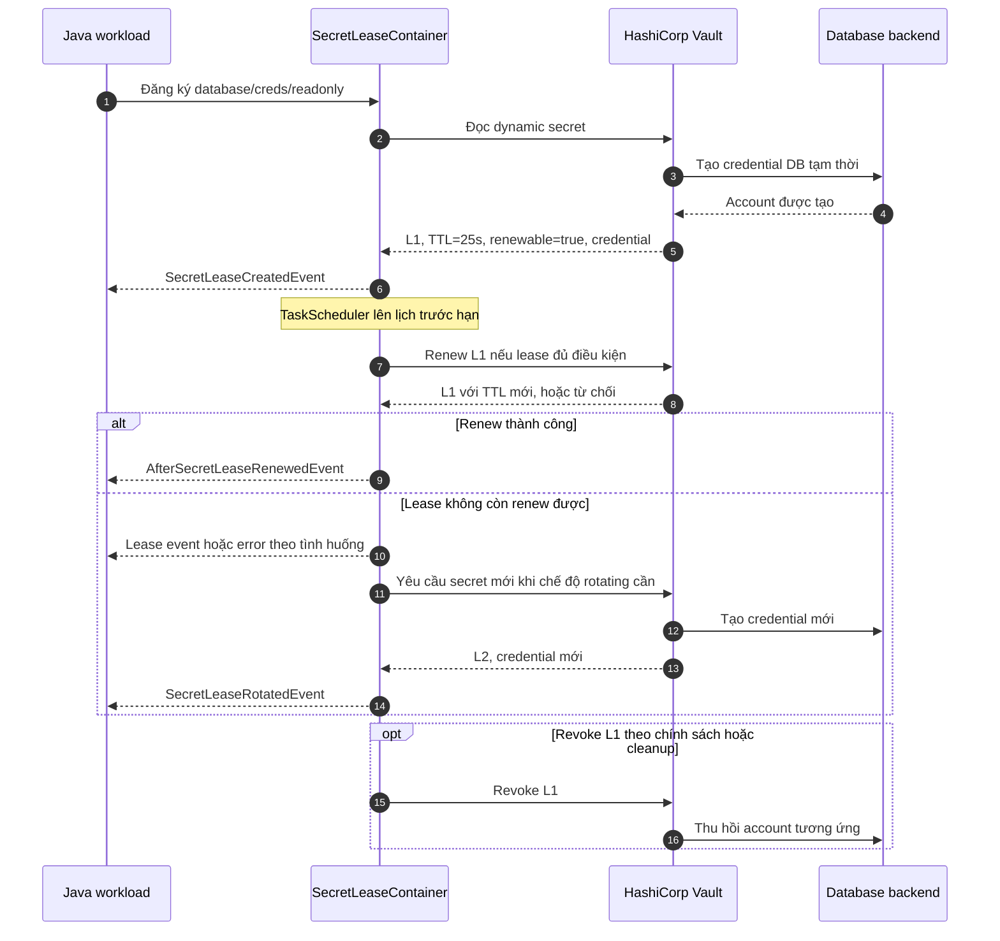
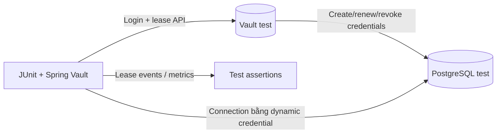

# Kiểm thử vòng đời bằng TTL ngắn và thời gian có kiểm soát trong Spring Vault

## 1. Tại sao phải kiểm thử vòng đời lease thay vì chỉ đọc được secret?

Trong ứng dụng Java sử dụng **Spring Vault**, `VaultTemplate` có thể đọc KV secrets, gọi Transit encryption, yêu cầu chứng thư PKI hoặc lấy **dynamic credentials** từ HashiCorp Vault. Đọc được dữ liệu ở thời điểm khởi động chỉ xác minh bước đầu; một ứng dụng chạy nhiều giờ hoặc nhiều ngày còn phải đối phó với **secret hết hạn**, **lease gia hạn thất bại**, **credential bị thu hồi** và **secret mới được cấp để thay thế**.

Ví dụ, `orders-service` cần kết nối PostgreSQL bằng username/password do Vault Database Secrets Engine cấp. Vault trả một cặp credential động có **lease ID**, **TTL** và cờ `renewable`. Nếu không có logic giữ credential hợp lệ, ứng dụng có thể vẫn dùng connection pool chứa account đã hết hiệu lực. Nếu rotation làm thay đổi username/password mà connection pool không nạp lại dữ liệu, việc nhận secret mới trong Spring Vault cũng chưa đủ để giữ hệ thống hoạt động.

Vì vậy, kiểm thử vòng đời không nên chỉ gọi `vault.read("database/creds/readonly")` và khẳng định "có username là PASS". Bài học thuộc chương **Vòng đời lease** của module **SPRING_VAULT**; nội dung tập trung vào cách **rút ngắn TTL để tái hiện vòng đời**, **điều khiển thời gian trong unit test**, **quan sát renew/rotation/revoke trên Vault thật** và **kiểm tra phản ứng của ứng dụng**.

Mục tiêu sau bài học:

1. Phân biệt lease của **dynamic secret**, lease/TTL của **Vault token**, hiệu lực của chứng thư PKI và secret KV thông thường.
2. Hiểu những điều cần assert khi lease được tạo, renew, hết hạn, revoke hoặc thay thế.
3. Chọn ngưỡng `minRenewal` và `expiryThreshold` phù hợp khi dùng TTL ngắn với `SecretLeaseContainer`.
4. Viết unit test không chờ thời gian thật bằng `Clock` giả lập và thiết kế scheduler kiểm thử chủ động.
5. Viết integration test có deadline rõ ràng, dùng Vault test + backend phù hợp, không dựa vào `Thread.sleep(...)` đoán thời điểm.
6. Xác minh sự kiện và trạng thái downstream, có cleanup, metric, audit và xử lý lỗi để bài test ít chập chờn.

## 2. Cần hiểu chính xác đối tượng đang đếm TTL

| Đối tượng | Nguồn phát hành | Vòng đời chính | Test thích hợp |
| --- | --- | --- | --- |
| **Dynamic secret lease** | Database/AWS/engine có cơ chế phát hành credential động | Cấp credential → renew nếu cho phép → hết hạn hoặc revoke → credential không còn đáng tin cậy | `SecretLeaseContainer`, `vault lease lookup/renew/revoke`, xác minh backend |
| **Vault login token** | Auth method (AppRole, Kubernetes, cert, cloud auth...) | Login → renew theo token TTL → re-login hoặc revoke | `SessionManager` / `LifecycleAwareSessionManager`, `vault token lookup` |
| **KV v1/v2 secret** | KV secrets engine | Dữ liệu lưu trữ, cập nhật phiên bản; không tự tạo dynamic lease như database | Test đọc/ghi/version/policy, **không** dùng để giả lập dynamic lease |
| **Transit response** | Transit secrets engine | Mã hóa/giải mã, key rotation; không phải dynamic credential lease | Test ciphertext, key version, policy, lỗi |
| **PKI certificate** | PKI secrets engine | `notBefore`/`notAfter`, issuance/revocation; có thể kèm thông tin lease tùy endpoint/engine | Kiểm chứng hiệu lực X.509 và phản ứng client, không đồng nhất với lease database |

Một dynamic secret thường trả về những trường như:

```json
{
  "lease_id": "database/creds/readonly/<opaque-lease-id>",
  "lease_duration": 25,
  "renewable": true,
  "data": {
    "username": "<REDACTED>",
    "password": "<REDACTED>"
  }
}
```

Các giá trị giả trong ví dụ chỉ giúp minh họa cấu trúc; đừng đưa credential thật vào tài liệu hoặc log. `lease_duration` của Vault thường biểu diễn thời gian tính bằng **giây**. Không biến giá trị này thành `Instant` theo múi giờ hoặc coi nó là dấu thời gian Unix.

### 2.1. Lease ID là khóa quản lý, không phải credential

`lease_id` xác định một lease cụ thể để truy vấn, renew hoặc revoke. Nó **không phải** Vault token và không nên đưa vào `X-Vault-Token`. Một lần đọc lại `database/creds/readonly` có thể phát hành **credential mới và lease ID mới**, ngay cả khi role name không thay đổi.

Ví dụ thao tác quản trị trên môi trường thử nghiệm:

```bash
vault lease lookup "<LEASE_ID>"
vault lease renew -increment=20s "<LEASE_ID>"
vault lease revoke "<LEASE_ID>"
```

Quyền gọi `sys/leases/lookup`, renew hoặc revoke cần được cấp rõ theo policy. Các lệnh này phải chạy bằng danh tính test có quyền tương ứng; không cấp `sudo`/root token cho ứng dụng chỉ để quản lý lease.

### 2.2. Token cha và secret lease liên quan nhưng không cùng một TTL

Vault thường gắn các lease cấp bởi một **service token** với token đó. Nếu token cha bị revoke hoặc hết hiệu lực, các lease con liên quan có thể bị revoke. Ngược lại, **gia hạn token cha không tự động gia hạn mọi lease secret**.

Hãy test độc lập:

- **Token lifecycle:** lần đăng nhập, TTL, token renew, token bị revoke, khả năng re-login.
- **Secret lifecycle:** lease của `database/creds/readonly`, renew/rotation của credential, revoke và cập nhật credential cho client dùng database.
- **Quan hệ token–lease:** token bị revoke làm credential động có thể bị thu hồi theo quan hệ lease của Vault, dù secret lease còn TTL trên giấy.

Một test nhận mã HTTP 403 khi đọc Vault có thể do token không hợp lệ hoặc do policy path không có quyền; điều đó **không chứng minh** credential database đã hết lease.

## 3. Xác định các mốc thời gian cần kiểm soát

Một bài test TTL có thể mô hình hóa:

- `t0`: yêu cầu secret; Vault phát hành lease `L1` với `lease_duration = 25s`.
- `tRenew`: ứng dụng lên lịch renew trước khi lease hết hạn.
- `tExpiry`: hạn hiệu lực của lease theo Vault; có thể thay đổi sau renew thành công.
- `tRevoke`: người quản trị hoặc ứng dụng chủ động revoke lease.
- `tRotate`: ứng dụng yêu cầu secret mới và nhận lease `L2` khi cần thay thế.



Sơ đồ diễn tả **mô hình logic**, không cam kết thứ tự sự kiện đồng nhất cho mọi backend hoặc lần renew thất bại. Spring Vault chỉ biết rằng lease cần kiểm tra tại các thời điểm lên lịch; Vault không tự đẩy một event hết hạn qua network tới ứng dụng. Nếu thread scheduler bị chậm, **`SecretLeaseExpiredEvent` có thể xuất hiện muộn hơn thời điểm lease thực sự hết hiệu lực**.

### 3.1. Không lấy `t0 + TTL` làm chân lý tuyệt đối

TTL trong response là **thời gian hiệu lực còn lại tại lúc Vault phản hồi**, có thể đã giảm khi client nhận được. Vault có thể áp dụng default TTL, max TTL, explicit max TTL và role/backend limits. Nếu gọi `renew` với `increment=20s`, Vault **không bắt buộc** cấp đúng 20 giây; phải đọc lại TTL thực tế.

Đối với kiểm thử tích hợp, hãy ghi lại đồng hồ tại **thời điểm nhận response**, tính một khoảng thời gian thử nghiệm có dung sai cho network/scheduler, và dùng `vault lease lookup` hoặc một phép thử downstream để kiểm tra trạng thái thật khi cần. Không assert một event phải tới đúng mili-giây `t0 + 25_000ms`.

## 4. Thiết kế bộ test ba lớp

| Lớp test | Kiểm soát thời gian | Đối tượng kiểm chứng | Tốc độ và mức tin cậy |
| --- | --- | --- | --- |
| **Unit test logic thời gian** | `Clock.fixed(...)` / `Clock.offset(...)` | Điều kiện gần hạn, đã hạn, renewable/non-renewable, quyết định renew/rotate | Nhanh, quyết định tuyệt đối, không chờ |
| **Component test scheduler + Vault giả lập** | `TaskScheduler` kiểm thử có virtual clock và hàng đợi task | Thời điểm đặt lịch, huỷ lịch, retries, dispatch event, shutdown | Nhanh nếu mô phỏng scheduler đúng hợp đồng |
| **Integration test Vault thật** | TTL ngắn **có thực**, deadline hữu hạn, polling sự kiện/lease | Vault API, auth, backend credential, renew, revoke, token–lease | Chậm hơn, chịu độ trễ network/OS, cần dung sai |

**Nguyên tắc:** dùng virtual time để chứng minh công thức/thứ tự mà ứng dụng kiểm soát; dùng Vault thật để chứng minh engine thực thi **lease API và credential lifecycle**; không cố bắt tích hợp bên ngoài có tốc độ và lịch chạy chính xác đến từng mili-giây.

Tránh hai cực đoan:

1. Mọi unit test đều gọi `Thread.sleep(30_000)`, khiến CI chậm và thất thường khi máy quá tải.
2. Mọi bài test chỉ dùng mock `VaultResponse`, rồi tuyên bố credential PostgreSQL chắc chắn bị revoke khi lease hết hạn. Mock không thực hiện hành động tại backend.

## 5. `SecretLeaseContainer` và những điểm điều khiển TTL

Trong Spring Vault, `SecretLeaseContainer` là thành phần quản lý các secrets có lease. Khi bắt đầu, nó lấy secret đã đăng ký, theo dõi TTL, lên lịch renew và có thể thay bằng secret mới tùy `RequestedSecret`.

| API | Ý nghĩa thực tế trong bài test |
| --- | --- |
| `requestRenewableSecret(path)` | Đăng ký secret theo hướng **renew lease**; không giả định luôn tự cấp credential mới |
| `requestRotatingSecret(path)` | Đăng ký secret có thể **renew và rotate** khi cần; nhận secret mới theo vòng đời |
| `setMinRenewal(Duration)` | Khoảng tối thiểu giữa các lượt renew, tránh renew quá liên tục |
| `setExpiryThreshold(Duration)` | Khoảng đệm được dùng để tính thời điểm renew trước khi lease hết hạn |
| `setTaskScheduler(TaskScheduler)` | Scheduler quản lý công việc nền; cũng là điểm thay scheduler trong component test |
| `setLeaseStrategy(...)` | Quy tắc xử lý renew errors; cần xác minh phiên bản và chính sách được cấu hình |
| `addLeaseListener(...)` | Quan sát created, renewed, expired, rotated events |
| `addErrorListener(...)` | Quan sát lỗi truy cập secret, renew, rotate, revoke |
| `start()` / `stop()` | Bắt đầu hoặc ngừng quản lý; `stop()` ngừng scheduling nhưng không mặc nhiên revoke mọi lease |
| `destroy()` | Dọn vòng đời và có thể revoke các lease mà container đang quản lý; cần dùng cẩn thận ở test |

### 5.1. Vấn đề rất quan trọng khi TTL quá ngắn

Tài liệu Spring Vault cho biết các giá trị mặc định thông dụng của `SecretLeaseContainer` là **`expiryThreshold = 1m`** và **`minRenewal = 10s`**. Nếu backend cấp lease chỉ **5 giây**, ngưỡng mặc định đã lớn hơn TTL: container có thể xem lease gần hết/hết hạn ngay khi vừa nhận, gây kết quả khác kỳ vọng và khiến test không có ý nghĩa về quy trình renew.

Với test có TTL khoảng **25–30 giây**, có thể đặt ngưỡng thử nghiệm nhỏ hơn, chẳng hạn:

```java
container.setMinRenewal(Duration.ofSeconds(2));
container.setExpiryThreshold(Duration.ofSeconds(5));
```

Các con số ở đây dành cho môi trường test. **Không có một giá trị đúng cho mọi version, backend hoặc độ trễ**. Khi vận hành thật, chọn TTL/threshold theo nhu cầu uptime, số lượng lease, tốc độ renew và giới hạn auth backend.

Một lịch minh họa khi Vault trả TTL 25 giây:

```text
t=0s            RequestedSecret nhận lease L1, TTL 25s
t≈20s           Đến thời điểm dự kiến renew trước hạn 5s
t≈20s + mạng    Vault trả TTL mới nếu renew thành công
t>25s           Nếu không renew thành công, có nguy cơ lease hết hạn
```

**Đây chỉ là lịch xấp xỉ**: scheduler, lỗi mạng, trễ JVM và cách xử lý minRenewal/expiryPredicate có thể làm thời gian thực tế khác. Đừng kiểm thử bằng điều kiện tuyệt đối `event.timestamp == 20_000`.

### 5.2. Cấu hình container cho môi trường kiểm thử

Ví dụ JavaConfig dành cho một test context Spring, giả định `VaultOperations` và `TaskScheduler` đã được cấu hình:

```java
import java.time.Duration;

import org.springframework.context.annotation.Bean;
import org.springframework.context.annotation.Configuration;
import org.springframework.scheduling.TaskScheduler;
import org.springframework.vault.core.VaultOperations;
import org.springframework.vault.core.lease.SecretLeaseContainer;

@Configuration
class TestSecretLeaseConfiguration {

    @Bean
    SecretLeaseContainer secretLeaseContainer(
            VaultOperations vaultOperations,
            TaskScheduler taskScheduler) {

        SecretLeaseContainer container =
                new SecretLeaseContainer(vaultOperations, taskScheduler);

        // Chỉ dùng mức này cho integration test TTL ngắn.
        container.setMinRenewal(Duration.ofSeconds(2));
        container.setExpiryThreshold(Duration.ofSeconds(5));

        // Khi Spring quản lý bean, lifecycle sẽ được container xử lý.
        return container;
    }
}
```

Sau đó đăng ký secret ở bước setup **trước khi quan sát các sự kiện mong muốn**, ví dụ:

```java
RequestedSecret requested = container.requestRotatingSecret(
        "database/creds/readonly");
container.addLeaseListener(listener);
```

Trong Spring-managed context, `SecretLeaseContainer` là bean có lifecycle (`SmartLifecycle`). Đăng ký listener sau khi secret được lấy có thể bỏ lỡ `SecretLeaseCreatedEvent`; nên chuẩn bị listener và registration trước thời điểm `start()` hoặc dùng `register(secret, listener)` theo hợp đồng API phù hợp. Trong test tạo đối tượng thủ công, cần gọi `afterPropertiesSet()`, `start()` và `destroy()` đúng vòng đời.

**Cảnh báo trùng bean:** nếu Spring Cloud Vault đã tự tạo/điều hành `SecretLeaseContainer` cho ConfigData, đừng vô tình đăng ký/renew cùng secret bằng một container thứ hai khi chưa xét rõ ownership. Hai bộ quản lý lease độc lập có thể tạo nhiều credentials, nhiều renew/revoke và làm audit khó đọc.

## 6. Viết unit test không chờ thời gian thật bằng `Clock`

Bất kỳ chính sách ứng dụng nào sử dụng deadline và renewal window đều nên nhận `java.time.Clock` như dependency. Điều này cho phép dịch thời gian trong test mà không đổi đồng hồ máy CI.

### 6.1. Một bộ quyết định tối giản

Ví dụ dưới đây là **logic ứng dụng do ta tự viết để minh họa kiểm thử thời gian**, **không phải implementation bên trong `SecretLeaseContainer`**:

```java
import java.time.Clock;
import java.time.Duration;
import java.time.Instant;

enum LeaseAction {
    KEEP,
    RENEW,
    ROTATE
}

record LeaseSnapshot(Instant expiresAt, boolean renewable) {}

final class LeaseDecision {

    static LeaseAction decide(
            LeaseSnapshot lease,
            Clock clock,
            Duration renewWindow) {

        Instant now = clock.instant();

        if (!now.isBefore(lease.expiresAt())) {
            return LeaseAction.ROTATE;
        }

        Instant renewFrom = lease.expiresAt().minus(renewWindow);
        if (lease.renewable() && !now.isBefore(renewFrom)) {
            return LeaseAction.RENEW;
        }

        return LeaseAction.KEEP;
    }
}
```

Trong policy minh họa này, lease non-renewable được giữ đến khi hết hạn rồi đề nghị rotate; lease renewable bắt đầu đề nghị renew khi còn dưới hoặc bằng `renewWindow`. Hãy kiểm tra thêm `renewWindow >= 0` nếu hàm trở thành code production và định nghĩa rõ hành động khi renew thất bại.

### 6.2. JUnit 5 kiểm tra chính xác ba điểm thời gian

```java
import static org.junit.jupiter.api.Assertions.assertEquals;

import java.time.Clock;
import java.time.Duration;
import java.time.Instant;
import java.time.ZoneOffset;
import org.junit.jupiter.api.Test;

class LeaseDecisionTest {

    @Test
    void keepsThenRenewsThenRotatesWithoutSleeping() {
        Clock atStart = Clock.fixed(
            Instant.parse("2030-05-01T00:00:00Z"),
            ZoneOffset.UTC);

        LeaseSnapshot lease = new LeaseSnapshot(
            Instant.parse("2030-05-01T00:00:25Z"),
            true);

        Duration renewWindow = Duration.ofSeconds(5);

        assertEquals(LeaseAction.KEEP,
            LeaseDecision.decide(lease, atStart, renewWindow));

        Clock atBoundary = Clock.offset(atStart, Duration.ofSeconds(20));
        assertEquals(LeaseAction.RENEW,
            LeaseDecision.decide(lease, atBoundary, renewWindow));

        Clock afterExpiry = Clock.offset(atStart, Duration.ofSeconds(25));
        assertEquals(LeaseAction.ROTATE,
            LeaseDecision.decide(lease, afterExpiry, renewWindow));
    }

    @Test
    void nonRenewableLeaseDoesNotRequestRenewal() {
        Clock time = Clock.fixed(
            Instant.parse("2030-05-01T00:00:23Z"),
            ZoneOffset.UTC);

        LeaseSnapshot lease = new LeaseSnapshot(
            Instant.parse("2030-05-01T00:00:25Z"),
            false);

        assertEquals(LeaseAction.KEEP,
            LeaseDecision.decide(
                lease, time, Duration.ofSeconds(5)));
    }
}
```

Ưu điểm của bài này:

- Không có `sleep`; test nhanh và cho kết quả lặp lại được.
- Thời điểm `t=20s` được kiểm tra **đúng biên renewWindow**.
- Có thể bổ sung các ca trước biên 1 nanosecond, sau biên, lease đã hết hạn, boolean `renewable=false`.
- Không phụ thuộc timezone của máy vì sử dụng `Instant`/`ZoneOffset.UTC`.
- Dễ thêm bảng property-based testing với nhiều TTL và renewal window.

**Giới hạn:** `Clock.offset(...)` ở đây chỉ chi phối **hàm `LeaseDecision.decide(...)`**. Nó **không** làm HashiCorp Vault ngoài process trôi nhanh thời gian và cũng không tự kích hoạt task đã hẹn trong scheduler thật của Spring.

## 7. Kiểm thử scheduling có virtual time: kiểm soát cả Clock lẫn task queue

Để kiểm tra `SecretLeaseContainer` tự lên lịch, một `Clock` giả **một mình là chưa đủ**. Container thực thi renew/rotate thông qua `TaskScheduler`. Một test double đủ tốt cần:

1. Công bố đồng hồ có thể điều khiển (qua hợp đồng scheduler version đang dùng).
2. Lưu những task được lên lịch theo thời điểm `Instant` hoặc trigger.
3. Cho phép test gọi `advanceBy(Duration)` rồi **chạy các task đã đến hạn** trong thứ tự xác định.
4. Hỗ trợ huỷ `ScheduledFuture` khi container stop/destroy.
5. Quan sát request renew/revoke qua fake `VaultOperations` hoặc HTTP test double.
6. Cho phép dọn sạch mọi scheduled task sau test.

Một cấu trúc test có thể biểu diễn:

```text
clock = 2030-05-01T00:00:00Z
fakeVault.read(database/creds/readonly) -> L1, TTL 25s, renewable=true
container.start()
assert event Created(L1)

testScheduler.advanceBy(19s)
assert renewCalls == 0

testScheduler.advanceBy(2s)
assert renewCalls >= 1
fakeVault.renew(L1) -> TTL mới

assert event AfterSecretLeaseRenewed(L1)
```

Đây là **pseudo-code của test scheduler**, không phải API `advanceBy` có sẵn của `TaskScheduler`. Việc xây dựng test double phải tuân thủ interface, kiểu `ScheduledFuture` và phương thức clock của Spring Framework version đang dùng.

Nếu dùng **virtual time của Reactor**, lưu ý nó chỉ điều khiển scheduler Reactor tương ứng; không mặc nhiên điều khiển một `ThreadPoolTaskScheduler` dùng thread thật. Khi tích hợp imperative Spring Vault, phải kiểm soát đúng scheduler mà `SecretLeaseContainer` đang thực sự dùng.

### 7.1. Không tự ý chuyển đồng hồ hệ thống của CI

Tránh thay giờ máy, timezone hệ điều hành hoặc dùng lệnh chỉnh NTP trong pipeline. Cách đó tác động tất cả tác vụ khác (TLS, database, JVM, Docker) và làm kết quả khó tái hiện. Dùng `Clock`/scheduler giả lập cho unit/component test; dùng thời gian thực và timeout bounded cho integration test.

## 8. Kiểm thử tích hợp với Vault thật và lease 25 giây

### 8.1. Chuẩn bị môi trường cách ly

Cần có:

- **HashiCorp Vault test** (có thể chạy container/dev server cô lập) và audit log dành cho test.
- Một **database secrets engine** đã liên kết tới PostgreSQL/MariaDB test, có role tên `readonly` dưới mount `database`.
- Role được cấu hình **`default_ttl ≈ 25s`** và **`max_ttl ≈ 90s`** trong môi trường test, backend cho phép renew nếu test muốn kiểm tra renew.
- Vault token của ứng dụng chỉ có quyền lấy credentials và vận hành lease cần thiết; operator test có quyền lookup/revoke theo chuẩn riêng.
- Một database độc lập, cho phép kiểm tra account được tạo/revoke mà không ảnh hưởng hệ thống thật.

Ví dụ operator **đã cấu hình database connection** và tạo role cho test:

```bash
# Ví dụ: database/config/test-pg đã được cài bởi operator.
# Đọc command chuẩn xác cho backend/role trước khi dùng.
vault write database/roles/readonly \
  db_name="test-pg" \
  creation_statements="CREATE ROLE \"{{name}}\" WITH LOGIN PASSWORD '{{password}}' VALID UNTIL '{{expiration}}';" \
  default_ttl="25s" \
  max_ttl="90s"
```

Cú pháp `creation_statements` phụ thuộc backend và cấu hình database; ví dụ dùng kiểu PostgreSQL. Phải bảo đảm Vault có quyền tạo và thu hồi account, chính sách role chỉ cấp quyền tối thiểu; nếu database engine chưa được cấu hình đầy đủ, lệnh `vault write` ở đây **không thể tự hoàn tất setup**.

**Vì sao không dùng KV v2?** KV không phát hành dynamic secret lease theo nghĩa quản lý lifetime của database credentials, dù có trường metadata liên quan; test KV không tạo bằng chứng renew/revoke dynamic credential.

### 8.2. Đọc một secret lease mà không in credential

```bash
# Chỉ lấy metadata, không echo username/password.
vault read -format=json database/creds/readonly \
  | jq '{lease_id, lease_duration, renewable}'

# Ở phiên test riêng, lưu lease ID để chạy các bước tiếp theo:
LEASE_ID="$(vault read -format=json database/creds/readonly \
  | jq -r '.lease_id')"
```

**Chú ý:** hai lệnh `vault read` ở trên phát hành **hai lease khác nhau**. Nếu muốn thử đúng một lease, hãy chỉ chạy lệnh thứ hai rồi dùng `vault lease lookup "$LEASE_ID"` để quan sát thông tin. Tránh để secret/lease không được dọn; test phải thu hồi lease đã cấp dù testcase lỗi.

Để tránh stdout chứa credential, dùng đúng một lần đọc và chỉ xuất metadata:

```bash
LEASE_ID="$(vault read -format=json database/creds/readonly \
  | jq -r '.lease_id')"

vault lease lookup "$LEASE_ID"
```

Không ghi lease ID trong log công khai nếu chính sách tổ chức xem metadata này nhạy cảm; dùng lease ID trong shell test ngắn hạn và cleanup an toàn.

### 8.3. Test renew có kiểm chứng bằng kết quả thật

```bash
# Vault quyết định số giây thực sự được phép, không nhất thiết = 20s.
vault lease renew -increment=20s "$LEASE_ID"

# Truy vấn TTL còn lại sau renew.
vault lease lookup "$LEASE_ID"
```

Nên assert:

- Lệnh renew thành công khi lease có `renewable=true` và chưa chạm max TTL.
- `lease_id` thường giữ nguyên vì **renew kéo dài lease hiện tại**, không tạo account mới.
- TTL sau renew là **giá trị Vault thực trả**, có thể nhỏ hơn increment yêu cầu.
- Sau đủ thời gian hoặc khi đạt max TTL, renew có thể bị từ chối/không kéo dài nữa; không diễn giải mặc định rằng đó là lỗi Spring Vault.

Nếu cần kiểm tra gia hạn **thực sự kéo dài hiệu lực**, so sánh deadline tương đối bằng `lease lookup` và kiểm tra credential vẫn được backend chấp nhận **sau khi đã đi qua hạn gốc** (nếu chính sách backend cho phép). Không chỉ assert response HTTP 200 mà bỏ qua tính hợp lệ của credential.

### 8.4. Test revoke và tác động downstream

```bash
vault lease revoke "$LEASE_ID"

# Với backend đã xử lý revoke thành công, lookup có thể không còn lease.
vault lease lookup "$LEASE_ID"
```

Kết quả lookup sau revoke thường báo không tìm thấy hoặc lỗi tương ứng. Nhưng điều quan trọng hơn là **account DB thử nghiệm không còn được dùng theo hợp đồng revocation của backend**. Khi kiểm thử downstream, phân biệt:

- **Tạo kết nối mới** với username/password cũ → phải bị từ chối sau khi revocation đã được backend xử lý, nếu backend cấu hình thu hồi account tương ứng.
- **Kết nối đang mở sẵn** có thể tồn tại trong một khoảng thời gian hoặc có semantics riêng của database/pool. Không lấy việc một session cũ còn hoạt động làm bằng chứng chắc chắn rằng revoke không chạy.
- Nếu Vault không gọi được backend khi revoke, có thể gặp **irrevocable lease** hoặc lỗi vận hành. Test phải báo lỗi thực, không giả định Vault luôn thu hồi thành công ngay tức khắc.

**Cleanup:** sau testcase thành công/thất bại, revoke toàn bộ lease test còn sống và dọn account/container thử nghiệm theo ownership. Không dùng `vault lease revoke -prefix database/creds` trên môi trường chia sẻ, vì thao tác đó có thể thu hồi credential của workload khác.

## 9. Quan sát events của `SecretLeaseContainer` trong integration test

Spring Vault phát các sự kiện như:

| Event | Diễn giải | Điều cần assert |
| --- | --- | --- |
| `SecretLeaseCreatedEvent` | Container đã lấy secret và lease ban đầu | Bài test nhận được event gắn với `RequestedSecret` cần theo dõi |
| `AfterSecretLeaseRenewedEvent` | Lease đã được renew | Có event khi backend cho phép và renew thật thành công |
| `SecretLeaseExpiredEvent` | Container quan sát lease hết hạn | Có thể tới **sau** thời điểm hết hạn thật |
| `SecretLeaseRotatedEvent` | Secret đã được thay bằng secret mới | Credential/lease mới được đưa tới phần tiêu thụ theo thiết kế |
| `BeforeSecretLeaseRevocationEvent` / `AfterSecretLeaseRevocationEvent` | Trước/sau thao tác revoke do container quản lý | Phân biệt event của container với thao tác revoke ngoại bộ |
| `SecretLeaseErrorEvent` hoặc `LeaseErrorListener` | Lỗi trong đọc, renew, rotate hoặc revoke | Test ghi nhận loại lỗi và xử lý retry/fallback phù hợp |

### 9.1. Một mẫu JUnit chờ event bằng latch, không sleep đoán giờ

Đoạn test sau minh họa kiểm tra sự kiện **Created** khi dùng Vault Database backend thật. `VaultOperations` là dependency của integration test đã cấu hình; để chạy cần JUnit 5, Spring Vault và `TaskScheduler` đúng phiên bản.

```java
import static org.junit.jupiter.api.Assertions.assertTrue;

import java.time.Duration;
import java.util.concurrent.CountDownLatch;
import java.util.concurrent.TimeUnit;

import org.junit.jupiter.api.Test;
import org.junit.jupiter.api.Timeout;
import org.springframework.scheduling.concurrent.ThreadPoolTaskScheduler;
import org.springframework.vault.core.VaultOperations;
import org.springframework.vault.core.lease.SecretLeaseContainer;
import org.springframework.vault.core.lease.domain.RequestedSecret;
import org.springframework.vault.core.lease.event.LeaseListenerAdapter;
import org.springframework.vault.core.lease.event.SecretLeaseCreatedEvent;
import org.springframework.vault.core.lease.event.SecretLeaseEvent;

class SecretLeaseIntegrationTest {

    // Do Spring Test inject từ test application context.
    private final VaultOperations vaultOperations;

    SecretLeaseIntegrationTest(VaultOperations vaultOperations) {
        this.vaultOperations = vaultOperations;
    }

    @Test
    @Timeout(30)
    void obtainsSecretLeaseAndCleansUp() throws Exception {
        ThreadPoolTaskScheduler scheduler = new ThreadPoolTaskScheduler();
        scheduler.setPoolSize(1);
        scheduler.setThreadNamePrefix("lease-test-");
        scheduler.initialize();

        SecretLeaseContainer leases =
            new SecretLeaseContainer(vaultOperations, scheduler);

        try {
            leases.setMinRenewal(Duration.ofSeconds(2));
            leases.setExpiryThreshold(Duration.ofSeconds(5));

            RequestedSecret requested =
                leases.requestRotatingSecret("database/creds/readonly");
            CountDownLatch created = new CountDownLatch(1);

            leases.addLeaseListener(new LeaseListenerAdapter() {
                @Override
                public void onLeaseEvent(SecretLeaseEvent event) {
                    if (requested.equals(event.getSource())
                            && event instanceof SecretLeaseCreatedEvent) {
                        created.countDown();
                    }
                }
            });

            // Tạo container thủ công: khởi tạo rồi start rõ ràng.
            leases.afterPropertiesSet();
            leases.start();

            assertTrue(
                created.await(10, TimeUnit.SECONDS),
                "Expected SecretLeaseCreatedEvent within deadline");
        } finally {
            // Thao tác dọn lifecycle có thể revoke lease thử nghiệm.
            try {
                leases.destroy();
            } finally {
                scheduler.shutdown();
            }
        }
    }
}
```

**Điều kiện bổ sung để chạy thật:** cấu hình Spring Test context và inject `VaultOperations`, ví dụ dùng `@SpringBootTest` với constructor injection thích hợp hoặc cung cấp `VaultOperations` qua test fixture. Code minh họa **phần lõi test**, chưa phải một file có đủ annotation/fixture để copy chạy độc lập.

Khi test renew, thêm `CountDownLatch renewed` và listener kiểm tra `event instanceof AfterSecretLeaseRenewedEvent`; cấu hình TTL backend để renewal có cơ hội xảy ra rồi chờ tối đa theo deadline có dung sai, ví dụ `renewed.await(35, TimeUnit.SECONDS)`. Không bắt mọi test phải đợi 35 giây: tách test renew có TTL thực thành **integration suite**; unit/component test dùng virtual time nên chạy trong vài mili-giây.

**Tránh overclaim:** chỉ thấy `AfterSecretLeaseRenewedEvent` chứng minh container đã nhận renew thành công, chưa chứng minh application đã cập nhật **connection pool** hoặc rằng credential database vẫn dùng được sau hạn ban đầu. Kiểm tra consumer/backend riêng khi cần.

### 9.2. Khi test muốn quan sát rotation thật

Dùng `requestRotatingSecret("database/creds/readonly")`, chuẩn bị backend có điều kiện không thể renew hoặc đã tới max TTL, rồi quan sát:

1. `SecretLeaseCreatedEvent` với lease `L1`.
2. Lượt renew cuối cùng hoặc tình huống lease không còn hợp lệ.
3. `SecretLeaseRotatedEvent`/lease mới `L2` khi container thực hiện rotation.
4. Hệ thống sử dụng credential mới và có thể tạo kết nối DB mới.
5. Credential cũ không còn được dùng theo chính sách revocation.

Không assert `L2` có một số byte khác `L1` dựa trên format có thể thay đổi; kiểm tra ít nhất lease ID hoặc một identity/version thích hợp nếu backend thực sự tạo lease mới. Cũng không gửi username/password về telemetry; dùng test fixture bảo vệ secret.

## 10. Các ca lỗi cần kiểm thử với TTL ngắn

| Ca | Cách gây lỗi trong môi trường test | Kết quả đúng cần quan sát |
| --- | --- | --- |
| **Không renewable** | Backend test trả `renewable=false` hoặc lease test double tương ứng | Không renew mù quáng; chuyển theo cơ chế rotation/expiration đã chọn |
| **Max TTL đã tới** | Role test có `max_ttl` thấp và chạy đủ renew cycle | Renew không thể kéo dài vô hạn; cần credential mới nếu ứng dụng còn hoạt động |
| **Vault HTTP 429/5xx** | Test proxy giả lập lỗi trên `sys/leases/renew` | Retry/backoff hữu hạn, không tăng vô hạn số task/login |
| **Vault mất mạng** | Network fault trong test, giữ JVM chạy | Báo error event, telemetry và khả năng phục hồi khi mạng trở lại |
| **Lease bị revoke bên ngoài** | Operator chỉ revoke lease `L1` của test | Các lần renew/lookup sau phản ánh trạng thái revoked; consumer xử lý credential cũ |
| **Token cha bị revoke** | Revoke Vault **test token** sở hữu lease | Tách lỗi session token và secret lease, xác minh quan hệ revoke |
| **Scheduler bị delay** | Fake scheduler không chạy task tới sau hạn | Không giả định renew có thể phục hồi lease đã hết hạn; cần rotate theo chính sách |
| **Backend revoke thất bại** | Database tạm mất mạng tại lúc Vault thu hồi account | Ghi nhận trạng thái lỗi/irrevocable; không tự tuyên bố account đã bị vô hiệu |
| **Shutdown giữa renew** | Đóng container có task đang lên lịch | Không dùng secret sau cleanup; thread scheduler/tài nguyên được dọn đúng |
| **Rotation nhưng connection pool giữ mật khẩu cũ** | Pool đã tạo connection bằng L1 trước khi nhận L2 | Pool/consumer phải nạp credential mới hoặc được restart theo kiến trúc |

Với những API có side effects như PKI issuance, không tự retry theo vòng lặp chỉ vì một lease event đến trễ. Thử nghiệm phải xác minh tính idempotent hoặc xây dựng cleanup cho mọi kết quả đã được tạo.

### 10.1. Phân biệt lỗi transport, auth và lease

Một renew failure có thể bắt nguồn từ:

- Token gọi `sys/leases/renew` không còn hợp lệ.
- Token hợp lệ nhưng Vault policy thiếu quyền renew.
- Lease không renewable, đã hết hạn hoặc vượt max TTL.
- Vault/backend không truy cập được, HTTP 5xx hoặc timeout.
- Sai lease endpoint do cấu hình phiên bản hoặc mount path.
- Scheduler thread bị block hay bị tắt.

Mọi trường hợp trên đều có thể làm ứng dụng khó có credential mới, nhưng hành động khắc phục khác nhau. Một `permission denied` không nên được retry nhiều lần như một timeout mạng.

## 11. Vì sao event không thay thế việc kiểm tra credential đang được dùng?

`SecretLeaseContainer` quản lý việc yêu cầu, renew hoặc rotate **secret**. Nhưng ứng dụng còn có một phần khác: **đưa secret mới vào nơi sử dụng**.

Ví dụ JDBC connection pool `DataSource` được tạo từ username/password đầu tiên. Khi Vault cấp lease mới, application có thể nhận `SecretLeaseRotatedEvent`, nhưng:

- Một `HikariDataSource` có thể đã khởi tạo với mật khẩu cũ và giữ nó.
- Connection pool có thể duy trì connection cũ, hoặc fail khi tạo connection mới.
- Cập nhật một `Map`/property source không nhất thiết làm toàn bộ bean tạo trước đó nạp lại credential.
- Rotation yêu cầu logic wiring/connection pool lifecycle đã thiết kế và có kiểm thử riêng.

Bởi vậy, integration test nên đo **kết quả nghiệp vụ cụ thể**:

```text
Phase 1: request DB thành công qua account từ lease L1
Phase 2: lease renew hoặc rotation L1 → L2
Phase 3: ứng dụng thực sự chuyển sang credential còn hợp lệ
Phase 4: request DB tiếp tục thành công bằng session/connection mới
Phase 5: credential L1 bị thu hồi theo chính sách backend
```

Nếu hệ thống có đường kết nối không thể cập nhật trong runtime, đây là quyết định kiến trúc: có thể cần restart pool hoặc rolling restart ứng dụng khi secret thay đổi. Không dùng một event thành công như bằng chứng end-to-end mọi hoạt động đều đã được cập nhật.

## 12. Quy tắc kiểm thử thời gian để CI ít chập chờn

1. **Đo trạng thái, không đo ngủ:** thay `Thread.sleep(25000)` bằng đợi một điều kiện quan sát được (event, lease lookup, số lần renew) với deadline hữu hạn.
2. **TTL ngắn nhưng có khoảng an toàn:** backend TTL 20–30 giây, renewal threshold vài giây; đừng đặt TTL 1 giây rồi bắt toàn bộ pipeline TLS/Vault/DB xử lý chính xác trong 1 giây.
3. **Tách suite:** unit tests bằng fake clock chạy thường xuyên; integration tests dùng Vault thật có thể chạy ở pipeline phù hợp.
4. **So sánh thời gian tương đối:** dùng `Duration` và đồng hồ monotonic cho timeout trong process khi có thể; tránh dựa vào timezone/NTP wall clock của CI.
5. **Deadline rõ ràng:** mỗi đợt chờ phải có timeout, ví dụ 10 giây cho Created và một khoảng rộng hơn cho Renewed.
6. **Cho phép jitter có kiểm soát:** event có thể đến muộn do scheduler/network; kiểm tra trước/sau một vùng thời gian hợp lý, không assert chính xác mili-giây.
7. **Kiểm soát tài nguyên:** mỗi test dùng Vault namespace/mount/role/DB riêng hoặc định danh test độc lập để không va chạm lease của testcase khác.
8. **Cleanup trong `finally`:** stop/destroy container, scheduler, revoke lease test, dọn DB credentials/containers và không để thread nền rò rỉ.
9. **Không ngụy tạo TTL:** Vault trả TTL thực theo max TTL; đọc response/lookup rồi assert từ giá trị thật.
10. **Không log secrets:** credentials DB, Vault token, auth JWT, SecretId và private key không được xuất trong test reports hoặc build logs.

### 12.1. Cách viết assertion phù hợp

**Assertion dễ bị flaky:**

```java
Thread.sleep(20_000);
assertEquals(1, events.getRenewedCount()); // phụ thuộc máy và network
```

**Ý tưởng ổn định hơn:**

```java
assertTrue(
    renewedEvent.await(35, TimeUnit.SECONDS),
    "Expected renewal before test deadline"
);
```

Có thể dùng Awaitility hoặc polling với deadline nếu cần xác minh một predicate có giá trị. Nếu dùng polling, chọn chu kỳ đủ thưa để không tạo tải Vault và ghi rõ expected trạng thái terminal. Đối với unit test thuần, không cần `await`: tiến clock giả lập tới thời điểm mong muốn rồi gọi hàm quyết định ngay.

**Đừng gán cùng một deadline cho mọi môi trường:** timeout tại laptop, CI container, Vault test cluster có độ trễ khác nhau. Chọn từ budget thực tế, đồng thời bảo vệ test khỏi việc treo vô hạn.

## 13. Khi nào nên dùng Testcontainers?

Testcontainers hữu ích để dựng Vault thử nghiệm, PostgreSQL test và các thành phần cần thiết bằng container. Tuy nhiên:

- `VaultContainer`/container chỉ cung cấp quá trình chạy Vault; muốn test **database dynamic leases** bạn vẫn phải mount/configure database secrets engine, tạo database connection, role và policy test.
- Không dùng Vault dev/root token trong mã ứng dụng production. Root token có thể được test fixture dùng **chỉ để setup** và tạo token quyền hẹp cho ứng dụng đang kiểm thử.
- Không assert lease revoke bằng việc chỉ nhìn Vault response: nên xác minh kết quả thực ở database với một kết nối mới.
- Khi khởi động nhiều container, chờ readiness của Vault và PostgreSQL trước khi bắt đầu đo TTL. Không bắt đầu đồng hồ từ lúc Docker đang pull image.
- Network aliases, Vault URL, TLS và secret mount path cần được cấu hình đúng để client trong test container liên lạc được nhau; lỗi DNS không phải lỗi lease lifecycle.

Một kịch bản tích hợp ngắn:



Đối với module **SPRING_VAULT**, Testcontainers được dùng để xác minh ranh giới giữa Spring và Vault, còn các cơ chế auth workload thực tế (Kubernetes/Azure/AWS) có thể cần environment-specific tests khác. Không vì dùng container test mà suy ra mọi IAM cloud identity đều đã được kiểm chứng.

## 14. Tín hiệu giám sát và bảo mật trong test

Để biết một testcase đang diễn ra đúng vòng đời, nên ghi các thông tin **không nhạy cảm**:

| Tín hiệu | Ý nghĩa |
| --- | --- |
| `lease_created_total`, `lease_renewed_total`, `lease_rotated_total` | Đếm các sự kiện lifecycle |
| `lease_renew_failures_total` | Tách lỗi renew và lý do ở mức category |
| `lease_remaining_ttl_seconds` | Quan sát TTL còn lại, không dùng làm metric label chứa lease ID |
| `vault_request_duration_seconds` | Thời gian request Vault theo endpoint class |
| `db_connection_failures_total` | Kiểm chứng tác động downstream khi credential hết hạn/rotate |
| `scheduler_queue_depth` hoặc trạng thái worker | Phát hiện task renew bị backlog |
| Vault audit records tại `sys/leases/renew`/`revoke` | Chứng cứ Vault có nhận thao tác tương ứng hay không |

Đây là **ví dụ tên metric ứng dụng tự thiết kế**, không phải metric mặc định Spring Vault xuất sẵn. Tách metrics cho **Vault token renew** và **secret lease renew**, vì hai quá trình có timeline khác nhau. Không để username/password, JWT, Vault token, raw lease ID hoặc secret body trong label/log công khai.

### 14.1. Event listener chạy trên nhiều thread

Spring Vault có thể dispatch event trên **thread start container** hoặc **worker thread renew**. Test listener cần thread-safe, ví dụ `CountDownLatch`, `ConcurrentLinkedQueue` hoặc `AtomicInteger`. Không dùng `ArrayList` không đồng bộ rồi assert từ thread khác.

Khi listener làm việc nặng, nó có thể kéo dài tác vụ scheduler. Trong production, listener nên chuyển việc xử lý dài sang cơ chế thích hợp, nhưng phải giữ thứ tự/transactional semantics khi thay đổi credential. Trong test, listener chỉ nên ghi nhận sự kiện tối thiểu để tránh tạo trễ giả.

## 15. Tổng hợp các kịch bản kiểm thử nên có

| Mã | Thiết lập | Điều cần chứng minh |
| --- | --- | --- |
| L1 | Lease renewable, TTL 25s, threshold 5s | Container lấy lease, thực hiện renew thành công nếu Vault cho phép |
| L2 | Lease non-renewable | Không renew, hành vi hết hạn/rotate theo mode |
| L3 | Max TTL 90s, nhiều renewal | Không gia hạn vô hạn; thực tế chịu max TTL |
| L4 | Chủ động revoke L1 | Lease không còn hợp lệ; backend thu hồi credential đúng chính sách |
| L5 | Token cha hết hạn/revoke | Lease con có thể bị revoke theo quan hệ token/lease |
| L6 | Vault renew endpoint trả 5xx/429 | Retry bounded, error event và phục hồi nếu điều kiện phù hợp |
| L7 | Vault deny renew do ACL | Lỗi được phân loại, không retry vô hạn |
| L8 | Scheduler bị chậm qua tExpiry | Nhận thức đúng expiration; có rotation/fallback phù hợp |
| L9 | Secret được rotate L1 → L2 | Ứng dụng nạp được credential mới; DB connection mới hoạt động |
| L10 | Container bị destroy | Dọn task/lease test, không để credential/thread còn hoạt động ngoài kiểm soát |
| L11 | Hai instance/pod cùng request role | Lease IDs và vòng đời theo từng workload; không mặc định chia sẻ credential |
| L12 | KV v2 đọc nhiều lần | Không tạo dynamic lease từ KV; kiểm chứng khác biệt với database engine |

Khi chạy toàn bộ test suite, không cần để mọi testcase đều chờ hết 25–90 giây. Phần lớn trường hợp L2, L6, L7, L8 và state transitions có thể được mô phỏng bằng fake clock/scheduler/HTTP client, còn một nhóm nhỏ L1/L4/L5/L9 có thể dùng integration test thật.

## 16. Câu hỏi tự đánh giá

1. Vì sao `vault.read("secret/data/orders")` của KV v2 không phù hợp để kiểm chứng vòng đời dynamic secret lease?
2. Phân biệt TTL của Vault token và TTL của credential database trong một ứng dụng đang dùng `SecretLeaseContainer`.
3. Tại sao lease TTL 5 giây kết hợp ngưỡng `expiryThreshold = 1m` có thể làm integration test sai kỳ vọng?
4. `setMinRenewal(...)` và `setExpiryThreshold(...)` tác động đến scheduling khác nhau như thế nào?
5. Vì sao `Clock.offset(...)` giúp unit test nhanh nhưng không làm Vault server hết hạn lease sớm hơn?
6. Khi `SecretLeaseCreatedEvent` đã phát, có thể khẳng định JDBC pool đã dùng credential mới không? Vì sao?
7. Sự khác nhau giữa `requestRenewableSecret(...)` và `requestRotatingSecret(...)` là gì?
8. Tại sao `vault lease renew -increment=20s` không bảo đảm TTL được gia hạn đúng 20 giây?
9. Vì sao `SecretLeaseExpiredEvent` có thể được phát muộn hơn thời điểm Vault đã thu hồi credential?
10. Khi operator chủ động revoke lease, cần kiểm tra gì ngoài kết quả `vault lease lookup`?
11. Làm sao phân biệt lỗi renew do token/policy với lỗi renew do lease không renewable?
12. Vì sao test revocation phải xét kết nối DB **mới** và trạng thái connection pool cũ?
13. Khi testcase thất bại trước bước assert, cần cleanup Vault leases và scheduler như thế nào?
14. Khi nào cần test tích hợp bằng Vault + database thật, khi nào unit test bằng fake clock là đủ?

## 17. Checklist áp dụng trước khi đưa hệ thống vào production

- [ ] Xác định đúng secret động có lease ID/TTL; không suy đoán từ KV hoặc Transit response.
- [ ] Token login và secret lease được quản lý bởi thành phần đúng trách nhiệm, có policy tối thiểu.
- [ ] TTL/renewable/max TTL của role/backend đã được operator cấu hình và kiểm tra readback.
- [ ] Ngưỡng renew phù hợp với TTL thực, latency và số lượng leases.
- [ ] Listener/scheduler có lifecycle rõ ràng, không rò rỉ thread hoặc credential khi shutdown.
- [ ] Có xử lý rotation tại nơi **sử dụng** secret (connection pool/bean), ngoài việc nhận event.
- [ ] Unit test dùng clock giả lập cho các phép quyết định thời gian.
- [ ] Component test kiểm soát `TaskScheduler` và HTTP response/error của Vault.
- [ ] Integration test dùng Vault và backend cách ly, deadline hữu hạn và cleanup đầy đủ.
- [ ] Kiểm thử renew success, non-renewable, max TTL, revoke, expired, network failure, token revoke và consumer reload.
- [ ] Dùng audit/metrics có chọn lọc, không log credentials hoặc raw Vault token.
- [ ] Không dùng lệnh revoke theo prefix rộng trên môi trường chung.

## 18. Ghi nhớ và tài liệu tham khảo

**Điểm chính:** TTL ngắn giúp quan sát nhanh vòng đời lease, nhưng **thời gian có kiểm soát** mới làm bài test đáng tin cậy. Dùng `Clock` và scheduler giả cho logic do Java làm chủ, dùng Vault thật để xác minh lease API, token–lease relationship và hành vi database. Với Spring Vault, `SecretLeaseContainer` quản lý renew/rotation; event cho biết trạng thái container quan sát, còn backend và consumer xác nhận hiệu lực thực sự.

Nguồn chính thức để đối chiếu theo phiên bản:

- [Spring Vault — Credentials Rotation](https://docs.spring.io/spring-vault/reference/vault/credential-rotation.html)
- [Spring Vault API — SecretLeaseContainer](https://docs.spring.io/spring-vault/reference/api/java/org/springframework/vault/core/lease/SecretLeaseContainer.html)
- [Spring Vault API — Lease](https://docs.spring.io/spring-vault/reference/api/java/org/springframework/vault/core/lease/domain/Lease.html)
- [Spring Vault API — Lease Events](https://docs.spring.io/spring-vault/reference/api/java/org/springframework/vault/core/lease/event/package-summary.html)
- [HashiCorp Vault — Lease, Renew and Revoke](https://developer.hashicorp.com/vault/docs/concepts/lease)
- [HashiCorp Vault — Lease CLI Commands](https://developer.hashicorp.com/vault/docs/commands/lease)
- [HashiCorp Vault — Renew Lease](https://developer.hashicorp.com/vault/docs/commands/lease/renew)
- [HashiCorp Vault — Manage Dynamic Credential Leases](https://developer.hashicorp.com/vault/tutorials/db-credentials/manage-dynamic-leases)
