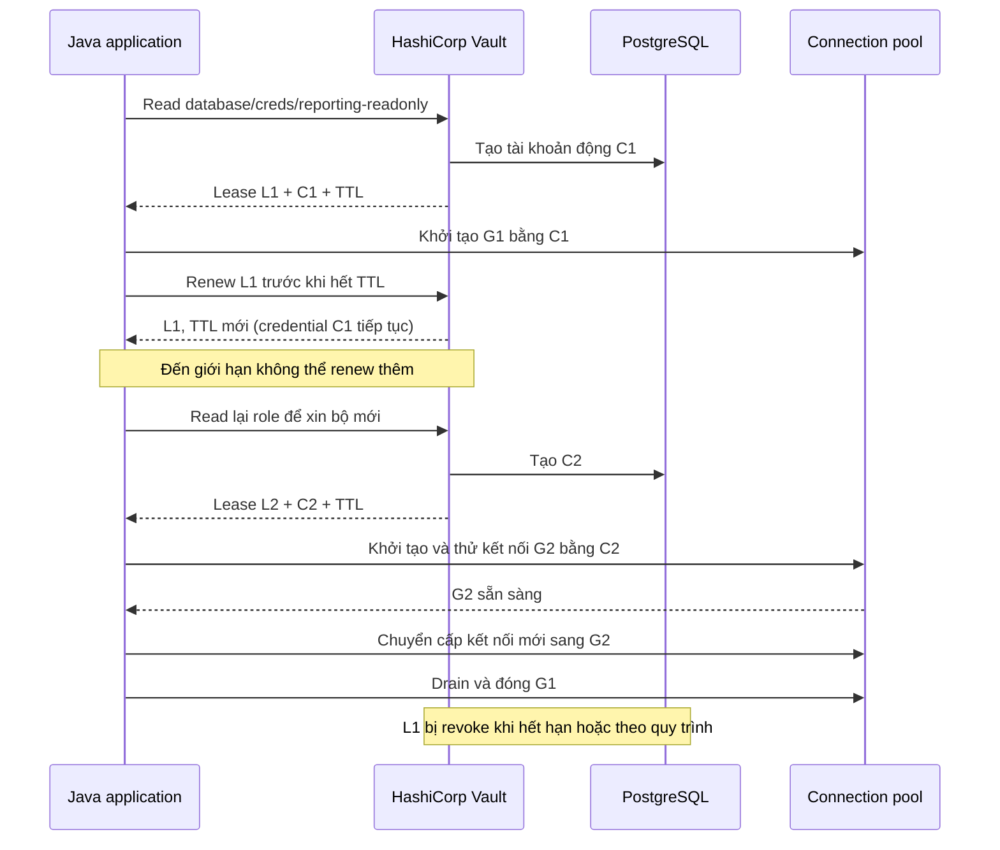
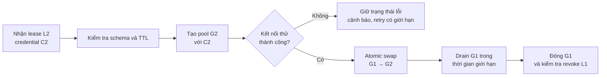

# Gia hạn thông tin hiện có và nhận một bộ thông tin mới

## 1. Bài toán xoay vòng thông tin xác thực trong ứng dụng

Trong chương **Xoay vòng trong ứng dụng** của **Spring Vault**, ta xét một dịch vụ Java sử dụng `VaultTemplate` / `VaultOperations` để truy cập **HashiCorp Vault**. Workload được xác thực bằng Kubernetes, cloud IAM hoặc AppRole, sau đó lấy tài khoản PostgreSQL tạm thời từ **Database secrets engine**. Tài khoản này có một **lease** với thời gian sống (TTL) hữu hạn.

Để duy trì hoạt động, ứng dụng có hai lựa chọn chính:

1. **Gia hạn (*renew*) lease hiện có:** đề nghị Vault kéo dài thời gian hợp lệ của credential đã được cấp, trong giới hạn mà backend và chính sách cho phép.
2. **Nhận một bộ credential mới (*rotate/re-request*):** yêu cầu Vault cấp bộ username/password mới với lease mới, rồi chuyển các kết nối của ứng dụng sang bộ đó.

Hai thao tác khác nhau về danh tính credential, tác động tới connection pool, chi phí vận hành và mức gián đoạn. Một chương trình chỉ xử lý TTL mà bỏ qua việc **đưa credential mới vào các consumer** vẫn có thể ngừng hoạt động dù Vault đã cấp secret thành công.

Sau bài học, bạn có thể:

- Giải thích chính xác renew và rotate ở mức Vault lease và ở mức ứng dụng.
- Phân biệt `RequestedSecret.renewable(...)` với `RequestedSecret.rotating(...)` và hiểu cách `SecretLeaseContainer` xử lý cả hai.
- Dùng các sự kiện lease để thiết kế cập nhật dữ liệu cấu hình hoặc thay database connection pool đúng thời điểm.
- Phối hợp secret lease với Vault token/session, xử lý lease hết hạn hoặc bị thu hồi ngoài ý muốn.
- Chọn quy trình phù hợp cho dynamic database credentials, static database roles, KV secrets, PKI và Transit.
- Kiểm thử trường hợp thành công, rotation không đồng bộ, lỗi hạ tầng và nhiều replicas.

## 2. Các khái niệm phải tách biệt

Vault sử dụng **lease** để theo dõi vòng đời của nhiều secret động. Khi ứng dụng gọi `database/creds/reporting-readonly`, Vault có thể tạo một database user và trả về `lease_id`, `lease_duration`, `renewable` cùng `username`/`password`.

Ví dụ phản hồi minh họa (không chứa credential thật):

```json
{
  "lease_id": "database/creds/reporting-readonly/example-lease-001",
  "lease_duration": 1800,
  "renewable": true,
  "data": {
    "username": "v-reporting-example-001",
    "password": "<REDACTED>"
  }
}
```

**Vault token** được cấp khi đăng nhập và **lease của database user** là hai đối tượng khác nhau. Token cho phép gọi Vault theo policy; lease kiểm soát thời gian tồn tại của credential do engine cấp. Gia hạn token **không mặc nhiên gia hạn lease**. Khi token sở hữu một dynamic lease bị thu hồi hoặc hết hạn, Vault có thể kéo theo việc thu hồi lease, dù TTL của lease chưa hết.

| Khái niệm | Ý nghĩa | Quản lý ở đâu? |
|---|---|---|
| `Vault token` | Danh tính phiên và quyền gọi Vault | `ClientAuthentication`, `SessionManager`, Vault |
| `Lease ID` | Định danh lần cấp phát một dynamic secret | Vault expiration manager và secrets engine |
| `Lease TTL` | Khoảng thời gian còn hợp lệ nếu chưa bị revoke sớm | Vault/backend; client phải theo dõi thời gian thực |
| `Lease renewal` | Kéo dài lease hiện có trong giới hạn | `sys/leases/renew`, `SecretLeaseContainer` |
| `Secret rotation/re-request` | Cấp một credential/lease mới và chuyển consumer sang nó | Secrets engine, ứng dụng và `SecretLeaseContainer` |
| `Application cache / pool` | Bản sao credential mà ứng dụng đang sử dụng | JVM, datasource, HTTP/SDK clients |

**Chú ý tên gọi:** "rotation" trong Vault cũng có thể chỉ việc đổi mật khẩu cho **static database role** với username giữ nguyên. Trong bài này, khi nói "nhận bộ thông tin mới" cho **dynamic role**, ta nói tới một lần yêu cầu credential mới và lease mới; không áp dụng y hệt cho static role.

## 3. Renew và rotate: sự khác nhau cốt lõi

| Tiêu chí | Gia hạn credential hiện có | Xin credential mới |
|---|---|---|
| Thao tác tại Vault | Renew một `lease_id` đang hợp lệ | Đọc lại dynamic secret endpoint để cấp lease mới |
| Lease ID | Giữ **cùng lease** | Nhận **lease ID khác** khi backend tạo lần cấp mới |
| Username/password | Thông thường vẫn là credential đang được quản lý trong lease đó | Thông thường là cặp credential mới đối với dynamic database role |
| Mục đích | Tiếp tục dùng credential đang hoạt động | Thay credential khi không thể/không nên tiếp tục dùng bộ cũ |
| Điều kiện | Lease còn tồn tại, cho phép renew, chưa chạm giới hạn | Vault token còn hợp lệ, có quyền đọc role và backend cấp được |
| Phản hồi cần xử lý | TTL thực tế sau renew, trạng thái lỗi | Payload credential, lease ID/TTL mới, kết quả kích hoạt consumer |
| Tác động lên DB pool | Thường không cần đổi username/password | Phải cập nhật và thường cần **thay hoặc tái tạo pool** |
| Rủi ro chính | Chạm max TTL, renew trễ, token bị revoke | Credential mới cấp nhưng chuyển đổi lỗi, tạo nhiều credential dư |
| Spring Vault | `RequestedSecret.renewable(path)` | `RequestedSecret.rotating(path)` |

Không phải renew lúc nào cũng thành công: `renewable=true` chỉ cho biết lease **có thể** gia hạn tại thời điểm trả về; backend vẫn có thể từ chối khi đến **max TTL**, thay đổi policy hoặc revoke cưỡng chế. Ngược lại, **rotation không mặc nhiên thu hồi ngay** credential cũ: thời điểm thu hồi phụ thuộc TTL, loại backend và thao tác quản lý lease. Ứng dụng phải kiểm tra/điều phối khi nào bộ cũ thực sự mất hiệu lực.

### Hai câu hỏi quyết định

- **Credential hiện tại còn có thể và nên được dùng không?** Nếu có, renew giúp giảm chi phí khởi tạo tài khoản và hạn chế thay connection pool.
- **Nếu không, hệ thống có thể chuyển sang credential mới an toàn không?** Khi lease không thể renew hoặc chính sách yêu cầu thay định kỳ, cần xin một bộ mới, kích hoạt consumer rồi loại bỏ quyền sử dụng bộ cũ.

## 4. Timeline minh họa

Giả sử role PostgreSQL phát hành dynamic lease với TTL ban đầu 20 phút, giới hạn tối đa (max TTL) 60 phút kể từ thời điểm cấp. Các mốc dưới đây chỉ minh họa; TTL thực tế và giới hạn phụ thuộc cấu hình Vault.

| Thời điểm | Lease L1 và credential C1 | Hành động ứng dụng |
|---|---|---|
| 10:00 | Vault phát hành L1/C1, TTL còn 20 phút | Dùng C1 tạo pool G1; kiểm tra kết nối |
| 10:15 | L1 vẫn hợp lệ | Yêu cầu renew, Vault chấp nhận TTL mới theo policy |
| 10:30 | Vẫn là **L1/C1** | Tiếp tục dùng pool G1 |
| 10:45 | L1 đến gần giới hạn tối đa của role | Thử renew; kết quả có thể bị giới hạn thời gian còn lại |
| Gần 11:00 | L1 không thể tiếp tục được giữ hợp lệ | Xin L2/C2 và xây pool G2 |
| Sau khi G2 đạt health check | C2 phục vụ kết nối mới; L1 sắp hết/hết hạn | Chuyển routing sang G2, drain G1, xử lý revoke L1 khi phù hợp |



Trong Spring Vault, thời điểm "hết hạn" do `SecretLeaseContainer` xác định có thể sớm hơn TTL tuyệt đối nhờ ngưỡng an toàn, và việc phát hiện cũng có thể chậm khi JVM tạm dừng hoặc mạng lỗi. Không thiết kế dựa trên giả định có một tín hiệu push chính xác tới từng ứng dụng đúng mili giây secret hết hạn.

## 5. Gia hạn lease ở Vault: phải đọc TTL được trả về

Ví dụ thực hành với **Vault thử nghiệm** có sẵn Database secrets engine và role `reporting-readonly`. Workload chỉ có quyền phù hợp để đọc credential; thao tác renew/revoke phải theo Vault ACL của môi trường.

```bash
# Không bật shell tracing khi xử lý dynamic credentials.
# Chỉ trích xuất metadata, không in username/password ra terminal.
LEASE_ID="$(vault read -format=json database/creds/reporting-readonly \
  | jq -r '.lease_id')"

# Xin khoảng 20 phút hiệu lực tính từ thời điểm renew hiện tại.
vault lease renew -increment=20m "$LEASE_ID"

# Dùng quyền phù hợp để kiểm tra TTL/renewable sau renew.
vault lease lookup "$LEASE_ID"
```

Điểm thường hiểu sai: `-increment=20m` **không phải** cộng thêm 20 phút vào TTL còn lại. Nó là **TTL mong muốn tính từ lúc gửi yêu cầu**. Đây là giá trị gợi ý; Vault/backend có thể cho ngắn hơn, từ chối renew hoặc áp giới hạn tối đa. Luôn kiểm tra **TTL thực tế trong phản hồi** sau thao tác.

Nếu L1 đã bị revoke, không thể dùng lệnh renew để hồi sinh nó. Nếu L1 còn nhưng `renewable=false`, tiếp tục gọi renew liên tục cũng không tạo ra khả năng renew. Với loại dynamic credential này, thiết kế phải xin L2 mới trước thời hạn thực tế và chuyển consumer theo kế hoạch.

### Renew không phải rotation mật khẩu tại PostgreSQL

Với dynamic database credential, renew L1 thường chỉ kéo dài khoảng thời gian Vault quản lý **cùng database user**. Nó không tự làm PostgreSQL đổi password, cũng không báo cho Java rằng phải tạo pool mới. Nếu backend có semantics riêng, phải kiểm tra hợp đồng của plugin thay vì áp đặt giả định một cách tuyệt đối.

## 6. Chế độ renewable và rotating trong Spring Vault

Spring Vault cung cấp `SecretLeaseContainer` để đăng ký những secret cần theo dõi, lập lịch và phát sinh sự kiện. Hai mode quan trọng:

```java
// Hai lựa chọn riêng; thông thường chọn MỘT mode cho một secret path.
RequestedSecret renewable =
    RequestedSecret.renewable("database/creds/reporting-readonly");

RequestedSecret rotating =
    RequestedSecret.rotating("database/creds/reporting-readonly");
```

Tương ứng, khi đăng ký vào container:

```java
RequestedSecret renewable =
    container.requestRenewableSecret("database/creds/reporting-readonly");

// Hoặc lựa chọn cho ứng dụng luôn cần credential mới khi lease hết:
RequestedSecret rotating =
    container.requestRotatingSecret("database/creds/reporting-readonly");
```

Không đăng ký đồng thời cả hai mode trên cùng path để rồi hy vọng container tự phối hợp. Chọn một chiến lược có ý nghĩa rõ ràng cho consumer. Theo tài liệu Spring Vault:

| Mode | Khi lease còn được renew | Khi lease hết hạn hoặc được xác định đã hết |
|---|---|---|
| `renewable` | Container tìm cách renew lease đã có | Lease không còn hợp lệ; **không tự xin một bộ mới theo mode này** |
| `rotating` | **Cũng renew** lease khi còn có thể | Container lấy **secret mới/lease mới** bằng cách đọc lại endpoint |

**Chú ý:** `rotating` không có nghĩa "mỗi lần scheduler chạy sẽ đổi username/password". Container **ưu tiên renew** tới khi lease được xem là hết hạn, sau đó mới yêu cầu secret khác. Đây là khác biệt dễ bị bỏ sót khi đọc tên API.

`SecretLeaseContainer` dùng một ngưỡng sắp hết hạn (mặc định khoảng **1 phút**) và thời gian tối thiểu dành cho renew (mặc định khoảng **10 giây**). Những giá trị này có thể chỉnh theo API của phiên bản Spring Vault đang sử dụng, ví dụ `setExpiryThreshold(Duration)` và `setMinRenewal(Duration)`. Chọn chúng theo TTL thực tế, độ trễ Vault và ngân sách chuyển pool; không giảm ngưỡng tùy tiện khiến renew bị gọi liên tục.

### Các sự kiện cần quan sát

| Event | Ý nghĩa đối với ứng dụng |
|---|---|
| `SecretLeaseCreatedEvent` | Lần đầu lấy secret; có thể khởi tạo consumer bằng credential mới |
| `AfterSecretLeaseRenewedEvent` | Renew lease thành công; cập nhật thời gian an toàn nhưng thường **không đổi credential** |
| `SecretLeaseRotatedEvent` | Đã lấy một bộ secret khác sau rotation; cập nhật consumer |
| `SecretLeaseExpiredEvent` | Container quan sát lease hết hạn; không cung cấp credential cũ cho consumer mới |
| `BeforeSecretLeaseRevocationEvent` / `AfterSecretLeaseRevocationEvent` | Có thể phối hợp trước/sau revocation tùy lifecycle |
| `SecretLeaseErrorEvent` hoặc `LeaseErrorListener` | Có lỗi lấy secret, renew, rotate hoặc kết nối Vault; cần giới hạn retry và cảnh báo |
| `SecretNotFoundEvent` | Không lấy được secret tại path; phân biệt thiếu cấu hình và sự cố tạm thời |

`SecretLeaseRotatedEvent` **kế thừa** `SecretLeaseCreatedEvent`: nếu viết `if (event instanceof SecretLeaseCreatedEvent)`, callback đó cũng nhận sự kiện rotate. Điều này tiện cho logic áp dụng credential nhưng cần cẩn thận nếu phân loại metrics theo số lần cấp lần đầu/đã rotate.

Listener phải được đăng ký **trước khi start container** để không bỏ qua event cấp secret đầu tiên. Event có thể được phát trên thread khởi động hoặc scheduler/worker thread; handler không nên chặn dài, ghi log dữ liệu nhạy cảm hay tạo vòng re-request không giới hạn.

## 7. Mẫu Java: nhận credential mới và giao việc đổi connection pool

Ví dụ sau dùng `SecretLeaseContainer`, Spring Boot/Spring Context và Java 17+. Ứng dụng giả định có bean `VaultOperations` và `TaskScheduler` đã cấu hình. Interface `PoolRotationCoordinator` biểu diễn phần code do ứng dụng tự triển khai để chuyển kết nối.

```java
import java.util.Map;
import org.springframework.context.annotation.Bean;
import org.springframework.context.annotation.Configuration;
import org.springframework.scheduling.TaskScheduler;
import org.springframework.vault.core.VaultOperations;
import org.springframework.vault.core.lease.SecretLeaseContainer;
import org.springframework.vault.core.lease.domain.Lease;
import org.springframework.vault.core.lease.domain.RequestedSecret;
import org.springframework.vault.core.lease.event.LeaseListenerAdapter;
import org.springframework.vault.core.lease.event.SecretLeaseCreatedEvent;
import org.springframework.vault.core.lease.event.SecretLeaseEvent;
import org.springframework.vault.core.lease.event.SecretLeaseExpiredEvent;

interface PoolRotationCoordinator {
    // Validate credential mới; xây pool mới, kiểm tra, rồi chuyển traffic.
    void activate(String leaseId, String username, String password);

    // Chỉ đánh dấu không sẵn sàng nếu leaseId vẫn thuộc generation hiện tại.
    void invalidateIfActive(String leaseId);

    // Ghi nhận loại lỗi/trạng thái; không đưa thông tin secret vào log.
    void reportFailure(String stage, Exception error);
}

@Configuration
class ReportingDatabaseLeaseConfiguration {

    @Bean
    SecretLeaseContainer reportingLeases(
            VaultOperations vault,
            TaskScheduler scheduler,
            PoolRotationCoordinator pools) {

        SecretLeaseContainer container =
                new SecretLeaseContainer(vault, scheduler);
        RequestedSecret requested = container.requestRotatingSecret(
                "database/creds/reporting-readonly");

        container.addLeaseListener(new LeaseListenerAdapter() {
            @Override
            public void onLeaseEvent(SecretLeaseEvent event) {
                if (!requested.equals(event.getSource())) {
                    return;
                }

                if (event instanceof SecretLeaseCreatedEvent created) {
                    Lease lease = created.getLease();
                    if (lease == null || !lease.hasLeaseId()) {
                        throw new IllegalStateException(
                                "Dynamic credential không có lease ID");
                    }
                    Map<String, Object> values = created.getSecrets();
                    String username = required(values, "username");
                    String password = required(values, "password");

                    // Cũng chạy khi event là SecretLeaseRotatedEvent.
                    pools.activate(lease.getRequiredLeaseId(),
                            username, password);
                } else if (event instanceof SecretLeaseExpiredEvent) {
                    Lease expired = event.getLease();
                    if (expired != null && expired.hasLeaseId()) {
                        pools.invalidateIfActive(
                                expired.getRequiredLeaseId());
                    }
                }
            }

            @Override
            public void onLeaseError(
                    SecretLeaseEvent event, Exception error) {
                if (requested.equals(event.getSource())) {
                    pools.reportFailure("reporting-db", error);
                }
            }
        });

        // Container là bean Spring: framework quản lý init/start/stop.
        // Listener đã được đăng ký trước khi container khởi động.
        return container;
    }

    private static String required(
            Map<String, Object> data, String key) {
        Object value = data.get(key);
        if (!(value instanceof String)
                || ((String) value).isBlank()) {
            throw new IllegalStateException(
                    "Thiếu hoặc sai kiểu trường secret: " + key);
        }
        return (String) value;
    }
}
```

Ví dụ trên có tính định hướng kiến trúc: ứng dụng vẫn phải triển khai `PoolRotationCoordinator`, chính sách lỗi và readiness. Với một connection pool thực tế, `activate` có thể tốn thời gian; nên **đưa công việc dài sang executor có giới hạn**, bảo toàn thứ tự các thế hệ credential và không để callback của scheduler bị chặn. Nếu handler ném exception, cần cấu hình đường ghi nhận lỗi và khôi phục phù hợp, tránh đánh dấu đã kích hoạt khi pool chưa sẵn sàng.

Ở Spring Vault 4.x có thể dùng `ManagedSecret.rotating(...)` để đăng ký secret qua callback khai báo. Đây là lựa chọn tiện hơn khi consumer đơn giản, nhưng vẫn phải thiết kế chuyển pool/chuyển client đúng nghĩa; thay chuỗi username/password trong một bean không làm mọi connection hiện hữu đăng nhập lại.

## 8. Cập nhật datasource/connection pool đúng cách

Với HikariCP hoặc connection pool khác, username/password được sử dụng khi **tạo kết nối vật lý**. Thay đổi thuộc tính datasource không bảo đảm những connection đã mở chuyển sang credential mới. Một rotation an toàn nên dùng **thế hệ pool** (*pool generation*).



Quy trình gợi ý:

1. **Nhận event cấp mới:** đọc `lease_id`, `username`, `password` từ sự kiện, kiểm tra schema và thời hạn còn lại. Không lưu secret vào log hoặc metric.
2. **Tạo pool mới:** khởi tạo pool G2 bằng C2; thử lấy connection và truy vấn kiểm tra tối thiểu, tránh thao tác nghiệp vụ có tác dụng phụ.
3. **Chuyển atomically:** dùng một tham chiếu thread-safe để những request mới lấy connection từ G2. Ghi nhận generation/lease ID nội bộ để event của L1 đến trễ không làm vô hiệu hóa G2.
4. **Drain pool cũ:** để giao dịch đã bắt đầu kết thúc trong ngưỡng timeout được chọn; đồng thời ngăn phát sinh kết nối mới từ G1.
5. **Thu hồi/đóng tài nguyên:** đóng G1, xác minh lease L1 được xử lý theo policy và backend. Nếu credential đã bị revoke trước khi swap, transaction đang chạy có thể thất bại; không hứa zero downtime tuyệt đối.
6. **Xử lý lỗi:** nếu G2 không health check thành công, không chuyển traffic sang pool lỗi. Quyết định tạm dùng G1 chỉ khi C1 **còn được backend chấp nhận** và chính sách bảo mật cho phép; nếu không, phản ánh trạng thái không sẵn sàng.

**Race condition cần phòng:** `SecretLeaseExpiredEvent` của L1 có thể tới sau khi G2 đã active. `invalidateIfActive("L1")` phải kiểm tra lease ID đang hoạt động, tránh dừng nhầm pool của L2. Cũng cần ngăn callback L2 bị trễ ghi đè một thế hệ L3 mới hơn.

Trong ứng dụng có nhiều replicas, mỗi instance nên có phạm vi credential/lease rõ ràng. Nếu các replicas vô tình chia sẻ một token hoặc một lease, việc thu hồi khi một instance dừng có thể gây gián đoạn cho các instance còn lại.

## 9. Phối hợp với Vault token, SessionManager và workload auth

Ứng dụng Spring Vault thường dùng `ClientAuthentication` để xác thực bằng workload identity, kết hợp `LifecycleAwareSessionManager` để renew token hoặc re-login theo khả năng. Hai dòng thời gian cần quản lý độc lập:

```text
Workload identity --> Vault token T --> yêu cầu dynamic secret --> Lease L1
       |                 |                                   |
       |                 +-- token renew / re-login          +-- lease renew
       |                                                     +-- rotate -> L2
       +-- Kubernetes / IAM / AppRole                         +-- revoke/expire
```

Nếu **Vault token T bị thu hồi**, dynamic leases gắn với service token đó thường bị revoke theo quan hệ sở hữu. Việc `SessionManager` đăng nhập lại và nhận T2 giúp ứng dụng tiếp tục gọi Vault **nhưng không phục hồi tài khoản database từ L1**. Phải xin L2 mới và chuyển pool.

Theo cơ chế Spring Vault, `SessionLeaseContainer` có các listener liên quan đến session và xác thực để khởi động lại vòng đời secret sau khi đăng nhập lại. Khi sử dụng cần kết nối đúng `AuthenticationListener` / `AuthenticationErrorListener` với session manager tương thích theo tài liệu phiên bản. **Đăng nhập thành công không phải bằng chứng đã chuyển credential ở datasource**.

Khi chọn TTL:

- Vault token quá ngắn và liên tục chạm *max TTL* có thể làm các dynamic lease bị thu hồi sớm, tạo churn tài khoản và pool.
- Lease TTL quá ngắn với refresh/rotation chậm làm tăng nguy cơ hết hiệu lực khi chưa kịp tạo pool mới.
- Token và lease có giới hạn max TTL riêng; phải thử kịch bản token bị revoke cưỡng chế **trước** khi lease hết hạn.
- Có thể cần backoff/jitter và giới hạn số lần re-login để tránh nhiều replicas cùng tạo hàng loạt credential khi Vault chập chờn.

## 10. Khi nào không áp dụng cơ chế dynamic lease như trên?

Từ "rotation" xuất hiện trong nhiều Vault engines, nhưng semantics không giống nhau.

| Loại secret / dịch vụ | Renew giá trị đang dùng? | Nhận bộ mới/rotation theo cách nào? |
|---|---|---|
| **Database dynamic role** | Renew **lease động** nếu được phép | Đọc lại `database/creds/<role>` để nhận user/password và lease mới |
| **AWS dynamic credentials** | Renew lease theo loại credential/backend nếu được hỗ trợ | Yêu cầu credential mới; cập nhật AWS SDK client và kiểm tra credential cũ bị revoke |
| **Database static role** | Không coi như lần cấp dynamic user có lease riêng | Vault tự xoay password của **username cố định** theo `rotation_period`/`rotation_schedule` hoặc thao tác quản trị |
| **KV v1/KV v2** | Không có dynamic-secret lease để renew mỗi lần đọc | Ghi version/giá trị mới; ứng dụng refresh cache và phối hợp issuer revoke giá trị cũ |
| **PKI certificate** | Không kéo dài `notAfter` của một chứng thư X.509 đã ký | Cấp chứng thư mới, thay cert/key và TLS context; có thể dùng `CertificateContainer` |
| **Transit encryption/signing** | Không cấp lease cho mỗi lần gọi encrypt/sign | Việc rotate key version là quản trị khóa; ứng dụng xử lý key version/ciphertext theo thiết kế |

Riêng **static database roles**, có thể đọc `database/static-creds/<role>` để lấy password hiện tại của tài khoản cố định. Điều này không giống xin một database user mới. Nếu backend đã rotate password, pool Java có thể phải thay kết nối dù username không đổi. Không gắn mặc định `requestRotatingSecret("database/static-creds/...")` rồi suy rằng sẽ có lease động và event giống `database/creds/...`.

Với **KV**, `lease_duration` nếu xuất hiện là thông tin khác với dynamic lease và không có nghĩa được gọi `sys/leases/renew` để giữ nguyên key. Với **PKI**, việc cấp chứng thư mới không tự làm các kết nối TLS đang mở thay chứng thư; cần reload SSL context và quản lý thời hạn/revocation ở consumer.

## 11. Policy và giới hạn quyền

Ví dụ policy cho service chỉ được nhận credential động của một role:

```hcl
path "database/creds/reporting-readonly" {
  capabilities = ["read"]
}
```

Ứng dụng có thể cần quyền đối với các endpoint renew/revoke lease theo mô hình ACL và token của Vault; xác minh quyền cần thiết bằng integration test ở môi trường thật, không mặc nhiên cấp quyền rộng `sys/leases/*` hoặc `sudo`. Thao tác thu hồi lease theo prefix hoặc thu hồi hàng loạt là quyền vận hành nhạy cảm, tránh cấp cho workload bình thường.

Để tạo role Database secrets engine, backend Vault phải có quyền tạo/thu hồi user ở database. Đó là credential/quyền **của Vault backend**, khác với Vault token của ứng dụng Java chỉ đọc endpoint được phép.

Với Kubernetes/cloud IAM/AppRole, liên kết role auth theo đúng workload/environment để mỗi phiên Vault chỉ nhận policies tối thiểu. Không dùng Vault root token hoặc mã token cố định trong source code để vượt qua lỗi renewal.

## 12. Xử lý lỗi và khả năng phục hồi

| Tình huống | Hậu quả | Hành động của ứng dụng |
|---|---|---|
| Renew L1 thành công | L1 tiếp tục hợp lệ | Cập nhật TTL sau renew; giữ consumer C1 |
| Renew bị giới hạn TTL / không renewable | Sắp phải đổi credential | Lập lịch xin L2 và chuẩn bị pool mới |
| Vault tạm mất kết nối khi renew | Có thể không biết trạng thái mới nhất | Retry giới hạn; giữ mốc an toàn của TTL cũ, báo cảnh báo |
| L1 bị revoke từ phía Vault | C1 có thể mất hiệu lực ngay cả khi TTL cũ còn | Chặn pool cũ cho kết nối mới, re-login nếu cần, xin credential mới |
| Đọc L2 thành công nhưng DB không chấp nhận C2 | Có secret mới nhưng không sử dụng được | Không swap; kiểm tra DB role/permissions/plugin, báo lỗi rõ ràng |
| DB pool G2 khởi tạo chậm | Có thể có khoảng mất phục vụ khi G1 hết hạn | Cải thiện lead time, pool warm-up, giới hạn request |
| Event lỗi đến sau khi đã có L3 | Có thể vô hiệu hóa sai consumer hiện tại | Đối chiếu lease ID/generation trước khi cập nhật |
| Revoke L1 ở backend thất bại | User cũ có thể còn tồn tại ngoài Vault | Cảnh báo security/operations, kiểm tra irrevocable leases |
| Ứng dụng shutdown | Container ngừng quản lý leases; token/lease có thể tiếp tục hoặc bị thu hồi tùy lifecycle | Chọn policy cleanup rõ ràng; không giả định `stop()` là revoke ngay mọi lease |

Không retry vô hạn mỗi khi kết nối DB thất bại. Một lỗi DB có thể do network, quá tải hoặc schema; ứng dụng cần phân biệt lỗi xác thực credential với lỗi kết nối trước khi tạo hàng loạt user mới. Retry thao tác nghiệp vụ phải bảo toàn idempotency và transaction boundaries.

### Đo lường mà không lộ secret

Theo dõi số lần renew/rotate thành công hoặc thất bại; thời gian còn lại của lease; tuổi của pool generation; latency cấp credential; thời gian pool switch; số kết nối lỗi do xác thực; thời điểm refresh thành công gần nhất; sự kiện token re-login và tình trạng Vault/backend.

Chỉ dùng nhãn metric hữu hạn theo ứng dụng/role/loại event. Không ghi `password`, raw `VaultResponse`, Vault token, IAM-signed JWT hoặc toàn bộ event object vào log. `lease_id` cũng là metadata nhạy cảm về nội bộ: giữ trong bộ nhớ để tương quan và hạn chế đưa ra log hoặc trace công khai.

## 13. Kiểm thử tích hợp theo đúng hai chiến lược

Unit test có thể mock `VaultOperations` và listener events để kiểm tra hợp đồng của `PoolRotationCoordinator`. Tuy nhiên, để xác minh renew/revoke thực tế cần một Vault thử nghiệm và một PostgreSQL test do Database secrets engine quản lý.

| Kịch bản | Kết quả kỳ vọng |
|---|---|
| **Renew khi lease còn hợp lệ** | Cùng lease ID; TTL thực tế thay đổi theo Vault; không tạo pool mới chỉ vì renew |
| **Chạm giới hạn max TTL** | Renew không thể duy trì L1 mãi; mode rotating lấy L2 và khởi tạo thế hệ pool mới |
| **Mode renewable khi lease hết** | Không tự động biến thành re-request theo kỳ vọng của mode rotating |
| **Mode rotating nhận L2** | Event cấp mới/rotated có payload mới; pool G2 health check rồi trở thành active |
| **Credential mới sai hoặc database tạm ngừng** | Không swap sang pool lỗi; trạng thái readiness phản ánh khả năng phục vụ |
| **L1 bị revoke trước TTL** | App nhận biết lỗi, không tái sử dụng C1 vô thời hạn; lấy token/credential mới nếu được phép |
| **Callback L1 đến chậm sau L2** | Không làm vô hiệu hóa G2 nhờ kiểm tra lease ID/generation |
| **Nhiều replicas** | Mỗi instance quản lý lease/pool theo phân quyền; không chia sẻ nhầm credential |
| **KV/PKI** | Không áp dụng dynamic lease renewal cho KV/certificate; kiểm tra refresh/re-issuance riêng |

Trong test, giảm TTL cho môi trường thử nghiệm để quan sát sự kiện mà không phải đợi quá lâu. Kiểm thử cả **revoke cưỡng chế trước TTL**, không chỉ đợi lease hết tự nhiên. Tài khoản/lease/token thử nghiệm phải được dọn dẹp theo quyền và quy trình của sandbox; không chạy các thao tác revoke trên production.

### Một bài test định hướng trạng thái

```text
Given: L1 còn hạn, G1 active, đọc/ghi test DB thành công.
When : Renew L1 được Vault chấp nhận.
Then : Lease ID không đổi, G1 vẫn active, TTL nhận lại được lưu.

Given: L1 sắp không thể renew, mode=rotating.
When : Vault trả L2/C2 và G2 health check thành công.
Then : New checkouts dùng G2; G1 được drain và đóng đúng hạn.

Given: G2 khởi tạo thất bại hoặc đã có L3 mới hơn.
When : Callback lỗi/hết hạn của L2 được nhận.
Then : Không sử dụng pool lỗi, không ghi đè G3, có metric/cảnh báo.
```

## 14. Bài tập thực hành

**Bài A — Chỉ gia hạn:** Dịch vụ `analytics-api` nhận lease dynamic DB TTL 30 phút và có thể renew tới tối đa 2 giờ. Trình bày timeline ba lần renew và giải thích vì sao sau 2 giờ app không thể giữ L1 mãi. Chọn `renewable` hay `rotating` nếu ứng dụng phải phục vụ liên tục và vì sao.

**Bài B — Không cho renew:** Một role trả `lease_id` hợp lệ, `lease_duration=900`, `renewable=false`. Hãy thiết kế lịch xin credential mới, warm-up pool, TTL safety margin và xử lý lỗi khi Vault không sẵn sàng trước khi L1 hết hạn.

**Bài C — Lỗi giao dịch khi chuyển pool:** Ứng dụng có 50 request đang dùng G1 và nhận event L2. Một số transaction kéo dài vài phút; L1 chỉ còn 45 giây. Hãy giải thích giới hạn của việc drain G1, cách đặt transaction timeout và chiến lược trả lỗi an toàn khi credential cũ hết hạn trước khi transaction xong.

**Bài D — Chọn đúng động cơ rotation:** Bốn nhóm trong tổ chức đang dùng (1) dynamic DB role, (2) static DB role, (3) KV v2 API key, (4) PKI certificate. Hãy mô tả phương thức thay thông tin hiện có/nhận thông tin mới cho từng nhóm và nêu những nhóm không có dynamic lease để `SecretLeaseContainer` renew.

Một lời giải đạt yêu cầu phải nêu rõ **ai sở hữu lease**, **điều kiện renew**, **điều kiện phải cấp mới**, **cơ chế chuyển consumer**, **hành vi khi lỗi** và **bằng chứng kiểm thử**.

## 15. Tài liệu tham khảo chính thức

- [Spring Vault — Credentials Rotation](https://docs.spring.io/spring-vault/reference/vault/credential-rotation.html): `SecretLeaseContainer`, `ManagedSecret`, events, tuning, session leases và PKI.
- [Spring Vault — SecretLeaseContainer Javadoc](https://docs.spring.io/spring-vault/reference/api/java/org/springframework/vault/core/lease/SecretLeaseContainer.html): `requestRenewableSecret`, `requestRotatingSecret`, `renew` và `rotate`.
- [Spring Vault — RequestedSecret Javadoc](https://docs.spring.io/spring-vault/reference/api/java/org/springframework/vault/core/lease/domain/RequestedSecret.html): hai mode `renewable` / `rotating`.
- [Spring Vault — Lease Javadoc](https://docs.spring.io/spring-vault/reference/api/java/org/springframework/vault/core/lease/domain/Lease.html): lease ID, duration và renewability.
- [HashiCorp Vault — Lease, Renew, and Revoke](https://developer.hashicorp.com/vault/docs/concepts/lease): increment từ thời điểm hiện tại, TTL thực tế và việc thu hồi lease.
- [HashiCorp Vault — Tokens](https://developer.hashicorp.com/vault/docs/concepts/tokens): token TTL, renew, revoke và liên hệ với lease của dynamic secret.
- [HashiCorp Vault — Database Secrets Engine](https://developer.hashicorp.com/vault/docs/secrets/databases): dynamic/static roles, cấp credentials và rotation.
- [HashiCorp Vault — Manage Dynamic Credential Leases](https://developer.hashicorp.com/vault/tutorials/db-credentials/manage-dynamic-leases): thực hành cấp, renew, revoke lease.
