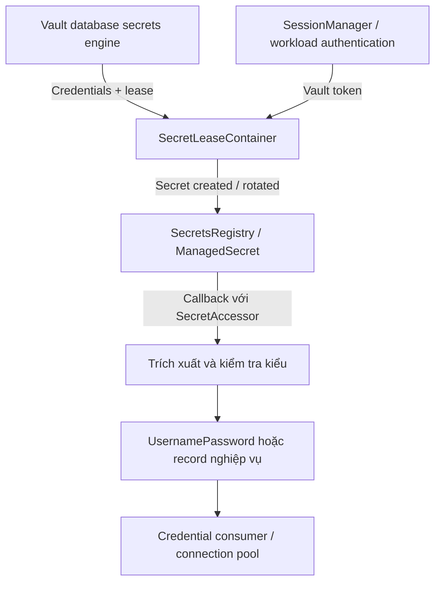
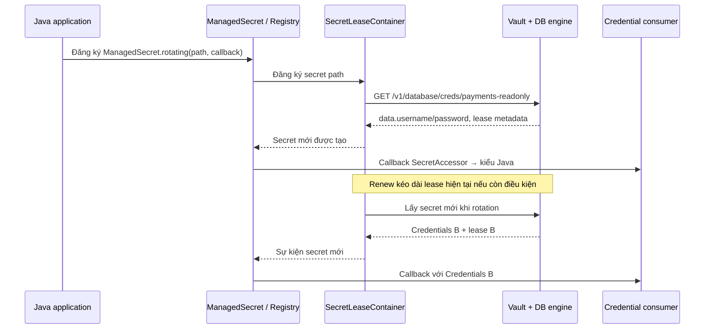
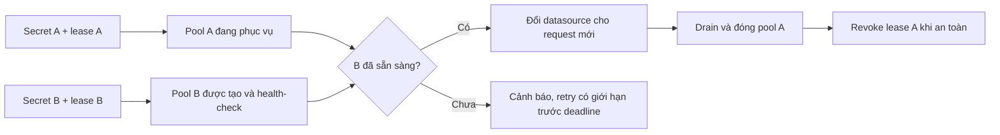

# Truy cập dữ liệu có kiểu qua SecretAccessor

## 1. Bài toán: khi secret thay đổi, dữ liệu Java cũng phải thay đổi

Trong **SPRING_VAULT**, ứng dụng Java dùng HashiCorp Vault để lấy thông tin đăng nhập database, đọc KV secrets, yêu cầu Transit encryption hoặc cấp chứng chỉ PKI. Với **dynamic secrets** (chẳng hạn database credentials), Vault có thể tạo `username` và `password` mới sau một vòng đời lease. Nếu ứng dụng chỉ đọc `Map<String, Object>` lúc khởi động rồi giữ các giá trị mãi mãi, những thành phần như connection pool sẽ tiếp tục dùng credential cũ sau rotation.

Từ **Spring Vault 4.1**, `ManagedSecret` hỗ trợ khai báo secret cần quản lý và nhận callback khi dữ liệu mới được cấp. Callback nhận **`ManagedSecret.SecretAccessor`** để truy cập các trường của secret bằng kiểu dữ liệu rõ ràng. Nhờ vậy, logic đọc key, kiểm tra giá trị và cập nhật nơi sử dụng nằm gần nhau, thay vì phân tán những phép ép kiểu `Map` khắp ứng dụng.

Sau bài học, bạn sẽ biết:

- Xác định chính xác `SecretAccessor` thuộc API nào, lúc nào callback được gọi và cách nó gắn với `ManagedSecret`/`SecretLeaseContainer`.
- Đọc `String`, `int`, `long` và kiểu tùy chọn; chọn phương thức bắt buộc hay có default theo hợp đồng dữ liệu.
- Chuyển `SecretAccessor` thành kiểu nghiệp vụ như `UsernamePassword` hoặc một Java `record` tùy chỉnh.
- Cập nhật thành phần sử dụng bí mật khi secret được cấp lần đầu hoặc được rotate, đồng thời xử lý lỗi, tính sẵn sàng và quản lý lease.
- Kiểm thử mapping, rotation, auth token, policy và bảo vệ credential khi ghi log.

> Phạm vi phiên bản: `ManagedSecret` cùng `ManagedSecret.SecretAccessor` là API **Spring Vault 4.1+**. Trong các phiên bản cũ, dùng `SecretLeaseContainer`/lease event hoặc cơ chế tương đương; không mặc định mọi dự án Spring Cloud Vault đều có sẵn `ManagedSecret`.

## 2. `SecretAccessor` đứng ở đâu trong kiến trúc rotation?

`ManagedSecret.SecretAccessor` là **interface lồng trong lớp `org.springframework.vault.core.lease.ManagedSecret`**. Nó không phải `SecretDocumentAccessor` của Spring Data Vault, cũng không phải một `VaultTemplate` dùng để gọi Vault API trực tiếp. Vai trò của nó là **đọc dữ liệu của secret vừa được nhận** trong callback của `ManagedSecret`.



| Thành phần | Trách nhiệm | Điều không nên nhầm |
| --- | --- | --- |
| `VaultTemplate` / `VaultOperations` | Gửi request có Vault token để đọc secret, gọi Transit/PKI hoặc các API khác. | Không tự cập nhật mọi object Java đã từng nhận secret. |
| `SecretLeaseContainer` | Yêu cầu secret, theo dõi lease, lên lịch renew và phát sự kiện khi secret được cấp/rotate/hết hạn. | Renew lease **không** đồng nghĩa tạo credentials mới. |
| `SecretsRegistry` | Nhận đăng ký secret và phối hợp với hạ tầng quản lý lease. | Không phải kho lưu trữ mật khẩu cho nghiệp vụ tự truy vấn tùy ý. |
| `ManagedSecret` | Khai báo secret path và callback truyền dữ liệu mới tới consumer. | Chỉ tạo bean chưa bảo đảm callback chạy nếu chưa được registry/container đăng ký và khởi động. |
| `ManagedSecret.SecretAccessor` | Cung cấp phương thức đọc giá trị trong callback theo key/kiểu. | Không phải object để gọi Vault hoặc gia hạn lease. |
| `ManagedSecret.UsernamePassword` | Kiểu chuyên dụng lấy username/password qua `SecretAccessor`. | Không tự thay thế datasource hay đóng connection cũ. |

Một `ManagedSecret` là `SecretRegistrar`. Khi được đăng ký vào registry hoạt động, nó theo dõi sự kiện và gọi **secrets consumer** lúc nhận dữ liệu lần đầu và khi secret được cấp lại do rotation. Những lần **renew thành công nhưng không thay đổi giá trị** chủ yếu gia hạn lease của secret hiện tại; không nên coi mỗi lần renew là một lần callback với password mới.



## 3. Từ JSON của Vault đến `SecretAccessor`

Ví dụ role `payments-readonly` của database secrets engine, mount tại `database/`:

```http
GET /v1/database/creds/payments-readonly HTTP/1.1
X-Vault-Token: <workload-token>
```

Phản hồi được rút gọn để thấy cấu trúc:

```json
{
  "lease_id": "database/creds/payments-readonly/example-lease",
  "lease_duration": 1200,
  "renewable": true,
  "data": {
    "username": "v-payments-42",
    "password": "<redacted>"
  }
}
```

Callback `ManagedSecret.rotating("database/creds/payments-readonly", secrets -> ...)` đọc các key **`username`** và **`password`** trong dữ liệu của secret. `SecretAccessor` giúp truy cập các key ấy; thông tin vòng đời như `lease_id`, `lease_duration` ở phần bao ngoài của response không nên được suy đoán là key có thể đọc trực tiếp bằng `getString("lease_id")`.

| Cấu trúc Vault | API Java thích hợp | Ý nghĩa |
| --- | --- | --- |
| `data.username` | `secrets.getRequiredString("username")` | Trường bắt buộc; lỗi nếu thiếu/null. |
| `data.password` | `secrets.getRequiredString("password")` hoặc `secrets.as(UsernamePassword::from)` | Trường bí mật cần bảo vệ. |
| `data.port` nếu engine trả số | `secrets.getInt("port")` / `getInt("port", 5432)` | Chọn required hoặc default theo hợp đồng. |
| `lease_duration` của response | `SecretLeaseContainer`/thông tin lease | Lịch renew và rotate, không phải dữ liệu nghiệp vụ tùy ý. |
| `lease_id` của response | Hạ tầng quản lý lease của Spring Vault | Dùng cho renew/revoke theo quyền được cấp; không công khai. |

Nếu dữ liệu xuất phát từ KV v2, cấu trúc HTTP là `data.data` và có version/metadata. Với KV tĩnh, thường nên dùng `opsForKeyValue(mount, KV_2)` hoặc mapping phù hợp. **`SecretAccessor` trong `ManagedSecret` được giới thiệu để xử lý secret đang được quản lý vòng đời**, đặc biệt trường hợp xoay vòng dynamic credentials; nó không thay thế mọi API đọc KV v2, Transit hay PKI.

## 4. Bảng phương thức đọc dữ liệu có kiểu

Javadoc Spring Vault 4.1 mô tả các phương thức trong `ManagedSecret.SecretAccessor`:

| Phương thức | Kiểu trả về / hành vi | Tình huống dùng |
| --- | --- | --- |
| `get("key")` | `Object` hoặc `null` | Khi cần kiểm tra kiểu thực tế trước xử lý. |
| `get("key", Class<T>)` | `T` hoặc `null` | Truy cập một kiểu cụ thể, ví dụ `String.class`; vẫn kiểm tra `null`. |
| `getRequired("key", Class<T>)` | `T`, báo lỗi nếu thiếu/null | Trường bắt buộc của schema; không âm thầm bỏ qua. |
| `getString("key")` | `String` hoặc `null` | Giá trị văn bản tùy chọn. |
| `getRequiredString("key")` | `String`, báo lỗi nếu thiếu/null | `username`, `password` bắt buộc. |
| `getString("key", defaultValue)` | `String` có fallback | Thuộc tính tùy chọn, ví dụ tên schema mặc định. |
| `getString("key", Supplier<String>)` | `String`; tính default khi thiếu | Fallback cần tính lúc sử dụng. |
| `getInt("key")`, `getLong("key")` | `int` / `long` bắt buộc | TTL phụ hoặc số lượng do secret thực sự chứa. |
| `getInt("key", defaultValue)`, `getLong("key", defaultValue)` | Số có fallback | Trường tùy chọn trong hợp đồng dữ liệu. |
| `as(Function<SecretAccessor, P>)` | `P` do mapper trả | Chuyển toàn bộ dữ liệu thành object/domain type riêng. |

Các overload nhận `IntSupplier` và `LongSupplier` cũng tồn tại cho giá trị mặc định tính khi cần. Với phương thức **required**, `NoSuchElementException` được dùng khi key bị thiếu hoặc có giá trị `null`. Với phương thức ép kiểu, nếu kiểu dữ liệu thực không tương thích, cần xử lý lỗi chuyển kiểu thay vì kỳ vọng API tự chuyển mọi chuỗi sang số. Việc cung cấp `defaultValue` chỉ áp dụng khi giá trị không có/null; không nên dùng fallback để che giấu cấu hình sai hoặc sai type.

**Hai quy tắc để tránh bug:** Trường thiết yếu như database password phải dùng `required` và kiểm tra rỗng nếu nghiệp vụ không chấp nhận; trường tùy chọn như `schema` mới cân nhắc default. `getString("password", "guest")` có thể khiến ứng dụng âm thầm dùng credential ngoài mong đợi khi Vault trả response thiếu password.

## 5. Đọc username/password qua kiểu có sẵn

Spring Vault cung cấp `ManagedSecret.UsernamePassword` để bao bọc cặp trường thường gặp. Nó có `getUsername()`, `getPassword()`, `applyTo(...)` và factory `from(SecretAccessor)`.

```java
import org.springframework.vault.core.lease.ManagedSecret;
import org.springframework.vault.core.lease.ManagedSecret.UsernamePassword;

ManagedSecret managed = ManagedSecret.rotating(
    "database/creds/payments-readonly",
    secrets -> secrets.as(UsernamePassword::from)
        .applyTo((username, password) -> {
            // username: String; password: CharSequence
            // Truyền dữ liệu đến thành phần tiêu thụ secret.
            credentialsConsumer.install(username, password);
        })
);
```

`UsernamePassword.from(...)` kiểm tra đủ các trường; nếu thiếu username hoặc password, nó có thể báo `IllegalStateException`. Đầu ra `getPassword()` là **`CharSequence`**, còn `getUsername()` là `String`. Chỉ chuyển password sang `String` khi thư viện tiêu thụ thực sự yêu cầu; không in `toString()` của object chứa bí mật ra log.

Một cách đọc trực tiếp khác khi không cần tạo wrapper:

```java
ManagedSecret managed = ManagedSecret.rotating(
    "database/creds/payments-readonly",
    secrets -> {
        String username = secrets.getRequiredString("username");
        String password = secrets.getRequiredString("password");
        credentialsConsumer.install(username, password);
    }
);
```

`credentialsConsumer` trong hai đoạn trên là **interface do ứng dụng tự triển khai**, không phải bean mặc định của Spring Vault. Nó cần bảo đảm cách thay credentials cho database, HTTP client hay adapter nghiệp vụ đúng với đặc tính thành phần ấy. Để khai báo thành bean Spring, có thể dùng:

```java
import org.springframework.context.annotation.Bean;
import org.springframework.context.annotation.Configuration;
import org.springframework.vault.core.lease.ManagedSecret;
import org.springframework.vault.core.lease.ManagedSecret.UsernamePassword;

@Configuration
class DatabaseCredentialConfiguration {

    @Bean
    ManagedSecret paymentsCredentials(CredentialConsumer consumer) {
        return ManagedSecret.rotating(
            "database/creds/payments-readonly",
            secrets -> secrets.as(UsernamePassword::from)
                .applyTo(consumer::install)
        );
    }
}

interface CredentialConsumer {
    void install(String username, CharSequence password);
}
```

`ManagedSecret` bean phải được **đăng ký với hạ tầng `SecretsRegistry`/`SecretLeaseContainer`** và nhận event. Khi cấu hình kế thừa `AbstractVaultConfiguration`, các `SecretRegistrar` bean có thể được đăng ký trước khi container chạy. Với Spring Boot/Spring Cloud Vault, kiểm tra auto-configuration thực tế của phiên bản sử dụng; không tạo nhiều container cùng xoay vòng một secret path. Ví dụ bean trên tập trung minh họa cách đọc dữ liệu có kiểu, không tự cài đặt một connection pool hoàn chỉnh.

## 6. Mapping sang Java record do ứng dụng định nghĩa

`UsernamePassword` phù hợp database credentials cơ bản. Nhưng một secret có thể còn chứa `host`, `port`, `schema` hay thuộc tính được backend tùy biến. Có thể chuyển vào **object bất biến** để kiểm tra hợp đồng dữ liệu một lần tại biên nhận secret.

```java
import java.util.function.Consumer;
import org.springframework.vault.core.lease.ManagedSecret;
import org.springframework.vault.core.lease.ManagedSecret.SecretAccessor;

record DatabaseCredential(
    String username,
    String password,
    String host,
    int port,
    String schema
) {
    static DatabaseCredential from(SecretAccessor s) {
        String username = s.getRequiredString("username");
        String password = s.getRequiredString("password");
        String host = s.getRequiredString("host");
        int port = s.getInt("port", 5432);
        String schema = s.getString("schema", "public");

        if (username.isBlank() || password.isBlank() || host.isBlank()) {
            throw new IllegalArgumentException("Secret chứa trường bắt buộc rỗng");
        }
        if (port < 1 || port > 65535) {
            throw new IllegalArgumentException("Port của secret không hợp lệ");
        }
        return new DatabaseCredential(username, password, host, port, schema);
    }
}

Consumer<DatabaseCredential> onNewCredential = credential -> {
    // Kiểm tra kết nối và chuyển credential sang consumer của ứng dụng.
};

ManagedSecret managed = ManagedSecret.rotating(
    "database/creds/custom-role",
    secrets -> onNewCredential.accept(secrets.as(DatabaseCredential::from))
);
```

Đoạn trên là ví dụ cho **secret có cấu trúc do người vận hành quy định**; database secrets engine mặc định thường chỉ trả `username` và `password`, vì vậy `host`/`port` có thể không tồn tại và phải đến từ cấu hình đáng tin cậy khác. Đừng dùng `getRequiredString("host")` trên dynamic database response chuẩn nếu backend không thực sự cấp trường ấy.

`record` tự sinh `toString()` chứa các field; **không log record chứa password**, không đưa record làm metric label hoặc cache có thời hạn vượt lease. Trong code production, có thể tách loại chứa `CharSequence` hoặc wrapper cho password nhằm giảm việc sao chép; dù vậy, thư viện JDBC thường cần chuỗi và không có cách xóa an toàn tất cả bản sao khỏi bộ nhớ JVM.

Mẫu chuyển đổi riêng giúp thống nhất **kiểm tra schema**: nếu `port` là chuỗi `"5432"` trong một backend nhưng code đòi `int`, bạn nên định nghĩa parser/validation rõ ràng hoặc sửa nguồn dữ liệu, thay vì trông đợi `getInt` tự ép kiểu chuỗi ở mọi phiên bản.

## 7. Dùng `SecretAccessor` khi rotation xảy ra

Với một lease có `lease_duration=1200` và `renewable=true`, có thể diễn ra ba việc khác nhau:

| Sự kiện | Dữ liệu credential | Vai trò callback `ManagedSecret` |
| --- | --- | --- |
| Secret được cấp lần đầu | Nhận `username/password` A | Chuyển A sang consumer khi có dữ liệu. |
| Renew lease A thành công | Vẫn dùng cùng A, chỉ kéo dài thời hạn lease | Không cần thay password; callback nhận **secret mới** không được hiểu là callback mỗi lần renew. |
| Lease A hết khả năng gia hạn/được rotate | Vault cấp credentials B cùng lease mới | Callback lại nhận `SecretAccessor` chứa B để cập nhật consumer. |

`ManagedSecret.rotating(...)` sử dụng cơ chế rotation của `SecretLeaseContainer`. Spring Vault có expiry threshold và lịch tác vụ; secret mới có thể được lấy **sau khi lease cũ hết hạn/được nhận diện là hết hạn**. Nếu ứng dụng cần chuyển đổi trước deadline với bảo đảm không gián đoạn, cần cơ chế cấp trước credentials B và đổi tài nguyên sử dụng B trước khi A hết hạn. Không suy ra callback sẽ tự thực hiện zero-downtime cutover chỉ vì tên `rotating`.

Một connection pool là ví dụ điển hình: gọi `dataSource.setUsername(...)` và `setPassword(...)` chưa chắc thay credentials cho các kết nối đang mở hoặc ép tất cả kết nối tương lai sử dụng giá trị mới tùy cơ chế pool. Cách tiếp cận rõ ràng hơn cho hệ thống cần độ sẵn sàng cao là:

1. Nhận B qua callback hoặc quy trình prefetch có chủ đích, kiểm tra tính hợp lệ của field bằng `SecretAccessor`.
2. Tạo và health-check pool B với B; chỉ đánh dấu B sẵn sàng khi kết nối mới thực sự được mở.
3. Chuyển luồng tạo connection mới sang pool B; chờ transaction đang dùng A kết thúc trong giới hạn thời gian.
4. Đóng pool A và thu hồi lease A khi an toàn, theo chính sách ứng dụng.

Sơ đồ cho chiến lược pool chuyển đổi sớm:



**`SecretAccessor` xử lý dữ liệu có kiểu; orchestration rotation thuộc trách nhiệm thành phần quản lý tài nguyên của ứng dụng.** Việc hợp nhất hai trách nhiệm này mà không xác định vòng đời pool dễ dẫn đến sai password, mất kết nối hoặc rò rỉ tài nguyên khi Vault cấp lại secret.

## 8. Kiểm tra điều kiện bootstrap và thời điểm callback chạy

`ManagedSecret` phụ thuộc vào **lifecycle** của `SecretLeaseContainer`. Spring có thể chỉ bắt đầu container sau khi bean được khởi tạo. Điều này tạo ra một vấn đề khởi động: một thành phần khác dùng credentials trong `@PostConstruct` hoặc `InitializingBean.afterPropertiesSet()` có thể chạy **trước** khi `ManagedSecret` nhận secret đầu tiên.

Vì vậy cần:

- Đảm bảo registry/container được tạo, nhận đăng ký trước startup và listener được gắn kịp thời.
- Sắp xếp thứ tự khởi tạo giữa secret management với datasource/client cần credential. Kiểm tra cấu hình `AbstractVaultConfiguration` hoặc Spring Cloud Vault tương ứng.
- Thiết kế readiness gate: không cho ứng dụng phục vụ request phụ thuộc database khi chưa có credentials hợp lệ và pool chưa được kiểm tra.
- Xử lý trường hợp startup Vault tạm thời không sẵn sàng, token bị lỗi hoặc policy thiếu quyền `read` tại `database/creds/payments-readonly`.
- Khi ứng dụng đóng, dừng công việc nhận secret mới, giải phóng pool và đảm bảo revoke theo yêu cầu/policy; không bắt buộc mọi ứng dụng đều được cấp quyền revoke rộng.

Nếu hệ thống có nhiều replica, mỗi replica nên có cơ chế credentials riêng hoặc chiến lược phân phối được phê duyệt. Không mặc định secret cập nhật trên một instance sẽ được callback đồng thời ở tất cả instance. Token của workload và lease được phát hành cho từng phiên cần được quản lý độc lập, đặc biệt khi session token hết hạn hoặc bị revoke.

## 9. Xử lý lỗi của callback và `ManagedSecret`

`ManagedSecret` có overload nhận cả **callback lỗi**:

```java
ManagedSecret managed = ManagedSecret.rotating(
    "database/creds/payments-readonly",
    secrets -> {
        var credentials = secrets.as(UsernamePassword::from);
        credentials.applyTo(credentialsConsumer::install);
    },
    error -> {
        // Không ghi error kèm credential/payload nhạy cảm.
        rotationHealth.markFailed();
        metrics.incrementCredentialRotationFailure();
    }
);
```

`rotationHealth` và `metrics` là thành phần **tự định nghĩa trong ứng dụng**; đây không phải lớp của Spring Vault. Callback lỗi là nơi báo vấn đề cho hạ tầng quan sát; không nên nuốt lỗi rồi tiếp tục coi credential mới là hợp lệ. Nếu callback consumer ném exception giữa chừng, cần đảm bảo trạng thái datasource không bị cập nhật một nửa (username mới, password cũ). Thiết kế một đối tượng credential hoàn chỉnh và cập nhật atomically khi có thể.

| Tình huống | Điều có thể xảy ra | Cách xử lý |
| --- | --- | --- |
| Thiếu trường `password` | `UsernamePassword.from` báo lỗi khi mapping. | Chặn cutover, cảnh báo và kiểm tra response/role; không dùng mật khẩu mặc định. |
| Sai kiểu `port` | `getInt` không phù hợp với dữ liệu backend. | Sửa schema/parser, giữ tài nguyên trước đó nếu còn hợp lệ. |
| Vault trả `403` khi cấp secret mới | Token/ACL trên `database/creds/<role>` không hợp lệ. | Kiểm tra workload authentication, session token và Vault policy. |
| Lease gần max TTL | Renew không kéo dài đủ; rotation có thể đến muộn. | Prefetch B sớm và reserve thời gian tạo pool; đo thời gian thực tế. |
| Pool B không kết nối được | Credential đúng schema nhưng database chưa sẵn sàng. | Health-check B trước cutover; giới hạn retry, không revoke A vội. |
| Secret đã rotate nhưng token bị revoke | Lease mới cũng có thể bị ảnh hưởng theo quan hệ token. | Kiểm tra session lifecycle, re-login và yêu cầu secret mới. |
| Callback lỗi hoặc listener lỗi | Có nguy cơ trạng thái ứng dụng chưa được cập nhật. | Đặt readiness/degraded phù hợp, đo và báo lỗi không chứa bí mật. |

Không ghi mật khẩu, Vault token, SecretID, JWT, `Map` secret đầy đủ hoặc `DatabaseCredential.toString()` vào log. Hạn chế cả `lease_id`, accessor, request body khi gắn vào trace/metric. Chỉ giữ tên role/path đã được phép hiển thị, HTTP status, thời gian và nhóm lỗi; correlation qua request ID sau khi lọc.

## 10. Khi nào nên dùng `SecretAccessor`, khi nào dùng API khác?

| Nhu cầu | API Spring Vault phù hợp | Lưu ý |
| --- | --- | --- |
| Dynamic database credentials với callback rotation | `ManagedSecret.rotating(...)` + `SecretAccessor` | Cần registry/container, schema mapping và consumer sẵn sàng đổi credential. |
| Cần đọc username/password có kiểu | `secrets.as(UsernamePassword::from)` | Chỉ dùng nếu secret thực sự có key `username` và `password`. |
| Secret có schema nghiệp vụ riêng | `secrets.as(CustomCredential::from)` | Validate đủ trường/range trước khi chuyển sang downstream. |
| Cần quản lý lease thủ công hoặc theo dõi sự kiện chi tiết | `SecretLeaseContainer`, `RequestedSecret`, lease listener | Phù hợp khi phải xử lý `SecretLeaseCreatedEvent`, `SecretLeaseRotatedEvent`, lỗi/expiry đặc biệt. |
| Đọc secret tĩnh KV v2 theo một request | `VaultTemplate.opsForKeyValue(mount, KV_2)` | KV v2 dùng path `data/`, metadata/version; không cần tạo managed rotation nếu không có yêu cầu. |
| Mã hóa/giải mã bằng Transit | `opsForTransit()` | Payload `plaintext` base64/ciphertext, không phải cặp username/password. |
| Cấp/ký chứng chỉ PKI | `opsForPki(mount)` hoặc `CertificateContainer` | Luân chuyển chứng chỉ theo hạn X.509; không suy ra lease DB từ chứng chỉ. |
| Quản lý Vault client token | `SessionManager`/reactive session manager | Token renew/re-login khác việc renew secret lease. |

Từ góc độ phân quyền, workload cần capability phù hợp trên path thực tế, ví dụ `read` tại `database/creds/payments-readonly`. Nó không cần quyền quản trị toàn Vault. Việc đăng nhập Kubernetes/AppRole/AWS IAM chỉ trả token; **ACL của token** mới quyết định được đọc credential đó không. Token hết hiệu lực có thể khiến các lease liên quan bị revoke; vì vậy rotation và session lifecycle phải được kiểm tra cùng nhau.

## 11. Kiểm thử tích hợp và giám sát

Thực hành trên Vault test độc lập với database test, một role có TTL ngắn và policy tối thiểu. Kiểm thử cả **đọc đúng field** lẫn **dữ liệu thực sự được áp dụng vào thành phần dùng secret**:

| Tình huống | Kỳ vọng cần xác nhận |
| --- | --- |
| Secret cấp lần đầu | Callback nhận `SecretAccessor`, `UsernamePassword.from` đọc được username/password, consumer hoạt động. |
| Secret thiếu username | Mapping báo lỗi; không cập nhật pool bằng credential rỗng. |
| Secret thiếu password | Không có fallback mặc định; báo lỗi và readiness giảm theo chính sách. |
| Secret thêm một field tùy chọn | `getString(key, defaultValue)` chỉ fallback khi field thiếu/null; bản ghi nghiệp vụ hợp lệ. |
| Field sai kiểu | Mapper phát hiện trước khi áp dụng; ghi log được phép và kiểm soát lỗi. |
| Renew lease thành công | Không coi lease renew là rotation tạo username/password mới. |
| Rotate secret | Callback mới được gọi với B; thành phần sử dụng B thay cho A. |
| Connection pool đổi credential | Kết nối mới thật sự xác thực bằng B; kết nối A được drain/đóng theo kế hoạch. |
| Token/ACL bị lỗi | Bị từ chối tại Vault auth hoặc secrets engine và được phân loại rõ. |
| Secret đến muộn sau startup | Readiness không cho nghiệp vụ chạy khi pool chưa có credential hợp lệ. |
| Vault unavailable khi xoay vòng | Retry giới hạn và cảnh báo đủ sớm; không dùng A quá hạn. |

Trong unit test chỉ riêng mapper, có thể dùng bản triển khai giả của `SecretAccessor` trả những giá trị định sẵn; đó là cách kiểm tra `getRequiredString`, `getInt`, `as` mà không cần Vault thật. Với **integration test**, dùng container Vault/database thật hoặc môi trường thử phù hợp để xác nhận TTL, rotation và khả năng kết nối; mock callback đơn thuần không chứng minh Vault đã cấp credentials mới.

Các metric nên đo thời gian nhận secret mới, số lỗi callback, thời gian chuẩn bị và health-check pool, số connection còn phụ thuộc credential cũ, thời gian cutover, lỗi renew/rotate và số trường hợp token re-login. Không đưa username/password hoặc SecretID vào metric labels.

## 12. Bài tập tình huống và câu hỏi tự kiểm tra

Ứng dụng `billing-api` dùng `ManagedSecret.rotating("database/creds/billing-role", ...)`. Vault trả dữ liệu có `username`, `password`; lease ban đầu 15 phút, renewable. Ứng dụng cập nhật `HikariDataSource.setUsername/setPassword` trong callback và cho rằng mọi query sau đó tự động dùng credential mới. Sau khi lease đạt max TTL, Vault cấp bộ B nhưng một số request vẫn lỗi đăng nhập.

**Phân tích:**

1. `SecretAccessor` đã hoàn thành vai trò đọc đúng key của B. Điều này **không bảo đảm** mọi kết nối vật lý trong pool đã được thay.
2. Renew lease không thay password. Callback với B chỉ diễn ra khi có secret mới/rotation theo cơ chế đã cấu hình.
3. Pool A vẫn có thể chứa kết nối cũ hoặc tạo kết nối theo cấu hình cache; cần kiểm tra cụ thể implementation của datasource, drain và chuyển pool nếu cần.
4. Nếu muốn không gián đoạn ở sát max TTL, hãy **cấp B sớm, health-check B, chuyển traffic, đóng A**; không dựa hoàn toàn vào rotation event sau khi lease hết hạn.
5. Kiểm tra token/session và Vault policy nếu lần cấp B thất bại, thay vì suy ra lỗi Java mapping.

**Câu hỏi:** `secrets.getString("password", "default")` có phù hợp không? **Không** với credential bắt buộc: thiếu password phải được coi là lỗi, tránh dùng giá trị ngoài Vault.

**Câu hỏi:** `secrets.as(UsernamePassword::from)` có lập tức mở kết nối JDBC không? **Không.** Nó chỉ chuyển dữ liệu thành interface truy cập có kiểu; thao tác mở, thay và đóng kết nối do consumer thực hiện.

**Câu hỏi:** Có thể giữ `SecretAccessor` như một kho lưu password toàn cục không? Không nên. Dùng nó trong callback để đọc/validate và chuyển giá trị tới bộ quản lý credentials đã xác định lifecycle; không lưu giữ object bí mật vượt thời hạn/điều kiện sử dụng.

## 13. Tài liệu tham khảo và nguyên tắc triển khai

- [Spring Vault — Credentials Rotation](https://docs.spring.io/spring-vault/reference/vault/credential-rotation.html): `SecretLeaseContainer`, `ManagedSecret`, `SecretRegistrar`, event và TTL.
- [Javadoc `ManagedSecret`](https://docs.spring.io/spring-vault/reference/api/java/org/springframework/vault/core/lease/ManagedSecret.html): `rotating(...)`, callback và đăng ký với `SecretsRegistry`.
- [Javadoc `ManagedSecret.SecretAccessor`](https://docs.spring.io/spring-vault/reference/api/java/org/springframework/vault/core/lease/ManagedSecret.SecretAccessor.html): đầy đủ phương thức truy cập key có kiểu.
- [Javadoc `ManagedSecret.UsernamePassword`](https://docs.spring.io/spring-vault/reference/api/java/org/springframework/vault/core/lease/ManagedSecret.UsernamePassword.html): `from`, `getUsername`, `getPassword`, `applyTo`.
- [HashiCorp Vault — Database secrets engine](https://developer.hashicorp.com/vault/docs/secrets/databases): phát hành, renew và thu hồi dynamic database credentials.

Khi dùng **SPRING_VAULT**, hãy theo chuỗi **Vault cấp secret → ManagedSecret nhận callback → SecretAccessor đọc theo kiểu → validate dữ liệu → cập nhật thành phần sử dụng → kiểm chứng kết nối mới**. Việc đọc dữ liệu có kiểu giúp phát hiện secret thiếu/sai schema ngay tại biên; quản lý lease, max TTL, session và chuyển đổi tài nguyên mới quyết định ứng dụng duy trì truy cập an toàn trong toàn bộ vòng đời rotation.
