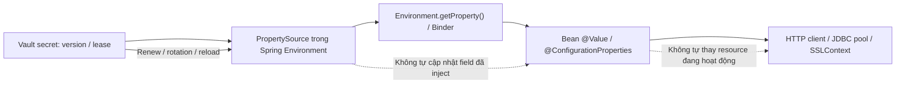
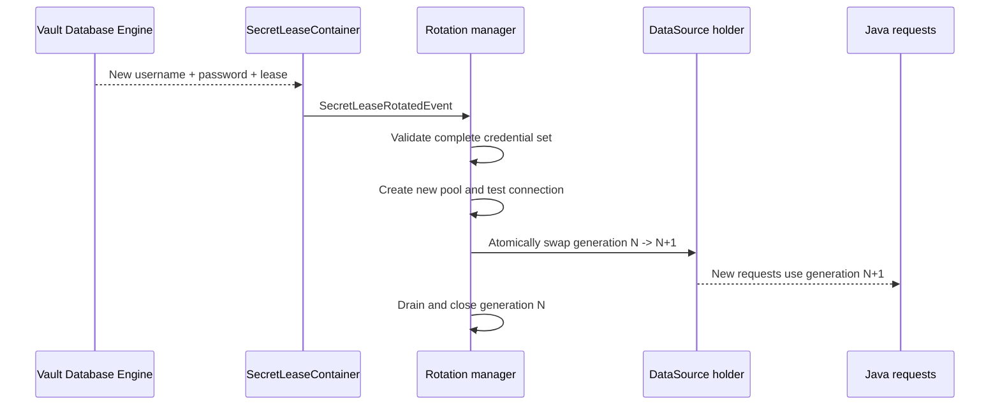

# Phân biệt cập nhật PropertySource với thay giá trị đã chụp trong bean

## 1. Tình huống: Vault đã xoay vòng secret nhưng Java vẫn dùng giá trị cũ

Một ứng dụng Java chạy với **Spring Vault** hoặc **Spring Cloud Vault** lấy tài khoản database từ HashiCorp Vault. Ban đầu Vault trả về:

```text
report.username = report-user-v1
report.password = <REDACTED-V1>
```

Sau khi lease cũ hết hạn và credential được xoay vòng, `LeaseAwareVaultPropertySource` đã lưu cặp mới:

```text
report.username = report-user-v2
report.password = <REDACTED-V2>
```

Khi gọi `Environment.getProperty("report.username")` sau cập nhật, ứng dụng có thể thấy `report-user-v2`. Nhưng một bean đã được tạo bằng:

```java
public ReportService(@Value("${report.username}") String username) {
    this.username = username;
}
```

vẫn giữ **`report-user-v1`**. Tương tự, một `HikariDataSource` được xây từ username/password cũ không tự đổi cấu hình và các kết nối đang mở chỉ vì Spring `Environment` hiện có giá trị mới.

Đó là ranh giới của bài **“Phân biệt cập nhật PropertySource với thay giá trị đã chụp trong bean”**, thuộc chương **Xoay vòng trong ứng dụng** của module **SPRING_VAULT**. Chủ đề liên quan trực tiếp đến VaultTemplate, vòng đời token và lease, Database dynamic secrets, PKI, xử lý lỗi và kiểm thử tích hợp.

**Mục tiêu học tập:**

- Phân biệt tầng **Vault secret → PropertySource → Environment → bean → resource thực tế**.
- Giải thích vì sao `@Value`, constructor arguments và nhiều `@ConfigurationProperties` beans giữ giá trị **tại thời điểm bind/khởi tạo**.
- Biết điều kiện để `LeaseAwareVaultPropertySource` tự cập nhật; phân biệt nó với KV v2 không có cơ chế push thay đổi.
- Chọn giữa **đọc động qua Environment**, **rebind/refresh có điều kiện** và **atomic swap resource**.
- Tự tái hiện hiện tượng bằng một chương trình Java thuần Spring, sau đó thử rotation với Vault thật.
- Thiết kế xử lý expiration, concurrency, logging, rollback và readiness an toàn.

**Nguyên tắc cốt lõi:** *Cập nhật nguồn cấu hình không đồng nghĩa cập nhật mọi đối tượng đã đọc từ nguồn ấy.*

## 2. Năm tầng dữ liệu với trạng thái độc lập



| Tầng | Ví dụ | Khi Vault đổi secret | Cần thao tác gì? |
| --- | --- | --- | --- |
| **1. Vault** | KV v2 version mới, Database credential mới | Vault lưu/cấp giá trị mới và lease tương ứng | Kiểm tra quyền, path, version/lease và TTL. |
| **2. PropertySource** | `LeaseAwareVaultPropertySource`, `VaultPropertySource`, Spring Cloud Vault property source | **Có thể** được cập nhật nếu có lifecycle/reload phù hợp | Renew/rotate/reload hoặc thay property source. |
| **3. Environment** | `environment.getProperty("report.password")` | Đọc lookup mới **có thể** trả giá trị mới | Phải lookup lại, đúng key và precedence. |
| **4. Bean đã bind** | Field `@Value`, constructor parameter, `@ConfigurationProperties` | Thông thường vẫn mang giá trị lần bind trước | Rebind, refresh hoặc thiết kế lại thành provider động. |
| **5. Resource** | `HikariDataSource`, HTTP auth interceptor, `SSLContext` | Có thể vẫn giữ credential/certificate cũ | Tạo resource mới, kiểm tra và hoán đổi, dọn resource cũ. |

**Đừng bỏ qua tầng 4–5.** Trong nhiều sự cố rotation, Vault và PropertySource hoạt động đúng; lỗi nằm ở datasource/client đã chụp credential tại thời điểm khởi tạo.

### Các khái niệm cần phân biệt

- **Snapshot:** một đối tượng giữ giá trị được đọc tại thời điểm tạo hoặc bind, ví dụ field `private final String password`.
- **Live lookup:** mỗi lần sử dụng đều gọi một provider hoặc `Environment.getProperty` để đọc giá trị hiện có.
- **Rebind:** framework bind lại property lên một bean, có thể sửa field hiện có.
- **Refresh:** tạo lại đối tượng trong `@RefreshScope` khi refresh được kích hoạt, hoặc reload configuration theo cơ chế rõ ràng.
- **Resource replacement:** tạo client/pool/context mới từ một bộ secret **nhất quán**, chuyển traffic, đóng bản cũ. Đây là thao tác nghiệp vụ lớn hơn thay một field.

## 3. Spring Vault cập nhật PropertySource ra sao?

Spring Vault có `VaultPropertySource` và `LeaseAwareVaultPropertySource`. Lớp sau kết hợp `SecretLeaseContainer` để yêu cầu leased secret, renew hoặc rotate và cập nhật dữ liệu trong property source qua các event.

Theo Spring Vault Javadoc, `LeaseAwareVaultPropertySource` có **dữ liệu mutable**, được **background thread cập nhật**; khi lease hết hạn hoặc bị revoke, property có thể bị **loại khỏi source**. Các getter `getProperty(String)` / `getPropertyNames()` phản ánh dữ liệu của source đang được quản lý.

Ví dụ với Spring Vault thuần:

```java
import org.springframework.context.annotation.Configuration;
import org.springframework.vault.annotation.VaultPropertySource;

@Configuration
@VaultPropertySource(
    value = "database/creds/report-read",
    propertyNamePrefix = "report.",
    renewal = VaultPropertySource.Renewal.ROTATE
)
public class ReportVaultPropertyConfig {
}
```

Mục đích: đọc username/password động từ `database/creds/report-read` và phơi bày key có tiền tố `report.` vào `Environment`. `Renewal.ROTATE` chỉ định quản lý vòng đời/rotation. Để annotation hoạt động cần Spring Vault `VaultTemplate`, `SecretLeaseContainer` và các bean hạ tầng được đăng ký đúng theo phiên bản, thường do `AbstractVaultConfiguration` cung cấp; với Spring Boot có thể dùng auto-configuration Spring Cloud Vault.

**Lưu ý:** `@VaultPropertySource` mặc định **không bật renewal**. Đừng chỉ thêm annotation rồi suy ra mọi credential sẽ tự xoay vòng trong lúc app chạy.

### Renewal và rotation không có cùng ý nghĩa

| Hành động của `SecretLeaseContainer` | Giá trị secret | Tầng PropertySource | Hành động cần ở app |
| --- | --- | --- | --- |
| **Renew** một lease renewable | Credential **thường giữ nguyên**; TTL được gia hạn | Có thể không đổi username/password | Cập nhật deadline và theo dõi lease. |
| **Rotate** / lấy secret mới | Username/password/key **có thể khác** | Thay các property liên quan bằng dữ liệu mới | Chuyển client/pool tới generation mới, kiểm chứng. |
| Lease expired/revoked | Giá trị cũ không còn được bảo đảm | Có thể bị loại khỏi source | Ngừng sử dụng credential cũ, fail closed nếu cần. |
| Lỗi đọc/renew | Chưa chắc đã có credential mới | Source có thể giữ/loại giá trị tùy strategy | Quan sát error, deadline, retry và readiness. |

`SecretLeaseContainer` có event như `SecretLeaseCreatedEvent`, `AfterSecretLeaseRenewedEvent`, `SecretLeaseRotatedEvent`, `SecretLeaseExpiredEvent` và `SecretLeaseErrorEvent`. **Vault không push event expired trực tiếp đến Java**; event phản ánh kết quả container chủ động theo dõi lease, nên có thể đến trễ.

### KV v2 khác với leased credentials

Một lệnh `vault kv put` tạo version mới **không đẩy thông báo** tới `Environment` trên tất cả ứng dụng đang chạy. Với KV v2, đừng mặc định rằng PropertySource sẽ tự thấy thay đổi ngay lập tức. Cần một cơ chế **reload/refresh/poll có kiểm soát**, vòng đời TTL áp dụng cho loại source cụ thể, hoặc đọc lại bằng `VaultOperations` theo nhu cầu.

Ví dụ khi dùng `@VaultPropertySource("secret/apps/demo")`, cần kiểm tra cách mount KV v2 được nhận diện và **không thêm đoạn `data/`** vào logic path của annotation. Nếu dùng `VaultOperations.opsForKeyValue("secret", KV_2)`, path logic như `apps/demo` cũng không chứa `data/`.

## 4. Vì sao `@Value` vẫn giữ giá trị cũ?

Spring xử lý placeholder `@Value("${report.password}")` khi tạo bean hoặc inject field/constructor. Giá trị được dùng để xây đối tượng tại thời điểm đó. Nếu property source đổi sau này, Spring **không theo dõi mọi field `@Value` và tự động gán lại**.

```java
import org.springframework.beans.factory.annotation.Value;
import org.springframework.stereotype.Service;

@Service
public class SnapshotApiClient {

    private final String apiKey;

    public SnapshotApiClient(
            @Value("${payments.api-key}") String apiKey) {
        this.apiKey = apiKey; // Snapshot tại lúc constructor chạy.
    }

    public boolean isConfigured() {
        return apiKey != null && !apiKey.isBlank();
    }
}
```

Nếu `payments.api-key` lần đầu là token A, rồi PropertySource đổi sang token B, `SnapshotApiClient` vẫn có **token A**. Field `final` thể hiện rõ snapshot, nhưng kể cả field không final và inject qua setter/field thì cũng **không tự đổi nếu không có cơ chế rebind hoặc tái tạo bean**.

Tương tự:

```java
@Bean
DataSource applicationDataSource(
        @Value("${report.username}") String username,
        @Value("${report.password}") String password) {
    return buildDataSource(username, password);
}
```

Ngay cả khi Environment đã có username/password mới, `DataSource` được tạo ban đầu vẫn dùng credential lúc xây pool, trừ khi có logic tái cấu hình/replacement. Đoạn trên là *pseudocode thiết kế*; `buildDataSource` đại diện cho hàm tạo pool thực tế.

## 5. Ví dụ chạy được: PropertySource đổi, snapshot không đổi

Ví dụ dưới đây **không cần Vault server**, chỉ dùng `spring-context` (Spring Framework 6+, Java 17+) để mô phỏng một PropertySource thay đổi. Dùng chuỗi giả `dummy-v1` và `dummy-v2`, không phải secret thật.

```java
import java.util.concurrent.ConcurrentHashMap;
import java.util.Map;

import org.springframework.beans.factory.annotation.Value;
import org.springframework.context.annotation.AnnotationConfigApplicationContext;
import org.springframework.core.env.Environment;
import org.springframework.core.env.MapPropertySource;

public final class PropertySourceSnapshotDemo {

    static final class CapturedBean {
        private final String key;

        CapturedBean(@Value("${demo.api-key}") String key) {
            this.key = key;
        }

        String value() {
            return key;
        }
    }

    static final class LiveLookupBean {
        private final Environment environment;

        LiveLookupBean(Environment environment) {
            this.environment = environment;
        }

        String value() {
            return environment.getRequiredProperty("demo.api-key");
        }
    }

    public static void main(String[] args) {
        Map<String, Object> mutable = new ConcurrentHashMap<>();
        mutable.put("demo.api-key", "dummy-v1");

        try (AnnotationConfigApplicationContext ctx =
                     new AnnotationConfigApplicationContext()) {

            // Mô phỏng PropertySource có thể cập nhật trong runtime.
            ctx.getEnvironment().getPropertySources().addFirst(
                new MapPropertySource("simulated-vault", mutable));

            ctx.register(CapturedBean.class, LiveLookupBean.class);
            ctx.refresh();

            CapturedBean captured = ctx.getBean(CapturedBean.class);
            LiveLookupBean live = ctx.getBean(LiveLookupBean.class);

            if (!"dummy-v1".equals(captured.value())
                    || !"dummy-v1".equals(live.value())) {
                throw new AssertionError("Unexpected initial values");
            }

            mutable.put("demo.api-key", "dummy-v2");

            // Snapshot không đổi, lookup tại thời điểm gọi thấy mới.
            if (!"dummy-v1".equals(captured.value())
                    || !"dummy-v2".equals(live.value())) {
                throw new AssertionError("PropertySource behavior changed");
            }
        }
    }
}
```

**Kết luận được chứng minh từ ví dụ:**

- `MapPropertySource` tham chiếu map mutable; thay map khiến lookup mới thấy giá trị mới.
- `CapturedBean` được Spring inject `dummy-v1` một lần; `@Value` không tự cập nhật.
- `LiveLookupBean` giữ **tham chiếu tới Environment**, gọi `getRequiredProperty()` ở thời điểm sử dụng, nên thấy `dummy-v2`.
- Không có event rebind, `@RefreshScope` hay Vault nào trong ví dụ; chính sự khác nhau của **lookup vs snapshot** tạo ra kết quả.

**Giới hạn:** kết quả này **chỉ đúng khi source đang có thay đổi** và key `demo.api-key` chưa bị một `PropertySource` khác có **precedence cao hơn** che khuất. Trong thực tế, Env có thể ưu tiên system properties, command-line arguments hoặc nguồn khác tùy thứ tự và cấu hình.

## 6. Khi nào dùng Environment lookup động?

Tùy trường hợp, có thể tránh snapshot bằng cách giữ `Environment` và lookup mỗi lần cần giá trị:

```java
import org.springframework.core.env.Environment;
import org.springframework.stereotype.Component;

@Component
public class DynamicEndpointProvider {

    private final Environment environment;

    public DynamicEndpointProvider(Environment environment) {
        this.environment = environment;
    }

    public String endpointForNewRequest() {
        String endpoint = environment.getProperty("payments.endpoint");
        if (endpoint == null || endpoint.isBlank()) {
            throw new IllegalStateException(
                "payments.endpoint is unavailable");
        }
        return endpoint;
    }
}
```

**Phù hợp:** cấu hình đơn giản, giá trị ít liên quan trạng thái, mỗi request mới có thể lấy lại một field và source đã được cập nhật.

**Không phù hợp nếu:**

- Credential gồm **username và password phải đổi cùng nhau**; hai lần gọi `getProperty` có thể rơi vào giữa một lần rotation, nhận username mới/password cũ.
- Client đã lưu token vào interceptor, connection pool hoặc SSL context khi khởi tạo; lấy một chuỗi mới từ Environment không tự thay resource đó.
- Property source vừa hết lease và xóa key; lookup mới có thể trả `null` hoặc rơi về **giá trị fallback** từ source ưu tiên thấp hơn. Cần kiểm soát hành vi fallback vì có thể dẫn tới credential không còn hợp lệ.

Với bộ secret có nhiều field liên quan, **đọc động từng field không đảm bảo atomicity**. Thiết kế an toàn hơn là đọc trọn một generation, validate cùng nhau rồi publish như một snapshot immutable.

## 7. `@ConfigurationProperties`: bind một lần và rebind có điều kiện

Trong Spring Boot, `@ConfigurationProperties` là cách dùng tốt cho cấu hình có cấu trúc. Nhưng **bind lúc khởi động không tự biến bean thành một view trực tiếp** của PropertySource.

```java
import org.springframework.boot.context.properties.ConfigurationProperties;
import org.springframework.stereotype.Component;

@Component
@ConfigurationProperties(prefix = "payments")
public class PaymentSettings {

    private String endpoint;
    private String apiKey;

    public String getEndpoint() {
        return endpoint;
    }

    public void setEndpoint(String endpoint) {
        this.endpoint = endpoint;
    }

    public String getApiKey() {
        return apiKey;
    }

    public void setApiKey(String apiKey) {
        this.apiKey = apiKey;
    }
}
```

Trong một ứng dụng **không cài/không bật Spring Cloud Context refresh support**, thay source không khiến `PaymentSettings` tự rebind. Với **Spring Cloud Context**, `EnvironmentChangeEvent` có thể kích hoạt **`ConfigurationPropertiesRebinder`** để bind lại các `@ConfigurationProperties` phù hợp.

```java
import java.util.Set;

import org.springframework.cloud.context.environment.EnvironmentChangeEvent;
import org.springframework.context.ApplicationContext;

public final class ConfigurationReloadSignal {
    private final ApplicationContext context;

    public ConfigurationReloadSignal(ApplicationContext context) {
        this.context = context;
    }

    public void changed() {
        // Chỉ phát sau khi PropertySource đã cập nhật thực sự.
        context.publishEvent(new EnvironmentChangeEvent(
            context,
            Set.of("payments.endpoint", "payments.api-key")));
    }
}
```

**Điều kiện của đoạn mã:** ứng dụng có dependency **Spring Cloud Context** và đường phát hiện thay đổi (Vault lease event/đầu mối reload) đã **xác thực source thật sự chứa giá trị mới**. `EnvironmentChangeEvent` tự nó **không gọi Vault để đọc lại**, không tự tìm version KV v2 mới và không cập nhật các đối tượng khác đã lấy bản sao của field. Không được phát sự kiện chỉ vì nghe nói secret đã thay đổi mà dữ liệu Environment chưa cập nhật.

**Cẩn trọng với concurrency:** rebinding một bean mutable không đảm bảo mọi thread quan sát một cặp field nhất quán trong suốt quá trình rebind. Một request có thể thấy `endpoint` mới cùng `apiKey` cũ, hoặc một bean khác vẫn giữ bản sao từ lần khởi tạo cũ. Với credentials, ưu tiên **immutable snapshot + atomic swap** hoặc tái tạo một resource nguyên khối.

## 8. `@RefreshScope`: tạo lại bean có trigger, không tự động mọi nơi

Spring Cloud Context cung cấp `@RefreshScope`. Một bean trong scope này thường được dùng qua proxy; khi có refresh, **đối tượng đích trong cache bị loại**, lần gọi kế tiếp tạo bean mới và resolve lại giá trị từ Environment.

Ví dụ cho một client đơn giản, chỉ minh họa việc tái tạo đối tượng:

```java
import org.springframework.beans.factory.annotation.Value;
import org.springframework.cloud.context.config.annotation.RefreshScope;
import org.springframework.context.annotation.Bean;
import org.springframework.context.annotation.Configuration;

@Configuration
public class PaymentClientConfig {

    @Bean("paymentClient")
    @RefreshScope
    public PaymentClient paymentClient(
            @Value("${payments.api-key}") String apiKey) {
        return new PaymentClient(apiKey);
    }

    public static final class PaymentClient {
        private final String apiKey;

        public PaymentClient(String apiKey) {
            this.apiKey = apiKey;
        }

        public boolean isConfigured() {
            return !apiKey.isBlank();
        }
    }
}
```

Để yêu cầu làm mới bean đã được tạo (khi đã biết Environment có giá trị mới):

```java
import org.springframework.cloud.context.scope.refresh.RefreshScope;

public class ClientRefreshCoordinator {

    private final RefreshScope refreshScope;

    public ClientRefreshCoordinator(RefreshScope refreshScope) {
        this.refreshScope = refreshScope;
    }

    public void refreshClientAfterSourceUpdate() {
        refreshScope.refresh("paymentClient");
    }
}
```

**Lưu ý đúng về lifecycle:**

- Chỉ gắn `@RefreshScope` vào bean chưa đủ; cần một **trigger** như `RefreshScope.refresh("paymentClient")`, `refreshAll()` hoặc một quy trình `ContextRefresher.refresh()` / Actuator `/refresh` được bảo vệ.
- Refresh bean không bắt buộc đi cùng event `EnvironmentChangeEvent`. Cơ chế phát event rebind và cơ chế làm mới refresh scope là **hai thao tác khác nhau**.
- Nếu property source **chưa có giá trị mới**, refresh vẫn tạo bean từ nguồn cũ.
- Refresh không tạo atomic swap mọi resource của hệ thống. Đừng áp dụng `@RefreshScope` một cách mù quáng cho `HikariDataSource`: theo tài liệu Spring Cloud Commons, `HikariDataSource` thuộc nhóm **không refreshable** mặc định.
- Với Java record hoặc constructor-bound `@ConfigurationProperties`, kiểm tra giới hạn refresh theo phiên bản Spring Cloud; không giả định mọi kiểu immutable đều rebind được.

**Về quản trị:** không công khai `/actuator/refresh` hoặc `/actuator/env` cho mọi người dùng. Đây là các endpoint có thể làm thay đổi cấu hình chạy thật; cần phân quyền, giám sát và bảo vệ chúng theo chính sách.

## 9. Cách đúng với credential nhiều field: immutable generation + resource swap

Một cách triển khai production thường có ba phần độc lập:

1. **Nguồn cập nhật:** nhận credential mới từ lease event của `SecretLeaseContainer` hoặc từ quy trình reload Vault được kiểm soát.
2. **Bộ xử lý rotation:** kiểm tra đủ username/password, hạn sử dụng, tạo resource (ví dụ HikariCP pool), thử kết nối và chỉ publish nếu hợp lệ.
3. **Điểm truy cập hiện hành:** tham chiếu đến **một resource generation hoàn chỉnh**; request mới dùng generation mới, resource cũ được drain/close theo deadline.



Ví dụ logic publish **một cặp giá trị cùng generation** thay vì hai field độc lập:

```java
import java.time.Instant;
import java.util.concurrent.atomic.AtomicReference;

public final class CredentialSnapshotHolder {

    public record Credentials(
            long generation,
            String username,
            String password,
            Instant safeUntil) {

        public Credentials {
            if (generation <= 0
                    || username == null || username.isBlank()
                    || password == null || password.isBlank()
                    || safeUntil == null) {
                throw new IllegalArgumentException(
                    "Incomplete credential generation");
            }
        }
    }

    private final AtomicReference<Credentials> current =
            new AtomicReference<>();

    public void publish(Credentials candidate) {
        current.updateAndGet(old ->
            old == null || candidate.generation() > old.generation()
                ? candidate : old);
    }

    public Credentials forNewConnection() {
        Credentials snapshot = current.get();
        if (snapshot == null
                || !Instant.now().isBefore(snapshot.safeUntil())) {
            throw new IllegalStateException(
                "No currently usable database credentials");
        }
        return snapshot;
    }
}
```

**Đây là minh họa snapshot, chưa phải HikariCP pool manager.** Trong production, cần đánh dấu generation lúc **bắt đầu** luồng rotation và không cho callback chậm ghi đè version mới. `safeUntil` phải được tính bảo thủ dựa trên Vault TTL/lease, giờ hiện tại và khoảng dự phòng; nếu chỉ đo duration trong một JVM, nên dùng đồng hồ monotonic cho decision. Không log hoặc chuyển `Credentials` vào response.

Trong resource manager thật, **thay cả pool** sau khi kiểm tra. Không chỉ sửa mật khẩu của pool đang hoạt động trong khi connection cũ đang được mượn. Khi pool mới không tạo được, giữ trạng thái DEGRADED **chỉ khi pool cũ còn trong deadline an toàn**; nếu quá hạn phải fail closed và báo readiness không sẵn sàng.

### Event không đồng nghĩa resource đã thay

`SecretLeaseRotatedEvent` là bằng chứng Spring Vault **nhận secret mới**, không phải bằng chứng downstream đã chấp nhận secret đó. Hãy coi việc tạo resource, kiểm chứng, atomic swap và drain pool cũ là bước riêng. Một callback `onLeaseEvent` không nên block scheduler bằng thử kết nối dài hoặc retry liên tục; đưa công việc nặng sang executor có timeout và ordering theo generation.

## 10. Spring Cloud Vault: cấu hình đúng lifecycle

Nếu sử dụng Spring Cloud Vault Config, các thuộc tính quản lý **secret lease** ví dụ:

```yaml
spring:
  cloud:
    vault:
      uri: https://vault.internal.example:8200
      config:
        lifecycle:
          enabled: true
          min-renewal: 10s
          expiry-threshold: 30s
```

Các thuộc tính dưới `spring.cloud.vault.config.lifecycle` giúp quản lý **renewal/rotation của secrets có lease**. Chúng **khác** `spring.cloud.vault.session.lifecycle`, là vòng đời **Vault login token**. Khi token được renew mà dynamic database credential đã hết lease, ứng dụng vẫn mất khả năng tạo kết nối DB.

**Cấu hình trên không cam kết `@Value` tự thay đổi.** Nó chỉ giúp source quản lý secret; ứng dụng phải chọn chiến lược cập nhật bean/resource.

Với KV v2, Spring Cloud Vault thường nạp config qua **ConfigData** (`spring.config.import=vault://`) hoặc cơ chế bootstrap tương ứng phiên bản. Ví dụ minh họa:

```yaml
spring:
  application:
    name: payments
  config:
    import: "vault://"
  cloud:
    vault:
      uri: https://vault.internal.example:8200
      kv:
        enabled: true
        backend: secret
```

Một lệnh mới của `vault kv put -mount=secret payments apiKey=...` không có nghĩa mọi ứng dụng dùng `vault://` đều tự nhận ngay version mới. Cần kiểm tra quy trình reload ConfigData/Environment, trigger refresh và trạng thái bean. Khi thao tác KV v2 qua `VaultOperations`, truyền path logic không gồm đoạn `data/`.

## 11. Lược đồ quyết định theo loại secret

| Nhu cầu | Cách đọc/áp dụng khuyến nghị | Giới hạn phải quản lý |
| --- | --- | --- |
| Một giá trị cấu hình ít thay đổi (feature flag, endpoint) | `Environment.getProperty` khi cần hoặc refresh có kiểm soát | Cần source thật sự được cập nhật; precedence có thể che dữ liệu. |
| Một bean đọc secret ở constructor để gọi API | `@RefreshScope` kèm trigger, hoặc tạo lại client qua factory | Phải tái tạo client thực tế; kiểm chứng trước khi sử dụng. |
| Cặp username/password động của Database | Lease events + immutable credential generation + thay pool | Không tách username/password; deadline, connection draining, rollback. |
| PKI certificate/private key | Rotation event/reload + tạo `SSLContext` mới | TLS contexts/connections cũ không tự cập nhật; kiểm tra cert validity. |
| KV v2 secret thay theo phiên bản | Reload/poll/refresh có kiểm soát hoặc chủ động đọc Vault | Không có push event khi `kv put`; quản lý version và lỗi 403/404. |
| Transit encryption | Gọi VaultTemplate/Transit API, quản lý token và key rotation theo API engine | Không có lease username/password cho mỗi phép encrypt. |
| Multi-instance cluster | Mỗi instance cập nhật theo trigger/lease của mình, có giám sát | Một instance refresh không tự refresh mọi replica. |

**Khi nào nên restart service?** Với dependency có trạng thái phức tạp, thay nóng không được thiết kế tốt, hoặc chu trình rotating hiếm gặp, **rolling restart có kiểm soát** sau khi cập nhật source có thể an toàn hơn việc patch nhiều bean cùng lúc. Cần bảo đảm secret cũ còn hợp lệ trong khoảng giao thoa và mỗi replica boot với version đúng.

## 12. Phân quyền, nhất quán và các tình huống lỗi

### 12.1. Secret rotation chịu hai hệ thống permission

Để đọc KV v2, policy ví dụ:

```hcl
path "secret/data/payments" {
  capabilities = ["read"]
}
```

Đối với dynamic database credential, role/auth path và API renew/lease được kiểm soát theo **Vault ACL và chính sách engine**. Một bean không thấy giá trị mới có thể do hết lease, mất quyền token, renew thất bại, precedence hoặc không rebind. Không gom tất cả thành “PropertySource không hoạt động”.

### 12.2. Bảng chẩn đoán

| Triệu chứng | Kiểm tra nguyên nhân | Cách xử lý |
| --- | --- | --- |
| Vault cấp credential mới, `Environment` đã đổi, `@Value` vẫn cũ | Bean giữ snapshot | Chuyển sang provider động/refresh hoặc thay resource. |
| `Environment.getProperty` vẫn cũ | PropertySource chưa được cập nhật, key khác hoặc source ưu tiên cao hơn che | Kiểm tra lifecycle/reload, path, property names và precedence. |
| `@ConfigurationProperties` vẫn cũ dù source đổi | Chưa có `EnvironmentChangeEvent`/rebind, hoặc dependency chưa phù hợp | Kích hoạt rebind đúng quy trình; test lại không dùng secret thật. |
| `@RefreshScope` vẫn dùng bean cũ | Không có refresh trigger, sai bean name/scope | Kiểm tra scope, `refresh` call và dữ liệu source lúc refresh. |
| Log báo rotated nhưng JDBC tiếp tục lỗi | Pool cũ chưa được thay/connection cũ chưa drain | Tạo pool mới, test connection, atomic swap rồi close cũ. |
| Đọc hai field nhận username/password khác generation | Đọc rời rạc giữa rotation | Dùng immutable snapshot nguyên bộ + generation ID. |
| PropertySource xóa key khi lease expired, app vẫn kết nối được | Bean/pool còn giữ credential snapshot | Chặn dùng sau safe deadline; báo trạng thái lỗi phù hợp. |
| Secret KV v2 đã thay nhưng mọi instance không thấy | Không có trigger reload, app chỉ tải lúc startup | Thiết kế refresh có kiểm soát hoặc rolling restart. |
| `403 permission denied` khi Vault đọc/renew | Token thiếu Vault policy hoặc hết hạn | Kiểm tra auth/token lifecycle, policy cho path/lease. |
| `404`/secret absent | Sai mount/path/version, path đã bị xóa | Phân biệt thiếu secret với lỗi auth, không dùng fallback không rõ ràng. |
| `5xx`/timeout Vault | Mạng/Vault outage, renew/rotation trễ | Retry giới hạn, deadline, readiness và alert. |

**Một lỗi nguy hiểm:** property source bị xóa key cũ khi expired, nhưng một source thấp hơn lại có `report.password` dùng cho môi trường khác. `Environment.getProperty` có thể rơi xuống fallback. Với secret quan trọng, cần kiểm tra **nguồn đang cung cấp giá trị** cùng policy và không cho môi trường sản xuất âm thầm lấy credential default.

## 13. Kế hoạch kiểm thử chứng minh sự khác biệt

Cần hai tầng kiểm chứng: unit test **không cần Vault** để chứng minh snapshot, và integration test **Vault + downstream** để chứng minh rotation dùng được trong ứng dụng thật.

| Ca | Thao tác | Kết quả mong đợi |
| --- | --- | --- |
| A — Snapshot | Chạy ví dụ `PropertySourceSnapshotDemo`, đổi `dummy-v1` → `dummy-v2` | `CapturedBean` vẫn v1, `LiveLookupBean` thấy v2. |
| B — Precedence | Thêm PropertySource ưu tiên cao chứa cùng key | `Environment` trả giá trị của source đứng trước dù Vault source đã đổi. |
| C — `@ConfigurationProperties` | Đổi source rồi kiểm tra bean trước và sau `EnvironmentChangeEvent` | Chỉ khi rebind được kích hoạt phù hợp, bean mới quan sát giá trị mới. |
| D — RefreshScope | Đổi source, đọc bean trước và sau `refresh("paymentClient")` | Bean proxy cung cấp target mới sau refresh, từ source đã đổi. |
| E — Dynamic credential | Vault Database trả credential v1 rồi v2 | Event ghi nhận rotation, PropertySource nhận v2, pool mới đăng nhập DB được. |
| F — Dữ liệu rời rạc | Đổi username/password khi nhiều threads đọc | Thiết kế snapshot giữ cặp nhất quán; không trộn generation. |
| G — Rotation thất bại | Pool v2 không thể kết nối | Không publish pool lỗi; giữ v1 đến deadline rồi chuyển UNAVAILABLE. |
| H — Out-of-order event | Worker xử lý v1 kết thúc sau v2 | Generation v2 không bị ghi đè bởi event cũ. |
| I — Lease expired | Cho secret hết hạn / revoke bên ngoài | Source xóa/đổi state; bean snapshot có thể còn cũ, app chặn dùng theo deadline. |
| J — KV v2 put | Ghi version KV mới trong lúc app chạy | Không kỳ vọng auto push; sau reload/refresh thích hợp app thấy version mới. |
| K — Token hết hạn | Revoke Vault login token hoặc làm thiếu policy | Phân biệt lỗi 403, không báo nhầm là credential chưa thay trong bean. |
| L — Multi-instance | Chạy hai replica, refresh một replica | Replica kia chưa chắc đã cập nhật; cần rollout/trigger riêng. |
| M — PKI | Thay certificate/key ở source | SSLContext đang dùng chưa đổi; cần reload và test TLS handshake. |
| N — Logging | Thử tình huống error/retry/refresh | Không in secret, token, lease ID và payload event vào log/trace. |

**Unit test:** có thể dựng `MapPropertySource` bằng map giả và assertions như mục 5; không tạo tests chỉ phản chiếu implementation mà không xác minh behavior. Test concurrency phải buộc tình huống username/password đổi cùng lúc và chứng minh snapshot/resource không bị trộn.

**Integration test:** dùng Vault dev/Testcontainers, Database test, TTL ngắn và policy đọc tối thiểu. Kiểm tra event, giá trị `Environment`, bean được bind, pool đang sử dụng và thành công của database login **riêng từng tầng**. Nếu chỉ kiểm tra PropertySource mới mà không tạo connection mới, bài test chưa chứng minh rotation của ứng dụng thành công.

### Metrics cần quan sát

- Thời điểm lease received/renew/rotate/expired và **độ trễ ứng dụng áp dụng** credential mới.
- Version/generation cục bộ hiện hành (không dùng secret hoặc lease ID làm nhãn metric).
- Tình trạng refresh/rebind, số lần tạo pool lỗi, thời gian drain resource cũ.
- Số request còn sử dụng credential sau **safe deadline** (mục tiêu bằng 0).
- Mã HTTP Vault `403`, `404`, `429`, `5xx` và lỗi đăng nhập downstream.

Không đưa giá trị mật khẩu hoặc key vào metrics, log, Actuator `/env`/`/configprops` hay event object. Dù có masking của framework, vẫn cần giới hạn quyền truy cập management endpoints.

## 14. Các ngộ nhận cần tránh

1. **“Vault đổi secret là `@Value` tự đổi.”** Sai: `@Value` được resolve khi bean được inject/tạo, không gắn observer với property source.
2. **“PropertySource luôn mutable.”** Sai: `LeaseAwareVaultPropertySource` được thiết kế để cập nhật, nhưng các nguồn khác có thể chỉ là snapshot.
3. **“KV v2 có version mới sẽ tự phát lease rotated event.”** Sai: việc ghi KV v2 không tự push event tới mọi app.
4. **“`Environment.getProperty` trả mới nghĩa là datasource đang dùng mới.”** Sai: datasource/client vẫn là resource được tạo trước.
5. **“Chỉ cần `@RefreshScope`, không cần trigger.”** Sai: phải có hoạt động invalidate/refresh và nguồn mới.
6. **“`EnvironmentChangeEvent` sẽ tự fetch Vault.”** Sai: event là tín hiệu cho rebind từ Environment hiện tại, không tạo nguồn mới.
7. **“`@ConfigurationProperties` rebind đồng nghĩa cập nhật nguyên tử tất cả field.”** Sai: readers có thể quan sát trạng thái trung gian; nhóm credentials cần snapshot.
8. **“Credential v1 còn tạo connection được thì an toàn để giữ mãi.”** Sai: lease có thể đến hạn/revoke; phải kiểm tra TTL và deadline riêng.
9. **“Đã nhận `SecretLeaseRotatedEvent` nghĩa là pool đã rotate.”** Sai: event chứa secret mới, còn tạo/kiểm chứng/swap pool là trách nhiệm ứng dụng.
10. **“Refresh một replica sẽ refresh cả cluster.”** Sai: mỗi instance cần nhận trigger hoặc chạy rollout phù hợp.

## 15. Câu hỏi tự kiểm tra

1. Phân biệt `Vault secret`, `PropertySource`, `Environment`, bean `@Value` và JDBC pool về thời điểm cập nhật.
2. Nếu `Environment.getProperty("report.password")` đã trả v2, vì sao field `@Value` vẫn giữ v1?
3. `LeaseAwareVaultPropertySource` thay đổi nội dung thế nào khi renew, rotate, lease hết hạn/revoke?
4. Vì sao có thể xảy ra tình huống username v2 nhưng password v1 với hai lần `Environment.getProperty`?
5. `EnvironmentChangeEvent` và `RefreshScope.refresh()` có cùng mục đích không? Mỗi cơ chế tác động tới tầng nào?
6. Vì sao gắn `@RefreshScope` lên `HikariDataSource` thường không phải lời giải phù hợp?
7. Khi nào nên dùng dynamic lookup, khi nào bắt buộc dùng atomic swap một resource generation?
8. Một bản KV v2 mới được ghi qua `vault kv put`: cần thêm cơ chế gì để bean đang chạy nhận giá trị?
9. Khi secret hết lease và bị loại khỏi property source, điều gì có thể xảy ra với bean snapshot và cấu hình fallback?
10. Hãy thiết kế một test chứng minh rotation thành công **tới tận database connection**, không chỉ ở PropertySource.

**Ghi nhớ:** Xoay vòng credential có nhiều tầng: **Vault thay secret → PropertySource nhận dữ liệu mới → bean được rebind/tạo lại → resource nhận credential mới → downstream chấp nhận**. `@Value` và constructor giữ **snapshot**; `Environment` có thể đọc động nếu nguồn đã cập nhật. Khi secret ảnh hưởng JDBC/HTTP/PKI, cần generation nhất quán, validation, atomic swap, deadline và observability để thực sự hoàn tất rotation.

## 16. Tài liệu tham khảo

- [Spring Vault — Property Sources](https://docs.spring.io/spring-vault/reference/vault/propertysource.html): `VaultPropertySource`, `@VaultPropertySource`, renewal/rotation và nguồn cấu hình.
- [Spring Vault Javadoc — LeaseAwareVaultPropertySource](https://docs.spring.io/spring-vault/reference/api/java/org/springframework/vault/core/env/LeaseAwareVaultPropertySource.html): dữ liệu source mutable, cập nhật background, xóa property khi expired/revoked.
- [Spring Vault — Credentials Rotation](https://docs.spring.io/spring-vault/reference/vault/credential-rotation.html): `SecretLeaseContainer`, event và lifecycle secret.
- [Spring Vault Javadoc — SecretLeaseContainer](https://docs.spring.io/spring-vault/reference/api/java/org/springframework/vault/core/lease/SecretLeaseContainer.html): renew/rotate, scheduler và giới hạn event.
- [Spring Cloud Vault — Config Lifecycle](https://docs.spring.io/spring-cloud-vault/reference/advanced-topics.html): `spring.cloud.vault.config.lifecycle` và quyền quản lý leased secret.
- [Spring Cloud Vault — Common Application Properties](https://docs.spring.io/spring-cloud-vault/reference/appendix.html): `enabled`, `min-renewal`, `expiry-threshold` và cấu hình lifecycle.
- [Spring Cloud Commons — EnvironmentChangeEvent và RefreshScope](https://docs.spring.io/spring-cloud-commons/reference/spring-cloud-commons/application-context-services.html): rebind `@ConfigurationProperties`, refresh bean, giới hạn HikariDataSource và AOT.
- [HashiCorp Vault — Lease, Renew and Revoke](https://developer.hashicorp.com/vault/docs/concepts/lease): lease TTL và tác động của revoke.
- [HashiCorp Vault — KV v2](https://developer.hashicorp.com/vault/docs/secrets/kv/kv-v2): versioning và thao tác KV secrets.
