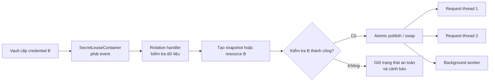
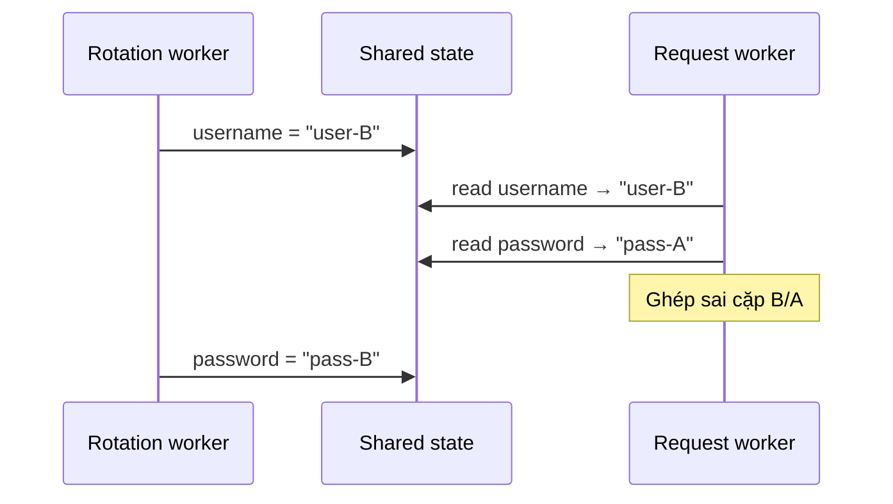
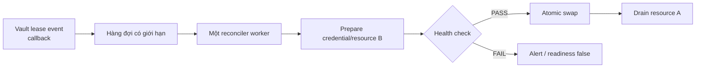
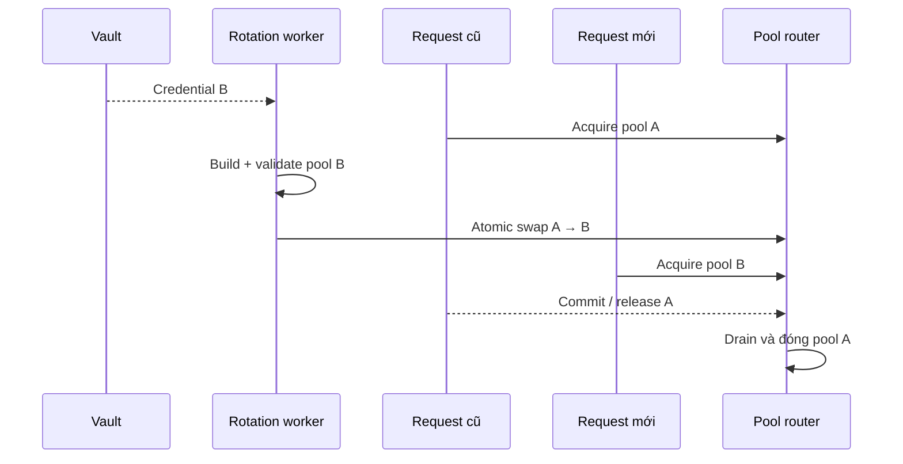

# Đồng bộ thay đổi giữa các luồng trong ứng dụng

Ứng dụng Java chạy lâu dài thường có nhiều luồng cùng đọc cấu hình, gọi cơ sở dữ liệu, gửi HTTP request hoặc thực hiện tác vụ nền. Trong khi đó, **Spring Vault** có thể nhận credential mới từ HashiCorp Vault bất kỳ lúc nào thông qua **secret rotation**. Nếu một luồng cập nhật username/password còn những luồng khác tiếp tục đọc dữ liệu cũ, ứng dụng dễ gặp lỗi xác thực ngẫu nhiên, cập nhật không đồng nhất hoặc làm gián đoạn giao dịch đang chạy.

Bài học trong chương **Xoay vòng trong ứng dụng** giải thích cách **đồng bộ việc công bố thay đổi giữa các luồng** khi Spring Vault thông báo đã lấy một phiên bản secret mới. Đây là vấn đề của cả hai phía: **Vault/`SecretLeaseContainer` cấp secret và phát sự kiện; ứng dụng Java phải công bố và sử dụng phiên bản mới một cách an toàn**.

Ví dụ xuyên suốt là dịch vụ Java dùng database credentials động tại `database/creds/reporting`. Các nguyên tắc tương tự áp dụng khi thay token gọi một API, cập nhật TLS certificate/private key hoặc đổi cấu hình nhạy cảm đọc qua `VaultTemplate`. Chúng gắn với phạm vi module **SPRING_VAULT**: xác thực workload, policy, vòng đời token và lease, xử lý lỗi, giám sát và kiểm thử tích hợp.

## 1. Mục tiêu

Sau bài này, bạn có thể:

1. Phân biệt **rotation xảy ra tại Vault**, **nhận sự kiện tại Spring Vault** và **áp dụng secret mới vào thành phần đang chạy**.
2. Giải thích vì sao cập nhật hai field `username`/`password` độc lập có thể tạo ra một cặp không hợp lệ ngay cả khi mỗi field được khai báo `volatile`.
3. Dùng **immutable snapshot + `AtomicReference`** để công bố nhiều giá trị secret như một trạng thái nhất quán.
4. Hiểu vai trò của `SecretLeaseContainer`, `SecretLeaseCreatedEvent`, `SecretLeaseRotatedEvent` và `SecretLeaseExpiredEvent` trong luồng đa luồng.
5. Thiết kế việc đổi **connection pool** có bước kiểm tra trước khi chuyển, giữ an toàn cho giao dịch đang chạy và không làm nghẽn luồng xử lý lease.
6. Xử lý những race condition phổ biến: sự kiện đến chậm, rotation liên tiếp, credential hết hạn, shutdown và rollback.
7. Viết kiểm thử concurrency và tích hợp dựa trên hành vi thực sự thay vì chỉ kiểm tra field đã được gán.

## 2. Ba tầng trạng thái phải đồng bộ

Hãy hình dung dịch vụ đang dùng credential `A`. Vault cấp credential `B` sau khi lease của `A` đi đến giới hạn. Có ít nhất ba tầng trạng thái:

| Tầng | Ai quản lý? | Điều gì thay đổi? | Rủi ro nếu bỏ qua |
| --- | --- | --- | --- |
| **Nguồn secret** | Vault | Credential và lease từ `A` sang `B` | `A` hết hạn/bị revoke |
| **Trạng thái trong JVM** | Spring Vault và code ứng dụng | Thread xử lý event nhận `B` và công bố dữ liệu mới | Thread khác tiếp tục đọc `A` hoặc đọc cặp giá trị bị trộn |
| **Tài nguyên đang sử dụng** | Connection pool, HTTP client, TLS context... | Các kết nối/request mới sử dụng `B` | Đã công bố `B` nhưng pool vẫn tạo kết nối bằng `A` |

**Thành công của `SecretLeaseRotatedEvent` chỉ chứng minh Spring Vault đã lấy secret mới.** Nó không chứng minh mọi DataSource, JDBC connection, HTTP client hay giao dịch trong ứng dụng đã đổi sang secret đó.



Điểm công bố phải rõ ràng. Khi người đọc đi vào một thao tác, họ cần lấy **một phiên bản** và nhất quán dùng phiên bản đó trong toàn thao tác, hoặc nắm một handle đến tài nguyên đã được chuẩn bị tương ứng.

## 3. Sự kiện rotation đến từ luồng nào?

`SecretLeaseContainer` thực hiện lấy secret, renew lease và rotate theo `RequestedSecret`. Theo tài liệu Spring Vault, **event có thể được phát từ luồng khởi động container hoặc từ worker thread nền** dùng cho việc renew/rotate; không có bảo đảm callback sẽ chạy trên luồng đang xử lý request HTTP của ứng dụng.

Thứ tự phổ biến:

1. Ứng dụng đăng ký `RequestedSecret.rotating("database/creds/reporting")` và listener.
2. Container bắt đầu: lấy credential đầu tiên, phát `SecretLeaseCreatedEvent`.
3. Luồng request đọc credential hiện hành để sử dụng.
4. Container renew lease. `AfterSecretLeaseRenewedEvent` thông báo TTL được gia hạn, **không phải credential đã đổi**.
5. Lease cũ hết hạn; container lấy credential mới và phát `SecretLeaseRotatedEvent`.
6. Listener chuyển credential mới vào thành phần dùng nó; các luồng request tiếp tục hoạt động.

### Các loại event và tác động đến consumer

| Spring Vault event | Ý nghĩa | Xử lý gợi ý |
| --- | --- | --- |
| `SecretLeaseCreatedEvent` | Nhận secret lần đầu | Công bố initial snapshot/tài nguyên |
| `SecretLeaseRotatedEvent` | Nhận secret mới do rotation | Kiểm tra và thay snapshot/tài nguyên |
| `AfterSecretLeaseRenewedEvent` | Lease hiện tại được renew | Cập nhật TTL/metric, **giữ credential** |
| `SecretLeaseExpiredEvent` | Lease được xác định đã hết hạn | Không tiếp tục cho request mới dùng credential của lease đó |
| `SecretNotFoundEvent` | Không tìm thấy secret | Readiness/alert tùy phụ thuộc |
| `SecretLeaseErrorEvent` | Lỗi gọi Vault hoặc renew/fetch | Phân loại, backoff, cảnh báo, không log secret |

**`SecretLeaseRotatedEvent` kế thừa `SecretLeaseCreatedEvent`.** Nếu kiểm tra kiểu bằng `instanceof`, phải đặt nhánh `RotatedEvent` trước `CreatedEvent` khi cần phân biệt initial load và rotation. Hoặc dùng nhánh `CreatedEvent` để xử lý cả hai một cách chủ đích và đặt metric riêng cho rotation.

## 4. Lỗi concurrency điển hình: cập nhật hai field riêng lẻ

Giả sử ứng dụng giữ credential trong hai field:

```java
// Ví dụ sai: mỗi trường có visibility nhưng cả cặp không atomic.
final class UnsafeCredentials {
    volatile String username = "user-A";
    volatile String password = "pass-A";

    void update(String nextUsername, String nextPassword) {
        username = nextUsername;
        password = nextPassword;
    }
}
```

Khi `Thread Rotation` ghi `user-B` trước rồi `pass-B` sau, `Thread Request` có thể xen giữa:



Mỗi thao tác ghi/đọc reference đều đơn lẻ, nhưng **không có atomicity của cả bộ username/password**. `volatile` bảo đảm một số quy tắc visibility/happens-before theo Java Memory Model, **không biến hai field thành một giao dịch**.

Các biến thể khác cũng thường sai:

- Giữ dữ liệu trong `HashMap`/`Properties` rồi sửa nhiều key từ thread khác mà không có synchronization.
- Dùng `ConcurrentHashMap` rồi cập nhật `username` và `password` bằng hai lệnh `put`. Map an toàn ở cấp thao tác, **không an toàn ở cấp nhiều key**.
- Thay hai giá trị riêng của `@ConfigurationProperties` và cho rằng mọi bean đã tự cập nhật.
- Tạo snapshot từ một mutable map nhưng giữ nguyên tham chiếu map đó, để code khác sửa sau khi “publish”.
- Đọc username/password ở **hai thời điểm khác nhau** trong cùng một request thay vì nắm một snapshot duy nhất.

## 5. Cách 1: immutable snapshot và `AtomicReference`

Khi một nghiệp vụ chỉ cần **đọc một bộ giá trị cùng nhau** (ví dụ username, password, endpoint, token, version), mô hình đơn giản và dễ kiểm chứng là:

1. Tạo một object **bất biến** chứa toàn bộ giá trị cần dùng.
2. Kiểm tra tính hợp lệ của object mới **trước khi công bố**.
3. Thay một tham chiếu duy nhất bằng `AtomicReference.set(...)` hoặc `compareAndSet(...)`.
4. Mỗi reader gọi `get()` **một lần**, dùng object vừa nhận cho toàn bộ thao tác.

### Ví dụ Java 17+

```java
import java.util.Map;
import java.util.Objects;
import java.util.concurrent.atomic.AtomicReference;

// Object không có setter. Một snapshot chứa trọn bộ giá trị đồng bộ.
record CredentialSnapshot(
        String username,
        String password,
        String leaseId,
        long generation) {

    CredentialSnapshot {
        Objects.requireNonNull(username);
        Objects.requireNonNull(password);
        Objects.requireNonNull(leaseId);
        if (username.isBlank() || password.isBlank()) {
            throw new IllegalArgumentException("Credential thiếu trường");
        }
    }
}

final class CredentialStore {
    private final AtomicReference<CredentialSnapshot> active =
            new AtomicReference<>();

    // Giả định MỘT writer tuần tự; các reader có thể chạy đồng thời.
    private long lastGeneration;

    public synchronized void publish(
            Map<String, Object> secrets, String leaseId) {
        String username = Objects.toString(secrets.get("username"), "");
        String password = Objects.toString(secrets.get("password"), "");
        CredentialSnapshot next = new CredentialSnapshot(
                username, password,
                Objects.requireNonNull(leaseId),
                ++lastGeneration);

        // Điểm công bố atomic, tạo quan hệ happens-before cho reader.
        active.set(next);
    }

    public CredentialSnapshot current() {
        CredentialSnapshot snapshot = active.get(); // CHỈ đọc một lần
        if (snapshot == null) {
            throw new IllegalStateException(
                    "Chưa có credential hợp lệ; từ chối request");
        }
        return snapshot;
    }

    // Chỉ vô hiệu hóa credential nếu event expiry thuộc đúng lease hiện hành.
    public void expireIfCurrent(String expiredLeaseId) {
        if (expiredLeaseId == null || expiredLeaseId.isBlank()) {
            return;
        }
        active.updateAndGet(previous ->
                previous != null
                        && expiredLeaseId.equals(previous.leaseId())
                        ? null : previous);
    }
}
```

**Chú ý:** `lastGeneration` chỉ tăng khi một publisher đã có quyền ghi gọi `publish`; `synchronized` làm các lần publish tuần tự. Nếu nhiều event đến **không theo thứ tự thực của Vault**, generation này chỉ biểu thị **thứ tự nhận/áp dụng**, không tự xác nhận credential nào thực sự mới hơn. Phần xử lý sự kiện đến trễ ở mục sau sẽ giải thích cách hạn chế tác động.

### Reader dùng snapshot đúng cách

```java
CredentialSnapshot credential = store.current();

String username = credential.username();
String password = credential.password();

// Chuyển cả hai giá trị của CÙNG credential vào thao tác nghiệp vụ.
// Ví dụ: credentialsForRequest(username, password);
```

Không viết:

```java
// Sai: có thể lấy username từ phiên bản A và password từ phiên bản B.
String username = store.current().username();
String password = store.current().password();
```

`AtomicReference` giải quyết **coherent publication giữa các luồng**, không bảo đảm credential còn hợp lệ ở hệ thống đích suốt thời gian request. Nếu Vault revoke lease ngay sau khi reader lấy snapshot, server database vẫn có thể từ chối đăng nhập; ứng dụng phải xử lý lỗi và readiness phù hợp.

### Tại sao `record` giúp ích?

`record` trong Java 17 tạo nhóm field `final`, không có setter và phù hợp để giữ dữ liệu liên quan trong một object. Có thể dùng một class `final` với các field `final` ở Java cũ hơn. Đừng thêm mutable `byte[]`, `char[]` hoặc `Map` mà không bảo vệ/copy; sự bất biến của reference không ngăn sửa phần tử của mảng.

Ví dụ dùng `String` cho mật khẩu vì nhiều API JDBC nhận `String`, nhưng nó ở heap dưới dạng immutable string và không thể xóa sạch chủ động. Hạn chế vòng đời snapshot, không log hoặc in `record.toString()`, tránh lưu lại tham chiếu cũ ngoài nhu cầu thực tế.

## 6. `volatile`, lock và CAS: dùng công cụ nào?

| Công cụ Java | Đảm bảo | Khi phù hợp | Giới hạn |
| --- | --- | --- | --- |
| `volatile CredentialSnapshot` | Công bố một reference và visibility | Một writer, một snapshot bất biến | Không có CAS cho cập nhật cạnh tranh |
| `AtomicReference<CredentialSnapshot>` | Atomic `get/set/CAS` trên một reference | Đa reader, một hoặc nhiều writer có kiểm soát | Không tự đồng bộ side effects bên ngoài |
| `synchronized` | Mutual exclusion và visibility | Nhiều bước cần cùng critical section | Tránh khóa giữ lâu khi gọi Vault/DB |
| `ReentrantReadWriteLock` | Đọc song song, ghi độc quyền | Nhiều trường mutable buộc cập nhật cùng lock | Dễ gây nghẽn/độ phức tạp hơn immutable state |
| `ConcurrentHashMap` | An toàn với thao tác trên từng key | Cache độc lập theo key | Không bảo đảm hai key thuộc cùng thế hệ |
| `ExecutorService` một luồng | Tuần tự hóa tác vụ được gửi vào executor | Áp dụng sự kiện/chuẩn bị pool theo một thứ tự do app kiểm soát | Không tự biết event nào mới hơn nếu đầu vào đã đảo thứ tự |

Với bộ credential gồm nhiều trường, **`AtomicReference` chứa snapshot bất biến** thường là lựa chọn dễ đọc. Nếu phải thay cả connection pool và các resource bên ngoài, atomic reference chỉ là **bước chuyển giao pointer**; cần thêm quy trình prepare/health check/drain.

## 7. Nối `SecretLeaseContainer` với `CredentialStore`

Spring Vault có `RequestedSecret.rotating(path)` và `SecretLeaseContainer` để nhận dynamic secret. Ví dụ dưới đây cho thấy listener chỉ công bố một **snapshot hợp lệ** và không tự thao tác pool/database trong callback.

```java
import java.util.Map;
import org.springframework.scheduling.TaskScheduler;
import org.springframework.vault.core.VaultOperations;
import org.springframework.vault.core.lease.SecretLeaseContainer;
import org.springframework.vault.core.lease.domain.RequestedSecret;
import org.springframework.vault.core.lease.event.*;

public final class LeaseWiring {
    public static SecretLeaseContainer start(
            VaultOperations vault,
            TaskScheduler scheduler,
            CredentialStore store) throws Exception {

        SecretLeaseContainer container =
                new SecretLeaseContainer(vault, scheduler);
        RequestedSecret requested =
                RequestedSecret.rotating("database/creds/reporting");

        container.addLeaseListener(new LeaseListenerAdapter() {
            @Override
            public void onLeaseEvent(SecretLeaseEvent event) {
                if (!requested.equals(event.getSource())) {
                    return;
                }

                if (event instanceof SecretLeaseRotatedEvent rotated) {
                    // Rotation kế thừa CreatedEvent; xử lý nhánh này trước.
                    install(rotated);
                } else if (event instanceof SecretLeaseCreatedEvent created) {
                    // Lần cấp đầu tiên.
                    install(created);
                } else if (event instanceof SecretLeaseExpiredEvent expired) {
                    if (expired.getLease() != null) {
                        store.expireIfCurrent(
                                expired.getLease().getLeaseId());
                    }
                } else if (event instanceof AfterSecretLeaseRenewedEvent) {
                    // Chỉ ghi metrics TTL, không thay username/password.
                }
            }

            private void install(SecretLeaseCreatedEvent event) {
                if (event.getLease() == null ||
                        !event.getLease().hasLeaseId()) {
                    throw new IllegalStateException("Thiếu lease ID");
                }
                // publish() chuẩn hóa và kiểm tra dữ liệu, không lưu Map mutable.
                store.publish(event.getSecrets(),
                        event.getLease().getLeaseId());
            }

            @Override
            public void onLeaseError(
                    SecretLeaseEvent event, Exception error) {
                // Metric + cảnh báo đã lọc thông tin nhạy cảm.
                // Không log response có username/password hay token.
            }
        });

        container.addRequestedSecret(requested);
        container.afterPropertiesSet();
        container.start();
        return container;
    }
}
```

Đoạn ví dụ dùng cú pháp `instanceof` có pattern variable của Java 17+. Thư viện Spring Vault cần được cấu hình thành một bean quản lý lifecycle hoặc tạo thủ công có `afterPropertiesSet()`/`start()`/`stop()` theo đúng ứng dụng. **Đăng ký listener trước khi start** vì sự kiện cấp secret lần đầu có thể xuất hiện ngay trong quá trình khởi động.

**Giới hạn của ví dụ:** `install(...)` là thao tác nhẹ trong callback, không tạo pool. Nếu một implementation cần truy vấn database, xây TLS context, kiểm thử network hoặc đợi resource, hãy tách công việc nặng sang worker riêng theo mục tiếp theo. Khi dùng Spring Cloud Vault auto-configuration, kiểm tra container đã tồn tại trước khi dựng thêm.

## 8. Callback lease không phải nơi làm việc nặng

Vì callback có thể chạy trên luồng khởi động hoặc worker thread của container, nếu listener trực tiếp:

- Tạo connection pool mất hàng giây;
- Chờ toàn bộ request đang chạy hoàn tất;
- Gọi HTTP request đến service khác;
- Chờ một lock mà request thread cũng đang giữ;
- Ghi hàng nghìn log hoặc chờ retry vô hạn;

thì có thể làm chậm việc xử lý lease tiếp theo, gây deadlock, vượt TTL hoặc làm quá trình khởi động bị kẹt.

### Mẫu thiết kế: listener nhẹ, reconciler một luồng



Nên tổ chức:

1. Listener **xác thực event thuộc đúng `RequestedSecret`**, lấy một bản dữ liệu cần thiết, không log secret.
2. Chuyển yêu cầu áp dụng thay đổi sang **executor một luồng** hoặc hàng đợi có giới hạn; xử lý lỗi khi queue đầy thay vì làm mất event âm thầm.
3. Worker **chuẩn bị trước** resource mới. Ví dụ mở pool mới, chạy lệnh test connection có timeout ngắn.
4. Nếu pass, **công bố một handle mới atomically**; request mới sử dụng handle mới.
5. Cho request đã lấy handle cũ hoàn thành trong khoảng thời gian có kiểm soát; drain/đóng resource cũ khi an toàn.

Hàng đợi một luồng giúp thực thi tuần tự, nhưng không phải phép màu chống event sai thứ tự. Có thể nhận một thông báo lease đã hết hạn **sau** khi credential mới được công bố. Do đó cần kiểm tra `lease ID`/generation để không vô hiệu hóa credential mới bằng thông báo của lease cũ.

### Không phụ thuộc vào tính “exactly once”

Trong hệ thống thực tế, có thể có event được gửi lại, xử lý chậm hoặc callback chạy trong lúc shutdown. Thiết kế handler theo hướng **idempotent**:

- Nhận hai lần yêu cầu áp dụng cùng một lease ID không tạo hai pool mới nếu trạng thái đã là lease đó.
- Một event expiry của lease `L1` không xóa trạng thái của lease `L2`.
- Một task áp dụng credential B đã bị thay thế bởi C không được publish B sau C.
- Retry có giới hạn và backoff; lỗi khi đồng bộ phải có metric/readiness phản ánh.

Với các pipeline thật sự đa nguồn, nên có **một coordinator** quyết định thế hệ nào là mới hơn dựa trên trạng thái lease/Vault hoặc chuỗi sự kiện tin cậy, chứ không dùng thời điểm một thread hoàn tất tác vụ làm nguồn thứ tự.

## 9. Race condition đến chậm: expiry cũ xóa credential mới

Ví dụ:

```text
t0: app dùng credential A với lease L1
t1: Vault cấp credential B, lease L2
t2: app publish B
t3: callback SecretLeaseExpiredEvent(L1) được xử lý muộn
t4: app xóa "current" bất kể lease ID => B biến mất (BUG)
```

Giải pháp là **gắn danh tính lease với snapshot** và chỉ hủy nếu đúng phiên bản đang hoạt động:

```java
// store chứa AtomicReference<CredentialSnapshot> active
store.expireIfCurrent("database/creds/reporting/<old-lease-id>");
// Nếu active đang giữ lease mới L2, lambda giữ nguyên snapshot.
```

Một lỗi khác xảy ra khi **hai luồng chuẩn bị tài nguyên**:

```text
Thread 1: nhận B, bắt đầu tạo pool B (rất chậm)
Thread 2: nhận C, tạo pool C nhanh và publish C
Thread 1: hoàn tất B sau cùng và publish B (BUG: quay về phiên bản cũ)
```

Chặn bằng một coordinator tuần tự, hoặc phiên bản **monotonic** có CAS cho phép publish chỉ khi candidate **mới hơn trạng thái hiện hành theo thứ tự nguồn đáng tin cậy**. Không gán generation theo thời điểm task chạy xong; đó là thứ tự hoàn tất bất định.

### So sánh nhanh `set` và `compareAndSet`

```java
// set: phù hợp khi chỉ có một publisher đã sắp xếp thứ tự.
active.set(newSnapshot);

// compareAndSet: dùng khi chỉ chấp nhận thay thế trạng thái đúng kỳ vọng.
CredentialSnapshot expected = active.get();
boolean installed = active.compareAndSet(expected, newSnapshot);
// Nếu false, phải đọc lại và quyết định có nên áp dụng hay hủy candidate.
```

**CAS đơn độc không bảo đảm phiên bản mới hơn.** Nó chỉ bảo đảm không có writer khác thay `expected` giữa lúc kiểm tra và công bố; logic nghiệp vụ vẫn phải đối chiếu thế hệ/lease.

## 10. Thay connection pool an toàn

Với HikariCP, một pool chứa nhiều JDBC connection được tạo từ credential tại các thời điểm khác nhau. Việc cập nhật hai field trong `HikariDataSource` không tương đương thay ngay mọi connection.

Tài liệu HikariCP nêu rằng thay `username`/`password` lúc runtime ảnh hưởng **chỉ đến connection mới**, và cách thay qua runtime configuration áp dụng với một số chế độ tạo connection dựa trên `DataSource`. Vì vậy:

- Connection đang được giao cho transaction **không tự động xác thực lại** với credential mới.
- Một transaction đang chạy có thể vẫn cần connection cũ cho đến commit/rollback.
- Gán username rồi gán password theo hai bước có cửa sổ tạo connection với **cặp không khớp** nếu pool cho phép cập nhật runtime.
- Nếu Vault revoke credential cũ, các kết nối mới dùng A có thể thất bại ngay cả khi connection cũ đang tồn tại.

### Mô hình chuẩn bị rồi chuyển (prepare → validate → publish → drain)

| Pha | Việc làm | Điều kiện chuyển bước |
| --- | --- | --- |
| **Prepare** | Nhận credential B, tạo pool B độc lập | Không làm thay đổi pool A hiện hành |
| **Validate** | Mở một connection thử bằng B, kiểm tra timeout/cấu hình | Thử thành công và resource sẵn sàng |
| **Publish** | Đổi atomic reference từ handle A sang handle B | Request mới luôn nhìn một handle hoàn chỉnh |
| **Drain** | Cho request đã mượn A hoàn thành trong giới hạn | Không đóng A giữa giao dịch đang sử dụng |
| **Retire** | Đóng pool A, giải phóng resource và ghi metric | Không còn borrower hợp lệ hoặc đã qua deadline cưỡng chế |



**Lưu ý thiết kế quan trọng:** `AtomicReference<HikariDataSource>.getAndSet(B)` chỉ đổi pointer, **không bảo vệ các request vừa đọc pointer A khỏi việc A bị close ngay sau đó**. Muốn tránh race, router cần:

- Cơ chế `acquire()/release()` có **reference count** hoặc quản lý các phiên giao dịch đang mượn pool.
- Đánh dấu pool cũ `retired` trước khi nhận borrower mới, nhưng vẫn giữ nó mở cho borrower đã vào.
- Thời hạn drain và quy trình cưỡng chế phù hợp với timeout giao dịch, tránh giữ pool cũ vô thời hạn.
- Giải quyết race giữa `acquire` và `retire` dưới cùng một cơ chế đồng bộ (lock/CAS/handle).

Một giải pháp đơn giản nhưng có downtime là tạm dừng request mới, đợi mọi giao dịch cũ hoàn thành rồi tạo/thay pool; lựa chọn này có thể phù hợp với ứng dụng nội bộ, batch hoặc dịch vụ có tải nhỏ. Nếu cần zero-downtime, phải có **overlap credential** ở backend hoặc chiến lược chuyển đổi phù hợp; `RequestedSecret.rotating(...)` tự nó **không bảo đảm overlap**.

## 11. Không phải dependency nào cũng dùng pool

### Đối với HTTP API token

Khi client xây header `Authorization` cho từng request, có thể đọc **một snapshot token bất biến** ngay khi tạo request. Không lưu token trong một HTTP client chỉ được khởi tạo duy nhất nếu muốn tự động thay token. Lưu ý token có thể hết hạn sau khi snapshot được lấy; xử lý 401 và retry theo chính sách, không in bearer token.

### Đối với Vault KV v2 tĩnh

Ứng dụng đọc một property từ `VaultTemplate` và cache nó trong field immutable lúc khởi động sẽ **không tự động refresh** chỉ vì bản ghi KV v2 được thay. Cần một cơ chế cập nhật được thiết kế riêng (polling, tín hiệu từ hệ thống triển khai, Spring Cloud Vault refresh...) rồi công bố snapshot. Không giả định KV v2 static secret có dynamic renewable lease như Database secrets engine.

### Đối với certificate và private key

Chứng thư và private key là **một bundle phải đồng bộ với nhau**, giống username/password. Không thay private key trước rồi thay certificate sau trên hai biến độc lập. Chuẩn bị key/cert/trust material cùng nhau, tạo TLS context mới và chuyển context/connection phù hợp. Những TLS connection đã bắt tay trước đó không nhất thiết tự nhận certificate mới; cần đánh giá việc thiết lập lại kết nối.

### Đối với Transit encryption

Vault Transit thực hiện encryption/decryption qua Vault API; kết quả không phải một database password cần đổi giữa thread theo lease. Tuy nhiên nếu ứng dụng local-cache metadata về key, chính sách rotate phiên bản khóa hoặc dữ liệu nhạy cảm khác, vẫn cần công bố một snapshot nhất quán.

## 12. TTL và hết hạn: atomic publish chưa đủ

Ứng dụng có thể công bố credential B atomically nhưng B vẫn hết hạn ngay sau đó. Vì vậy thiết kế phải kết hợp:

- **Lease ID** để biết event thuộc credential hiện tại hay đã cũ.
- **Lease TTL** và thời điểm quan sát để cảnh báo sắp hết hạn, đồng thời tránh coi thời điểm nội bộ là cam kết tuyệt đối của Vault.
- **Readiness gate**: thiếu credential hợp lệ thì từ chối traffic mới thay vì tiếp tục dùng một password đã bị revoke.
- **Retry/backoff**: xử lý lỗi mạng tạm thời có giới hạn; phân biệt lỗi không thể renew, lỗi permission, credential sai.
- **Session/token lifecycle**: Vault login token cũng có TTL, policies và có thể bị thu hồi. Lease của secret động có thể bị revoke khi token mẹ hết hiệu lực.
- **Cleanup**: shutdown phải giải phóng connection pool, scheduler, executor và tránh một callback muộn publish lại resource đã dừng.

`SecretLeaseContainer` có thể phát `SecretLeaseExpiredEvent` **sau thời điểm lease thực tế hết hạn** bởi Vault không đẩy sự kiện tự động đến client; container phát hiện qua tương tác và lịch nội bộ. Vì vậy **không được xem event là bảo đảm chính xác tuyệt đối về thời điểm hiệu lực**.

Một quyết định vận hành cần ghi rõ: khi credential A hết hạn mà chuẩn bị B thất bại, có cho request mới chạy không? Với database credential đã bị revoke, thông thường cần **fail closed** cho request mới cần credential, trả lỗi phụ thuộc tạm thời/readiness false và tiếp tục phục hồi có kiểm soát. Cứ giữ credential A để “đảm bảo availability” có thể chỉ tạo thêm lỗi đăng nhập và che giấu sự cố.

## 13. Khởi động và dừng: tránh mất event đầu tiên

Tại thời điểm ứng dụng khởi động, container có thể lấy secret và phát `SecretLeaseCreatedEvent` trước khi một số bean/request handler sẵn sàng. Cần đặt thứ tự rõ ràng:

1. Khởi tạo `CredentialStore`/pool coordinator.
2. Đăng ký listener **trước** `container.start()`.
3. Bắt đầu `SecretLeaseContainer` và chỉ bật readiness khi credential đầu tiên đã được kiểm chứng, tài nguyên đích sẵn sàng.
4. Khi rotation, cập nhật resource trong một quy trình có trạng thái rõ ràng, không đổi bean phụ thuộc từng field.
5. Khi shutdown, ngăn nhận request mới, dừng reconciler/lease container theo thứ tự phù hợp và drain các resource đang dùng.

Spring Vault có `ManagedSecret.rotating(...)` trong các bản mới để nối quá trình lấy secret và callback cập nhật thành phần ứng dụng. Đây là abstraction hữu ích nhưng callback vẫn phải **thread-safe, idempotent** và tính tới tài nguyên đang dùng; `ManagedSecret` không biến việc đóng connection pool thành an toàn một cách tự động.

## 14. Quan sát và kiểm soát sự cố

Không log password, Vault token, certificate private key, JWT hoặc toàn bộ `event.getSecrets()`. Ghi nhận metric/trace có kiểm soát:

| Metric hoặc trạng thái | Ý nghĩa | Khi nào cảnh báo? |
| --- | --- | --- |
| `secret_rotation_received_total` | Số event nhận được theo path/loại | Event bất thường, lặp nhiều |
| `secret_rotation_applied_total` | Số lần resource mới đã publish thành công | Nhận event nhưng không áp dụng được |
| `secret_rotation_prepare_failures_total` | Lỗi validate pool/HTTP/TLS mới | Bất kỳ lỗi kéo dài hoặc liên tục |
| `active_lease_remaining_seconds` | Thời gian lease được ước lượng từ metadata | Sắp hết hạn mà chưa renew/rotate |
| `retired_pool_active_borrowers` | Số request còn dùng pool cũ | Không drain được sau deadline |
| `vault_authentication_errors_total` | Lỗi login/renew Vault token | Mất session, credential secrets bị ảnh hưởng |
| `readiness_state` | Có thể phục vụ request với credential hợp lệ? | Chuyển thành không sẵn sàng |

`lease ID` và event source có thể mang thông tin vận hành; hạn chế dùng chúng làm label metric có cardinality cao. Nếu cần correlation giữa old/new generation, dùng ID nội bộ không chứa password; giữ lease ID đầy đủ trong log bảo vệ nếu chính sách cho phép.

### Quy trình ứng phó một rotation thất bại

1. Phân biệt **Vault không cấp B**, **đã cấp B nhưng B không connect được**, hay **đã connect được nhưng publish/drain lỗi**.
2. Đọc trạng thái active generation/lease và lease TTL, tránh quyết định chỉ dựa vào timestamp của một callback.
3. Nếu B chưa được publish, giữ A **chỉ khi A còn hợp lệ**; nếu A đã hết hạn, chuyển readiness theo hướng an toàn.
4. Nếu B đã publish, không rollback vô điều kiện sang A vì A có thể đã bị revoke.
5. Kiểm tra transaction đang chạy, pool cũ còn borrowers, lỗi authentication và số lần retry trước khi cho traffic bình thường trở lại.

## 15. Kiểm thử concurrency và tích hợp

Các bài kiểm thử nên mô phỏng nhiều reader thật, một hoặc nhiều writer theo thiết kế, đồng thời kiểm chứng hành vi của Vault và phụ thuộc bên ngoài.

| Ca | Thao tác | Kỳ vọng |
| --- | --- | --- |
| 1. Startup | Chưa nhận event secret đầu | `current()` báo chưa sẵn sàng, không dùng credential rỗng |
| 2. Initial load | `SecretLeaseCreatedEvent` chứa A | Mọi reader nhận cả `username A/password A` |
| 3. Publish atomic | Hàng trăm reader đọc khi writer đổi A ↔ B | Không reader nào nhận cặp username B/password A |
| 4. Renew lease | `AfterSecretLeaseRenewedEvent` | Không thay credential hoặc tạo pool không cần thiết |
| 5. Rotation | Event có B, validation pass | Các request mới dùng B sau điểm publish |
| 6. Prepare pool fail | B sai hoặc DB unavailable | Không publish B; readiness phù hợp TTL của A |
| 7. Expiry muộn | Active đang L2, nhận expiry L1 | Không xóa hoặc đóng L2 |
| 8. Rotation cạnh tranh | Apply B chậm, C nhanh | Không để B publish lại sau C |
| 9. Transaction cũ | Transaction giữ handle A khi swap B | Không close A trước khi borrower hoàn thành |
| 10. Pool drain timeout | Transaction treo | Có deadline, metric và chính sách cưỡng chế |
| 11. Token bị revoke | Vault token phát hành credential bị mất hiệu lực | Lease phụ thuộc được xử lý, không chấp nhận secret giả là mới |
| 12. Callback sau shutdown | Container/executor đang dừng | Không mở pool mới hoặc publish vào resource đã đóng |
| 13. Failed retry | Vault tạm timeout | Bounded retry/backoff, không log secret và không lặp vô hạn |
| 14. Multiple replicas | Hai instance dùng hai lease động | Mỗi JVM tự đồng bộ riêng; không chia sẻ state RAM |

### Pseudocode kiểm tra tính nhất quán snapshot

```text
store.publish({username: "user-0", password: "pass-0"}, "lease-0")
start 1 writer + 8 reader threads with CountDownLatch

writer:
  for n = 1..500:
    store.publish({username: "user-" + n,
                   password: "pass-" + n}, "lease-" + n)

each reader:
  repeat 10000 times:
    snapshot = store.current() // một get duy nhất
    u = suffix(snapshot.username)
    p = suffix(snapshot.password)
    assert u == p             // không bao giờ bị trộn phiên bản

join all threads
assert no assertion failed
```

Đây là **pseudocode**, không phải test Java hoàn chỉnh. Kiểm thử thật nên dùng `ExecutorService`, `CountDownLatch`, `Future.get()` để thu lỗi từ worker threads; chạy nhiều lịch giao thoa khác nhau. Cần thêm **integration test** với Vault test server và database test để kiểm tra TTL, revoke, ACL, retry và pool cutover – test atomic field không thể chứng minh hệ thống bên ngoài đã thay credential đúng.

## 16. Những sai lầm thường gặp

**Sai lầm 1 — Dùng hai `volatile` là đủ.** Mỗi field có visibility nhưng không bảo đảm toàn bộ tổ hợp nhất quán. Dùng snapshot bất biến hoặc khóa bảo vệ cả hai.

**Sai lầm 2 — Đọc `AtomicReference.get()` nhiều lần trong cùng request.** Hai lần có thể trả hai generation khác nhau; đọc một lần rồi tái sử dụng cùng snapshot.

**Sai lầm 3 — Xử lý `SecretLeaseRotatedEvent` chỉ bằng cách đổi password.** Vault có thể thay cả username/password, lease ID và metadata. Phải coi secret là một **bộ giá trị**.

**Sai lầm 4 — Đóng pool cũ ngay sau `getAndSet`.** Các giao dịch đã chọn pool cũ có thể đang chạy; cần quản lý borrower/retire.

**Sai lầm 5 — Đặt công việc I/O lâu trong callback lease.** Callback có thể chạy trên scheduler/luồng khởi động; tách việc chuẩn bị resource ra reconciler.

**Sai lầm 6 — Coi mỗi event là mới hơn event trước.** Expiry event của lease cũ hoặc tác vụ apply chậm có thể xuất hiện sau rotation mới. Kiểm tra lease ID và thứ tự nguồn.

**Sai lầm 7 — Dùng một `AtomicReference` để đồng bộ nhiều JVM.** Nó chỉ đồng bộ **trong một tiến trình Java**. Mỗi replica nhận secret/lease riêng và phải tự xử lý cập nhật; điều phối liên tiến trình cần cơ chế khác.

**Sai lầm 8 — Coi readiness bằng “đã từng có secret”.** Credential có thể hết TTL/revoke; readiness cần phản ánh tính sử dụng được hiện tại và kết nối thật với dependency.

## 17. Quy tắc thiết kế cho dự án thực tế

| Câu hỏi | Nguyên tắc áp dụng |
| --- | --- |
| Ai là chủ sở hữu sự thay đổi? | Vault phát hành giá trị; một coordinator trong JVM quyết định khi nào publish |
| Giá trị nào phải đi cùng nhau? | Gom username/password, token/metadata, certificate/private key thành một snapshot |
| Reader thấy trạng thái gì? | Một snapshot/handle được công bố atomically |
| Khi nào tài nguyên mới được dùng? | Chỉ sau khi đã chuẩn bị và kiểm tra đạt yêu cầu |
| Khi nào hủy tài nguyên cũ? | Sau khi không còn borrower, hoặc theo deadline và chính sách an toàn |
| Nếu event bị trễ/đảo thứ tự? | So sánh lease ID, generation tin cậy và bỏ qua event stale |
| Nếu rotation thất bại? | Alert, bounded retry, readiness phù hợp; không sử dụng secret đã revoke |
| Khi kiểm thử cần nhìn gì? | Không có mixed version; chuyển pool/connection thật, lease và ACL hợp lệ |

**Kết luận thực hành:** `SecretLeaseContainer` chỉ cung cấp cơ chế nhận/renew/rotate và thông báo secret. **Java Memory Model và tài nguyên của ứng dụng** quyết định việc thay secret đó có được quan sát nhất quán và an toàn bởi các luồng đang chạy hay không. Với dữ liệu thuần, dùng snapshot bất biến và `AtomicReference`; với resource nặng như connection pool hoặc TLS context, thêm **prepare → validate → atomic publish → drain**. Cần nối chúng với vòng đời Vault token/lease, quan sát lỗi và kiểm thử concurrency để đảm bảo rotation thực sự có hiệu lực.

## Tài liệu tham khảo

- [Spring Vault – Credentials Rotation: SecretLeaseContainer, Events, ManagedSecret](https://docs.spring.io/spring-vault/reference/vault/credential-rotation.html)
- [Spring Vault – SecretLeaseContainer API và hành vi callback](https://docs.spring.io/spring-vault/reference/api/java/org/springframework/vault/core/lease/SecretLeaseContainer.html)
- [Spring Vault – SecretLeaseEvent API](https://docs.spring.io/spring-vault/reference/api/java/org/springframework/vault/core/lease/event/SecretLeaseEvent.html)
- [Spring Vault – SecretLeaseCreatedEvent API](https://docs.spring.io/spring-vault/reference/api/java/org/springframework/vault/core/lease/event/SecretLeaseCreatedEvent.html)
- [Spring Vault – SecretLeaseRotatedEvent API](https://docs.spring.io/spring-vault/reference/api/java/org/springframework/vault/core/lease/event/SecretLeaseRotatedEvent.html)
- [Spring Vault – Lease API](https://docs.spring.io/spring-vault/reference/api/java/org/springframework/vault/core/lease/domain/Lease.html)
- [HikariCP – Runtime username/password changes (HikariConfigMXBean)](https://javadoc.io/static/com.zaxxer/HikariCP/7.1.0/com/zaxxer/hikari/HikariConfigMXBean.html)
- [Java Platform – AtomicReference](https://docs.oracle.com/en/java/javase/21/docs/api/java.base/java/util/concurrent/atomic/AtomicReference.html)
- [HashiCorp Vault – Lease, renew và revoke](https://developer.hashicorp.com/vault/docs/concepts/lease)
