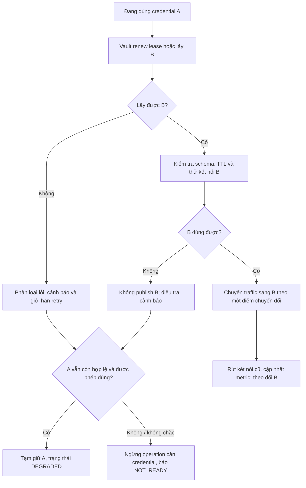
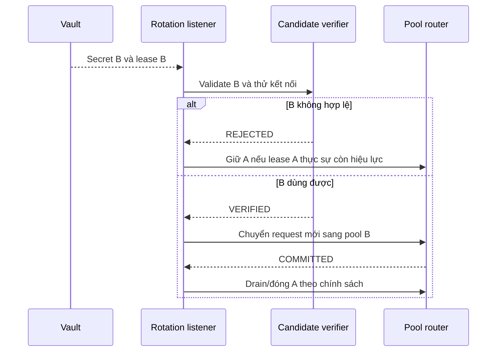

# Ứng xử khi nhận secret mới thất bại

Trong ứng dụng Java dùng Spring Vault, **xoay vòng secret** không chỉ là đọc lại một giá trị từ HashiCorp Vault. Ứng dụng còn phải xác nhận secret mới hợp lệ, đưa nó vào HTTP client, connection pool hoặc thành phần sử dụng tương ứng, rồi ngừng dùng secret cũ đúng thời điểm. Có những lần Vault không cấp được secret mới; cũng có lần Vault đã trả credential mới nhưng ứng dụng không thể kết nối bằng credential đó. Nếu không thiết kế đường xử lý thất bại, hệ thống có thể tiếp tục dùng credential đã hết hạn, mất toàn bộ kết nối hoặc đưa bí mật vào log.

Bài thuộc chương **Xoay vòng trong ứng dụng** của module `SPRING_VAULT`. Ví dụ chính là database credentials động được cấp bởi Vault và theo dõi qua `SecretLeaseContainer`/`VaultTemplate`. Các nguyên tắc kiểm soát lỗi, policy, TTL và kiểm thử cũng hữu ích với KV secrets, Transit encryption, PKI và cơ chế đăng nhập theo workload, nhưng **mỗi loại tài nguyên có vòng đời khác nhau**.

## 1. Phân biệt ba loại thất bại trong quá trình xoay vòng

Xét một dịch vụ `orders-api` đang dùng database account A do Vault database secrets engine cấp. Gần đến thời điểm hết lease, ứng dụng cần sử dụng account B. Có ít nhất ba điểm lỗi độc lập:

| Điểm lỗi | Ví dụ | Ứng dụng biết gì? | Điều phải tránh |
| --- | --- | --- | --- |
| **Không lấy được secret mới** | Vault timeout, HTTP `503`, `403`, không có secret tại path | Chưa có credential B đáng tin cậy | Xóa A ngay hoặc coi B là chuỗi rỗng |
| **Lấy được nhưng không chấp nhận được** | Thiếu `username`/`password`, không đúng kiểu, thiếu certificate chain, vi phạm quy tắc ứng dụng | B tồn tại nhưng chưa qua validation | Ghi B vào cấu hình runtime trước khi kiểm tra |
| **Nhận hợp lệ nhưng áp dụng thất bại** | DB từ chối B, pool khởi tạo lỗi, client không reload TLS, kết nối thử thất bại | B đã được Vault cấp, nhưng thành phần phụ thuộc chưa sẵn sàng | Báo “rotation succeeded” chỉ vì HTTP Vault trả `200` |

Ngoài ra, **renew lease thất bại** khác với **fetch secret mới thất bại**. Renew cố kéo dài lease hiện tại; rotate yêu cầu secret khác. Với dynamic credentials, renew có thể tiếp tục dùng cùng username/password, còn rotate thường dẫn đến credential mới. Chỉ biết `renewable=true` không bảo đảm lease có thể gia hạn vô thời hạn.

Một luồng xoay vòng an toàn gồm:



**Điều kiện để giữ A** không phải “A còn nằm trong bộ nhớ”. Nó phải còn hiệu lực thực tế, chưa bị revoke và còn phù hợp chính sách an toàn. Khi lease A đã hết hạn hoặc bị thu hồi, ứng dụng không được coi `LeaseStrategy.retainOnIoError()` là giấy phép tiếp tục dùng A.

## 2. Hiểu dữ liệu Vault cấp và thời hạn thực sự

Ví dụ Vault database secrets engine tại mount `database`, role `orders-readonly`:

```http
GET /v1/database/creds/orders-readonly HTTP/1.1
Host: vault.example.internal:8200
X-Vault-Token: <VAULT_LOGIN_TOKEN>
```

```json
{
  "lease_id": "database/creds/orders-readonly/demo-lease-A",
  "lease_duration": 300,
  "renewable": true,
  "data": {
    "username": "v_orders_A",
    "password": "fake-password-A"
  }
}
```

Trong response, `lease_duration` tính bằng **giây**; `lease_id` dùng để nhận diện lease; `data` là credential được cấp. Đây là **dynamic secret**, khác cấu trúc KV v2 với `data.data` và metadata phiên bản. TTL có thể bị giới hạn bởi auth token cha, secrets engine, role và chính sách Vault.

Ví dụ lúc `10:00:00` nhận A có TTL 300 giây. `10:04:00` Vault có lỗi mạng, còn một phút trước thời điểm hết hạn dự kiến `10:05:00`. Việc giữ A ở trạng thái dùng được chỉ có thể là **phương án tạm thời trong cửa sổ còn hợp lệ**. Nếu không xác nhận lại được hiệu lực, đến hạn phải chặn thao tác cần credential, cho phép hệ thống điều phối giảm traffic hoặc chuyển sang cơ chế dự phòng đã được thiết kế.

```text
10:00               10:04                10:05
 |--------------------|--------------------|
 Nhận A               Lấy B thất bại      A hết TTL dự kiến
                      Có thể DEGRADED     Không tiếp tục giả định A hợp lệ
```

Thời hạn dự kiến phải dựa vào TTL gần nhất Vault trả về khi cấp/renew, thời điểm quan sát và độ trễ; local clock và lịch của `TaskScheduler` có thể sai lệch. **Lease được Vault thu hồi trước hạn** sẽ mất hiệu lực ngay cả khi thời gian đo tại ứng dụng vẫn còn.

## 3. Spring Vault thông báo thành công hay lỗi ở đâu?

`SecretLeaseContainer` theo dõi các `RequestedSecret`, chủ động renew các lease đủ điều kiện và lấy secret mới khi sử dụng **rotating mode**. Container nhận lịch từ `TaskScheduler`; Vault không chủ động đẩy sự kiện “secret vừa hết hạn” tới ứng dụng. Tùy phiên bản và điều kiện vận hành, sự kiện expiration có thể đến **sau** thời điểm hết hạn thực tế.

| Sự kiện / callback | Ý nghĩa | Phản ứng phù hợp |
| --- | --- | --- |
| `SecretLeaseCreatedEvent` | Đã nhận secret và thông tin lease | Chuyển sang bước validate rồi apply, không coi là đã hoàn tất |
| `SecretLeaseRotatedEvent` | Đã lấy secret mới trong luồng xoay vòng | Kiểm tra B, xây client/pool mới, cập nhật trạng thái |
| `AfterSecretLeaseRenewedEvent` | Renew lease thành công | Cập nhật mốc TTL; thường không cần thay credential |
| `SecretLeaseExpiredEvent` | Container quan sát lease đã hết hạn | Dừng dùng credential liên quan khi không còn hiệu lực |
| `SecretNotFoundEvent` | Không tìm thấy secret tại path đăng ký | Kiểm tra mount/path/role và khả năng cung cấp tài nguyên |
| `LeaseErrorListener.onLeaseError(...)` | Lỗi trong lấy secret, renew, revoke hoặc rotate | Phân loại lỗi, phát cảnh báo và điều phối khôi phục |

**Ranh giới quan trọng:** các event trên mô tả việc container tương tác với Vault. Chúng **không thể tự biết** rằng HikariCP, HTTP client, certificate loader hoặc kết nối tới hệ thống đích đã sử dụng secret mới thành công. Bởi vậy, ứng dụng cần theo dõi thêm trạng thái **đã xác minh và được áp dụng**.

Ví dụ đăng ký event và error callback, dùng Spring Vault Core 3.2+/4.x:

```java
import java.util.Map;
import java.util.function.Consumer;
import org.springframework.scheduling.TaskScheduler;
import org.springframework.vault.core.VaultOperations;
import org.springframework.vault.core.lease.SecretLeaseContainer;
import org.springframework.vault.core.lease.domain.RequestedSecret;
import org.springframework.vault.core.lease.event.SecretLeaseCreatedEvent;
import org.springframework.vault.core.lease.event.SecretLeaseExpiredEvent;

class RotationRegistration {
    static SecretLeaseContainer create(
            VaultOperations vault,
            TaskScheduler scheduler,
            Consumer<Map<String, Object>> submitCandidate,
            Runnable markExpired,
            Consumer<Exception> reportFailure) {

        SecretLeaseContainer container =
                new SecretLeaseContainer(vault, scheduler);
        RequestedSecret requested = container
                .requestRotatingSecret("database/creds/orders-readonly");

        container.addLeaseListener(event -> {
            if (!requested.equals(event.getSource())) {
                return;
            }
            // SecretLeaseRotatedEvent kế thừa SecretLeaseCreatedEvent.
            if (event instanceof SecretLeaseCreatedEvent created) {
                submitCandidate.accept(created.getSecrets());
            } else if (event instanceof SecretLeaseExpiredEvent) {
                markExpired.run();
            }
        });

        container.addErrorListener((event, exception) -> {
            if (requested.equals(event.getSource())) {
                reportFailure.accept(exception);
            }
        });

        return container;
    }
}
```

`submitCandidate`, `markExpired`, `reportFailure` là các **cổng callback do ứng dụng triển khai**. Callback nhận secret map chỉ nên đẩy sang hàng đợi có giới hạn để validate/apply; không thực hiện kết nối database chậm trên thread renewal. Khi dùng bean do Spring quản lý, để `SmartLifecycle` của container thực hiện initialize/start/stop; đăng ký listener trước khi container bắt đầu. Nếu Spring Cloud Vault đã auto-configure container, cần chọn đúng container đang quản lý secret, tránh tạo thêm một container cạnh tranh cho cùng path.

`LeaseErrorListener` nhận cả event và `Exception`. Không log nguyên `event`, object secret hoặc toàn bộ exception chain nếu có nguy cơ chứa đường dẫn nội bộ, token hay raw request. Nên phân loại mã lỗi và gửi metric thông qua hệ thống đã kiểm duyệt dữ liệu.

## 4. Giữ bản cũ, nhưng phải biết khi nào buộc phải dừng

Có thể thiết kế trạng thái ứng dụng độc lập với trạng thái scheduler:

| Trạng thái | Điều kiện | Hành vi |
| --- | --- | --- |
| `STARTING` | Chưa có credential nào được xác minh | Chưa mở readiness cho operation cần secret |
| `READY` | Secret hiện tại đã validate, dùng được, chưa hết hiệu lực | Phục vụ bình thường |
| `DEGRADED` | Không lấy/apply được B, nhưng A còn hiệu lực được kiểm soát | Phục vụ có giới hạn, cảnh báo và thử phục hồi |
| `BLOCKED` | A hết hạn/bị revoke hoặc chưa có secret sử dụng được | Từ chối thao tác phụ thuộc secret; readiness thất bại nếu chức năng cốt lõi |
| `RECOVERING` | Đang thử kết nối bằng B và chuyển đổi tài nguyên | Không công bố thành công cho tới khi B được áp dụng |

Lỗi mạng lúc `GET` secret không nhất thiết là lý do dừng ứng dụng **ngay lập tức** nếu A vẫn xác thực thành công và còn TTL. Tuy nhiên, nếu cơ sở dữ liệu đã từ chối A hoặc Vault thông báo A bị revoke, tiếp tục dùng A chỉ làm tăng lỗi và có thể vượt quá policy bảo mật. Lựa chọn fail-open/fail-closed phải được đưa vào contract của từng tính năng: chẳng hạn đọc dữ liệu công khai có thể không phụ thuộc DB credential, còn API cần truy cập DB bắt buộc không được trả kết quả thành công giả.

**Readiness** và **liveness** cần tách biệt. Lỗi secret bắt buộc kéo dài có thể khiến readiness thất bại để load balancer ngừng cấp request; liveness chỉ nên thất bại nếu tiến trình không thể tự phục hồi. Khởi động lại pod liên tục khi Vault đang gián đoạn có thể tạo bão đăng nhập hoặc làm mất credential A còn hợp lệ.

## 5. Apply secret theo hai pha: validate trước, chuyển đổi sau

Đối với database credential B, nên thực hiện:

1. **Nhận ứng viên** từ Vault, giữ trong bộ nhớ riêng; xác nhận schema, field bắt buộc, metadata TTL và đúng secrets engine.
2. **Thử sử dụng B** bằng kết nối thử có timeout và quyền tối thiểu. Nếu thất bại, không công bố B là credential đang hoạt động.
3. **Chuẩn bị tài nguyên mới**: tạo pool hoặc client với B, warm-up một số connection và kiểm tra operation đơn giản.
4. **Chuyển đổi tại một điểm rõ ràng**: dùng atomic reference hoặc cơ chế định tuyến phiên bản để request mới đi qua pool B.
5. **Thu hồi tài nguyên cũ có kiểm soát**: ngừng cấp request mới cho pool A, đợi request đang chạy hoàn thành trong giới hạn cho phép, đóng pool A.
6. **Xác nhận phục hồi**: metrics, readiness, health check, log trạng thái đã được kiểm duyệt, không in B.

Sơ đồ chuyển đổi:



Ví dụ cấu trúc Java thuần để thể hiện **validate rồi mới publish** một snapshot ứng dụng; lớp thử kết nối thật do dự án triển khai:

```java
import java.util.concurrent.atomic.AtomicReference;

record DbCredentials(String username, String password) {}

@FunctionalInterface
interface CandidateVerifier {
    void verify(DbCredentials credentials) throws Exception;
}

final class CredentialGate {
    private final AtomicReference<DbCredentials> active =
            new AtomicReference<>();
    private final CandidateVerifier verifier;

    CredentialGate(CandidateVerifier verifier) {
        this.verifier = verifier;
    }

    // Được gọi trên một hàng đợi rotation có thứ tự và có giới hạn.
    void applyCandidate(DbCredentials candidate) throws Exception {
        if (candidate == null
                || candidate.username() == null
                || candidate.username().isBlank()
                || candidate.password() == null
                || candidate.password().isBlank()) {
            throw new IllegalArgumentException("Invalid Vault credentials");
        }
        verifier.verify(candidate); // Kiểm tra downstream trước khi publish.
        active.set(candidate);
    }

    DbCredentials current() {
        return active.get();
    }
}
```

Mã này **chưa tự xoay HikariCP/connection pool**: `AtomicReference` chỉ đổi đối tượng chứa credential, không đổi các kết nối database đã được tạo. Khi áp dụng thực tế, điểm publish thường là **pool/router mới** sau khi kiểm tra B, có khả năng drain A và trạng thái TTL riêng. Ngoài ra, phải chặn event cũ hoặc retry đến muộn ghi đè lên credential mới: dùng một hàng đợi tuần tự, generation hoặc cơ chế fencing theo vòng đời cụ thể. Không dùng thứ tự từ `lease_id` như một timestamp đáng tin cậy.

**Nếu B được cấp sau khi lease A đã hết hạn:** không rollback về A chỉ vì B không chạy được. Lúc này đúng hơn là chặn operation cần credential, phục hồi B hoặc xin secret mới theo quy trình; không tái sử dụng credential A đã bị thu hồi.

## 6. Thiết kế retry dựa trên nguyên nhân

| Loại lỗi | Có nên thử lại ngay? | Xử lý phù hợp |
| --- | --- | --- |
| Timeout, lỗi kết nối, `502/503` | Có thể retry nhưng có giới hạn | Exponential backoff + jitter, timeout hữu hạn; theo dõi Vault readiness |
| `429` / giới hạn tần suất | Chờ theo thông tin server khi có | Giảm đồng thời, tôn trọng retry hint, backoff |
| `403 permission denied` ở secrets path | Không lặp vô hạn | Kiểm tra Vault token, policy, mount path và capability |
| `403` do token không hợp lệ | Cần kiểm tra session | Để `SessionManager`/auth client khôi phục; giới hạn retry nghiệp vụ |
| `404` secret hoặc role | Thường là lỗi định tuyến/cấu hình | Kiểm tra mount/path, quyền và sự tồn tại; chỉ retry nếu biết có provisioning trễ |
| `400` vì request sai | Không nên retry nguyên request | Sửa payload, role hoặc API path |
| HTTP `200` nhưng dữ liệu thiếu/sai kiểu | Không công bố ứng viên | Báo lỗi hợp đồng dữ liệu, điều tra nguồn cấp |
| B kết nối DB thất bại | Chỉ retry nếu lỗi được xác nhận tạm thời | Probe giới hạn thời gian, tránh tạo hàng trăm pool thất bại |
| Lease A đã revoke | Không được tiếp tục A | Chuyển `BLOCKED`, khôi phục bằng credential được phép |

Ví dụ chính sách retry cấp ứng dụng: tối đa 3 lần, khoảng chờ cơ bản `500ms`, tăng gấp đôi và thêm jitter, tổng thời gian không vượt ngân sách cho thao tác. **Đây là ví dụ thiết kế**, không phải mặc định của Spring Vault; thay đổi theo SLA và thời gian còn lại của lease. Chỉ retry đối với lỗi tạm thời, tránh một request người dùng tạo ra một chuỗi login/secret issuance kéo dài.

Với `SecretLeaseContainer`, `LeaseStrategy` giúp xác định sau lỗi renew có nên giữ hay bỏ **trạng thái lease**:

```java
// Chọn một chiến lược theo yêu cầu vận hành:
container.setLeaseStrategy(LeaseStrategy.dropOnError());
// Hoặc: LeaseStrategy.retainOnError()
// Hoặc: LeaseStrategy.retainOnIoError()
```

`LeaseStrategy.retainOnIoError()` có thể hợp lý với lỗi mạng tạm thời, nhưng nó **không kéo dài TTL trên Vault**. Việc giữ trạng thái lease bên trong container khác hoàn toàn việc ứng dụng quyết định credential A vẫn sử dụng được. Đừng cài vòng retry thủ công cạnh tranh với scheduler/lease manager mà không kiểm soát thời điểm, số lần và đồng thời.

## 7. Khi lỗi gắn với token đăng nhập thay vì secret

`SessionManager` quản lý **Vault client token**, còn `SecretLeaseContainer` quản lý **lease của secret**. Khi auth token gốc hết hạn hoặc bị thu hồi, các lease gắn với token đó có thể bị Vault thu hồi. Việc dùng `LifecycleAwareSessionManager` giúp renew hoặc đăng nhập lại bằng danh tính workload khi thích hợp, nhưng **token mới không tự làm lease cũ sống lại**.

Ví dụ luồng phục hồi:

```text
Kubernetes ServiceAccount JWT
    -> POST /v1/auth/kubernetes/login
    -> Vault token T2
    -> SecretLeaseContainer lấy lại database/creds/orders-readonly
    -> Lease B, credential B
    -> Validate và chuyển downstream sang B
```

Người triển khai cần nối lifecycle session với secret lifecycle theo cơ chế mà phiên bản Spring Vault/Spring Cloud Vault hỗ trợ. `SecretLeaseContainer` cung cấp `getAuthenticationListener()` và `getAuthenticationErrorListener()` ở các phiên bản liên quan để xử lý sự kiện thay đổi session. Nếu Spring Cloud Vault quản lý bean sẵn, ưu tiên cấu hình được hỗ trợ thay vì đăng ký thêm listener tùy tiện.

Với **AppRole Secret ID** có TTL hoặc giới hạn số lần sử dụng, re-login có thể thất bại ngay cả khi Vault đã hoạt động bình thường; phải có cách cấp Secret ID mới. Với **AWS IAM/Kubernetes/TLS cert**, kiểm tra metadata/JWT/certificate còn hợp lệ và ràng buộc role/policy đúng. Không hardcode một Vault token vào HTTP client để “chữa” lỗi rotation.

## 8. Phân biệt KV v2, database credential, Transit và PKI

Không phải mọi loại secret đều tạo lease giống nhau:

| Dịch vụ | “Secret mới” có nghĩa là gì? | Cách phát hiện và phục hồi khi lỗi |
| --- | --- | --- |
| **Database dynamic credentials** | Vault cấp username/password mới, lease mới | `SecretLeaseContainer` rotating; validate B, làm mới connection pool, xử lý hết TTL A |
| **KV v2 static secret** | Version mới của key/value được ghi vào KV | Đọc lại đúng version/path, kiểm tra schema/version, atomic apply; KV v2 không mặc nhiên có renewable lease |
| **Transit encryption** | Key version trên Vault thay đổi khi rotate Transit key | Ứng dụng gửi dữ liệu tới Transit và xử lý ciphertext theo version; không tự tải private key Transit để swap |
| **PKI certificate** | Chứng thư mới được cấp, có expiry X.509 và private key tương ứng | Cấp lại/đổi certificate chain, reload SSLContext/client, kiểm tra handshake; `CertificateContainer` ở phiên bản Spring Vault hỗ trợ |
| **Vault auth credential** | JWT, Secret ID, IAM credential hoặc certificate mới cho login | Đảm bảo auth client dùng nguồn credential mới; Vault login token có lifecycle riêng |

Đối với KV v2, đường dẫn dữ liệu đọc là `/v1/<mount>/data/<key>`; `data.metadata.version` là **phiên bản secret**, không phải TTL lease database. Trong failure recovery, đừng đọc secret từ một mount không đúng hoặc bỏ lớp `data.data`. Nếu ứng dụng cập nhật key KV v2, dùng cơ chế CAS khi thích hợp để tránh ghi đè thay đổi của bên khác.

Transit rotate key thường diễn ra trong Vault; ciphertext có prefix phiên bản khóa như `vault:v2:...`. Nếu mã hóa thất bại do token/policy/timeout, hãy xử lý lỗi ở **Transit API** và thiết kế idempotency cho operation; không coi đó là lý do làm mới database password.

PKI certificate có thể đã hết hạn trong khi Vault token vẫn có hiệu lực. Nếu TLS client chưa reload certificate mới, việc thay file trên volume không đủ; phải làm mới SSLContext hoặc client phù hợp. Việc quay lại certificate A đã hết hạn hoặc bị revoke không phải rollback an toàn.

## 9. Lỗi rotation và cấu hình Spring Cloud Vault

Spring Cloud Vault có thể tự khởi tạo secret lifecycle cho property sources khi dùng Config Data:

```yaml
spring:
  config:
    import: vault://
  cloud:
    vault:
      uri: https://vault.internal.example:8200
      authentication: KUBERNETES
      kubernetes:
        role: orders-service
        kubernetes-path: kubernetes
      config:
        lifecycle:
          enabled: true
          expiry-threshold: 45s
          min-renewal: 10s
      database:
        enabled: true
        backend: database
        role: orders-readonly
```

`config.lifecycle.*` ở đây điều khiển **secret lease**, khác `session.lifecycle.*` điều khiển **Vault login token**. Hai nhóm cần phối hợp nhưng không thay thế nhau. Tùy Spring Cloud Vault và Spring Vault version, các property lifecycle có thể khác; kiểm tra dependency đã resolve và tài liệu của đúng version trước khi sử dụng trong production.

Nếu khởi tạo ứng dụng bằng `spring.config.import: vault://` và Vault không khả dụng ngay lúc startup, quá trình tạo property source có thể thất bại **trước khi ứng dụng có credential để dùng**. Cấu hình fail-fast/optional import cần dựa trên loại secret và mục tiêu bảo mật; **không đặt secret bắt buộc thành tùy chọn chỉ để startup được** rồi dùng giá trị mặc định rỗng.

Ngay cả khi `LeaseAwareVaultPropertySource` nhận được giá trị mới, một bean đã đọc `@Value` lúc khởi tạo hoặc một DataSource không hỗ trợ reconfiguration sẽ không tự động được xây lại. Ứng dụng phải triển khai cơ chế refresh/rotation đúng thành phần. Có thể dùng Spring events hoặc `ManagedSecret` ở phiên bản Spring Vault hỗ trợ để kết nối secret mới với consumer; vẫn phải xác minh downstream thật sự đổi credential.

## 10. Giám sát và ứng phó sự cố

Các metric nên có:

| Metric | Ý nghĩa | Quy tắc bảo mật |
| --- | --- | --- |
| `vault_rotation_fetch_success_total` / `failure_total` | Vault có cấp được ứng viên mới không | Phân loại theo engine/role được kiểm duyệt |
| `vault_rotation_apply_success_total` / `failure_total` | Consumer có thật sự nhận B không | Không ghi plaintext, password hay private key |
| `vault_rotation_seconds_to_expiry` | Thời gian còn lại của credential đang dùng | Không dùng `lease_id` làm label |
| `vault_rotation_candidate_age_seconds` | B đã chờ validate/apply bao lâu | Theo dõi queue bị nghẽn |
| `vault_rotation_state` | READY/DEGRADED/BLOCKED/RECOVERING | Metric ít nhãn, không lộ thông tin người dùng |
| `vault_rotation_retry_total` | Retry có tăng bất thường không | Phân loại network/auth/policy/schema |
| `database_auth_failures_total` | Credential mới hoặc cũ bị DB từ chối | Theo dõi theo service, không ghi username nhạy cảm |

Một log an toàn có thể có dạng:

```text
component=credential-rotation
engine=database
role=orders-readonly
stage=downstream.probe
outcome=failed
failure_kind=authentication
rotation_state=DEGRADED
attempt=2
```

Không in `data.password`, Vault token, ServiceAccount JWT, AppRole Secret ID, private key hoặc raw response/event. Chỉ log `lease_id` khi chính sách vận hành cho phép và đã được kiểm duyệt; ưu tiên correlation ID riêng của ứng dụng. Cần cảnh báo khi **không còn credential hợp lệ**, khi retry vượt ngưỡng hoặc khoảng thời gian còn lại trước expiry thấp hơn khả năng phục hồi dự kiến.

Runbook khi một lần rotation lỗi:

1. Xác định lỗi nằm ở **Vault fetch/renew**, **validation**, **downstream apply** hay **token session**; ghi mã trạng thái và thời gian.
2. Kiểm tra lease A có còn hợp lệ thực sự không. Nếu không, chuyển `BLOCKED` cho chức năng phụ thuộc secret.
3. Kiểm tra Vault health, auth mount, secrets engine mount, policy và TTL; phân biệt `403` do ACL với token invalid.
4. Nếu đã nhận B, kiểm tra schema, quyền của account B, kết nối test, connection pool/TLS reload và thứ tự event.
5. Phục hồi với bounded retry và backoff; tránh restart đồng loạt làm mất trạng thái có ích.
6. Chỉ xác nhận “rotation complete” khi consumer dùng được B; quan sát lỗi thực tế sau cutover và thu hồi tài nguyên cũ theo chính sách.

## 11. Kiểm thử các nhánh thất bại

### Mock Vault và consumer độc lập

Với WireMock hoặc fake Vault HTTP server, tạo phản hồi cho hai lượt lấy credential:

```text
GET /v1/database/creds/orders-readonly
  -> 200, lease_id=A, lease_duration=300, data.username=A, data.password=fake-A

GET /v1/database/creds/orders-readonly (lần xoay vòng)
  -> 503 Service Unavailable

GET /v1/database/creds/orders-readonly (lần thử phục hồi hợp lệ)
  -> 200, lease_id=B, lease_duration=300, data.username=B, data.password=fake-B
```

Song song, mock một **database connector**: lần đầu B không đăng nhập được, lần tiếp B có thể kết nối được. Khi test, phải phân biệt:

- HTTP Vault đã trả B hay chưa;
- B đã qua validation chưa;
- B đã được áp dụng vào pool/client nào;
- request mới có thật sự đi qua pool B;
- credential A còn hiệu lực khi fallback hay đã hết hạn.

Chỉ mock `VaultOperations.read()` trả B không thể chứng minh container đã xoay vòng theo đúng lịch. Cần một test riêng kiểm tra `SecretLeaseContainer`, `TaskScheduler`, thứ tự event và lỗi renewal/rotation. Với xử lý đồng thời, dùng clock/scheduler kiểm soát được hoặc timeout có giới hạn để tránh test không ổn định.

| Ca kiểm thử | Thiết lập | Kỳ vọng |
| --- | --- | --- |
| Khởi động thiếu secret | Lần fetch đầu trả `503` | Không tạo client bằng credential rỗng; readiness chưa READY |
| Lỗi tạm thời khi A còn TTL | B fetch timeout, A được xác nhận còn hiệu lực | DEGRADED, giữ A có giới hạn; retry có backoff |
| Lỗi khi A hết TTL | B chưa có, A đã expire | BLOCKED; không tiếp tục dùng A |
| Payload B sai schema | Thiếu password hoặc kiểu dữ liệu sai | Không publish B; phát lỗi validation |
| B dùng được ở Vault nhưng DB từ chối | Probe B trả lỗi authentication | Không chuyển pool sang B; xử lý A theo hiệu lực thật |
| B hợp lệ và DB chấp nhận | Probe thành công | Chuyển traffic mới sang B một lần, rồi drain A |
| Event đến sai thứ tự | B được apply, callback cũ đến muộn | A không ghi đè B |
| Vault `403` do policy | Token không đủ quyền `database/creds/*` | Điều tra policy; không retry login vô hạn |
| Vault login token bị revoke | Renewal hoặc fetch lỗi auth | Re-login theo workload; lease cũ không tự hồi sinh |
| Nhiều instance đồng thời rotate | Nhiều pod có lease riêng | Không chia sẻ credential sai, không gây login/fetch storm |
| Shutdown khi đang apply B | Tác vụ bị ngắt giữa prepare/commit | Consumer trở về trạng thái xác định, không rò rỉ pool hoặc secret |

### Integration test với Vault thật

Trong môi trường thử nghiệm cô lập, bật một database secrets engine, role TTL ngắn hợp lý và policy tối thiểu. Kiểm tra `SecretLeaseContainer` xin credential, kết nối tới database, lỗi mạng tạm thời, hết lease A và chuyển sang B. Thu hồi Vault token thử nghiệm để xem tác động lên lease con và luồng login lại. Đảm bảo mọi tài khoản tạm, token, lease và resource test được dọn an toàn. Với test PKI/certificate, kiểm tra cả TLS handshake sau khi reload, không chỉ đọc được tệp chứng thư mới.

## 12. Bài thực hành

**Bối cảnh:** ứng dụng `orders-api` dùng Spring Vault, Vault database role `orders-readonly` cấp credential động TTL 5 phút. Ứng dụng dùng HikariCP, có `SecretLeaseContainer` ở rotating mode và `LifecycleAwareSessionManager` cho Vault login token.

1. Vẽ trạng thái `READY`, `DEGRADED`, `RECOVERING`, `BLOCKED`; xác định sự kiện chuyển trạng thái khi fetch B, validation và DB probe thất bại.
2. Đặt `expiry-threshold=45s`, `min-renewal=10s` và mô tả vì sao không thể cứ retry khi A hết TTL.
3. Đăng ký `LeaseListener` cùng `LeaseErrorListener`; phân biệt `SecretLeaseRotatedEvent` và lỗi do consumer không apply B.
4. Viết một `CredentialGate` để validate B trước khi publish và triển khai pool router sao cho request mới chuyển sang pool B sau khi thử kết nối thành công.
5. Dựng các phản hồi `503`, `403`, `404`, dữ liệu sai schema và DB authentication failure; kiểm tra lựa chọn giữ A hoặc chặn request theo TTL thực.
6. Tạo một test callback đến muộn nhằm bảo đảm credential cũ không ghi đè credential mới.
7. Thu hồi token Vault trong test instance, rồi xác minh re-login không khiến lease A tự động hồi sinh.
8. Thiết kế metric và cảnh báo phân biệt **fetch failure**, **apply failure** và **credential expired** mà không ghi log giá trị secret.

**Tiêu chí hoàn thành:** người học xử lý được cả lỗi lấy và lỗi áp dụng secret mới; chỉ dùng credential cũ khi còn hợp lệ; thực hiện chuyển đổi có kiểm tra và giới hạn retry; giữ độc lập vòng đời lease, Vault token và consumer; đồng thời kiểm thử được thất bại lẫn phục hồi thực tế.

## Tài liệu tham khảo

- [Spring Vault — Credential Rotation](https://docs.spring.io/spring-vault/reference/vault/credential-rotation.html)
- [Spring Vault — SecretLeaseContainer JavaDoc](https://docs.spring.io/spring-vault/reference/api/java/org/springframework/vault/core/lease/SecretLeaseContainer.html)
- [Spring Vault — Lease events](https://docs.spring.io/spring-vault/reference/api/java/org/springframework/vault/core/lease/event/package-summary.html)
- [Spring Vault — LeaseStrategy JavaDoc](https://docs.spring.io/spring-vault/reference/api/java/org/springframework/vault/support/LeaseStrategy.html)
- [Spring Cloud Vault — Common Application Properties](https://docs.spring.io/spring-cloud-vault/reference/appendix.html)
- [HashiCorp Vault — Lease concepts](https://developer.hashicorp.com/vault/docs/concepts/lease)
- [HashiCorp Vault — Database secrets engine](https://developer.hashicorp.com/vault/docs/secrets/databases)
