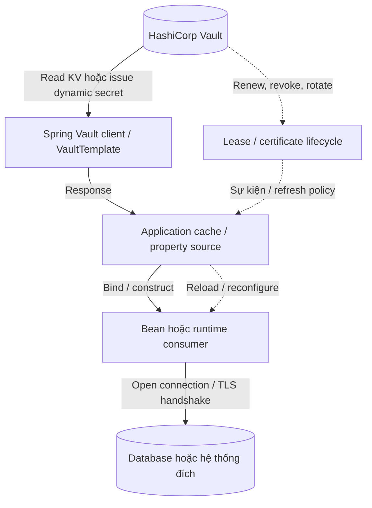
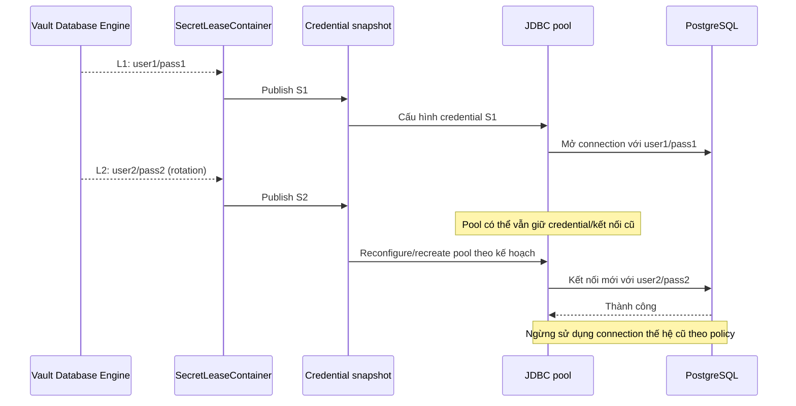
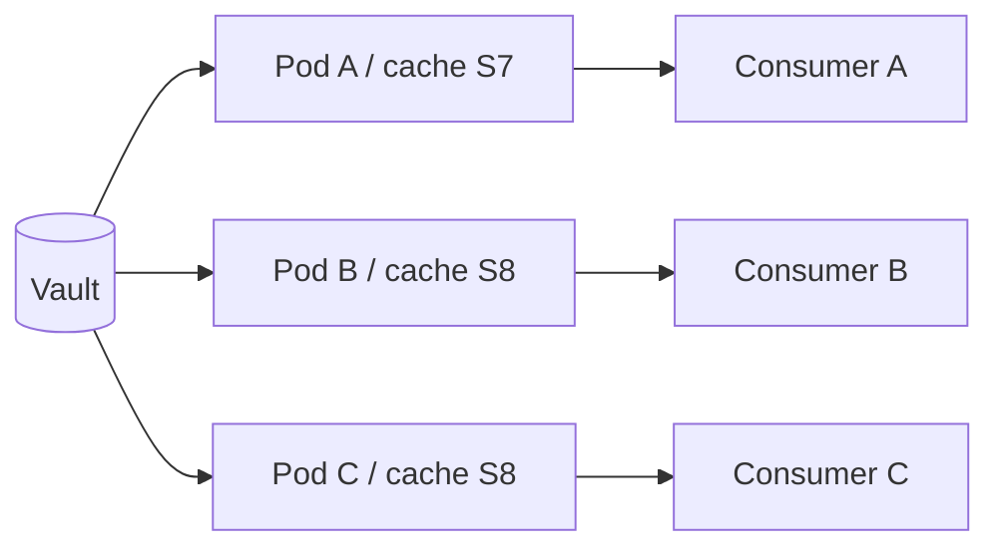
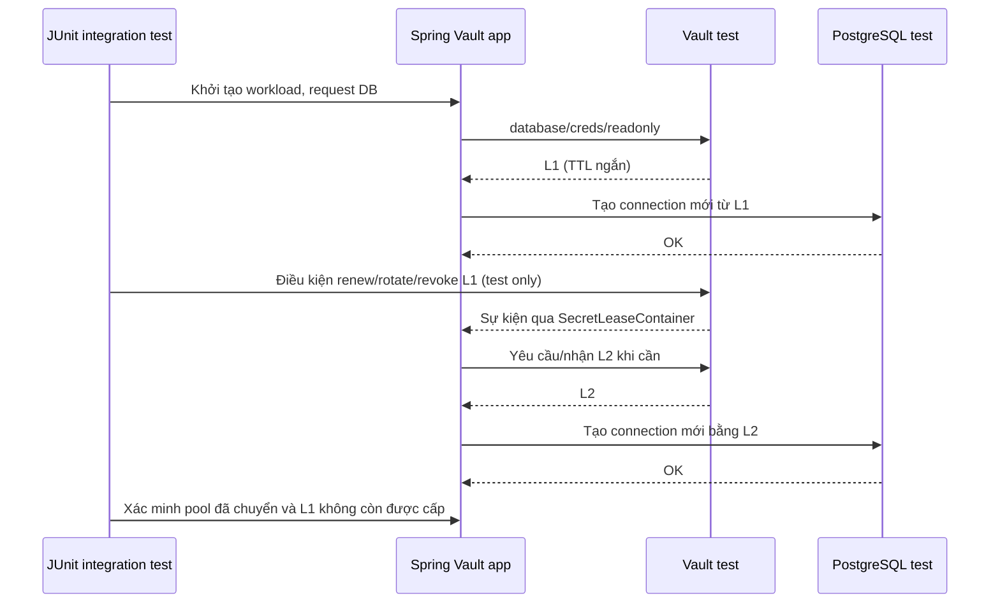

# Phạm vi lưu đệm và thời hạn sử dụng dữ liệu đã nhận trong Spring Vault

## 1. Vì sao dữ liệu đã đọc thành công vẫn có thể trở thành vấn đề?

Ứng dụng Java sử dụng **Spring Vault** thường lấy dữ liệu từ HashiCorp Vault bằng `VaultTemplate`: giá trị cấu hình trong KV secrets, username/password động từ Database Secrets Engine, khóa và thao tác Transit, hoặc chứng thư PKI. Để giảm số request đến Vault, lập trình viên có thể giữ dữ liệu nhận được trong bean singleton, object cache, biến cấu hình hoặc connection pool. Nhưng **giữ được dữ liệu trong bộ nhớ không có nghĩa dữ liệu ấy còn hợp lệ hoặc còn đủ mới để sử dụng**.

Ví dụ, `orders-service` đọc một mật khẩu database từ Vault lúc 09:00. Lúc 09:30, Vault đã rotate credential, nhưng `HikariDataSource` của ứng dụng vẫn đang cố tạo connection mới bằng mật khẩu cũ. Một biến thể khác: token của ứng dụng vẫn còn hiệu lực nhưng key `secret/data/orders` trong KV v2 đã được operator cập nhật. Nếu ứng dụng tiếp tục đọc bản sao cache từ lúc khởi động, nó không nhận giá trị mới dù mọi request Vault đều có quyền hợp lệ.

Trong chương **Xoay vòng trong ứng dụng** của module **SPRING_VAULT**, bài học tập trung vào hai quyết định mà mỗi ứng dụng phải nêu rõ:

1. **Phạm vi lưu đệm (cache scope):** bản sao được giữ trong một lần gọi, một bean, một JVM/pod, một connection pool hay chia sẻ cho cả cụm?
2. **Thời hạn sử dụng (use-by/freshness window):** ứng dụng cho phép bản sao đó tiếp tục được dùng đến khi nào, và điều gì xảy ra khi phải thay mới hoặc vô hiệu hóa?

Mục tiêu là thiết kế được đường đi **Vault → dữ liệu nhận được → cache → thành phần tiêu thụ**, kết hợp đúng TTL, lease, sự kiện rotation, policy, lỗi, giám sát và kiểm thử tích hợp.

> **Nguyên tắc nền tảng:** TTL do Vault trả, giới hạn độ mới mà nghiệp vụ cho phép và tuổi thọ của connection/certificate đang sử dụng là những đại lượng khác nhau. Cần thiết kế cho từng loại secret; không lấy một bộ đếm thời gian áp dụng máy móc cho tất cả.

## 2. Bốn bản sao và bốn loại thời gian

Một yêu cầu có thể đi qua những bản sao dữ liệu khác nhau:



| Lớp | Nội dung lưu giữ | Đồng hồ hoặc điều kiện kết thúc |
| --- | --- | --- |
| Vault secrets engine | KV version, dynamic credential lease, certificate hoặc key metadata | Tùy backend: KV versioning, TTL lease, certificate `notAfter`, revoke |
| `VaultTemplate` response | Giá trị trả về từ một request Vault | Bản thân response thường là snapshot; không tự thay đổi khi Vault đổi dữ liệu |
| Cache/property source của ứng dụng | Snapshot được dùng lại ở những request tiếp theo | TTL do ứng dụng đặt, tín hiệu invalidate, secret lifecycle event, refresh |
| Consumer (DB pool, HTTP/TLS client, bean) | Mật khẩu/key/certificate đã được chép vào cấu hình hoặc kết nối | Tuổi thọ bean/connection, khả năng reload, policy vận hành, downstream rejection |

Một secret có thể được **cập nhật trong cache** nhưng **consumer vẫn dùng bản cũ**. Ví dụ cập nhật property trong `Environment` không bảo đảm một bean đã khởi tạo với `@Value` hoặc một connection pool đã mở tự nhận giá trị mới.

### 2.1. Ba khái niệm không thể hoán đổi

- **Validity (hiệu lực):** nguồn và hệ thống đích còn chấp nhận credential/chứng thư không? Dynamic credential có thể hết lease hoặc bị revoke; certificate có thể hết hạn; token có thể bị vô hiệu hóa.
- **Freshness (độ mới):** dữ liệu ứng dụng đang dùng có phản ánh phiên bản hiện tại ở Vault không? Một giá trị KV đã cũ có thể vẫn có định dạng hợp lệ nhưng khác dữ liệu vừa được cập nhật.
- **Availability (khả dụng):** nếu Vault/network tạm mất, ứng dụng có tiếp tục xử lý được không? Chính sách dùng bản cache còn hiệu lực phải phân biệt rõ với việc dùng credential đã bị revoke.

Đối với hệ thống nhạy cảm, **cache hit** không bao giờ tự chứng minh cả ba điều kiện này đều đúng.

## 3. Chọn phạm vi lưu đệm theo danh tính và nhu cầu

| Phạm vi | Ví dụ | Ưu điểm | Rủi ro cần quản lý |
| --- | --- | --- | --- |
| Một lần gọi | Đọc secret rồi dùng cho một thao tác | Ít trạng thái tồn đọng | Mỗi call có thể làm thêm request Vault, tăng độ trễ |
| Một HTTP request / một job | Snapshot được giữ xuyên suốt một giao dịch | Không đổi credential giữa chừng trong cùng công việc | Request dài có thể vượt TTL; cần deadline |
| Bean ứng dụng | Singleton chứa snapshot KV | Dùng lại nhanh trong cùng JVM | Bean khởi tạo sớm có thể giữ giá trị cũ lâu dài |
| `SessionManager` | Cache **Vault token** theo danh tính workload | Giảm login thừa, quản lý token lifecycle | Token cache không phải cache KV hay dynamic credentials |
| `SecretLeaseContainer` | Theo dõi leases dynamic secrets theo từng instance | Renew/rotate theo lifecycle Vault | Consumer phải áp dụng credential mới; cần scheduler và event handling |
| Connection pool / TLS context | DB account hoặc certificate trong client | Tái sử dụng kết nối hiệu quả | Có thể còn connection/key material cũ sau rotation |
| Một JVM/pod | Một snapshot chia sẻ giữa các thread của service | Giới hạn phạm vi phơi lộ, dễ cô lập lỗi | Mỗi pod có thời điểm refresh khác nhau |
| Distributed cache / cache toàn cụm | Lưu chung raw credential giữa nhiều pod | Giảm một số request đọc | Mở rộng đối tượng có thể truy cập secret, đồng bộ revoke khó, phá cô lập workload |

**Khuyến nghị mặc định:** giới hạn cache secret ở **phạm vi ứng dụng/workload instance**, với quyền truy cập tối thiểu. Mỗi pod tự dùng danh tính workload để lấy Vault token và secret mình cần. Chỉ dùng cache chia sẻ cho dữ liệu nhạy cảm khi có phân tích trust boundary, mã hóa/ACL/audit, quy tắc invalidation và lý do kiến trúc rõ ràng.

Trong cùng một JVM, nhiều thread có thể đọc một **snapshot bất biến** qua reference thread-safe. Điều này khác việc chia sẻ một `Map` mutable chứa username/password đang được cập nhật từng field; cách sau có thể đưa cho thread A username mới nhưng password cũ.

## 4. Đừng suy luận TTL giống nhau cho KV, dynamic credentials và token

| Loại dữ liệu | Nguồn giới hạn hiệu lực | Cache ứng dụng nên dựa vào | Sau rotation cần làm gì? |
| --- | --- | --- | --- |
| **KV v1/v2** | KV lưu dữ liệu/phiên bản; không tự phát hành **dynamic lease** | SLA về độ mới do nghiệp vụ quy định, version metadata, chủ động refresh | Đọc lại bản mới và áp dụng cho consumer |
| **Database/AWS dynamic credentials** | Vault lease ID, `lease_duration`, `renewable`, max TTL và revoke | Renew/rotate theo `SecretLeaseContainer`; giới hạn dùng cục bộ sớm hơn expiry | Cập nhật credential và kết nối/SDK liên quan, xử lý lease cũ |
| **Vault login token** | Token TTL, `renewable`, max TTL, revoke | `SessionManager`/`LifecycleAwareSessionManager` | Renew hoặc re-login; không dùng TTL này làm cache TTL của KV |
| **PKI certificate** | X.509 `notBefore/notAfter`, issuer, thu hồi chứng thư | Certificate lifecycle, rotate trước `notAfter`, khả năng reload TLS context | Cấp lại certificate/bundle và reload nơi dùng |
| **Transit response** | Policy/key version; ciphertext và encryption context | Yêu cầu nghiệp vụ riêng; không có dynamic secret lease cho ciphertext | Key rotation/re-wrap theo chính sách, không tự dùng lease timer |
| **ConfigData/property source** | Thời điểm được nạp/refresh và hợp đồng backend | Khả năng refresh/rebind bean, mức độ stale có thể chấp nhận | Refresh property source và xác minh consumer thực sự dùng giá trị mới |

HashiCorp Vault ghi rõ **KV secrets engine không cấp lease theo nghĩa dynamic secret lease**. Một số API KV có thể trả duration mang tính **gợi ý thời điểm kiểm tra lại**, không phải bằng chứng dữ liệu sẽ bị Vault xóa hoặc không còn hợp lệ sau thời gian đó. Với KV v2, **version** giúp xác định thay đổi; không suy ra freshness chỉ từ thời điểm ứng dụng khởi động.

Ngược lại, dynamic secrets có lease thật và có thể bị Vault revoke **trước deadline cục bộ**. TTL chỉ là thời hạn tối đa được cấp tại một thời điểm, không phải lời hứa rằng credential chắc chắn còn hợp lệ tới mili-giây cuối cùng.

## 5. Mô hình hóa thời hạn sử dụng tại ứng dụng

Giả sử nhận credential động tại thời điểm `receivedAt`, Vault trả `lease_duration = 1.800s` (30 phút). Ứng dụng đặt biên an toàn `safetyMargin = 120s` và muốn dùng snapshot tối đa `businessMaxAge = 10m`.

Mốc dùng cục bộ có thể đặt là:

\[
\text{usableUntil}=\min(\text{receivedAt}+\text{TTL}_{\text{Vault}}-\text{safetyMargin},\ \text{receivedAt}+\text{businessMaxAge})
\]

Với ví dụ trên, `usableUntil` là **10 phút sau khi nhận** vì giới hạn độ mới của nghiệp vụ chặt hơn giới hạn lease còn lại (28 phút).

**Giả định và giới hạn của công thức:**

1. `receivedAt` phải được ghi khi **đã nhận được dữ liệu**, không phải lúc bắt đầu gửi request. TTL Vault có thể đang giảm trong mạng; biên an toàn phải xét độ trễ, clock skew và scheduler.
2. Đây là **giới hạn sử dụng cục bộ**, không chứng minh Vault chưa revoke credential; khi nhận tín hiệu revoke/expired hoặc downstream báo không còn hợp lệ, cache phải invalidate sớm.
3. Khi `SecretLeaseContainer` renew **cùng lease** thành công, deadline lease có thể thay đổi mà username/password không thay; logic consumer phải cập nhật metadata mà không bắt buộc tạo credential mới.
4. Khi rotate sang lease **mới**, phải áp dụng atomically cả username, password và metadata mới; không cập nhật từng trường tự do.
5. `businessMaxAge` là quy tắc riêng của ứng dụng, **không** đương nhiên bằng `token_ttl`, `certificate.notAfter` hoặc thời gian sống của một connection.

### 5.1. Ví dụ bảng thời gian

| Mốc giả định | Trạng thái Vault | Cache ứng dụng | Quyết định |
| --- | --- | --- | --- |
| 10:00 | Cấp lease L1, TTL 30 phút | Nhận snapshot S1 | Cho phép dùng S1 |
| 10:08 | Lease L1 còn hiệu lực | S1 vẫn trong freshness window 10 phút | Có thể tiếp tục dùng |
| 10:10 | Lease L1 có thể vẫn hợp lệ | S1 chạm businessMaxAge | Chủ động refresh/kiểm tra lại |
| 10:18 | Renew L1 thành công | Credential không đổi, metadata TTL cập nhật | Không cần thay username/password nếu renew đúng |
| 10:20 | Operator revoke L1 bất ngờ | S1 chưa hết deadline tự tính nếu được kéo dài | **Vô hiệu S1 ngay khi phát hiện**, không chờ timer |
| 10:21 | Vault cấp L2 | Cache và pool cũ chưa đổi | Chỉ chuyển sang L2 khi consumer áp dụng thành công |

Thời điểm đều là ví dụ. Một số backend có cơ chế delay/revoke khác nhau, và application có thể chưa nhận tín hiệu revoke ngay; phải có kiểm soát lỗi khi request thực tế bị từ chối.

## 6. Ví dụ Java: lưu snapshot bất biến theo generation

Đoạn mã dưới đây minh họa **phạm vi cache trong một JVM**, cách kiểm tra deadline và cập nhật atomically. Nó là **lớp bảo vệ dữ liệu đã nhận**, không phải thư viện thay thế `SecretLeaseContainer`, không tự login/renew/revoke Vault và không quản lý connection pool.

### 6.1. Snapshot và container truy cập đồng thời

```java
import java.time.Clock;
import java.time.Instant;
import java.util.Objects;
import java.util.concurrent.atomic.AtomicReference;

record CredentialSnapshot(
        long generation,
        String username,
        String password,
        Instant usableUntil
) {
    CredentialSnapshot {
        if (generation <= 0) {
            throw new IllegalArgumentException("generation must be positive");
        }
        Objects.requireNonNull(username);
        Objects.requireNonNull(password);
        Objects.requireNonNull(usableUntil);
    }

    boolean usableAt(Instant now) {
        return now.isBefore(usableUntil);
    }
}

final class CredentialView {

    // Giữ generation ngay cả khi đã invalidate để không nhận
    // sự kiện cũ đến trễ và làm dữ liệu lỗi thời sống lại.
    private record Slot(long generation, CredentialSnapshot value) {}

    private final AtomicReference<Slot> current =
        new AtomicReference<>(new Slot(0L, null));

    private final Clock clock;

    CredentialView(Clock clock) {
        this.clock = Objects.requireNonNull(clock);
    }

    void publish(CredentialSnapshot replacement) {
        Objects.requireNonNull(replacement);
        current.updateAndGet(old ->
            replacement.generation() > old.generation()
                ? new Slot(replacement.generation(), replacement)
                : old);
    }

    void invalidateIfCurrent(long generation) {
        current.updateAndGet(old ->
            old.generation() == generation
                ? new Slot(generation, null)
                : old);
    }

    CredentialSnapshot requireUsable() {
        CredentialSnapshot snapshot = current.get().value();
        if (snapshot == null || !snapshot.usableAt(clock.instant())) {
            throw new IllegalStateException(
                "No currently usable credential snapshot");
        }
        return snapshot;
    }
}
```

**Cách dùng đúng:** code quản lý vòng đời secret bên ngoài nhận một bộ credential hợp lệ rồi gọi `publish(newSnapshot)`. Mọi thread đọc **một object đầy đủ** qua `requireUsable()`, nên không gặp username và password từ hai đợt rotation khác nhau. Khi biết generation hiện tại đã hết hiệu lực, gọi `invalidateIfCurrent(generation)`. Event đến trễ của generation cũ không thể xóa snapshot mới.

**Những điều ví dụ không tự giải quyết:** cách lấy `generation` từ nguồn đáng tin cậy, Vault lease renew/revoke, việc tạo hoặc hủy connection, rò rỉ secret trong Java heap, tính hợp lệ thực tế của credential phía DB, và sự phối hợp nhiều pod. `String` chứa password không thể bảo đảm xóa sạch khỏi heap; muốn giảm thời gian tồn tại và phạm vi truy cập phải thiết kế ownership dữ liệu toàn diện.

Trong triển khai, generation nên được tăng bởi **một điểm điều phối phiên bản trong JVM**; không suy ra từ thứ tự chuỗi lease ID và không đồng nhất với KV version giữa các engine. Nếu restart process, lưu lại state chỉ khi có yêu cầu; bản thân snapshot raw secret không nên ghi ra disk.

### 6.2. Unit test fake clock, không dùng sleep

```java
import static org.junit.jupiter.api.Assertions.assertEquals;
import static org.junit.jupiter.api.Assertions.assertThrows;

import java.time.Clock;
import java.time.Instant;
import java.time.ZoneOffset;
import org.junit.jupiter.api.Test;

class CredentialViewTest {

    @Test
    void expiredSnapshotIsRejectedAndOldEventCannotDeleteNewOne() {
        Clock clock = Clock.fixed(
            Instant.parse("2030-01-01T10:00:00Z"),
            ZoneOffset.UTC);

        CredentialView view = new CredentialView(clock);

        view.publish(new CredentialSnapshot(
            1L, "orders-v1", "test-only-v1",
            Instant.parse("2030-01-01T10:05:00Z")));

        assertEquals("orders-v1", view.requireUsable().username());

        view.publish(new CredentialSnapshot(
            2L, "orders-v2", "test-only-v2",
            Instant.parse("2030-01-01T10:15:00Z")));

        view.invalidateIfCurrent(1L); // Event cũ đến trễ.
        assertEquals("orders-v2", view.requireUsable().username());

        view.invalidateIfCurrent(2L);
        assertThrows(IllegalStateException.class, view::requireUsable);
    }

    @Test
    void localExpiryIsEnforcedWithoutWaitingForRealTime() {
        Clock afterExpiry = Clock.fixed(
            Instant.parse("2030-01-01T10:06:00Z"),
            ZoneOffset.UTC);

        CredentialView view = new CredentialView(afterExpiry);
        view.publish(new CredentialSnapshot(
            1L, "orders-v1", "test-only-v1",
            Instant.parse("2030-01-01T10:05:00Z")));

        assertThrows(IllegalStateException.class, view::requireUsable);
    }
}
```

Bài test xác minh hai thuộc tính có giá trị: **snapshot cũ không được dùng sau deadline** và **invalidation đến muộn không được xoá nhầm thế hệ mới**. Nó **không** chứng minh DB đã thu hồi credential; cần integration test với Vault và database thực để xác minh phần đó.

### 6.3. Có nên refresh ngay tại `requireUsable()`?

Không nhất thiết. Nếu mọi request hết hạn cache đều tự gọi Vault, bạn có thể tạo **refresh storm** khi 100 thread đồng thời thấy một snapshot đã cũ. Một thiết kế thường tốt hơn là có **một tác vụ refresh/rotation được quản lý** và các request hoặc:

- Dùng snapshot còn hợp lệ.
- Chờ lần refresh đang diễn ra với timeout/budget rõ ràng.
- Thất bại có kiểm soát khi không thể chứng minh credential còn sử dụng được.

Nếu muốn cấp lại secret khi cache miss, dùng đồng bộ/single-flight và retry có giới hạn. Không đặt vòng retry vô hạn hoặc tạo `VaultTemplate`/`SessionManager` mới trong từng request.

## 7. Dynamic credentials: vòng đời lease và phạm vi cache

### 7.1. Vai trò của `SecretLeaseContainer`

Đối với database credentials động ở path `database/creds/readonly`, Spring Vault cung cấp `SecretLeaseContainer`. Thành phần này quản lý `RequestedSecret`, lấy secret, renew lease và **rotate** khi cần nếu secret được đăng ký ở rotating mode. Nó hoạt động cùng `TaskScheduler` và phát sự kiện như:

| Sự kiện | Điều ứng dụng biết | Điều còn phải làm |
| --- | --- | --- |
| `SecretLeaseCreatedEvent` | Đã nhận secret/lease ban đầu | Cài snapshot đầu tiên và đưa credential tới consumer |
| `AfterSecretLeaseRenewedEvent` | Renew lease đã được Vault chấp nhận | Cập nhật thời hạn sử dụng; credential có thể không đổi |
| `SecretLeaseRotatedEvent` | Đã lấy secret mới thay cho thế hệ trước | Áp dụng atomically credential mới, chuyển pool/consumer |
| `SecretLeaseExpiredEvent` | Container đã quan sát lease hết hạn | Ngừng tin tưởng snapshot cũ; kiểm tra rotation/fallback |
| `BeforeSecretLeaseRevocationEvent` | Sắp revoke một lease trong container | Chuẩn bị dừng dùng credential tương ứng |
| `AfterSecretLeaseRevocationEvent` | Revoke hoàn tất ở mức Vault API | Kiểm tra backend và dọn consumer cần thiết |
| `SecretLeaseErrorEvent` | Lỗi đọc/renew/rotate/revoke | Phân loại, cảnh báo, hạn chế stale data |

`SecretLeaseRotatedEvent` là một dạng chuyên biệt của `SecretLeaseCreatedEvent`. Nếu listener xử lý cả hai, nên kiểm tra rotated trước rồi mới xử lý created để tránh **áp dụng cùng một secret hai lần**.

Vault không gửi push event trực tiếp cho Java khi lease đến hạn. `SecretLeaseContainer` phát hiện và xử lý qua lịch làm việc của client, vì vậy sự kiện có thể đến **sau** thời điểm Vault đã thực sự revoke lease.

### 7.2. Đăng ký rotating secret và listener đúng thứ tự

Ví dụ mẫu theo API Spring Vault core:

```java
import org.springframework.scheduling.TaskScheduler;
import org.springframework.vault.core.VaultOperations;
import org.springframework.vault.core.lease.SecretLeaseContainer;
import org.springframework.vault.core.lease.domain.RequestedSecret;
import org.springframework.vault.core.lease.event.LeaseListenerAdapter;
import org.springframework.vault.core.lease.event.SecretLeaseCreatedEvent;
import org.springframework.vault.core.lease.event.SecretLeaseEvent;
import org.springframework.vault.core.lease.event.SecretLeaseRotatedEvent;

class RotationWiringExample {

    static SecretLeaseContainer createContainer(
            VaultOperations vaultOperations,
            TaskScheduler taskScheduler) throws Exception {

        SecretLeaseContainer container =
            new SecretLeaseContainer(vaultOperations, taskScheduler);

        RequestedSecret requested =
            container.requestRotatingSecret("database/creds/readonly");

        container.addLeaseListener(new LeaseListenerAdapter() {
            @Override
            public void onLeaseEvent(SecretLeaseEvent event) {
                if (!requested.equals(event.getSource())) {
                    return;
                }

                if (event instanceof SecretLeaseRotatedEvent) {
                    // Gửi dữ liệu thế hệ mới đến lớp quản lý consumer.
                    // Không log event body vì có thể chứa username/password.
                } else if (event instanceof SecretLeaseCreatedEvent) {
                    // Nạp credential đầu tiên.
                }
            }
        });

        // Chỉ khi tự quản lý container thủ công.
        container.afterPropertiesSet();
        container.start();
        return container;
    }
}
```

Đây là **minh họa nối sự kiện**, chưa phải trình xử lý rotation hoàn chỉnh: phần callback cần trích xuất dữ liệu theo API version, xác thực metadata, gắn generation, chuyển đổi consumer và xử lý lỗi. Trong ứng dụng Spring, ưu tiên để container quản lý bean lifecycle (`start`/`stop`/`destroy`) thay vì tự tạo nhiều container trùng một secret.

Spring Vault còn có `ManagedSecret` / `SecretRegistrar` để giảm mã listener thủ công; API này nối sự kiện lease với logic ánh xạ secret cho consumer. Kiểm tra phiên bản Spring Vault để chọn điểm tích hợp thích hợp. **Đăng ký listener trước khi container bắt đầu lấy secret**, vì listener gắn muộn có thể bỏ lỡ event lần đầu.

### 7.3. Renewal giữ lease, rotation thay thế credential

- **Renew:** Vault kéo dài lease hiện có khi còn `renewable` và chưa chạm giới hạn. Username/password thường **không đổi**. Đừng khởi tạo database pool mới trong mỗi `AfterSecretLeaseRenewedEvent` nếu không có lý do.
- **Rotate:** khi lease không còn dùng được hoặc backend cần credential mới, container yêu cầu secret mới. Có thể tạo **lease ID và username/password mới**, cần đưa tới consumer.
- **Revoke/expire:** credential cũ có thể bị backend vô hiệu hóa. Việc cache chứa password cũ **không làm nó tiếp tục hợp lệ**.

Tách hai dòng cập nhật: **gia hạn metadata thời hạn** và **thay thế vật liệu credential**. Điều này giảm thao tác pool không cần thiết mà vẫn giữ thông tin hiệu lực chính xác.

## 8. Connection pool: cache ẩn thường gây lỗi lớn nhất

Trong Java, `HikariDataSource` hoặc pool của driver giữ **kết nối đã xác thực**, không chỉ giữ username/password ban đầu. Ngay cả khi ứng dụng nhận secret mới từ Vault và cập nhật một biến, pool có thể vẫn tạo connection bằng mật khẩu cũ hoặc còn kết nối đã mở trước rotation.



### 8.1. Cập nhật field không luôn đủ

Với HikariCP, `HikariConfigMXBean#setUsername` và `setPassword` có thể cập nhật credential dùng cho **kết nối mới** trong cấu hình và phiên bản phù hợp; điều đó **không** làm các connection cũ đang mở xác thực lại. Tính năng này cũng có hạn chế phụ thuộc cách pool dùng `DataSource` thay vì driver/JDBC URL. Vì vậy, hãy kiểm chứng trên driver/pool thực đang triển khai, không chỉ kiểm tra setter gọi thành công.

Một chiến lược rotation có thể là:

1. Nhận L2 và xác định credential đã đủ điều kiện.
2. Chuẩn bị một **pool mới** dùng L2 hoặc cập nhật runtime config theo API pool được hỗ trợ.
3. Thử kết nối mới thật, xác nhận truy vấn read-only được phép.
4. Chuyển traffic sang pool mới atomically.
5. Cho các giao dịch đang chạy kết thúc theo timeout rồi đóng/evict connection cũ.
6. Revoke L1 hoặc để Vault xử lý đúng lease policy sau khi chuyển đổi an toàn.

Với pool không hỗ trợ thay đổi credentials an toàn, **tạo pool mới và đổi reference** thường dễ kiểm chứng hơn sửa cấu hình pool đang dùng. Ngược lại, nếu back-end revoke account L1 **ngay trước** khi pool mới sẵn sàng, ứng dụng sẽ gặp khoảng thời gian không có kết nối hợp lệ.

### 8.2. Hai kiểu rotation và trade-off

| Cách | Ưu điểm | Đánh đổi |
| --- | --- | --- |
| Thay credentials trong pool đang chạy | Ít tài nguyên tạm thời | Cần hiểu cơ chế pool/driver; existing connections có thể giữ thế hệ cũ |
| Tạo pool mới rồi chuyển reference | Có thể kiểm tra L2 trước khi chuyển traffic, rollback có kiểm soát | Tạm thời có hai pool, chiếm nhiều connections, phải dọn pool cũ |
| Rolling restart pod | Đơn giản hóa reload bean và state | Cần đủ replica, phối hợp readiness và grace period |
| Sidecar/agent cập nhật secret vào file | Giảm logic gọi Vault trong app | App vẫn cần watch/reload/restart đúng cách; file mới không tự cập nhật object đã được tạo |

**Đừng để callback lease event giữ một lock toàn cục và vừa chờ mạng/database vừa chặn mọi request nghiệp vụ**. Dùng cơ chế chuyển trạng thái phù hợp và giới hạn concurrency; đảm bảo một rotation đến muộn không thể ghi đè credential mới hơn.

## 9. Caching KV: bản sao có thể hợp lệ nhưng đã cũ

KV khác database dynamic credentials. Giả sử key `secret/orders` trong mount `secret` (KV v2) có `data.api-key`. Operator cập nhật từ phiên bản 7 sang 8 lúc 14:00. Vault không thông báo tức thì cho mọi `@Value`/`ConfigurationProperties` bean đã khởi tạo lúc 13:50.

### 9.1. Chọn chính sách freshness cho KV

Ba chiến lược phổ biến:

- **Load at startup:** đọc một lần khi bootstrap, giữ đến lần restart/refresh đã định nghĩa. Chỉ phù hợp khi thay đổi được triển khai cùng rolling restart hoặc ứng dụng chấp nhận stale đến chu kỳ restart.
- **TTL-based refresh:** đọc lại sau mỗi `maxAge` hoặc trong background; cho phép thay đổi mà không restart, nhưng bản sao có thể stale trong suốt khoảng TTL và khi Vault không khả dụng.
- **Version/invalidation-based refresh:** theo dõi KV v2 version (qua metadata hoặc đường cập nhật nội bộ được kiểm soát) và chủ động reload khi version đổi. Cần cơ chế tín hiệu tin cậy; Vault KV không tự phát push event đến mọi JVM theo mặc định.

**Lưu ý quan trọng:** bản thân việc gọi `VaultTemplate.read(...)` thường lấy một **snapshot tại thời điểm request**; nó không đồng nghĩa client duy trì một cache KV chung có TTL tự động. Nếu lập trình viên hoặc một property source giữ snapshot, chính lớp đó phải có chính sách làm mới rõ.

### 9.2. API KV v2 và version

Ví dụ đọc bằng Spring Vault core:

```java
import org.springframework.stereotype.Service;
import org.springframework.vault.core.VaultKeyValueOperations;
import org.springframework.vault.core.VaultKeyValueOperationsSupport;
import org.springframework.vault.core.VaultOperations;
import org.springframework.vault.support.VaultResponseSupport;

@Service
public class OrdersConfigurationReader {

    // Giả sử Vault KV v2 lưu đúng hai field: endpoint và apiKey.
    public record OrdersSettings(String endpoint, String apiKey) {}

    private final VaultKeyValueOperations kv;

    public OrdersConfigurationReader(VaultOperations vault) {
        this.kv = vault.opsForKeyValue(
            "secret", VaultKeyValueOperationsSupport.KeyValueBackend.KV_2);
    }

    public OrdersSettings loadCurrentData() {
        VaultResponseSupport<OrdersSettings> response =
            kv.get("orders", OrdersSettings.class);
        if (response == null || response.getData() == null) {
            throw new IllegalStateException("KV orders is missing");
        }
        return response.getData();
    }
}
```

Ví dụ sử dụng API đọc KV v2 và DTO dạng record bất biến (Java 17+), giả định JSON có hai trường `endpoint` và `apiKey`. Đối chiếu mapping JSON thực tế và API Spring Vault version đang dùng trước khi triển khai. Record chỉ bất biến về **tham chiếu và field**, không tự bảo đảm xóa dữ liệu nhạy cảm khỏi heap; không trả `apiKey` ra HTTP hoặc log.

Không đặt key dữ liệu nhạy cảm vào log để đối chiếu version. Nếu cần kiểm tra version của KV v2, sử dụng metadata API với policy tối thiểu phù hợp và chỉ giữ version/timestamp, không xuất nội dung secret.

### 9.3. Giới hạn của ConfigData và `@Value`

Spring Cloud Vault có thể nạp secret vào `Environment`/ConfigData ngay lúc khởi động. Điều đó thường tạo **snapshot cấu hình ban đầu**; sự kiện refresh property source hoặc thay file **không tự bảo đảm** các bean và client đã tạo (JDBC pool, SSL context, third-party SDK) được nạp lại.

Các câu cần kiểm tra:

1. Property source có được làm mới/rotate thật không?
2. Bean đang dùng đọc property **mỗi lần** hay đã bind một lần vào field?
3. Nếu bean có `@Value`, `@ConfigurationProperties` hoặc được tạo trong `@PostConstruct`, cơ chế rebind/recreate nào được bật và kiểm thử?
4. Connection pool/TLS context có cần rebuild không?
5. Nếu dữ liệu chưa được nạp lần đầu, readiness có vô tình báo **ready** quá sớm không?

Tùy phiên bản Spring Cloud Vault, có thể có hỗ trợ cho lease-aware property sources, nhưng **đừng suy diễn** rằng mọi loại KV và mọi bean đều tự động nhận giá trị mới ngay sau Vault update.

## 10. Cache theo phiên bản: thay đổi đồng thời và event đến muộn

Trong môi trường nhiều thread, có thể xảy ra:

```text
14:00:00  Refresh A bắt đầu đọc KV version 7.
14:00:01  Operator ghi version 8.
14:00:02  Refresh B đọc version 8, kết thúc trước và publish S8.
14:00:03  Refresh A mới kết thúc, vô tình publish S7.
```

Nếu chỉ dùng `AtomicReference.set(snapshot)`, request A đến muộn có thể **đè ngược** dữ liệu từ mới thành cũ. Vì vậy, với KV v2, nên giữ **version canonical** trong snapshot và áp dụng so sánh version trước khi publish. Không dựa vào thời gian kết thúc HTTP request để quyết định phiên bản nào mới hơn.

Với dynamic secret, lease IDs thường **không có thứ tự toàn cục**, nên không so sánh chuỗi lease ID để suy ra generation. Dùng một state machine/sequence thuộc đúng producer mà ứng dụng kiểm soát và gắn trách nhiệm chỉ có **một producer** áp dụng rotation cho cùng logical secret trong một instance.

### 10.1. Quan hệ giữa "mới hơn" và "dùng được"

Ngay cả snapshot S8 mới hơn S7 cũng có thể **không được dùng** nếu:

- Credential S8 đã bị revoke đột ngột.
- Áp dụng vào pool thất bại, phải giữ trạng thái **not ready**.
- Key/certificate mới chưa được consumer chấp nhận vì lệch trust chain hoặc cấu hình.
- Token của workload thiếu quyền đọc version mới.
- Snapshot có metadata thiếu hoặc không khớp nguồn.

Do đó, **bước publish** nên đến sau bước kiểm chứng tối thiểu và phải gắn với trạng thái ứng dụng (ready/degraded/unavailable). Không đánh dấu "rotation success" chỉ vì đã đổi một reference.

## 11. Vòng đời certificate và Transit không phải cache lease thông thường

### 11.1. PKI certificate

Chứng thư X.509 có hạn hiệu lực `notAfter`, identity, issuer và private key. Một số luồng PKI không tạo lease động; Spring Vault hiện có `CertificateContainer` và `ManagedCertificate` để quản lý việc lấy/rotate chứng thư.

Đối với HTTPS client/server hoặc mTLS:

- Cần có certificate/key bundle hợp lệ **trước khi** TLS client/server sẵn sàng.
- Phải rotate **trước** `notAfter` với khoảng đệm, xét thời gian truyền tải và khả năng các instance nhận khác thời điểm.
- Cập nhật file PEM/keystore **không tự đảm bảo** một `SSLContext` hoặc `KeyManager` đã tạo lại nạp nội dung mới.
- Kết nối TLS đã mở trước rotation có thể tiếp tục theo semantics connection; kết nối mới phải dùng certificate/trust chain phù hợp.
- Khi thay CA/trust anchor, nên có giai đoạn chấp nhận CA cũ và mới nếu thiết kế trust yêu cầu, rồi thu hồi CA cũ đúng kế hoạch.

Không gán `lease_duration` của dynamic database secret cho thời hạn chứng thư. Hãy đọc `notBefore/notAfter` và trạng thái revocation/X.509 tại đúng lớp TLS.

### 11.2. Transit encryption

Transit engine thực hiện mã hóa/giải mã qua API như `transit/encrypt/orders`, quản lý key versions ở phía Vault. Một ciphertext có thể mang metadata key version; key rotation không tự làm mọi ciphertext cũ "hết hạn" theo một cache TTL giống database account.

Khi cache kết quả Transit, phải phân biệt:

- Ciphertext có được lưu lại theo quy tắc dữ liệu nghiệp vụ hay không.
- Context/nonce có ràng buộc với request không.
- Plaintext trong bộ nhớ có được giữ lâu hơn cần thiết không.
- Khi key rotation xảy ra có cần **rewrap** dữ liệu đã lưu theo chính sách không.

Không cố sử dụng `SecretLeaseContainer` để renew một ciphertext. Nó không phải dynamic credential lease.

## 12. Chính sách khi Vault không truy cập được

Một chiến lược cache phải xác định hành vi khi refresh/renew/rotate thất bại, trước khi sự cố xảy ra.

| Trạng thái | Hành vi thường hợp lý | Điều phải tránh |
| --- | --- | --- |
| KV snapshot còn trong `maxAge`, Vault timeout ngắn | Có thể tiếp tục dùng trong khoảng đã được nghiệp vụ phê duyệt | Gia hạn cache vô hạn chỉ vì Vault lỗi |
| KV snapshot vượt freshness deadline | Fail hoặc degrade theo policy, thử refresh có backoff | Mặc định dùng mãi mà không có alert |
| Dynamic credential còn TTL và chưa bị phát hiện revoke | Có thể dùng theo lease/lifecycle policy với biên an toàn | Coi local TTL là bảo đảm chưa bị revoke |
| Dynamic credential đã hết lease/bị revoke | Ngừng cấp credential đó cho kết nối mới, chuyển/rotate hoặc fail | "Grace period" tùy ý vượt hiệu lực Vault |
| Certificate hết `notAfter` | Không tạo kết nối mới bằng chứng thư hết hạn; phát lại/rotate đúng cách | Tắt hostname/chain/expiry verification để hệ thống chạy tiếp |
| Vault token không hợp lệ | `SessionManager` re-login nếu credential gốc hợp lệ | Lặp lại KV request bằng token stale vô hạn |
| Rotation mới tới nhưng consumer apply thất bại | Giữ trạng thái phản ánh lỗi, quyết định rollback khi credential cũ còn thực sự hợp lệ | Báo rotation success trước khi kiểm tra consumer |

**Fail-open hay fail-closed** là quyết định nghiệp vụ và an toàn. Với dữ liệu KV không nhạy cảm tới từng phút, việc dùng bản cache còn trong giới hạn freshness đã định có thể hợp lý. Với credential đã bị revoke hoặc certificate hết hạn, không thể "kéo dài hiệu lực" bằng cách cho phép cache dùng thêm vài phút.

### 12.1. Giữ cache khi lỗi có nghĩa là gì?

Giữ snapshot cũ **trong giới hạn đã phê duyệt** khác với tự làm mới deadline mỗi lần Vault timeout. Không đặt `usableUntil = now + 10m` sau mỗi lỗi, vì như vậy một cache có thể tồn tại vô hạn khi Vault bị gián đoạn. Deadline phải dựa trên **lần nhận dữ liệu hợp lệ** hoặc bằng chứng gia hạn hợp lệ, không dựa trên lần retry thất bại.

### 12.2. Retry và thundering herd

Khi snapshot hết thời hạn và nhiều request cùng cần refresh, tránh để mỗi thread tự gọi `vault.read(...)`. Dùng một nguồn làm mới có điều phối, bounded retries, backoff có jitter, timeout và circuit breaker phù hợp. **Không đồng bộ toàn bộ request nghiệp vụ** dưới một mutex chỉ để chặn nhiều lần refresh.

Một request PKI issue/rotation không nhất thiết idempotent: nếu retry mù quáng sau timeout, có thể cấp hai chứng thư. Ghi lại dấu vết an toàn để phân biệt kết quả đã tạo và tình huống thực sự thất bại.

## 13. Nhiều pod: dữ liệu có thể khác nhau tại cùng một thời điểm

Trong một deployment 8 pod, có thể tồn tại 8 snapshot KV khác phiên bản hoặc 8 bộ dynamic credentials riêng. Đó không tự động là lỗi; cần xác định giới hạn sai lệch chấp nhận được và cơ chế rollout/refresh.



Đối với key cấu hình cần **thay đồng bộ toàn hệ thống**, một TTL đơn giản có thể không đáp ứng được yêu cầu nhất quán. Cân nhắc quy trình đổi version hai pha hoặc hợp đồng backward compatibility:

1. Phát hành cấu hình/credential mới nhưng vẫn cho phép bản cũ trong khoảng rollout khi an toàn.
2. Phân phối thông báo version mới hoặc điều phối rolling restart.
3. Mỗi pod tải và áp dụng S8; hệ thống xác minh readiness/metrics.
4. Chỉ sau đó thu hồi bản cũ theo kế hoạch, nếu có quyền kiểm soát vòng đời.
5. Khi rollout thất bại, rollback có hạn và bằng chứng còn hiệu lực của credential cũ.

Với **dynamic secrets gắn token của từng pod**, không cố ép tất cả pod dùng chung một `lease_id` hoặc raw secret; việc đó có thể phá cô lập danh tính và tạo điểm lỗi chung.

## 14. Security: dữ liệu đã nhận cũng là secret cần bảo vệ

Một cache làm tăng số bản sao credential tồn tại trong hệ thống. Dù Vault đảm bảo encryption at rest ở backend, **bản sao trong Java process vẫn là dữ liệu nhạy cảm**.

- Giới hạn đối tượng có quyền đọc snapshot; không đưa cache vào HTTP response, debug endpoint, exception message hay serialization.
- Tránh ghi raw credentials, Vault token, JWT, private key, secret JSON và lease ID chưa được phân loại vào log/traces/metrics labels.
- Hạn chế heap dump và crash dump ở môi trường production; chúng có thể chứa `String`/byte array của secret.
- Không đưa secret vào `@Cacheable` hoặc distributed cache mặc định khi chưa biết serializer, TTL, encryption, access controls và leak path.
- Khi cần gỡ secret khỏi bộ nhớ, hiểu giới hạn của JVM: không thể bảo đảm mọi bản sao `String` được xóa ngay; thiết kế giảm thời gian sống và không tạo bản sao mới không cần thiết.
- Dùng TLS, policy tối thiểu cho đường dẫn KV/Database/Transit/PKI, và phân tách token scope theo workload.
- Không dùng cache lâu hạn để che việc token/role sai policy hoặc Vault tạm unreachable.

Một **cache TTL** chỉ là quy tắc sử dụng tại Java; nó **không thu hồi** credential tại Vault hoặc hệ thống đích. Muốn vô hiệu một secret đã lộ cần revoke/rotate từ nguồn và kiểm tra downstream.

## 15. Giám sát, SLO và dấu hiệu dữ liệu bị stale

Để vận hành rotation, cần biết **dữ liệu đang có**, **dữ liệu đang được dùng** và **mức độ lệch nhau**.

| Metric hoặc tín hiệu tự thiết kế | Ý nghĩa |
| --- | --- |
| `secret_snapshot_age_seconds` | Tuổi bản sao tính từ lần lấy/refresh hợp lệ |
| `secret_snapshot_remaining_use_seconds` | Thời gian còn lại đến deadline sử dụng cục bộ |
| `secret_refresh_success_total` / `failure_total` | Lượt refresh thành công/thất bại theo path class |
| `lease_renew_success_total` / `failure_total` | Đếm lượt renew dynamic lease |
| `secret_rotation_success_total` | Chỉ tăng khi đã áp dụng vào consumer theo hợp đồng |
| `secret_consumer_apply_failures_total` | Phát hiện event nhận được nhưng client/pool không áp dụng |
| `db_new_connection_failures_total` | Dấu hiệu credential đã hết hiệu lực hoặc pool chưa chuyển |
| `kv_version_lag` | Độ lệch phiên bản giữa cache và nguồn biết được (nếu có quyền/khả năng đo) |
| `certificate_days_until_expiry` | Cảnh báo trước khi mTLS certificate hết hạn |
| Vault audit records | Xác minh request đọc/renew/revoke/issue theo đường dẫn, không log raw secret |

Các metric trên là **gợi ý thiết kế**, không phải tên metric tự động do Spring Vault xuất. Tránh đưa `lease_id`, username, token, resource path chứa định danh nhạy cảm vào label. Dùng nhãn cardinality thấp như engine kind, workload, outcome, error category.

Một SLO phù hợp cho KV có thể là "**99,9% request dùng snapshot được xác nhận không quá 5 phút tuổi**"; dynamic credentials nên thêm "**không tạo kết nối mới bằng credential đã biết bị revoke**" và thời gian phát hiện/apply rotation. SLO cần đo ở **consumer**, không chỉ ở thời điểm Vault trả response.

## 16. Kiểm thử theo ba ranh giới

### 16.1. Unit test: deadline và thứ tự cập nhật

Dùng `Clock.fixed` / `Clock.offset` để xác minh:

1. Snapshot được nhận trước deadline, thread có thể đọc.
2. Tại đúng `usableUntil`, snapshot bị từ chối (quy tắc `isBefore`).
3. Generation cũ đến muộn không ghi đè generation mới.
4. Invalidate generation cũ không xóa generation mới.
5. Một đợt refresh thất bại không tự gia hạn deadline.
6. Một snapshot là unit dữ liệu bất biến: username/password đi cùng nhau.

Những test này không cần Vault thật, chạy nhanh và có kết quả xác định.

### 16.2. Component test: event và consumer

Dùng mock Vault/HTTP transport cùng event test fixture:

- `SecretLeaseCreatedEvent` → lần đầu nạp credential vào lớp consumer.
- `AfterSecretLeaseRenewedEvent` → cập nhật metadata TTL nhưng không tạo pool mới thừa.
- `SecretLeaseRotatedEvent` → áp dụng generation mới đúng một lần.
- `SecretLeaseExpiredEvent` → không cấp snapshot cũ cho connection mới.
- `SecretLeaseErrorEvent` → báo lỗi, giữ deadline cũ, retry giới hạn.
- Thử apply thất bại một nửa: consumer phải giữ trạng thái đúng, không đánh dấu rotation success.
- Thử event đến không theo thứ tự để xác minh generation guard.
- Đảm bảo listener thread-safe, shutdown dọn scheduler/task đúng cách.

### 16.3. Integration test: Vault + PostgreSQL hoặc backend thật



Các assertion quan trọng:

1. Container lấy được secret và ghi nhận một lease gắn với workload test.
2. Khi renew thành công, lease còn hợp lệ theo Vault; không giả định credential mới đã được phát hành.
3. Khi rotation xảy ra, credential mới thực sự được consumer đưa vào connection mới.
4. Revoke L1 làm credential L1 không còn hợp lệ theo backend sau khi revoke được xử lý; **kết nối đã mở** có thể có semantics riêng của DB.
5. Nếu Vault token cha bị revoke, lease con có thể bị ảnh hưởng; không đánh đồng token TTL với secret lease TTL.
6. Cleanup luôn thực hiện trong `finally`: stop/destroy container, thu hồi lease test còn sống, dọn database/test containers và tránh revoke theo prefix rộng trên Vault chia sẻ.

Dùng **TTL ngắn với deadline hữu hạn** cho một số integration tests; unit test logic thời gian nên dùng clock giả để không làm CI chậm. Đối với Kubernetes, AWS hoặc Azure identity thực, cần test theo môi trường riêng: Testcontainers Vault không tự xác minh được tất cả workload-identity protocols.

## 17. Những lỗi phổ biến và cách suy ra nguyên nhân

| Biểu hiện | Nguyên nhân có thể | Kiểm tra trước |
| --- | --- | --- |
| Vault đã có KV version mới, app vẫn dùng cũ | Snapshot/cache hoặc bean bind tại startup | TTL refresh, version, ConfigData, bean lifecycle |
| `SecretLeaseRotatedEvent` có nhưng DB vẫn 403/invalid password | Consumer/pool chưa dùng credential mới | Pool config, open connections, apply failures |
| Dữ liệu vừa renew nhưng cache báo hết hạn | Không cập nhật expiry metadata sau renew | State model, scheduling, clock |
| Cache còn hạn nhưng Vault báo lease invalid | Lease bị revoke sớm/token cha bị thu hồi | Lease lookup, auth logs, error event |
| Sau startup 10 pod thấy dữ liệu không đồng nhất | Mỗi pod refresh ở mốc khác nhau | Deployment/refresh propagation, KV version lag |
| Cache bị đảo từ version 8 xuống 7 | Refresh response cũ đến muộn và overwrite | Version guard, concurrent producer |
| 100 request đồng thời khiến Vault tăng tải | Cache miss tạo refresh per request | Single-flight, bounded concurrency |
| Certificate file mới nhưng TLS vẫn dùng cert cũ | `SSLContext`/pool chưa reload | Key manager, trust manager, connection lifetime |
| Chỉ cập nhật password nhưng DB vẫn lỗi | Username/password bị cập nhật lệch thế hệ | Atomic snapshot và pool cutover |
| Vault tạm down làm cache sống vô hạn | Mỗi retry tự gia hạn local TTL | Deadline dựa trên lần nhận/renew hợp lệ |

## 18. Câu hỏi tự đánh giá

1. Tại sao việc một `VaultTemplate.read(...)` thành công không chứng minh bean đang dùng sẽ tự thay đổi khi Vault cập nhật KV?
2. Phạm vi `SessionManager` khác gì với phạm vi cache credential động và phạm vi JDBC connection pool?
3. `lease_duration` của dynamic database secret khác gì với TTL gợi ý hoặc version của KV?
4. Vì sao cache deadline không bảo đảm credential sẽ còn dùng được nếu bị Vault revoke sớm?
5. Renew lease và rotate credential khác nhau thế nào? Có cần tạo pool mới sau mọi lần renew không?
6. Nếu hai refresh KV trả version 7 và 8 theo thứ tự hoàn tất ngược nhau, làm sao tránh đè snapshot mới?
7. Vì sao `@Value` của một bean và một file secret volume đã đổi có thể chưa đồng bộ?
8. Khi nào nên tạo pool mới rồi chuyển traffic thay vì chỉ sửa username/password trong pool cũ?
9. Vì sao một `SecretLeaseRotatedEvent` không đủ để xác nhận hệ thống có thể tạo connection DB mới?
10. Nếu Vault mất mạng khi KV cache còn 3 phút trước deadline, chính sách stale-while-error cần ràng buộc gì?
11. Tại sao một cache phân tán chứa raw credential có thể làm phạm vi bảo mật rộng hơn?
12. Khi nào ứng dụng cần để ý `CertificateContainer`, và tại sao không dùng `SecretLeaseContainer` cho mọi chứng thư?
13. Key rotation trong Transit có làm ciphertext cũ hết hạn theo một lease hay không?
14. Những metric nào cho biết rotation thành công **ở consumer**, ngoài việc Vault báo thành công?

## 19. Checklist thiết kế cache và rotation

- [ ] Mỗi secret được phân loại: KV, dynamic lease, Vault token, PKI certificate hoặc Transit operation.
- [ ] Có cache scope rõ theo workload/identity và consumer; không dùng global cache raw secret theo mặc định.
- [ ] Ghi rõ freshness SLA, usableUntil, safety margin, hành vi refresh/renew/revoke/rotate.
- [ ] Không lấy token TTL làm KV cache TTL hoặc certificate expiry.
- [ ] Snapshot credentials được publish atomically; có generation/version guard và chống event đến muộn.
- [ ] Refresh có single-flight, timeout, retry bounded, backoff có jitter và cleanup.
- [ ] `SecretLeaseContainer` / `ManagedSecret` hoặc lớp tương ứng được quản lý lifecycle đúng cách.
- [ ] Khi rotate, downstream pool/client/SSL context thực sự nạp dữ liệu mới; có kiểm tra healthy connection.
- [ ] Khi consumer apply thất bại, trạng thái readiness phản ánh thực tế, không báo thành công giả.
- [ ] KV v2 có chiến lược cập nhật version/refresh rõ; bean bootstrap không giữ giá trị cũ vô hạn.
- [ ] Có xử lý Vault outage theo policy nhưng không tự kéo dài hiệu lực credential đã revoke.
- [ ] Có test fake clock, event/concurrency và integration test Vault + backend có thể revoke.
- [ ] Mọi log/metric/trace, heap dump và debug endpoint được kiểm soát để không lộ secret.

## 20. Ghi nhớ và tài liệu tham khảo

**Phạm vi lưu đệm** trả lời câu hỏi **ai đang giữ và chia sẻ bản sao secret**. **Thời hạn sử dụng** trả lời câu hỏi **bản sao ấy được dùng tới khi nào và ai sẽ thay thế nó**. Với Spring Vault, trách nhiệm nhận token thuộc `SessionManager`; vòng đời leased secret thuộc `SecretLeaseContainer`/`ManagedSecret`; property source/KV và consumer có cơ chế refresh riêng; TLS certificate còn có chu kỳ phát hành/đổi certificate. Các lớp này phải liên kết qua một hợp đồng trạng thái rõ ràng.

Tài liệu tham khảo chính thức:

- [Spring Vault — Credentials Rotation: SecretLeaseContainer, ManagedSecret, CertificateContainer](https://docs.spring.io/spring-vault/reference/vault/credential-rotation.html)
- [Spring Vault — Property Sources và refresh/rotation](https://docs.spring.io/spring-vault/reference/vault/propertysource.html)
- [Spring Vault API — SecretLeaseContainer](https://docs.spring.io/spring-vault/reference/api/java/org/springframework/vault/core/lease/SecretLeaseContainer.html)
- [Spring Vault API — Lease Events](https://docs.spring.io/spring-vault/reference/api/java/org/springframework/vault/core/lease/event/package-summary.html)
- [Spring Cloud Vault — ConfigData](https://docs.spring.io/spring-cloud-vault/docs/current/reference/html/config-data.html)
- [HashiCorp Vault — Lease, Renew và Revoke](https://developer.hashicorp.com/vault/docs/concepts/lease)
- [HashiCorp Vault — KV secrets engine](https://developer.hashicorp.com/vault/docs/secrets/kv)
- [HashiCorp Vault — Database secrets engine](https://developer.hashicorp.com/vault/docs/secrets/databases)
- [HashiCorp Vault — PKI secrets engine](https://developer.hashicorp.com/vault/docs/secrets/pki)
- [HikariCP — Runtime ConfigMXBean và PoolMXBean](https://github.com/brettwooldridge/HikariCP/wiki/FAQ)
