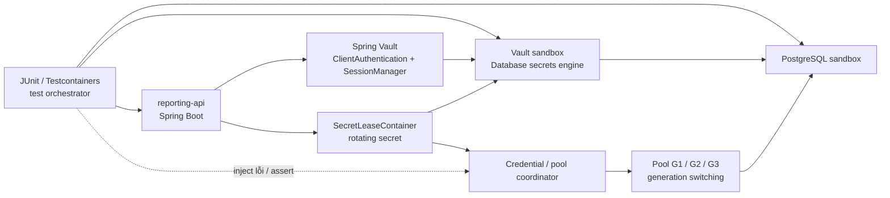
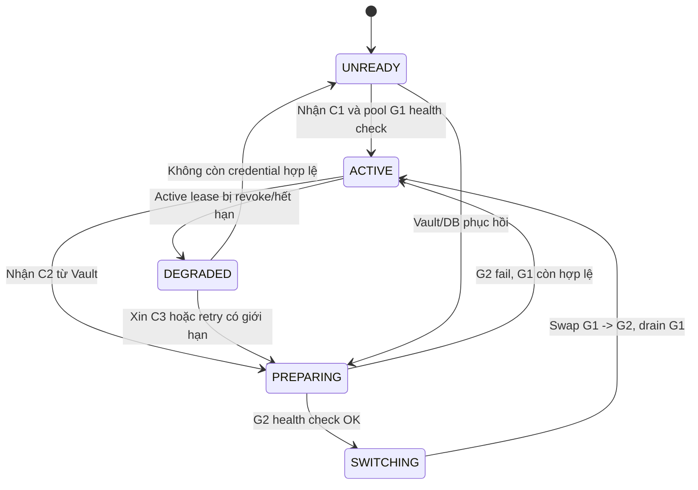

# Kiểm thử ứng dụng tiếp tục hoạt động qua nhiều lần xoay vòng

## 1. Mục tiêu: chứng minh ứng dụng phục vụ được sau vòng xoay thứ ba, thứ mười

Trong chương **Xoay vòng trong ứng dụng** của **Spring Vault**, triển khai cơ chế renew/rotate thành công mới giải quyết được một nửa bài toán. Với ứng dụng Java truy cập **HashiCorp Vault** qua `VaultTemplate` hoặc `VaultOperations`, câu hỏi quan trọng tiếp theo là: **sau nhiều lần cấp lại credential, ứng dụng còn phục vụ request, còn an toàn và còn khả năng tự phục hồi không?**

Ví dụ, `reporting-api` dùng **Database secrets engine** để nhận username/password PostgreSQL động, mỗi bộ được Vault gắn một lease và TTL. Spring Vault có thể renew lease, rồi đọc secret mới khi cần rotate. Nhưng JDBC pool có thể tiếp tục giữ connection cũ; event của lease cũ có thể đến sau khi pool mới hoạt động; token Vault có thể hết hạn giữa vòng đổi; hoặc một replica có thể thành công trong khi replica khác mắc kẹt. Vì vậy **"đọc được secret mới" khác với "toàn bộ ứng dụng tiếp tục hoạt động"**.

Bài học này xây dựng chiến lược kiểm thử theo ba cấp: **unit test xác định trạng thái**, **integration test Vault + PostgreSQL thật trong sandbox** và **soak/chaos test qua nhiều vòng rotation**. Kỹ thuật cũng áp dụng có điều chỉnh cho KV secrets, Transit encryption, PKI certificates, các loại token và lease khác.

Sau bài học, bạn có thể:

- Định nghĩa các bất biến (*invariants*) để kiểm thử service qua ít nhất ba vòng cấp credential mới.
- Phân biệt lease **renewal**, secret **rotation** và việc kích hoạt credential mới tại database pool.
- Tạo fixture có Vault, PostgreSQL, workload authentication, chính sách quyền tối thiểu và TTL ngắn trong môi trường thử nghiệm.
- Viết test Java/JUnit phát hiện sai thứ tự event, duplicate event, credential mới không dùng được và lệnh expire đến muộn.
- Kiểm chứng tự phục hồi sau token revoke/re-login, Vault/DB tạm không sẵn sàng và nhiều instance hoạt động đồng thời.
- Đo lường điều kiện PASS/FAIL dựa trên request thật, thời gian chuyển đổi, trạng thái lease và tài nguyên còn sót lại.

## 2. Xác định chính xác "tiếp tục hoạt động" nghĩa là gì

Một bộ kiểm thử chỉ `assertNotNull(username)` sau ba lần gọi Vault chưa chứng minh tính liên tục. Cần kiểm chứng cả **đường dữ liệu**, **vòng đời credential** và **độ bền của tiến trình**.

| Bất biến | Cách chứng minh | Điều kiện FAIL |
|---|---|---|
| **I1 — Có phục vụ request** | Chạy truy vấn PostgreSQL thật trước, trong và sau mỗi rotation | Chỉ đọc được Vault nhưng business query liên tục lỗi |
| **I2 — Credential mới thật sự được sử dụng** | Query `current_user` trên kết nối **vừa tạo**; so với generation đang active | Pool báo đã đổi nhưng vẫn mở kết nối bằng user cũ |
| **I3 — Không quay về thế hệ cũ** | Quan sát số generation tăng đơn điệu và kiểm tra lease ID | Event đến trễ ghi đè credential mới |
| **I4 — Chỉ có một pool active cho request mới** | Kiểm tra nguồn cấp connection hiện hành khi swap | New checkout rơi ngẫu nhiên vào pool cũ |
| **I5 — Kết nối cũ được xử lý có thời hạn** | Đếm active/idle connections, pool đóng, số DB users đã revoke | Pool cũ tồn tại vô hạn, rò rỉ connection |
| **I6 — Không lộ secret** | Quét logs/traces/test output cho token, password, payload | Log cả Vault response hoặc connection string có mật khẩu |
| **I7 — Lỗi tạm thời có hồi phục** | Làm hỏng một lần cấp credential/pool warm-up; khôi phục backend | App mắc kẹt dù Vault/DB đã hoạt động lại |
| **I8 — Không mở rộng quyền** | Role khác/đường dẫn khác bị Vault trả 403 | Workload đọc hoặc sửa secret nằm ngoài policy |

**SLA kiểm thử cần được định lượng** theo yêu cầu của dịch vụ, ví dụ: 100% lượt read-only kiểm tra thành công trong cửa sổ chuyển đổi bình thường; thời gian gián đoạn khi lỗi cưỡng chế dưới ngưỡng đã thống nhất; pool cũ được drain trong khoảng timeout; và không có leak sau 10 vòng. Các ngưỡng này là **giả định minh họa**, không phải bảo đảm mặc định của Spring Vault.

Nếu lease bị revoke bất ngờ trước khi credential mới sẵn sàng, zero-downtime có thể không khả thi. Một kết quả an toàn vẫn phải **fail closed**, phục hồi trong ngân sách cho phép và tránh tiếp tục sử dụng credential đã biết không hợp lệ.

## 3. Hiểu những gì phải được xoay vòng

Vault có các cơ chế mang tên gần giống nhau nhưng yêu cầu kiểm thử khác nhau.

| Đối tượng | Renew/rotate có nghĩa gì? | Phép kiểm tra hữu ích |
|---|---|---|
| **Vault token** | Renew token hoặc đăng nhập lại bằng workload identity | Token mới gọi Vault thành công; không reuse token bị revoke |
| **Database dynamic credential** | Renew một lease; khi cần cấp mới, đọc lại `database/creds/<role>` | Lease/username mới; JDBC pool mở kết nối thật với credential mới |
| **Database static role** | Vault tự đổi password cho một username cố định | Pool dùng password mới; username có thể giữ nguyên |
| **KV v2** | Ghi version mới, ứng dụng refresh/invalidate cache | Version thay, mỗi replica đọc giá trị mới theo SLA; KV không có dynamic lease |
| **Transit** | Rotate key version ở Vault, không phải lease của mỗi lần encrypt | Encrypt mới và decrypt ciphertext cũ/mới theo policy/khả năng key |
| **PKI** | Cấp lại chứng thư X.509/khóa và reload TLS context | Handshake mới dùng cert mới; kiểm tra expiry, trust, revocation |

**Phạm vi chính của lab:** Database dynamic credentials. Trường hợp này bộc lộ đầy đủ tương tác giữa **lease**, **token**, **secret mới** và **connection pool**. Những phần còn lại được so sánh ở cuối bài để tránh lấy kết luận từ Database secrets engine áp dụng máy móc cho KV/PKI.

### Hai mode của Spring Vault phải hiểu đúng

`SecretLeaseContainer` đăng ký secret theo `RequestedSecret.renewable(path)` hoặc `RequestedSecret.rotating(path)`. Theo Spring Vault, **rotating mode vẫn renew một lease khi còn có thể**, rồi yêu cầu secret mới sau khi lease hết hạn theo chính sách của container. Nó **không đảm bảo phát hành user/password mới sau mỗi tick scheduler**.

Một lượt test **renew thành công** có thể vẫn giữ nguyên lease và DB user. Để kiểm thử *nhiều lần xoay vòng thật*, phải có ít nhất ba **lần nhận credential/lease mới**, thường bằng cách chạm max TTL trong fixture hoặc điều khiển chủ động tại ranh giới kiểm thử. Test không được đánh đồng ba event renewal với ba event rotation.

## 4. Mô hình fixture và luồng ứng dụng



Chuẩn bị một môi trường **chỉ dành cho kiểm thử**, có thể dùng Testcontainers hoặc các container tương đương:

1. **PostgreSQL** có database `appdb`, bảng `report_data` chứa vài dòng dữ liệu giả và một tài khoản quản trị dùng riêng cho Vault Database plugin.
2. **Vault** với auth method phù hợp và Database secrets engine mount tại `database`; cấu hình plugin `postgresql-database-plugin` trỏ tới hostname PostgreSQL **trong cùng container network**.
3. Dynamic role `reporting-readonly` có `creation_statements` tạo user test được quyền `SELECT` và `revocation_statements` phù hợp để thu hồi user/đặc quyền. Cấu hình `default_ttl` và `max_ttl` ngắn để thấy nhiều vòng rotation, nhưng không quá ngắn khiến startup/CI noise chi phối kết quả.
4. Vault policy của ứng dụng chỉ có quyền `read` trên `database/creds/reporting-readonly` cùng các quyền renew cần thiết theo Vault ACL. Test administrator dùng credential **tách biệt** khi chủ động revoke lease/token hoặc cấu hình backend.
5. Ứng dụng có `SecretLeaseContainer`, component chuyển datasource/pool và endpoint **kiểm tra truy vấn thật**. Test quan sát kết quả request, lease generation, số connection active và metric.

### Ví dụ cấu hình Vault role trong sandbox

Giả định người vận hành test đã enable `database` và tạo `database/config/appdb` với kết nối quản trị PostgreSQL:

```bash
# Lệnh minh họa chỉ dùng trong môi trường thử nghiệm tách biệt.
vault write database/roles/reporting-readonly \
  db_name=appdb \
  creation_statements='CREATE ROLE "{{name}}" WITH LOGIN PASSWORD '\''{{password}}'\'' VALID UNTIL '\''{{expiration}}'\''; GRANT CONNECT ON DATABASE appdb TO "{{name}}"; GRANT USAGE ON SCHEMA public TO "{{name}}"; GRANT SELECT ON ALL TABLES IN SCHEMA public TO "{{name}}";' \
  default_ttl=90s \
  max_ttl=4m
```

Khi chạy thực tế, nên đặt các SQL statements vào **fixture file của test harness** để tránh lỗi quote theo shell, thiết lập quyền PostgreSQL tối thiểu, xác minh plugin xử lý renew/revoke đúng và áp dụng `ALTER DEFAULT PRIVILEGES` nếu bài test tạo bảng mới. Ví dụ trên không tự khởi tạo Database secrets engine, PostgreSQL role quản trị hay container network.

Ví dụ policy của workload:

```hcl
path "database/creds/reporting-readonly" {
  capabilities = ["read"]
}
```

Quyền renew lease chịu Vault ACL và endpoint `sys/leases/renew` tương ứng theo phiên bản/cấu hình; kiểm thử bằng token thật trước khi quyết định cấp thêm. Không cấp `sudo` hay quyền `sys/leases/revoke-prefix` toàn cục cho workload chỉ vì muốn thực hiện rotation.

### Cẩn thận với TTL ngắn trong test

`SecretLeaseContainer` có **expiry threshold** mặc định khoảng **1 phút** và minimum renewal khoảng **10 giây** trong tài liệu Spring Vault. Nếu đặt lease TTL `20s` nhưng giữ threshold `60s`, container có thể coi lease gần hết ngay từ đầu. Bài test sẽ có kết quả bất thường và dễ bị phụ thuộc tốc độ máy CI.

Chọn một trong hai cách:

- **Integration thực tế:** TTL khoảng 90 giây hoặc hơn, max TTL đủ cho vài chu kỳ và thời gian cho pool warm-up; chỉnh threshold nếu cần.
- **Unit test deterministic:** dùng clock/scheduler giả và callback có điều khiển để kiểm thử logic thế hệ **không cần đợi thời gian thật**.

Trong ứng dụng thật, đừng đưa TTL lab vào cấu hình production. TTL phải được thiết kế từ threat model, thời gian tạo pool và yêu cầu phục vụ.

## 5. Máy trạng thái của ứng dụng khi rotate

Một ứng dụng resilient không chỉ có hai trạng thái "credential có/không". Tối thiểu nên mô hình hóa:



Các bất biến ở mức code:

- Mỗi bộ credential có `leaseId` và một **số thứ tự thế hệ nội bộ** (*generation*) tăng đơn điệu; **không suy thứ tự bằng cách so sánh lease ID** vì đó là chuỗi opaque.
- Chỉ cấp connection mới từ **pool active hiện tại**. Đường chuyển pool phải thực hiện atomic swap, có cơ chế reference/drain cho request đang hoạt động.
- Một candidate chỉ được activate sau khi **schema hợp lệ, TLS/DB connection thành công và truy vấn kiểm tra đạt yêu cầu**.
- `SecretLeaseExpiredEvent` của L1 không được vô hiệu hóa L2/L3 đã active.
- Nếu gặp duplicate event, retry hoặc callback bất đồng bộ, không được làm số lượng pool tăng mãi hoặc quay lại credential cũ.
- Sau lỗi, hệ thống phải có đường khôi phục; trong khoảng không có credential hợp lệ, readiness xuống và request trả lỗi có kiểm soát.

**Điểm giới hạn:** Spring Vault phát các sự kiện lease khi client theo dõi/reconcile; Vault không push thông báo tức thời tới mọi JVM. Vì thế cần kiểm chứng cả tín hiệu từ DB và retry khi backend đã revoke credential nhưng client chưa kịp nhận `SecretLeaseExpiredEvent`.

## 6. Ví dụ Java: quản lý nhiều thế hệ pool có thể kiểm thử

Để viết unit test không phụ thuộc HikariCP hay Vault, tách logic nhận credential khỏi thao tác tạo connection pool. Ví dụ Java 17 dưới đây là **lõi điều phối giản lược**, không có toàn bộ code kiểm soát active JDBC transactions; `PoolHandle.retire()` phải được hiện thực bằng cơ chế ngừng checkout mới rồi drain connection cũ.

```java
import java.util.Objects;
import java.util.concurrent.atomic.AtomicReference;

record CredentialCandidate(
        long generation,
        String expectedPreviousLease,
        String leaseId,
        String username,
        String password) {

    CredentialCandidate {
        if (generation <= 0 || leaseId == null || leaseId.isBlank()
                || username == null || username.isBlank()
                || password == null || password.isBlank()) {
            throw new IllegalArgumentException("Credential không hợp lệ");
        }
    }

    @Override public String toString() {
        return "CredentialCandidate[REDACTED]";
    }
}

interface PoolHandle {
    boolean probe(); // Kiểm tra có thể tạo kết nối/truy vấn thực tế.
    void retire();   // Chặn checkout mới; drain và đóng pool cũ.
}

interface PoolFactory {
    PoolHandle create(CredentialCandidate candidate);
}

public final class RotationGate {
    private record Active(long generation, String leaseId, PoolHandle pool) {}

    private final PoolFactory factory;
    private final AtomicReference<Active> active = new AtomicReference<>();

    public RotationGate(PoolFactory factory) {
        this.factory = Objects.requireNonNull(factory);
    }

    public boolean promote(CredentialCandidate candidate) {
        PoolHandle next = factory.create(candidate);
        if (!next.probe()) {
            next.retire();
            return false;
        }

        while (true) {
            Active old = active.get();
            if (old == null && candidate.expectedPreviousLease() != null) {
                next.retire();
                return false;
            }
            if (old != null &&
                    (candidate.generation() <= old.generation()
                    || !old.leaseId().equals(candidate.expectedPreviousLease()))) {
                next.retire();
                return false;
            }
            Active replacement = new Active(
                    candidate.generation(), candidate.leaseId(), next);
            if (active.compareAndSet(old, replacement)) {
                if (old != null) old.pool().retire();
                return true;
            }
        }
    }

    public void expireIfCurrent(String leaseId) {
        while (true) {
            Active old = active.get();
            if (old == null || !old.leaseId().equals(leaseId)) return;
            if (active.compareAndSet(old, null)) {
                old.pool().retire();
                return;
            }
        }
    }

    public String activeLeaseId() {
        Active current = active.get();
        return current == null ? null : current.leaseId();
    }

    public boolean canServe() {
        Active current = active.get();
        return current != null && current.pool().probe();
    }
}
```

Đặc điểm quan trọng của mẫu này:

- `expectedPreviousLease` buộc một bước rotation kế tiếp phải nối đúng **lease đang active**. Lần khởi tạo đầu dùng `null`; event L1 cũ đến sau L3 sẽ bị loại.
- `generation` phải do **bộ điều phối vòng đời** cấp theo thứ tự sự kiện đã chấp nhận; Spring Vault **không cung cấp một generation ID** như vậy. Nếu callback chạy đa luồng, hãy đưa event về một hàng đợi có thứ tự và kết hợp kiểm tra `previousLease` của `SecretLeaseRotatedEvent`.
- `probe()` trong unit test là fake; trong tích hợp thật phải **mở một connection mới và truy vấn DB**. Không dùng mỗi `DataSource.isWrapperFor(...)` hoặc trạng thái object để khẳng định credential hợp lệ.
- `retire()` là một **hợp đồng**: không đóng đột ngột transaction đang dùng connection cũ nếu chưa đến hạn drain. Bản thực tế cần phối hợp checkout, active request count, transaction timeout và hạn khóa cũ.
- Nếu pool G2 không thể khởi tạo, giữ G1 **chỉ khi credential của G1 vẫn được backend chấp nhận**. Nếu G1 đã hết hạn/revoke, phải chuyển sang trạng thái không sẵn sàng.

Khi tích hợp thật, cần quản lý thêm lỗi `factory.create(...)`/`probe()` bằng timeout, close cleanup trong `finally`, giới hạn số candidate đồng thời và cơ chế recovery từ trạng thái `active=null`. Ví dụ tập trung vào các bất biến cần kiểm thử, chưa phải thư viện quản lý Hikari pool production.

## 7. Unit test xác định: đi qua ba vòng mới và hai lỗi

Một test có thể dùng fake pools để kiểm chứng luật chuyển thế hệ **ngay lập tức**, không phải đợi Vault TTL. Ví dụ JUnit 5:

```java
import static org.junit.jupiter.api.Assertions.*;
import java.util.ArrayList;
import java.util.List;
import org.junit.jupiter.api.Test;

class RotationGateTest {
    static final class FakePool implements PoolHandle {
        boolean healthy;
        boolean retired;
        FakePool(boolean healthy) { this.healthy = healthy; }
        @Override public boolean probe() { return healthy && !retired; }
        @Override public void retire() { retired = true; }
    }

    static final class FakeFactory implements PoolFactory {
        final List<FakePool> created = new ArrayList<>();
        String failLeaseId;
        @Override public PoolHandle create(CredentialCandidate c) {
            FakePool p = new FakePool(!c.leaseId().equals(failLeaseId));
            created.add(p);
            return p;
        }
    }

    private static CredentialCandidate next(
            long generation, String previous, String lease) {
        return new CredentialCandidate(
                generation, previous, lease,
                "test-user-" + generation,
                "test-password-" + generation);
    }

    @Test
    void continuesServingAfterThreeRotations() {
        FakeFactory factory = new FakeFactory();
        RotationGate gate = new RotationGate(factory);

        assertTrue(gate.promote(next(1, null, "L1")));
        assertTrue(gate.canServe());

        assertTrue(gate.promote(next(2, "L1", "L2")));
        assertEquals("L2", gate.activeLeaseId());
        assertTrue(gate.canServe());

        assertTrue(gate.promote(next(3, "L2", "L3")));
        assertEquals("L3", gate.activeLeaseId());
        assertTrue(gate.canServe());

        assertTrue(factory.created.get(0).retired);
        assertTrue(factory.created.get(1).retired);
        assertFalse(factory.created.get(2).retired);

        gate.expireIfCurrent("L1"); // Event cũ đến muộn.
        assertEquals("L3", gate.activeLeaseId());
        assertTrue(gate.canServe());
    }

    @Test
    void doesNotPromoteUnhealthyOrStaleCredential() {
        FakeFactory factory = new FakeFactory();
        RotationGate gate = new RotationGate(factory);
        assertTrue(gate.promote(next(1, null, "L1")));

        factory.failLeaseId = "L2";
        assertFalse(gate.promote(next(2, "L1", "L2")));
        assertEquals("L1", gate.activeLeaseId());

        factory.failLeaseId = null; // Backend phục hồi.
        assertTrue(gate.promote(next(2, "L1", "L2")));
        assertTrue(gate.promote(next(3, "L2", "L3")));

        assertFalse(gate.promote(next(2, "L1", "L2")));
        assertEquals("L3", gate.activeLeaseId());
        assertTrue(gate.canServe());
    }
}
```

Test này kiểm chứng **ba thế hệ credential** chứ không chỉ ba lần gọi renew. Nó cũng kiểm tra health gate, kết quả sau một lần lỗi, stale event và retire pool cũ. Fake `retire()` chỉ đánh dấu boolean; test với HikariCP/DB thật ở phần sau mới chứng minh không rò rỉ connection và giao dịch đang chạy được xử lý đúng.

**Giới hạn quan trọng:** Một ứng dụng không nên tự giả định event thứ ba được phát nếu event thứ hai thất bại. Đường hồi phục cần retry hữu hạn hoặc xin lại dynamic credentials mới theo trạng thái Vault; `expectedPreviousLease` cho phép test phát hiện sự đứt chuỗi thay vì âm thầm gắn pool sai. Trong test thực tế, nếu nguồn đã revoke L1, cần chuyển sang unready rồi xin credential mới bằng phiên Vault hợp lệ.

## 8. Nối Spring Vault lease events với bộ điều phối

Trong Spring Vault, đăng ký path cho `SecretLeaseContainer` và listener **trước khi start container**. Ví dụ rút gọn:

```java
SecretLeaseContainer leases =
        new SecretLeaseContainer(vaultOperations, taskScheduler);
RequestedSecret requested = leases.requestRotatingSecret(
        "database/creds/reporting-readonly");

leases.addLeaseListener(new LeaseListenerAdapter() {
    @Override
    public void onLeaseEvent(SecretLeaseEvent event) {
        if (!requested.equals(event.getSource())) return;

        if (event instanceof SecretLeaseRotatedEvent rotated) {
            // rotated.getPreviousLease() và getCurrentLease()
            // giúp xác định quan hệ L1 -> L2; đồng bộ với active state.
            enqueueForPoolWarmup(rotated);
        } else if (event instanceof SecretLeaseCreatedEvent created) {
            // Event cấp lần đầu; cũng cần khởi tạo pool.
            enqueueForPoolWarmup(created);
        } else if (event instanceof SecretLeaseExpiredEvent expired) {
            invalidateIfStillActive(expired.getLease());
        } else if (event instanceof AfterSecretLeaseRenewedEvent renewed) {
            recordRenewedTtl(renewed.getLease());
        }
    }

    @Override
    public void onLeaseError(SecretLeaseEvent event, Exception error) {
        if (requested.equals(event.getSource())) {
            recordLeaseErrorWithoutSecrets(error);
        }
    }
});
// Khi tự quản lý: afterPropertiesSet() rồi start() đúng một lần.
// Nếu khai báo bean do Spring quản lý, tránh start thêm lần hai.
```

Các hàm `enqueueForPoolWarmup`, `invalidateIfStillActive`, `recordRenewedTtl` và `recordLeaseErrorWithoutSecrets` là **pseudocode của ứng dụng**, không phải API sẵn có của Spring Vault. Phần cần triển khai là một executor có giới hạn và giữ thứ tự theo requested path, sau đó map `created.getSecrets()` thành credential, `created.getLease()` thành lease ID và gọi `RotationGate`/pool manager. Không sao chép đoạn trên như một class độc lập chưa có imports/bean wiring.

**Thứ tự kiểm tra loại event rất quan trọng:** `SecretLeaseRotatedEvent` là subclass của `SecretLeaseCreatedEvent`. Nếu xử lý `SecretLeaseCreatedEvent` trước, một event rotate sẽ lọt nhánh "cấp lần đầu"; test đếm vòng có thể bị sai. Phần trên xử lý `rotated` trước.

Spring Vault có threshold và scheduler riêng; sự kiện expire/rotate **không đồng nghĩa Vault bảo đảm credential cũ còn hợp lệ đến khi callback chạy xong**. Với SLA liên tục nghiêm ngặt, cần chuẩn bị bộ mới *trước* hạn cũ, chuyển pool thành công rồi mới thu hồi bộ cũ khi được phép. Việc dùng `requestRotatingSecret` mặc định không tự tạo cơ chế chồng lấn credential phục vụ zero-downtime.

## 9. Integration test: chạy qua nhiều credential thật

Unit test `RotationGate` bảo vệ logic nội bộ. **Integration test** phải đi qua các tầng thật: Vault tạo user, PostgreSQL chấp nhận user, pool đóng/mở connection và API trả kết quả nghiệp vụ.

### 9.1. Trình tự kiểm thử thành công

1. Khởi chạy PostgreSQL và Vault **cách ly**, kết nối chúng bằng container network, tạo schema `report_data` cùng role đọc.
2. Cấu hình Spring Vault login bằng token/role **test**. Ưu tiên workload auth mô phỏng production; nếu dùng test token trực tiếp thì ghi rõ bài test này **chưa xác minh cơ chế workload login**.
3. Start `SecretLeaseContainer`. Đợi event `SecretLeaseCreatedEvent` qua một latch hoặc condition hữu hạn. Kiểm tra pool G1 mở một **kết nối vật lý mới**, truy vấn `SELECT current_user, COUNT(*) FROM report_data` thành công.
4. Tạo **vòng mới**: cho L1 chạm giới hạn không thể renew, hoặc điều khiển rotation qua cơ chế được phép trong fixture; đợi event `SecretLeaseRotatedEvent` và kiểm tra C2/L2 khác lần trước. Làm tương tự để lấy C3/L3 và C4/L4.
5. Sau mỗi vòng, chạy liên tục truy vấn thật từ một hoặc nhiều thread; kiểm tra `current_user` trên **new connection** tương ứng với Cn và generation state tăng.
6. Kiểm tra G(n-1) không phục vụ **new checkout**, drain và đóng trong timeout. Khi backend đã revoke lease cũ, thử mở kết nối mới bằng credential cũ và kiểm tra kết quả theo semantics PostgreSQL/plugin; không suy rằng session đã mở bị cắt ngay.
7. Dừng container và thu hồi token/leases test; kiểm tra database không còn user test ngoài phạm vi đã cho phép tồn tại.

### 9.2. Điều kiện chờ trong test

**Không dùng** `Thread.sleep(120000)` để "đợi rotation". Scheduler, JVM pause, độ trễ Docker và Vault backend khiến kiểm thử kiểu này vừa chậm vừa không ổn định.

Sử dụng một cơ chế polling theo điều kiện, với deadline, ví dụ Awaitility:

```java
await()
    .atMost(Duration.ofMinutes(5))
    .pollInterval(Duration.ofMillis(250))
    .untilAsserted(() -> {
        assertEquals("L3", rotationState.activeLeaseId());
        assertTrue(reportingService.canReadDatabase());
    });
```

`L3` ở đây là **giá trị tượng trưng** của test double; với Vault thật lease ID không thể dự đoán. Trong integration test, hãy đợi `generation >= 3`, kiểm tra lease ID **khác lease trước**, rồi đọc trạng thái thật của ứng dụng. Khi timeout, báo stage/generation và mã lỗi, không đổ raw secret response ra test logs.

### 9.3. Đọc đúng người dùng từ kết nối thật

Ví dụ `JdbcTemplate` có thể xác minh user PostgreSQL hiện hành:

```java
String databaseUser = jdbcTemplate.queryForObject(
        "SELECT current_user", String.class);
long rowCount = jdbcTemplate.queryForObject(
        "SELECT COUNT(*) FROM report_data", Long.class);

assertNotNull(databaseUser);
assertTrue(rowCount >= 0);
```

Khi kiểm thử generation mới, cần chắc chắn `JdbcTemplate` trỏ vào **datasource active mới** và connection mới. Nếu transaction/scope đã giữ connection cũ từ trước, `current_user` có thể vẫn phản ánh user cũ — điều này là **bằng chứng cần xem xét**, không nhất thiết là lỗi nếu transaction đã bắt đầu trước swap và vẫn trong drain window.

## 10. Ma trận lỗi bắt buộc: nhiều vòng mới lộ lỗi khó

| Kịch bản | Cách tạo tình huống trong sandbox | Kết quả cần assert |
|---|---|---|
| **F1 — Renew thành công** | Đặt role cho phép renew trước max TTL | Lease ID không đổi; pool không bị tái tạo vô cớ |
| **F2 — Rotate nhiều lần** | Cho lease chạm giới hạn, lặp tối thiểu ba lần | G1 → G2 → G3 → G4, mỗi thế hệ xử lý request thật |
| **F3 — Pool mới health check thất bại** | Tạm từ chối kết nối của candidate hoặc chặn DB | Không swap; ghi lỗi; hồi phục khi DB sẵn sàng |
| **F4 — Lease cũ expire event đến trễ** | Phát event L1 sau khi G3 active | G3 không bị close, generation không giảm |
| **F5 — Duplicate/late rotation event** | Gửi lại event L2 sau khi G3 active | Không tạo pool active sai, không quay về L2 |
| **F6 — Token bị revoke** | Admin sandbox revoke service token T đang sở hữu L2 | T bị từ chối; lease liên quan bị xử lý revoke; re-login T2, cấp L3 rồi chuyển pool |
| **F7 — Vault timeout khi rotate** | Tạm ngắt mạng từ app tới Vault | Retry có giới hạn; không dùng stale credential quá hạn, hồi phục khi mạng trở lại |
| **F8 — Database revoke chậm/lỗi** | Ngắt Vault→DB khi revoke | Có tín hiệu revoke failure/irrevocable lease; không báo đã dọn xong |
| **F9 — Nhiều replicas** | Chạy 2–3 instances với leases riêng | Một instance rotate/revoke không khiến instance khác mất credential vì dùng chung token |
| **F10 — Restart giữa vòng** | Restart JVM sau khi nhận L2 nhưng trước swap | Khởi tạo phiên/credential mới đúng, không phụ thuộc state trong RAM đã mất |
| **F11 — Token max TTL và renew thất bại** | Điều chỉnh role/token trong sandbox để buộc login lại | Không kỳ vọng renew lease cũ sẽ cứu token; tạo session và credential mới |
| **F12 — Tải đồng thời** | Chạy read-only requests trong khi rotate 10 vòng | Throughput/latency theo SLO, không lỗi không kiểm soát, không leak |

Một số test phải **tách test case**: ví dụ token bị revoke có thể dẫn tới mất hiệu lực credential trước khi candidate mới sẵn sàng. Khi đó tiêu chí đúng là **fail closed + khôi phục trong khoảng đã định**, thay vì buộc tuyệt đối 100% request thành công trong tình huống an toàn đã yêu cầu thu hồi cưỡng chế.

## 11. Soak test và kiểm soát rò rỉ tài nguyên

Các lỗi memory leak và connection leak thường chỉ xuất hiện sau nhiều lượt, do mỗi rotation mở thêm một pool, scheduler/listener tồn tại mãi hoặc cache giữ credential cũ.

Thiết kế **soak test** có giới hạn rõ ràng, ví dụ 10 vòng với khoảng 20 request đọc DB mỗi vòng (các con số là mục tiêu kiểm thử tùy chọn):

```text
for generation in 1..10:
    wait until new lease/credential is ACTIVE
    assert fresh DB connection passes SELECT
    submit 20 read-only requests during next rotation window
    verify result correctness and per-generation error rate
    verify old pool drains and new checkouts use current pool
    record live connections, pool count, lease age and failures

after all rounds:
    assert one active pool per process
    assert no unbounded growth in threads, pools or live connections
    assert no dynamic DB users left beyond expected active leases
    inspect logs/traces for secret leakage
```

Theo dõi **số pool tạo/đóng**, tổng JDBC connections tại PostgreSQL, heap trend và số thread scheduler/worker; phân biệt tài nguyên còn đang drain hợp lệ với tài nguyên đã quá hạn cleanup. Không chỉ dựa vào `System.gc()` hoặc số lượng object heap tại một thời điểm để kết luận có leak.

Nếu backend cấp user mới mỗi vòng, hãy theo dõi số **active DB roles** theo phạm vi test; sau TTL/revoke thành công, số user cũ cần giảm theo quy trình plugin. Nếu revoke thất bại, báo lỗi thật và dọn thủ công theo runbook sandbox — không "force" xóa dấu vết chỉ để test chuyển xanh.

### Nhiều replica làm gì khác?

Hai `reporting-api` replicas **không nên dùng chung một Vault token service lâu dài** nếu token của một replica có thể bị thu hồi khi replica đó dừng. Mỗi replica nên sở hữu session/lease/credential theo chính sách kiến trúc, nhận biết generation riêng và không ghi đè cấu hình runtime của replica khác.

Nếu use case đòi hỏi cùng một static credential cho tất cả replicas, bài test phải đánh giá cập nhật đồng bộ theo window cũ/mới, khác với dynamic-secret lease per-instance. Không gán một yêu cầu test cho cả hai mô hình.

## 12. Quan sát: metric cần chứng minh điều gì?

Để kiểm thử và vận hành, cần các tín hiệu không chứa secret:

| Metric / event | Ý nghĩa |
|---|---|
| `vault_login_total{result}`, `vault_token_renew_total{result}` | Phân biệt session/token với secret lease |
| `vault_lease_renew_total{result,role}` | Lease đã renew bao lần, có lỗi không |
| `vault_secret_rotation_total{result,role}` | Bộ credential mới được cấp, lỗi/timeout |
| `app_pool_generation_active` | Generation tăng đơn điệu, không nhảy ngược |
| `app_pool_switch_duration_seconds` | Pool mới warm-up và swap mất bao lâu |
| `app_pool_old_active_connections` | Pool cũ có được drain đúng hạn |
| `app_db_authentication_failures_total` | Sự cố do credential đã hết hạn/đang đổi |
| `app_readiness_state` | App có đủ credential/pool hợp lệ để phục vụ không |

Đây là **tên metric minh họa do ứng dụng đặt**, không phải các metric mặc định chắc chắn do Spring Vault xuất ra.

Không đặt username, password, Vault token, dynamic lease ID hoặc secret path chứa tenant tùy ý làm **label**. Lease ID có thể dùng bên trong correlation state, nhưng nên sử dụng mã thế hệ số/hữu hạn để xuất metric nhằm giảm rò rỉ và cardinality.

Trong integration test, assert cả **metric change** và **business result**. Một metric `rotation_success=1` không chứng minh các connection hiện dùng được credential mới; phải kèm truy vấn DB thật và quan sát pool.

## 13. Những anti-pattern khiến bài test "xanh giả"

| Test chưa đủ | Vì sao kết luận sai? | Thử gì thêm? |
|---|---|---|
| Đọc `database/creds` ba lần rồi assert username khác | Chỉ kiểm tra Vault tạo user, chưa kiểm tra ứng dụng dùng user mới | Gọi API nghiệp vụ/JDBC qua pool active mỗi vòng |
| Đếm ba `AfterSecretLeaseRenewedEvent` là ba rotation | Renew thường giữ nguyên lease/credential | Đếm `SecretLeaseRotatedEvent` và kiểm tra lease ID khác |
| Fake `DataSource` trả true cho mọi truy vấn | Bỏ qua lỗi PostgreSQL auth thực tế | Integration test mở kết nối vật lý và query |
| `Thread.sleep` một thời gian cố định | Phụ thuộc CI timing, không chứng minh điều kiện đã xảy ra | Await condition, deadline và trạng thái thế hệ |
| Sau event mới chỉ sửa username/password trong object | JDBC connection đã mở vẫn giữ identity cũ | Tạo/warm-up pool mới và drain pool cũ |
| Giả định mọi event đến theo thứ tự | Callback chậm/duplicate có thể phá state | Test stale expiry, duplicate rotation, generation guard |
| Chạy với token root/admin trong app | Không chứng minh workload permission/renew và thiếu quyền | Test với role/policy quyền tối thiểu |
| Không chạy test khi token bị revoke | Bỏ sót cascade revocation của dynamic leases | Inject token revoke trước lease TTL |
| Không đo kết nối sau 10 vòng | Leak tăng dần vẫn được bỏ qua | So sánh pool/connection counts và cleanup |
| In toàn bộ `VaultResponse` khi test lỗi | Rò rỉ plaintext trong CI logs | Log mã lỗi/generation, kiểm tra output đã lọc |

## 14. Tiêu chí nghiệm thu và cách đọc kết quả

Để kết luận **ứng dụng tiếp tục hoạt động qua nhiều lần xoay vòng**, nên lưu một báo cáo test có:

1. **Môi trường:** phiên bản Vault, PostgreSQL, Spring Vault, Java, Testcontainers; cơ chế auth, role policy, TTL/max TTL/threshold.
2. **Số vòng:** ít nhất ba vòng *credential mới* liên tiếp (G1→G2→G3→G4) cùng các lần renew xen kẽ nếu hệ thống cho phép.
3. **Bằng chứng sau mỗi vòng:** lease ID mới (ghi ở dạng rút gọn/che), database user trên connection **mới**, truy vấn nghiệp vụ PASS, thời gian warm-up/swap, pool cũ retire/drain.
4. **Bằng chứng khi lỗi:** token revoke, Vault timeout, DB auth fail và stale event đều có kết quả đúng chính sách. Ghi rõ trường hợp được phép gián đoạn và giới hạn thời gian phục hồi.
5. **Tình trạng tài nguyên:** số connections, số pools, DB users còn lại, scheduler/listener và không có tăng trưởng vô hạn.
6. **Không lộ bí mật:** CI logs, application logs, trace, test reports không chứa username/password thật, signed JWT hoặc Vault token.

### Mẫu báo cáo kiểm thử minh họa

| Vòng | Lease hiện hành | Query trên kết nối mới | Pool cũ | Kết quả |
|---|---|---|---|---|
| G1 | L1 (ẩn ID thật) | PASS | Chưa có | PASS |
| G2 | L2 | PASS với C2 | G1 retired/drained | PASS |
| G3 | L3 | PASS với C3 | G2 retired/drained | PASS |
| G4 | L4 | PASS với C4 | G3 retired/drained | PASS |
| Event L1 đến trễ | Vẫn L4 | PASS với C4 | Không ảnh hưởng G4 | PASS |
| Vault tạm lỗi | L4 hoặc unready tùy TTL | Theo SLA được chọn | Không dùng bộ revoked | PASS nếu hồi phục đúng chính sách |

Đây là **mẫu kết quả mong đợi**, không phải kết quả chạy thực tế của dự án. Hãy chỉ điền "PASS" khi test runner đã thu thập được bằng chứng tương ứng.

## 15. Bài tập thực hành

**Tình huống A — Nhiều lần xoay vòng nhưng không đổi pool.** Một Spring Boot service nhận ba event `SecretLeaseRotatedEvent` với các lease ID khác nhau, nhưng PostgreSQL `current_user` từ ứng dụng luôn giữ nguyên user của vòng đầu. Hãy mô tả nguyên nhân có thể xảy ra, chiến lược instrumentation và bộ integration test đủ để xác định vấn đề.

**Tình huống B — Mất kết nối ở vòng thứ ba.** G1 và G2 hoạt động tốt; khi chuẩn bị G3, Vault trả credential nhưng PostgreSQL không chấp nhận user mới. Hãy xác định khi nào được giữ G2, khi nào phải chuyển unready, cách retry có giới hạn và cách chống tạo thêm hàng chục user rác trong DB.

**Tình huống C — Token revoke và sự kiện đến trễ.** Sau khi G3 active, token của session cấp L2 bị revoke và callback `SecretLeaseExpiredEvent(L2)` tới sau. Viết assertion bảo đảm G3 không bị vô hiệu hóa bởi L2; đồng thời phân tích rủi ro nếu G3 cũng được cấp bằng chính session/token đã bị revoke.

**Tình huống D — 10 vòng, nhiều replicas.** Hai replicas độc lập xoay vòng 10 lần; một replica bị restart giữa lúc đang switch pool. Thiết kế test với các điều kiện về readiness, token/lease ownership, DB user cleanup, pool count và mức gián đoạn được phép. Phân biệt lỗi thật với khoảng drain hợp lệ.

**Tình huống E — Đổi engine.** Nếu credential là KV v2 API key, static DB role, Transit key hoặc chứng thư PKI, bộ kiểm thử phải thay những assertion nào? Giải thích vì sao không thể luôn kiểm tra bằng `lease_id mới`.

Một lời giải được xem là đầy đủ khi tách được **sự kiện tại Vault**, **state trong JVM**, **khả năng phục vụ của hệ thống đích**, **chính sách an toàn khi lỗi** và **bằng chứng đo được sau nhiều vòng**.

## 16. Tài liệu tham khảo chính thức

- [Spring Vault — Credentials Rotation](https://docs.spring.io/spring-vault/reference/vault/credential-rotation.html): `SecretLeaseContainer`, sự kiện, TTL tuning, phối hợp session/lease và PKI.
- [Spring Vault — SecretLeaseContainer Javadoc](https://docs.spring.io/spring-vault/reference/api/java/org/springframework/vault/core/lease/SecretLeaseContainer.html): `requestRotatingSecret`, lifecycle và hành vi renew/rotate.
- [Spring Vault — SecretLeaseRotatedEvent Javadoc](https://docs.spring.io/spring-vault/reference/api/java/org/springframework/vault/core/lease/event/SecretLeaseRotatedEvent.html): event rotate và previous/current lease.
- [Spring Vault — SecretLeaseCreatedEvent Javadoc](https://docs.spring.io/spring-vault/reference/api/java/org/springframework/vault/core/lease/event/SecretLeaseCreatedEvent.html): `getSecrets()` và `getLease()`.
- [Spring Vault — Lease Javadoc](https://docs.spring.io/spring-vault/reference/api/java/org/springframework/vault/core/lease/domain/Lease.html): lease ID/TTL/renewable.
- [HashiCorp Vault — Lease, Renew, and Revoke](https://developer.hashicorp.com/vault/docs/concepts/lease): giới hạn lease và revocation.
- [HashiCorp Vault — PostgreSQL database secrets engine](https://developer.hashicorp.com/vault/docs/secrets/databases/postgresql): tạo và thu hồi dynamic database credential.
- [HashiCorp Vault — Database Secrets Engine](https://developer.hashicorp.com/vault/docs/secrets/databases): dynamic vs static roles và chính sách rotation.
- [Testcontainers for Java — Documentation](https://java.testcontainers.org/): quản lý các container tích hợp trong test.
- [JUnit 5 — User Guide](https://junit.org/junit5/docs/current/user-guide/): kiểm thử Java có cấu trúc và assertions.
