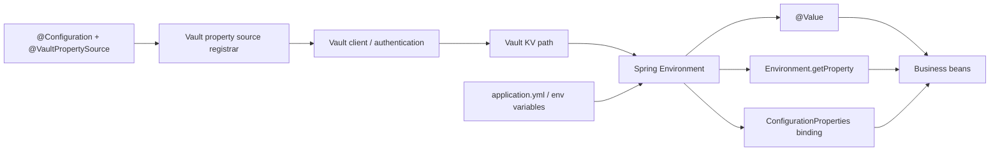
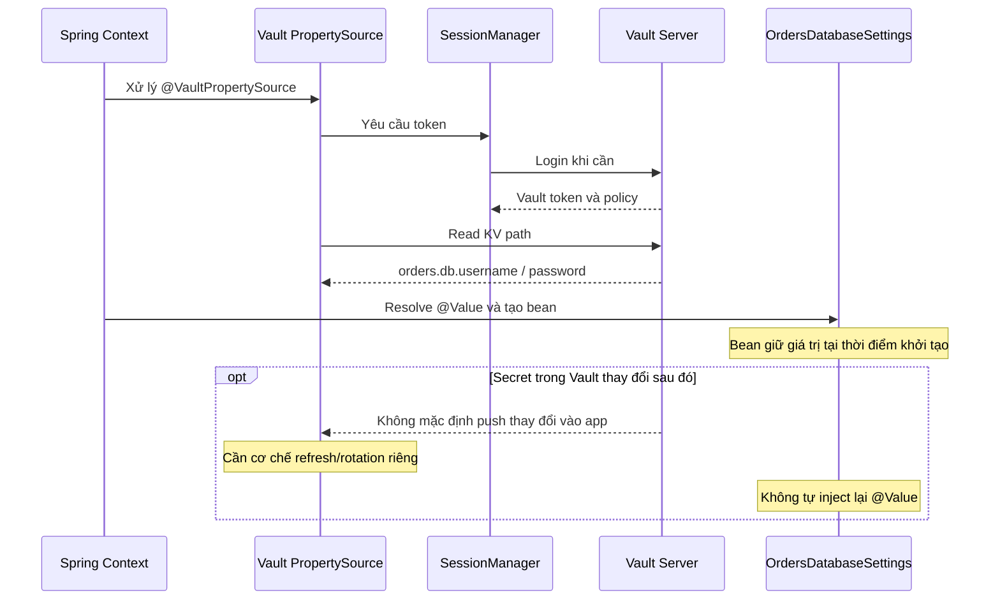

# @VaultPropertySource trên lớp cấu hình

Trong module **SPRING_VAULT**, ứng dụng Java dùng Spring Vault để truy cập HashiCorp Vault qua `VaultTemplate`, đăng nhập bằng danh tính workload và thực hiện những thao tác được Vault policy cho phép. Không phải thông tin nào lấy từ Vault cũng cần một lệnh gọi trong mỗi request: một số giá trị, chẳng hạn endpoint dịch vụ nội bộ, tên người dùng database hoặc khóa cấu hình tích hợp, được ứng dụng sử dụng ngay khi các bean Spring được tạo.

**`@VaultPropertySource`** cho phép đưa giá trị lấy từ Vault vào hệ thống **`Environment`/`PropertySource` của Spring**. Một lớp `@Configuration` có thể khai báo nguồn Vault; sau đó các bean đọc giá trị bằng `@Value`, `Environment.getProperty(...)` hoặc cơ chế binding cấu hình phù hợp. Bài thuộc chương **Nguồn cấu hình**, giải thích cách khai báo annotation, thiết lập client, cấp quyền đọc, xử lý thứ tự ưu tiên cấu hình, phân biệt KV v1/KV v2 và đánh giá vòng đời secret khi ứng dụng chạy lâu dài.

> Nội dung dưới đây dùng ví dụ rõ ràng với **KV v1** để minh họa cách annotation nạp các key phẳng. Đối với KV v2, dynamic secrets hoặc Spring Cloud Vault Config Data, cần xác minh khả năng hỗ trợ và cấu hình theo đúng phiên bản Spring Vault đang triển khai.

## 1. @VaultPropertySource giải quyết vấn đề gì?

Thông thường, ứng dụng Spring nhận cấu hình từ `application.yml`, biến môi trường, tham số dòng lệnh hoặc hệ thống cấu hình tập trung. Những nguồn này cùng góp mặt trong một `Environment`; các `PropertySource` lưu các cặp khóa–giá trị để Spring giải quyết placeholder như `${orders.db.username}`.

Khi secret nằm trong Vault, bạn có hai lựa chọn chính:

1. **Đọc trực tiếp lúc thực thi** bằng `VaultOperations`/`VaultTemplate`: service biết rõ thời điểm và operation, có thể xử lý kết quả, lỗi, TTL và rotation theo nghiệp vụ.
2. **Thêm nguồn cấu hình** qua `@VaultPropertySource`: các bean truy cập giá trị như cấu hình Spring, không cần biết chi tiết HTTP path của Vault.



Sơ đồ thể hiện **dòng phụ thuộc và trách nhiệm**, không khẳng định Spring luôn đọc file cấu hình trước/sau Vault theo một thứ tự cố định. Thứ tự nạp và độ ưu tiên của từng nguồn phải được xác minh trong ứng dụng cụ thể.

### Bốn khái niệm không nên nhầm

| Khái niệm | Chức năng | Vòng đời |
| --- | --- | --- |
| `@VaultPropertySource` | Khai báo nguồn dữ liệu Vault trên lớp cấu hình | Được xử lý khi Spring nạp lớp `@Configuration` |
| `VaultPropertySource` | `PropertySource` chứa các giá trị lấy từ Vault | Góp phần vào `Environment`; có thể có chiến lược cập nhật riêng nếu được cấu hình |
| `VaultTemplate` / `VaultOperations` | Client thực hiện HTTP request tới Vault | Bean/đối tượng client dùng chung, phụ thuộc authentication và session |
| `SessionManager` | Cung cấp token, tùy cấu hình có thể xử lý renew/re-login | Vòng đời token tách biệt với thời điểm nạp giá trị trong bean |

Có một khác biệt đặc biệt quan trọng: **Vault token được gia hạn không đồng nghĩa biến Java đã được inject bằng `@Value` sẽ tự đổi**. Cơ chế property source, bean binding và secret rotation là những trách nhiệm khác nhau.

## 2. Điều kiện cần có trước khi khai báo annotation

Giả sử ứng dụng `orders-service` cần hai thuộc tính:

- `orders.db.username`: tên đăng nhập database thử nghiệm;
- `orders.db.password`: mật khẩu database thử nghiệm.

Trong bài thực hành, Vault có mount `demo-kv/` theo **KV version 1** và secret ở path `orders`; ứng dụng sẽ đọc `demo-kv/orders`.

### 2.1. Tạo KV v1 và dữ liệu thử nghiệm

Các lệnh dưới đây dành cho **Vault dev/test cô lập**, do operator có quyền cấu hình chạy:

```bash
vault secrets enable -path=demo-kv -version=1 kv

vault kv put demo-kv/orders \
  orders.db.username=orders_reader \
  orders.db.password=example-only-password

vault kv get demo-kv/orders
```

Trong môi trường thật, secret phải được cấp qua quy trình quản lý secret an toàn; không dùng mật khẩu ví dụ, không lưu giá trị sản xuất trong script và không bật lại mount đã tồn tại. Lệnh `vault kv get` có thể hiển thị secret, vì vậy chỉ chạy trong môi trường test và không gửi nguyên output lên log hoặc ticket công khai.

### 2.2. Cấp Vault ACL đúng path

Tạo policy HCL chỉ cho phép đọc một secret:

```hcl
# orders-config-reader.hcl
path "demo-kv/orders" {
  capabilities = ["read"]
}
```

Operator có quyền quản trị policy có thể áp dụng:

```bash
vault policy write orders-config-reader orders-config-reader.hcl
```

Policy cần được gắn vào **token/role thực sự dùng để đăng nhập** cho `orders-service`. Tạo policy trên Vault chưa tự làm ứng dụng có quyền. Cần kiểm tra liên kết giữa Kubernetes/AppRole/cloud auth role và `token_policies`, sau đó xác minh request đọc bằng đúng identity của workload.

### 2.3. Cấu hình client Vault

`@VaultPropertySource` cần một Vault client được cấu hình với endpoint, TLS và authentication phù hợp. Với **Spring Vault core**, ứng dụng có thể sử dụng `AbstractVaultConfiguration`. Đoạn sau cố ý dùng token từ environment cho **bài thực hành**, không đại diện cấu hình production:

```java
import java.net.URI;

import org.springframework.context.annotation.Configuration;
import org.springframework.vault.authentication.ClientAuthentication;
import org.springframework.vault.authentication.TokenAuthentication;
import org.springframework.vault.client.VaultEndpoint;
import org.springframework.vault.config.AbstractVaultConfiguration;

@Configuration
public class LabVaultClientConfiguration extends AbstractVaultConfiguration {

    @Override
    public VaultEndpoint vaultEndpoint() {
        return VaultEndpoint.from(
            URI.create(requiredEnv("VAULT_ADDR"))
        );
    }

    @Override
    public ClientAuthentication clientAuthentication() {
        return new TokenAuthentication(requiredEnv("VAULT_TOKEN"));
    }

    private static String requiredEnv(String name) {
        String value = System.getenv(name);
        if (value == null || value.isBlank()) {
            throw new IllegalStateException(
                "Missing required Vault setting: " + name
            );
        }
        return value;
    }
}
```

Ví dụ cần `VAULT_ADDR`, `VAULT_TOKEN` được cấp hợp lệ và trust chain TLS đúng. Token thử nghiệm phải có policy `orders-config-reader`, tuyệt đối không dùng root token của Vault dev cho service đang được kiểm thử. Trong production, nên chọn authentication theo workload như Kubernetes, AppRole hoặc cloud IAM và bảo đảm nguồn identity được rotate theo chính sách.

**Nếu dự án dùng Spring Cloud Vault**, auto-configuration có thể tạo client, session manager và nguồn cấu hình; hãy kiểm tra cơ chế hiện có trước khi thêm `AbstractVaultConfiguration` để tránh đăng ký client hoặc property source trùng lặp.

## 3. Gắn @VaultPropertySource lên lớp @Configuration

Ví dụ Java 17+ sau đăng ký nguồn `demo-kv/orders` và dùng placeholder để tạo bean bất biến:

```java
import org.springframework.beans.factory.annotation.Value;
import org.springframework.context.annotation.Bean;
import org.springframework.context.annotation.Configuration;
import org.springframework.vault.annotation.VaultPropertySource;

@Configuration(proxyBeanMethods = false)
@VaultPropertySource("demo-kv/orders")
public class OrdersVaultPropertiesConfiguration {

    @Bean
    OrdersDatabaseSettings ordersDatabaseSettings(
            @Value("${orders.db.username}") String username,
            @Value("${orders.db.password}") String password) {

        if (username.isBlank() || password.isBlank()) {
            throw new IllegalStateException(
                "Required orders database configuration is empty"
            );
        }
        return new OrdersDatabaseSettings(username, password);
    }
}

record OrdersDatabaseSettings(String username, String password) {
}
```

Trong ví dụ:

1. `@Configuration` làm cho Spring xử lý lớp như một nguồn bean definitions.
2. `@VaultPropertySource("demo-kv/orders")` khai báo Vault path muốn bổ sung vào các nguồn cấu hình.
3. Spring Vault truy cập path đó bằng client/session đã cấu hình và đưa các key vào `Environment` theo cơ chế property source.
4. `@Value("${orders.db.username}")` và `@Value("${orders.db.password}")` lấy giá trị ứng với hai key hiện có.
5. Bean `OrdersDatabaseSettings` giữ các giá trị được truyền **tại thời điểm bean được tạo**.

Với Spring Boot, cơ chế placeholder thông thường đã được thiết lập. Nếu dùng Spring Framework thuần, cần bảo đảm context có cấu hình giải quyết placeholder `${...}`, chẳng hạn `PropertySourcesPlaceholderConfigurer` khi cần; không mặc định mọi context tối giản đều hỗ trợ `@Value` giống Spring Boot.

**Hạn chế bảo mật của ví dụ:** Bean chứa password trong một `String` sẽ giữ dữ liệu nhạy cảm trong memory trong suốt vòng đời bean. Không gắn `@Data`/`toString()`, không in record ra log và không xuất giá trị qua Actuator. Khi password cần xoay vòng trong quá trình chạy, thiết kế credential consumer riêng thay vì trông đợi record tự cập nhật.

### Khi nào annotation thực sự hoạt động?

Lớp phải được Spring **scan hoặc import**. Chỉ tạo file Java với `@VaultPropertySource` rồi không cho nó nằm trong component scan/import sẽ không thêm nguồn Vault vào `Environment`. Nếu lớp nằm dưới `@Profile("prod")`, nguồn Vault cũng chỉ tồn tại khi profile tương ứng được kích hoạt.

Khi container khởi tạo, nó phải có khả năng giải quyết bean cần thiết để tạo property source và lấy dữ liệu. Nếu Vault unavailable tại giai đoạn cấu hình, ứng dụng có thể thất bại startup hoặc thiếu property, tùy đường thực thi và các tùy chọn phiên bản. Không thiết kế hệ thống trên giả định rằng mọi nguồn Vault đều được lazy-load ở request đầu tiên.

## 4. Đọc dữ liệu qua Environment và @ConfigurationProperties

`@Value` tiện cho vài thuộc tính, nhưng nếu phải quản lý nhiều thông số liên quan, bạn có thể dùng `Environment` hoặc binding `@ConfigurationProperties`.

### 4.1. Environment.getProperty

```java
import org.springframework.core.env.Environment;
import org.springframework.stereotype.Service;

@Service
public class OrdersConfigurationLookup {
    private final Environment environment;

    public OrdersConfigurationLookup(Environment environment) {
        this.environment = environment;
    }

    public String databaseUsername() {
        String username =
            environment.getProperty("orders.db.username");

        if (username == null || username.isBlank()) {
            throw new IllegalStateException(
                "Missing required orders.db.username"
            );
        }
        return username;
    }
}
```

`Environment` tra cứu từ danh sách các property source theo **thứ tự ưu tiên**; code không có bằng chứng rằng giá trị trả về chắc chắn tới từ Vault nếu cùng key còn xuất hiện ở nguồn khác. Vì vậy cần có chính sách tên key, precedence và kiểm thử xung đột.

### 4.2. Dùng @ConfigurationProperties trong Spring Boot

Ví dụ với Spring Boot có `@EnableConfigurationProperties`:

```java
import org.springframework.boot.context.properties.ConfigurationProperties;
import org.springframework.boot.context.properties.EnableConfigurationProperties;
import org.springframework.context.annotation.Configuration;

@ConfigurationProperties(prefix = "orders.db")
public record OrdersDbProperties(String username, String password) {
}

@Configuration(proxyBeanMethods = false)
@EnableConfigurationProperties(OrdersDbProperties.class)
class OrdersDbPropertiesBindingConfiguration {
}
```

Nếu `OrdersDbProperties` cần nhận property từ annotation, hãy bảo đảm **lớp `@VaultPropertySource` được nạp trong cùng context, đúng giai đoạn** và các key có dạng phù hợp để binder xử lý. Đây là một cơ chế binding của Spring Boot; `@VaultPropertySource` không có nhiệm vụ tạo hoặc cập nhật `@ConfigurationProperties` bean.

Lưu ý: cấu hình binding trên không tự refresh một record đã được dựng khi source bên dưới thay đổi. Secret rotation có thể làm `Environment.getProperty` đọc dữ liệu mới (nếu source được cập nhật đúng cách), trong khi record và bean đang dùng credential cũ vẫn giữ giá trị ban đầu.

## 5. Phân biệt đường dẫn KV v1 và KV v2

Sai phiên bản KV là lỗi phổ biến khi sử dụng property source. Cả hai có thể cùng được gọi là “secret KV”, nhưng API path và cấu trúc response khác nhau.

| Nội dung | KV v1 | KV v2 |
| --- | --- | --- |
| Ví dụ mount | `demo-kv/` | `secret/` |
| Secret logic | `orders` | `orders` |
| API đọc | `GET /v1/demo-kv/orders` | `GET /v1/secret/data/orders` |
| Policy đọc | `path "demo-kv/orders" { capabilities = ["read"] }` | `path "secret/data/orders" { capabilities = ["read"] }` |
| Dữ liệu response | `data` chứa key–value trực tiếp | `data.data` chứa key–value, có thêm `data.metadata` |
| Cập nhật/version | Không có version KV v2 | Có version, soft delete và metadata riêng |
| Cách dùng với `@VaultPropertySource` | Path đơn giản trong bài lab | **Phải kiểm chứng API của property source và hỗ trợ KV v2** theo phiên bản |

Ví dụ source trong bài dùng KV v1 để tránh nhập nhằng. Với KV v2, **không tự suy** rằng thêm `/data/` vào chuỗi của annotation luôn tạo ra các key phẳng mong muốn: việc flatten response phụ thuộc implementation property source và cơ chế client. Có thể lựa chọn cấu hình nguồn KV v2 được Spring Cloud Vault hỗ trợ, hoặc đọc qua `opsForKeyValue("secret", KeyValueBackend.KV_2)` và tự xử lý dữ liệu.

Ví dụ Spring Vault đọc **KV v2 bằng operations API**:

```java
import org.springframework.vault.core.VaultKeyValueOperationsSupport.KeyValueBackend;
import org.springframework.vault.core.VaultOperations;
import org.springframework.vault.support.VaultResponse;

VaultResponse response = vaultOperations
    .opsForKeyValue("secret", KeyValueBackend.KV_2)
    .get("orders");

if (response == null || response.getData() == null) {
    throw new IllegalStateException("KV v2 secret not found");
}
```

`vaultOperations` ở ví dụ là dependency đã được cấu hình và inject. Dữ liệu này nằm ngoài `Environment` trừ khi ứng dụng chủ động đưa vào một nguồn cấu hình. Nếu muốn các bean khác sử dụng key từ KV v2 như properties, nên dùng integration phù hợp và kiểm thử cả cấu trúc response, key binding lẫn quyền `secret/data/orders`.

## 6. Thứ tự ưu tiên giữa Vault, application.yml và biến môi trường

Spring `Environment` bao gồm nhiều `PropertySource` có thể chứa **cùng một tên key**. Khi lấy một property, **nguồn có precedence cao hơn** thường thắng; tuy nhiên vị trí cụ thể của Vault source phụ thuộc cách đăng ký, phiên bản Spring và cách sử dụng Spring Boot/Cloud Vault.

Ví dụ nếu cả ba nguồn có key `orders.db.username`:

```yaml
# application.yml: fallback cấu hình không nhạy cảm ở môi trường test
orders:
  db:
    username: local_reader
```

```text
# Vault: demo-kv/orders
orders.db.username = vault_reader

# Environment: ORDERS_DB_USERNAME
ORDERS_DB_USERNAME=env_reader
```

Không thể suy ra kết quả cuối là `vault_reader` chỉ vì lớp có `@VaultPropertySource`. Với Spring Boot, các nguồn do cấu hình bên ngoài, command-line và hệ thống property source khác có thứ tự riêng; khi Spring Cloud Vault cũng tham gia Config Data, thứ tự có thể khác cấu hình thuần Spring Vault core.

Một cách điều tra an toàn là kiểm tra **tên và thứ tự property source**, không in giá trị:

```java
import org.springframework.core.env.ConfigurableEnvironment;
import org.springframework.core.env.PropertySource;

public final class PropertySourceInspector {
    public static void printNames(ConfigurableEnvironment environment) {
        for (PropertySource<?> source : environment.getPropertySources()) {
            System.out.println("propertySource=" + source.getName());
        }
    }
}
```

Ví dụ trên dành cho phát hiện nguồn trong môi trường test; trong production hãy dùng log được kiểm soát. Đừng gọi `System.out.println(environment.getProperty("orders.db.password"))` hoặc dump toàn bộ `Environment`/Actuator `/env` vì có thể tiết lộ secret.

### Một số quy tắc thực tiễn

- **Đặt namespace key rõ ràng** theo ứng dụng và mục đích (ví dụ `orders.db.*`), tránh các key chung như `username` hoặc `password`.
- **Không đặt default plaintext secret** trong placeholder như `${orders.db.password:changeme}`; lỗi thiếu secret nên được phát hiện thay vì lặng lẽ dùng credential yếu.
- **Kiểm thử khi hai nguồn có cùng key** để biết source nào thắng; nếu không muốn override ngầm, kiểm soát bằng conventions hoặc validation.
- **Kiểm tra trong đúng profile** (`dev`, `test`, `prod`) vì cấu hình profile và file import có thể làm danh sách nguồn khác nhau.
- **Đừng thay đổi precedence bằng cách tùy tiện thêm PropertySource vào đầu** khi chưa hiểu tác động lên các cấu hình khác.

## 7. @VaultPropertySource khác gì Spring Cloud Vault Config Data?

Cả hai có thể đưa secret Vault vào Spring configuration nhưng dùng các cơ chế tích hợp khác nhau.

| Tiêu chí | `@VaultPropertySource` | Spring Cloud Vault Config Data |
| --- | --- | --- |
| Điểm khai báo | Trên `@Configuration` (hoặc lớp cấu hình được import) | Qua cơ chế Spring Boot Config Data, thường `spring.config.import=vault://` |
| Phạm vi | Nguồn/path do annotation khai báo | Các context/config backend do Spring Cloud Vault quản lý |
| Thời điểm | Trong quá trình container xử lý configuration class | Có thể xảy ra rất sớm trong giai đoạn chuẩn bị `Environment` |
| Phù hợp | Ứng dụng Spring Vault core cần một vài source cụ thể | Ứng dụng Spring Boot dùng nguồn cấu hình Vault theo hệ thống config |
| Cần VaultTemplate/auto-config? | Cần các thành phần client Spring Vault phù hợp | Spring Cloud Vault tạo hoặc phối hợp client theo cơ chế starter |
| Rotation | Tùy kiểu property source/chiến lược reload và consumer | Tùy tính năng của Cloud Vault và cơ chế refresh được cấu hình; không tự bảo đảm bean đã bind sẽ cập nhật |

Ví dụ cấu hình kiểu Spring Cloud Vault trong một ứng dụng Boot có starter tương ứng:

```yaml
spring:
  config:
    import: vault://
  cloud:
    vault:
      uri: https://vault.example.internal:8200
      authentication: KUBERNETES
      kubernetes:
        role: orders-service
```

Đây là **mẫu minh họa phương thức xác thực**: cần cấu hình auth mount, JWT projection, TLS, KV backend, namespace và tùy chọn fail-fast theo đúng deployment/phiên bản. Có `spring.config.import=vault://` trong YAML không bảo đảm tự có Vault role/policy hay truy cập được secret.

**Tránh đăng ký trùng cùng một path** bằng cả `@VaultPropertySource` và Config Data nếu không có yêu cầu rõ ràng. Điều đó có thể làm precedence khó dự đoán, tăng request đến Vault và tạo kỳ vọng sai về refresh. Khi một dự án đã chọn Spring Cloud Vault, nên tận dụng cơ chế của nó thay vì thêm annotation rải rác.

## 8. Vòng đời bean, token và làm mới giá trị cấu hình

Một nguồn cấu hình đọc từ Vault có thể chứa secret **tĩnh** hoặc secret **có lease**. Để vận hành đúng, cần phân biệt các thời điểm:



### 8.1. Với KV secret tĩnh

Cập nhật KV v1 hoặc tạo version mới trong KV v2 **không tự phát sự kiện** đến mọi instance Java. Nếu có yêu cầu rotation khi runtime, bạn phải xác định ai sẽ đọc lại dữ liệu, khi nào refresh, thời gian cache, cách đồng bộ bean và khi nào các connection cũ bị loại bỏ.

### 8.2. Với secret động có lease

Spring Vault có `SecretLeaseContainer` và cơ chế `LeaseListener` để quản lý secret có lease; các sự kiện có thể báo tạo, renew, expire và rotate. Một số phiên bản/cấu hình Vault property source có khả năng tích hợp renewal hoặc rotation. Tuy vậy, **update property source** và **cập nhật bean đã được khởi tạo** là hai bước khác nhau. Cần kiểm chứng cụ thể giá trị `Environment`, bean `@ConfigurationProperties`/`@Value` và consumer như JDBC pool sau mỗi lần rotate.

Ví dụ database credential được Vault cấp với TTL 15 phút: nếu bean `OrdersDatabaseSettings` giữ username/password được inject lúc startup, khi lease hết hạn, credential của bean có thể không còn dùng được dù token Vault đã được renew. Một thay đổi hợp lệ cần tạo credential mới, dựng hoặc reconfigure connection pool an toàn và đóng pool cũ có kiểm soát; không dựa vào việc giá trị của `PropertySource` có thể đã đổi.

### 8.3. Với token và policy

`SessionManager` cung cấp token để đọc từ Vault. **Renew token không làm refresh KV value**, cũng không renew lease của database secret một cách tự động. Login thành công không đủ cho quyền đọc: token phải có `read` trên **đúng path**. Ví dụ đọc KV v1 `demo-kv/orders` khác với path KV v2 `secret/data/orders`.

## 9. Thiết kế hành vi khi Vault không sẵn sàng

Tác động của lỗi phụ thuộc secret được sử dụng lúc nào:

| Pha | Lỗi có thể xuất hiện | Quyết định cần thiết |
| --- | --- | --- |
| Xử lý `@VaultPropertySource` | Vault unavailable, thiếu authentication, TLS lỗi, policy `403` | Chọn fail-fast hay cho phép thiếu cấu hình theo khả năng phiên bản; với secret bắt buộc nên fail rõ ràng |
| Tạo bean bằng `@Value` | Placeholder không giải quyết được, giá trị rỗng hoặc sai kiểu | Validation để ngăn ứng dụng nhận lưu lượng khi thiếu cấu hình bắt buộc |
| Runtime với secret tĩnh đã inject | Vault không truy cập được nhưng bean vẫn giữ giá trị cũ | Xác định ranh giới thời gian/độ tin cậy của cached value, không mặc định secret vẫn hợp lệ |
| Runtime với dynamic secret | Lease hết TTL, renew/rotate thất bại | Quản lý readiness và consumer, ngừng dùng credential hết hiệu lực |
| Runtime sau khi policy bị đổi | Token hợp lệ nhưng Vault trả `403` khi đọc lại | Sửa Vault policy/capability, không retry vô hạn hay nâng quyền tự động |

Với secret bắt buộc để tạo database connection, cách an toàn thường là **không báo READY khi chưa có secret hợp lệ**. Có thể fail startup hoặc tách readiness và retry nền với deadline, tùy yêu cầu vận hành. Liveness không nên gọi Vault trên mọi probe vì một sự cố ngắn có thể gây restart loop. Các cơ chế này cần được thiết kế bên ngoài annotation: bản thân `@VaultPropertySource` không định nghĩa chính sách phục hồi của toàn ứng dụng.

## 10. Chẩn đoán các lỗi thường gặp

| Triệu chứng | Lớp cần kiểm tra | Hướng xử lý |
| --- | --- | --- |
| `Could not resolve placeholder 'orders.db.username'` | Lớp config chưa được scan/import, source không được đăng ký, key sai, precedence bất ngờ | Xác minh bean configuration có mặt trong context và tên key trong Vault |
| `403 permission denied` khi khởi tạo | Vault token ACL sai path/capability | Kiểm tra auth role và token policies; KV v1 `demo-kv/orders` cần `read` |
| `404` hoặc không có data | Sai mount, path, version KV hoặc secret chưa tồn tại | Kiểm tra mount version và dùng API/path phù hợp |
| `BeanCreationException` liên quan Vault client | Thiếu `VaultOperations`/auth/endpoint, cấu hình trùng hoặc thiếu biến môi trường | Kiểm tra client bean graph, startup phase và dependency versions |
| `SSLHandshakeException` hoặc timeout | CA/hostname, network, Vault seal/HA | Kiểm tra truststore và timeout; không tắt TLS verification |
| Bean nhận giá trị từ `application.yml` thay vì Vault | Property source precedence/cùng key | Kiểm tra tên/thứ tự các nguồn mà không log giá trị secret |
| Secret thay đổi nhưng bean vẫn dùng password cũ | `@Value` đã chụp giá trị khi bean được tạo | Thiết kế refresh/rotation consumer; không mặc định bean được inject lại |
| Đọc KV v2 được với `VaultTemplate` nhưng annotation không có key mong muốn | Cấu trúc `data.data`, API hỗ trợ và path/backend semantics khác | Dùng property source integration hỗ trợ KV v2 theo version, hoặc operations API riêng |
| Actuator/exception vô tình lộ secret | Logging, `toString()`, config endpoints hoặc raw HTTP payload | Redaction, giới hạn truy cập và tắt những đầu ra không cần thiết |

Để điều tra, trước hết xác định **request đã đến Vault hay chưa**; sau đó kiểm tra authentication/token và policy, cuối cùng mới đến map/binding/precedence trong Spring. Lỗi `403` của Vault secret engine không phải bằng chứng Spring không scan được lớp `@Configuration`.

## 11. Kiểm thử @VaultPropertySource có ý nghĩa

Đối với bài này, một kiểm thử thật cần xác minh đồng thời **Vault source** và **Spring Environment**. Unit test mock `Environment` chỉ kiểm chứng logic lấy property, chưa chứng minh annotation làm việc.

### 11.1. Integration test với Vault cô lập

Chuẩn bị Vault dev/Testcontainers hoặc Vault test instance riêng, tạo KV v1 `demo-kv` và secret `orders` chứa key giả, đăng ký token ít quyền với policy `orders-config-reader`. Boot application dùng `@VaultPropertySource("demo-kv/orders")`.

Ví dụ test chỉ khẳng định những giá trị không nhạy cảm:

```java
import static org.assertj.core.api.Assertions.assertThat;

import org.junit.jupiter.api.Test;
import org.springframework.beans.factory.annotation.Autowired;
import org.springframework.boot.test.context.SpringBootTest;
import org.springframework.core.env.Environment;

@SpringBootTest
class OrdersVaultPropertiesIntegrationTest {

    @Autowired
    Environment environment;

    @Autowired
    OrdersDatabaseSettings settings;

    @Test
    void loadsVaultPropertiesIntoSpringConfiguration() {
        assertThat(environment.getProperty("orders.db.username"))
            .isEqualTo("orders_reader");

        assertThat(settings.username())
            .isEqualTo("orders_reader");

        assertThat(settings.password())
            .isNotBlank();
        // Không assert bằng cách in hoặc ghi secret ra report.
    }
}
```

**Điều kiện chạy:** test phải chuẩn bị Vault fixture, `VAULT_ADDR`/`VAULT_TOKEN` và TLS/auth client trước khi tạo Spring context. `@SpringBootTest` không tự tạo Vault hoặc mount KV. `OrdersDatabaseSettings` trong test là record được tạo bởi lớp `OrdersVaultPropertiesConfiguration` đã nêu ở phần trước.

### 11.2. Ma trận kiểm thử nên có

| Test | Bố trí | Kỳ vọng |
| --- | --- | --- |
| Happy path KV v1 | Key phẳng trong `demo-kv/orders`, policy `read` | `Environment` và bean đọc đúng giá trị |
| Lớp config không được scan | Không import `OrdersVaultPropertiesConfiguration` | Không có source Vault tương ứng; placeholder thiếu theo cấu hình |
| Policy không đủ | Token không có `read` | Lỗi Vault ACL được ghi nhận, không có cách bypass |
| Path sai | Annotation trỏ secret không tồn tại | Startup/binding phản ánh lỗi thiếu dữ liệu theo hành vi được cấu hình |
| Cùng key ở hai nguồn | `application.yml` và Vault cùng chứa `orders.db.username` | Kết quả precedence được ghi rõ bằng assertion |
| KV v2 | Mount KV v2 với path/adapter đúng phiên bản | Đúng cách flatten dữ liệu và policy `secret/data/orders` |
| Vault tạm unavailable | Chặn network test trước startup | Fail-fast/NOT_READY theo yêu cầu, không rò rỉ secret |
| Secret được đổi sau startup | Cập nhật giá trị ở Vault | Xác minh rõ behavior của `Environment`, bean đã bind và consumer |
| Token hết TTL | Token test TTL ngắn hoặc revoke | Cơ chế session/re-login hoạt động hoặc báo lỗi có kiểm soát |
| Shutdown | Đóng context sau khi đã inject | Các resource do ứng dụng sở hữu được dừng, không có leak background jobs |

Kiểm thử precedence và runtime rotation có ý nghĩa hơn việc chỉ xác nhận bean đã tồn tại. Với KV v2, test phải kiểm tra version/backend semantics thật; với dynamic secret, test cần xác nhận connection pool hoặc consumer đã chuyển credential, không chỉ xác nhận property source thay đổi.

## 12. Bảo mật khi dùng secret như cấu hình

Khi `@VaultPropertySource` nạp secret vào `Environment`, dữ liệu trở thành phần của **trạng thái cấu hình trong JVM**. Quyền đọc nó phải được bảo vệ bằng cơ chế Vault policy và quyền truy cập ứng dụng.

- **Không log key–value toàn bộ của `Environment`**. Bản thân tên key có thể không nhạy cảm, nhưng value là bí mật và có thể xuất hiện trong debug dumps.
- **Không đặt secret trong URL, annotation literal hoặc Git.** Annotation chỉ chứa **Vault path**; credential auth phải được cấp qua workload runtime.
- **Dùng least privilege**: chỉ cấp `read` cho path ứng dụng cần; không sử dụng root token, wildcard policy hoặc capability `sudo`.
- **Giới hạn Actuator**: endpoints như `/env` hoặc `/configprops` cần được khóa và sanitization phù hợp; không dựa hoàn toàn vào cơ chế che giá trị mặc định.
- **Đừng tạo default mật khẩu kém an toàn** để tránh startup failure. Kiểm tra thiếu dữ liệu và thông báo bằng tên key, không bằng nội dung secret.
- **Xác định vòng đời secret ngay từ thiết kế**: KV static thay đổi do người quản trị; database credentials động có lease; chứng chỉ PKI có thời hạn; Transit key xử lý server-side, không cần đưa private key vào `Environment`.
- **Không nhầm login với authorization**: workload identity có thể login thành công nhưng Vault policy vẫn từ chối đọc nguồn cấu hình.

Nếu ứng dụng thực sự cần password rotate khi đang chạy, chỉ đọc vào record bằng `@Value` là chưa đủ. Cần cơ chế riêng phối hợp Vault lease/rotation, chuyển credential ở consumer, tránh trộn dữ liệu cũ/mới và có kế hoạch khôi phục khi Vault tạm không sẵn sàng.

## 13. Tự kiểm tra

**Câu 1.** Lớp có `@VaultPropertySource("demo-kv/orders")` nhưng không nằm trong component scan/import. `Environment` có tự nạp dữ liệu từ Vault không?  
**Trả lời:** Không. Spring phải xử lý lớp cấu hình để đăng ký property source.

**Câu 2.** Vì sao `@Value("${orders.db.password}")` có thể còn mật khẩu cũ sau khi operator thay secret ở Vault?  
**Trả lời:** Giá trị được giải quyết khi bean được tạo; không có bảo đảm bean đã tạo được inject lại chỉ vì dữ liệu trong Vault đổi.

**Câu 3.** KV v1 mount `demo-kv`, path `orders` cần capability gì để đọc?  
**Trả lời:** `read` trên Vault ACL path `demo-kv/orders`, và token ứng dụng phải thực sự mang policy đó.

**Câu 4.** Khi ứng dụng dùng KV v2, policy `read` trên `secret/orders` có đủ không?  
**Trả lời:** Không. Với KV v2, API đọc dữ liệu thường dùng `secret/data/orders`; cần kiểm tra mount/version và cách client/property source xử lý KV v2.

**Câu 5.** Cùng key `orders.db.username` có ở Vault và `application.yml`. Giá trị cuối chắc chắn là của Vault?  
**Trả lời:** Không. Cần xét precedence thực tế của các `PropertySource` trong context.

**Câu 6.** Spring Cloud Vault Config Data và `@VaultPropertySource` có giống hệt nhau về giai đoạn tải?  
**Trả lời:** Không. Config Data có thể tải rất sớm khi chuẩn bị `Environment`; annotation được xử lý khi nạp lớp configuration.

**Câu 7.** Vault token renew thành công có tự gia hạn database credential nằm trong bean đã inject không?  
**Trả lời:** Không. Token, lease của dynamic secret và giá trị trong bean có vòng đời độc lập.

**Câu 8.** Vì sao không in mọi property từ `Environment` để debug?  
**Trả lời:** Vì có thể làm lộ password, token hoặc cấu hình nhạy cảm; chỉ quan sát tên source và tín hiệu lỗi đã được lọc.

**Kết luận:** `@VaultPropertySource` làm cho secret Vault tham gia cơ chế cấu hình chuẩn của Spring, hữu ích khi bean chỉ cần lấy một vài giá trị lúc khởi động. Sử dụng đúng đòi hỏi nắm rõ **Vault path và KV version, auth/policy, thời điểm nạp, property source precedence và giới hạn refresh của bean**. Khi secret có vòng đời động, cần thiết kế thêm cơ chế rotation cho consumer thay vì giả định annotation tự xử lý mọi thay đổi.

### Tài liệu tham khảo

- [Spring Vault Reference](https://docs.spring.io/spring-vault/reference/)
- [Spring Vault API – VaultPropertySource](https://docs.spring.io/spring-vault/reference/api/java/org/springframework/vault/annotation/VaultPropertySource.html)
- [Spring Framework – Environment Abstraction](https://docs.spring.io/spring-framework/reference/core/beans/environment.html)
- [Spring Cloud Vault Reference](https://docs.spring.io/spring-cloud-vault/reference/)
- [HashiCorp Vault – KV Secrets Engine](https://developer.hashicorp.com/vault/docs/secrets/kv)

