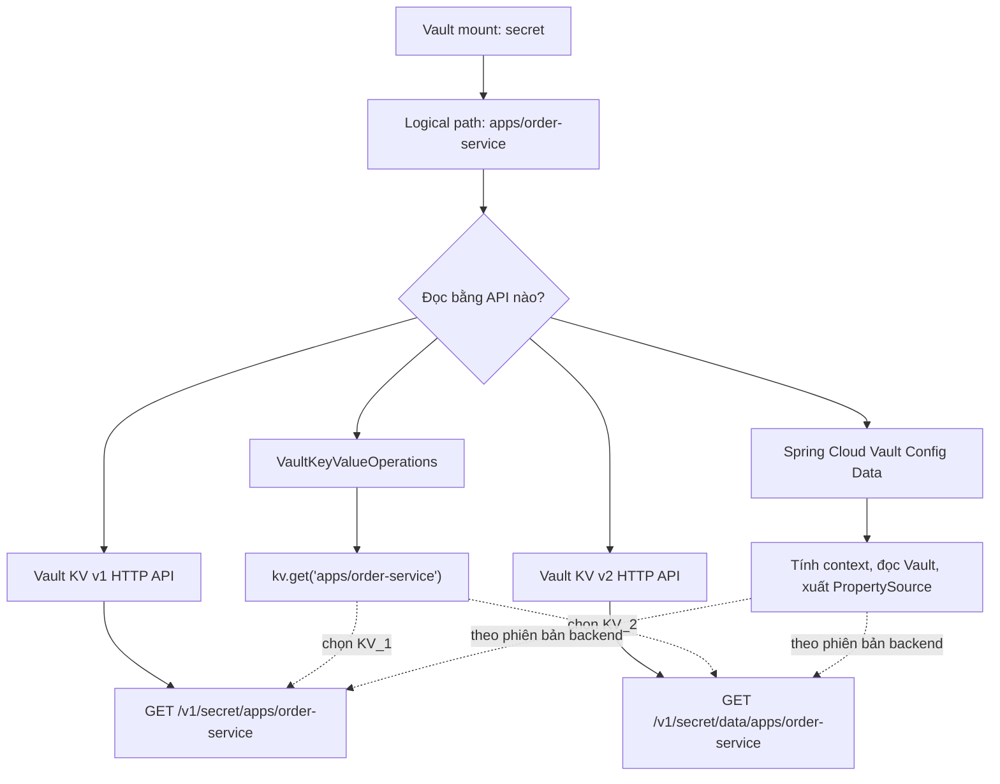

# Đường dẫn KV v1, KV v2 và quy ước của abstraction

## 1. Vì sao cùng một secret lại có nhiều kiểu đường dẫn?

Trong **Spring Vault**, ứng dụng Java có thể đọc bí mật của HashiCorp Vault qua `VaultTemplate`/`VaultOperations` hoặc đưa giá trị KV vào Spring `Environment` dưới dạng nguồn cấu hình bằng **Spring Cloud Vault**. Khi kết hợp nhiều lớp API, một lỗi rất phổ biến là chèn thêm hoặc bỏ thiếu phân đoạn `data/` trong đường dẫn.

Hãy xét ứng dụng `order-service` cần đọc cấu hình tại key logic `apps/order-service` trong KV secrets engine được mount ở `secret/`.

- Đối với **KV v1**, HTTP read path là `secret/apps/order-service`.
- Đối với **KV v2**, HTTP read path là `secret/data/apps/order-service`.
- Đối với **Vault CLI `vault kv get`** và **Spring Vault `VaultKeyValueOperations`**, ứng dụng thường truyền **mount** `secret` và **logical path** `apps/order-service`. Abstraction chọn HTTP path thích hợp theo phiên bản engine.
- Đối với **Spring Cloud Vault Config Data/PropertySource**, ứng dụng cấu hình mount và *context* (theo tên ứng dụng, profile hoặc đường dẫn chỉ định). Thành phần cấu hình xử lý việc truy cập KV v1/v2 trước khi xuất các key sang `Environment`.

**Chốt quy ước ngay từ đầu:** `mount path`, `logical secret path`, `KV HTTP API path` và `Spring configuration property name` là bốn khái niệm khác nhau. Chúng có thể chứa các chuỗi tương tự nhưng không thể thay thế tùy ý.

### Một hình dung tổng thể



Trong sơ đồ, `/v1/` là **phiên bản của Vault HTTP API**, có mặt trong cả KV v1 và KV v2. Nó **không nói lên secrets engine đang chạy KV v1**. Sự khác biệt của KV v2 nằm ở các API route như `data/` và `metadata/` phía sau tên mount.

## 2. Ba lớp path cần ghi nhớ

| Khái niệm | Ví dụ | Đối tượng sử dụng |
| --- | --- | --- |
| **KV mount** | `secret`, `kv-v1`, `kv-v2` | Vault operator bật secrets engine tại đây; client chọn backend |
| **Logical secret path / context** | `apps/order-service`, `order-service/prod` | `vault kv` CLI, `VaultKeyValueOperations` và cấu hình context |
| **HTTP API path** | `secret/data/apps/order-service` | `VaultOperations.read` API thô hoặc HTTP client trực tiếp |
| **Spring property key** | `payments.timeout`, `database.url` | `@Value`, `@ConfigurationProperties` và `Environment` |

Một mount có thể có tên `secret` nhưng chạy **KV v1 hoặc KV v2**. Không thể suy phiên bản engine từ tên mount. Tên mount cũng có thể khác hoàn toàn giữa development và production; quản trị viên quyết định khi bật engine.

Ví dụ để phân biệt:

```text
Vault server base URL: https://vault.example.internal:8200
KV mount:             secret
Logical path:         apps/order-service

KV v1 HTTP endpoint: GET /v1/secret/apps/order-service
KV v2 HTTP endpoint: GET /v1/secret/data/apps/order-service
Spring KV abstraction: vault.opsForKeyValue("secret", KV_2).get("apps/order-service")
```

Với API KV trừu tượng, **không** viết `.get("secret/data/apps/order-service")` vì abstraction đã gắn mount và phần path của phiên bản engine. Nếu truyền đường dẫn HTTP đầy đủ vào API tương đối, kết quả có thể bị ghép đôi như `secret/data/secret/data/...`.

## 3. Khác biệt giữa KV v1 và KV v2

| Khía cạnh | KV v1 | KV v2 |
| --- | --- | --- |
| Dữ liệu | Key/value không có version history của KV engine | Có nhiều phiên bản của một logical secret |
| HTTP đọc | `GET /v1/<mount>/<path>` | `GET /v1/<mount>/data/<path>` |
| HTTP ghi | `POST /v1/<mount>/<path>` | `POST /v1/<mount>/data/<path>` |
| HTTP liệt kê | `LIST /v1/<mount>/<prefix>` | `LIST /v1/<mount>/metadata/<prefix>` |
| Dạng response đọc | Trường `data` chứa trực tiếp các giá trị ứng dụng | `data.data` chứa giá trị ứng dụng; `data.metadata` chứa metadata phiên bản |
| Phiên bản / CAS | Không có API versioned KV tương đương | Có hỗ trợ versioning, compare-and-set và thao tác metadata theo quyền |
| Policy đọc secret | `<mount>/<path>` | `<mount>/data/<path>` |
| Policy list/metadata | Cùng cây path KV v1 | Dùng `<mount>/metadata/<prefix>` cho API metadata phù hợp |

### 3.1. Response JSON cho KV v1

Giả sử secret `apps/order-service` chứa `feature.mode` và `db.host`. Một HTTP response minh họa:

```json
{
  "data": {
    "feature.mode": "safe",
    "db.host": "database.example.internal"
  }
}
```

Dữ liệu ứng dụng nằm trực tiếp ở `data` của response. KV v1 không có metadata cho từng phiên bản secret giống KV v2.

### 3.2. Response JSON cho KV v2

Với cùng logical path và các key tương tự, Vault KV v2 trả thêm một lớp `data`:

```json
{
  "data": {
    "data": {
      "feature.mode": "safe",
      "db.host": "database.example.internal"
    },
    "metadata": {
      "version": 3,
      "destroyed": false,
      "deletion_time": "",
      "created_time": "2026-01-01T00:00:00Z"
    }
  }
}
```

Timestamp và version chỉ là dữ liệu minh họa. Đây là cấu trúc **HTTP API raw** được lược bớt các trường response chung. Trong Spring Vault, API cấp cao `VaultKeyValueOperations.get(...)` xử lý hình dạng KV v2 để người gọi đọc các key ứng dụng bằng `VaultResponse.getData()` thay vì tự bóc `data.data`.

Khi dùng HTTP client thô, phải xử lý lớp dữ liệu lồng nhau; nhưng **không viết logic bóc lớp thứ hai vào mọi service** nếu đã chọn `VaultKeyValueOperations` làm abstraction.

### 3.3. Lưu ý về metadata và thao tác xóa

KV v2 phân biệt API `data` và `metadata`. Quyền đọc dữ liệu (`read` trên `data/...`) và quyền liệt kê hoặc quản lý metadata (`list`/các quyền khác trên `metadata/...`) có thể tách độc lập. Một ứng dụng chỉ cần đọc đúng một secret không nhất thiết phải được cấp quyền `list` trên toàn mount.

KV v2 còn có các thao tác xóa mềm phiên bản, khôi phục phiên bản và hủy vĩnh viễn phiên bản. Chúng có đường dẫn/quyền riêng; đừng nhầm hành vi xóa của KV v1 với lifecycle versioned KV v2.

## 4. Thử nghiệm hai mount độc lập bằng Vault CLI

Trong Vault **thử nghiệm**, một operator có thể bật hai mount khác nhau để thực hành. Các lệnh dưới đây yêu cầu danh tính có quyền quản trị secrets engine; không đặt root token vào ứng dụng Java.

```bash
# Chạy một lần trên Vault thử nghiệm, nếu các mount chưa tồn tại.
vault secrets enable -path=kv-v1 -version=1 kv
vault secrets enable -path=kv-v2 -version=2 kv

# Ghi cùng logical path trên hai engine.
vault kv put -mount=kv-v1 apps/order-service feature.mode=safe db.host=db-v1.test
vault kv put -mount=kv-v2 apps/order-service feature.mode=safe db.host=db-v2.test

# Lệnh CLI cấp cao chọn đúng HTTP API theo phiên bản mount.
vault kv get -mount=kv-v1 apps/order-service
vault kv get -mount=kv-v2 apps/order-service

# Xem metadata/version theo tính năng được hỗ trợ của KV v2.
vault kv metadata get -mount=kv-v2 apps/order-service
```

`vault kv put` và `vault kv get` nhận tên mount và logical path. Với KV v2, CLI tự thực hiện request bên dưới `kv-v2/data/apps/order-service`. Không ghi `data/` trong logical path CLI:

```bash
# SAI khi muốn lưu vào key logic apps/order-service:
vault kv put -mount=kv-v2 data/apps/order-service feature.mode=safe

# ĐÚNG:
vault kv put -mount=kv-v2 apps/order-service feature.mode=safe
```

Lệnh sai có thể tạo một secret có logical path bắt đầu bằng `data/`; điều này khiến ứng dụng đọc nhầm key dù request kỹ thuật vẫn thành công. Đừng chỉ kiểm tra status HTTP; cần xác minh **logical path đúng**.

## 5. Quy ước khi dùng VaultTemplate và VaultOperations

### 5.1. API raw: người gọi chịu trách nhiệm đường dẫn HTTP

`VaultOperations.read(String path)` là thao tác đọc Vault theo **path API**, không tự biết bạn muốn dùng KV v1 hay KV v2:

```java
import org.springframework.vault.core.VaultOperations;
import org.springframework.vault.support.VaultResponse;

public final class RawVaultReader {

    private final VaultOperations vault;

    public RawVaultReader(VaultOperations vault) {
        this.vault = vault;
    }

    public VaultResponse readKv1() {
        return vault.read("kv-v1/apps/order-service");
    }

    public VaultResponse readKv2() {
        return vault.read("kv-v2/data/apps/order-service");
    }
}
```

Ở đường đọc KV v2 bằng API raw, `VaultResponse.getData()` có thể mang cả object `data` và `metadata` bên trong. Cách xử lý response cần phù hợp cấu trúc JSON của backend. Nếu mã nghiệp vụ chỉ muốn key ứng dụng, ưu tiên API KV chuyên dụng.

### 5.2. VaultKeyValueOperations: đường dẫn tương đối theo mount

`VaultKeyValueOperations` được thiết kế để che giấu khác biệt các đường dẫn thao tác giữa KV v1/v2. Người lập trình chọn mount và loại backend, rồi truyền **logical secret path tương đối với mount**:

```java
import org.springframework.vault.core.VaultKeyValueOperations;
import org.springframework.vault.core.VaultKeyValueOperationsSupport.KeyValueBackend;
import org.springframework.vault.core.VaultOperations;
import org.springframework.vault.support.VaultResponse;

public final class VersionAwareVaultReader {

    private final VaultKeyValueOperations v1;
    private final VaultKeyValueOperations v2;

    public VersionAwareVaultReader(VaultOperations vault) {
        this.v1 = vault.opsForKeyValue("kv-v1", KeyValueBackend.KV_1);
        this.v2 = vault.opsForKeyValue("kv-v2", KeyValueBackend.KV_2);
    }

    public String v1Host() {
        return requiredString(v1.get("apps/order-service"), "db.host");
    }

    public String v2Host() {
        return requiredString(v2.get("apps/order-service"), "db.host");
    }

    private static String requiredString(VaultResponse response, String key) {
        if (response == null || response.getData() == null) {
            throw new IllegalStateException("Required Vault configuration is missing");
        }
        Object value = response.getData().get(key);
        if (!(value instanceof String text) || text.isBlank()) {
            throw new IllegalStateException("Required Vault property is invalid");
        }
        return text;
    }
}
```

Điểm cần nhớ:

- `"kv-v1"`/`"kv-v2"` là **mount name**, được truyền một lần vào `opsForKeyValue`.
- `"apps/order-service"` là **logical path**, không bao gồm mount hoặc `data/`.
- `KeyValueBackend.KV_1` hay `KV_2` phải khớp **version thật** của mount.
- Đọc `response.getData().get("db.host")` là thao tác trên **giá trị ứng dụng**, không phải bóc JSON thô từ HTTP.
- Nếu secret thiếu hoặc key sai kiểu, code trả lỗi có kiểm soát; không ghi secret vào exception hoặc log.

Một số phiên bản Spring Vault hỗ trợ `opsForKeyValue(mount)` tự xác định version bằng truy vấn mount. Điều đó có thể phát sinh nhu cầu truy cập API metadata hệ thống. Khi ứng dụng đã biết chắc version và policy không cho phép kiểm tra mount, lựa chọn overload `opsForKeyValue(mount, KV_1/KV_2)` là cách thể hiện contract rõ ràng hơn.

### 5.3. Khi cần CAS hoặc đọc một phiên bản cụ thể

KV v2 có version history và compare-and-set (CAS) để giảm nguy cơ ghi đè cạnh tranh. API chung `VaultKeyValueOperations` ưu tiên thao tác cơ bản; đối với workflow phụ thuộc số phiên bản, CAS hoặc metadata, có thể sử dụng `VaultVersionedKeyValueOperations` của Spring Vault:

```java
// Chọn backend versioned của cùng mount (Java minh họa).
VaultVersionedKeyValueOperations versioned =
        vault.opsForVersionedKeyValue("kv-v2");

// Sau đó dùng API versioned phù hợp với phiên bản thư viện
// để đọc version, ghi với CAS, và thao tác trên metadata.
```

Đoạn trên minh họa cách **chọn abstraction** chứ chưa phải một phương thức nghiệp vụ đầy đủ; import cần `org.springframework.vault.core.VaultVersionedKeyValueOperations` và biến `vault` phải là `VaultOperations` đã cấu hình. Khi viết CAS thật, cần đọc tài liệu signature/version tương ứng và xử lý xung đột rõ ràng.

## 6. Spring Cloud Vault: KV trở thành nguồn cấu hình

**Spring Cloud Vault** có vai trò khác với service tự gọi `VaultOperations`. Nó có thể đọc các KV context khi ứng dụng khởi động và đưa các cặp key/value vào Spring `Environment` như một hoặc nhiều `PropertySource`.

Ví dụ `order-service` chạy Spring Boot, KV v2 mount tên `secret`, Vault lưu key `service.region=ap-southeast-1` ở logical path `order-service`.

Trong một ứng dụng dùng Spring Cloud Vault Config Data, cấu hình minh họa:

```yaml
spring:
  application:
    name: order-service
  config:
    import: "vault://"
  cloud:
    vault:
      uri: ${VAULT_URI}
      authentication: KUBERNETES
      kubernetes:
        role: order-service
      kv:
        enabled: true
        backend: secret
        backend-version: 2
        default-context: application
        profile-separator: "/"

# Giá trị service.region sẽ được lấy từ Vault context được nạp.
```

Khi chạy với `spring.profiles.active=prod`, ứng dụng thường xét các **context logic** sau, theo quy tắc mặc định hoặc giá trị đã cấu hình:

```text
secret/order-service/prod
secret/order-service
secret/application/prod
secret/application
```

Đây là các **context logic** để mô tả nguồn config. Vì mount `secret` là KV v2, truy cập HTTP tới context `order-service/prod` thực tế dùng `secret/data/order-service/prod`. **Không** khai báo `backend: secret/data` và cũng **không** đặt tên context `data/order-service/prod` để “sửa” URL.

Thứ tự ưu tiên thực tế khi các context có cùng property còn phụ thuộc vào Config Data import, profile, thứ tự `PropertySource` và phiên bản; cần xác minh `Environment` tại runtime thay vì coi thứ tự liệt kê ở ví dụ là một cam kết bất biến.

### 6.1. Backend-version và cơ chế nhận diện engine

Spring Cloud Vault hỗ trợ KV v1 và KV v2. Cấu hình `spring.cloud.vault.kv.backend-version` biểu diễn version khi dùng các phiên bản hỗ trợ thuộc tính này. Các phiên bản Spring Cloud Vault cũng có cơ chế nhận biết KV mount để ánh xạ sang endpoint tương ứng. Khi triển khai, cần đối chiếu phiên bản thư viện và cấu hình chính thức; **đừng dùng version sai để ép đường dẫn**.

Ví dụ:

```yaml
spring:
  cloud:
    vault:
      kv:
        backend: kv-v1
        backend-version: 1
```

Nếu Vault thật đang dùng KV v2 tại `kv-v1` (dù tên là `kv-v1`), cấu hình sẽ mâu thuẫn về semantics. Cần sửa version theo mount thật; đặt tên không phải bằng chứng xác thực version.

### 6.2. Property key khác logical secret path

Giả sử KV v2 chứa secret tại `secret/order-service/prod` với các key:

```json
{
  "service.region": "ap-southeast-1",
  "service.feature-enabled": "true",
  "database.pool-size": "12"
}
```

Sau khi nguồn config được nạp, Spring có thể cung cấp các giá trị đó qua `@Value` hoặc `@ConfigurationProperties`:

```java
import org.springframework.beans.factory.annotation.Value;
import org.springframework.stereotype.Component;

@Component
public class ServiceRegion {

    private final String region;

    public ServiceRegion(@Value("${service.region}") String region) {
        this.region = region;
    }

    public String getRegion() {
        return region;
    }
}
```

`service.region` là **property key** trong `Environment`, không phải path để gọi Vault. Spring Cloud Vault mặc định đưa các property theo đúng tên key lưu trong KV, trừ khi có cấu hình prefix/PropertySource khác. Không nhầm `service.region` với logical context `order-service/prod` hoặc HTTP path `secret/data/order-service/prod`.

### 6.3. Các context theo profile và default-context

Spring Cloud Vault có thể kết hợp tên ứng dụng, profile đang kích hoạt và default context (`application` theo cấu hình phổ biến). Điều này cho phép giữ cấu hình dùng chung tại `secret/application` và giá trị riêng tại `secret/order-service` hoặc `secret/order-service/prod`.

Ví dụ:

| Logical context | Nội dung gợi ý | Đối tượng áp dụng |
| --- | --- | --- |
| `application` | Feature flags không nhạy cảm dùng chung | Nhiều ứng dụng |
| `application/prod` | Giá trị chung cho môi trường production | Các app có profile `prod` |
| `order-service` | Cấu hình riêng ứng dụng | `order-service` mọi môi trường |
| `order-service/prod` | Cấu hình riêng production của `order-service` | `order-service` profile `prod` |

Tổ chức path cần đi cùng policy Vault phù hợp. Ví dụ một ứng dụng chỉ được đọc chính context của nó và một số context chung; không cấp `read` trên `secret/data/*` nếu không cần.

### 6.4. Config Data contextual locations

Bên cạnh `spring.config.import: "vault://"` nạp những nguồn mặc định đã bật, Spring Cloud Vault có thể hỗ trợ **đường dẫn ngữ cảnh chỉ định rõ**, ví dụ dạng `vault:///my/context/path`. Nhờ đó ứng dụng kiểm soát context sẽ được đọc:

```yaml
spring:
  config:
    import: "vault:///teams/orders/runtime"
```

Khi chọn contextual location, cần kiểm tra nghĩa **context path** theo phiên bản Spring Cloud Vault và backend đã cấu hình, cũng như tác động của import đến thứ tự ưu tiên `PropertySource`. Tránh đưa raw HTTP path `data/` vào import nếu integration đã xử lý KV version. Nếu cần nhiều context, cấu hình từng context rõ ràng và kiểm tra key trùng nhau.

## 7. Khi dùng Vault CLI, HTTP API và Spring abstraction song song

Một bảng ánh xạ cụ thể giúp nhận diện đúng đường dẫn ở từng nơi. Giả sử:

- **KV mount** tên `secret`.
- **Logical secret path** là `orders/runtime`.
- **Property key** bên trong secret là `order.timeout`.

| Môi trường thao tác | KV v1 | KV v2 |
| --- | --- | --- |
| Vault CLI | `vault kv get -mount=secret orders/runtime` | Cùng lệnh, CLI tự thêm path API |
| HTTP GET | `/v1/secret/orders/runtime` | `/v1/secret/data/orders/runtime` |
| Spring `VaultOperations.read` | `read("secret/orders/runtime")` | `read("secret/data/orders/runtime")` |
| Spring `VaultKeyValueOperations.get` | `opsForKeyValue("secret", KV_1).get("orders/runtime")` | `opsForKeyValue("secret", KV_2).get("orders/runtime")` |
| Spring Cloud Vault (context tùy chọn) | Context logic `orders/runtime` | Context logic `orders/runtime`, HTTP API do integration ánh xạ |
| Vault policy chỉ đọc dữ liệu | `path "secret/orders/runtime"` | `path "secret/data/orders/runtime"` |

Ví dụ lỗi thường gặp:

```text
Mong muốn: KV v2, mount secret, logical key orders/runtime

SAI ở VaultKeyValueOperations:
  kv.get("secret/data/orders/runtime")
  kv.get("data/orders/runtime")
  kv.get("secret/orders/runtime")

ĐÚNG:
  kv = vault.opsForKeyValue("secret", KV_2)
  kv.get("orders/runtime")

ĐÚNG khi dùng raw VaultOperations:
  vault.read("secret/data/orders/runtime")
```

Một abstraction có thể chọn đúng endpoint nhưng truy cập vẫn thất bại `403` vì token thiếu policy. **Sai đường dẫn** và **sai quyền** cần kiểm tra cùng nhau, không tự sửa bằng cấp wildcard policy.

## 8. Policy cho KV v1 và KV v2

### 8.1. KV v1: path dữ liệu trực tiếp

Policy HCL chỉ đọc secret `orders/runtime` trên KV v1 mount `legacy`:

```hcl
path "legacy/orders/runtime" {
  capabilities = ["read"]
}
```

### 8.2. KV v2: path data riêng

Policy HCL chỉ đọc cùng logical path trên KV v2 mount `secret`:

```hcl
path "secret/data/orders/runtime" {
  capabilities = ["read"]
}
```

Nếu ứng dụng cần liệt kê logical path dưới `orders` bằng API KV v2, có thể cần `list` trên metadata path:

```hcl
path "secret/metadata/orders/*" {
  capabilities = ["list"]
}
```

Chỉ thêm quyền metadata nếu nghiệp vụ thực sự cần. Đọc một key `orders/runtime` không đòi hỏi quyền liệt kê toàn bộ `orders/*`. Các quyền quản lý version, delete/destroy/undelete có contract khác, phải xét riêng.

**Lưu ý giới hạn quyền:** Spring Cloud Vault có thể đọc nhiều context của ứng dụng và default-context. Vì vậy policy cần bao phủ đúng những context mà integration thực sự tải, không chỉ một path. Nếu một context không có dữ liệu, hành vi của integration trước lỗi 404/403 có thể khác theo phiên bản và chế độ bootstrap; cần kiểm thử với policy dự kiến, không mở rộng quyền bừa bãi.

## 9. Thứ tự PropertySource, refresh và cấu hình ổn định

Không phải mọi yêu cầu đọc secret đều nên đi qua Spring `Environment`. Hãy tách hai kiểu sử dụng:

| Nhu cầu | API phù hợp | Cách dữ liệu được cập nhật |
| --- | --- | --- |
| Cấu hình ứng dụng cần lúc bootstrap | Spring Cloud Vault Config Data/PropertySource | Nạp vào `Environment` theo cơ chế Config Data |
| Đọc secret chủ động khi chạy | `VaultOperations`/`VaultKeyValueOperations` | Mỗi request đọc theo API, trừ khi ứng dụng tự cache |
| Quản lý version/CAS của KV v2 | `VaultVersionedKeyValueOperations` | Ghi/đọc version qua API tương ứng |
| Dynamic credential có TTL/lease | Lease management/secret integration phù hợp | Theo vòng đời lease, không dùng KV context để thay thế |
| Transit encryption / PKI | Các operations tương ứng | Theo policy và lifecycle riêng của backend |

**Spring Cloud Vault không mặc nhiên đẩy mọi thay đổi KV vào biến `@Value` đang giữ trong singleton bean.** Nguồn config thường được nạp khi khởi động; refresh động cần cơ chế được hỗ trợ và cấu hình/kiểm thử riêng. Nếu ứng dụng đòi hỏi giá trị tức thời sau khi rotate secret, hãy xác định rõ chiến lược đọc lại, refresh và thay thế resource sử dụng secret.

Tương tự, khi nhiều `PropertySource` cùng chứa `order.timeout`, giá trị có hiệu lực phụ thuộc thứ tự ưu tiên trong `Environment`. Không nên để secret/property có cùng tên trùng lặp vô tình giữa `application`, `order-service`, profile và biến môi trường. Có thể tổ chức key rõ ràng hoặc sử dụng prefix cho contextual locations khi cơ chế đó được hỗ trợ.

### Ví dụ kiểm tra nguồn property một cách an toàn

Trong môi trường test, có thể xác minh **tên nguồn và key đã tồn tại** mà không ghi giá trị bí mật:

```java
import org.springframework.core.env.ConfigurableEnvironment;
import org.springframework.core.env.PropertySource;

public final class VaultPropertyInspector {

    private final ConfigurableEnvironment environment;

    public VaultPropertyInspector(ConfigurableEnvironment environment) {
        this.environment = environment;
    }

    public void printPropertySourcesOnly() {
        for (PropertySource<?> source : environment.getPropertySources()) {
            // Chỉ ghi tên nguồn đã được phê duyệt;
            // KHÔNG in source.getProperty(...) hoặc dump Environment.
            System.out.println(source.getName());
        }
    }
}
```

Trong production, ngay cả tên nguồn có chứa path cũng có thể tiết lộ kiến trúc. Chỉ dùng logger có quyền phù hợp và redaction nếu cần. Không bật actuator env/configprops xuất giá trị secret cho người dùng không có quyền.

## 10. Sự cố thường gặp: tìm lỗi ở tầng nào?

| Hiện tượng | Nguyên nhân thường gặp | Cách xác định |
| --- | --- | --- |
| `404` khi đọc KV v2 bằng raw API | Thiếu `data/` hoặc sai mount/logical key | So sánh raw API path với `vault kv get -mount=...` |
| `404` khi dùng `VaultKeyValueOperations` | Đã tự thêm `data/` vào logical path hoặc truyền sai mount | In tên mount/path không nhạy cảm và xem API được sinh ra |
| `403` khi raw KV v2 đã đúng path | Policy cấp `secret/orders/runtime` thay vì `secret/data/orders/runtime` | So sánh Vault policy với HTTP API path, không dùng root token để che lỗi |
| `403` khi list KV v2 | Thiếu `list` trên `metadata/...` | Kiểm tra đúng metadata prefix và capability cần thiết |
| Config Data không thấy property | Không có `spring.config.import`, thiếu starter, backend bị tắt hoặc context sai | Kiểm tra configuration, app name, active profile và property source |
| Production nạp nhầm giá trị của dev | Context/profile mặc định hoặc nhiều nguồn có key trùng | Kiểm tra profile đang chạy, context được tải và precedence |
| Đọc được KV bằng CLI nhưng không bằng Spring | CLI dùng token/namespace/mount khác ứng dụng | So sánh identity, Vault URI, namespace và role policy |
| Spring raw KV v2 trả lớp `data` lồng nhau | Khác response schema giữa v1 và v2 | Dùng `VaultKeyValueOperations` hoặc bóc đúng `data.data` ở raw client |
| `ClassNotFoundException` / lỗi bean | Thiếu Spring Vault/Cloud Vault dependency hoặc bản không tương thích | Kiểm tra dependency tree, BOM và API của phiên bản thực tế |
| Thay secret trong Vault nhưng bean không cập nhật | `@Value` giữ giá trị bootstrap, không có refresh | Thiết kế refresh/restart hoặc truy cập Vault chủ động |
| KV v2 báo xung đột CAS/version | Ghi với version không còn mới hoặc policy CAS bắt buộc | Sử dụng versioned API và xử lý optimistic concurrency |

Nên bắt đầu bằng **xác minh mount/version/logical path**, sau đó kiểm tra **HTTP path**, **policy**, **auth namespace**, rồi **PropertySource loading**. Tăng quyền token không sửa được code đang truy cập key sai hoặc dùng phiên bản engine không đúng.

## 11. Bài thực hành tích hợp

Mục tiêu là đọc cùng một logical secret qua cả API đồng bộ và Spring Cloud Vault, đồng thời chứng minh sự khác biệt ở tầng HTTP.

### 11.1. Chuẩn bị môi trường Vault test

1. Chạy Vault thử nghiệm cô lập; bật `kv-v1` với KV v1 và `kv-v2` với KV v2.
2. Ghi secret ở logical path `apps/order-service` trên cả hai mount bằng `vault kv put -mount=...`.
3. Tạo hai policy chỉ đọc đúng key: `kv-v1/apps/order-service` cho KV v1 và `kv-v2/data/apps/order-service` cho KV v2.
4. Cấu hình một auth method có role dành cho test application, không dùng root token trong Spring.
5. Xác minh từ Vault CLI rằng cả hai logical key đọc được với quyền dự kiến.

### 11.2. Kiểm tra Spring Vault operations

- Dùng `opsForKeyValue("kv-v1", KV_1)` và `opsForKeyValue("kv-v2", KV_2)`, cùng gọi `get("apps/order-service")`.
- So sánh kết quả `VaultResponse.getData()`: cả hai cung cấp các trường ứng dụng tại cùng tầng abstraction.
- Dùng raw `read("kv-v1/apps/order-service")` và `read("kv-v2/data/apps/order-service")`; quan sát khác biệt response shape.
- Cố ý truyền `data/apps/order-service` vào `get(...)` để tái hiện lỗi path; sau đó khôi phục logical path chuẩn.
- Thu hồi quyền `read` trên `kv-v2/data/...` và xác minh không thể sửa `403` bằng retry vô hạn.

### 11.3. Kiểm tra Spring Cloud Vault Config Data

- Tạo `order-service` profile `prod` và KV v2 mount `secret`.
- Ghi property giả như `service.region` vào context `order-service/prod` và giá trị chung vào `application`.
- Cấu hình `spring.config.import: "vault://"`, auth role, KV mount và version đúng.
- Xác minh ứng dụng nạp nguồn thành công và đọc property qua `Environment`, không log nội dung secret.
- Thử chuyển sang KV v1 mount độc lập và điều chỉnh đúng cấu hình backend/version.
- Thay giá trị KV sau khi ứng dụng chạy để quan sát liệu bean hiện tại có refresh hay không; xác minh giải pháp refresh/restart đã chọn.

### 11.4. Các lớp kiểm thử

**Unit test:** mock `VaultKeyValueOperations` để kiểm tra xử lý dữ liệu thiếu/sai kiểu. Đây chỉ chứng minh logic Java, không chứng minh mount/version/policy đã đúng.

**Integration test:** dùng Vault instance thật trong môi trường test (chẳng hạn Testcontainers) để kiểm tra KV v1/v2 HTTP route, Vault policy, auth token và Spring Config Data loading. Dùng dummy secret, không đưa dữ liệu production vào test.

**Configuration test:** kiểm tra profile, default context, application name, KV mount, backend version, precedence và namespace (nếu có). Không đánh dấu test pass chỉ vì bootstrap không báo exception; xác nhận key dự kiến thực sự đến từ context đúng.

**Security test:** xác minh token chỉ có quyền những context cần thiết, không list metadata nếu không cần, không đọc được key của ứng dụng khác, và không có secret trong log/Actuator endpoint.

## 12. Checklist thiết kế đường dẫn KV

- Biết chính xác **mount name và KV engine version** từ Vault; không suy từ tên `secret` hay đường dẫn folder.
- Phân biệt **logical path**, **HTTP API path**, **context nguồn cấu hình** và **Spring property key**.
- Với KV v2, `data/` thuộc HTTP API đọc/ghi; abstraction `vault kv`, `VaultKeyValueOperations` và Spring Cloud Vault xử lý phần này theo version.
- Khi dùng `VaultOperations.read` raw, viết đúng `<mount>/data/<logical-path>` cho KV v2 và `<mount>/<logical-path>` cho KV v1.
- Khi dùng `VaultKeyValueOperations`, truyền mount ở `opsForKeyValue`, logical path ở `get/put/delete`; xác nhận `KV_1`/`KV_2`.
- Khi cần CAS/version KV v2, dùng API versioned phù hợp và xử lý xung đột có kiểm soát.
- Với Spring Cloud Vault, xác định `spring.config.import`, application name, profiles, default context, KV backend và version; kiểm tra precedence nếu key trùng.
- Policy KV v2 đọc dữ liệu cần `read` tại `<mount>/data/<path>`; quyền list/metadata sử dụng API path riêng khi cần.
- Không coi nguồn Spring `Environment` là tự động refresh; xác định chiến lược cập nhật secret và nơi sử dụng.
- Không log secret, token hoặc toàn bộ `Environment`; dùng TLS, workload authentication và least privilege.
- Kiểm thử KV v1/v2 bằng Vault thật trong test, bao gồm sai path, sai quyền, active profile và nguồn cấu hình trùng key.

**Ghi nhớ:** KV v1 và KV v2 khác nhau ở **HTTP route, response shape và API versioned/metadata**, nhưng `VaultKeyValueOperations` và Spring Cloud Vault giúp ứng dụng làm việc bằng **mount + logical path/context**. Giữ đúng ranh giới abstraction sẽ tránh lỗi thêm `data/` hai lần, cấp policy sai path và nạp nhầm property giữa các profile.

## Tài liệu tham khảo

- Spring Vault — Vault secrets engines và `VaultKeyValueOperations`: https://docs.spring.io/spring-vault/reference/4.0/vault/vault-secret-engines.html
- Spring Cloud Vault — Secret Backends / KV contexts: https://docs.spring.io/spring-cloud-vault/reference/secret-backends.html
- Spring Cloud Vault — Config Data import: https://docs.spring.io/spring-cloud-vault/reference/config-data.html

