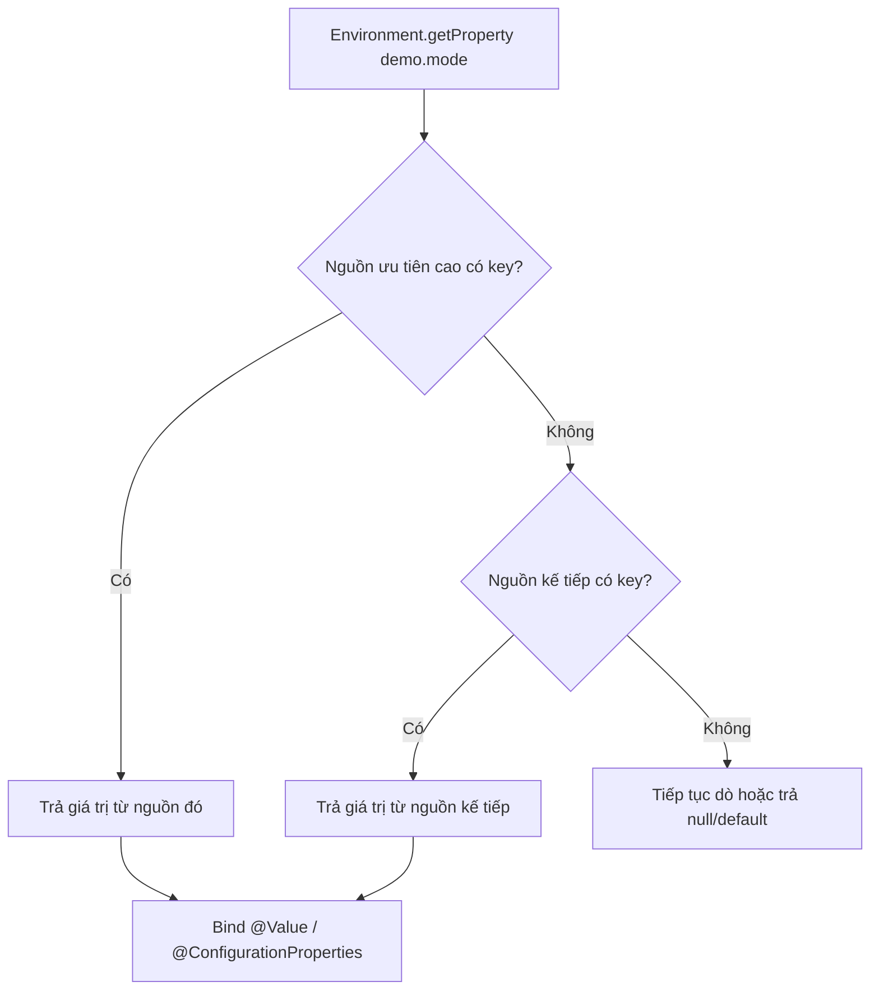
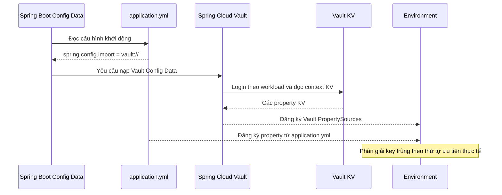
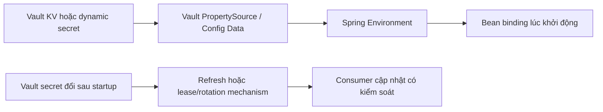

# Thứ tự ưu tiên giữa Vault và các nguồn cấu hình khác

## 1. Vì sao cùng một key lại có nhiều giá trị?

Trong **SPRING_VAULT**, một ứng dụng Java có thể lấy cấu hình từ `application.yml`, file cấu hình ngoài JAR, biến môi trường, tham số JVM, dòng lệnh và HashiCorp Vault. Ví dụ, `spring.datasource.username` được khai báo trong `application.yml` để chạy local, nhưng môi trường production lại nạp giá trị từ Vault. Nếu container đồng thời có biến môi trường `SPRING_DATASOURCE_USERNAME`, ứng dụng thực sự nhận giá trị nào?

Câu trả lời do **thứ tự ưu tiên của các `PropertySource` trong Spring `Environment`** quyết định, đồng thời còn phụ thuộc **cách đưa Vault vào Environment**: Spring Cloud Vault qua Config Data, cơ chế bootstrap cũ, `@VaultPropertySource` hoặc đăng ký bằng Java. Không có quy tắc bất biến rằng “dữ liệu Vault luôn thắng mọi nguồn khác”.

Sau bài này, bạn có thể:

- Giải thích cơ chế tra cứu key trùng nhau qua `Environment`, `PropertySource`, `@Value` và `@ConfigurationProperties`.
- Đọc đúng thứ tự nguồn cấu hình mặc định của Spring Boot và vị trí của Vault khi dùng `spring.config.import: vault://`.
- Xác định tác động của `application-{profile}.yml`, nhiều Config Data imports, các context Vault và `prefix`.
- So sánh Spring Cloud Vault với `VaultPropertySource` của Spring Vault core; phát hiện trường hợp cấu hình bị ghi đè ngoài ý muốn.
- Chẩn đoán an toàn, kiểm thử tích hợp và kiểm soát vòng đời secrets khi ứng dụng truy cập KV, database, Transit hoặc PKI.

> Ví dụ áp dụng cho Spring Boot có **Config Data API** (Boot 2.4+), Spring Cloud Vault tương thích và một KV secrets engine đã được cấu hình. Thứ tự có thể khác khi ứng dụng tự thay đổi `MutablePropertySources`, bật legacy bootstrap hoặc thêm thư viện cấu hình khác. Luôn kiểm tra phiên bản thực tế.

## 2. Quy tắc gốc: tra cứu `PropertySource` theo thứ tự

Spring `Environment` gom các nguồn cấu hình thành một danh sách có thứ tự. Khi cần `environment.getProperty("demo.mode")`, Spring tìm nguồn có chứa key tương ứng theo thứ tự ưu tiên và sử dụng **giá trị đầu tiên hợp lệ**. Với cùng một key, một nguồn ưu tiên cao sẽ che giá trị của nguồn thấp hơn; hai nguồn không trùng key vẫn cùng đóng góp cấu hình.



Giả sử một ứng dụng có:

| Nguồn | Key | Giá trị minh họa |
| --- | --- | --- |
| `application.yml` | `demo.mode` | `local` |
| Vault KV | `demo.mode` | `vault` |
| Biến môi trường | `DEMO_MODE` | `environment` |
| Tham số dòng lệnh | `--demo.mode=cli` | `cli` |

Trong cấu hình Spring Boot thông thường dùng **Vault Config Data import**, giá trị `demo.mode` cuối cùng là `cli`; bỏ tham số dòng lệnh thì thành `environment`; bỏ thêm biến môi trường thì thường là `vault`, nếu import Vault có ưu tiên hơn tài liệu `application.yml` khai báo nó. Cần xem vị trí và nguồn import để kết luận chính xác trường hợp cuối.

**Phân biệt ba khái niệm:** `PropertySource` quyết định **nguồn nào thắng**; `PropertyResolver` trả **giá trị theo key**; binder của `@ConfigurationProperties` quyết định **cách ánh xạ sang kiểu Java**. Nếu một giá trị tới từ Vault nhưng sai kiểu (ví dụ `server.port=abc`), kết quả có thể là lỗi binding; quy tắc ưu tiên không tự sửa kiểu dữ liệu.

## 3. Thứ tự ưu tiên mặc định của Spring Boot

Theo tài liệu Spring Boot, các nguồn ở bảng sau được xếp **từ ưu tiên cao xuống thấp** trong cấu hình phổ biến, khi không có can thiệp thủ công. Bảng tập trung vào các nguồn thường gặp; Spring Boot còn có JNDI, Servlet init parameters, devtools và các nguồn dành cho kiểm thử.

| Mức | Nguồn | Ví dụ | Điều cần nhớ |
| --- | --- | --- | --- |
| Cao nhất trong các nguồn liệt kê | Test overrides: `@TestPropertySource`, `@DynamicPropertySource`, `@SpringBootTest(properties=...)` | `demo.mode=test` | Dùng trong test, có thể che Vault và cấu hình production. |
| 1 | Tham số dòng lệnh | `--demo.mode=cli` | Thường ưu tiên hơn file và biến môi trường. Có thể tắt bằng `setAddCommandLineProperties(false)`. |
| 2 | `SPRING_APPLICATION_JSON` hoặc `spring.application.json` | JSON có key `demo.mode` | Được Spring Boot đưa thành PropertySource; cẩn trọng không đưa bí mật vào log. |
| 3 | Java system properties | `-Ddemo.mode=system` | Thông thường ưu tiên hơn biến môi trường hệ điều hành. |
| 4 | OS environment variables | `DEMO_MODE=environment` | Thường ưu tiên hơn Config Data, gồm giá trị lấy từ Vault qua Config Data. |
| 5 | **Config Data** | `application.yml`, `application-prod.yml`, `vault://`, `configtree:` | Thứ tự **bên trong** Config Data còn phụ thuộc import, profile và location. |
| 6 | `@PropertySource` trên cấu hình Spring | File `.properties` được annotation nạp | Thêm vào Environment khi context refresh, có thể quá muộn cho một số key bootstrap. |
| Thấp | `SpringApplication.setDefaultProperties(...)` | Giá trị mặc định chương trình | Dùng khi không có nguồn ưu tiên cao hơn. |

Các mức 1–6 chỉ dùng để **so sánh thứ tự trong bảng này**, không phải thứ tự số chính thức đầy đủ của Spring Boot. Đối với nhóm Config Data, thứ tự thường gặp của các file cấu hình (cùng cơ chế mặc định) từ thấp đến cao là: `application.yml` trong JAR, `application-{profile}.yml` trong JAR, `application.yml` ngoài JAR, rồi `application-{profile}.yml` ngoài JAR. **Khi có `spring.config.import`, phải tính cả vị trí tài liệu import**; không thể chỉ nhìn tên file để kết luận.

Spring Boot hỗ trợ *relaxed binding*: biến môi trường `DEMO_MODE` có thể tương ứng với property `demo.mode`. Với các key có dấu gạch ngang hoặc cấu trúc collection, nên dùng tên canonical kebab-case trong annotation và kiểm thử cách binder ánh xạ thực tế, thay vì đoán mọi phép biến đổi dấu gạch dưới.

## 4. Vault đi vào Config Data bằng `spring.config.import`

Spring Cloud Vault (3.0+ và các nhánh mới) hỗ trợ **Spring Boot Config Data API**. Trong `application.yml`:

```yaml
spring:
  application:
    name: payments-api
  config:
    import: "vault://"
  cloud:
    vault:
      uri: ${VAULT_ADDR}
      authentication: KUBERNETES

demo:
  mode: local
```

`vault://` yêu cầu Spring Cloud Vault nạp các context Vault được bật thành những `PropertySource`. Theo cấu hình KV mặc định được tài liệu Spring Cloud Vault mô tả, ứng dụng tên `payments-api` có thể đọc context theo tên ứng dụng và profile (chẳng hạn `secret/payments-api` và `secret/payments-api/prod`, tùy mount/context settings). Với KV v2, thư viện xử lý lớp `data` của HTTP API phù hợp; người dùng không cần tự viết URL HTTP `/v1/.../data/...` trong khai báo import.

Spring Boot quy định **tài liệu được import có thể ghi đè tài liệu đã khai báo import**. Nếu key `demo.mode` trong Vault được nạp bằng `vault://` và không có nguồn mạnh hơn, giá trị Vault sẽ che `demo.mode: local` trong tài liệu `application.yml` khai báo import.



**Tại sao `${VAULT_ADDR}` dùng được trong cấu hình?** Biến môi trường hoặc system property đã có sẵn ở giai đoạn nạp Config Data. Ngược lại, đừng cấu hình URI/credential đăng nhập Vault **chỉ** ở chính KV path mà Spring cần xác thực mới đọc được; điều đó tạo phụ thuộc bootstrap vòng tròn.

### 4.1. Thứ tự nhiều imports

Spring Boot cho phép:

```yaml
spring:
  config:
    import:
      - "vault://"
      - "optional:file:./overrides.properties"
```

Trong cùng danh sách import, **mục ở sau có ưu tiên cao hơn mục ở trước**. Do đó `overrides.properties` có thể ghi đè key cùng tên do `vault://` cung cấp. Nếu đổi thứ tự hai imports, thứ tự cạnh tranh cũng thay đổi. Việc đổi thứ tự dòng `demo.mode` và `spring.config.import` **bên trong cùng một tài liệu YAML** không làm thay đổi quy tắc này.

Nếu có nhiều context Vault, có thể khai báo **contextual locations** theo tài liệu Spring Cloud Vault, ví dụ:

```properties
spring.config.import=vault://my/path?prefix=shared.,vault://my/other/path?prefix=team.
```

Trong trường hợp trên, secret key tên `password` có thể xuất hiện ở `shared.password` và `team.password` thay vì cùng cạnh tranh cho `password`. `prefix` được nối **nguyên văn** vào tên property; cần thêm dấu `.` nếu muốn phân tách namespace. Việc đặt prefix và tên key rõ ràng thường đáng tin cậy hơn phụ thuộc vào thứ tự ghi đè tình cờ.

### 4.2. Profile ảnh hưởng thế nào?

Spring Boot xét `application-prod.yml` khi profile `prod` hoạt động. Với nhiều profile như `prod,region-a`, tài liệu của các profile đó có thể ghi đè nhau theo quy tắc **last wins trong location group**. Spring Cloud Vault cũng có thể nạp context Vault riêng theo profile. Vì thế giá trị cuối cùng của `payments.timeout` phụ thuộc đồng thời vào:

- Profile đang active và vị trí file (classpath hay ngoài JAR).
- `spring.config.import` được khai báo ở tài liệu chung hay tài liệu profile nào.
- Thứ tự các imports và cách nhóm các locations (`spring.config.location`, `spring.config.additional-location`).
- Các Vault context path thực sự được tải, thứ tự property sources của chúng và key trùng nhau.
- Biến môi trường, system properties, tham số dòng lệnh hoặc test overrides nằm **ngoài** nhóm Config Data.

Nếu muốn một context Vault riêng cho production, nên kiểm tra rõ khai báo import/profile trên phiên bản đang dùng và chạy test với `prod` active. Không kết luận chung rằng `application-prod.yml` **luôn** ghi đè Vault hay Vault **luôn** ghi đè `application-prod.yml` khi chưa xét vị trí import.

### 4.3. `optional:vault://` và lỗi khởi động

Với Spring Cloud Vault, có thể khai báo `optional:vault://` để mô tả location không bắt buộc trong những điều kiện được tài liệu hỗ trợ, ví dụ khi `spring.cloud.vault.enabled=false`. Tuy nhiên, `optional:` **không nên được dùng như cơ chế bỏ qua mọi lỗi auth, Vault 403, TLS hoặc kết nối**. Các key/context không tồn tại có cách xử lý riêng, có thể chịu `spring.cloud.vault.fail-fast` tùy phiên bản.

Nếu production bắt buộc cần `spring.datasource.password` từ Vault, ứng dụng phải fail rõ ràng hoặc giảm readiness khi không nạp được, thay vì âm thầm lấy mật khẩu mặc định nằm trong file và hoạt động với quyền sai.

## 5. Bốn tình huống đối chiếu giá trị cuối cùng

Giả sử `application.yml` khai báo `spring.config.import: vault://`, đồng thời có `demo.mode: local`. Vault chứa `demo.mode: vault`. Các giả định trong bảng: Spring Cloud Vault đã nạp context thành công, không có các nguồn cấu hình tùy biến khác và không dùng profile override riêng.

| Tình huống | Nguồn bổ sung | `Environment.getProperty("demo.mode")` | Tại sao? |
| --- | --- | --- | --- |
| A | Không có | `vault` | Import Vault ghi đè tài liệu `application.yml` khai báo nó. |
| B | `DEMO_MODE=environment` | `environment` | OS environment có ưu tiên cao hơn Config Data. |
| C | Thêm `-Ddemo.mode=system` khi đã có env ở B | `system` | Java system property ưu tiên hơn OS environment. |
| D | Thêm `--demo.mode=cli` vào C | `cli` | Command-line arguments thường đứng trên system/env properties. |

Nếu Vault **không có** key `demo.mode`, thì ở A giá trị local sẽ được dùng. Với cấu hình quan trọng về bảo mật, việc thiếu key Vault mà lấy fallback từ file có thể là sai mục đích thiết kế; cần validation hoặc bắt buộc property bằng `@ConfigurationProperties` và kiểm tra đặc thù ứng dụng.

Tình huống nhiều Vault context cũng có thể gây xung đột: `shared.password` và `team.password` dùng prefix rõ ràng sẽ dễ kiểm soát hơn hai context cùng xuất `password`. Nếu cần ưu tiên có chủ đích, hãy quản lý thứ tự `spring.config.import` và test kết quả tại startup thay vì dựa vào vị trí hiển thị của các secrets trong giao diện Vault.

## 6. Spring Vault core: đăng ký `VaultPropertySource` trực tiếp

Không phải dự án nào cũng dùng Spring Cloud Vault Config Data. **Spring Vault core** cung cấp `VaultPropertySource` và annotation `@VaultPropertySource`; các cách này đưa dữ liệu Vault vào `Environment` như một nguồn cấu hình.

Ví dụ đăng ký programmatic:

```java
import org.springframework.core.env.ConfigurableEnvironment;
import org.springframework.core.env.MutablePropertySources;
import org.springframework.vault.core.VaultOperations;
import org.springframework.vault.core.env.VaultPropertySource;

public final class VaultSourceOrder {

    // Gọi khi chuẩn bị Environment, sau khi đã cấu hình VaultOperations.
    public static void registerVaultSource(
            ConfigurableEnvironment environment, VaultOperations vault) {
        MutablePropertySources sources = environment.getPropertySources();
        sources.addFirst(new VaultPropertySource(vault, "secret/payments-api"));
    }
}
```

Ở đây `addFirst(...)` đặt `VaultPropertySource` ở vị trí **ưu tiên cao nhất tại thời điểm thêm**; các nguồn khác được thêm sau đó có thể thay đổi thứ tự thực. Nếu thay bằng `addLast(...)`, Vault đứng thấp nhất trong danh sách hiện có. `addBefore(name, source)` hoặc `addAfter(name, source)` cho phép xác định vị trí tương đối.

Đoạn trên chỉ minh họa **quy tắc chèn PropertySource**, không phải cấu hình bean production; ứng dụng thực cần `VaultOperations` thật và khởi tạo ở đúng giai đoạn. Quan trọng: với `@VaultPropertySource` trên class `@Configuration`, thứ tự đăng ký có thể khó dự đoán khi component scan nhiều cấu hình. Tài liệu Spring Vault khuyến nghị dùng `MutablePropertySources` trực tiếp khi **thứ tự override là yêu cầu quan trọng**.

```java
import org.springframework.context.annotation.Configuration;
import org.springframework.vault.annotation.VaultPropertySource;

@Configuration
@VaultPropertySource("secret/payments-api")
class PaymentsSecretConfig {
    // Spring đưa dữ liệu từ Vault path vào Environment.
}
```

Khả năng `@VaultPropertySource` hỗ trợ lease renewal/rotation, profile và các option khác phụ thuộc Spring Vault version và annotation configuration. **Đừng trộn lẫn mặc định** thứ tự `@VaultPropertySource` với thứ tự `vault://` của Spring Cloud Vault: chúng có cơ chế khởi tạo và đăng ký khác nhau. Nếu ứng dụng bật cả hai, cùng một context có thể được nạp nhiều lần, gây xung đột và khó giải thích kết quả.

## 7. Sự khác nhau giữa Config Data và legacy bootstrap

Trước Spring Cloud Vault 3.0, các dự án thường dùng **bootstrap context** để đưa Vault vào Environment sớm. Các bản mới ưu tiên **Config Data API**. Có thể bật bootstrap trở lại qua `spring.cloud.bootstrap.enabled=true` hoặc starter bootstrap khi có lý do tương thích, nhưng nguồn cấu hình được thêm ở giai đoạn khác và có quy tắc override cần xem riêng theo Spring Cloud version.

| Cách tích hợp | Điểm được cấu hình | Cách nhận định thứ tự |
| --- | --- | --- |
| Spring Cloud Vault **Config Data** | `spring.config.import: vault://` | Xét vị trí import trong Config Data, profile, thứ tự imports và các nguồn Boot ưu tiên cao. |
| Legacy **bootstrap context** | `bootstrap.yml` / bootstrap properties và remote property sources | Phân tích cơ chế bootstrap/remote override của phiên bản đang chạy; không áp quy tắc import mới một cách máy móc. |
| Spring Vault **`@VaultPropertySource`** | Annotation trên class `@Configuration` | Thứ tự annotation/context registration có thể không xác định rõ; kiểm tra thực tế. |
| Spring Vault **`MutablePropertySources.addFirst/addLast`** | Java configuration | Thứ tự được lập trình viên chỉ định tại thời điểm đăng ký. |
| `VaultTemplate.read(...)` trực tiếp | Service hoặc component lấy secret khi cần | Không tự bổ sung property vào Environment; **không tham gia thứ tự override** trừ khi code chủ động đăng ký. |

Với dự án mới, ưu tiên **một cơ chế tích hợp cấu hình nhất quán** và test rằng tất cả nguồn Vault thực sự được nạp. Nếu có chuyển đổi từ bootstrap sang Config Data, cần so sánh giá trị cuối cùng của từng key quan trọng trước/sau migration, nhất là `spring.datasource.*`, chứng chỉ/khóa và tính năng cấu hình theo profile.

## 8. Quan sát chính xác nguồn đang cung cấp một key

Trong môi trường test, có thể dùng `ConfigurableEnvironment` để xác định **tên nguồn thắng**, mà không in giá trị bí mật:

```java
import org.springframework.core.env.ConfigurableEnvironment;
import org.springframework.core.env.PropertySource;

public final class PropertyOriginInspector {

    public static String firstSourceFor(
            ConfigurableEnvironment env, String propertyName) {
        for (PropertySource<?> source : env.getPropertySources()) {
            if (source.containsProperty(propertyName)) {
                return source.getName();
            }
        }
        return "<not-found>";
    }
}
```

Gọi `firstSourceFor(env, "demo.mode")` sau khi application context đã nạp xong để xem nguồn nào xuất hiện trước. **Không trả nguyên danh sách nguồn hoặc key nhạy cảm ra API công khai**; một số tên `PropertySource` có thể chứa Vault path, profile hoặc thông tin cấu trúc nội bộ. Với key dùng relaxed binding (`DEMO_MODE`), kiểm tra thêm kết quả binder, vì tra cứu trực tiếp `containsProperty("demo.mode")` và binding có thể không hiển thị cùng chi tiết chuyển đổi tên.

Nếu dùng Spring Boot Actuator, `/actuator/env` có thể cung cấp thông tin nguồn và origin, nhưng phải giới hạn quyền truy cập và bảo vệ cách hiển thị giá trị; không bật hiển thị raw secrets để debug production. Khi xác minh, so sánh **tên property source, property origin, profile đang active, thứ tự import và nguồn external overrides**, thay vì log toàn bộ `Environment` hoặc mật khẩu.

### Quy trình chẩn đoán khi Vault không thắng

1. **Xác nhận key thực:** `spring.datasource.password` hay `spring.datasource.hikari.password` có cùng ý nghĩa với thành phần đang bind không? Tên sai khiến Vault có dữ liệu nhưng không được dùng.
2. **Kiểm tra Vault đã nạp chưa:** dependency Spring Cloud Vault, `spring.config.import`, auth method, Vault URI, TLS và role/policy có phù hợp không?
3. **Kiểm tra context:** application name, profile, mount, `kv.backend`, context path và `prefix` có khớp secret đã ghi trong Vault không?
4. **Kiểm tra thứ tự:** env/system/CLI/test override, nhiều imports, file profile, Config Data location, `@VaultPropertySource` hoặc code `addFirst/addLast`.
5. **Kiểm tra binding và consumer:** `@ConfigurationProperties` có bind đúng type không? Bean tạo ở lúc nào? Có code nào cố tình cache giá trị trước khi Vault source được thêm không?
6. **Xác minh bằng test có kiểm soát** và giảm bớt trùng key hoặc chọn namespace rõ ràng. Tránh giải quyết bằng cách in toàn bộ secrets ra log.

## 9. Cấu hình nào nên để ở Vault, cấu hình nào ở nguồn khác?

Ưu tiên là cơ chế kỹ thuật; **quyền sở hữu cấu hình** mới giúp tránh lỗi vận hành. Một chiến lược phổ biến:

| Nhóm dữ liệu | Nguồn khuyến nghị | Lý do |
| --- | --- | --- |
| URI Vault, auth mount, thông tin nhận diện workload | Environment/orchestrator hoặc file bootstrap được quản trị | Phải có trước khi có thể đăng nhập và đọc Vault. |
| Password/token kết nối dịch vụ, API key | Vault hoặc cơ chế cấp bí mật chuyên dụng | Phân quyền theo workload, audit, rotation, không commit trong repository. |
| Feature flag, timeout, tên dịch vụ | File Config Data hoặc config service có chủ sở hữu rõ | Dễ review, không nhất thiết là bí mật. |
| Profile `dev`, `staging`, `prod` | Cấu hình triển khai/CI/CD | Chọn bối cảnh nạp Vault và file; không để môi trường tự đoán. |
| Dynamic database credentials có lease | Spring Vault lease management và consumer callback | Cần lifecycle; không đủ khi chỉ bind password một lần lúc startup. |

Không thể bảo mật password bằng cách “đặt trong Vault” nếu cùng key bị một environment variable hoặc CLI argument khác ghi đè. Ngược lại, việc cho phép override trong test/local có thể là chủ ý. Vì vậy nên xác định rõ key nào có quyền override, triển khai cấu hình cấp quyền tối thiểu và viết kiểm thử assertion cho các key quan trọng.

## 10. Đừng nhầm ưu tiên cấu hình với vòng đời secret

`spring.config.import: vault://` thường giải quyết việc **nạp cấu hình khi ứng dụng khởi động**. Nó không bảo đảm mọi bean được bind bằng `@Value` hoặc `@ConfigurationProperties` sẽ nhận giá trị mới tức thì khi secret KV được cập nhật, token được renew hoặc một database lease hết hạn.



- **KV secrets:** Có thể cập nhật version tại Vault; ứng dụng cần cơ chế refresh/đọc lại được hỗ trợ. Cấu hình đã bind vào singleton không tự biến đổi chỉ vì Vault có version mới.
- **Vault client token:** `SessionManager` hoặc reactive session manager xử lý renew/re-login. Đó là vòng đời **token**, không quyết định thứ tự `PropertySource`.
- **Dynamic secrets:** Lease có `lease_id`, `lease_duration`, `renewable` và có thể tới max TTL. Sử dụng `SecretLeaseContainer`/`ManagedSecret` và callback để cập nhật datasource/pool khi cần. `@Value("${spring.datasource.password}")` không tự xoay vòng pool kết nối.
- **Transit encryption/PKI:** Các API tạo ciphertext/chứng chỉ; dữ liệu trả về và vòng đời khóa/chứng chỉ có logic riêng, không thể suy ra từ precedence của một property string.

Nếu một bean không thay đổi sau rotation dù Environment có giá trị mới, cần kiểm tra **điểm bind/khởi tạo và cơ chế refresh**; không vội kết luận nguồn Vault bị ưu tiên thấp hơn. Ngược lại, nếu Environment ngay từ đầu nhận sai giá trị, hãy xử lý precedence trước khi thêm cơ chế refresh.

## 11. Kiểm thử tích hợp: xác minh thứ tự và phân quyền

Nên có Vault test độc lập (KV v2, auth role/policy giới hạn) và chạy ứng dụng với profile thực tế. Đối với từng scenario, xác nhận cả **giá trị cuối cùng** lẫn **nguồn đã thắng** bằng một key kiểm thử không nhạy cảm, ví dụ `demo.mode`. Với password thật, chỉ xác nhận thông qua kết nối được cấp quyền và log trạng thái đã lọc.

| Kịch bản | Chuẩn bị | Kết quả cần xác nhận |
| --- | --- | --- |
| Import Vault mặc định | `application.yml` có `demo.mode=local`, Vault có `demo.mode=vault`. | Giá trị là `vault` nếu import ghi đè tài liệu khai báo. |
| Environment override | Thêm `DEMO_MODE=environment`. | Giá trị là `environment`. |
| JVM override | Thêm `-Ddemo.mode=system` bên cạnh environment. | Giá trị là `system`. |
| CLI override | Thêm `--demo.mode=cli`. | Giá trị là `cli`. |
| Hai imports | Một import Vault và một import file có cùng key, đổi thứ tự. | Import đứng sau thắng theo thứ tự Config Data. |
| Profile | Chạy `dev` và `prod`, có context Vault/file dành riêng. | Kết quả khớp profile và vị trí import được định nghĩa. |
| Prefix Vault | Hai context đều có key `password`, mỗi context thêm prefix khác. | Nhận `shared.password` và `team.password`, không che nhau. |
| Custom PropertySource | Đăng ký `VaultPropertySource` bằng `addFirst` hoặc `addLast`. | Giá trị phản ánh vị trí chèn theo thứ tự thực tế của Environment. |
| Vault lỗi auth/TLS | Cho sai role hoặc Vault unavailable trong test. | App báo lỗi rõ theo fail policy, không âm thầm dùng credential mặc định không an toàn. |
| Rotation sau startup | Đổi KV hoặc dynamic database secret. | Kiểm tra refresh/consumer và datasource mới; phân biệt với lần bind ban đầu. |

Ví dụ test đơn giản kiểm tra giá trị cuối cùng trong một test Spring Boot có cấu hình Vault thử nghiệm:

```java
import static org.assertj.core.api.Assertions.assertThat;

import org.junit.jupiter.api.Test;
import org.springframework.beans.factory.annotation.Autowired;
import org.springframework.boot.test.context.SpringBootTest;
import org.springframework.core.env.Environment;

@SpringBootTest(properties = "demo.mode=test-override")
class PropertyPrecedenceTest {

    @Autowired Environment environment;

    @Test
    void testPropertyOverridesConfigData() {
        assertThat(environment.getProperty("demo.mode"))
            .isEqualTo("test-override");
    }
}
```

Test này chứng minh **test property có thể che nguồn Config Data**, không tự kiểm chứng Vault đã nạp đúng. Test có Vault thật cần chạy một trường hợp **không có test override** và kiểm tra tên `PropertySource`/origin tương ứng; không đánh đồng hai dạng test.

### Bài tập tự kiểm tra

**Tình huống:** `application.yml` khai báo `spring.config.import: vault://` và `demo.mode=local`; Vault có `demo.mode=vault`. Khi triển khai, container đặt `DEMO_MODE=staging`, còn command line truyền `--demo.mode=debug`.

1. Giá trị hiệu lực là gì? **`debug`**, do command-line property có ưu tiên cao hơn environment và Vault Config Data trong cấu hình Boot thông thường.
2. Bỏ command line thì sao? **`staging`**, vì biến môi trường vẫn che nguồn Config Data.
3. Bỏ cả hai thì sao? **`vault`**, với giả định import Vault thành công và ghi đè tài liệu `application.yml` khai báo import.
4. Đổi thứ tự dòng `demo.mode` với dòng `spring.config.import` trong cùng `application.yml` có tác dụng không? **Không.** Thứ tự import của các location và document mới là yếu tố cần xét.
5. Nếu `VaultTemplate` đọc được `secret/payments-api` nhưng `@Value` vẫn nhận `local`? Kiểm tra **Vault PropertySource có được đăng ký vào Environment không**, key/prefix, phương thức import, profile, thứ tự nguồn và thời điểm bean được bind. Việc `VaultTemplate` đọc secret thành công không tự tạo config property.

## 12. Nguyên tắc triển khai và nguồn tham khảo

- **Không giả định Vault luôn có ưu tiên cao nhất.** Với Config Data, OS env/system properties/CLI thường có thể ghi đè Vault; với API đăng ký thủ công, vị trí `PropertySource` do code quyết định.
- **Quản lý rõ imports, contexts và profiles.** Nếu có key trùng nhau, xác định chính sách override và dùng prefix để giảm xung đột.
- **Tách bootstrap credential khỏi secret của ứng dụng.** Ứng dụng phải xác thực được với Vault trước khi nạp những giá trị được lưu trong Vault.
- **Giám sát an toàn.** Chẩn đoán bằng tên nguồn, origin và key không nhạy cảm; không xuất token/password ra log hoặc actuator công khai.
- **Kiểm thử precedence và rotation riêng.** Nguồn thắng ở startup chưa nói lên khả năng refresh hoặc thay đổi connection pool khi lease hết hạn.

Tài liệu chính thức có ích để kiểm tra đúng phiên bản:

- [Spring Boot — Externalized Configuration](https://docs.spring.io/spring-boot/reference/features/external-config.html): thứ tự `PropertySource`, Config Data imports, profile, file ngoài JAR và biến môi trường.
- [Spring Cloud Vault — ConfigData API](https://docs.spring.io/spring-cloud-vault/docs/current/reference/html/config-data.html): `vault://`, contextual imports, prefix và optional locations.
- [Spring Vault — Property Sources](https://docs.spring.io/spring-vault/reference/vault/propertysource.html): `VaultPropertySource`, `@VaultPropertySource`, `MutablePropertySources` và lưu ý thứ tự đăng ký.
- [Spring Vault — Credentials Rotation](https://docs.spring.io/spring-vault/reference/vault/credential-rotation.html): phần vòng đời của dynamic secrets và cập nhật consumers.

Trong **SPRING_VAULT**, phương pháp đáng tin cậy là xác định **key cần lấy → nguồn nào được nạp → nguồn nào có ưu tiên cao nhất → giá trị được bind vào Java khi nào → dữ liệu có cần refresh/rotation không**. Cách kiểm tra này giúp tránh ghi đè bí mật ngoài ý muốn và giữ cấu hình workload, ACL, token/lease, KV, Transit và PKI đúng với thiết kế vận hành.
