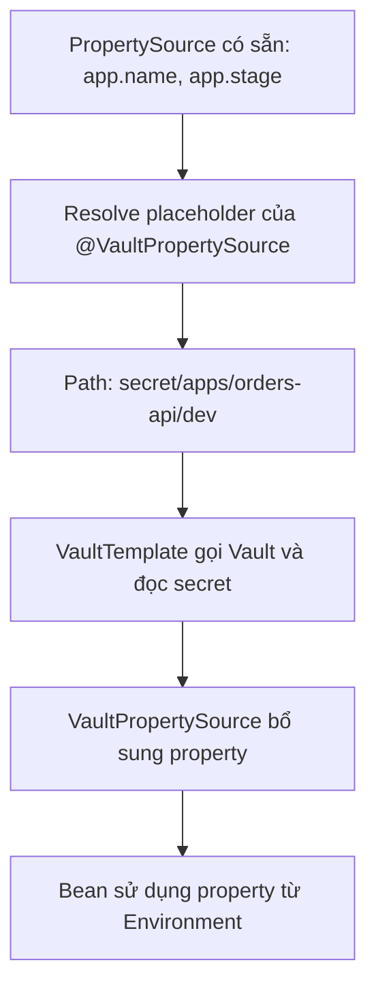
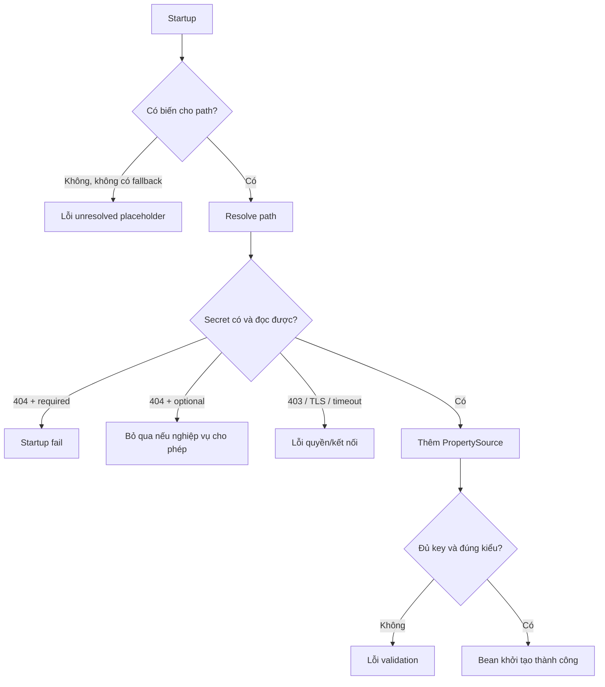

# Placeholder trong đường dẫn và yêu cầu dữ liệu có sẵn

## 1. Bối cảnh và mục tiêu

Trong module **SPRING_VAULT**, ứng dụng Java sử dụng Spring Vault và `VaultTemplate` để truy cập HashiCorp Vault theo danh tính workload và chính sách phân quyền. Ngoài đọc KV secrets trực tiếp, ứng dụng có thể đưa dữ liệu Vault vào **Spring Environment** làm nguồn cấu hình cho các bean. Một cách tích hợp là `@VaultPropertySource`.

Ví dụ ứng dụng `orders-api` sử dụng các secret theo môi trường:

| Môi trường | Đường dẫn logic trong Vault |
| --- | --- |
| Phát triển | `secret/apps/orders-api/dev` |
| Staging | `secret/apps/orders-api/staging` |
| Production | `secret/apps/orders-api/prod` |

Để không lặp lại cấu hình, Spring Vault hỗ trợ **placeholder** như `${app.name}` hoặc `${app.stage:dev}` ngay trong đường dẫn `@VaultPropertySource`. Hai yêu cầu quan trọng là:

1. Thuộc tính dùng để **xây đường dẫn** phải có trong `Environment` **trước thời điểm annotation được xử lý**.
2. **Secret tại path đã giải quyết phải có dữ liệu** nếu nghiệp vụ yêu cầu bắt buộc; các key bên trong cũng cần được xác minh riêng.

Giải quyết placeholder thành công **không có nghĩa** Vault đã lưu secret tại đường dẫn đó, và việc tìm thấy secret **không đảm bảo** mọi key mà ứng dụng cần đã tồn tại.

Sau bài học thuộc chương **Nguồn cấu hình**, bạn có thể phân biệt placeholder của đường dẫn với placeholder giá trị; cấu hình `ignoreSecretNotFound`; chuẩn bị KV v2, Vault policy; kiểm tra bắt buộc từng field; xử lý lỗi 404, 403, vòng lặp bootstrap và phân biệt với Spring Cloud Vault ConfigData.

> Các ví dụ chỉ dùng Vault dev và dữ liệu giả. Không đưa Vault token, mật khẩu, private key hoặc nội dung secret nhạy cảm vào log, response HTTP hoặc repository.

## 2. Quan hệ giữa `Environment` và `VaultPropertySource`

Spring `Environment` chứa các `PropertySource` theo thứ tự ưu tiên, ví dụ system properties, environment variables, file cấu hình và PropertySource được thư viện đăng ký. Spring Vault có thể đọc secret thông qua `VaultTemplate` rồi hiển thị các key/value của nó như một `VaultPropertySource`.



Chu trình khởi động phụ thuộc **thứ tự**:

- Trước tiên phải biết `app.name` và `app.stage` để **xác định nơi đọc**.
- Sau đó `VaultPropertySource` mới tải `feature.enabled`, `api.base-url` hoặc các cấu hình khác từ Vault.
- Cuối cùng bean mới có thể nhận `orders.feature.enabled` hoặc `orders.api.base-url`.

Vì vậy, không thể chỉ đặt `app.stage=prod` **trong chính secret `secret/apps/orders-api/prod`** rồi dựa vào secret này để giải quyết placeholder chọn path. Đó là vòng phụ thuộc: muốn đọc secret phải biết stage, nhưng stage lại cần đọc secret mới biết.

### Ba loại biểu thức dễ nhầm

| Vị trí | Ví dụ | Ý nghĩa |
| --- | --- | --- |
| Trong annotation | `secret/apps/${app.name}/${app.stage}` | Chọn nguồn cần đọc trước khi nạp Vault |
| Key trong Environment | `orders.feature.enabled` | Tên cấu hình do Vault đã cung cấp |
| Trong `@Value` | `@Value("${orders.feature.enabled:false}")` | Lấy property cho bean, có thể có fallback |

Hai loại placeholder đều dùng cú pháp Spring `${...}` nhưng hoạt động ở **hai thời điểm khác nhau**.

## 3. Cú pháp placeholder và fallback

Annotation cần import từ `org.springframework.vault.annotation.VaultPropertySource`. Ví dụ:

```java
import org.springframework.context.annotation.Configuration;
import org.springframework.vault.annotation.VaultPropertySource;

@Configuration
@VaultPropertySource(
    value = "secret/apps/${app.name}/${app.stage:dev}",
    propertyNamePrefix = "orders.",
    ignoreSecretNotFound = false
)
public class OrdersVaultSourceConfiguration {
}
```

Khi `app.name=orders-api` và `app.stage=staging`, path thực tế là `secret/apps/orders-api/staging`. Khi `app.name=orders-api` nhưng thiếu `app.stage`, fallback làm path trở thành `secret/apps/orders-api/dev`.

| Thành phần | Vai trò |
| --- | --- |
| `secret` | Mount KV secrets engine |
| `apps` | Phần path cố định |
| `${app.name}` | Placeholder không có default, bắt buộc phải resolve |
| `${app.stage:dev}` | Placeholder có giá trị mặc định `dev` |
| `propertyNamePrefix="orders."` | Thêm tiền tố cho tên property đọc từ Vault |
| `ignoreSecretNotFound=false` | Báo lỗi khi secret path bắt buộc không tồn tại |

Nếu `app.name` chưa có ở bất kỳ PropertySource nào đã đăng ký và không có fallback, Spring Vault sẽ ném **`IllegalArgumentException`** trong giai đoạn giải quyết placeholder. Đây là lỗi khác với HTTP 404 vì path Vault không tồn tại.

Fallback `:dev` chỉ tạo **giá trị path**; nó không tạo secret trong Vault, không ghi key, không cấp quyền đọc và không bảo đảm môi trường mặc định là đúng. Với production, nên yêu cầu `app.stage` được khai báo rõ để tránh âm thầm sử dụng cấu hình môi trường khác.

## 4. Điều kiện đầu tiên: biến chọn path phải có trước

Tài liệu Spring Vault quy định placeholder trong `@VaultPropertySource` được resolve từ **các PropertySource đã được đăng ký trước** vào Spring `Environment`.

Ví dụ cấu hình Spring Boot:

```yaml
# application.yml chỉ chứa giá trị không nhạy cảm để chọn path.
app:
  name: orders-api
  stage: dev
```

Hoặc cung cấp qua JVM system properties:

```bash
java -Dapp.name=orders-api -Dapp.stage=staging -jar orders-api.jar
```

Trong Spring thuần, bạn cũng có thể thêm một `MapPropertySource` vào `ConfigurableEnvironment` **trước khi `ApplicationContext.refresh()`**. Không đợi một bean `@PostConstruct` gán `app.stage`: ở thời điểm này annotation có thể đã được xử lý.

Mô hình lỗi:

```text
T0 Spring bắt đầu xử lý @Configuration.
T1 @VaultPropertySource cần app.name để tạo path.
T2 app.name chưa có trong Environment.
T3 Không có default -> IllegalArgumentException.
T4 Context không khởi động hoàn chỉnh; chưa cần gửi request đọc Vault.
```

Tại giai đoạn bootstrap, nguồn đặt biến thường là deployment config, environment hay system property đã được kiểm soát. **Không lấy path segment trực tiếp từ header, query parameter hoặc tenant do client tự cung cấp** rồi ghép với root mount, vì ứng dụng có thể bị dẫn đến secret ngoài phạm vi. Nếu bắt buộc dùng segment động, áp dụng allowlist, chuẩn hóa path và hạn chế Vault ACL theo danh tính workload.

Khi có nhiều `@Configuration` được component-scan và nhiều nguồn được đăng ký qua annotation, thứ tự khó dự đoán chính xác; khi precedence quan trọng, hãy dùng API programmatic để xác định thứ tự hoặc nạp giá trị chọn path từ nguồn bootstrap chắc chắn.

## 5. Điều kiện thứ hai: Vault phải có secret tại path tương ứng

Khi placeholder đã được resolve, `VaultPropertySource` đọc dữ liệu từ Vault; nó **không tự provision secret**. Với `app.name=orders-api` và `app.stage=dev`, cần có key tại mount `secret`, path `apps/orders-api/dev`.

### 5.1. Chuẩn bị KV v2 trong Vault dev

```bash
# Chỉ chạy nếu mount secret/ chưa tồn tại.
vault secrets enable -path=secret -version=2 kv

# Giá trị giả, không dùng credential sản xuất.
vault kv put -mount=secret apps/orders-api/dev \
  feature.enabled=true \
  api.base-url=https://api.dev.example.invalid \
  request.timeout-ms=1500

# Xác minh data trước khi chạy ứng dụng.
vault kv get -mount=secret apps/orders-api/dev
```

Không enable lại mount đã tồn tại. Nếu mount đã có, kiểm tra loại và KV version trước khi sử dụng.

Với KV v2, HTTP API thực tế để đọc là `GET /v1/secret/data/apps/orders-api/dev`, nhưng annotation dùng **logical path** `secret/apps/orders-api/dev`, không chèn `data/`. Spring Vault nhận diện backend và xử lý phần API theo version tương ứng.

### 5.2. Policy tối thiểu

```hcl
path "secret/data/apps/orders-api/dev" {
  capabilities = ["read"]
}
```

Workload cần Vault token từ Kubernetes/JWT, AppRole hoặc phương thức auth thích hợp với policy cho phép đọc đúng endpoint. Secret có tồn tại nhưng token thiếu quyền vẫn nhận HTTP 403. Tài liệu Spring Vault còn lưu ý có thể cần truy cập endpoint phát hiện mount `sys/internal/ui/mounts/...` tùy cách Vault kiểm tra mount/path; hãy xem audit và cấu hình thực tế nếu bị từ chối.

### 5.3. Path có data chưa đủ đảm bảo field bắt buộc

Giả sử Vault chứa:

```json
{
  "feature.enabled": "true",
  "request.timeout-ms": "1500"
}
```

Secret **tồn tại**, nhưng thiếu key `api.base-url`. Nếu code cần `orders.api.base-url`, phải kiểm tra riêng:

```java
String url = environment.getRequiredProperty("orders.api.base-url");
```

Nếu key không có ở bất kỳ PropertySource nào, `getRequiredProperty` ném `IllegalStateException`. Nếu một nguồn cấu hình khác cũng định nghĩa key, giá trị có thể được lấy từ nguồn đó; muốn khẳng định nguồn gốc Vault, cần kiểm tra provenance/precedence riêng.

## 6. `ignoreSecretNotFound` và ba mức kiểm tra

Theo Spring Vault Javadoc, thuộc tính annotation có mặc định:

```java
boolean ignoreSecretNotFound() default true;
```

Mặc định `true` phù hợp cho secret **tùy chọn**. Với secret bắt buộc, đặt `ignoreSecretNotFound=false`.

| Tình huống | Khi `true` | Khi `false` |
| --- | --- | --- |
| Secret tồn tại và đọc được | Nạp property | Nạp property |
| Secret path trả 404 | Có thể bỏ qua path không có | Báo lỗi đọc nguồn bắt buộc |
| Placeholder không resolve | Lỗi `IllegalArgumentException` | Vẫn lỗi `IllegalArgumentException` |
| Path tồn tại nhưng thiếu field | Không kiểm tra field | Vẫn không kiểm tra field |
| Vault trả 403 | Không phải lỗi “not found” | Không phải lỗi “not found” |
| Lỗi TLS/timeout | Không phải lỗi 404 tùy chọn | Không phải lỗi 404 tùy chọn |

Ba lớp kiểm tra là:

1. **Required placeholder:** path selector phải có trước khi resolve.
2. **Required secret path:** secret phải tồn tại khi cấu hình bắt buộc, sử dụng `ignoreSecretNotFound=false`.
3. **Required field:** từng key phải có giá trị đúng kiểu và ngữ nghĩa; dùng `getRequiredProperty`, cấu hình binding và validation.

Không coi `ignoreSecretNotFound=true` là “bỏ qua mọi lỗi Vault”. Nó không giải quyết sai policy hoặc sự cố TLS/mạng.

## 7. Java: đọc và kiểm tra các property từ Vault

Giả sử application đã có bean `VaultTemplate`/`VaultOperations` và xác thực Vault phù hợp. Annotation có thể được khai báo cùng lớp `@Configuration`:

```java
package example.orders.config;

import org.springframework.context.annotation.Configuration;
import org.springframework.vault.annotation.VaultPropertySource;

@Configuration
@VaultPropertySource(
    value = "secret/apps/${app.name}/${app.stage}",
    propertyNamePrefix = "orders.",
    ignoreSecretNotFound = false
)
public class OrdersVaultSourceConfig {
}
```

Tại path đã resolve, Vault KV v2 chứa các key:

```json
{
  "feature.enabled": "true",
  "api.base-url": "https://api.dev.example.invalid",
  "request.timeout-ms": "1500"
}
```

Sau khi thêm prefix `orders.`, các tên property ứng dụng cần đọc là:

| Key trong Vault | Key trong `Environment` |
| --- | --- |
| `feature.enabled` | `orders.feature.enabled` |
| `api.base-url` | `orders.api.base-url` |
| `request.timeout-ms` | `orders.request.timeout-ms` |

Dấu chấm cuối của prefix là một phần chuỗi truyền vào; nếu dùng `propertyNamePrefix="orders"` thì không nên mặc định giả định thư viện tự thêm dấu chấm.

### 7.1. Tạo bean với validation rõ ràng

```java
package example.orders.config;

import java.net.URI;
import java.time.Duration;

import org.springframework.context.annotation.Bean;
import org.springframework.context.annotation.Configuration;
import org.springframework.core.env.Environment;

record OrdersRemoteSettings(
        boolean enabled,
        URI apiBaseUrl,
        Duration timeout
) {}

@Configuration
class OrdersRemoteSettingsConfig {

    @Bean
    OrdersRemoteSettings ordersRemoteSettings(Environment env) {
        String rawEnabled = env.getRequiredProperty(
                "orders.feature.enabled");
        String rawUrl = env.getRequiredProperty(
                "orders.api.base-url");
        String rawTimeout = env.getRequiredProperty(
                "orders.request.timeout-ms");

        if (!rawEnabled.equalsIgnoreCase("true")
                && !rawEnabled.equalsIgnoreCase("false")) {
            throw new IllegalArgumentException(
                    "Invalid feature.enabled value");
        }

        URI uri = URI.create(rawUrl);
        if (!"https".equalsIgnoreCase(uri.getScheme())) {
            throw new IllegalArgumentException(
                    "API base URL must be HTTPS");
        }

        long timeoutMillis = Long.parseLong(rawTimeout);
        if (timeoutMillis <= 0 || timeoutMillis > 30000) {
            throw new IllegalArgumentException(
                    "Invalid request timeout");
        }

        return new OrdersRemoteSettings(
                Boolean.parseBoolean(rawEnabled),
                uri,
                Duration.ofMillis(timeoutMillis));
    }
}
```

Ví dụ cố ý **không tạo fallback** cho ba field bắt buộc. Với dữ liệu bị thiếu, `getRequiredProperty` báo lỗi rõ; với dữ liệu sai kiểu, validation tiếp tục từ chối cấu hình. Nếu dùng `@Value("${orders.feature.enabled:false}")` thay thế, fallback `false` có thể làm mất dấu hiệu một giá trị lẽ ra bắt buộc phải nằm trong Vault.

Một lưu ý về nguồn dữ liệu: `getRequiredProperty` tìm trong **toàn bộ Environment**, vì vậy nếu `application.yml` hay nguồn khác chứa cùng key thì vẫn có thể trả giá trị. Khi chính sách yêu cầu chứng minh key đến từ Vault, bạn cần kiểm tra PropertySource cụ thể, tên nguồn hoặc quy tắc precedence; chỉ gọi `getRequiredProperty` chưa đủ xác minh provenance.

Đối với secret nhạy cảm như database password, không in toàn bộ record, object, map, exception hoặc `Environment` ra log/HTTP. Cấu hình đúng path không thay thế quy tắc bảo vệ dữ liệu.

## 8. Độ ưu tiên khi nhiều nguồn cấu hình cùng chứa một key

Spring `MutablePropertySources` cho phép điều khiển vị trí PropertySource. Theo tài liệu Spring Vault, API programmatic phù hợp khi nhiều `@Configuration` được component-scan, thứ tự annotation khó dự đoán hoặc muốn chắc chắn nguồn nào thắng.

```java
import org.springframework.core.env.ConfigurableEnvironment;
import org.springframework.vault.core.VaultOperations;
import org.springframework.vault.core.env.VaultPropertySource;

public final class VaultSourceRegistrar {

    private VaultSourceRegistrar() {}

    public static void register(
            ConfigurableEnvironment env,
            VaultOperations operations) {

        String appName = env.getRequiredProperty("app.name");
        String stage = env.getRequiredProperty("app.stage");

        if (!appName.matches("[a-z0-9][a-z0-9-]{1,40}")
                || !stage.matches("dev|staging|prod")) {
            throw new IllegalArgumentException(
                    "Invalid Vault path segments");
        }

        String path = "secret/apps/" + appName + "/" + stage;
        VaultPropertySource source =
                new VaultPropertySource(operations, path);

        env.getPropertySources().addFirst(source);
    }
}
```

Đây là **một helper**, chưa phải ứng dụng Spring Boot hoàn chỉnh. Cần gọi nó tại điểm bootstrap có `VaultOperations` hợp lệ và **trước khi những bean tiêu thụ property được tạo**. Không chờ đến `@PostConstruct` rồi cho rằng các bean đã được bind tự động cập nhật.

`VaultPropertySource` tải dữ liệu tại lúc khởi tạo theo Javadoc. Constructor trong ví dụ không biểu diễn yêu cầu “secret bắt buộc”; khi muốn policy required, hãy dùng overload có tham số `ignoreSecretNotFound` phù hợp với phiên bản thư viện hoặc kiểm tra dữ liệu bằng quy trình có chủ đích.

| Tình huống | Kết quả có thể xảy ra |
| --- | --- |
| `application.yml` định nghĩa `orders.feature.enabled=false`, Vault định nghĩa `true` | Kết quả phụ thuộc độ ưu tiên các nguồn |
| `addFirst(vaultSource)` | Vault source được tìm trước các source hiện tại |
| `addLast(vaultSource)` | Source đã tồn tại có thể che giá trị Vault |
| Nhiều annotation/component-scan | Thứ tự có thể khó đánh giá; cần kiểm tra `Environment` thực tế |

Nếu dữ liệu Vault phải là chuẩn duy nhất cho cấu hình quan trọng, cần có quyết định rõ về thứ tự và kiểm thử nguồn dữ liệu được chọn.

## 9. Spring Cloud Vault `spring.config.import`: một cách tích hợp khác

Spring Cloud Vault hỗ trợ Spring Boot **ConfigData API** (Boot 2.4+, Spring Cloud Vault 3.0+) để tự động nạp Vault PropertySource trong giai đoạn bootstrap. Một contextual location cố định có dạng:

```yaml
spring:
  config:
    import: "vault:///secret/apps/orders-api/dev"
  cloud:
    vault:
      kv:
        enabled: true
        backend: secret
```

Một số dạng location được Spring Cloud Vault mô tả:

| Location | Ý nghĩa |
| --- | --- |
| `vault://` | Lấy nguồn cấu hình mặc định từ các secrets backend đã bật |
| `vault:///secret/apps/orders-api/dev` | Chỉ định một contextual path cụ thể |
| `optional:vault://` | Biến thể optional của default location |
| `optional:vault:///secret/apps/orders-api/dev` | Biến thể optional của contextual path |
| `vault:///secret/apps/orders-api/dev?prefix=orders.` | Thêm prefix cho key trả về |

Khi dùng default location `vault://`, Spring Cloud Vault có thể tính context từ application name và active profiles. Với KV v2, framework xây request API có đoạn `data/` phù hợp. Để tùy biến context có các property chính thức như `spring.cloud.vault.kv.application-name`, `spring.cloud.vault.kv.profiles` và `spring.application.name`.

**Không giả định placeholder trong `@VaultPropertySource` và placeholder bên trong `spring.config.import` có chung thứ tự resolve.** ConfigData được tải bằng pipeline bootstrap riêng. Trước khi tham số hóa một chuỗi import, cần xác minh khả năng hỗ trợ của phiên bản Spring Boot/Spring Cloud Vault thực tế.

### 9.1. Vì sao `optional:` không tương đương `ignoreSecretNotFound=false`?

Theo tài liệu Spring Cloud Vault ConfigData, một contextual Vault path trả HTTP **404 sẽ được bỏ qua dù location có tiền tố `optional:` hay không**. Khi yêu cầu startup thất bại nếu secret không có, cần bật Vault Client Fail Fast, ví dụ:

```yaml
spring:
  config:
    import: "vault:///secret/apps/orders-api/prod"
  cloud:
    vault:
      fail-fast: true
```

Đây là khác biệt quan trọng giữa hai API:

| Tích hợp | Cách yêu cầu lỗi nếu secret path bắt buộc bị thiếu |
| --- | --- |
| Spring Vault `@VaultPropertySource` | `ignoreSecretNotFound = false` |
| Spring Vault `VaultPropertySource` trực tiếp | Dùng overload/hành vi required tương ứng |
| Spring Cloud Vault ConfigData | `spring.cloud.vault.fail-fast = true` với 404 theo docs/version |

`fail-fast` vẫn không kiểm tra từng trường trong một secret đã tồn tại. Vì vậy, bạn vẫn cần validation trong bean như phần 7. Không dùng `optional:` làm tín hiệu rằng “mọi lỗi kết nối và quyền sẽ được bỏ qua”.

### 9.2. Nên chọn cách nào?

- Dùng **Spring Vault core và `@VaultPropertySource`** khi cần khai báo rõ những path được nạp trong một cấu hình Java và đã có hạ tầng `VaultTemplate`.
- Dùng **API `VaultPropertySource` trực tiếp** khi cần kiểm soát chính xác thứ tự nguồn hoặc thời điểm đăng ký.
- Dùng **Spring Cloud Vault ConfigData** khi ứng dụng đã sử dụng Spring Boot starter và muốn framework quản lý import, ứng dụng/profile context và bootstrap tự động.

Không đăng ký cùng một secret nhiều lần qua cả annotation và ConfigData mà không xác định precedence; dữ liệu sẽ khó theo dõi và có thể có hành vi khác nhau khi fail-fast, refresh hoặc đổi version.

## 10. Lỗi phổ biến và xử lý

| Triệu chứng | Nguyên nhân thường gặp | Hướng xử lý |
| --- | --- | --- |
| `IllegalArgumentException` vì unresolved placeholder | Biến path chưa có trong Environment trước annotation | Đưa biến chọn path vào nguồn bootstrap, kiểm tra tên |
| Production đọc secret dev | Fallback `:dev` được dùng khi thiếu stage | Yêu cầu stage rõ, loại fallback không an toàn |
| HTTP 404 khi đọc PropertySource | Secret path chưa provision, path typo hoặc sai mount | Kiểm tra path cuối cùng và `vault kv get` trên lab |
| `ignoreSecretNotFound=true` nhưng bean vẫn lỗi | Bỏ qua secret, bean vẫn yêu cầu key bắt buộc | Kiểm tra business contract, tách optional và required |
| Có secret nhưng `getRequiredProperty` vẫn báo thiếu | Sai prefix, sai key hoặc property chưa đăng ký | Kiểm tra `propertyNamePrefix` và thời điểm tải |
| HTTP 403 `permission denied` | Token thiếu `read` tại `secret/data/...` | Kiểm tra ACL, auth role và audit Vault |
| Sai đường dẫn KV v2 | Thêm `data/` vào annotation logical path | Bỏ `data/`, để Spring Vault xử lý |
| Giá trị không giống nội dung Vault | Bị nguồn khác che do precedence | Kiểm tra thứ tự PropertySource hoặc ConfigData |
| Lỗi TLS/timeout | CA, hostname, network hoặc Vault không sẵn sàng | Sửa kết nối, giữ TLS validation |
| Viết mới secret nhưng app vẫn dùng data cũ | PropertySource/bean đã tải khi startup | Dùng refresh/rotation tương ứng hoặc restart an toàn |
| ConfigData 404 bị bỏ qua dù không optional | Cơ chế skip của Spring Cloud Vault | Xem `spring.cloud.vault.fail-fast` theo phiên bản |
| Path bị điều khiển bởi dữ liệu HTTP | Path selector thiếu validation/allowlist | Dùng configuration deployment và Vault ACL hạn chế |

Đừng xử lý 403 bằng cách chuyển sang root token; cũng không tắt xác minh chứng thư TLS để vượt lỗi kết nối. Mọi lỗi cần được phân loại theo **resolve path**, **dữ liệu thiếu**, **policy**, **mạng/TLS** hoặc **validation**.

## 11. Quy trình preflight khi deploy

1. Xác định biến chọn path (tên ứng dụng, stage, region) đến từ nguồn đáng tin cậy đã có **trước annotation/ConfigData**.
2. Tính đường dẫn Vault thật từ các biến được phép; chặn segment lạ hoặc path traversal.
3. Xác minh mount KV v2 và đường dẫn logic; không tự thêm `data/` vào annotation.
4. Provision secret bắt buộc trước khi đưa workload vào môi trường chạy.
5. Gắn đúng policy `read` cho workload identity, không cấp quyền rộng không cần thiết.
6. Cấu hình required behavior: `ignoreSecretNotFound=false` hoặc ConfigData fail-fast theo cách tích hợp.
7. Kiểm tra key bắt buộc và kiểu dữ liệu bằng validation trong bean.
8. Xác nhận precedence nếu key xuất hiện ở nhiều PropertySource.
9. Chặn log, traces, Actuator và HTTP response chứa token hoặc secret data.
10. Thử startup với thiếu placeholder, thiếu path, thiếu key và không đủ ACL.



## 12. Kiểm thử tích hợp

Nên dùng Vault dev/Testcontainers riêng, mount KV v2 `secret` và dữ liệu giả cho từng môi trường. Cần có **integration test tạo Spring ApplicationContext thực**, vì lỗi placeholder thường xảy ra trước khi bean nghiệp vụ hoạt động.

| Trường hợp | Thiết lập | Kỳ vọng |
| --- | --- | --- |
| Đầy đủ placeholder | `app.name=orders-api`, `app.stage=dev` | Đọc đúng secret, key xuất hiện trong Environment |
| Fallback hoạt động | Thiếu stage với `:dev` | Path dev được chọn |
| Thiếu path selector bắt buộc | Thiếu `app.name` | Lỗi `IllegalArgumentException` |
| Secret path bắt buộc không có | `ignoreSecretNotFound=false` và 404 | Context fail |
| Secret path tùy chọn không có | `ignoreSecretNotFound=true` và 404 | Không có key từ nguồn Vault |
| Secret có nhưng thiếu field | Bỏ `api.base-url` | `getRequiredProperty`/validation fail |
| Key sai kiểu | `request.timeout-ms=abc` | Parse/validation báo lỗi |
| Không đủ quyền | Policy không có `read` | Vault trả 403, không coi là optional |
| KV v2 path sai | Thêm `data/` vào annotation | Test phát hiện đọc sai logical path |
| Trùng tên property | File config và Vault có cùng key | Precedence được xác nhận |
| Spring Cloud Vault fail-fast tắt | Contextual path 404 | Xác nhận skip theo phiên bản |
| Spring Cloud Vault fail-fast bật | Contextual path 404 | Startup fail |
| Segment path không hợp lệ | `app.stage=../../prod` | Validation từ chối |

### Unit test bổ sung cho field bắt buộc

Test bằng `MockEnvironment` chỉ kiểm tra validation trong bean, **không chứng minh Vault đã được gọi**:

```java
import static org.assertj.core.api.Assertions.assertThatThrownBy;
import org.junit.jupiter.api.Test;
import org.springframework.mock.env.MockEnvironment;

class OrdersRemoteSettingsConfigTest {

    @Test
    void missingRequiredFieldFails() {
        MockEnvironment env = new MockEnvironment()
                .withProperty("orders.feature.enabled", "true")
                .withProperty("orders.request.timeout-ms", "1500");

        OrdersRemoteSettingsConfig config =
                new OrdersRemoteSettingsConfig();

        assertThatThrownBy(() -> config.ordersRemoteSettings(env))
                .isInstanceOf(IllegalStateException.class);
        // Thiếu orders.api.base-url.
    }

    @Test
    void invalidTimeoutFails() {
        MockEnvironment env = new MockEnvironment()
                .withProperty("orders.feature.enabled", "true")
                .withProperty("orders.api.base-url",
                        "https://api.dev.example.invalid")
                .withProperty("orders.request.timeout-ms", "-10");

        OrdersRemoteSettingsConfig config =
                new OrdersRemoteSettingsConfig();

        assertThatThrownBy(() -> config.ordersRemoteSettings(env))
                .isInstanceOf(IllegalArgumentException.class);
    }
}
```

Cần thêm test thật ở giai đoạn bootstrap để kiểm tra path đã resolve, quyền của Vault token, trạng thái KV v2 và chính sách thiếu secret. Không in raw secret vào CI artifacts; dùng sentinel giả và các tài khoản test quyền tối thiểu.

### Bài tập tự thực hành

1. Tạo KV v2 mount `secret` trong Vault lab, ghi secret `apps/orders-api/dev`.
2. Dùng `@VaultPropertySource` với `${app.name}`, `${app.stage:dev}` và nạp `app.name` trước startup.
3. Thêm `propertyNamePrefix="orders."`, đọc property đã có prefix.
4. Xóa biến `app.name` khỏi cấu hình để quan sát lỗi resolve.
5. Tạm trỏ đến secret chưa tồn tại, thử `ignoreSecretNotFound=true` rồi `false`.
6. Tạo lại secret nhưng bỏ một key bắt buộc, kiểm tra bean startup.
7. So sánh `spring.config.import` với `spring.cloud.vault.fail-fast` bật/tắt.
8. Giải thích vì sao không được lưu giá trị chọn path chỉ trong chính secret cần truy cập.

## 13. Ghi nhớ

- `${...}` trong `@VaultPropertySource` chỉ được resolve từ `PropertySource` **đã đăng ký trước**; thiếu biến và không có fallback dẫn tới `IllegalArgumentException`.
- Fallback chọn path, **không tạo secret** hoặc cấp Vault policy.
- Cấu hình bắt buộc cần ba lớp kiểm tra: **placeholder**, **secret path**, **key/giá trị**.
- `ignoreSecretNotFound` mặc định `true`; dùng `false` cho secret không được phép thiếu, và validate các field thiết yếu riêng.
- `@VaultPropertySource` đối với KV v2 sử dụng path logic, không tự ghi thêm `data/`.
- Precedence giữa các PropertySource có thể khiến dữ liệu Vault bị nguồn khác che; kiểm tra thứ tự trên context thực.
- Spring Cloud Vault ConfigData có chính sách xử lý 404 riêng, nên dùng `spring.cloud.vault.fail-fast` khi cần fail startup.
- Luôn kiểm soát path selector, Vault policy, lỗi TLS và việc ghi log secret.

## Tài liệu tham khảo

- [Spring Vault — Property Sources và placeholder](https://docs.spring.io/spring-vault/reference/vault/propertysource.html)
- [Spring Vault — @VaultPropertySource API](https://docs.spring.io/spring-vault/docs/current/api/org/springframework/vault/annotation/VaultPropertySource.html)
- [Spring Vault — VaultPropertySource API](https://docs.spring.io/spring-vault/reference/api/java/org/springframework/vault/core/env/VaultPropertySource.html)
- [Spring Framework — Environment Abstraction](https://docs.spring.io/spring-framework/reference/core/beans/environment.html)
- [Spring Cloud Vault — ConfigData API](https://docs.spring.io/spring-cloud-vault/reference/config-data.html)
- [Spring Cloud Vault — Secret Backends](https://docs.spring.io/spring-cloud-vault/reference/secret-backends.html)
- [Spring Cloud Vault — Reference về fail-fast](https://docs.spring.io/spring-cloud-vault/docs/current/reference/html/index.html)
- [HashiCorp Vault — KV v2 API](https://developer.hashicorp.com/vault/api-docs/secret/kv/kv-v2)
- [HashiCorp Vault — Policies](https://developer.hashicorp.com/vault/docs/concepts/policies)
