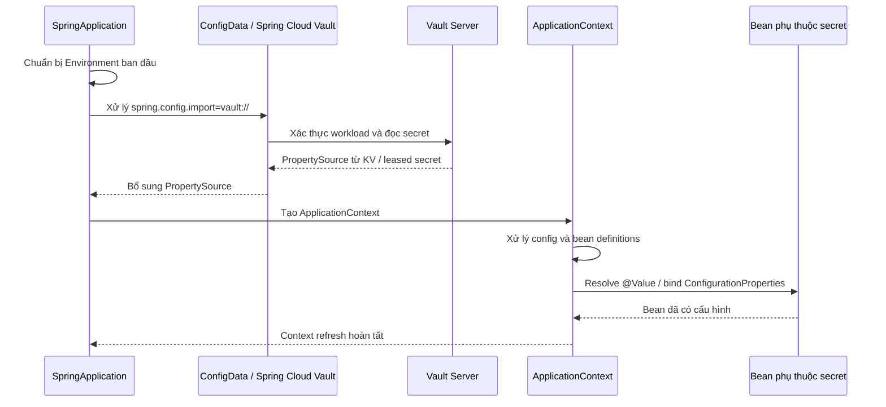
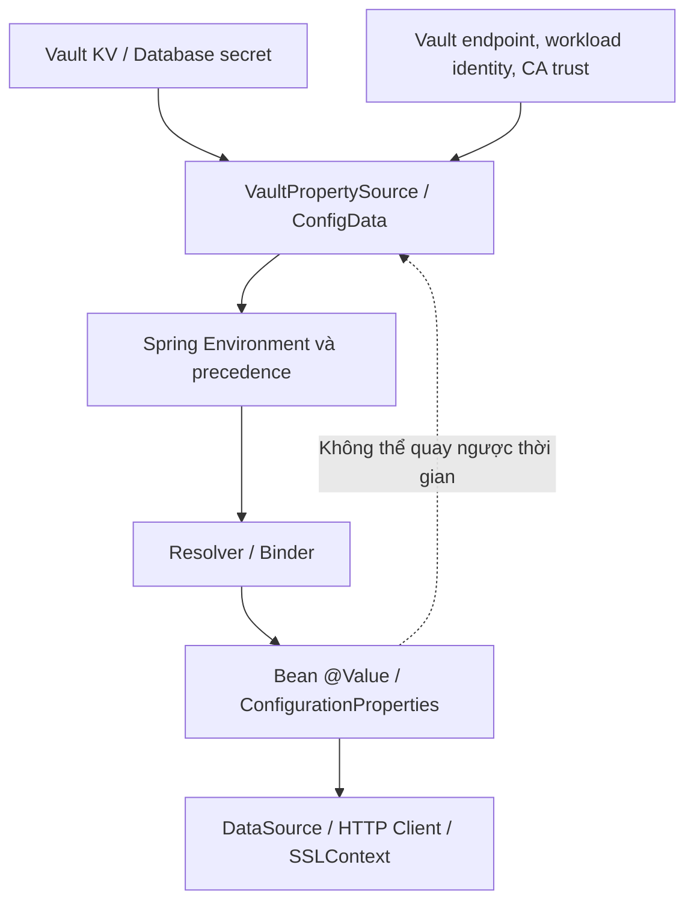
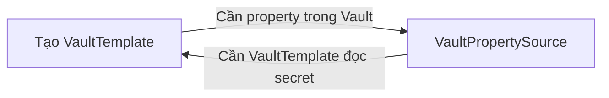

# Thời điểm lấy secret trước khi tạo bean phụ thuộc

## 1. Bài toán: Bean cần mật khẩu ngay khi khởi tạo

Một ứng dụng Spring Boot Java tạo `DataSource` hoặc HTTP client ngay lúc khởi động. Constructor của bean cần một mật khẩu nằm trong **HashiCorp Vault**:

```java
public PaymentGatewayClient(String apiKey) {
    if (apiKey == null || apiKey.isBlank()) {
        throw new IllegalArgumentException("Missing API key");
    }
    // Khởi tạo client từ key đã có.
}
```

Nếu ứng dụng tạo bean **trước** khi tải key từ Vault, bean có thể thất bại, khởi tạo với chuỗi rỗng hoặc lấy nhầm giá trị mặc định. Lỗi này thường bị chẩn đoán nhầm là “Vault không trả secret”, trong khi Vault hoàn toàn có thể trả đúng dữ liệu **nhưng quá muộn**.

Chủ đề **“Thời điểm lấy secret trước khi tạo bean phụ thuộc”** thuộc chương **Nguồn cấu hình** của module **SPRING_VAULT**. Spring Vault cho phép Java truy cập Vault qua `VaultTemplate`, còn Spring Cloud Vault tích hợp secret vào Spring `Environment` để các bean dùng `@Value`, `@ConfigurationProperties` và auto-configuration. Cả hai đều phải giải bài toán **đúng thứ tự khởi tạo**.

**Mục tiêu:**

- Phân biệt lúc **khởi tạo nguồn cấu hình** với lúc **khởi tạo bean phụ thuộc**.
- Hiểu giai đoạn **Spring Boot ConfigData** và cách `spring.config.import=vault://` tải secret sớm.
- Biết cách dùng `@VaultPropertySource` hoặc đăng ký `VaultPropertySource` thủ công **trước `refresh()`**.
- Xác định ranh giới bootstrap: muốn gọi Vault phải có endpoint, TLS trust và danh tính workload **từ bên ngoài Vault**.
- Tránh lỗi circular dependency, placeholder thiếu, thứ tự PropertySource sai, config fallback nguy hiểm.
- Kiểm thử thứ tự khởi tạo, fail-fast, Vault outage và sự khác nhau giữa lấy secret lúc startup với rotation trong runtime.

**Thông điệp chính:** secret cần có mặt trong đúng `PropertySource`/`Environment` **trước thời điểm Spring resolve constructor argument hay bind configuration bean cần secret**. Lấy secret đúng nhưng sau khi bean đã được tạo sẽ không sửa được quá khứ khởi tạo.

## 2. Dòng thời gian khởi động Spring Boot

Một ứng dụng Spring Boot sử dụng **ConfigData API** đi qua các pha khái quát:



Sơ đồ chỉ biểu diễn **thứ tự logic quan trọng**, không phải toàn bộ hook nội bộ của Spring Boot. Theo tài liệu Spring Cloud Vault, **ConfigData được xử lý trước khi ApplicationContext của ứng dụng sẵn sàng**; hạ tầng để gọi Vault trong pha này phải được bootstrapped riêng.

| Pha | Thành phần / ví dụ | Secret từ Vault cần sẵn sàng chưa? |
| --- | --- | --- |
| **0 — Hạ tầng bootstrap** | Đọc `spring.config.import`, Vault URI, CA trust, loại authentication | Cần thông tin **để đến Vault**, chưa thể yêu cầu secret ứng dụng từ chính Vault. |
| **1 — ConfigData resolution/load** | `VaultConfigDataLoader` xác thực và đọc Vault paths | **Có**, nếu bean sắp tạo cần key từ Vault. |
| **2 — Bean definition/configuration processing** | `@Configuration`, `@VaultPropertySource`, import registrar | Phải đăng ký source trước các bean phụ thuộc; một số cách xử lý còn có giới hạn thời điểm. |
| **3 — Bean instantiation/injection** | `@Bean`, constructor, `@Value`, bind `@ConfigurationProperties`, auto-configured DataSource | **Bắt buộc key đã resolve được** nếu là secret thiết yếu. |
| **4 — Bean initialization** | `@PostConstruct`, `InitializingBean` | Quá muộn để thay constructor argument của bean đã tạo. |
| **5 — Application ready** | `ApplicationRunner`, `CommandLineRunner`, `ApplicationReadyEvent` | Quá muộn cho bean thiết yếu đã khởi tạo; chỉ nên dùng cho tác vụ sau startup. |

**Lưu ý:** `@VaultPropertySource` trên `@Configuration` được xử lý khi cấu hình Spring được đăng ký, trước khi bean thông thường sử dụng property; song nó **không giống ConfigData ở pha sớm nhất**. Các giá trị cấu hình được Spring Boot đọc trước khi context refresh (ví dụ một số `logging.*` hoặc `spring.main.*`) không nên phụ thuộc cách đưa PropertySource vào muộn trong quá trình xử lý config class.

## 3. Các tầng dữ liệu và bất biến khởi tạo



Ở thời điểm tạo bean phụ thuộc, nên bảo đảm:

1. **Nguồn đã đọc:** path, mount, namespace, profile đúng và Vault đã trả key mong muốn.
2. **Nguồn đã gắn vào Environment:** dù Vault trả dữ liệu đúng, nhưng source chưa được đăng ký thì Spring không thấy.
3. **Key được resolve đúng:** không bị key cùng tên trong source ưu tiên cao hơn che khuất.
4. **Secret có định dạng hợp lệ:** chuỗi không rỗng, thời hạn credential đủ dùng, TLS material hợp lệ.
5. **Không có nguồn fallback nguy hiểm:** secret thiếu không được tự rơi xuống hard-coded password hoặc token dev.
6. **Bean chỉ được tạo sau khi các điều kiện trên đạt:** hoặc ứng dụng fail startup có lý do rõ ràng.

### Phân biệt “đã có secret” và “bean đã dùng secret”

| Kiểm tra | Kết luận được | Điều chưa được chứng minh |
| --- | --- | --- |
| Vault API đọc path thành công | Vault có thể trả secret | Environment đã thấy key hay chưa. |
| `Environment.getProperty("payment.api-key")` trả giá trị | Nguồn cấu hình đã được resolve | Bean đã được tạo sau lần load hay không; credential trong client có đúng không. |
| `@Value` constructor nhận chuỗi | Dependency được cấp một giá trị | Đã kiểm tra quyền / format / TTL hay chưa. |
| HTTP client hoặc pool được tạo thành công | Đối tượng tồn tại | Downstream thực sự xác thực thành công với credential. |
| Kết nối thử thành công | Secret dùng được tại thời điểm thử | Tự rotate được khi secret hết hạn hay không. |

Đây là lý do cần test **theo từng lớp**, không chỉ gọi `vault kv get` rồi kết luận Spring khởi tạo đúng.

## 4. Phương án ưu tiên trên Spring Boot: Spring Cloud Vault ConfigData

Spring Boot 2.4+ hỗ trợ **ConfigData API**; Spring Cloud Vault 3.0+ tích hợp `vault://` để lấy property sources từ Vault **trước khi tạo bean ứng dụng**. Với Spring Boot phiên bản hiện đại và các dependency tương thích, đây thường là hướng ít rủi ro về thứ tự khởi tạo hơn so với tự thêm nguồn cấu hình trong một bean khởi động muộn.

### 4.1. Thêm starter tương thích

Với Spring Boot/Spring Cloud, dùng **Spring Cloud dependency management (BOM)** và starter:

```xml
<dependency>
    <groupId>org.springframework.cloud</groupId>
    <artifactId>spring-cloud-starter-vault-config</artifactId>
</dependency>
```

Ví dụ dependency chỉ mô tả thành phần cần thiết. Không tự chọn phiên bản Spring Boot, Spring Cloud và Spring Vault ngẫu nhiên; cần lấy đúng BOM tương thích của dự án. Nếu dùng Bean Validation như `@NotBlank`, cần thêm `spring-boot-starter-validation`.

### 4.2. Cấu hình nguồn Vault được tải sớm

Ví dụ ứng dụng `invoice-api` chạy **trong Kubernetes**, đã có Vault Kubernetes auth role và service account tương ứng. Cấu hình `application.yml`:

```yaml
spring:
  application:
    name: invoice-api
  config:
    import: "vault://"
  cloud:
    vault:
      uri: https://vault.internal.example:8200
      authentication: KUBERNETES
      fail-fast: true
      kubernetes:
        role: invoice-api
        kubernetes-path: kubernetes
        service-account-token-file: /var/run/secrets/kubernetes.io/serviceaccount/token
      kv:
        enabled: true
        backend: secret
```

Với KV v2 mount `secret/`, Spring Cloud Vault mặc định tính context KV theo `spring.application.name`, ở đây là **`secret/invoice-api`** (cùng profile-specific context khi sử dụng active profiles, theo phiên bản/cấu hình). Dữ liệu logic trong Vault nên có key ví dụ:

```json
{
  "payment.gateway.api-key": "<REDACTED_TEST_API_KEY>",
  "payment.gateway.base-url": "https://sandbox.gateway.example"
}
```

Giải thích thứ tự:

1. Boot biết phải import `vault://` từ cấu hình cục bộ.
2. Spring Cloud Vault dùng **Vault URI + Kubernetes service account JWT** từ môi trường chạy để đăng nhập.
3. Vault trả KV data theo context tương ứng; Spring Cloud Vault đóng gói thành `PropertySource`.
4. Khi Boot tạo bean có `payment.gateway.api-key`, giá trị đã nằm trong Environment nếu đường import thành công và không bị che bởi source khác.
5. Bean nhận cấu hình hoặc startup thất bại nếu secret thiếu và code xác thực yêu cầu đầu vào.

**Điều kiện tiên quyết:** Kubernetes auth method và role `invoice-api` đã được quản trị viên cấu hình để bind đúng service account/namespace và cấp Vault policy đọc key ở path phù hợp. Ví dụ không thể chạy thành công trên laptop chỉ bằng cách sao chép YAML nếu không có service account JWT.

**Không lưu** JWT, Vault token, SecretId hoặc password thật vào `application.yml`. Chỉ URI, mount, auth method, role name và các thông số bootstrap không phải bí mật được phép có mặt trong cấu hình; vẫn bảo vệ thông tin hạ tầng nhạy cảm.

### 4.3. Secret được bind vào bean phụ thuộc như thế nào?

Ví dụ Java 17+, Spring Boot 3.x:

```java
import java.net.URI;

import jakarta.validation.constraints.NotBlank;
import jakarta.validation.constraints.NotNull;
import org.springframework.boot.context.properties.ConfigurationProperties;

@ConfigurationProperties(prefix = "payment.gateway")
public record PaymentGatewayProperties(
        @NotBlank String apiKey,
        @NotNull URI baseUrl) {
}
```

Khai báo scan và bean phụ thuộc:

```java
import org.springframework.boot.autoconfigure.SpringBootApplication;
import org.springframework.boot.context.properties.ConfigurationPropertiesScan;
import org.springframework.context.annotation.Bean;
import org.springframework.boot.SpringApplication;

@SpringBootApplication
@ConfigurationPropertiesScan
public class InvoiceApplication {

    public static void main(String[] args) {
        SpringApplication.run(InvoiceApplication.class, args);
    }

    @Bean
    PaymentGatewayClient paymentGatewayClient(
            PaymentGatewayProperties properties) {
        return new PaymentGatewayClient(
            properties.baseUrl(), properties.apiKey());
    }
}
```

Trong ví dụ, `PaymentGatewayClient` là class nghiệp vụ của ứng dụng nhận `URI` và key; không có constructor của một thư viện bên thứ ba được giả định. Ở thời điểm Spring khởi tạo bean, `PaymentGatewayProperties` cần được bind và validate từ Environment. Nếu không có key phù hợp, `@NotBlank` yêu cầu fail thay vì âm thầm dùng chuỗi rỗng.

**Hai điểm phải kiểm tra:**

- Import đúng Vault path nhưng cấu hình key sai tên (ví dụ `payment.gateway.apiKey` khác định dạng mong muốn) có thể khiến binder không nhận được giá trị.
- Annotation `@NotBlank` cần hạ tầng Bean Validation, không phải thay thế permission Vault. Hãy xác minh có `spring-boot-starter-validation` và Spring Cloud Vault BOM phù hợp.

### 4.4. Explicit context và thứ tự nguồn

Spring Cloud Vault còn hỗ trợ explicit context:

```yaml
spring:
  config:
    import: "vault:///team/invoice-api?prefix=invoice."
```

Đây là **ví dụ chỉ chọn nguồn cụ thể** và đặt prefix; context path cần khớp đường Vault đã thiết kế. Nếu secret có key `api-key` và prefix `invoice.` thì tên property sẽ là `invoice.api-key`. Prefix được thêm **nguyên văn**, nên cần dấu chấm ở cuối nếu muốn phân tách key.

Có thể trộn nhiều location `vault://` và nguồn cấu hình khác, nhưng **precedence phụ thuộc thứ tự import và hệ thống property sources thực tế**. Nếu cùng key xuất hiện ở nhiều nguồn, xem `Environment.getPropertySources()` để xác định nguồn thắng thay vì phán đoán theo tên file. Không được đưa password hoặc token vào log để kiểm tra precedence.

## 5. Fail-fast và ý nghĩa của `optional:vault://`

**Mặc định không nên để service xử lý thanh toán hoặc truy cập database production khởi tạo với credentials vắng mặt.** Nếu một bean cần secret để hoạt động, chọn chiến lược **fail closed / fail startup**.

Spring Cloud Vault có `spring.cloud.vault.fail-fast`; cấu hình `true` giúp startup thất bại khi không lấy được thông tin bắt buộc theo cách cấu hình client.

Phân biệt các tình huống:

| Tình huống | Mức độ | Hành vi kỳ vọng |
| --- | --- | --- |
| Vault không thể kết nối do TLS/DNS/outage | Critical nếu secret bắt buộc | Fail startup hoặc retry có giới hạn trước khi đưa pod vào ready. |
| Auth workload thất bại `403` | Critical | Không bỏ qua quyền, sửa identity/role/policy. |
| KV context trả `404` | Có thể bị skip tùy ConfigData fail-fast | Validate key bằng `@NotBlank` / `getRequiredProperty`; dùng chính sách fail-fast rõ ràng. |
| Context được đánh dấu `optional:vault://` | Không cam kết tự bỏ qua mọi loại lỗi | Theo tài liệu, optional liên quan khi Vault support bị disable; các case 404 có xử lý riêng. |
| Key tồn tại nhưng không đúng kiểu | Critical đối với bean phụ thuộc | Bind/validation thất bại, không khởi tạo client với giá trị tùy tiện. |
| Property key trùng key môi trường | Tùy precedence | Xác định source thực tế thắng, không coi “đã đọc Vault” là đủ. |

**Lưu ý quan trọng:** Spring Cloud Vault ConfigData có cách xử lý `404` riêng: context không tồn tại có thể bị skip dù `spring.config.import` không có `optional:`; tài liệu hướng dẫn cấu hình **fail-fast** để buộc dừng khi context bắt buộc vắng mặt. Đừng suy luận rằng **chỉ cần bỏ `optional:`** là ứng dụng chắc chắn fail với mọi secret/path thiếu.

Có thể bổ sung bean startup guard:

```java
import org.springframework.core.env.Environment;
import org.springframework.stereotype.Component;

@Component
public class PaymentSecretGuard {

    public PaymentSecretGuard(Environment environment) {
        String key = environment.getRequiredProperty(
            "payment.gateway.api-key");
        if (key.isBlank()) {
            throw new IllegalStateException(
                "Mandatory payment gateway configuration is empty");
        }
    }
}
```

Guard là bước bổ sung và chạy trong pha tạo bean, **không thay thế ConfigData**. Nếu bean được tạo sớm hơn `PaymentSecretGuard` và dùng key không hợp lệ, hậu quả đã xảy ra. Tốt hơn là validate tại **bean phụ thuộc** hoặc qua typed configuration được dùng làm dependency trực tiếp.

## 6. Spring Vault thuần với `@VaultPropertySource`

Nếu không dùng Spring Cloud Vault ConfigData, Spring Vault cung cấp annotation để thêm secret vào Environment.

```java
import org.springframework.context.annotation.Configuration;
import org.springframework.vault.annotation.VaultPropertySource;

@Configuration
@VaultPropertySource(
    value = "secret/invoice-api",
    ignoreSecretNotFound = false
)
public class InvoiceVaultPropertyConfiguration {
}
```

Annotation này dùng `VaultTemplate` (mặc định bean name `vaultTemplate`) để tải path khai báo và đăng ký `PropertySource` trong lúc Spring xử lý `@Configuration`. Theo Javadoc, `ignoreSecretNotFound` mặc định `true`, nên với secret bắt buộc hãy cân nhắc `false` hoặc thêm validation tại bean phụ thuộc.

Một configuration class phụ thuộc có thể dùng Environment:

```java
import org.springframework.context.annotation.Bean;
import org.springframework.context.annotation.Configuration;
import org.springframework.core.env.Environment;

@Configuration
public class PaymentClientConfiguration {

    @Bean
    public PaymentGatewayClient paymentGatewayClient(Environment env) {
        String key = env.getRequiredProperty(
            "payment.gateway.api-key");
        String endpoint = env.getRequiredProperty(
            "payment.gateway.base-url");
        return new PaymentGatewayClient(
            java.net.URI.create(endpoint), key);
    }
}
```

Khi Spring xử lý cấu hình theo đúng thứ tự, source cần được đăng ký trước bean cần key. `@VaultPropertySource` là lựa chọn tiện cho ứng dụng Spring Vault thuần, nhưng chú ý:

- **Hạ tầng Vault phải tồn tại khi registrar xử lý annotation**, kể cả `VaultTemplate`, authentication, TLS/network và quyền đọc secret.
- Thứ tự giữa nhiều `@VaultPropertySource` được component-scanning phát hiện **không dễ kiểm soát**; nếu override properties quan trọng, có thể cần đăng ký programmatic.
- Đường path KV v2 trong `@VaultPropertySource` **không thêm `data/`** vào logic path (Spring Vault xử lý khác biệt KV v2 theo hạ tầng).
- Annotation xử lý trong context processing, **không tự thay thế ConfigData** đối với mọi property bị Boot đọc từ giai đoạn rất sớm.
- Tích hợp với phiên bản Spring Vault 4.1.x cần kiểm tra `VaultTemplate`, bean dependencies và cấu hình sao cho không gây vòng tròn tạo bean.

### Anti-pattern: secret của VaultTemplate cũng lấy qua chính source mà nó phải mở

Không cấu hình `VaultTemplate` phụ thuộc vào `payment.gateway.api-key` nếu `@VaultPropertySource` phải dùng **VaultTemplate đó** để tải key. Luồng sẽ thành:



Đây là vòng phụ thuộc bootstrap (chicken-and-egg). Để phá vòng, lấy **Vault endpoint, loại auth, workload credentials và TLS trust** từ môi trường cấu hình bên ngoài Vault trước; sau đó mới tải secrets nghiệp vụ. **Không đặt key xác thực Vault chỉ trong chính path Vault mà key ấy cần để đọc.**

## 7. Spring Vault thuần: đăng ký PropertySource trước `refresh()`

Ví dụ sau dùng Spring Vault 4.x và Spring Framework 6+, minh họa cách **đọc secret sớm trước khi tạo bean phụ thuộc**.

Điều kiện ví dụ: một **Vault Agent proxy** chạy trên cùng host, lắng nghe `http://127.0.0.1:8200`, đã cấu hình auto-auth và gắn token vào HTTP request tới Vault. Java **không dùng token tĩnh** và endpoint local được hạn chế truy cập.

```java
import java.net.URI;

import org.springframework.context.support.GenericApplicationContext;
import org.springframework.core.env.MutablePropertySources;
import org.springframework.vault.client.VaultEndpoint;
import org.springframework.vault.core.VaultTemplate;
import org.springframework.vault.core.env.VaultPropertySource;

public final class EarlyVaultPropertyBootstrap {

    public static void main(String[] args) {

        VaultTemplate vault = new VaultTemplate(
            VaultEndpoint.from(
                URI.create("http://127.0.0.1:8200")));

        try (GenericApplicationContext context =
                 new GenericApplicationContext()) {

            // Constructor VaultPropertySource đọc Vault NGAY khi tạo source.
            VaultPropertySource source =
                new VaultPropertySource(vault, "secret/invoice-api");

            MutablePropertySources sources =
                context.getEnvironment().getPropertySources();

            // Thêm trước refresh để Environment đã có key khi tạo bean.
            sources.addFirst(source);

            context.registerBean(PaymentGatewayClient.class, () -> {
                String token = context.getEnvironment()
                    .getRequiredProperty("payment.gateway.api-key");
                String uri = context.getEnvironment()
                    .getRequiredProperty("payment.gateway.base-url");
                return new PaymentGatewayClient(
                    URI.create(uri), token);
            });

            context.refresh();
            PaymentGatewayClient client =
                context.getBean(PaymentGatewayClient.class);

            // Dùng client, không log token hoặc nội dung secret.
        }
    }
}
```

`PaymentGatewayClient` là class ứng dụng với constructor `(URI, String)`; ví dụ tập trung vào thứ tự của container, không triển khai logic HTTP cụ thể.

**Tại sao đúng:** `VaultPropertySource` tải dữ liệu từ Vault **ngay trong constructor** theo Javadoc, rồi được `addFirst` trước `context.refresh()`. Khi Spring đăng ký/khởi tạo `PaymentGatewayClient`, `getRequiredProperty` đã có thể resolve key.

**Giới hạn:** cách này phù hợp khi bạn tự quản lý context/hạ tầng Vault. Trong một dự án Spring Boot dùng nhiều auto-config, tùy tiện tạo một `GenericApplicationContext` riêng rồi mong bean cấu hình xuất hiện trong context của Boot là **sai**: hai contexts khác nhau không tự chia sẻ PropertySource. Với Spring Boot, ưu tiên `spring.config.import=vault://` hoặc một hook hạ tầng chuyên dụng được thiết kế trước context refresh.

Nếu tự lập trình `EnvironmentPostProcessor` để đọc Vault sớm, cần quản lý thứ tự, bootstrap clients và TLS/identity không phụ thuộc vào beans chưa có. Đừng lấy `VaultTemplate` từ ApplicationContext khi context thậm chí chưa tồn tại.

## 8. Những phương án thường quá muộn

### 8.1. `@PostConstruct` / `ApplicationReadyEvent`

```java
import jakarta.annotation.PostConstruct;
import org.springframework.stereotype.Component;
import org.springframework.vault.core.VaultOperations;

@Component
class LateVaultLoader {

    private final VaultOperations vaultOperations;

    LateVaultLoader(VaultOperations vaultOperations) {
        this.vaultOperations = vaultOperations;
    }

    @PostConstruct
    void fetchTooLateForOtherConstructors() {
        // Dù gọi được Vault ở đây, constructor của bean khác
        // có thể đã nhận cấu hình thiếu trước đó.
        var response = vaultOperations.read("secret/data/invoice-api");
        // KHÔNG dùng kết quả để âm thầm ghi vào global state.
    }
}
```

Mã là **ví dụ anti-pattern**, không phải cấu hình được khuyến nghị. `@PostConstruct` chạy **sau khi bean này khởi tạo** và không đảm bảo chạy trước constructor của mọi bean khác. `ApplicationRunner` / `ApplicationReadyEvent` còn đến **sau refresh**, quá muộn để sửa bean đã tạo.

### 8.2. `@DependsOn`, `@Order` và `@Lazy`

- `@DependsOn("vaultTemplate")` chỉ ép **thứ tự tạo bean**, không chứng minh rằng **PropertySource đã tải secret**. Tạo VaultTemplate không đồng nghĩa đã đọc mọi path dữ liệu.
- `@Order` không phải cơ chế tổng quát để sắp thứ tự tạo mọi singleton hoặc bảo đảm các placeholder sẵn có.
- `@Lazy` chỉ **trì hoãn thời điểm** tạo bean. Nó có thể che lỗi startup hoặc khiến lỗi xuất hiện ở request đầu tiên. Đây không phải bảo đảm secret sẽ được tải đúng nếu không có hook trước đó.
- `@Bean(initMethod="...")`, constructor logging hay một scheduled job sau startup không thể sửa giá trị đã được inject vào singleton khác.

**Giải pháp là xử lý ở đúng tầng configuration loading**, không phải chèn thêm thứ tự tùy tiện vào các business beans.

### 8.3. Đọc trực tiếp Vault trong constructor bean

```java
public PaymentService(VaultOperations vault) {
    // Mô hình không khuyến nghị cho cấu hình startup:
    // gây side effect network khi tạo bean,
    // khó fail-fast có kiểm soát và khó test ordering.
    var secret = vault.read("secret/data/invoice-api");
}
```

Cách này có thể hoạt động với ứng dụng nhỏ nhưng làm bean creation phụ thuộc mạng, khó quản lý retry/timeout, dễ tạo vòng giữa `VaultOperations` và các beans có cấu hình lấy từ Vault. Nếu mục tiêu là **PropertySource sẵn trước bean**, dùng ConfigData hoặc đăng ký source sớm thay vì mỗi bean tự tải secret.

## 9. Bootstrap identity: secret nào phải có trước Vault?

Bản thân việc **đăng nhập Vault** cần một số thông tin mà hệ thống phải cung cấp trước khi đọc được secrets nghiệp vụ.

| Dữ liệu | Nguồn đề xuất | Có nên cất chỉ trong Vault cần chính nó để truy cập? |
| --- | --- | --- |
| Vault HTTPS URI/port/namespace | Deployment config / cluster service discovery | Không. |
| CA trust, TLS trust store | OS/JVM trust store hoặc secret được mount **trước bootstrap** | Không. |
| Kubernetes service account JWT | Projected service account token của Kubernetes | Không. |
| AWS IAM role/web identity | AWS credential provider, instance/pod workload identity | Không. |
| AppRole RoleId/SecretId | Broker/wrapping/secret injection an toàn và giới hạn TTL | Không nếu đó là nguồn duy nhất và Vault chưa truy cập được. |
| Secret nghiệp vụ (payment API key, DB credentials) | Vault KV/Database/PKI sau authentication | Có; đây là mục tiêu tải từ Vault. |
| Vault client token sau login | Vault cấp, Spring Vault/session manager giữ | Không hard-code trong image hoặc repository. |

**Ranh giới bảo mật:** các thông số bootstrap được dùng để **đi tới Vault**, còn secrets nghiệp vụ được Vault quản lý theo policy. Nếu cho phép ứng dụng tải mọi thứ từ một file local để “dự phòng” mà không kiểm soát, hệ thống có thể làm lộ credential hoặc dùng cấu hình dev ở production.

## 10. PropertySource precedence, profile và namespace

Một secret có mặt trong Vault không đồng nghĩa nó sẽ thắng khi resolve giá trị:

- `command-line arguments` và system properties có thứ tự ưu tiên theo quy tắc Spring Boot và có thể ghi đè ConfigData.
- Một `PropertySource` được `addFirst` có độ ưu tiên cao ở thời điểm đăng ký, nhưng nguồn khác sau đó vẫn có thể được chèn vào trước.
- Với nhiều `@VaultPropertySource` do component-scan phát hiện, thứ tự có thể khó xác định; khi sự khác biệt quan trọng cần dùng API `MutablePropertySources` để quản lý.
- `spring.application.name` và active profiles ảnh hưởng path KV được Spring Cloud Vault chọn; sai tên app hoặc profile làm đọc nhầm context.
- Với Vault Enterprise, namespace làm thay đổi logical mount/policy được resolve; phải cấu hình đúng `spring.cloud.vault.namespace` và quyền thực tế.
- Key có cùng tên giữa Vault và local config dễ gây shadowing; nên chọn key namespace rõ ràng và tránh các giá trị mật khẩu mặc định trong file chạy production.

### Kiểm tra thứ tự source mà không làm lộ secret

Trong môi trường dev/test, có thể in **tên PropertySource** và boolean cho biết có key, nhưng **không in value**:

```java
import org.springframework.core.env.ConfigurableEnvironment;
import org.springframework.core.env.PropertySource;

public final class PropertySourceDiagnostics {

    public static void printPresence(
            ConfigurableEnvironment env, String requiredKey) {

        for (PropertySource<?> source : env.getPropertySources()) {
            boolean present = source.containsProperty(requiredKey);
            System.out.println(source.getName() + " -> present=" + present);
        }
    }
}
```

Mã minh họa dùng console chỉ để phát hiện **source name / presence**; cần hạn chế cả tên source nếu chứa thông tin path nội bộ và không bật ở production. Không dùng `/actuator/env` hay `/actuator/configprops` không bảo vệ: nhiều endpoint có thể bộc lộ dữ liệu cấu hình hoặc nguồn bí mật, ngay cả khi đã có cơ chế sanitization.

## 11. Việc lấy secret trước bean khác với rotation sau startup

Bài này tập trung **thời điểm lấy secret ban đầu**. Sau khi bean được tạo, secret có thể tiếp tục thay đổi, ví dụ:

- KV v2 có version mới.
- Database dynamic credential đến hạn lease và được rotate.
- PKI certificate/private key được cấp lại.
- Vault login token hết TTL và được re-login.

**ConfigData tải ban đầu trước bean không có nghĩa `@Value`/DataSource sẽ tự cập nhật trong runtime**. Bean đã được tạo có thể giữ một snapshot của giá trị cũ; để thay credential đang chạy, cần thiết kế **refresh/rebind** hoặc **thay resource** riêng, quản lý deadline và readiness.

Tách hai câu hỏi:

| Câu hỏi | Giai đoạn | Giải pháp |
| --- | --- | --- |
| “Làm sao bean vừa tạo đã có key?” | **Startup** | ConfigData hoặc PropertySource khởi tạo trước bean, fail-fast/validation. |
| “Làm sao bean đang chạy dùng key mới?” | **Runtime** | Lease event/reload, refresh/rebind hoặc atomic swap client/pool. |

Không dùng một `SecretLeaseContainer` chạy background như cách duy nhất để cung cấp credential cho bean startup nếu bean **bắt buộc có key ngay**. Cần chặn quá trình khởi tạo cho tới khi dữ liệu đầu tiên đã sẵn sàng, hoặc tạo resource theo cơ chế async rõ ràng và giữ readiness false cho đến khi ready.

## 12. Kiểm thử thứ tự mà không cần Vault thật

Ví dụ Java 17+ / Spring Framework 6+ dưới đây **tái hiện quy tắc trước `refresh()`** bằng PropertySource giả, không dùng mật khẩu thật.

```java
import java.util.Map;

import org.springframework.context.annotation.AnnotationConfigApplicationContext;
import org.springframework.context.annotation.Bean;
import org.springframework.context.annotation.Configuration;
import org.springframework.core.env.MapPropertySource;
import org.springframework.core.env.Environment;

public final class EarlyPropertySourceDemo {

    record GatewayClient(String apiKey) {
        GatewayClient {
            if (apiKey == null || apiKey.isBlank()) {
                throw new IllegalArgumentException("Missing API key");
            }
        }
    }

    @Configuration
    static class GatewayConfiguration {
        @Bean
        GatewayClient gatewayClient(Environment env) {
            return new GatewayClient(env.getRequiredProperty(
                "payment.gateway.api-key"));
        }
    }

    public static void main(String[] args) {

        try (AnnotationConfigApplicationContext ctx =
                 new AnnotationConfigApplicationContext()) {

            // Secret giả được đăng ký TRƯỚC khi refresh/tạo bean.
            ctx.getEnvironment().getPropertySources().addFirst(
                new MapPropertySource(
                    "fake-vault-config",
                    Map.of("payment.gateway.api-key", "test-only-key")));

            ctx.register(GatewayConfiguration.class);
            ctx.refresh();

            if (!"test-only-key".equals(
                    ctx.getBean(GatewayClient.class).apiKey())) {
                throw new AssertionError("Secret was not bound");
            }
        }
    }
}
```

Kết quả kỳ vọng: context refresh thành công vì PropertySource đã cung cấp `payment.gateway.api-key` lúc bean được tạo. **Kiểm tra đối chứng:** bỏ dòng `addFirst` và giữ nguyên code khác; `getRequiredProperty` sẽ fail trong quá trình tạo bean. Nếu chỉ thêm source **sau `ctx.refresh()`**, đã quá muộn để cứu lần khởi tạo thất bại.

Ví dụ này chứng minh **thứ tự**, không chứng minh các cơ chế authentication, lease hay permission của Vault. Để kiểm thử luồng Vault thật, dùng integration test với Vault dev/Testcontainers và auth role riêng.

## 13. Tình huống tích hợp với Vault thật

Chuẩn bị Vault thử nghiệm, KV v2 mount `secret/`, cấu hình role đúng workload; không dùng root token cho ứng dụng. Khởi tạo KV path logic `invoice-api` chứa key `payment.gateway.api-key`, `payment.gateway.base-url` bằng công cụ quản trị phù hợp và test credential giả. Với Vault CLI:

```bash
# Chạy trong môi trường TEST, các giá trị đều giả.
vault kv put -mount=secret invoice-api \
  payment.gateway.api-key="test-api-key" \
  payment.gateway.base-url="https://sandbox.gateway.example"

# Xác minh dữ liệu bằng CLI được ủy quyền.
# Không đưa output có secret vào log CI.
vault kv get -mount=secret invoice-api
```

**Lưu ý:** cách ghi value trực tiếp trên command line được dùng chỉ vì đây là key giả; trong production hãy tránh đặt secret thật trong shell history/process arguments. Hạ tầng authentication trong YAML phải chạy đúng môi trường; thử bằng workload identity thật hoặc Vault Agent test tương đương.

| Ca thử | Thiết lập | Điều cần xác minh |
| --- | --- | --- |
| A — ConfigData đúng | `spring.config.import=vault://`, path và permission hợp lệ | Bean `PaymentGatewayProperties` bind được trước khi `PaymentGatewayClient` khởi tạo. |
| B — Thiếu import | Bỏ `spring.config.import` nhưng vẫn có Spring Cloud Vault starter | Không giả định KV đã được mount; startup guard cần fail nếu thiếu key. |
| C — Mất key | Xóa `payment.gateway.api-key` khỏi KV test | `@NotBlank` / `getRequiredProperty` khiến startup fail thay vì dùng rỗng. |
| D — Sai role | Kubernetes role không bind service account/namespace | Vault login bị từ chối, bean không được tạo thành công. |
| E — Sai policy | Role có Vault token nhưng không được đọc `secret/data/invoice-api` | Vault trả `403`, không fallback sang key hard-coded. |
| F — KV path 404 | Đổi app name hoặc mount để path không tồn tại | Kiểm tra fail-fast/skip path, validation dừng nếu key bắt buộc thiếu. |
| G — Vault outage | Không thể kết nối Vault lúc startup | Tùy chính sách fail-fast, startup không trở thành ready khi cần secret. |
| H — TLS sai | CA chưa trusted/cert hết hạn | Không tắt verification; sửa trust chain trước khi tạo bean. |
| I — Precedence | Đặt cùng key ở source ưu tiên cao hơn | Tìm chính xác source nào đang cung cấp key mà không log value. |
| J — Wrong profile | Kích hoạt profile khác với Vault context mong đợi | Xác minh path/profile và fail nếu secret bắt buộc không có. |
| K — Plain Spring Vault | Thêm `VaultPropertySource` trước `refresh()` | Bean đọc được key từ Environment khi tạo. |
| L — Late loading | Chỉ fetch secret trong `@PostConstruct` | Constructor bean thiết yếu fail trước hoặc giữ giá trị sai. |
| M — Circular bootstrap | VaultTemplate cần property chỉ có trong source mà nó tải | Context không khởi tạo đúng; tách bootstrap identity khỏi application secret. |
| N — Runtime rotation | KV version mới/lease rotate sau khi bean đã tạo | Bean cũ không tự cập nhật; kiểm tra riêng logic refresh/resource replacement. |

### Đo các mốc trong integration test

```text
t0  SpringApplication bắt đầu
t1  ConfigData Vault loader bắt đầu auth và đọc secret
t2  Vault PropertySource đã được đăng ký vào Environment
t3  Spring bắt đầu tạo bean phụ thuộc
t4  Bean và downstream client được validate
t5  Application ready

Yêu cầu thứ tự: t1 <= t2 < t3 <= t4 <= t5
```

Timeline chỉ thể hiện **thứ tự logic**; không dùng nó làm cam kết thời gian theo mili giây. Có thể instrument bằng hooks sẵn có, mock Vault API ở unit test hoặc Vault audit trong test, **không log credential**.

## 14. Chẩn đoán lỗi khởi động theo đúng pha

| Dấu hiệu | Pha gây lỗi có khả năng cao | Cách xử lý |
| --- | --- | --- |
| `Could not resolve placeholder` khi inject `@Value` | Bean creation, key không có trong Environment | Kiểm tra `spring.config.import`, Vault path, source order và key. |
| `BindException` / validation fail | Bind `@ConfigurationProperties` | Kiểm tra cấu trúc key, kiểu dữ liệu, giá trị trống và validation. |
| `Connection refused` / DNS / TLS handshake | ConfigData loader hoặc VaultPropertySource init | Kiểm tra endpoint, network, trust store, timeout, không tắt TLS validation. |
| Vault login `403` | Auth/bootstrap | Kiểm tra workload identity, auth mount, role, policy. |
| Secret read `403` sau login | Vault secret path/policy | KV v2 policy cần đúng path API `secret/data/...`. |
| Secret read `404` | Sai mount/app name/profile hoặc chưa provision | Không nhầm với lỗi token; cấu hình fail-fast và guard key. |
| Bean tạo thành công nhưng dùng key dev | PropertySource bị override/fallback | Kiểm tra precedence và loại bỏ default secret nguy hiểm. |
| Lỗi circular dependency lúc tạo VaultTemplate | Bootstrap source phụ thuộc VaultTemplate hoặc bean nghiệp vụ | Tách hạ tầng bootstrap, dùng ConfigData/Agent và cấu hình từ ngoài Vault. |
| Startup chậm bất thường | Độ trễ auth/Vault, retry và network timeout | Đo time-to-config, đặt timeout và retry có giới hạn. |
| Secret mới ở Vault nhưng bean cũ chưa đổi | Runtime refresh, không phải startup | Thiết kế refresh/rebind hoặc resource rotation riêng. |
| Ứng dụng báo ready trước khi thử downstream | Readiness chưa gắn validation thật | Kiểm tra kết nối service thiết yếu trước khi nhận traffic. |

Không biến mọi lỗi startup thành “secret not found”. Phải phân biệt **không lấy được source**, **lấy được nhưng không resolve được key**, **bean validation fail** và **downstream authentication fail**.

## 15. Bảo mật và vận hành

- [ ] Chọn **ConfigData** khi dùng Spring Boot + Spring Cloud Vault hiện đại và cần secrets cho bean startup.
- [ ] Đặt `spring.config.import` ở nguồn được Boot đọc **trước context refresh**.
- [ ] Cấp endpoint, TLS trust và workload identity từ môi trường bootstrap; tránh vòng tự phụ thuộc.
- [ ] Bảo đảm Vault policy chỉ cho phép đọc các KV/Database/PKI paths thật sự cần.
- [ ] **Fail startup** khi thiếu secret quan trọng; không chấp nhận key rỗng hoặc fallback sang password dev.
- [ ] Validate `@ConfigurationProperties` / constructor; không đặt validation muộn trong `ApplicationReadyEvent`.
- [ ] Kiểm soát `PropertySource` precedence và tên key, tránh trùng giữa các nguồn.
- [ ] Dùng `@VaultPropertySource(ignoreSecretNotFound=false)` nếu secret bắt buộc và phù hợp hạ tầng Spring Vault thuần.
- [ ] Kiểm thử đủ path, profile, quyền, TLS, outage, BeanCreationException và tình huống 404.
- [ ] Không log Vault token, password, PEM key, secret value hoặc payload ConfigData.
- [ ] Quản lý riêng vòng đời **Vault token** và **dynamic secret lease**; import ban đầu không bảo đảm runtime rotation.
- [ ] Bảo vệ Actuator endpoints, metrics, traces; chỉ ghi tên source đã được kiểm soát và tình trạng có/không key.

## 16. Câu hỏi tự kiểm tra

1. Vì sao `spring.config.import=vault://` phù hợp với secret mà bean `@Value` cần ngay ở constructor?
2. `@PostConstruct` hoặc `ApplicationReadyEvent` có thể sửa được một lần khởi tạo bean đã thất bại vì thiếu key không?
3. Tại sao cần biết Vault URI, CA trust và workload identity từ **trước** khi đọc secret nghiệp vụ?
4. Khác nhau giữa cách Spring Boot **ConfigData** và `@VaultPropertySource` xử lý thời điểm đăng ký nguồn?
5. `@VaultPropertySource` có tự đảm bảo thứ tự override giữa nhiều configuration classes component-scanned không?
6. Khi Vault KV context trả 404, vì sao **bỏ `optional:`** không đủ để khẳng định mọi missing secret sẽ làm startup fail?
7. Trong ví dụ `EarlyPropertySourceDemo`, vì sao `getRequiredProperty` fail nếu chưa add source trước refresh?
8. Những dấu hiệu nào giúp phân biệt lỗi authentication (403), lỗi bind (`@NotBlank`), và lỗi downstream client?
9. Tại sao property source đã được tải đúng vẫn có thể bị giá trị ở một nguồn ưu tiên cao hơn che?
10. Nếu secret được rotate sau startup, cần làm gì để `DataSource` đã tạo dùng credentials mới?

**Ghi nhớ:** Chỉ có thể khởi tạo an toàn bean phụ thuộc Vault secret khi **secret đã được tải, đưa vào đúng PropertySource và resolve trước pha bean instantiation**. Trong Spring Boot hiện đại, `spring.config.import=vault://` xử lý sớm qua ConfigData; trong Spring Vault thuần, `@VaultPropertySource` hoặc programmatic registration phải được setup trước các bean cần secret. Luôn tách thông tin **bootstrap để tới Vault** khỏi **secret nghiệp vụ lấy từ Vault**, fail closed khi thiếu key và quản lý rotation sau startup như một bài toán riêng.

## 17. Tài liệu tham khảo

- [Spring Vault — Property Sources](https://docs.spring.io/spring-vault/reference/vault/propertysource.html): cảnh báo về bootstrap beans cần Vault data; đăng ký `VaultPropertySource` và dùng `@VaultPropertySource`.
- [Spring Vault Javadoc — VaultPropertySource](https://docs.spring.io/spring-vault/reference/api/java/org/springframework/vault/core/env/VaultPropertySource.html): constructor tải properties từ Vault ngay khi tạo source.
- [Spring Vault Javadoc — @VaultPropertySource](https://docs.spring.io/spring-vault/reference/api/java/org/springframework/vault/annotation/VaultPropertySource.html): `ignoreSecretNotFound`, `vaultTemplateRef`, thứ tự sources và default renewal.
- [Spring Cloud Vault — ConfigData API](https://docs.spring.io/spring-cloud-vault/reference/config-data.html): `vault://`, explicit contexts, optional và bootstrap infrastructure.
- [Spring Cloud Vault — Authentication methods](https://docs.spring.io/spring-cloud-vault/reference/authentication.html): cấu hình Kubernetes auth và workload credentials.
- [Spring Cloud Vault — Advanced topics / Fail Fast](https://docs.spring.io/spring-cloud-vault/reference/advanced-topics.html): `spring.cloud.vault.fail-fast` và khả năng kết nối Vault.
- [Spring Boot — Externalized Configuration](https://docs.spring.io/spring-boot/reference/features/external-config.html): thứ tự property sources và hạn chế của `@PropertySource` đăng ký muộn.
- [Spring Boot — ConfigurationProperties](https://docs.spring.io/spring-boot/reference/features/external-config.html#features.external-config.typesafe-configuration-properties): type-safe binding/validation.
- [HashiCorp Vault — KV Version 2](https://developer.hashicorp.com/vault/docs/secrets/kv/kv-v2): secret path, version và policy.
- [HashiCorp Vault — Auth methods](https://developer.hashicorp.com/vault/docs/auth): workload identity, policy, token và phân quyền.
