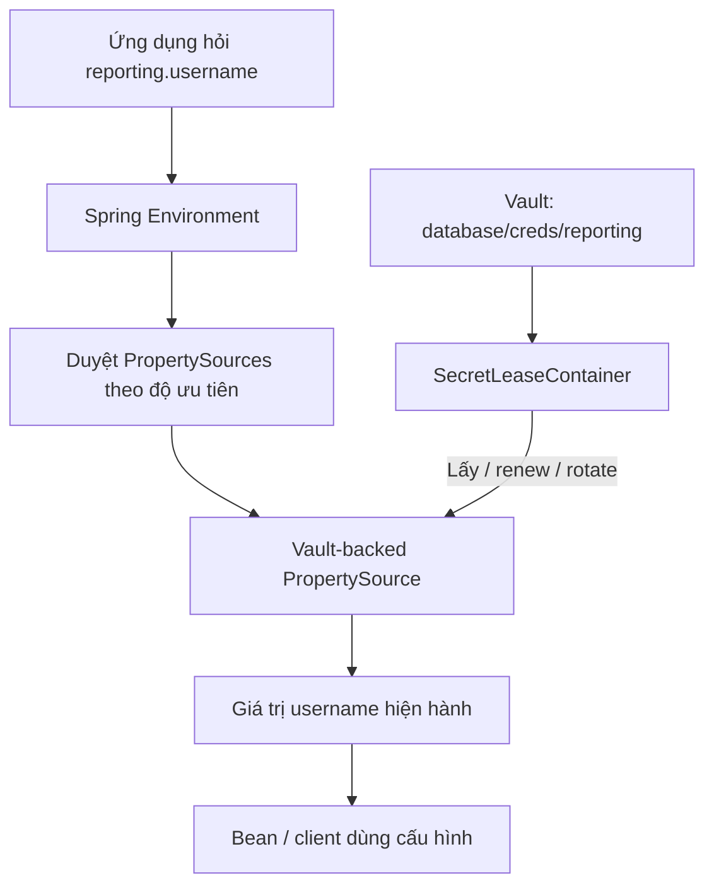
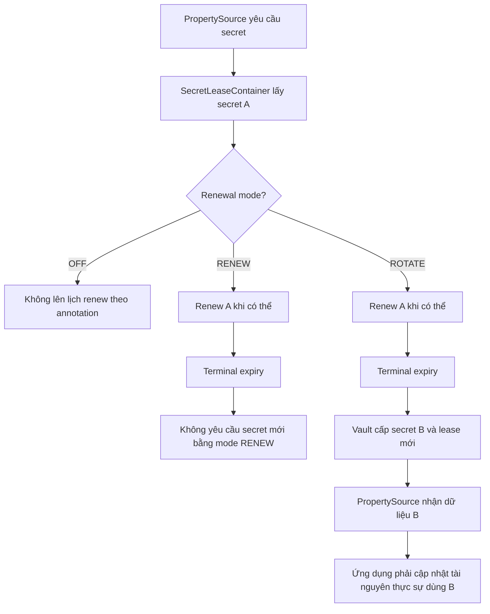
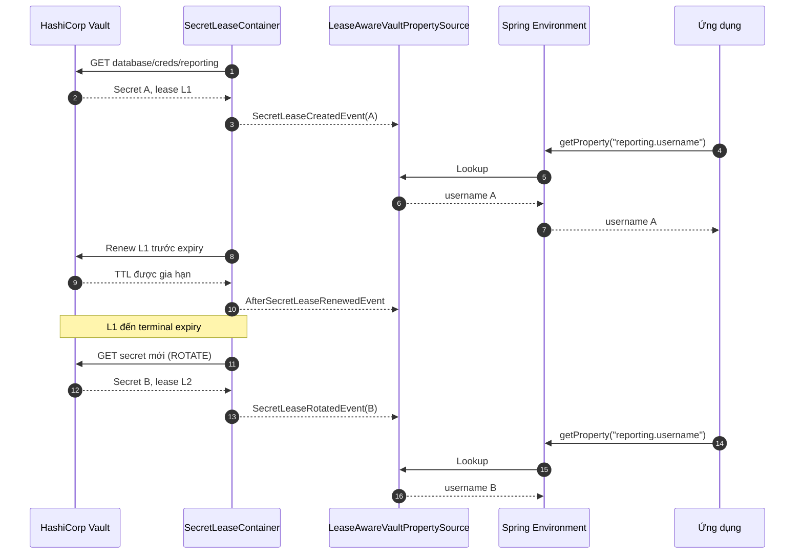
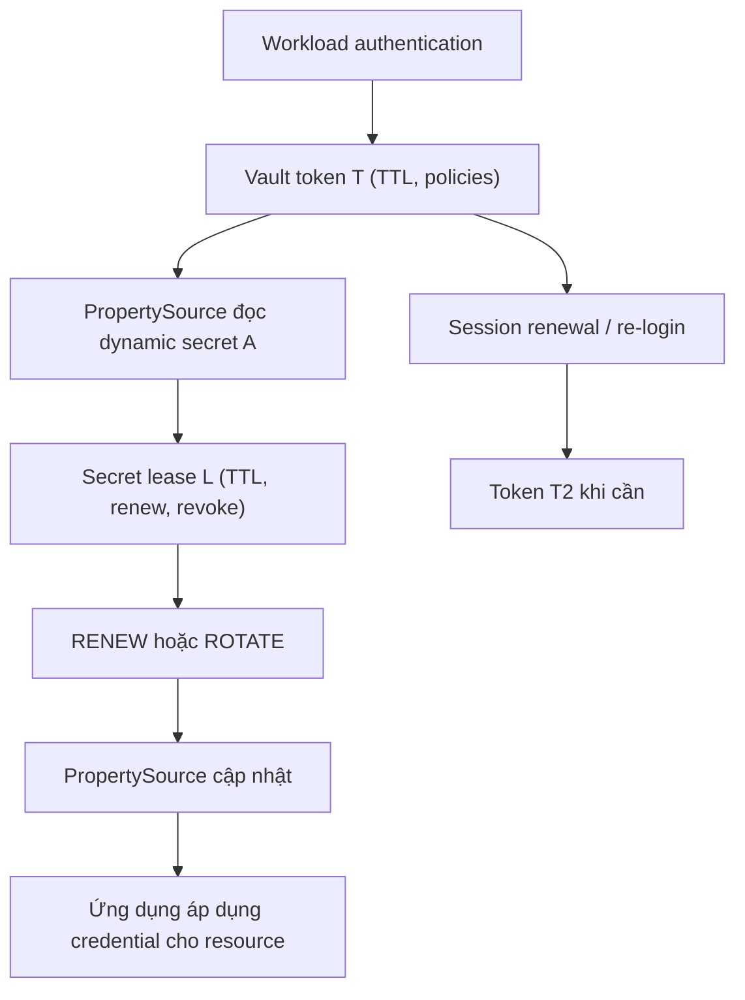

# Chế độ renewal và rotation của nguồn cấu hình

Một ứng dụng Java có thể đưa giá trị bí mật từ HashiCorp Vault vào Spring `Environment` như một **nguồn cấu hình (`PropertySource`)**. Cách này cho phép đọc các khóa như `reporting.username`, `reporting.password`, khóa API hoặc dữ liệu cấu hình nhạy cảm mà không viết chúng trực tiếp trong `application.yml`. Tuy nhiên, nếu Vault cấp **dynamic credentials có thời hạn**, giá trị cấu hình sẽ hết hiệu lực khi lease hết hạn. Nguồn cấu hình vì vậy cần chính sách **renewal (gia hạn)** hoặc **rotation (lấy giá trị mới)**.

Spring Vault cung cấp ba chế độ `@VaultPropertySource(renewal = ...)`: **`OFF`**, **`RENEW`** và **`ROTATE`**. Spring Cloud Vault cũng quản lý vòng đời lease của các nguồn cấu hình mà nó tích hợp bằng `spring.cloud.vault.config.lifecycle.*`. Hai cách cấu hình liên quan cùng một cơ chế nhưng **không dùng cùng một enum hay cùng giá trị mặc định**.

Bài học thuộc chương **Nguồn cấu hình**, trong module **SPRING_VAULT**. Ta sẽ nối khái niệm `PropertySource` với `SecretLeaseContainer`, `VaultTemplate`, Vault token, ACL, lease TTL, thao tác đổi credential của ứng dụng và kiểm thử tích hợp. Ví dụ xuyên suốt là secret tại `database/creds/reporting`: Vault sinh username/password động để một dịch vụ Java truy cập database.

## 1. Mục tiêu học tập

Sau bài học, bạn có thể:

1. Trình bày cách `VaultPropertySource` và `LeaseAwareVaultPropertySource` đưa dữ liệu Vault vào Spring `Environment`.
2. So sánh ý nghĩa, thời điểm renew và hành vi khi hết lease của **`OFF`**, **`RENEW`**, **`ROTATE`**.
3. Cấu hình `@VaultPropertySource` theo từng nguồn và nhóm `spring.cloud.vault.config.lifecycle.*` trong Spring Cloud Vault.
4. Giải thích vì sao **PropertySource đã nhận giá trị mới** không có nghĩa các bean, `@Value`, `@ConfigurationProperties` hay connection pool đều tự cập nhật.
5. Phân biệt dynamic secret có lease, KV v2 tĩnh, secret có TTL/`refresh_interval` và thời hạn Vault login token.
6. Kiểm tra sai path, lease expiry, lỗi renew/rotation, thứ tự ưu tiên nguồn cấu hình, rò rỉ credential và race condition.

## 2. PropertySource là gì và Vault xuất hiện ở đâu?

Spring `Environment` chứa một danh sách `PropertySource<?>` có thứ tự ưu tiên. Khi code gọi `environment.getProperty("reporting.username")`, Spring duyệt các nguồn theo thứ tự để tìm giá trị đầu tiên phù hợp. Giá trị có thể đến từ cấu hình ứng dụng, biến môi trường, system properties hoặc từ Vault.



Cần phân biệt hai hành động:

- **Tra cứu property:** Spring đọc một giá trị đang được `PropertySource` cung cấp.
- **Cập nhật property:** một thành phần quản lý lease nhận secret mới và cập nhật dữ liệu nội bộ của `PropertySource`. Các ứng dụng đang giữ bản sao cũ của property có thể **không biết** sự thay đổi này.

Một `PropertySource` không tự là cơ chế xác thực. Để gọi Vault, Spring Vault vẫn cần một **Vault login token** được cấp bằng AppRole, AWS IAM, Kubernetes, TLS certificate hoặc phương thức khác. Sau đó, Vault ACL quyết định đường dẫn secret nào được đọc và lease nào có thể được gia hạn hoặc thu hồi.

### Nguồn động và nguồn tĩnh

| Nguồn Vault | Ví dụ path | Đặc trưng | Điều cần lưu ý |
| --- | --- | --- | --- |
| **Dynamic Database secrets** | `database/creds/reporting` | Phát sinh username/password và lease | Hợp với renew/rotate |
| **Dynamic cloud credentials** | `aws/creds/reporting-role` | Phát sinh access key/secret key hoặc loại credential tương ứng | Có thể hết hạn, cần làm mới consumer |
| **KV v1/generic có TTL metadata** | `secret/legacy-app` | Có thể có `refresh_interval` nhưng không có lease ID | Spring Vault có logic làm mới theo TTL phù hợp backend |
| **KV v2 tĩnh** | `secret/payment` (logical path) | Có các version; không mặc nhiên là dynamic renewable lease | Đọc version mới nhất khác với tự theo dõi thay đổi |
| **PKI certificate** | `pki/issue/web-role` | Chứng thư có `notAfter` và cơ chế phát hành lại riêng | Không mặc nhiên renew như database lease |

Không giả định có thể dùng `ROTATE` để “định kỳ reread mọi key KV v2” nếu nguồn không cung cấp lease hay tín hiệu refresh. Với KV v2, nên thiết kế chiến lược phát hiện thay đổi, reload hoặc phát hành cấu hình độc lập khi cần; `@VaultPropertySource` có thể lấy phiên bản mới nhất **tại thời điểm đọc source** mà không cần thêm `data/` vào path.

## 3. Ba chế độ của `@VaultPropertySource.Renewal`

Spring Vault định nghĩa enum `org.springframework.vault.annotation.VaultPropertySource.Renewal` gồm:

```java
VaultPropertySource.Renewal.OFF
VaultPropertySource.Renewal.RENEW
VaultPropertySource.Renewal.ROTATE
```

### `OFF` — tắt quản lý lease từ annotation

Đây là **giá trị mặc định** của `@VaultPropertySource`. Nguồn vẫn đọc dữ liệu ban đầu nhưng **không chủ động gia hạn lease** cho secret theo cấu hình annotation này. Khi dynamic credential hết hạn ở Vault, giá trị mà ứng dụng đã lấy có thể không còn dùng được.

`OFF` phù hợp với cấu hình tĩnh hoặc ứng dụng chủ động tự kiểm soát vòng đời secret bằng một thành phần khác. Nó **không có nghĩa** cứ hết hạn thì Spring tự xóa bean hay phát hành secret mới.

### `RENEW` — giữ lease hiện hành

Khi secret có lease cho phép renew, Spring Vault gửi yêu cầu gia hạn trước khi lease hết hạn. Mục tiêu là **giữ bộ credential đã phát hành có hiệu lực càng lâu càng được phép**, cho tới giới hạn `max TTL` hoặc khi Vault từ chối renew. Khi đạt hạn cuối, `RENEW` **không tự xin một bộ credential thay thế** theo ngữ nghĩa của mode.

Khi renew thành công, thông thường `username`/`password` không đổi; **TTL mới** của lease mới là dữ liệu thay đổi. Đừng gắn listener `AfterSecretLeaseRenewedEvent` vào logic bắt buộc phải thay DataSource.

### `ROTATE` — renew rồi lấy secret mới khi lease hết hạn

`ROTATE` **cũng thử renew trước**. Khi lease đến giới hạn cuối và hết hạn, Spring Vault cố **lấy một bộ secret mới** từ cùng đường dẫn, nhận lease mới và cập nhật nội dung nguồn cấu hình. Với dynamic credentials, bản mới có thể mang username/password và lease ID khác hoàn toàn.

Nếu backend, token, ACL hoặc kết nối mạng ngăn việc lấy lại secret, quá trình rotation có thể thất bại. Không có cam kết rằng credential mới xuất hiện ngay đúng thời điểm lease cũ hết hạn, hoặc rằng toàn bộ tài nguyên phụ thuộc trong ứng dụng đã đổi sang credential mới.

| Tiêu chí | `OFF` | `RENEW` | `ROTATE` |
| --- | --- | --- | --- |
| Mặc định của `@VaultPropertySource` | **Có** | Không | Không |
| Đọc secret ban đầu | Có | Có | Có |
| Tự renew lease | Không | Có nếu đủ điều kiện | Có nếu đủ điều kiện |
| Giữ credential cũ khi renew thành công | Không có renew từ source | Có | Có |
| Khi đến terminal lease expiry | Không có lifecycle renewal | Dừng ở expiry; không tự lấy bộ mới | Cố lấy secret/lease mới |
| Có thể thay username/password trong runtime | Không từ cơ chế này | Không do bản thân renew | **Có**, nếu fetch mới thành công |
| Phù hợp | Tĩnh hoặc cơ chế refresh khác | Job/secret cần duy trì một credential cố định | Workload sống lâu cần credential luân phiên |

**Điểm cần nhớ:** `ROTATE` không tương đương “mỗi vài giây lấy một mật khẩu mới”. Lịch hoạt động phụ thuộc TTL, renewability, max lease time, scheduler và độ trễ Vault.

## 4. Timeline minh họa với database credentials

Giả sử Vault tạo credential `A` lúc 09:00, TTL 30 phút, renewable và có thời điểm cuối không thể gia hạn thêm khoảng 11:00.

| Thời điểm | `OFF` | `RENEW` | `ROTATE` |
| --- | --- | --- | --- |
| 09:00 | PropertySource đọc A | PropertySource đọc A | PropertySource đọc A |
| 09:25 | Không renew | Có thể renew lease A | Có thể renew lease A |
| 10:15 | A có thể đã hết hạn | Tiếp tục dùng A sau renew | Tiếp tục dùng A sau renew |
| Gần 11:00 | Không xử lý lease | Cố renew cho đến giới hạn | Cố renew cho đến giới hạn |
| Lease A hết hạn | Nguồn không bảo đảm A còn hợp lệ | Không tự fetch B | Cố fetch credential B, lease mới |
| Sau expiry | Ứng dụng phải xử lý theo thiết kế | Không được tiếp tục tin A còn hợp lệ | Nguồn có thể chứa B, nếu đã rotate thành công |



Thời điểm gia hạn/rotate **không cố định**. Mỗi engine và role có thời gian tối đa khác nhau; việc lên lịch còn chịu ảnh hưởng của `expiryThreshold`, `minRenewal`, đồng hồ nội bộ và lỗi mạng. Timeline chỉ dùng để đối chiếu ngữ nghĩa.

## 5. Cấu hình `@VaultPropertySource` theo từng nguồn

Để dùng Spring Vault thuần, import `@VaultPropertySource` từ `org.springframework.vault.annotation`. Ví dụ:

```java
import org.springframework.context.annotation.Configuration;
import org.springframework.vault.annotation.VaultPropertySource;

@Configuration(proxyBeanMethods = false)
@VaultPropertySource(
        value = "database/creds/reporting",
        propertyNamePrefix = "reporting.",
        renewal = VaultPropertySource.Renewal.ROTATE,
        ignoreSecretNotFound = false)
public class ReportingVaultProperties {
}
```

Khi Vault trả map:

```json
{
  "lease_id": "database/creds/reporting/<lease-id>",
  "renewable": true,
  "lease_duration": 1800,
  "data": {
    "username": "v-reporting-a",
    "password": "<mat-khau-bao-mat>"
  }
}
```

nguồn cấu hình đóng góp các property tương ứng **`reporting.username`** và **`reporting.password`**. Tiền tố `reporting.` giúp tránh xung đột với property `username` chung của các nguồn khác. Payload trên đã rút gọn so với response Vault thật.

Để chỉ gia hạn mà không fetch credential mới sau terminal expiry:

```java
@Configuration(proxyBeanMethods = false)
@VaultPropertySource(
        value = "database/creds/reporting",
        propertyNamePrefix = "reporting.",
        renewal = VaultPropertySource.Renewal.RENEW)
class RenewOnlyReportingConfig {
}
```

Các cấu hình trên là **hai biến thể độc lập**, không dùng đồng thời cho cùng một nguồn trong một ứng dụng: điều đó có thể tạo hai đường quản lý lease và các property trùng tên.

### Ý nghĩa các tham số annotation

| Tham số | Ý nghĩa | Khuyến nghị |
| --- | --- | --- |
| `value` | Một hoặc nhiều đường dẫn bí mật ở Vault | Đặt đúng mount/path backend |
| `propertyNamePrefix` | Thêm prefix vào key | Tách key giữa các engine/workload |
| `renewal` | `OFF`, `RENEW` hoặc `ROTATE` | Căn cứ TTL và khả năng cập nhật consumer |
| `ignoreSecretNotFound` | Có thể bỏ qua source không tìm thấy; mặc định `true` | Với secret bắt buộc, nên đặt `false` |
| `vaultTemplateRef` | Tên bean `VaultTemplate` dùng để truy cập Vault; mặc định `vaultTemplate` | Dùng đúng client, namespace và TLS settings |

Nếu một `@Configuration` class có `@VaultPropertySource` nhưng Bean cần credential ngay khi khởi tạo, phải thiết kế đúng thứ tự initialization. Không đưa logic đổi pool vào constructor của chính bean mà làm phát sinh vòng phụ thuộc với Vault connection.

### Đường dẫn KV v2

Với KV v2, path logic như `secret/payment` được Spring Vault xử lý qua mount detection; **không tự thêm `data/`** vào `@VaultPropertySource(value = ...)`. Đường dẫn HTTP `/v1/secret/data/payment` là dạng API thấp hơn; annotation dùng path mức logic. Cần quyền Vault phù hợp với endpoint API cuối cùng, không suy ACL từ tên property.

## 6. Lớp vận hành phía dưới: `LeaseAwareVaultPropertySource`

Khi bật lifecycle, Spring Vault có `org.springframework.vault.core.env.LeaseAwareVaultPropertySource`. Đây là `EnumerablePropertySource` lấy secret qua `SecretLeaseContainer` với một `RequestedSecret` tương ứng.

Tài liệu Spring Vault nêu rõ **nội dung của nguồn này có thể được cập nhật từ background threads, là dữ liệu thay đổi được**, và **property bị loại khi lease hết hạn hoặc bị revoke**.

Ví dụ dựng programmatic (được đặt vào giai đoạn cấu hình `Environment` trước khi ứng dụng cần các property):

```java
import org.springframework.core.env.ConfigurableEnvironment;
import org.springframework.vault.core.env.LeaseAwareVaultPropertySource;
import org.springframework.vault.core.lease.SecretLeaseContainer;
import org.springframework.vault.core.lease.domain.RequestedSecret;

// environment và leaseContainer do hệ thống cấu hình Spring cung cấp.
RequestedSecret request =
        RequestedSecret.rotating("database/creds/reporting");

LeaseAwareVaultPropertySource propertySource =
        new LeaseAwareVaultPropertySource(
                "vault-reporting", leaseContainer, request);

environment.getPropertySources().addFirst(propertySource);
```

Đây là **đoạn minh họa đăng ký**, không phải toàn bộ class Spring Boot chạy độc lập: `environment` và `leaseContainer` phải được khởi tạo, đăng ký, quản lý lifecycle đúng thứ tự. Constructor của `LeaseAwareVaultPropertySource` **tự yêu cầu secret qua container** khi khởi tạo; không nên tạo các đăng ký trùng lặp hoặc hai container cùng quản lý cùng một nguồn mà không có lý do.

### Quan hệ với `RequestedSecret.Mode`

`@VaultPropertySource.Renewal` có **ba** giá trị. `RequestedSecret.Mode` chỉ có **`RENEW` và `ROTATE`**:

```java
RequestedSecret renew =
        RequestedSecret.renewable("database/creds/reporting");

RequestedSecret rotate =
        RequestedSecret.rotating("database/creds/reporting");
```

Hai mode này xác định hành vi của `SecretLeaseContainer`. `OFF` là quyết định **không đăng ký vòng đời renew từ property source**, nên không có `RequestedSecret.Mode.OFF`. Không dùng nhầm hai enum có tên gần giống nhau.

### Chuỗi xử lý lease events



`SecretLeaseRotatedEvent` kế thừa `SecretLeaseCreatedEvent`. Khi viết listener phân biệt hai loại, kiểm tra rotated trước created hoặc cố ý dùng nhánh chung nếu muốn nhận cả initial và rotation. `AfterSecretLeaseRenewedEvent` không đồng nghĩa có secret mới.

## 7. Spring Cloud Vault ConfigData và lease lifecycle

Với Spring Boot sử dụng **Spring Cloud Vault Config**, thông thường việc đưa Vault thành `PropertySource` được thực hiện sớm bằng **ConfigData API** (`spring.config.import: "vault://"`). Cơ chế này có thể tạo nhiều nguồn từ KV và các secret backend được bật.

Ví dụ `application.yml` chỉ thể hiện cách chọn nguồn và lịch quản lý lease; phương thức authentication và credential cấp cho Spring Cloud Vault cần được cấu hình riêng:

```yaml
spring:
  config:
    import: "vault://"
  cloud:
    vault:
      uri: https://vault.internal.example:8200
      database:
        enabled: true
        backend: database
        role: reporting
        username-property: spring.datasource.username
        password-property: spring.datasource.password
      config:
        lifecycle:
          enabled: true
          min-renewal: 10s
          expiry-threshold: 1m
      session:
        lifecycle:
          enabled: true
          refresh-before-expiry: 5s
          expiry-threshold: 7s
```

Trong ví dụ, Spring Cloud Vault cấu hình database backend để đọc dynamic credentials theo role `reporting` và đóng góp vào `spring.datasource.username`/`spring.datasource.password`. Tên mount, role và cả tên property phải phù hợp với hệ thống thực tế; YAML chưa bao gồm authentication, TLS truststore và dependency của ứng dụng.

**Lưu ý về mặc định:** trong Spring Cloud Vault, `spring.cloud.vault.config.lifecycle.enabled` **thường mặc định là `true`** để quản lý lease của nguồn cấu hình tích hợp. Điều này **khác** `@VaultPropertySource(renewal = OFF)` trong Spring Vault thuần. Không suy diễn mặc định của một cơ chế sang cơ chế còn lại.

### Hai nhóm lifecycle độc lập

| Nhóm cấu hình | Điều khiển | Điều gì bị tác động khi tắt? |
| --- | --- | --- |
| `spring.cloud.vault.config.lifecycle.*` | Lease gắn với secret/nguồn cấu hình | Secret lease có thể không được renew hoặc rotate |
| `spring.cloud.vault.session.lifecycle.*` | **Vault login token** dùng để gọi API | Token có thể hết hạn, không renew/re-login theo quản lý session |

Token đăng nhập và lease secret thường có liên hệ: nếu Vault token tạo dynamic secret bị hết hạn/thu hồi, các lease phụ thuộc có thể bị thu hồi theo quan hệ token/lease. **Bật secret lifecycle nhưng tắt session lifecycle** không bảo đảm động cơ renew secret còn quyền gọi Vault dài hạn.

Các version Spring Cloud Vault có thể khác về tên thuộc tính, endpoint mặc định và secret backend tích hợp. Cần kiểm tra hướng dẫn của **phiên bản Spring Cloud Vault + Spring Boot đang chạy**, không sao chép cấu hình legacy `bootstrap.yml` mà không đối chiếu ConfigData API.

### Renewal/rotation trong ConfigData có giống @VaultPropertySource không?

`@VaultPropertySource` điều khiển **một nguồn** qua enum `Renewal`. `spring.cloud.vault.config.lifecycle.enabled` là **công tắc vòng đời tổng thể** và các tham số lịch/chiến lược dành cho các nguồn cấu hình được Spring Cloud Vault quản lý.

Không có ý nghĩa rằng `enabled=true` là phép gán trực tiếp `Renewal.ROTATE` vào mọi source: từng backend có đặc điểm lease và chính sách riêng. Cần xác minh source thực tế có lease, có thể renew/rotate, và consumer có được cập nhật hay không.

## 8. Vấn đề lớn nhất: PropertySource thay đổi nhưng bean không đổi

Giả sử `LeaseAwareVaultPropertySource` đã cập nhật `reporting.username` từ A sang B. Có ba cách ứng dụng tiêu thụ property:

| Cách đọc | Khi property source đổi | Giới hạn |
| --- | --- | --- |
| `environment.getProperty("reporting.username")` mỗi lần cần | Có thể đọc được giá trị mới tại thời điểm gọi | Hai property đọc tách biệt có thể đến từ hai generation khác nhau |
| `@Value("${reporting.username}")` inject vào một field | Thông thường field được gán **lúc tạo bean** | Không tự inject lại khi nguồn cập nhật |
| `@ConfigurationProperties` bind vào bean startup | Các field đã bind thường giữ giá trị cũ | Không tự rebind trừ khi có cơ chế refresh/rebind riêng |
| DataSource/HTTP client/TLS context đã khởi tạo | Tiếp tục dùng credential/config đã áp vào resource | Cần cập nhật resource hoặc thay bằng instance mới |

**Đây không phải lỗi của Vault.** `PropertySource` là chỗ tra cứu configuration value; Spring không mặc định điều phối mọi object đã tiêu thụ giá trị đó. Cơ chế `@RefreshScope`/refresh event của Spring Cloud (nếu được cấu hình và kích hoạt đúng cách) là vấn đề riêng, **không tự động phát sinh chỉ vì lease được renew/rotate**.

### Ví dụ gây hiểu nhầm

```java
import org.springframework.beans.factory.annotation.Value;
import org.springframework.stereotype.Component;

@Component
class StaticReportingCredentials {
    @Value("${reporting.username}")
    private String username;

    @Value("${reporting.password}")
    private String password;

    // Hai field này không tự đổi chỉ vì PropertySource xoay vòng.
}
```

Nếu một DataSource được tạo từ hai field này lúc startup, lease ở Vault có thể đã rotate nhưng DataSource vẫn dùng credential A.

### Đọc Environment mỗi lần vẫn có race condition

```java
String username = environment.getProperty("reporting.username");
// Đúng lúc này PropertySource được cập nhật từ A sang B.
String password = environment.getProperty("reporting.password");
// Có thể trộn username A với password B.
```

`LeaseAwareVaultPropertySource` có thể thay dữ liệu từ background thread; **không coi hai lời gọi `getProperty(...)` là một giao dịch atomic**. Khi có nhiều field phải đi cùng nhau (username/password, certificate/private key, endpoint/token), nên dùng **một snapshot bất biến** được công bố nguyên khối.

## 9. Công bố credential mới đồng bộ và cập nhật tài nguyên thật

Một mẫu thiết kế cho ứng dụng Java chạy nhiều thread:

1. Spring Vault nhận `SecretLeaseCreatedEvent` hoặc `SecretLeaseRotatedEvent` từ đúng path.
2. Thành phần xử lý đọc **toàn bộ `event.getSecrets()` trong cùng một event**.
3. Kiểm tra đủ trường và dựng một immutable snapshot.
4. Chuyển một reference atomically để các reader thấy **một phiên bản nguyên vẹn**.
5. Nếu secret dùng để kết nối database/TLS, chuẩn bị và xác minh resource mới **trước khi công bố**; sau đó drain resource cũ theo trạng thái request đang chạy.

### Ví dụ dùng `AtomicReference`

```java
import java.util.Map;
import java.util.Objects;
import java.util.concurrent.atomic.AtomicReference;

import org.springframework.vault.core.lease.SecretLeaseContainer;
import org.springframework.vault.core.lease.domain.RequestedSecret;
import org.springframework.vault.core.lease.event.*;

record ReportingCredential(String username, String password) {
    ReportingCredential {
        Objects.requireNonNull(username);
        Objects.requireNonNull(password);
        if (username.isBlank() || password.isBlank()) {
            throw new IllegalArgumentException("Thiếu database credential");
        }
    }
}

final class CredentialSnapshotStore {
    private final AtomicReference<ReportingCredential> current =
            new AtomicReference<>();

    void attach(SecretLeaseContainer container, RequestedSecret requested) {
        // Đăng ký trước khi container bắt đầu lấy secret.
        container.addLeaseListener(new LeaseListenerAdapter() {
            @Override
            public void onLeaseEvent(SecretLeaseEvent event) {
                if (!requested.equals(event.getSource())) {
                    return;
                }
                // RotatedEvent kế thừa CreatedEvent: nhánh này
                // cố ý xử lý cả lần đầu và lần rotate.
                if (event instanceof SecretLeaseCreatedEvent created) {
                    Map<String, Object> secrets = created.getSecrets();
                    ReportingCredential next = new ReportingCredential(
                            Objects.toString(secrets.get("username"), ""),
                            Objects.toString(secrets.get("password"), ""));
                    current.set(next); // công bố CẢ CẶP cùng lúc
                }
            }
        });
    }

    ReportingCredential requireCurrent() {
        ReportingCredential value = current.get(); // đọc một lần
        if (value == null) {
            throw new IllegalStateException("Chưa có credential hợp lệ");
        }
        return value;
    }
}
```

`RequestedSecret requested` là chính request mà `SecretLeaseContainer` quản lý, ví dụ `RequestedSecret.rotating("database/creds/reporting")`; đối tượng `container` phải được start/stop bằng lifecycle Spring. Nếu ứng dụng dùng `@VaultPropertySource`, ví dụ này chỉ minh họa **một consumer riêng** của lease events; tránh tự tạo thêm một container và một lease độc lập chỉ vì đã có annotation.

Code ví dụ chỉ cho thấy **cách công bố dữ liệu cùng nhau**. Để dùng production, cần thêm liên kết đúng lease ID, xử lý event expiry/stale, health check, error listener và cơ chế chuyển database pool. Không log `ReportingCredential` vì `record.toString()` có thể làm lộ password.

### Nếu consumer là connection pool

Thay cả pool theo trình tự **prepare → validate → atomic swap → drain**. Một `AtomicReference<HikariDataSource>` đổi pointer không tự bảo vệ những request đang sử dụng pool cũ khỏi việc pool bị đóng; cần cơ chế mượn/trả handle, reference count hoặc coordination tương đương.

Không giả định `HikariDataSource.setUsername(...)` rồi `setPassword(...)` là thao tác atomic và không cho rằng connection hiện tại sẽ tự reauthenticate. Lúc Vault revoke credential cũ, request mở connection mới bằng A có thể thất bại; monitor và readiness phải phản ánh trạng thái này.

## 10. Thứ tự ưu tiên và nguy cơ fallback bất ngờ

Spring `Environment` duyệt các property sources theo **thứ tự ưu tiên**. Ví dụ source từ Vault được thêm bằng `sources.addFirst(...)` thường có ưu tiên cao hơn các source đang có; dùng `addLast(...)` thì ngược lại.

Giả sử:

```text
Priority cao  → VaultPropertySource: reporting.password = "<secret-B>"
Priority thấp → application.yml: reporting.password = "fallback-demo"
```

Khi dynamic source còn giá trị, lookup trả `<secret-B>`. Nếu một `LeaseAwareVaultPropertySource` loại bỏ property sau khi lease expire/revoke, lookup có thể **rơi xuống giá trị từ source ưu tiên thấp hơn**. Đây là hậu quả cần xem xét về bảo mật và tính đúng đắn: một mật khẩu cũ hoặc giá trị thử nghiệm trong `application.yml` có thể vô tình được dùng.

Do đó:

- Không đặt **fallback password production** trong file ứng dụng.
- Với secret bắt buộc, fail fast hoặc dùng readiness gate khi nguồn Vault không có giá trị.
- Nếu có nhiều `PropertySource` cùng định nghĩa một key, xác định rõ priority của từng source.
- Ưu tiên tên property có prefix để giảm va chạm giữa các nguồn.
- Không coi `ignoreSecretNotFound=true` là phù hợp với mọi secret; đây là mặc định dành cho những nguồn có thể tùy chọn.

`@VaultPropertySource` đặt trên các class được component-scan có thứ tự đăng ký khó kiểm soát chính xác. Khi precedence là yêu cầu nghiệp vụ, cấu hình programmatic `ConfigurableEnvironment.getPropertySources()` là cách rõ ràng hơn.

## 11. Các trường hợp không áp dụng trực tiếp mode ROTATE

### KV v2 static secrets

KV v2 lưu **version**, không tương đương cấp một database lease mới. Nếu ai đó sửa `secret/payment` từ version 2 lên version 3, Spring `Environment` đã đọc version 2 lúc startup không mặc nhiên nhận một “lease expiry event” để tải version 3.

`@VaultPropertySource(value = "secret/payment")` có thể đọc phiên bản hiện hành khi source được tải. Muốn tự động nhìn thấy thay đổi tiếp theo, cần thiết kế **refresh/reload rõ ràng** (cơ chế phát sự kiện từ deployment, polling có kiểm soát, restart/refresh context) và xử lý cập nhật bean/tài nguyên.

### Transit encryption

Transit API tạo ciphertext hoặc thực hiện decrypt theo khóa Vault; nó **không** có secret username/password với dynamic lease như `database/creds`. Xoay phiên bản khóa Transit không biến một `VaultPropertySource` thành nguồn credential cần mode `ROTATE`. Khi cần rotate key version, dùng API Transit và chính sách khóa thích hợp.

### PKI certificates

Chứng thư X.509 có thời hạn `notBefore`/`notAfter` và có thể cần **phát hành lại**. Spring Vault mới có `CertificateContainer` để quản lý chứng thư, vì nhiều certificate không dùng lease renewable theo kiểu database secrets. Không áp `RENEW` của một database lease cho private key/certificate mà không xem đặc tính engine.

### Secret không renewable hoặc không có lease ID

Nếu backend không có renewable lease, `RENEW` không tạo ra khả năng renew. Với các nguồn generic có `refresh_interval`, tài liệu Spring Vault mô tả cơ chế làm mới theo TTL của nguồn đó dù không có lease ID; hành vi vẫn phụ thuộc backend và version thư viện.

## 12. Vault ACL và token lifecycle

Giả sử service chỉ có quyền lấy database credential từ role `reporting`. Vault ACL tối thiểu có thể bắt đầu bằng:

```hcl
path "database/creds/reporting" {
  capabilities = ["read"]
}
```

Khi cần quản lý lease, hãy kiểm tra thêm đúng endpoint mà Spring Vault sử dụng và capabilities phù hợp. Với endpoint hiện đại:

```hcl
# Ví dụ minh họa đường API; cấp quyền theo policy/role thực tế.
path "sys/leases/renew" {
  capabilities = ["update"]
}

path "sys/leases/revoke" {
  capabilities = ["update"]
}
```

Không mở rộng `database/*` hoặc `sys/leases/*` vô điều kiện. Với một số thao tác lease, Vault có thể cho chủ sở hữu token làm việc theo token/lease context mà không cần policy rộng tương ứng; kiểm thử policy thực tế trước khi cấp thêm quyền.

Ngoài ra, truy cập KV v2 có thể cần mount discovery qua `sys/internal/ui/mounts/...`; và login token có API lookup/renew/revoke riêng. Spring Vault xử lý chúng theo `VaultTemplate`/session manager, không theo property renewal enum.

**Cần tách hai vòng đời:**



Khi token mẹ `T` bị thu hồi hoặc hết hạn, Vault có thể thu hồi lease phụ thuộc `L`. Dù cấu hình `ROTATE` hợp lý, request lấy credential mới vẫn thất bại nếu session không còn quyền hoặc không thể đăng nhập lại.

## 13. Thiết kế giám sát và xử lý lỗi

Các lỗi dưới đây thường bị nhầm thành “`@VaultPropertySource` không hoạt động”:

| Triệu chứng | Nguyên nhân có thể | Cách kiểm tra/xử lý |
| --- | --- | --- |
| Giá trị được nạp lúc startup rồi không đổi | `renewal` mặc định `OFF` hoặc secret tĩnh không có lease | Xác định nguồn và chế độ; thiết kế refresh nếu là KV v2 |
| Lease renew thành công nhưng username vẫn như cũ | `RENEW`/`ROTATE` đang **gia hạn** cùng credential | Hành vi bình thường; quan sát lease TTL |
| Lease hết hạn nhưng không có credential mới | Dùng `RENEW`, backend/ACL lỗi hoặc fetch mới thất bại | Dùng `ROTATE` khi phù hợp, kiểm tra lease error |
| Source đã có B, bean vẫn dùng A | `@Value` hoặc `@ConfigurationProperties` bind lúc khởi tạo | Áp dụng refresh/rebind hoặc consumer snapshot/đổi resource |
| Hai key username/password khác phiên bản | Đọc hai property ở hai thời điểm qua `Environment` | Công bố immutable snapshot từ cùng secret event |
| DB 403/authentication failed sau rotation | Pool chưa đổi credential, connection mới vẫn dùng A | Prepare/validate/swap/drain pool |
| Environment trả fallback bí mật cũ | Vault source xóa property sau expiry/revoke, source khác còn key | Rà soát precedence, bỏ fallback nhạy cảm |
| Lỗi 403 ngay khi đọc secret | Vault token thiếu `read` trên path hoặc role chưa phù hợp | Xem ACL, mount, auth method và response lỗi đã lọc |
| Mọi secret dừng renew sau vài giờ | Vault login token hết TTL/không re-login được | Kiểm tra `session.lifecycle` và nguồn credential auth |
| Renew lỗi mạng không ổn định | Timeout, network/TLS, Vault unavailable | Bounded retry/backoff và cảnh báo trước terminal expiry |

`SecretLeaseContainer` có chiến lược xử lý lỗi như `DropOnError`, `RetainOnError`, `RetainOnIoError` tùy phiên bản. **Giữ một lease trong state nội bộ sau lỗi I/O không chứng minh nó còn hiệu lực trên Vault**; cần kiểm tra TTL thực tế và health của tài nguyên phụ thuộc.

### Metric nên có

- `vault_secret_lease_renew_success_total` / `vault_secret_lease_renew_error_total` theo engine, role, loại lỗi.
- `vault_secret_rotation_success_total` / `vault_secret_rotation_error_total` cùng độ trễ giữa event và consumer áp dụng.
- `secret_lease_remaining_seconds` và `vault_login_token_remaining_seconds` (hai gauge riêng).
- `credential_generation_active` hoặc trạng thái version nội bộ không chứa secret/lease ID đầy đủ làm high-cardinality label.
- `database_pool_cutover_duration_seconds`, pool cũ còn borrowers và `readiness`.

Tuyệt đối không log username/password, token, private key, toàn bộ map `event.getSecrets()` hoặc response Vault chứa secret. Log loại sự kiện, path/role đã chuẩn hóa, mã lỗi, request ID và thời gian, với kiểm soát truy cập phù hợp.

## 14. Kiểm thử tích hợp cho PropertySource

Các ca sau nên thực hiện trong Vault thử nghiệm với một dynamic secret role có TTL và max TTL đủ ngắn để quan sát, cùng một database test thật nếu kiểm tra credential rotation.

| Ca kiểm thử | Cấu hình/thao tác | Kết quả mong đợi |
| --- | --- | --- |
| 1. `OFF` | `@VaultPropertySource` không chỉ định `renewal` | Đọc secret đầu, không có lifecycle renew từ annotation |
| 2. `RENEW` | Secret renewable, TTL ngắn | Lease được gia hạn; giữ cùng credential |
| 3. `ROTATE` | Secret renewable đạt max TTL | Source lấy secret mới/lease mới khi backend cho phép |
| 4. Secret không renewable | `RENEW` hoặc `ROTATE` | Không giả định sẽ renew được; hành vi expiry theo mode/backend |
| 5. Không tìm thấy secret bắt buộc | `ignoreSecretNotFound=false` | Khởi tạo hoặc tải source thất bại rõ ràng |
| 6. Prefix | `propertyNamePrefix="reporting."` | Có `reporting.username`/`reporting.password` |
| 7. Precedence | Hai source cùng có key, thay `addFirst/addLast` | Giá trị theo thứ tự cấu hình được xác định |
| 8. Expiry/revoke | Thu hồi lease test và quan sát source có quản lý lease | Property bị loại/cảnh báo theo lifecycle; kiểm tra fallback |
| 9. `@Value` giữ snapshot | Tạo bean từ property A rồi source rotate sang B | Bean cũ không tự nhận B |
| 10. Thread safety | Rotation xảy ra giữa hai lần lookup | Phát hiện rủi ro mixed value; snapshot tránh lỗi |
| 11. Pool transition | Consumer chuẩn bị pool B và swap | New connections dùng B; old requests được drain |
| 12. Token session hết hạn | Thu hồi Vault login token và thử renew lease | Lỗi được nhận diện theo session/lease, re-login theo chính sách |
| 13. Tắt Spring Cloud lifecycle | `config.lifecycle.enabled=false` | Không tiếp tục quản lý renew/rotation tự động từ cơ chế này |
| 14. KV v2 đổi version | Cập nhật KV v2 bên ngoài ứng dụng | Không giả định PropertySource tự nhận event như dynamic lease |
| 15. Không log secret | Bật log tích hợp đã kiểm soát | Không xuất hiện credential/token trong logs |

Kiểm thử nên xác nhận cả **nội dung `Environment` hiện hành**, **TTL/lease ID** và **kết nối thật của resource tiêu thụ secret**. Nếu chỉ assert `Environment` trả B sau rotate thì chưa chứng minh DataSource hay TLS context đang dùng B.

### Một bộ assertion tối thiểu

```text
start Vault test backend with dynamic role
load Spring configuration with renewal = ROTATE
assert Environment has username/password A
assert no plaintext credential was logged

wait for terminal lease expiry in bounded test window
assert PropertySource eventually exposes a complete secret B
assert lease B differs from lease A where backend guarantees new lease

if a live DataSource exists:
    assert connection pool has cut over to B
    assert new database connection succeeds with B

stop application context
assert scheduled lease management stopped
```

Đây là **pseudocode** mô tả tiêu chí test, không phải Java/JUnit thực thi độc lập. Với các bài kiểm thử có thời gian, dùng timeout cố định hợp lý, clock giả nếu phù hợp và tránh `sleep` tùy ý lâu. Không dùng credential production trong unit/integration test.

## 15. Chọn chế độ nào?

| Mục đích | Chọn | Điều kiện vận hành |
| --- | --- | --- |
| Đọc cấu hình KV tĩnh lúc khởi động | `OFF` hoặc cơ chế refresh độc lập | Không nhầm version KV với dynamic lease |
| Job ngắn hạn cần giữ một dynamic credential | `RENEW` | Có phương án dừng/fail khi max lease TTL đến |
| Service chạy lâu cần thay dynamic credential | `ROTATE` | Consumer phải cập nhật token, pool hoặc client thật |
| Muốn Spring Cloud Vault tự quản lý lease nguồn cấu hình | `config.lifecycle.enabled=true` | Xác minh backend nguồn được hỗ trợ và token lifecycle |
| Có bean chỉ bind property tại startup | Dùng cơ chế refresh/rebind rõ ràng hoặc consumer riêng | PropertySource mới không tự đổi bean cũ |
| Secret cần nhất quán qua nhiều field | Snapshot bất biến + điểm publish atomic | Không đọc hai property ở hai generation khác nhau |
| Cần điều khiển lease theo từng nguồn trong Spring Vault | `@VaultPropertySource(renewal=...)` | Tránh đè hoặc trùng một nguồn với Cloud Vault |

**Nguyên tắc chính:** nguồn cấu hình chỉ chịu trách nhiệm **cung cấp và cập nhật các giá trị có thể tra cứu**. `RENEW` giữ lease hiện hành, `ROTATE` có thể đưa secret mới vào PropertySource, nhưng ứng dụng còn phải **đồng bộ việc sử dụng giá trị mới** và kiểm soát Vault login token, ACL, TTL cùng lỗi của tài nguyên đích. Đây là khác biệt giữa “PropertySource đã được refresh” và “ứng dụng đã vận hành ổn định với credential mới”.

## 16. Câu hỏi tự kiểm tra

1. Vì sao mặc định `OFF` của `@VaultPropertySource` không mâu thuẫn với `spring.cloud.vault.config.lifecycle.enabled=true`?
2. Khi `RENEW` thành công, `username`/`password` trong source có bắt buộc thay đổi không?
3. Tại sao `ROTATE` không đồng nghĩa “không renew” và không cam kết rotation theo chu kỳ cố định?
4. Nếu một bean nhận `@Value("${reporting.password}")` lúc startup, tại sao bean đó có thể tiếp tục dùng A khi `Environment` đã trả B?
5. Vì sao đọc `reporting.username` và `reporting.password` bằng hai lệnh `getProperty` riêng có thể sai dù PropertySource tự quản lý concurrency?
6. Nếu source Vault gỡ `reporting.password` sau expiry, điều gì có thể xảy ra khi `application.yml` có property trùng tên?
7. Nêu khác biệt giữa Vault token TTL, dynamic lease TTL và KV v2 version.
8. Trường hợp nào nên dùng `CertificateContainer` hoặc cơ chế phát hành chứng thư thay cho `Renewal.ROTATE` của một nguồn database credential?

## Tài liệu tham khảo

- [Spring Vault — Property Sources và @VaultPropertySource](https://docs.spring.io/spring-vault/reference/vault/propertysource.html)
- [Spring Vault — VaultPropertySource.Renewal (OFF, RENEW, ROTATE)](https://docs.spring.io/spring-vault/reference/api/java/org/springframework/vault/annotation/VaultPropertySource.Renewal.html)
- [Spring Vault — LeaseAwareVaultPropertySource](https://docs.spring.io/spring-vault/reference/api/java/org/springframework/vault/core/env/LeaseAwareVaultPropertySource.html)
- [Spring Vault — Credential Rotation và SecretLeaseContainer](https://docs.spring.io/spring-vault/reference/vault/credential-rotation.html)
- [Spring Vault — RequestedSecret.Mode](https://docs.spring.io/spring-vault/reference/api/java/org/springframework/vault/core/lease/domain/RequestedSecret.Mode.html)
- [Spring Cloud Vault — ConfigData API](https://docs.spring.io/spring-cloud-vault/reference/config-data.html)
- [Spring Cloud Vault — Lease lifecycle management](https://docs.spring.io/spring-cloud-vault/reference/advanced-topics.html)
- [HashiCorp Vault — Lease, Renew, Revoke](https://developer.hashicorp.com/vault/docs/concepts/lease)
