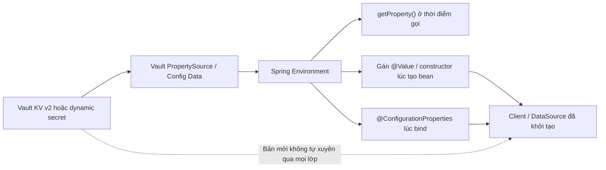
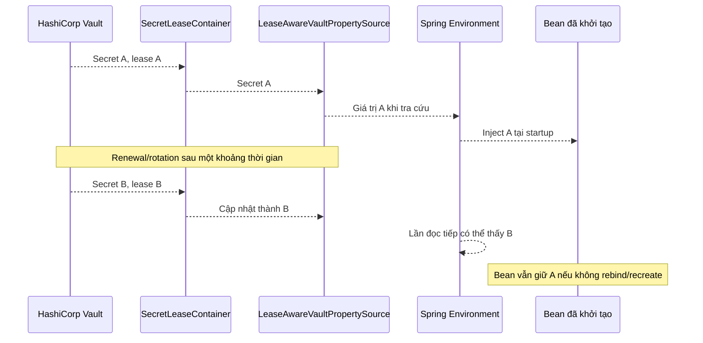

# Đọc lại Environment và giới hạn của giá trị đã gán cho bean

Khi Spring Vault hoặc Spring Cloud Vault đưa secret từ HashiCorp Vault vào **Spring `Environment`**, ứng dụng có thể truy xuất thuộc tính qua `Environment.getProperty(...)`, `@Value` hoặc `@ConfigurationProperties`. Nhưng ba cách này **không có cùng cơ chế cập nhật**. Nếu giá trị trong Vault đổi trong lúc chương trình hoạt động, một lần đọc mới từ `Environment` *có thể* trả giá trị mới khi `PropertySource` đã được làm mới; trong khi một field được gán lúc tạo bean hoặc một client đã được dựng với cấu hình cũ thường vẫn giữ giá trị cũ.

Đây là chủ đề của chương **Nguồn cấu hình**, trong module `SPRING_VAULT`: ứng dụng Java dùng `VaultTemplate` và xác thực theo workload để truy cập KV secrets, quản lý token và lease, Transit encryption, PKI và vận hành an toàn. Bài này tập trung vào **ranh giới giữa nguồn cấu hình đang thay đổi và trạng thái đã được gán cho đối tượng ứng dụng**. Hiểu đúng ranh giới đó giúp tránh sự cố khi xoay vòng database password, API key, chứng thư hoặc thay đổi cấu hình tại runtime.

## 1. Ba lớp dữ liệu không được nhầm lẫn

Giả sử ứng dụng `orders-service` lấy hai giá trị `gateway.url` và `gateway.api-key` từ KV v2. Hãy tách ba lớp:

| Lớp | Thành phần | Dữ liệu được giữ ở đâu? | Khi Vault thay đổi thì sao? |
| --- | --- | --- | --- |
| **Vault storage** | KV v2 hoặc secrets engine động | Trên Vault server, theo mount, path, version hoặc lease | Bản mới tồn tại trên Vault nhưng chưa chắc client đã nhận |
| **Spring PropertySource / Environment** | `VaultPropertySource`, `LeaseAwareVaultPropertySource`, Spring Cloud Vault Config Data | Trong tập các `PropertySource` của `Environment` và cơ chế cache tương ứng | Chỉ có dữ liệu mới khi chính source đó thực sự được cập nhật/tải lại, và không bị source ưu tiên cao hơn che |
| **Bean / tài nguyên đã tạo** | Field `@Value`, `@ConfigurationProperties`, HTTP client, HikariCP, TLS `SSLContext` | Trong field Java, object snapshot hoặc kết nối đang mở | Không tự đổi chỉ vì `Environment` có giá trị mới |



Từ **“đọc lại”** phải có ngữ cảnh: `Environment.getProperty` chỉ tra cứu các `PropertySource` hiện có theo thứ tự ưu tiên. Nó **không đồng nghĩa gửi HTTP GET mới đến Vault mỗi lần gọi**. Muốn thấy secret mới, đầu tiên phải xác minh nguồn Vault trong `Environment` đã được cập nhật bởi cơ chế refresh, rotation hoặc một thao tác rõ ràng.

## 2. Khởi tạo cấu hình Vault trong Spring Boot

Ví dụ Spring Cloud Vault dùng Config Data (trên phiên bản Spring Boot/Spring Cloud Vault có hỗ trợ):

```yaml
spring:
  application:
    name: orders-service
  config:
    import: "vault://"
  cloud:
    vault:
      uri: https://vault.internal.example:8200
      authentication: KUBERNETES
      kubernetes:
        role: orders-config-reader
        kubernetes-path: kubernetes
      kv:
        enabled: true
        backend: secret
        backend-version: 2
        application-name: orders-service
```

Ở môi trường thử nghiệm, Vault có thể chứa một KV v2 tại logical key `orders-service` trong mount `secret`:

```http
GET /v1/secret/data/orders-service HTTP/1.1
Host: vault.internal.example:8200
X-Vault-Token: <VALID_VAULT_TOKEN>
```

```json
{
  "data": {
    "data": {
      "gateway.url": "https://gateway-v1.internal.example",
      "gateway.api-key": "example-value-do-not-use"
    },
    "metadata": {
      "version": 1
    }
  }
}
```

`secret` là **mount**, `orders-service` là **KV logical key**, còn `gateway.url` là **property name** được xuất ra `Environment`. Khi gọi KV v2 trực tiếp, HTTP path có đoạn `data/`; với `VaultOperations.opsForKeyValue("secret", KV_2).get("orders-service")`, thư viện tự xây đường dẫn KV v2 phù hợp. Đừng nhầm đường dẫn cấu hình với đường dẫn đăng nhập `/v1/auth/kubernetes/login`.

Spring Cloud Vault có thể tải thêm context mặc định, context theo application name và profile theo cấu hình. Việc có nhiều source chứa `gateway.url` khiến giá trị quan sát được phụ thuộc vào **thứ tự ưu tiên**; đừng suy rằng bản vừa sửa trong Vault chắc chắn thắng giá trị từ biến môi trường, command line hoặc một property source khác.

## 3. Đọc `Environment` tại thời điểm sử dụng

Một bean giữ tham chiếu `Environment` có thể đọc giá trị hiện hành mỗi khi được gọi:

```java
import org.springframework.core.env.Environment;
import org.springframework.stereotype.Component;

@Component
class GatewaySettingsReader {
    private final Environment environment;

    GatewaySettingsReader(Environment environment) {
        this.environment = environment;
    }

    String currentEndpoint() {
        return environment.getRequiredProperty("gateway.url");
    }
}
```

Nếu `PropertySource` chứa `gateway.url` đã chuyển từ V1 sang V2 **và không có source ưu tiên cao hơn che phủ**, lần gọi `currentEndpoint()` tiếp theo có thể trả endpoint V2. Đây là **đọc giá trị mới**, không phải bảo đảm **đổi mọi client đã tạo**. Một bean khác có thể vẫn giữ URL cũ vì từng sao chép nó vào field.

Tương tự, Spring `Environment` có API `getProperty(key, Type.class)`, `getRequiredProperty(key)` và `getProperty(key, defaultValue)`. Với secret bắt buộc, tránh dùng chuỗi mặc định rỗng để che việc secret bị mất hoặc lease hết hạn. `getRequiredProperty` có thể phát lỗi khi key biến mất — hành vi đó thường an toàn hơn im lặng dùng cấu hình thiếu.

### Property source precedence

```java
import org.springframework.core.env.ConfigurableEnvironment;
import org.springframework.core.env.PropertySource;
import org.springframework.stereotype.Component;

@Component
class ConfigurationSourceInspector {
    private final ConfigurableEnvironment environment;

    ConfigurationSourceInspector(ConfigurableEnvironment environment) {
        this.environment = environment;
    }

    void inspectPresence(String propertyName) {
        for (PropertySource<?> source : environment.getPropertySources()) {
            if (source.containsProperty(propertyName)) {
                // Chỉ ghi tên source; không ghi value hoặc raw JSON.
                System.out.println("source=" + source.getName());
            }
        }
    }
}
```

Đoạn kiểm tra dùng để điều tra cấu hình, **không nên in tên property nhạy cảm hoặc danh sách source nội bộ ở endpoint công khai**. Khi nhiều source có cùng key, `Environment` chọn source có ưu tiên cao hơn; một Vault source đổi thành V2 vẫn có thể bị một system property cố định V1 che phủ. Nếu source trên cùng **xóa key**, kết quả có thể rơi xuống giá trị từ source thấp hơn chứ không tự động thành `null`.

## 4. Vì sao `@Value` và constructor vẫn có giá trị cũ?

Khi bean được Spring tạo, `@Value` thường được resolve và **gán vào field hoặc tham số constructor tại thời điểm khởi tạo**:

```java
import org.springframework.beans.factory.annotation.Value;
import org.springframework.stereotype.Component;

@Component
class GatewayClientConfigSnapshot {
    private final String endpoint;

    GatewayClientConfigSnapshot(@Value("${gateway.url}") String endpoint) {
        this.endpoint = endpoint;
    }

    String endpoint() {
        return endpoint;
    }
}
```

Timeline minh họa:

| Thời điểm | Vault / PropertySource | `Environment.getProperty("gateway.url")` | `GatewayClientConfigSnapshot.endpoint()` |
| --- | --- | --- | --- |
| T0: startup | V1 | V1 | V1 |
| T1: Vault lưu V2 nhưng source chưa tải lại | Vẫn V1 phía client | V1 | V1 |
| T2: source được cập nhật và ưu tiên đúng | V2 | V2 | **V1** |
| T3: tạo một snapshot bean mới từ source hiện hành | V2 | V2 | V2 ở **bean mới** |

Đây là lý do **không nên coi `@Value` là live view**. Nếu một `@Bean` được dựng bằng `new GatewayClient(environment.getProperty("gateway.url"))`, object đó cũng không tự thay đổi khi `Environment` được cập nhật. Khác biệt nằm ở **thời điểm và cách sử dụng giá trị**, không chỉ annotation.

Một field `static final` tự gán từ cấu hình, một cached string, một `RestClient` với base URL đã cố định, một pool database đã mở hoặc `SSLContext` tạo từ keystore đều chịu giới hạn tương tự. Đọc lại `Environment` không ép HTTP client, JDBC driver hay TLS engine tự xây lại tài nguyên.

## 5. `@ConfigurationProperties`: binding không phải cơ chế lắng nghe Vault

Spring Boot hỗ trợ ánh xạ nhóm property vào bean:

```java
import org.springframework.boot.context.properties.ConfigurationProperties;

@ConfigurationProperties(prefix = "gateway")
public class GatewayProperties {
    private String url;
    private String apiKey;

    public String getUrl() { return url; }
    public void setUrl(String url) { this.url = url; }
    public String getApiKey() { return apiKey; }
    public void setApiKey(String apiKey) { this.apiKey = apiKey; }
}
```

Để đăng ký class, dùng `@EnableConfigurationProperties(GatewayProperties.class)` hoặc `@ConfigurationPropertiesScan` trong cấu hình Spring Boot phù hợp. Theo cách thông thường, binder tạo/khởi tạo giá trị khi context khởi động. **Chỉ sửa KV trên Vault không tự làm setter chạy lại**.

Spring Cloud Context có thể **rebind** các `@ConfigurationProperties` bean khi nhận `EnvironmentChangeEvent` hoặc khi một quy trình refresh phù hợp được kích hoạt, với điều kiện đúng dependency/version. Điều đó khác việc Spring Vault cập nhật `PropertySource` trong một background thread: **không mặc định coi hai sự kiện này là một**.

Rủi ro còn lại: nếu class được rebind và `url`, `apiKey` thay đổi qua nhiều field, thread đọc đồng thời có thể quan sát **cặp giá trị chưa nhất quán** trong lúc binding. Ngay cả khi `GatewayProperties.getUrl()` đã trả V2, một `GatewayClient` được tạo từ URL V1 ở startup cũng có thể tiếp tục dùng V1.

Với `@ConfigurationProperties` bất biến/constructor binding hoặc record, khả năng refresh thay đổi theo phiên bản Spring Boot/Spring Cloud Context và cách tạo bean. Không áp dụng máy móc ví dụ cho bean mutable; đặc biệt `@RefreshScope` dùng proxy mặc định không thể trực tiếp áp dụng cho mọi `record` hoặc class `final`.

## 6. Vai trò của Spring Vault `PropertySource` và lease rotation

Spring Vault có hai ý tưởng liên quan:

- `VaultPropertySource` đưa dữ liệu từ Vault vào bộ sưu tập property source, dùng khi cấu hình ứng dụng. Với `@VaultPropertySource`, Spring Vault có thể cấu hình secret path và renewal/rotation phù hợp; nó phải được khởi tạo đủ sớm trước khi bean cần giá trị được tạo.
- `LeaseAwareVaultPropertySource` tích hợp `SecretLeaseContainer` để quản lý secrets có lease hoặc cần rotation. Nội dung có thể **được cập nhật từ background thread** khi Vault cấp lại secret; khi lease hết hạn/bị revoke, property liên quan có thể bị loại bỏ.



Nhưng **không phải mọi KV v2 key sẽ tự được polling liên tục**. Việc đọc bản KV mới phụ thuộc cơ chế mà ứng dụng thực sự dùng: Config Data refresh, `@VaultPropertySource` với renewal/rotation phù hợp, hoặc một luồng tự chủ động đọc lại qua `VaultTemplate`. Đặc biệt, renew database lease có thể chỉ **kéo dài thời hạn của cùng credential**, không nhất thiết thay giá trị username/password trong source.

Ví dụ Spring Vault Core đọc KV v2 **trực tiếp**:

```java
import org.springframework.vault.core.VaultOperations;
import org.springframework.vault.core.VaultKeyValueOperationsSupport.KeyValueBackend;
import org.springframework.vault.support.VaultResponseSupport;

record GatewaySecret(String url, String apiKey) {}

class GatewaySecretReader {
    private final VaultOperations vault;

    GatewaySecretReader(VaultOperations vault) {
        this.vault = vault;
    }

    GatewaySecret load() {
        VaultResponseSupport<GatewaySecret> response = vault
                .opsForKeyValue("secret", KeyValueBackend.KV_2)
                .get("orders-gateway", GatewaySecret.class);

        if (response == null || response.getData() == null) {
            throw new IllegalStateException("Gateway secret not found");
        }
        GatewaySecret secret = response.getData();
        if (secret.url() == null || secret.apiKey() == null) {
            throw new IllegalStateException("Gateway secret incomplete");
        }
        return secret;
    }
}
```

`GatewaySecretReader.load()` gửi thao tác đọc **tới Vault khi được gọi** thông qua `VaultOperations`, khác `Environment.getProperty()` vốn chỉ đọc property sources. `orders-gateway` trong ví dụ là KV key khác `orders-service` ở cấu hình trước. Cách này hữu ích khi cần quy trình chủ động validate rồi hoán đổi secret dưới kiểm soát ứng dụng, nhưng cũng cần timeout, retry có giới hạn, ACL policy và log an toàn.

## 7. Refresh bean một cách tường minh

Nếu dự án đã dùng **Spring Cloud Context**, `@RefreshScope` cho phép một bean được tạo lại khi refresh scope được kích hoạt. Ví dụ:

```java
import org.springframework.cloud.context.config.annotation.RefreshScope;
import org.springframework.context.annotation.Bean;
import org.springframework.context.annotation.Configuration;
import org.springframework.core.env.Environment;

@Configuration
class GatewayClientConfiguration {

    @Bean
    @RefreshScope
    GatewayClient gatewayClient(Environment env) {
        return new GatewayClient(env.getRequiredProperty("gateway.url"));
    }
}
```

`GatewayClient` ở đây là **lớp ứng dụng tự triển khai** nhận URL khi xây dựng. Bean refresh-scoped được cung cấp qua proxy: khi refresh xảy ra, target cũ bị loại khỏi cache và target mới được tạo khi được dùng tiếp. Đây không phải cơ chế “mỗi lần gọi đều kiểm tra Vault”; và **việc PropertySource đổi không tự kích hoạt `RefreshScope.refreshAll()`** trừ khi hệ thống đã nối sự kiện/cơ chế refresh phù hợp.

Trong Spring Cloud Context, thao tác refresh có thể được phát động qua thành phần quản trị được bảo vệ hoặc code gọi `RefreshScope`. API này có thể mất khả năng phục vụ một phần trong lúc rebuild bean; cần đo ảnh hưởng lên request đang chạy. `@RefreshScope` trên một class `@Configuration` **không bảo đảm tất cả `@Bean` định nghĩa bên trong đều refresh-scoped**.

Spring Cloud Context có thể cung cấp endpoint `POST /actuator/refresh` khi dự án bật các dependency/actuator settings phù hợp. Endpoint quản trị này **không nên công khai trên Internet**, không gửi kèm secret trong URL, cần kiểm soát quyền và audit. Không dùng cách gọi endpoint từ request người dùng mỗi khi đọc secret, và không giả định endpoint có sẵn ở mọi phiên bản.

**Lưu ý DataSource:** một số phiên bản Spring Cloud Context coi `HikariDataSource` là `never-refreshable`. Chỉ thêm `@RefreshScope` trên DataSource không tự động thay các connection đang mở. Với database credential xoay vòng, nên thiết kế cụ thể quá trình tạo pool B, xác minh kết nối, chuyển traffic, rồi drain pool A; hoặc dùng tích hợp rotation được phiên bản framework hỗ trợ.

**Lưu ý Spring AOT/native image:** các nhánh Spring Cloud Context có giới hạn hoặc không hỗ trợ context refresh khi AOT/native; phải kiểm tra tài liệu phiên bản đang chạy thay vì chọn refresh scope làm giải pháp mặc định.

## 8. Dữ liệu thay đổi là một tập giá trị, không chỉ một chuỗi

Giả sử Vault cập nhật đồng thời `gateway.url` và `gateway.api-key`. Một request đọc hai property bằng hai lệnh `Environment.getProperty` có thể gặp trường hợp **đọc URL V1 và API key V2** nếu PropertySource được cập nhật giữa hai lần đọc hoặc một key bị source khác che phủ.

Nếu cần một cặp credential/config nhất quán, hãy lấy **snapshot của cùng một secret version/event**, validate đủ trường, thử kết nối rồi mới publish một đối tượng bất biến:

```java
import java.net.URI;
import java.util.Objects;
import java.util.concurrent.atomic.AtomicReference;

record GatewayConfig(URI endpoint, String apiKey) {}

final class GatewayConfigHolder {
    private final AtomicReference<GatewayConfig> active = new AtomicReference<>();

    void applyCandidate(String endpoint, String apiKey) {
        URI uri = URI.create(Objects.requireNonNull(endpoint));
        if (!"https".equalsIgnoreCase(uri.getScheme())
                || apiKey == null || apiKey.isBlank()) {
            throw new IllegalArgumentException("Invalid gateway configuration");
        }
        // Kiểm tra candidate trên tài nguyên tạm trước khi dùng production.
        GatewayConfig candidate = new GatewayConfig(uri, apiKey);
        active.set(candidate); // Một lần chuyển đổi, tránh mix hai field.
    }

    GatewayConfig snapshot() {
        GatewayConfig result = active.get();
        if (result == null) {
            throw new IllegalStateException("Gateway configuration not ready");
        }
        return result;
    }
}
```

`GatewayConfigHolder` minh họa **atomic publication**, không tự tạo HTTP client mới, không tự đọc Vault và không kiểm tra được tính hợp lệ của API key. Trong hệ thống thật, `applyCandidate` nên nhận một **snapshot nhất quán do Vault response hoặc lease event cung cấp**, chạy validation/probe, và không để sự kiện đến muộn ghi đè một phiên bản mới hơn. `record` chứa secret có thể vô tình lộ dữ liệu qua `toString()`; tuyệt đối không log nguyên đối tượng.

Nếu secret mới chưa hợp lệ, chỉ tiếp tục dùng secret cũ khi TTL/lease và policy thực sự cho phép. Khi secret cũ hết hạn hoặc bị thu hồi, chuyển trạng thái chức năng phụ thuộc sang không sẵn sàng; không cho API key mặc định rỗng được dùng như credential dự phòng.

## 9. Kiểm thử bằng thay đổi `PropertySource` ngay trong bộ nhớ

Không cần Vault thật để chứng minh **`Environment` đổi nhưng bean snapshot không đổi**. Unit test sau dùng `StandardEnvironment` và `MapPropertySource` để mô phỏng một source có nội dung được cập nhật:

```java
import static org.junit.jupiter.api.Assertions.assertEquals;

import java.util.Map;
import java.util.concurrent.ConcurrentHashMap;
import org.junit.jupiter.api.Test;
import org.springframework.core.env.MapPropertySource;
import org.springframework.core.env.StandardEnvironment;

class EnvironmentSnapshotTest {

    @Test
    void environmentReadsNewValueButSnapshotKeepsOldValue() {
        var backing = new ConcurrentHashMap<String, Object>(
                Map.of("gateway.url", "https://gateway-v1.example"));
        var env = new StandardEnvironment();
        env.getPropertySources().addFirst(new MapPropertySource("mock-vault", backing));

        String createdAtStartup = env.getRequiredProperty("gateway.url");
        assertEquals("https://gateway-v1.example", createdAtStartup);

        // Giả lập PropertySource được làm mới; không phải Vault network call.
        backing.put("gateway.url", "https://gateway-v2.example");

        assertEquals("https://gateway-v2.example",
                env.getRequiredProperty("gateway.url"));
        assertEquals("https://gateway-v1.example", createdAtStartup);
    }
}
```

Kết quả chỉ chứng minh cơ chế `Environment` + object snapshot theo Spring. Muốn test Spring Vault end-to-end, phải đưa một `VaultPropertySource`/Config Data phù hợp vào context, tạo secret A, thay bằng B và **chủ động kích hoạt đúng cơ chế update/refresh mà phiên bản đang dùng cung cấp**.

Các test integration nên xác minh thêm:

| Case | Thao tác | Kỳ vọng |
| --- | --- | --- |
| Vault có V2 nhưng client chưa refresh | Ghi V2 vào KV v2, không phát động cơ chế tải lại | Chưa được khẳng định `Environment` có V2 |
| PropertySource đã tải B | Trigger refresh/rotation thành công | `Environment.getProperty` trả B nếu không có source che phủ |
| `@Value` snapshot được tạo với A | Không rebuild bean | Bean tiếp tục giữ A |
| `@ConfigurationProperties` mutable | Phát động rebind hợp lệ | Các getter có thể trả B; kiểm tra nhất quán khi concurrent |
| `@RefreshScope` | Refresh target rồi gọi bean qua proxy | Bean mới đọc B khi tái tạo |
| Hai property source trùng key | Source ưu tiên cao hơn vẫn giữ A | Kết quả environment tiếp tục A |
| Key biến mất do lease hết hạn | Xóa property khỏi source Vault | Có thể null, lỗi required property, hoặc fallback từ source thấp hơn |
| Consumer giữ connection cũ | Chỉ thay `Environment` | Connection vẫn có credential cũ nếu không được cập nhật riêng |
| Secret được làm mới nhưng không đủ ACL | Mock Vault trả `403` | Không coi kết quả rỗng là B hợp lệ; điều tra policy |
| Rotation đến muộn | V3 đến sau khi V2 đã apply | Không cho callback cũ ghi đè thế hệ mới |

## 10. Khoanh vùng khi một bean vẫn dùng cấu hình cũ

Khi thấy Vault đã chứa V2 nhưng client vẫn dùng V1, đừng vội restart toàn bộ ứng dụng. Kiểm tra theo thứ tự:

1. **Đúng Vault path chưa?** Xác định KV mount, version, application context, profile và namespace. KV v2 REST path có `/data/`, còn logical key trong `VaultOperations` không chứa phần này.
2. **PropertySource đã có V2 chưa?** Kiểm tra tên source, thời điểm load/rotation và lỗi renew; một `Environment.getProperty` mới không tự gửi GET tới Vault.
3. **Có source nào che V2 không?** Kiểm tra precedence từ biến môi trường, system property hoặc import context khác, chỉ log tên nguồn.
4. **Đối tượng nào giữ A?** `@Value`, constructor argument, cache, `@ConfigurationProperties`, client HTTP, DataSource hoặc SSLContext?
5. **Có refresh/rebind thực sự không?** Xác nhận event và handler; không giả định background rotation tự re-create mọi bean.
6. **Tài nguyên downstream đã đổi chưa?** Probe kết nối bằng credential mới, xác nhận request thực tế đi qua client/pool mới.
7. **Lỗi có liên quan token hoặc lease không?** Vault login token và dynamic secret lease có vòng đời riêng; không đọc được Vault do token hết hạn khác với key chưa được refresh.
8. **Giữ bí mật khi quan sát:** không log `gateway.api-key`, database password, Vault token, ServiceAccount JWT hay raw HTTP response. Chỉ xuất trạng thái, nguồn, version được phép công khai và kết quả kiểm tra.

Mối liên hệ đến các API khác: Transit encryption thao tác qua `/v1/transit/encrypt/<key>` và giữ key mật mã trên Vault, nên không có lý do copy Transit key vào `Environment`. Với PKI certificate, việc phát hành chứng thư mới và đổi một property chứa file path không đồng nghĩa TLS `SSLContext` đã nạp private key/certificate mới. Với KV v2 static secrets, version thay đổi không phải một renewable lease database.

## 11. Bài thực hành

**Tình huống:** `orders-service` dùng Spring Cloud Vault lấy `gateway.url` và `gateway.api-key` từ KV v2 `secret/orders-service`. Tại startup cả hai là V1. Sau triển khai, Vault cập nhật V2 nhưng một bean HTTP client vẫn gửi request tới V1.

1. Vẽ ba lớp **Vault → PropertySource/Environment → bean/client**; chỉ ra tại lớp nào đã quan sát được V2.
2. Viết một bean đọc `Environment.getRequiredProperty("gateway.url")` mỗi khi được gọi và một bean giữ `@Value` tại constructor; giải thích kết quả mong đợi ở T0–T3.
3. Sử dụng unit test `MapPropertySource` để chứng minh sửa backing map không thay một `String` snapshot đã tạo.
4. Kiểm tra source precedence khi cùng key nằm trong system property và Vault source; giải thích vì sao update Vault không làm kết quả environment đổi.
5. Triển khai một luồng refresh rõ ràng qua Spring Cloud Context (nếu dự án hỗ trợ) hoặc một bộ quản lý snapshot gọi `VaultOperations`; không dựa vào tác dụng phụ không được bảo đảm.
6. Thiết kế atomic cutover cho URL và API key: validation, probe HTTP, publish và rollback an toàn; tránh đọc hai key không cùng version.
7. Thử xóa secret, hết lease, Vault `403`, refresh lỗi và callback đến muộn; xác định trạng thái READY/DEGRADED/BLOCKED của chức năng phụ thuộc secret.
8. Tạo metric cho `property_source_updated`, `bean_refreshed` và `downstream_cutover_success` mà không ghi secret vào log hoặc metrics label.

**Tiêu chí hoàn thành:** người học phân biệt được làm mới `PropertySource`, đọc lại `Environment`, rebind `@ConfigurationProperties`, refresh bean và cập nhật tài nguyên downstream; biết kiểm tra source precedence và kiểm thử được trường hợp giá trị cũ vẫn nằm trong bean sau khi Vault đã thay đổi.

## Tài liệu tham khảo

- [Spring Vault — Property Sources](https://docs.spring.io/spring-vault/reference/vault/propertysource.html)
- [Spring Vault — LeaseAwareVaultPropertySource JavaDoc](https://docs.spring.io/spring-vault/reference/api/java/org/springframework/vault/core/env/LeaseAwareVaultPropertySource.html)
- [Spring Vault — Credential Rotation](https://docs.spring.io/spring-vault/reference/vault/credential-rotation.html)
- [Spring Cloud Vault — Config Data API](https://docs.spring.io/spring-cloud-vault/reference/config-data.html)
- [Spring Cloud Vault — Secret Backends](https://docs.spring.io/spring-cloud-vault/reference/secret-backends.html)
- [Spring Cloud Commons — Environment Changes và Refresh Scope](https://docs.spring.io/spring-cloud-commons/reference/spring-cloud-commons/application-context-services.html)
- [HashiCorp Vault — KV v2 API](https://developer.hashicorp.com/vault/api-docs/secret/kv/kv-v2)
- [HashiCorp Developer — Reload Vault secrets in Spring applications](https://developer.hashicorp.com/vault/tutorials/app-integration/spring-reload-secrets)
