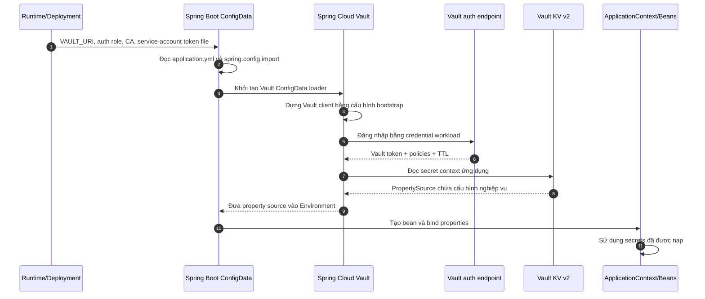
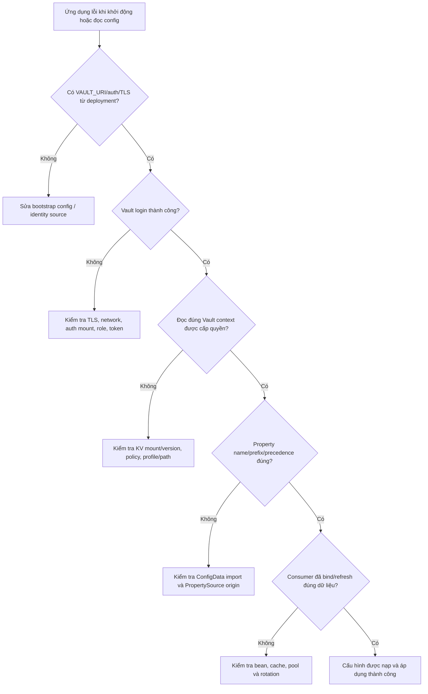

# Tách cấu hình kết nối Vault khỏi cấu hình được lấy từ Vault

## 1. Vấn đề cốt lõi: phải kết nối được trước khi đọc cấu hình

Trong module **SPRING_VAULT**, ứng dụng Java làm việc với HashiCorp Vault qua `VaultTemplate`, xác thực theo workload và Vault policy để đọc KV secrets, lấy credentials động, gọi Transit encryption hoặc PKI. Một bước thường gặp khi chuyển từ cấu hình cứng sang Vault là đưa cả `application.yml` vào Vault. Nhưng sẽ có một câu hỏi quan trọng:

> **Ứng dụng lấy địa chỉ, phương thức xác thực và thông tin TLS của Vault từ đâu nếu chính những thông tin đó lại đang nằm bên trong Vault?**

Đây là **vòng phụ thuộc bootstrap**. Trước khi truy cập bất kỳ secret nào trong Vault, ứng dụng phải biết **Vault ở đâu**, **cách kết nối an toàn**, **mình là ai** và **được phép đọc những path nào**. Những thông tin cần để xây dựng kết nối không thể phụ thuộc vào chính kết nối chưa được thiết lập.

Bài thuộc chương **Nguồn cấu hình**, có mục tiêu:

1. Phân biệt **cấu hình kết nối Vault (bootstrap/connection configuration)** với **cấu hình nghiệp vụ lấy từ Vault (Vault-backed application configuration)**.
2. Hiểu thứ tự khởi động Spring Boot, **Spring Cloud Vault ConfigData** và ứng dụng dùng **Spring Vault core**.
3. Chọn nguồn thích hợp cho Vault URI, TLS truststore, auth mount/role, workload credentials, KV context và dữ liệu nghiệp vụ.
4. Tránh vòng lặp tham chiếu, property collision, lộ secrets, lỗi precedence, nhầm token TTL với thời hạn của giá trị đã đọc.
5. Viết cấu hình, policy và kiểm thử có thể xác minh từng giai đoạn mà không cần root token trong ứng dụng.

**Phạm vi:** nội dung áp dụng cho Spring Vault core và, khi cần tự động đưa secrets vào Spring `Environment`, **Spring Cloud Vault**. Đây là hai khả năng liên quan nhưng **không đồng nhất**: thêm dependency Spring Vault core không tự biến mọi KV value thành một `PropertySource` của Spring Boot.

## 2. Hai nhóm cấu hình và một nhóm điều khiển vòng đời

| Nhóm | Ví dụ | Nguồn phù hợp | Thời điểm cần |
| --- | --- | --- | --- |
| **A. Cấu hình kết nối/bootstrap** | `spring.cloud.vault.uri`, TLS truststore, `authentication`, `kubernetes.role`, `namespace`, auth mount, timeout | `application.yml` đóng gói (không chứa secret), biến môi trường triển khai, file mount, service identity của nền tảng | **Trước** lần đầu liên lạc với Vault |
| **B. Cấu hình được Vault cung cấp** | `orders.remote-api-key`, `orders.remote-url`, DB credentials, cấu hình đối tác, API secrets | KV v1/v2, Database/AWS secrets engine, PKI và các secret backend cho phép | **Sau** khi có kết nối và quyền Vault |
| **C. Cấu hình vận hành/lifecycle** | Token renew, lease TTL, refresh policy, connection-pool reload, readiness | Spring Vault `SessionManager`, `SecretLeaseContainer`, mã ứng dụng, chính sách Vault | Khi cần **giữ cho dữ liệu đã lấy tiếp tục đúng và khả dụng** |

Nhóm C không thay thế A hoặc B. Ví dụ, `SessionManager` làm mới Vault token; nó **không tự động thay đổi** mật khẩu trong một `HikariDataSource` đã được tạo. `SecretLeaseContainer` quản lý leases động; nó **không làm ứng dụng tự tìm được Vault URI** khi chưa bootstrap.

### 2.1. Ví dụ phân loại một cấu hình thật

| Khóa/giá trị | Đặt ở đâu? | Lý do |
| --- | --- | --- |
| `VAULT_URI=https://vault.example.internal:8200` | Nguồn deploy/bootstrap | Không thể đọc từ Vault trước khi biết URI |
| `spring.cloud.vault.authentication=KUBERNETES` | Bootstrap | Phải chọn auth method trước login |
| `spring.cloud.vault.kubernetes.role=orders-app` | Bootstrap | Role dùng trong chính request login |
| Kubernetes service-account JWT | File token được runtime Kubernetes mount | Workload identity được cấp ngoài Vault, không commit source |
| Truststore/CA để xác minh Vault server | File mount hoặc image an toàn do operator cấp | Phải xác minh TLS ngay request đầu tiên |
| `orders.remote-api-key` | KV v2 trong Vault | Bí mật nghiệp vụ chỉ được đọc **sau login** |
| `orders.remote-url` | Có thể từ Vault hoặc config deploy | Quyết định theo ownership và nhu cầu thay đổi, không phải vì nó luôn là secret |
| `spring.datasource.password` động | Database secrets engine qua Spring Cloud Vault hoặc Spring Vault code | Credential có vòng đời riêng/lease; cần consumer cập nhật |
| `spring.application.name=orders-service` | Bootstrap | Có thể ảnh hưởng cách chọn KV context trước khi property source được tạo |
| `spring.profiles.active=prod` | Deploy/bootstrap | Profile quyết định những nguồn và context được tải khi khởi động |

**Không phải mọi giá trị ở nhóm A đều nhạy cảm.** URI/role/namespace thường là metadata cấu hình nhưng vẫn cần bảo vệ khỏi chỉnh sửa trái phép. Credential gốc (JWT, SecretId, private key, static token) là dữ liệu nhạy cảm; khi cần cho login, nó phải đến từ một **kênh cấp danh tính ban đầu đáng tin cậy**, không phải từ một KV path đòi chính credential đó để đọc.

## 3. Trình tự bootstrap: thứ gì đến trước, thứ gì đến sau?



Trình tự trên cho **Spring Cloud Vault ConfigData**, không phải timeline bắt buộc của mọi ứng dụng dùng Vault. Với **Spring Vault core** không cài ConfigData, bean `VaultTemplate` có thể được dựng trong `ApplicationContext` và secret được đọc **khi service chủ động gọi API**, không tự thành cấu hình của `Environment`.

### 3.1. Điểm không thể đảo ngược

Nếu application.yml viết:

```yaml
spring:
  cloud:
    vault:
      uri: ${company.vault.uri}
  config:
    import: "vault://"
```

và `company.vault.uri` **chỉ tồn tại trong KV của chính Vault đó**, loader không có cách nào biết URI để đi đọc KV. Tương tự, `spring.cloud.vault.kubernetes.role`, `spring.cloud.vault.ssl.trust-store` hoặc `spring.cloud.vault.namespace` không nên được kỳ vọng xuất hiện từ Vault-backed property source đầu tiên.

Giải pháp là **cung cấp các giá trị bootstrap từ nguồn có sẵn sớm hơn**: biến môi trường từ deployment, file cấu hình local đã ký/phê duyệt, ConfigMap/Secret mount của nền tảng hoặc thông tin identity tự động của runtime.

## 4. Spring Vault core và Spring Cloud Vault khác nhau ở đâu?

| Tiêu chí | Spring Vault core | Spring Cloud Vault |
| --- | --- | --- |
| Trọng tâm | Client API và operations với Vault (`VaultTemplate`, `VaultOperations`, `SessionManager`) | Tích hợp Vault với Spring Boot configuration, ConfigData/property sources và backend-specific integrations |
| Địa chỉ, auth, TLS | JavaConfig `AbstractVaultConfiguration` hoặc thành phần client tự cấu hình | Các properties `spring.cloud.vault.*` và bootstrap infrastructure |
| Dữ liệu KV đến app | Code gọi `opsForKeyValue(...)` hoặc `VaultTemplate.read(...)` | ConfigData nạp KV contexts thành Spring `PropertySource` nếu được bật |
| Cần `spring.config.import`? | Không phải một cơ chế của Spring Vault core | **Có** với cách tích hợp ConfigData được khuyến nghị |
| Thời điểm đọc KV | Do logic ứng dụng/bean quyết định | Thường **rất sớm** khi Boot tải config |
| Rotation | Dùng client API/lease container, ứng dụng nối vào consumer | Có thêm property-source lifecycle tùy backend/version; không tự bảo đảm mọi bean reload |

Spring Cloud Vault được xây trên khả năng của Spring Vault, nhưng **đừng bật song song hai bộ client/session manager độc lập** mà chưa rõ ownership. Nếu một `VaultTemplate` được custom riêng với token/namespace khác, nó có thể đọc thành công một path trong khi ConfigData lại lỗi, hoặc ngược lại.

Spring Cloud Vault 3.x+ ưu tiên ConfigData thay cho cơ chế `bootstrap.yml` cổ điển. Bootstrap context vẫn có thể được bật bằng cách cấu hình/dependency dành cho tương thích, nhưng với dự án Spring Boot hiện đại nên bắt đầu bằng `spring.config.import`. Kiểm tra BOM tương thích Spring Boot / Spring Cloud / Spring Vault theo version thực tế.

## 5. Ví dụ Spring Cloud Vault: phân nhóm ngay từ deployment

Giả sử service `orders-service` chạy trên Kubernetes, Vault auth mount `kubernetes` và KV v2 được mount tại `secret`.

### 5.1. Nguồn A: cấu hình kết nối từ `application.yml` và runtime

File `application.yml` thuộc artifact ứng dụng **chỉ chứa chỉ dẫn kết nối và key names**, không chứa raw Vault token hoặc JWT:

```yaml
spring:
  application:
    name: orders-service
  config:
    import: "vault://"
  cloud:
    vault:
      enabled: true
      uri: ${VAULT_URI}
      connection-timeout: 5000
      read-timeout: 15000
      fail-fast: true
      authentication: KUBERNETES
      kubernetes:
        role: ${VAULT_K8S_ROLE}
        kubernetes-path: kubernetes
        service-account-token-file: /var/run/secrets/kubernetes.io/serviceaccount/token
      kv:
        enabled: true
        backend: secret
        default-context: application
```

**Các giá trị bootstrap phải đến từ bên ngoài Vault:**

```text
Deployment / platform environment:
  VAULT_URI=https://vault.example.internal:8200
  VAULT_K8S_ROLE=orders-app

Mounted workload identity:
  /var/run/secrets/kubernetes.io/serviceaccount/token

Vault TLS trust material:
  CA/truststore tin cậy được cấp trước lần kết nối đầu tiên
```

Kubernetes ServiceAccount JWT được mount bởi platform; không ghi token đó vào ConfigMap công khai, Git, file YAML ứng dụng hoặc log. `VAULT_URI` có thể là metadata không nhạy cảm, nhưng phải kiểm soát quyền sửa vì đổi URI có thể chuyển credential/login đến máy chủ giả mạo.

**TLS:** nếu Vault dùng CA nội bộ, cấu hình truststore qua `spring.cloud.vault.ssl.trust-store`, `trust-store-password` (nếu có) và `trust-store-type`, hoặc dùng truststore/JVM TLS configuration đã được cấp qua runtime. Đảm bảo Vault client HTTP connector của phiên bản sử dụng **áp dụng** cấu hình SSL. Không tắt xác minh hostname hoặc dùng `VAULT_SKIP_VERIFY=true` để "sửa" lỗi production.

### 5.2. Nguồn B: KV v2 do Vault cung cấp

Operator đã mount KV v2 tại `secret`, thêm key cho service (sử dụng dữ liệu test):

```bash
# Chạy dưới vai trò operator của Vault test, không dùng root token trong app.
vault kv put secret/orders-service \
  orders.remote-url="https://api.example.test" \
  orders.remote-api-key="<TEST_ONLY_SECRET>"

# Với import vault:// mặc định, context chung application cũng được thử đọc.
# Khi bật fail-fast, tạo context test này để không gặp 404 ngoài ý muốn.
vault kv put secret/application service.mode="configured"

# Path logic KV: secret/orders-service.
# Với KV v2, API data path tương ứng thường là secret/data/orders-service.
```

Spring Cloud Vault (với `vault://` và context mặc định) chọn các context dựa trên `spring.application.name`, profile và `default-context`, chẳng hạn `secret/orders-service` và `secret/application`; KV v2 có phần `data/` trong **HTTP API path**, do Spring Cloud Vault xử lý theo engine version.

Hai property `orders.remote-url` và `orders.remote-api-key` được đưa vào `Environment` **sau khi Vault login thành công**. Chúng không cần hiện diện trong `application.yml` và không có quyền tự thay đổi cách Vault client được tạo.

Vault policy cho workload nên chỉ cho phép các context mà ConfigData thực sự đọc. Ví dụ:

```hcl
path "secret/data/orders-service" {
  capabilities = ["read"]
}

# Trong ví dụ vault:// + fail-fast=true đã tạo context chung application.
path "secret/data/application" {
  capabilities = ["read"]
}
```

Vault policy ở đây dùng **KV v2 API paths**. Đừng cho workload quyền rộng `secret/*` chỉ vì ConfigData gặp `permission denied`; xác minh profile/context nào đang được yêu cầu và cấp quyền tối thiểu đúng path.

### 5.3. Dùng giá trị ở bean nghiệp vụ

```java
import org.springframework.core.env.Environment;
import org.springframework.stereotype.Service;

@Service
public final class OrdersRemoteClientSettings {

    private final String remoteUrl;
    private final String apiKey;

    public OrdersRemoteClientSettings(Environment environment) {
        this.remoteUrl =
            environment.getRequiredProperty("orders.remote-url");
        this.apiKey =
            environment.getRequiredProperty("orders.remote-api-key");
    }

    public String remoteUrl() {
        return remoteUrl;
    }

    // Chỉ trao secret cho HTTP client được cấp quyền dùng.
    // Không expose apiKey qua HTTP, toString, Actuator hoặc logging.
    String apiKeyForClient() {
        return apiKey;
    }
}
```

Bean trên lấy dữ liệu từ Spring `Environment`, **không gọi Vault trực tiếp**. Cách đó hữu ích khi bí mật đã được Spring Cloud Vault đưa vào property source. Hai field là snapshot khi bean được tạo; **cập nhật KV ở Vault sau đó không khiến field tự động đổi**. Muốn refresh/rebind phải có thiết kế riêng cho từng loại secret và consumer.

Đối với dynamic database credentials, Spring Cloud Vault hoặc `SecretLeaseContainer` có thể cấp credential và quản lý lease, nhưng **connection pool đã tạo** vẫn cần hợp đồng cập nhật/recreate khi credential mới xuất hiện.

## 6. Chọn KV context rõ ràng và tránh vô tình đọc nhiều nơi

### 6.1. `vault://` và các context mặc định

`spring.config.import: "vault://"` cho phép Spring Cloud Vault nạp các backend được bật; KV thường dùng app name và profile. Ví dụ:

```text
spring.application.name = orders-service
spring.profiles.active = prod

Logical KV contexts có thể được tải:
  secret/orders-service/prod
  secret/orders-service
  secret/application/prod
  secret/application

Với KV v2, policy data paths tương ứng thêm /data/:
  secret/data/orders-service/prod
  secret/data/orders-service
  secret/data/application/prod
  secret/data/application
```

Danh sách thực tế phụ thuộc `spring.cloud.vault.kv.*`, profile separator, configuration và version. Nếu service không cần shared context, có thể chọn **context cụ thể** thay vì để loader tính tất cả context mặc định.

### 6.2. Nhập một context cụ thể và prefix tránh collision

Spring Cloud Vault hỗ trợ location `vault:///<context-path>` và tham số `prefix`. Nếu không muốn tải các context mặc định (bao gồm `application`), có thể **giữ KV backend enabled** nhưng chỉ dùng contextual import, không thêm `vault://` mặc định:

```yaml
spring:
  application:
    name: orders-service
  config:
    import: "vault:///secret/orders-service?prefix=orders."
  cloud:
    vault:
      uri: ${VAULT_URI}
      authentication: KUBERNETES
      kubernetes:
        role: ${VAULT_K8S_ROLE}
```

Với prefixed location, nếu KV chứa key `remote-api-key` thì property ứng dụng là `orders.remote-api-key`. **Prefix được thêm nguyên văn**; muốn có dấu chấm phân cách phải viết `prefix=orders.`. Không ghi key đã có tiền tố `orders.` đồng thời thêm prefix `orders.` nếu không muốn nhận `orders.orders.remote-api-key`.

**Ranh giới:** contextual path là cấu hình cho **đọc dữ liệu**, còn `uri`/`authentication` là cấu hình **kết nối**. Hai nhóm có thể nằm cùng YAML file vật lý, nhưng vẫn phải đến từ các nguồn sẵn sàng theo thứ tự và không tạo vòng phụ thuộc.

### 6.3. Không dùng prefix để che một lỗi phân quyền

`prefix` chỉ đổi **tên property được xuất ra Environment**, không đổi đường dẫn Vault mà loader đọc hoặc chính sách Vault. Nếu context `secret/orders-service` bị Vault trả 403, thêm `prefix=orders.` không làm auth role có thêm `read`.

## 7. Property precedence: cùng một tên, nhiều nguồn

Spring Boot tập hợp nhiều `PropertySource` như file cấu hình đóng gói, biến môi trường, system properties, command-line arguments, ConfigData import và nguồn tùy chỉnh. Khi cùng tồn tại một key, giá trị có **độ ưu tiên cao hơn** theo thứ tự resolver của Spring Boot sẽ thắng.

Ví dụ:

```text
application.yml:
  orders.remote-url=https://api-default.example.test

Vault KV:
  orders.remote-url=https://api-prod.example.internal

Deployment env:
  ORDERS_REMOTE_URL=https://api-canary.example.internal
```

Một ứng dụng không nên mặc định cho rằng "Vault luôn thắng" hoặc "application.yml luôn thắng". Nhiều thành phần như command-line arguments, environment variables và thứ tự import có độ ưu tiên khác nhau. Hãy xác nhận **nguồn thắng thực tế** theo Spring Boot và cấu hình profile đang chạy.

### 7.1. Ngăn key cấu hình kết nối bị đưa vào KV business

Không nên cho ứng dụng ghi các key sau vào context KV nghiệp vụ:

```text
spring.cloud.vault.uri
spring.cloud.vault.authentication
spring.cloud.vault.namespace
spring.cloud.vault.kubernetes.role
spring.config.import
spring.application.name
spring.profiles.active
```

Kể cả nếu cấu hình bootstrap đã được sử dụng để tạo client đầu tiên, việc một backend trả key tương tự vẫn có thể dẫn tới **khó hiểu về Environment, validation hoặc config drift**. Một số key kiểm soát config được xác định trong giai đoạn bootstrap nên thay đổi chúng trong property source tải muộn **không có tác dụng như mong đợi**.

Thiết kế an toàn:

1. Dùng namespace property riêng như `orders.*`, `billing.*` hoặc `partner.*` cho business data.
2. Có allowlist/schema hoặc review policy đối với key trong KV, đặc biệt với context chung.
3. Hạn chế quyền `create/update` KV cho service chỉ cần `read`.
4. Dùng `prefix` cho contextual locations khi có nhiều sources.
5. Kiểm tra nguồn property ở runtime **theo tên và origin**, không in giá trị bí mật.

### 7.2. Kiểm tra nguồn thắng mà không in secret

Một cách tiếp cận là duyệt tên `PropertySource` và hỏi nguồn nào có key, **không lấy giá trị ra log**. Cẩn trọng: `containsProperty` có thể kích hoạt resolution nội bộ tùy implementation; chỉ dùng trong môi trường test được kiểm soát.

```java
import org.springframework.core.env.ConfigurableEnvironment;
import org.springframework.core.env.PropertySource;

public final class PropertyOriginDiagnostic {

    public static String firstSourceContaining(
            ConfigurableEnvironment environment,
            String propertyName) {

        for (PropertySource<?> source : environment.getPropertySources()) {
            if (source.containsProperty(propertyName)) {
                return source.getName(); // Chỉ nguồn, không lộ value.
            }
        }
        return "<not-present>";
    }
}
```

Test có thể xác minh `orders.remote-api-key` được cung cấp bởi Vault source mong muốn. Với sản phẩm đang chạy, **không bật endpoint debug liệt kê key/value**, không log `Environment`, `@ConfigurationProperties` hoặc HTTP headers chứa Vault token. Spring Boot Actuator `env` và `configprops` cần được bảo vệ hoặc tắt/giới hạn hiển thị giá trị phù hợp.

## 8. Nguồn cấu hình bootstrap nào nên chọn?

| Nguồn | Thích hợp | Rủi ro/giới hạn |
| --- | --- | --- |
| `application.yml` trong artifact | Vault URI template, timeout, auth method, tên role/path không nhạy cảm | Tránh đóng gói credential trong Git/artifact; đổi địa chỉ phải tái cấu hình/deploy |
| Biến môi trường deployment | URL, role, namespace, feature flag, path tới credential file | Có thể bị thấy bởi process/tool có quyền; không coi env là secret manager hoàn hảo |
| Kubernetes ServiceAccount token mount | Chứng cứ workload cho Kubernetes auth | Phải mount đúng, có thời hạn/rotation; tránh copy sang log/cấu hình |
| Mounted file từ Secret hoặc agent | Truststore, client certificate/private key, AppRole SecretId được cấp qua kênh an toàn | Cần file permissions, atomic updates, lifecycle/reload |
| Cloud identity metadata | AWS/Azure/GCP workload authentication không cần static secret trong app | Phụ thuộc runtime và role/identity bên cloud; giới hạn IMDS access |
| Vault Agent sidecar | Agent nhận/đổi token và có thể dựng template file/secret cho workload | Phải hiểu ai sở hữu login, renew, token sink và file updates; tránh hai bộ auto-auth chồng chéo |
| Command-line args/JVM properties | Test tạm hoặc metadata không nhạy cảm | Có thể bị quan sát qua process introspection; không đưa raw token vào command line |

Kết hợp theo nguyên tắc **đường dẫn và loại danh tính có trước; credential gốc do nền tảng cấp; secrets nghiệp vụ lấy từ Vault**. Với môi trường production, workload identity như Kubernetes auth hoặc cloud IAM thường giúp tránh phân phối static Vault token dài hạn.

### 8.1. Truststore là cấu hình phải có từ đầu

Nếu server Vault dùng certificate do CA nội bộ ký, Java phải tin CA đó **trước request HTTPS login đầu tiên**. Lưu truststore chỉ trong Vault tạo vòng phụ thuộc:

```text
Muốn kết nối Vault → cần truststore
Muốn lấy truststore từ Vault → cần kết nối Vault
```

Giải quyết bằng truststore/CA được cấp qua image hoặc volume mount đã kiểm soát; certificate/CA được rotate theo quy trình riêng. Không tắt xác minh certificate chain/hostname vì thiếu truststore.

Nếu dùng mTLS `cert` auth, client keystore + private key cũng cần được cấp **trước login**; PKI role trong Vault có thể phát hành certificate cho các vòng sau, nhưng không tự giải được bài toán **cấp credential lần đầu** nếu app chỉ có mỗi cert auth.

## 9. Spring Vault core: tự cấu hình kết nối rồi chủ động đọc KV

Không phải dự án nào cũng sử dụng Spring Cloud Vault. Một ứng dụng chỉ phụ thuộc Spring Vault core có thể tự thiết lập endpoint/auth từ nguồn ngoài rồi gọi Vault operations đúng lúc.

### 9.1. JavaConfig tách nguồn bootstrap

Ví dụ dưới đây minh họa Spring Vault core. `TokenAuthentication` chỉ dành cho **mô phỏng hợp đồng** ở môi trường test/đã được quản lý token từ bên ngoài; production nên chọn workload auth và `SessionManager` theo vòng đời phù hợp.

```java
import java.net.URI;

import org.springframework.context.annotation.Configuration;
import org.springframework.vault.authentication.ClientAuthentication;
import org.springframework.vault.authentication.TokenAuthentication;
import org.springframework.vault.client.VaultEndpoint;
import org.springframework.vault.config.AbstractVaultConfiguration;

@Configuration
public class VaultCoreConfiguration extends AbstractVaultConfiguration {

    @Override
    public VaultEndpoint vaultEndpoint() {
        String vaultUri = requireBootstrapEnv("VAULT_URI");
        return VaultEndpoint.from(URI.create(vaultUri));
    }

    @Override
    public ClientAuthentication clientAuthentication() {
        // DEMO ONLY: token phải được cấp an toàn từ bên ngoài,
        // không commit vào Git hay hardcode trong Java.
        return new TokenAuthentication(
            requireBootstrapEnv("VAULT_TOKEN"));
    }

    private static String requireBootstrapEnv(String name) {
        String value = System.getenv(name);
        if (value == null || value.isBlank()) {
            throw new IllegalStateException(
                "Missing bootstrap configuration: " + name);
        }
        return value;
    }
}
```

Tại đây, `VaultEndpoint` và `ClientAuthentication` được dựng **từ nguồn ngoài**; `AbstractVaultConfiguration` cung cấp những thành phần nền tảng để `VaultTemplate` hoạt động. Ví dụ không tự nạp KV vào `Environment`. Đừng tạo một `VaultTemplate` mới cho mỗi HTTP request hoặc tự login lại mỗi lần đọc secret.

Nếu dùng AppRole/Kubernetes/Azure auth, thay `TokenAuthentication` bằng client authentication tương ứng được cấu hình từ **credential nguồn bootstrap**. Không lấy Vault SecretId từ path KV mà việc đọc path đó lại đòi chính SecretId cần thiết để login.

### 9.2. Service đọc KV khi thực sự cần dữ liệu

```java
import org.springframework.stereotype.Service;
import org.springframework.vault.core.VaultKeyValueOperations;
import org.springframework.vault.core.VaultKeyValueOperationsSupport;
import org.springframework.vault.core.VaultOperations;
import org.springframework.vault.support.VaultResponseSupport;

@Service
public final class OrdersSecretsRepository {

    public record RemoteSettings(String remoteUrl, String remoteApiKey) {}

    private final VaultKeyValueOperations kv;

    public OrdersSecretsRepository(VaultOperations vault) {
        this.kv = vault.opsForKeyValue(
            "secret",
            VaultKeyValueOperationsSupport.KeyValueBackend.KV_2);
    }

    public RemoteSettings fetchLatest() {
        VaultResponseSupport<RemoteSettings> response =
            kv.get("orders-service", RemoteSettings.class);

        if (response == null || response.getData() == null) {
            throw new IllegalStateException(
                "Vault KV context orders-service was not found");
        }
        return response.getData();
    }
}
```

Đoạn này **chủ động đọc** KV v2 tại mount `secret`, logical key `orders-service`, rồi ánh xạ JSON thành record DTO Java 17. **Trong ví dụ `spring-cloud-vault` trước**, KV chứa các key có dấu chấm như `orders.remote-api-key`. Để DTO này ánh xạ đúng, operator cần lưu **JSON keys `remoteUrl` và `remoteApiKey`** dưới path tương ứng hoặc dùng DTO/mapper phù hợp với cấu trúc KV thực.

Bài học nằm ở ranh giới: `VaultCoreConfiguration` **biết cách đi tới Vault**; `OrdersSecretsRepository` **biết lấy dữ liệu gì và chuyển thành kiểu nào**. Chúng không nên tạo phụ thuộc vòng.

### 9.3. Tại sao không nên đọc secrets trong constructor cấu hình Vault?

Sai thiết kế:

```java
@Override
public VaultEndpoint vaultEndpoint() {
    String endpoint = vaultTemplate.read("secret/data/vault-endpoint")
        .getData().get("url").toString();
    return VaultEndpoint.from(URI.create(endpoint));
}
```

`vaultTemplate` cần `VaultEndpoint` để được tạo, trong khi `vaultEndpoint()` lại cố sử dụng `vaultTemplate`. Spring có thể báo vòng phụ thuộc bean, lỗi khởi tạo hoặc thiếu endpoint. Dù tạo một HTTP client tạm để "đọc trước", bạn vẫn cần biết Vault URI, auth và truststore để dùng nó.

Cách giải là đọc `VAULT_URI` từ bootstrap. Nếu tổ chức cần discovery/rotation Vault endpoint tự động, phải dùng một **nguồn discovery/cluster address độc lập** hoặc một cơ chế bootstrap được phê duyệt; không lưu duy nhất địa chỉ Vault trong KV của Vault đó.

## 10. Thứ tự ưu tiên khi đổi môi trường và profile

Một thiết kế cần rõ **các giá trị cấu hình nào được quyết định trước bước import Vault**:

```text
Deployment manifest / môi trường:
  SPRING_PROFILES_ACTIVE=prod
  VAULT_URI=https://vault-prod.example.internal:8200
  VAULT_K8S_ROLE=orders-prod

application.yml:
  spring.application.name=orders-service
  spring.config.import=vault://
  spring.cloud.vault.uri=${VAULT_URI}
  spring.cloud.vault.kubernetes.role=${VAULT_K8S_ROLE}

Sau login:
  KV context cho profile prod → orders.remote-api-key, ...
```

Đừng đặt `spring.profiles.active` **chỉ trong KV** rồi mong ConfigData quay lại tải lại contexts khác: Spring Boot cần quyết định profile/nguồn import từ rất sớm. Khi muốn triển khai dev/prod, nên khai báo các bootstrap differences qua môi trường/ConfigMap/deployment, trong khi giá trị nghiệp vụ tương ứng nằm ở những KV contexts/policies khác nhau.

### 10.1. Tách quyền ở từng môi trường

Hai cấu hình cùng service name nhưng khác môi trường cần có Vault auth role/policy tách biệt. Ví dụ:

```text
dev:
  VAULT_URI=https://vault-dev.example.internal:8200
  VAULT_K8S_ROLE=orders-dev
  Vault KV: secret/orders-service/dev

prod:
  VAULT_URI=https://vault-prod.example.internal:8200
  VAULT_K8S_ROLE=orders-prod
  Vault KV: secret/orders-service/prod
```

Không dựa **chỉ** vào profile name để ngăn truy cập dữ liệu production. Vault role và ACL policy mới là ranh giới thực sự; tài khoản workload dev không nên được cấp quyền đọc production context dù biết đúng path.

## 11. Xử lý khởi động khi Vault hoặc context gặp lỗi

Spring Cloud Vault có hai khía cạnh khác nhau:

- **`spring.cloud.vault.fail-fast=true`**: yêu cầu ngừng khởi động khi dữ liệu Vault cần thiết không thể lấy được, phù hợp khi ứng dụng không thể chạy an toàn nếu thiếu secrets.
- **`optional:vault://`**: cho phép một ConfigData import được xem như tùy chọn trong điều kiện được Spring Cloud Vault hỗ trợ; tài liệu mô tả trường hợp `spring.cloud.vault.enabled=false`. Không nên coi `optional` như một cơ chế luôn bỏ qua lỗi credential, TLS hoặc Vault unreachable.

**Chi tiết dễ bỏ sót:** theo tài liệu Spring Cloud Vault, **404 của context không tồn tại** có thể bị bỏ qua dù location không có `optional:`, trừ khi dùng cơ chế Vault client **fail fast** phù hợp. Do đó, muốn yêu cầu có đủ secret thì cần **kiểm tra property bắt buộc** bằng `Environment.getRequiredProperty(...)` hoặc binding validation, ngoài việc bật fail-fast.

### 11.1. Ma trận khởi động

| Tình huống | Kết quả nên hướng tới | Chẩn đoán |
| --- | --- | --- |
| Thiếu `VAULT_URI` ở deployment | Fail trước khi client tự trỏ nhầm localhost | Kiểm tra env/config render và deployment |
| Truststore không tin Vault server | Fail TLS, không lấy secrets | Kiểm tra hostname, CA chain, SSL client |
| Kubernetes JWT không có/không đọc được | Login thất bại | Kiểm tra mount service-account token/permission |
| Auth mount/role sai | Vault login 400/403/404 | Kiểm tra `kubernetes-path`, role, service account bindings |
| Vault login được nhưng KV trả 403 | ACL policy sai path | Kiểm tra KV v2 `secret/data/...`, context/profile |
| Context KV không tồn tại | Có thể bị bỏ qua khi không fail-fast | Kiểm tra property bắt buộc và fail-fast |
| Vault trả 5xx/timeout | Bootstrap không thể lấy secrets | Fail hoặc retry có giới hạn theo SLO |
| KV trả dữ liệu nhưng thiếu `orders.remote-api-key` | Bean khởi tạo không đủ dữ liệu | Binding/validation fail, không chạy với giá trị rỗng |
| Context profile dev được tải trong prod | Có lỗi cấu hình môi trường | Kiểm tra `spring.profiles.active`, import path, auth policy |

Một `403` ở `auth/kubernetes/login` khác với `403` khi đọc `secret/data/orders-service`. Lỗi thứ nhất thường liên quan đến chứng cứ định danh/role/namespace; lỗi thứ hai liên quan Vault token policy hoặc backend path.

### 11.2. Phân biệt "không có property" và "không kết nối được Vault"

Không có property có thể do:

1. Context KV được tính khác do profile/application name.
2. Key KV sai spelling hoặc prefix; ví dụ source trả `orders.orders.remote-api-key`.
3. KV v1/v2 path không đúng hoặc backend disabled.
4. Context không tồn tại (404 bị skip).
5. Vault client không nạp property source vì `spring.config.import` không được bật hoặc ứng dụng dùng Spring Vault core thuần.

Nếu chính Vault không kết nối được, vấn đề nằm ở **bootstrap connection**: URI, TLS, auth, network hoặc timeouts. Đừng đi sửa class đọc `orders.remote-api-key` trước khi xác nhận đã có successful Vault login.

## 12. Runtime rotation: kết nối Vault vẫn đúng nhưng dữ liệu đã cũ

Tách A và B không chỉ quan trọng khi startup. Sau khi Vault trả KV secret, application có thể **giữ một snapshot** trong `Environment`, `@Value` bean, HTTP client hoặc connection pool. Khi operator đổi KV version hoặc Vault cấp dynamic credential mới, sự thay đổi **không nhất thiết** tự đi vào mọi consumer.

| Đối tượng | Ai quản lý thời hạn? | Có tự thay thế bean/connection không? |
| --- | --- | --- |
| Vault token dùng bởi Spring Vault | `SessionManager`, tùy implementation hỗ trợ renew/re-login | Không thay KV snapshot hoặc DataSource |
| KV v2 data | KV version + chính sách refresh do app chọn | Không mặc nhiên rebind mọi bean đã khởi tạo |
| Database dynamic credentials | Vault lease + `SecretLeaseContainer` hoặc property-source lifecycle | Consumer/pool vẫn cần apply/recreate |
| PKI certificate | `notBefore`/`notAfter`, issuer/revoke + certificate lifecycle | SSLContext/KeyManager có thể cần reload |
| Transit ciphertext/key version | Transit engine và nghiệp vụ encryption/decryption | Không phải lease cache cần renew |

Một thiết kế tốt phải trả lời: **khi dữ liệu từ Vault đổi, lớp nào nhận event, lớp nào kiểm chứng bản mới, lớp nào áp dụng vào consumer, khi nào vô hiệu bản cũ?**

Không dùng TTL Vault token làm "độ mới" của `orders.remote-api-key`. Renew Vault token thành công không tự đọc lại KV. Khi sự kiện rotation đến, cũng không nên thay đổi `spring.cloud.vault.uri` trong `Environment` và mong kết nối client hiện có tự đổi sang server khác.

## 13. Bảo mật: bootstrap tối thiểu nhưng vẫn là bề mặt tấn công

Đưa dữ liệu nhạy cảm vào Vault giảm rủi ro hardcode, nhưng **không loại bỏ bài toán secure introduction**. Ứng dụng vẫn cần một cách được tin cậy để chứng minh danh tính ban đầu.

### 13.1. Những điều nên làm

- Ưu tiên **workload identity** qua Kubernetes, AWS, Azure hoặc GCP auth thay vì static Vault token dài hạn.
- Giữ `VAULT_URI`, tenant/namespace, auth role, truststore path trong deployment được quản lý thay đổi và kiểm toán.
- Đặt credential gốc trong **volume/identity endpoint** có quyền tối thiểu; không in JWT/SecretId/password/private key ra log.
- Giới hạn outbound access để JVM chỉ gọi các Vault endpoints được cho phép; xác minh TLS chain và hostname.
- Đặt Vault ACL policy chính xác từng KV context, dynamic secrets, Transit hoặc PKI path; ứng dụng không có quyền write root.
- Với multi-tenant, tách identity, auth role, namespace và scope secret theo yêu cầu; không chia sẻ một token quyền rộng tùy tiện.
- Kiểm tra `PropertySource` origin và cảnh báo key bất thường, nhưng không công khai giá trị bí mật.
- Bảo vệ Actuator `env` / `configprops`, heap dump, thread dump, startup logs, ConfigData debug và HTTP wire logs.
- Có kế hoạch rotate bootstrap credential (ví dụ token gốc/workload JWT) và data secrets riêng; kiểm thử khi cả hai thay đổi.

### 13.2. Những điều không nên làm

- Lưu `spring.cloud.vault.token` hoặc private key thật trong repository, image hoặc command-line.
- Đặt Vault URI/CA/role chỉ trong KV của chính Vault mà client chưa thể truy cập.
- Cho người dùng cuối tự truyền `vaultUri`/`authPath` qua HTTP để sửa kết nối.
- Chép nguyên `Environment` vào logs khi phát hiện lỗi.
- Bật `VAULT_SKIP_VERIFY`, bỏ hostname verification hoặc fallback sang root token sau `403`.
- Dùng `spring.config.import=optional:vault://` như cách che lỗi production khi secret bắt buộc bị thiếu.
- Giả định mọi bean nhận được KV update ngay mà không cần refresh/recreate.

## 14. Kiểm thử từng giai đoạn thay vì chỉ assert endpoint trả 200

### 14.1. Unit test contract bootstrap

Một helper cấu hình nhỏ có thể giúp fail sớm khi thiếu giá trị bootstrap bắt buộc:

```java
import java.net.URI;
import java.util.Objects;
import java.util.function.Function;

public record VaultBootstrap(URI uri, String authRole) {

    public VaultBootstrap {
        Objects.requireNonNull(uri, "uri");
        if (!"https".equalsIgnoreCase(uri.getScheme())) {
            throw new IllegalArgumentException(
                "Vault URI must use HTTPS");
        }
        if (authRole == null || authRole.isBlank()) {
            throw new IllegalArgumentException(
                "Vault authentication role is required");
        }
    }

    public static VaultBootstrap from(
            Function<String, String> environment) {

        String uriValue = environment.apply("VAULT_URI");
        if (uriValue == null || uriValue.isBlank()) {
            throw new IllegalStateException("Missing VAULT_URI");
        }
        return new VaultBootstrap(
            URI.create(uriValue),
            environment.apply("VAULT_K8S_ROLE"));
    }
}
```

Helper là **logic kiểm tra cấu hình do ứng dụng tự viết**, không phải Spring Vault API. Production còn cần kiểm tra hostname allowlist/URI syntax đúng chuẩn, xử lý `null` có thông báo an toàn, và cấu hình truststore. Không log giá trị URI nếu nó chứa userinfo/credentials; tốt nhất cấm URI có `userInfo` và query bí mật.

JUnit 5 mẫu:

```java
import static org.junit.jupiter.api.Assertions.*;

import java.util.Map;
import org.junit.jupiter.api.Test;

class VaultBootstrapTest {

    @Test
    void readsConnectionSettingsFromDeploymentOnly() {
        Map<String, String> deploy = Map.of(
            "VAULT_URI", "https://vault.test.internal:8200",
            "VAULT_K8S_ROLE", "orders-test");

        VaultBootstrap bootstrap =
            VaultBootstrap.from(deploy::get);

        assertEquals("orders-test", bootstrap.authRole());
        assertEquals("vault.test.internal",
            bootstrap.uri().getHost());
    }

    @Test
    void rejectsHttpEndpoint() {
        Map<String, String> deploy = Map.of(
            "VAULT_URI", "http://vault.test.internal:8200",
            "VAULT_K8S_ROLE", "orders-test");

        assertThrows(IllegalArgumentException.class,
            () -> VaultBootstrap.from(deploy::get));
    }
}
```

Test trên xác minh **ràng buộc lớp bootstrap**, không chứng minh Vault server thực truy cập được hoặc KV policy đúng. Đừng trộn password/secret thật vào assertion failure hay snapshot testing.

### 14.2. Component test property origin và precedence

Dùng Spring Test `MockEnvironment` hoặc `StandardEnvironment` với các `MapPropertySource` giả lập. Tạo hai nguồn:

```text
deployment-source:
  spring.cloud.vault.uri=https://vault.test.internal:8200
  spring.cloud.vault.authentication=KUBERNETES

vault-business-source:
  orders.remote-api-key=TEST_ONLY_VALUE
  orders.remote-url=https://example.test
```

Các assertion cần có:

1. Bootstrap keys lấy từ nguồn deployment được phê duyệt.
2. Business keys có trong một source riêng và đúng prefix.
3. Nếu source Vault giả chèn key `spring.cloud.vault.uri` trái quy ước, test/policy validation từ chối hoặc cảnh báo; **không** dùng giá trị đó để khởi tạo Vault client.
4. Trường hợp nhiều source có cùng key business, test độ ưu tiên được mong muốn theo Boot version/import order.
5. Không log các giá trị business secret trong test report.

**Chú ý:** mock `PropertySource` chỉ kiểm chứng cách Java resolve dữ liệu, không kiểm chứng thứ tự ConfigData bootstrapping thực tế. Cần thêm một integration test Spring Boot + Spring Cloud Vault mới kết luận được về precedence khi chạy thật.

### 14.3. Integration test với Vault test

Dùng Vault thử nghiệm (Testcontainers hoặc Vault server riêng) và tạo auth role/policy chỉ cho phép context test:

1. Setup KV v2 ở `secret`, đặt `secret/orders-service` với hai key giả.
2. Cấp workload credential test ngoài Vault-backed property source, ví dụ Kubernetes auth môi trường thử nghiệm hoặc token test quyền hẹp do fixture tạo. Nếu Testcontainers không có Kubernetes TokenReview thật, chọn auth phù hợp fixture; **đừng nhận rằng đã test Kubernetes identity**.
3. Cho ứng dụng nhập `vault://`, assert `orders.remote-api-key` có mặt khi app tạo bean.
4. Đổi `VAULT_URI` sang địa chỉ sai: fail **trước** khi business bean hoạt động.
5. Dùng auth role sai: Vault login thất bại; assert lỗi khác với thiếu property.
6. Cho login thành công nhưng ACL bỏ `read` của `secret/data/orders-service`: import thất bại hoặc secret key bắt buộc thiếu, tùy fail-fast.
7. Đổi active profile và Vault context: xác minh path đúng, không đọc nhầm môi trường.
8. Cập nhật KV từ version 1 sang 2: xác minh snapshot startup không tự động đổi nếu không có refresh mechanism.
9. Cleanup token/secret/mount/containers chỉ trong phạm vi test, không revoke prefix trên Vault dùng chung.

### 14.4. Bảng các ca kiểm thử quan trọng

| Mã | Tình huống | Kỳ vọng |
| --- | --- | --- |
| B1 | Thiếu Vault URI, không có fallback | Bootstrap báo lỗi trước khi nạp secret |
| B2 | Vault URI là HTTP hoặc TLS không tin server | Cấm insecure ở production; báo lỗi TLS |
| B3 | Role/mount Kubernetes sai | Login thất bại đúng tầng auth |
| B4 | Login đúng nhưng KV policy thiếu `read` | Business property không được nạp; lỗi được phân loại |
| B5 | Key KV chứa trùng `spring.cloud.vault.uri` | Schema/allowlist từ chối hoặc cảnh báo key sai nhóm |
| B6 | Context KV 404 | Fail-fast/required property theo policy rõ ràng |
| B7 | KV key có prefix sai | Không bind thành bean; test xác định tên key đúng |
| B8 | Dev/prod profiles khác nhau | Đọc đúng context và chính sách theo môi trường |
| B9 | Vault không sẵn sàng | Có timeout/retry bounded hoặc fail-fast; không treo mãi |
| B10 | KV đổi sau startup | Có chính sách refresh/recreate, không giả định bean tự reload |
| B11 | Token hết hạn, secret lease còn TTL | Phân biệt session token lifecycle và lease lifecycle |
| B12 | Chạy 3 pod cùng lúc | Mỗi pod dùng bootstrap identity riêng, không buộc token chung |

## 15. Runbook: nhìn log để biết lỗi thuộc cấu hình nào



Runbook nên phân biệt **bốn loại tín hiệu**:

- **Bootstrap connection:** DNS/TLS/timeout của Vault URI.
- **Authentication:** login, token renew/re-login, auth role/policy.
- **ConfigData/KV:** path, profile, missing context, prefix, precedence.
- **Consumer:** property binding, cache lifetime, credentials rotation, pool/reload.

Giám sát có thể dùng các metric tự thiết kế như `vault_login_failures_total`, `vault_config_import_failures_total`, `business_settings_missing_total`, `secret_refresh_age_seconds` và `secret_consumer_apply_failures_total`. Đây là **đề xuất tên metric**, không phải các metric mặc định chắc chắn có trong Spring Cloud Vault.

## 16. Thực hành theo tình huống

### Thực hành A — Phá vòng phụ thuộc bootstrap

1. Viết một file cấu hình sai: `spring.cloud.vault.uri=${company.vault.uri}` nhưng `company.vault.uri` chỉ có trong KV Vault.
2. Giải thích vì sao ConfigData không thể tìm đến Vault lần đầu.
3. Chuyển URI thành `${VAULT_URI}` từ deployment, giữ `orders.remote-api-key` trong KV.
4. Khởi động lại test app; xác nhận Vault login rồi property source mới xuất hiện.
5. Thử bỏ `VAULT_URI` và kiểm tra fail sớm.

**Kết quả:** nêu được ranh giới giữa cấu hình nguồn cấp dữ liệu và dữ liệu do nguồn đó cung cấp.

### Thực hành B — Xác minh profile và policy

1. Tạo context `secret/orders-service/dev` và `secret/orders-service/prod` với keys thử nghiệm.
2. Chỉ cấp workload dev quyền đọc context dev và những context shared được phép.
3. Chạy với `SPRING_PROFILES_ACTIVE=dev` và role dev: key được nạp.
4. Thử đọc profile prod bằng role dev: Vault phải từ chối nếu policy không cho phép.
5. Kiểm tra config import path và độ ưu tiên, không chỉ so sánh raw value.

**Kết quả:** hiểu profile là cách chọn config, còn Vault ACL là ranh giới ủy quyền.

### Thực hành C — Phân biệt runtime snapshot và refresh

1. Khởi động ứng dụng với `orders.remote-api-key` version 1 trong KV.
2. Xác nhận bean được bind thành công.
3. Cập nhật KV version 2 ở Vault.
4. Quan sát bean đã tồn tại không đương nhiên đổi.
5. Thiết kế refresh/recreate hoặc rolling restart; chứng minh consumer nhận đúng giá trị mới mà không log API key.

**Kết quả:** nạp một secret thành công không đồng nghĩa đã quản lý được vòng đời bản sao của nó.

### Thực hành D — Test Spring Vault core không ConfigData

1. Tạo `AbstractVaultConfiguration` với `VAULT_URI`/credential test từ nguồn ngoài.
2. Inject `VaultOperations` và gọi `opsForKeyValue("secret", KV_2)`.
3. Xác nhận API read trả DTO nhưng không tự đăng ký thành `Environment` property source.
4. Để cùng một service dùng Spring Cloud Vault ConfigData trong môi trường thử nghiệm khác và so sánh.
5. Giải thích quyền sở hữu của `SessionManager`, Vault API và property-binding layer.

**Kết quả:** phân biệt "làm việc với Vault" và "nhập Vault thành nguồn cấu hình Spring Boot".

## 17. Câu hỏi tự đánh giá

1. Vì sao không nên lưu `spring.cloud.vault.uri` chỉ trong KV path mà chính client cần URI đó để đọc?
2. Nêu ít nhất năm giá trị thuộc nhóm **bootstrap connection** và ba giá trị thuộc nhóm **business config**.
3. Spring Vault core và Spring Cloud Vault ConfigData khác nhau thế nào khi đưa secret vào Spring `Environment`?
4. `spring.config.import: "vault://"` phải có từ giai đoạn nào của Spring Boot? Vì sao không nên lấy nó từ Vault?
5. Nếu login Vault thành công nhưng bean thiếu `orders.remote-api-key`, cần kiểm tra những lớp nào?
6. Với KV v2, path logic `secret/orders-service` và policy path `secret/data/orders-service` liên quan với nhau ra sao?
7. Khi có hai property sources trả cùng key, tại sao không được đoán bừa "Vault luôn có ưu tiên cao nhất"?
8. Tại sao một `@Value` bean có thể vẫn giữ giá trị cũ sau khi Vault KV đã được cập nhật?
9. `optional:vault://` có bảo đảm bỏ qua mọi lỗi login/TLS/Vault 5xx không?
10. Spring Cloud Vault có thể bỏ qua 404 context khi cấu hình nào? Đâu là vai trò của `fail-fast` và required-property validation?
11. Vì sao `spring.profiles.active` thuộc bootstrap hơn là business secret?
12. Vì sao truststore của Vault server phải có trước lần HTTPS login đầu tiên?
13. Vì sao không nên dùng một Vault token root để giải quyết lỗi thiếu policy context?
14. Khi DB dynamic credential rotate, thay property source đã đủ để pool mở connection mới bằng credential mới chưa?
15. Những phép kiểm tra nào chứng minh cấu hình đã **được áp dụng ở consumer**, không chỉ đọc được từ Vault?

## 18. Checklist triển khai

- [ ] Vault URI, namespace, TLS, auth method/mount/role, workload identity source sẵn sàng **trước ConfigData import**.
- [ ] Không có tham chiếu vòng: không cần KV từ chính Vault để xác định cách kết nối Vault.
- [ ] Cấu hình bootstrap không chứa raw token/SecretId/private key trong source code hoặc image.
- [ ] Workload authentication và Vault ACL được ràng buộc đúng identity, KV context, Transit/PKI paths.
- [ ] Biết rõ ứng dụng dùng Spring Vault core hay Spring Cloud Vault ConfigData, không tạo hai phiên quản lý trái ý muốn.
- [ ] `spring.config.import`, app name, active profiles và KV backend/context được cấu hình từ nguồn sớm và kiểm tra đúng.
- [ ] KV business keys có namespace/prefix/schema rõ ràng, không chứa các key làm thay đổi Vault bootstrap.
- [ ] Xác minh precedence của property sources và bảo vệ Actuator/logs không tiết lộ secret.
- [ ] Có fail-fast/required-property policy cho secret quan trọng, không dùng `optional` để che lỗi.
- [ ] Timeout, retry có giới hạn, TLS hostname verification và alert cho lỗi bootstrap/auth/config data.
- [ ] Có cơ chế refresh/rotation riêng cho KV snapshots, dynamic credentials, certificate và consumer.
- [ ] Unit test bootstrap contract, component test origin/precedence và integration test Vault + backend cô lập.
- [ ] Có runbook phân biệt lỗi connection, auth, property source và consumer.

## 19. Tổng kết và tài liệu tham khảo

**Tách cấu hình kết nối Vault khỏi cấu hình được lấy từ Vault** là một yêu cầu thứ tự phụ thuộc và an toàn, không chỉ là cách chia hai file YAML. **Nguồn bootstrap** cung cấp cách tìm Vault, tin cậy TLS và chứng minh workload identity; **Vault** cung cấp secrets nghiệp vụ sau khi xác thực; **ứng dụng** chịu trách nhiệm dùng những giá trị đó đúng nơi và làm mới khi cần. Spring Cloud Vault có ConfigData để nạp property sources sớm; Spring Vault core có `VaultTemplate` để chủ động thao tác API. Dù chọn cách nào, bạn đều phải giải quyết secure introduction, ACL policy, property precedence và vòng đời consumer.

Tài liệu chính thức để đối chiếu khi chọn phiên bản:

- [Spring Cloud Vault — Quick Start và cấu hình kết nối](https://docs.spring.io/spring-cloud-vault/reference/quickstart.html)
- [Spring Cloud Vault — ConfigData API, locations, prefixes và optional](https://docs.spring.io/spring-cloud-vault/reference/config-data.html)
- [Spring Cloud Vault — Authentication methods, Kubernetes auth](https://docs.spring.io/spring-cloud-vault/reference/authentication.html)
- [Spring Cloud Vault — Secret Backends, KV v1/v2 contexts](https://docs.spring.io/spring-cloud-vault/reference/secret-backends.html)
- [Spring Cloud Vault — Advanced Topics, Fail Fast và Namespace](https://docs.spring.io/spring-cloud-vault/reference/advanced-topics.html)
- [Spring Vault — Authentication Methods và secure introduction](https://docs.spring.io/spring-vault/reference/vault/authentication.html)
- [Spring Vault — Vault Client Access](https://docs.spring.io/spring-vault/reference/vault/vault-client.html)
- [Spring Vault — Credentials Rotation](https://docs.spring.io/spring-vault/reference/vault/credential-rotation.html)
- [HashiCorp Vault — Authentication concepts](https://developer.hashicorp.com/vault/docs/auth)
- [HashiCorp Vault — KV Secrets Engine](https://developer.hashicorp.com/vault/docs/secrets/kv)
- [Spring Boot — Externalized Configuration](https://docs.spring.io/spring-boot/reference/features/external-config.html)
