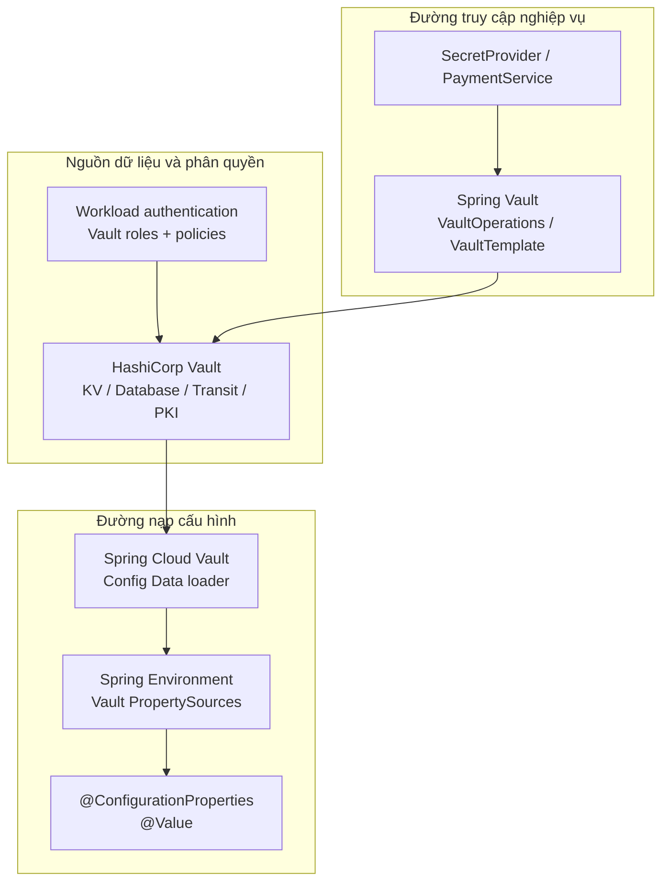
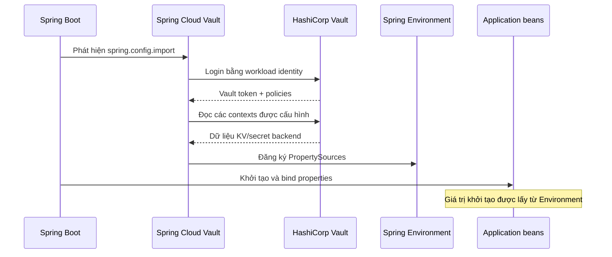
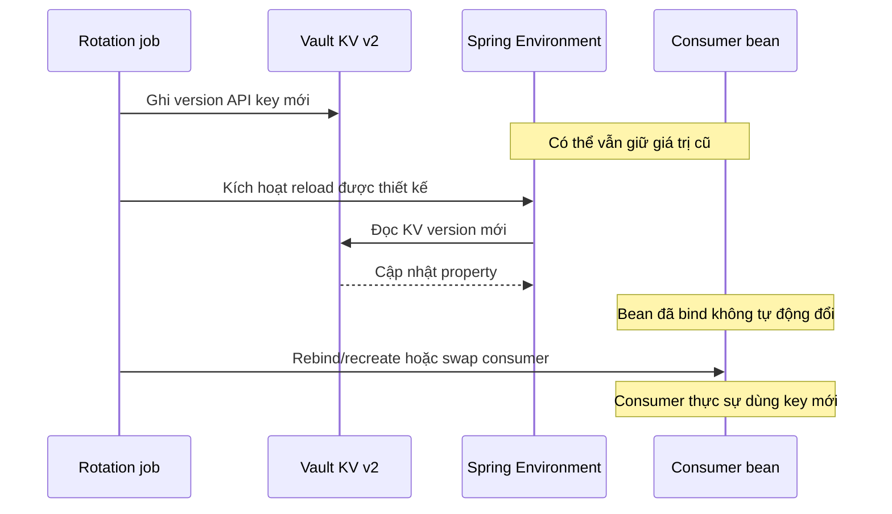

# Ranh giới với việc nạp cấu hình qua Spring Cloud Vault

## 1. Bài toán: Nạp cấu hình hay chủ động gọi Vault?

Trong chương **Nguồn cấu hình** của **Spring Vault**, ứng dụng Java làm việc với **HashiCorp Vault** qua hai hướng thường gặp:

1. **Nạp cấu hình**: **Spring Cloud Vault** đưa dữ liệu KV và các secret backends được bật thành các `PropertySource` của Spring `Environment`. Sau đó các bean nhận giá trị qua `@ConfigurationProperties`, `@Value` hoặc `Environment.getProperty(...)`.
2. **Gọi Vault tại runtime**: **Spring Vault** cho ứng dụng sử dụng `VaultTemplate` / `VaultOperations` để đọc/ghi KV, yêu cầu credential động, mã hóa bằng Transit hoặc cấp chứng thư PKI ở đúng thời điểm nghiệp vụ cần.

Hai hướng này sử dụng chung những khái niệm Vault authentication, Vault token, lease và policy nhưng khác **thời điểm**, **phạm vi**, **hợp đồng API** và **cơ chế cập nhật giá trị đang sử dụng**. Một ứng dụng có thể dùng cả hai; điều cần thiết là quyết định rõ thành phần nào sở hữu từng loại secret và ai chịu trách nhiệm làm mới consumer.

Sau bài học, bạn có thể:

- Phân biệt `ConfigData → PropertySource → Environment → bean` với `use case → VaultOperations → secrets engine`.
- Cấu hình Spring Cloud Vault nạp KV v2 theo tên ứng dụng, profile hoặc context cụ thể.
- Chọn giữa `@ConfigurationProperties`, `@VaultPropertySource` và adapter dùng `VaultOperations`.
- Thiết kế ranh giới bootstrap, runtime refresh, token/lease lifecycle và consumer rotation.
- Kiểm chứng Vault policy, độ ưu tiên của PropertySource và hành vi khi secret bị thay thế.

> **Nguyên tắc:** Spring Cloud Vault tích hợp Vault với cấu hình Spring Boot. Spring Vault là client API để Java tương tác với Vault. Nạp một property vào `Environment` không tương đương với thực hiện một thao tác Vault mới mỗi lần dùng property.

## 2. Ba tầng kiến trúc và vai trò của mỗi tầng



**Spring Vault thuần** cung cấp authentication, token/session management, KV operations, Transit/PKI/Database API và các thành phần quản lý dynamic lease. Thư viện này **cũng có** `VaultPropertySource` và `@VaultPropertySource` nếu cần đưa dữ liệu Vault vào `Environment` theo cách khai báo hoặc thủ công.

**Spring Cloud Vault** dùng Spring Vault làm nền tảng, đồng thời tích hợp với Spring Boot Config Data, nạp contexts theo tên ứng dụng/profile, tạo PropertySource và hỗ trợ một số backends qua configuration integration. Khi Spring Cloud Vault đã khởi tạo hạ tầng Spring Vault, ứng dụng thường có thể inject `VaultOperations` để tiếp tục gọi Vault chủ động.

| Tiêu chí | Spring Cloud Vault Config Data | Spring Vault `VaultOperations` |
|---|---|---|
| Mục tiêu | Lấy **property** cho cấu hình ứng dụng | Thực hiện **thao tác** với Vault theo use case |
| Thời điểm chính | Trước khi nhiều bean được tạo, trong Config Data/bootstrap | Khi Java method chủ động gọi |
| Dữ liệu trả về | Các key/value trong `PropertySource` | `VaultResponse`, payload nghiệp vụ, ciphertext, certificate... |
| Consumer | `Environment`, `@Value`, `@ConfigurationProperties` | Repository/service/provider hạ tầng |
| Nơi xác định path | Các config locations, backend, application name, profiles | Mount/path/engine do adapter xác định |
| Xử lý lỗi | Có thể ảnh hưởng khởi động toàn ứng dụng | Có thể ảnh hưởng riêng một thao tác/runtime request |
| Thay đổi sau startup | Cần xác minh refresh và bean rebinding | Có thể đọc lại và áp dụng cache/rotation theo chính sách |
| Lease động | Cloud Vault tích hợp lifecycle cho một số backends | Ứng dụng có thể điều phối bằng `SecretLeaseContainer` |

Một URL dịch vụ hoặc timeout ít thay đổi phù hợp với cơ chế cấu hình. Ngược lại, thao tác `Transit.encrypt(...)` cho từng payment hoặc yêu cầu chứng thư PKI theo request đòi hỏi API runtime, không thể được thay bằng một chuỗi property lúc startup.

## 3. Spring Cloud Vault nạp cấu hình ở giai đoạn nào?

Spring Boot cung cấp **Config Data API** từ phiên bản 2.4. Kể từ Spring Cloud Vault 3.0, cách thông thường để import dữ liệu Vault là khai báo `spring.config.import`. Trước đó, nhiều ứng dụng dùng bootstrap context với `bootstrap.yml`. Các bản hiện đại vẫn có cơ chế bật lại bootstrap context cũ khi thật sự cần, nhưng Config Data thường là lựa chọn ưu tiên.



### Hai kiểu địa chỉ import

| Config Data location | Ý nghĩa |
|---|---|
| `vault://` | Default location: nạp các secret backends được bật theo quy tắc tính contexts của Spring Cloud Vault |
| `vault:///<context-path>` | Contextual location: thêm context Vault được chỉ định thành một PropertySource |
| `optional:vault://` | Đánh dấu location optional theo semantics của Spring Cloud Vault; **không** phải cách bỏ qua mọi lỗi mạng/authentication |

Có thể trộn một số contextual locations với default location, hoặc sử dụng `prefix` để phân biệt key trùng tên. Đây là **Config Data location** chứ không phải URL HTTP `https://vault/v1/secret/data/...` của Vault REST API. Không đưa đoạn `data/` của KV v2 vào contextual path một cách máy móc.

### Vì sao không lấy mọi thông số bootstrap từ Vault?

Config Data được tải **trước khi Spring ApplicationContext có đầy đủ các bean nghiệp vụ**. Muốn lấy dữ liệu Vault, ứng dụng cần biết Vault URI, TLS trust và phương thức xác thực. Vì vậy:

- Vault URL, auth method, service account token location và CA trust phải sẵn có từ nguồn bootstrap tin cậy (cấu hình triển khai, Kubernetes/cloud workload identity, trust store).
- Không tạo vòng phụ thuộc "phải đọc Vault để biết địa chỉ/token dùng cho lần kết nối Vault đầu tiên".
- Nếu cần tùy biến HTTP client hoặc authentication trong giai đoạn Config Data, có thể phải dùng `BootstrapRegistryInitializer`/cơ chế bootstrap của phiên bản Spring Cloud Vault phù hợp. Một bean cấu hình được tạo **sau** bootstrap không nhất thiết tham gia vào lần import trước đó.
- Đừng giả định đặt `bootstrap.yml` là đủ với mọi bản Boot. Cần xác nhận mô hình Config Data hay legacy bootstrap của dự án trước khi sửa.

## 4. Cấu hình một ứng dụng Spring Boot với KV v2

Giả sử `orders-api` cần thông tin đối tác khi khởi động. Vault có KV v2 mount tại `secret`, và dữ liệu được chia theo context:

| Logical KV path | Property minh họa | Phạm vi |
|---|---|---|
| `secret/application` | `partner.connect-timeout=3s` | Giá trị chung nếu tổ chức cho phép |
| `secret/orders-api` | `partner.base-url=https://partner.test.example` | Mặc định cho `orders-api` |
| `secret/orders-api/prod` | `partner.api-key=<sensitive-value>` | Chỉ dành cho profile production |

Đây là **logical paths**. Trong HTTP API và Vault HCL policy của KV v2, context `orders-api/prod` tương ứng `secret/data/orders-api/prod`. Spring Cloud Vault nhận diện KV v2 và tự thêm segment `data` khi cần.

### 4.1. Dependency

Trong dự án Spring Boot đã dùng Spring Cloud BOM tương thích, khai báo starter:

```xml
<dependency>
    <groupId>org.springframework.cloud</groupId>
    <artifactId>spring-cloud-starter-vault-config</artifactId>
</dependency>
```

Phiên bản starter thường được Spring Cloud BOM quản lý. Phải dùng cặp Spring Boot/Spring Cloud release train tương thích; chỉ copy dependency mà không quản lý phiên bản có thể gây lỗi class/method và hành vi bootstrap khác tài liệu đang đọc.

### 4.2. `application.yml`

```yaml
spring:
  application:
    name: orders-api
  config:
    import: "vault://"
  cloud:
    vault:
      uri: https://vault.internal.example:8200
      authentication: KUBERNETES
      kubernetes:
        kubernetes-path: kubernetes
        role: orders-api
      kv:
        enabled: true
        backend: secret
        default-context: application
        profile-separator: "/"
      fail-fast: true
```

Giả định Vault đã cấu hình Kubernetes auth và role `orders-api` gắn với service account/namespace thích hợp, ứng dụng có TLS trust hợp lệ và Pod đọc được service-account JWT. Profile `prod` nên được bật từ cấu hình triển khai được kiểm soát, chẳng hạn `SPRING_PROFILES_ACTIVE=prod`; không nên hardcode production profile cho mọi môi trường.

Với tên ứng dụng `orders-api` và profile `prod`, Spring Cloud Vault có thể xét các KV contexts:

```text
secret/orders-api/prod
secret/orders-api
secret/application/prod
secret/application
```

Danh sách trên nêu các **context có thể được tra cứu**, không tự khẳng định độ ưu tiên cuối của tất cả PropertySources khi có cấu hình khác/import order khác. Khi nhiều nguồn có cùng một key, phải kiểm tra nguồn nào thắng ở phiên bản và môi trường thực tế.

### 4.3. Bind từ `Environment` vào kiểu dữ liệu Java

Ví dụ Spring Boot 3 / Java 17:

```java
import java.net.URI;
import java.time.Duration;
import org.springframework.boot.context.properties.ConfigurationProperties;

@ConfigurationProperties(prefix = "partner")
public record PartnerProperties(
        URI baseUrl,
        String apiKey,
        Duration connectTimeout) {
}
```

Đăng ký bean với `@EnableConfigurationProperties`:

```java
import org.springframework.boot.context.properties.EnableConfigurationProperties;
import org.springframework.context.annotation.Configuration;

@Configuration
@EnableConfigurationProperties(PartnerProperties.class)
public class PartnerConfiguration {
}
```

Service chỉ nhận object cấu hình:

```java
public final class PartnerService {
    private final PartnerProperties properties;

    public PartnerService(PartnerProperties properties) {
        this.properties = properties;
    }

    public void checkReady() {
        if (properties.apiKey() == null
                || properties.apiKey().isBlank()) {
            throw new IllegalStateException(
                    "Thiếu credential của đối tác");
        }
        // Tuyệt đối không log properties hoặc apiKey.
    }
}
```

Để chạy thực tế, cần thêm validation cho URL/timeout/credential và tạo bean HTTP client đúng lifecycle; code minh họa contract binding. `@ConfigurationProperties` có kiểu giúp kiểm tra lỗi, nhưng **không tự động thay đổi object được inject khi KV version mới được ghi**.

## 5. Khi nào cần truy cập trực tiếp bằng `VaultOperations`?

Giả sử `orders-api` còn một use case cần API key của một integration chỉ đọc khi thực sự gọi. Hoặc nó phải gọi Transit encryption và PKI certificate issuance trong runtime. Những thao tác đó phù hợp hơn với adapter truy cập Vault trực tiếp.

Ví dụ một adapter đọc KV v2 theo logical path tin cậy:

```java
import java.util.Map;
import org.springframework.stereotype.Repository;
import org.springframework.vault.core.VaultOperations;
import org.springframework.vault.core.VaultKeyValueOperationsSupport.KeyValueBackend;
import org.springframework.vault.support.VaultResponse;

@Repository
public final class PartnerSecretRepository {
    private final VaultOperations vault;

    public PartnerSecretRepository(VaultOperations vault) {
        this.vault = vault;
    }

    public String currentApiKey() {
        VaultResponse response = vault
                .opsForKeyValue("secret", KeyValueBackend.KV_2)
                .get("orders-api/partner");

        Map<String, Object> fields = response == null
                ? null : response.getData();
        Object value = fields == null ? null : fields.get("apiKey");
        if (!(value instanceof String)
                || ((String) value).isBlank()) {
            throw new IllegalStateException(
                    "API key đối tác không tồn tại hoặc sai kiểu");
        }
        return (String) value;
    }
}
```

`"secret"` là KV mount, còn `"orders-api/partner"` là logical path. `opsForKeyValue(..., KV_2)` sẽ xử lý API path `data/`. Không truyền path HTTP đầy đủ vào `get(...)`.

Adapter này gọi Vault tại thời điểm `currentApiKey()` được thực thi; nếu cần cache, TTL/refresh phải được xác định theo cửa sổ rotation của đối tác. Một API xử lý tenant phải xác thực tenant và ánh xạ sang tập path được phép, tránh chấp nhận `vaultPath` tùy ý từ HTTP request.

**Các use case khác:** Transit là thao tác `encrypt/decrypt/sign` và policy cho phép thao tác mật mã, không phải property. PKI là phát hành chứng thư và quản lý thời hạn/reload TLS. Dynamic database secrets có lease và cần thay datasource/connection pool. Những trường hợp này cần contract chuyên biệt như `EncryptionService`, `CertificateIssuer` hoặc `DatabaseCredentialProvider`.

### Có thể dùng cùng lúc Spring Cloud Vault và `VaultOperations`?

**Có**, miễn là:

- Một secret chỉ có **một chính sách sở hữu** về cache/refresh/rotation. Tránh import cùng key vào `Environment` rồi cũng đọc qua adapter mà không có quy định nguồn dữ liệu chính.
- Không tự tạo thêm `VaultTemplate`/`SessionManager` với các token và vòng đời khác nhau khi Cloud Vault đã tự cấu hình hạ tầng, trừ khi có chủ đích và kiểm thử.
- Quyền của Vault workload token được giới hạn theo **tổng các path/operations cần thiết**. Java module separation không thay thế Vault policy.
- Runtime operations giữ bí mật trong tầng hạ tầng; controller/use case không chọn arbitrary Vault path.

## 6. Spring Vault thuần cũng hỗ trợ PropertySource

Không nên nói "Spring Vault không hỗ trợ nạp configuration". Spring Vault có:

- `VaultPropertySource` để thêm một nguồn Vault vào `ConfigurableEnvironment` bằng Java.
- `@VaultPropertySource` để khai báo một path Vault ở lớp `@Configuration`. Nó có khả năng hỗ trợ refresh/renewal theo semantics của backend và cấu hình annotation.

Ví dụ khai báo với Spring Vault (cần có Vault infrastructure phù hợp):

```java
import org.springframework.context.annotation.Configuration;
import org.springframework.vault.annotation.VaultPropertySource;

@Configuration
@VaultPropertySource("secret/orders-api")
class OrdersVaultPropertiesConfiguration {
}
```

Điểm khác biệt với Spring Cloud Vault: annotation này không tự áp toàn bộ quy tắc mặc định Config Data `spring.config.import=vault://` theo application name, profiles và backends. Người lập trình phải chịu trách nhiệm đăng ký path đúng lúc, xác định độ ưu tiên, bảo đảm client đã có để đọc và tránh vòng phụ thuộc bootstrap.

Spring Vault docs cũng ghi nhận việc nhận diện mount cho `VaultPropertySource` có thể sử dụng endpoint `sys/internal/ui/mounts/...`; cần xác minh Vault policy cho phép truy cập các path cần thiết. Khi Boot đã sử dụng Spring Cloud Vault, thường giữ Config Data làm nguồn cấu hình chính, còn `VaultOperations` phục vụ nghiệp vụ/runtime.

| Thuộc tính | `@VaultPropertySource` | `spring.config.import` |
|---|---|---|
| Khai báo | Annotation hoặc Java API | Config Data location |
| Lifecycle khởi tạo | Phụ thuộc bean / property source registration | Được tích hợp vào Spring Boot bootstrap |
| App + profile contexts | Phải khai báo nếu muốn | Có cơ chế tính contexts theo ứng dụng/profile |
| Renewal/rotation | Có theo annotation/backend | Có lifecycle tích hợp theo backend được bật |
| Precedence | Cần kiểm soát `MutablePropertySources` và thứ tự | Tương tác với thứ tự imports và các nguồn Boot khác |

## 7. Ranh giới quan trọng nhất: thay đổi trong Vault không đồng nghĩa bean đã nhận giá trị mới

Có **ba lớp trạng thái** độc lập:

1. **Vault**: KV version hiện tại, database credential lease, certificate hoặc Transit key version.
2. **Spring Environment/PropertySource**: dữ liệu được nạp khi boot, hoặc thay đổi sau đó nếu có cơ chế refresh/lifecycle phù hợp.
3. **Consumer**: `@Value` đã inject, `@ConfigurationProperties` đã bind, HTTP client đang cầm API key, datasource đang giữ username/password, TLS context đang cầm cert/key.

Một thay đổi tại (1) **không tự bảo đảm** (2) và (3) đồng bộ tức thì.



| Trường hợp | Cần thực hiện | Điều không nên mặc định |
|---|---|---|
| KV v2 được ghi version mới | Refresh/restart hoặc runtime provider đọc lại | Vault tự push đến tất cả JVM |
| `@Value` đã inject `String` | Có chiến lược cập nhật/recreate bean | Field sẽ tự đổi khi `Environment` thay đổi |
| `@ConfigurationProperties` đã bind | Refresh/rebinding phù hợp, hoặc restart | Mọi object sẽ tự tái bind không cần trigger |
| Database credential lease rotate | Thay connection pool/client sử dụng credential | Property `spring.datasource.password` mới đủ cho connection đã mở |
| PKI certificate cấp mới | Reload key/cert/TLS context | TLS sessions cũ tự thay chứng thư |
| Transit key rotate | Quản lý key version và ciphertext tại Vault | Nạp property có thể thay thế encrypt/decrypt request |

`@RefreshScope` (nếu có Spring Cloud Context) chỉ giải quyết một phần bean lifecycle. Cần xác định **ai kích hoạt refresh**, bean nào có thể recreate, tác dụng phụ khi tái tạo client/pool và bảo vệ endpoint quản trị. Đừng giả định Spring Cloud Vault tự phát một refresh event cho mọi ứng dụng mỗi lần ai đó ghi KV version mới.

Với **dynamic leased secrets**, Spring Cloud Vault có cơ chế quản lý lease/rotation cho các backends tích hợp nhưng **không bảo đảm** mọi consumer đã được tái tạo hoặc chuyển physical connection. Với database pool cần warm-up thế hệ mới, atomic swap, drain cũ và quan sát lỗi.

## 8. PropertySource precedence và profile isolation

Ví dụ một property `partner.base-url` có thể đến từ nhiều nguồn:

```text
Vault secret/application           -> https://shared.test.example
Vault secret/orders-api           -> https://orders.test.example
Vault secret/orders-api/prod      -> https://orders.prod.example
application.yml                   -> https://fallback.test.example
Environment variable              -> PARTNER_BASE_URL=...
```

Spring Boot và Spring Cloud Vault có quy tắc thứ tự; vị trí import và active profiles cũng ảnh hưởng. Vì vậy **không đoán** property nào thắng chỉ vì path trông có vẻ cụ thể hơn. Trong integration test cần kiểm chứng giá trị cuối của `Environment.getProperty("partner.base-url")` và nguồn đó đúng như dự kiến, nhất là khi profile `prod` phải không dùng secret `dev`.

Nếu hai contextual locations cùng có key `api-key`, có thể dùng `prefix` để phân biệt:

```yaml
spring:
  config:
    import:
      - "vault:///secret/orders-api/payments?prefix=payments."
      - "vault:///secret/orders-api/notifications?prefix=notifications."
```

Các locations này là **ví dụ cú pháp**. Cần tạo đúng contexts, bảo đảm Cloud Vault resolve chúng trên phiên bản thực tế và không tự ghép `/data/` của KV v2. Prefix có dấu chấm cuối tạo các key như `payments.api-key` / `notifications.api-key`.

Đừng in `Environment` để debug precedence. Nếu một key là secret, giá trị plaintext đã được giải mã trong bộ nhớ JVM; code có quyền truy cập `Environment` có thể thấy giá trị đó.

## 9. Xác thực, Vault policy và lỗi khởi động

### 9.1. Workload auth và TLS phải sẵn sàng trước khi import

Spring Cloud Vault cũng cần Vault token. Trên Kubernetes, dùng service-account JWT và Vault Kubernetes auth; trên cloud có thể dùng cloud workload identity; trên VM/CI cân nhắc AppRole hoặc JWT auth theo môi trường. Không hardcode Vault root token hay service-account private key vào source/artifact.

Vault URI, cert trust và auth bootstrap phải có trước khi Config Data cần truy cập Vault. Phân biệt lỗi **login** với lỗi **đọc config path**; cùng là HTTP 403 nhưng nguyên nhân khác. Không tắt TLS verification để sửa lỗi chứng chỉ.

### 9.2. Policy cho các contexts KV v2

Nếu ứng dụng nạp các contexts `application`, `orders-api`, `orders-api/prod`, một policy ví dụ:

```hcl
path "secret/data/application" {
  capabilities = ["read"]
}

path "secret/data/orders-api" {
  capabilities = ["read"]
}

path "secret/data/orders-api/prod" {
  capabilities = ["read"]
}
```

Nếu thật sự có `secret/application/prod`, cần quyền đọc riêng khi context đó phải được import. Không cấp quyền rộng `secret/data/*` chỉ để startup dễ thành công. Mỗi context import thêm có thể đưa **nhiều bí mật plaintext hơn** vào ứng dụng.

Adapter runtime đọc `secret/data/orders-api/partner` qua logical path `orders-api/partner` cần được đánh giá policy **riêng**. Workload chỉ cần đọc KV không nên có quyền write/delete hoặc `sudo`.

### 9.3. `optional:vault://` không đồng nghĩa fail open mọi lỗi

```yaml
spring:
  config:
    import: "optional:vault://"
```

Theo tài liệu Spring Cloud Vault, optional location có thể được bỏ qua khi Vault support bị tắt bằng `spring.cloud.vault.enabled=false`. **Không** hiểu optional là yêu cầu bỏ qua mọi lỗi mạng, token 403 hoặc lỗi authentication. Context trả 404 có thể bị bỏ qua ngay cả với non-optional location; nếu cần fail startup khi context bắt buộc không tồn tại, xem cấu hình `spring.cloud.vault.fail-fast` và kiểm tra bean validation.

```yaml
spring:
  config:
    import: "vault://"
  cloud:
    vault:
      fail-fast: true
```

Với secret bắt buộc cho thanh toán, chính sách thường là **fail closed** khi không tải/bind được key hợp lệ. Với cấu hình phục vụ chức năng tùy chọn, có thể cho phép khởi động rồi vô hiệu hóa chức năng đó theo hợp đồng nghiệp vụ. Không tự fallback sang API key giả hoặc mặc định không an toàn.

### Các dấu hiệu chẩn đoán

| Triệu chứng | Tầng cần kiểm tra |
|---|---|
| Không thấy Vault PropertySource khi startup | Starter, Spring Cloud BOM, `spring.config.import`, bootstrap |
| Vault login 403 | Workload identity, auth method, auth role, token policy |
| KV path 403 hoặc 404 | KV mount v1/v2, API path, application/profile context, policy |
| Bean null/thiếu property | Key, prefix, profile, precedence, validation |
| Secret mới ở Vault nhưng bean vẫn cũ | Cơ chế reload PropertySource và bean/consumer lifecycle |
| DB login thất bại sau rotation | Connection pool còn dùng credential cũ hoặc lease bị revoke |
| Runtime request 403 sau một thời gian | Token renew/re-login, phiên hoặc policy thay đổi |

## 10. Chọn ranh giới cho từng use case

| Nhu cầu | Lựa chọn thường hợp lý | Điều phải thiết kế thêm |
|---|---|---|
| URL, timeout, feature flags, cấu hình ít thay đổi | Spring Cloud Vault Config Data + typed binding | Validation, precedence, profile isolation |
| API key đọc lúc startup và rotate theo lịch | Config Data nếu có restart/reload; hoặc provider runtime | Freshness SLA, cache, phối hợp key cũ/mới |
| Secret theo tenant hoặc request đã xác thực | Interface nghiệp vụ + `VaultOperations` | Tenant authorization, path whitelist, tải và cache |
| Database dynamic credentials | Lease-aware manager và pool rotation | Renew/rotate, token lifecycle, thế hệ pool |
| Transit encryption/decryption/signing | Vault API runtime | Quyền theo key/operation, lỗi, latency |
| PKI issuance/renewal | PKI API hoặc `CertificateContainer` | Cert/key lifecycle và reload TLS |
| Cấu hình cần trước bean creation | Config Data hoặc bootstrap-safe configuration | Không tạo vòng dependency |

Quy tắc thực tế: nếu chỉ cần **giá trị lúc tạo bean**, đánh giá Config Data; nếu phải **thực hiện hành động Vault trong nghiệp vụ**, dùng API; nếu giá trị **phải thay khi JVM đang chạy**, chứng minh đường refresh đến tận consumer.

## 11. Kiểm thử để chứng minh hai đường hoạt động đúng

### 11.1. Unit test binding và adapter

Với `@ConfigurationProperties`, unit test có thể cung cấp property giả và kiểm tra URL, duration, missing key, validation. Điều đó **chưa kiểm thử** Vault auth, KV v2 path hay permission.

Với `VaultOperations`, mock `VaultKeyValueOperations` để kiểm tra logical path, schema, response null, lỗi quyền, refresh/caching behavior. Không cần mock sâu HTTP transport cho một adapter chỉ ánh xạ response.

### 11.2. Integration test với Vault sandbox

Chạy Vault test với mount KV v2, role/policy tách biệt và dữ liệu giả:

1. **Config Data startup:** Đặt `spring.config.import=vault://`; verify `PartnerProperties` bind đúng khi profile `prod` bật.
2. **Isolation:** Chuyển profile và workload auth role; xác minh không đọc được context của môi trường khác.
3. **Precedence:** Đặt một property không nhạy cảm trùng ở vài nguồn; assert nguồn thắng đúng theo thiết kế.
4. **Fail fast và validation:** Simulate Vault unavailable, auth 403, missing mandatory key; kiểm tra bootstrap failure rõ ràng, không in secret.
5. **Runtime API:** `PartnerSecretRepository` đọc đúng `orders-api/partner`; path ngoài policy bị từ chối.
6. **KV rotation:** Ghi KV version mới; phân biệt giá trị trong Vault, Environment và consumer, rồi kích hoạt cơ chế refresh/restart đã thiết kế và verify consumer thực sự dùng key mới.
7. **Token lifecycle:** Revoke token thử nghiệm, kiểm tra cách renew/re-login và hành vi requests đang phục vụ.
8. **Nếu có dynamic credentials:** Database engine cấp lease mới, pool mới tạo kết nối vật lý thành công và pool cũ được drain/đóng.

| Kịch bản | Tiêu chí PASS |
|---|---|
| KV boot và đủ policy | Bean bind đúng, không lộ plaintext |
| Sai role/profile | Không lấy được dữ liệu ngoài phạm vi |
| KV version mới | Refresh đến đúng consumer trong ngưỡng thiết kế |
| Token revoke | Xử lý session và lỗi phù hợp, không tiếp tục dùng token cũ |
| Database lease rotate | Connections mới thực sự sử dụng credential mới |
| Transit/PKI runtime | Đúng operation và policy, không expose private keys |

Unit test chỉ xác minh Java behavior; integration test với Testcontainers hoặc môi trường tương đương mới chứng minh Vault auth/path/policy hoạt động. Không đưa Vault root token hoặc secret production vào CI.

## 12. An toàn dữ liệu và quan sát vận hành

Vì cấu hình đã nạp là **plaintext trong JVM**, cần quản lý như bất kỳ bí mật đang được ứng dụng sử dụng:

- Không log `Environment.getProperty(...)`, toàn bộ `PropertySource` hoặc response Vault chứa secret.
- Hạn chế actuator endpoints như `/env`, `/configprops`; kiểm tra sanitization và quyền truy cập endpoint quản trị.
- Không ghi mật khẩu, token, API key hoặc signed JWT vào metric labels, traces, URLs, crash dumps hay exception response.
- Workload auth role có policy hẹp và kết nối TLS được xác minh; không dùng long-lived admin token.
- Với dynamic credentials, theo dõi lease renew/rotate và consumer generation; một sự kiện refresh PropertySource thành công không chứng minh datasource đã đổi.
- Dùng metrics hữu hạn như `config_import_total{result}`, `vault_auth_failure_total`, `secret_refresh_age_seconds` và `consumer_generation`. Đây là **tên metric ứng dụng minh họa**, không phải metric mặc định chắc chắn của Spring Cloud Vault.
- Nếu bí mật bị thay để ứng phó sự cố, đừng cho phép cache stale vô thời hạn; cần SLA tối đa và quy trình revoke giá trị cũ ở hệ thống phát hành.

## 13. Sai lầm phổ biến

| Sai lầm | Hệ quả | Hướng khắc phục |
|---|---|---|
| Coi Spring Vault và Spring Cloud Vault là một API duy nhất | Trộn bootstrap và thao tác runtime | Phân tách PropertySource và `VaultOperations` |
| Dùng Boot Config Data nhưng thiếu `spring.config.import` | Không nạp được Vault config theo mô hình mới | Khai báo default/contextual location |
| Lấy thông tin để kết nối Vault từ chính Vault | Vòng phụ thuộc bootstrap | Nguồn bootstrap-safe cho URL, identity, trust |
| Tin `optional:vault://` sẽ bỏ qua mọi lỗi | Startup và fail-fast khó đoán | Kiểm tra documented semantics và validation |
| Tự thêm `/data/` vào KV v2 logical path | Đọc nhầm/404 | Phân biệt logical path với HTTP/policy path |
| Nghĩ KV version mới tự cập nhật `@Value` | Consumer giữ credential cũ | Refresh/rebind/restart có chủ đích |
| Nghĩ PropertySource đổi mật khẩu thì HikariCP đổi mọi connection | DB auth failure sau rotation | Tạo/warm-up/swap pool |
| Import cùng một secret và đọc trực tiếp mà không quản owner | Khác biệt giá trị/caching | Một hợp đồng rotation/refresh rõ ràng |
| Nhiều contexts trùng key, không test precedence | Dev/Prod override sai | Test môi trường và dùng prefix khi cần |
| Cấp `secret/data/*` chỉ để Config Data dễ chạy | Lộ nhiều secret không cần thiết | Least privilege theo context |
| Debug bằng cách in toàn bộ Vault properties | Lộ plaintext vào log/CI | Chỉ log tên nguồn, stage và mã lỗi đã lọc |

## 14. Bài tập vận dụng

**Bài A — Startup configuration.** `payment-api` có `partner.base-url`, `partner.connect-timeout` và `partner.api-key` trong KV v2. Hãy thiết kế các contexts `application`, `payment-api` và `payment-api/prod`; viết Config Data import, typed binding, Vault policy và test precedence.

**Bài B — Giá trị mới không đến bean.** Sau khi rotate API key, Vault có version mới nhưng HTTP client vẫn dùng key cũ trong nhiều giờ. Hãy mô tả ba lớp Vault–Environment–consumer và thiết kế refresh/restart hoặc runtime provider có độ cũ tối đa được xác minh bằng integration test.

**Bài C — Database dynamic credentials.** Spring Cloud Vault đưa username/password động vào PropertySource. Lease rotate thành công nhưng pool vẫn không kết nối được DB. Hãy nêu vì sao config update chưa đủ và cách warm-up, swap, drain các pool generations.

**Bài D — Transit + PKI.** Một service cần Transit encrypt mỗi request, phát hành PKI certificate định kỳ và nạp URL/timeout lúc bootstrap. Hãy chia trách nhiệm cho Config Data, `VaultOperations`, certificate lifecycle và thiết kế chính sách Vault tối thiểu.

**Bài E — Vòng phụ thuộc bootstrap.** `orders-api` muốn lấy `vault.uri` từ một Vault key, nhưng phải biết URI mới kết nối được Vault. Hãy chỉ ra vòng phụ thuộc và lựa chọn nguồn bootstrap-safe.

Mỗi lời giải cần trả lời sáu câu hỏi: **giá trị đến từ đâu, được đọc lúc nào, ai dùng nó, quyền nào cho phép đọc, cách thay đổi tới consumer và test nào chứng minh được hành vi đó?**

## 15. Tài liệu tham khảo chính thức

- [Spring Cloud Vault — ConfigData API](https://docs.spring.io/spring-cloud-vault/reference/config-data.html): `vault://`, contextual locations, optional và bootstrap customization.
- [Spring Cloud Vault — Secret Backends](https://docs.spring.io/spring-cloud-vault/reference/secret-backends.html): KV v1/v2, contexts và profiles, backend configuration.
- [Spring Cloud Vault — Quick Start](https://docs.spring.io/spring-cloud-vault/reference/quickstart.html): starter, `spring.config.import`, cấu hình kết nối.
- [Spring Cloud Vault — Advanced Topics](https://docs.spring.io/spring-cloud-vault/reference/advanced-topics.html): `fail-fast`, namespace và TLS.
- [Spring Cloud Vault — Authentication](https://docs.spring.io/spring-cloud-vault/reference/authentication.html): workload authentication modes.
- [Spring Vault — Property Sources](https://docs.spring.io/spring-vault/reference/vault/propertysource.html): `VaultPropertySource`, `@VaultPropertySource`.
- [Spring Vault — Credentials Rotation](https://docs.spring.io/spring-vault/reference/vault/credential-rotation.html): `SecretLeaseContainer`, lease events, token/session lifecycle.
- [HashiCorp Vault — KV v2](https://developer.hashicorp.com/vault/docs/secrets/kv/kv-v2): KV API path, version và policies.
- [Spring Boot — Externalized Configuration](https://docs.spring.io/spring-boot/reference/features/external-config.html): Config Data, property precedence và typed binding.
