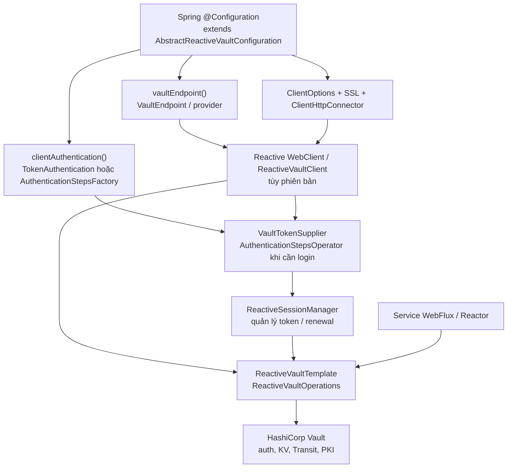
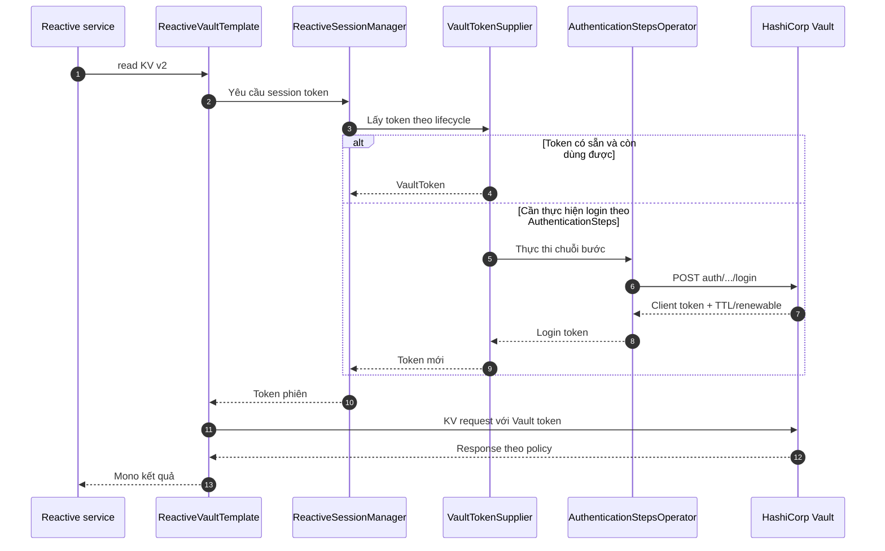

# AbstractReactiveVaultConfiguration và thành phần cần cung cấp

## 1. Vị trí của AbstractReactiveVaultConfiguration trong Spring Vault

Khi ứng dụng Java xử lý HTTP bằng Spring WebFlux hoặc xây dựng pipeline Reactor, việc đọc KV secret, gọi Transit encryption hay thao tác với HashiCorp Vault cần được tích hợp theo cách phù hợp với luồng **reactive**. Thay vì gọi `VaultTemplate` đồng bộ, ứng dụng có thể sử dụng `ReactiveVaultTemplate` thông qua interface `ReactiveVaultOperations`.

`AbstractReactiveVaultConfiguration` thuộc package `org.springframework.vault.config` là lớp cấu hình cơ sở của **Spring Vault**, giúp tạo các thành phần hạ tầng cần thiết trong Spring container:

- Địa chỉ Vault và những lựa chọn kết nối/TLS.
- Cơ chế xác thực của workload.
- HTTP client dùng cho Vault theo hướng reactive.
- Nguồn cung cấp và quản lý Vault client token.
- `ReactiveVaultTemplate` để service nghiệp vụ gọi Vault API.

Điểm quan trọng: khi **kế thừa `AbstractReactiveVaultConfiguration`**, ứng dụng không phải tự lắp tất cả các thành phần trên từ đầu. Thông thường, **hai phương thức môi trường cần triển khai** được kế thừa từ `AbstractVaultConfiguration` là `vaultEndpoint()` và `clientAuthentication()`. Các bean reactive còn lại được lớp cơ sở cung cấp, trừ khi dự án có yêu cầu tùy biến đặc biệt. <https://docs.spring.io/spring-vault/reference/vault/reactive-template.html>

Chương này tập trung vào **những thành phần cần cung cấp**, cách framework nối chúng với nhau, điều kiện để xác thực không chặn và cách kiểm chứng một cấu hình an toàn. Các thao tác KV, Transit, PKI đều cần Vault token có policy thích hợp; việc dùng API reactive **không tự cấp thêm quyền**.

### Mục tiêu sau bài học

Người học có thể giải thích:

1. Vì sao `AbstractReactiveVaultConfiguration` kế thừa cấu hình Vault đồng bộ nhưng lại tạo được `ReactiveVaultOperations`.
2. Những giá trị bắt buộc phải cung cấp và bean nào đã được tạo sẵn.
3. Vì sao `ClientAuthentication` không đồng nghĩa với “login không chặn” và vai trò của `AuthenticationStepsFactory`.
4. Khi nào cần tùy chỉnh client, session manager, TLS và token lifecycle.
5. Cách viết một service reactive dùng KV v2 mà không tự đăng nhập cho mỗi request.

## 2. Sơ đồ lắp ghép các thành phần



Phần **ứng dụng cung cấp** nằm ở `vaultEndpoint()` và `clientAuthentication()`, kèm các tùy chọn bảo mật hoặc mạng nếu cần. Phần **framework cung cấp** bao gồm session manager, client reactive và template. Ranh giới này giúp service nghiệp vụ không cầm token, không gọi login endpoint và không biết chi tiết Kubernetes/AppRole/AWS/GCP/Azure authentication.

Theo API Spring Vault, `AbstractReactiveVaultConfiguration` vẫn kế thừa `AbstractVaultConfiguration` và có thể cung cấp cả cấu hình imperative lẫn reactive. Chẳng hạn, một `SessionManager` đồng bộ có thể được tạo dưới dạng adapter bọc `ReactiveSessionManager`. Adapter kiểu này có thể phải đợi kết quả token; **không dùng client đồng bộ trên event-loop** chỉ vì cấu hình ban đầu là reactive.

## 3. Những phương thức bắt buộc phải cung cấp

### 3.1. vaultEndpoint(): địa chỉ server và ngữ cảnh kết nối

`vaultEndpoint()` trả về một `VaultEndpoint` mô tả Vault server mà client sẽ truy cập. Lớp cơ sở sử dụng thông tin này khi tạo endpoint provider và HTTP client.

Ví dụ trên một môi trường thử nghiệm với Vault URI từ cấu hình triển khai:

```java
import java.net.URI;

import org.springframework.context.annotation.Configuration;
import org.springframework.vault.authentication.ClientAuthentication;
import org.springframework.vault.authentication.TokenAuthentication;
import org.springframework.vault.client.VaultEndpoint;
import org.springframework.vault.config.AbstractReactiveVaultConfiguration;

@Configuration
public class ReactiveVaultClientConfiguration
        extends AbstractReactiveVaultConfiguration {

    @Override
    public VaultEndpoint vaultEndpoint() {
        URI uri = URI.create(requireEnvironment("VAULT_URI"));

        if (!"https".equalsIgnoreCase(uri.getScheme())) {
            throw new IllegalArgumentException(
                    "Vault URI must use HTTPS");
        }
        return VaultEndpoint.from(uri);
    }

    @Override
    public ClientAuthentication clientAuthentication() {
        // Chỉ minh họa token được cấp riêng cho môi trường test;
        // không dùng root token hoặc token tĩnh dài hạn trong production.
        return new TokenAuthentication(
                requireEnvironment("VAULT_TOKEN"));
    }

    private static String requireEnvironment(String key) {
        String value = System.getenv(key);
        if (value == null || value.isBlank()) {
            throw new IllegalStateException(key + " is missing");
        }
        return value;
    }
}
```

Ví dụ dùng Java có `String.isBlank()`, phù hợp Java 11 trở lên. Với một bản Spring Vault cụ thể, cần kiểm tra dependency và chữ ký API theo phiên bản. Giá trị `VAULT_URI` phải do deployment cung cấp, chẳng hạn `https://vault.internal.example:8200`. Không bỏ qua TLS certificate verification; chỉ kiểm thử qua HTTPS với CA trust đã cấu hình hoặc chứng chỉ tin cậy phù hợp.

**Đây là cấu hình minh họa hạ tầng, không phải mẫu xác thực production.** `TokenAuthentication` có thể nhận một token sẵn có, nhưng không tự tạo danh tính workload hoặc bảo đảm token được thay mới khi hết TTL. Nếu token do Vault Agent hoặc hệ thống bên ngoài cấp, phải xác định rõ ai quản lý rotation/revocation và client có nhận token mới hay không.

### 3.2. clientAuthentication(): phương thức cấp danh tính

`clientAuthentication()` trả về một đối tượng `ClientAuthentication`. Trong luồng đồng bộ, đối tượng này có thể thực hiện thao tác login. Nhưng để **`AbstractReactiveVaultConfiguration` tạo được chuỗi xác thực phù hợp reactive**, không phải mọi implementation tùy ý của `ClientAuthentication` đều dùng được.

Mô hình được hỗ trợ trong API Spring Vault:

- `TokenAuthentication`: trường hợp đặc biệt cho **Vault token có sẵn**; framework có thể tạo nguồn token từ giá trị đã cấp.
- `ClientAuthentication` đồng thời triển khai `AuthenticationStepsFactory`: mô tả chuỗi đăng nhập dưới dạng `AuthenticationSteps`, để runtime reactive thực thi bằng `AuthenticationStepsOperator`.
- Một `ClientAuthentication` tùy biến chỉ có phương thức đăng nhập **blocking** mà không hỗ trợ `AuthenticationStepsFactory` có thể **không được lớp cơ sở chấp nhận** khi xây `VaultTokenSupplier`.

Điều này không đồng nghĩa mọi bước trong một custom `AuthenticationSteps` luôn hoàn toàn non-blocking. Nếu factory tự đọc file chậm, gọi SDK đồng bộ hoặc thực hiện network I/O trên event-loop, vẫn có thể gây nghẽn. Cần rà soát cả bước lấy bằng chứng workload, ký request, đăng nhập và gia hạn.

### Bảng phân biệt theo khả năng đăng nhập

| Cách xác thực | Điều cần cung cấp | Vấn đề cần kiểm tra |
| --- | --- | --- |
| Token có sẵn | `TokenAuthentication` với token từ nguồn được bảo vệ | TTL, rotation, owner của token; không dùng root token |
| Kubernetes | Role + service account JWT và authentication implementation tương thích | Token file rotation, auth mount, `AuthenticationStepsFactory` theo phiên bản |
| AppRole | RoleID/SecretID, đường dẫn auth mount và implementation tương thích | SecretID TTL, số lần dùng, re-auth sau khi token hết hạn |
| AWS/GCP/Azure | Danh tính cloud, SDK/bằng chứng và auth role đã cấu hình | SDK có thể blocking, refresh cloud credentials, hỗ trợ native reactive |
| Custom authentication | Có mô tả `AuthenticationSteps` phù hợp hoặc token supplier riêng | Không giả định `ClientAuthentication.login()` có thể chạy trên event-loop |

Không tự chọn một phương thức xác thực chỉ vì nó có factory. Phải chọn theo danh tính workload thật, ràng buộc role bên Vault, chính sách least privilege và khả năng gia hạn/tái xác thực.

## 4. Các bean mà lớp cơ sở tạo giúp ứng dụng

Ngoài hai phương thức môi trường ở trên, `AbstractReactiveVaultConfiguration` có các hook và bean cấu hình cho phần reactive. Tên và chữ ký chi tiết có thể thay đổi giữa các thế hệ thư viện; đối chiếu với API mà dự án đang dùng.

| Thành phần | Nguồn gốc | Vai trò |
| --- | --- | --- |
| `VaultEndpoint` / `VaultEndpointProvider` | Cấu hình do ứng dụng cung cấp và provider kế thừa | Địa chỉ Vault, khả năng lấy endpoint cho request |
| `reactiveVaultEndpointProvider()` | Lớp cấu hình reactive | Đưa endpoint provider vào phần reactive |
| `clientAuthentication()` | **Ứng dụng override** | Chỉ ra thông tin và cơ chế đăng nhập |
| `vaultTokenSupplier()` | Lớp cấu hình reactive | Tạo `VaultTokenSupplier` từ authentication phù hợp |
| `reactiveSessionManager()` | Bean của lớp cơ sở | Quản lý Vault token trong luồng reactive |
| `clientHttpConnector()` | Hook protected của lớp cơ sở reactive | Tạo transport và áp dụng các tùy chọn client/TLS |
| `webClientFactory()` | Bean của lớp cơ sở reactive | Tạo `WebClient` dùng cho request Vault |
| `reactiveVaultTemplate()` | Bean của lớp cơ sở reactive | Cung cấp `ReactiveVaultTemplate` để thao tác API |
| `sessionManager()` | Bean adapter kế thừa/override | Cung cấp `SessionManager` kiểu imperative dựa trên phiên reactive |

Ở thế hệ Spring Vault **4.1**, lớp cấu hình còn có bean/hook `reactiveVaultClient()` sử dụng API `ReactiveVaultClient`. Ở các phiên bản trước, đường tạo template có thể dựa trực tiếp vào endpoint provider và `ClientHttpConnector`. **Không sao chép đoạn override từ 4.1 vào dự án 3.x** khi chưa đối chiếu Javadoc. <https://docs.spring.io/spring-vault/reference/api/java/org/springframework/vault/config/AbstractReactiveVaultConfiguration.html>

### 4.1. VaultTokenSupplier và AuthenticationStepsOperator

Chuỗi cấp token đi qua các thành phần:



Sơ đồ là mô hình trách nhiệm, **không khẳng định lớp framework thực hiện lại login cho từng request**. Mục tiêu của session manager là tái sử dụng token theo vòng đời; token renewal và re-auth phụ thuộc vào token metadata, loại xác thực, giới hạn TTL và việc authentication method có thể tạo chứng cứ mới.

### 4.2. ReactiveSessionManager và token lifecycle

`ReactiveSessionManager` cung cấp một phương thức bất đồng bộ lấy token (trả về `Mono`). `ReactiveLifecycleAwareSessionManager` là implementation hỗ trợ quản lý token theo lifecycle trong Spring Vault. Nó sử dụng nguồn token cùng task scheduler thích hợp để renew/re-auth khi điều kiện cho phép.

Lưu ý:

- **Vault token TTL** là thời hạn phía server; app không thể làm token sống mãi bằng cache một `Mono`.
- **Renew** gia hạn token hiện tại nếu Vault cho phép; **re-auth** thực hiện đăng nhập mới bằng bằng chứng workload.
- Nếu AppRole dùng `secret_id_num_uses=1`, SecretID đã dùng không thể mặc nhiên tái sử dụng cho re-auth. Phải có luồng cấp SecretID mới.
- Kubernetes service account JWT hoặc cloud credentials có thể rotate; authentication implementation cần lấy bằng chứng còn hiệu lực khi login lại.
- Token bị revoke trước TTL có thể khiến API thất bại. Không retry login vô hạn cho mọi lỗi `403` vì `403` cũng có thể là thiếu policy.
- Nếu dùng `TokenAuthentication` trỏ tới token tĩnh, framework không thể tự biến cùng token đã bị revoke thành token mới; phải phối hợp nguồn cấp token bên ngoài.

**Session token không phải dynamic secret lease.** Credentials động từ Database secrets engine hoặc chứng chỉ PKI có vòng đời riêng, cần một chiến lược refresh/rotation khác. Gia hạn token truy cập Vault không đồng nghĩa gia hạn mọi credential mà ứng dụng đang dùng.

## 5. Viết service chỉ phụ thuộc ReactiveVaultOperations

Khi đã cấu hình Spring bean, service nên chỉ tiêm `ReactiveVaultOperations`. Ví dụ ứng dụng đọc secret ở **KV v2** mount `kv`, logical path `apps/order-service`. Spring Vault phiên bản hỗ trợ `opsForKeyValue(...)` trong reactive API có thể dùng `ReactiveVaultKeyValueOperations`:

```java
import java.time.Duration;

import org.springframework.stereotype.Service;
import org.springframework.vault.core.ReactiveVaultKeyValueOperations;
import org.springframework.vault.core.ReactiveVaultOperations;
import org.springframework.vault.core.VaultKeyValueOperationsSupport.KeyValueBackend;
import org.springframework.vault.support.VaultResponse;

import reactor.core.publisher.Mono;

@Service
public final class OrderSecretRepository {

    private final ReactiveVaultKeyValueOperations kv;

    public OrderSecretRepository(ReactiveVaultOperations vault) {
        this.kv = vault.opsForKeyValue("kv", KeyValueBackend.KV_2);
    }

    public Mono<String> requireSigningKey() {
        return kv.get("apps/order-service")
                .switchIfEmpty(Mono.error(
                        new IllegalStateException(
                                "Required Vault secret is missing")))
                .map(this::extractSigningKey)
                .timeout(Duration.ofSeconds(5));
    }

    private String extractSigningKey(VaultResponse response) {
        if (response.getData() == null) {
            throw new IllegalStateException(
                    "Vault secret data is unavailable");
        }

        Object raw = response.getData().get("signingKey");
        if (!(raw instanceof String key) || key.isBlank()) {
            throw new IllegalStateException(
                    "Required signing key is invalid");
        }
        return key;
    }
}
```

Đoạn này minh họa Java 17 pattern matching, không cố định phiên bản Spring Vault. Với Spring Vault 3.1+ (và các bản tương ứng), reactive KV operations hỗ trợ API chọn backend. Nếu dự án đang dùng phiên bản cũ hơn hoặc API khác, cần đối chiếu Javadoc và có thể dùng phương thức `read` với raw path KV v2.

Điểm cần hiểu:

- `"kv"` là **mount name**. `"apps/order-service"` là **logical secret path**.
- KV v2 HTTP API dùng `kv/data/apps/order-service`, nhưng `opsForKeyValue("kv", KV_2)` tự xử lý route đó.
- `Mono` chưa thực thi cho tới khi được subscribe bởi runtime/consumer. Không gọi `.block()` bên trong Netty event-loop.
- `switchIfEmpty` xử lý response không có secret; `map` kiểm tra dữ liệu thiếu hoặc sai kiểu.
- `timeout(5 giây)` chỉ là ví dụ. Timeout thực tế phải phối hợp với Vault client timeout, retry, network p99 latency và yêu cầu sản phẩm.
- Không ghi token hoặc giá trị `signingKey` vào log, exception, trace hoặc metric label.

API `ReactiveVaultTemplate` được thiết kế để tái sử dụng giữa các request; không tạo một template/session manager mới trong mỗi WebFlux handler. Nếu cùng ứng dụng gọi Transit hoặc PKI, service tương ứng sử dụng đúng operations/API của backend và token policy thích hợp, không dùng lại bí mật signing key theo cách không cần thiết.

### 5.1. Dùng path HTTP thô khi cần

Không phải mọi phiên bản đều có mọi abstraction tiện lợi. Khi gọi `ReactiveVaultOperations.read(String)` cho KV v2, path HTTP phải có `data/`:

```java
Mono<VaultResponse> rawResponse =
        vault.read("kv/data/apps/order-service");
```

`vault` trong ví dụ là một bean `ReactiveVaultOperations`. Với raw API, response KV v2 có lớp `data.data`; caller phải xử lý cấu trúc trả về theo HTTP API. Không kết hợp vừa dùng raw path `data/` vừa dùng `opsForKeyValue(..., KV_2)` một cách tùy tiện.

## 6. Gradle dependencies và ranh giới với Spring Cloud Vault

### 6.1. Spring Vault thuần

Để tạo các bean bằng `AbstractReactiveVaultConfiguration`, dự án cần các dependency hỗ trợ Spring Vault core và HTTP client reactive tương thích. Ví dụ khai báo cơ sở:

```groovy
dependencies {
    implementation("org.springframework.vault:spring-vault-core")
    implementation("org.springframework:spring-webflux")

    // Reactor là dependency transitively liên quan tới WebFlux;
    // version phải được quản lý đồng bộ với Spring Framework.
}
```

Với dự án Spring Boot, nên dùng BOM/dependency management tương thích để quản lý phiên bản Spring Vault, Reactor và Spring WebFlux. Khi tùy biến transport (Reactor Netty, Jetty connector hoặc HTTP client được hỗ trợ), phải bảo đảm dependency **thực sự có trên runtime classpath**, chứ không chỉ ở compile-time. Không giả định bất cứ custom transport nào cũng tương thích với mọi phiên bản.

### 6.2. Spring Cloud Vault: tự động cấu hình thay vì kế thừa thủ công

Nếu dự án đã dùng `spring-cloud-starter-vault-config`, Spring Cloud Vault có thể tự tạo hạ tầng Vault cho các chế độ sử dụng tương ứng và tích hợp nguồn cấu hình Spring `Environment`. Khi đó, **không mặc định thêm** một lớp `AbstractReactiveVaultConfiguration` chỉ vì dự án dùng WebFlux: có thể tạo bean trùng tên, hai session manager hoặc các client dùng token khác nhau.

Các lựa chọn thường gặp:

| Kiến trúc | Cách cấu hình ưu tiên |
| --- | --- |
| Ứng dụng dùng Spring Vault thuần, muốn kiểm soát bean rõ ràng | Kế thừa `AbstractReactiveVaultConfiguration` |
| Ứng dụng Spring Boot dùng Vault chủ yếu làm nguồn cấu hình | Spring Cloud Vault Config Data/autoconfiguration |
| Ứng dụng vừa cần PropertySource vừa gọi reactive Vault API | Kiểm tra auto-config beans đã có; bổ sung đúng bean thiếu, tránh chồng session |
| Hệ thống nhận token từ Vault Agent/sidecar | Xác định token rotation và owner; tạo client theo contract được quản lý |
| Nhiều Vault clusters/danh tính | Tạo cấu hình/qualifier riêng, tránh dùng một mutable token toàn cục |

Không nên bật cả auto-config lẫn custom bean mà không có test xác nhận. Hai client dùng hai role/policy khác nhau có thể làm service đọc KV thành công ở môi trường local nhưng `403` ở production do lấy nhầm bean.

## 7. Tùy biến HTTP transport, TLS và namespace

Đa số ứng dụng không cần override `clientHttpConnector()` hay `webClientBuilder(...)`. Nhưng môi trường production có thể cần:

- TLS truststore/CA nội bộ và xác minh hostname đúng.
- Connection timeout, response timeout, connection pool và proxy phù hợp.
- Vault Enterprise namespace khi sử dụng.
- Custom WebClient filters để đo HTTP latency **mà không log header nhạy cảm**.
- Cấu hình endpoint provider cho Vault HA hoặc thay đổi đích phù hợp client library.
- Custom client SSL/transport do yêu cầu hạ tầng đã được phê duyệt.

Các tùy chọn trên nên được đặt ở tầng hạ tầng dùng bởi bean singleton. Không thay đổi Vault URI hoặc namespace theo input của người dùng cuối và không cho phép service truyền tùy tiện full URI vào client. API có thể gắn token vào request; cho phép full URI không kiểm soát có nguy cơ làm lộ token sang đích không tin cậy.

### 7.1. Cần chú ý khi override hook

| Hook | Khi cần | Rủi ro nếu tùy biến sai |
| --- | --- | --- |
| `clientOptions()` | Timeout, policy HTTP client phù hợp | Timeout không nhất quán, retry storm |
| `sslConfiguration()` | CA/truststore hoặc mTLS nếu được triển khai | Bỏ kiểm tra chứng chỉ, lỗi handshake |
| `clientHttpConnector()` | Thay transport theo hạ tầng | Blocking connector hoặc HTTP client không tương thích |
| `webClientBuilder(...)` | Đăng ký filter/customizer theo phiên bản | Header/token vô tình bị log, lỗi endpoint path |
| `reactiveVaultEndpointProvider()` | Endpoint động, HA hoặc lựa chọn endpoint riêng | Đổi sang server/namespace không đúng |
| `reactiveSessionManager()` | Lifecycle token đặc thù cần test riêng | Không renew/re-auth hoặc tạo nhiều token song song |

Chỉ override nếu đã chứng minh default không đáp ứng yêu cầu. Cần xem **chữ ký phương thức** của phiên bản đang dùng và bảo toàn phần cấu hình cần thiết của lớp cơ sở (SSL, client options, token supplier và scheduler).

### 7.2. Ví dụ cấu hình không an toàn cần tránh

```text
Không làm:
- tắt TLS certificate verification để “sửa” lỗi kết nối;
- bật log nguyên WebClient request/response body và X-Vault-Token;
- cho người dùng cuối truyền bất kỳ URL Vault nào;
- tạo một ReactiveVaultTemplate mới cho mỗi request;
- tự cache Vault token vô thời hạn trong Mono.cache();
- gọi .block() trên Netty event-loop để lấy token.
```

Vấn đề non-blocking chỉ giải quyết **mô hình thực thi**; bảo mật vẫn phải dựa vào Vault role, policy, TLS và lifecycle credential.

## 8. Khi authentication không triển khai AuthenticationStepsFactory

Đây là một trong những lỗi dễ nhầm nhất khi xây hạ tầng reactive. Một `ClientAuthentication` tùy biến có thể chạy tốt với `VaultTemplate` đồng bộ, nhưng `AbstractReactiveVaultConfiguration` không thể xây `VaultTokenSupplier` reactive từ nó nếu chỉ biết gọi `login()` đồng bộ.

### Triệu chứng và quyết định xử lý

| Triệu chứng | Ý nghĩa có thể | Cách xử lý |
| --- | --- | --- |
| Lỗi dựng bean liên quan `vaultTokenSupplier` | Authentication không phải `TokenAuthentication` và không cung cấp `AuthenticationStepsFactory` | Chọn implementation hỗ trợ steps hoặc thiết kế supplier riêng |
| SDK cloud chỉ có API blocking | Bước lấy/ký bằng chứng có thể chặn event-loop | Dùng SDK/reactive flow phù hợp hoặc tách blocking boundary |
| Login thành công rồi KV `403` | Token policy thiếu quyền hoặc path KV v2 sai | Kiểm tra policy `kv/data/...`; không sửa bằng đổi scheduler |
| Vault auth login `404` | Auth mount/path sai | Sửa đúng mount login, không tự hard-code token admin |
| Token hết hạn nhưng re-auth thất bại | Identity bootstrap/JWT/SecretID không còn hợp lệ | Thiết kế refresh workload credential trước khi re-auth |

Có ba hướng giải quyết thực tế:

1. **Ưu tiên auth implementation đã hỗ trợ `AuthenticationStepsFactory`** cho đúng method và phiên bản thư viện.
2. **Đưa việc cấp và xoay vòng token ra Vault Agent hoặc hệ thống issuer**, rồi để ứng dụng dùng token qua cơ chế cập nhật an toàn. Phải xác định ai sở hữu và thu hồi token.
3. **Giữ Vault client đồng bộ phía hạ tầng và cô lập blocking work** bằng executor/scheduler được giới hạn, thay vì ép custom `ClientAuthentication.login()` vào event-loop. Đây là phương án chuyển tiếp, không biến code cũ thành non-blocking thực sự.

Không sửa lỗi bằng cách tự gọi `.block()` trên event-loop hoặc tạo root token dùng vĩnh viễn. Những cách đó làm mất khả năng mở rộng và gây rủi ro bảo mật.

## 9. Xử lý lỗi và quan sát trong ứng dụng reactive

Trong Reactor, lỗi I/O, token và quyền truy cập thường lan ra như **error signal** thay vì exception được ném trực tiếp ra caller đồng bộ. Vì vậy, service nên thiết kế xử lý lỗi dựa trên loại nguyên nhân.

| Lỗi | Biểu hiện | Chính sách gợi ý |
| --- | --- | --- |
| Vault tạm mất kết nối | Timeout, DNS/TLS error, 5xx | Timeout hữu hạn, retry có backoff trong điều kiện an toàn |
| Auth method/role sai | Login trả 400/403 | Sửa cấu hình hoặc identity; không retry không giới hạn |
| Token hết hạn hoặc bị revoke | API bị Vault từ chối | Kiểm tra session manager và re-auth; phân biệt policy denial |
| KV path thiếu | `Mono.empty()` hoặc lỗi theo API/version | Xử lý thiếu secret rõ ràng, không trả secret rỗng im lặng |
| Sai KV v1/v2 path | `404` hoặc dữ liệu sai cấu trúc | Kiểm tra mount, `data/` và abstraction |
| Lỗi đọc dữ liệu/cấu trúc | Thiếu key, sai kiểu | Báo lỗi nghiệp vụ có kiểm soát; không in response có bí mật |
| Auth provider blocking | Event-loop lag, BlockHound hoặc latency tăng | Đo thread usage và kiểm tra `AuthenticationSteps` |
| Session renewal lỗi sau TTL | Chỉ lỗi sau một thời gian chạy | Thử token expiry/re-auth, không chỉ test khởi động |

### 9.1. Phân biệt retry hợp lý và retry nguy hiểm

Đọc KV bằng GET thường có tính đọc, nhưng retry login, ghi secret, cấp chứng chỉ PKI hay phát hành credential mới có thể tạo thêm state. Cần đặt timeout và retry riêng cho từng hoạt động; không dùng một `retryWhen` chung vô hạn cho mọi Publisher. Với Transit encryption, việc retry có thể tạo ciphertext khác dù plaintext không đổi tùy cơ chế và IV, nên cần hiểu yêu cầu nghiệp vụ.

Trong trường hợp token đã hết TTL, auth backend có thể cũng gặp sự cố. Không tiếp tục gửi hàng nghìn login request đồng thời vì nhiều subscriber cùng nhận lỗi. Cần sử dụng session manager/supplier có khả năng hạn chế login trùng và quan sát trạng thái đăng nhập.

### 9.2. Giữ thông tin bí mật ngoài telemetry

Chỉ nên đo latency, tỷ lệ thành công/thất bại, số lần login, renew, re-auth, số kết nối và event-loop delay theo nhãn có cardinality thấp. Không đưa `VaultToken`, `X-Vault-Token`, `SecretID`, JWT hoặc KV values vào log/trace/metric label. Cũng cần hạn chế hiển thị tên auth role và path nếu chúng tiết lộ cấu trúc nội bộ.

## 10. Kiểm thử cấu hình và vòng đời

Một unit test chỉ mock `ReactiveVaultOperations` có thể xác minh logic đọc KV, nhưng **không chứng minh `AbstractReactiveVaultConfiguration` đã dựng đúng bean, TLS và authentication**. Hãy kiểm thử theo từng lớp.

### 10.1. Context test

Khởi chạy Spring test application context với `ReactiveVaultClientConfiguration`, xác minh có thể lấy bean:

- `ReactiveVaultOperations` / `ReactiveVaultTemplate`.
- `ReactiveSessionManager`.
- Endpoint và authentication bean/cấu hình dự kiến.
- Không có bean session/template trùng do kết hợp thêm auto-configuration.

Lưu ý `clientAuthentication()` không phải lúc nào cũng được tự động đăng ký thành một bean `ClientAuthentication` độc lập; điều quan trọng là **lớp cấu hình dùng đúng implementation**, không nhất thiết có bean riêng mang tên đó.

### 10.2. Dùng StepVerifier cho logic KV

Với `OrderSecretRepository`:

```java
import static org.mockito.Mockito.when;

import java.util.Map;

import org.junit.jupiter.api.Test;
import org.mockito.Mockito;
import org.springframework.vault.core.ReactiveVaultKeyValueOperations;
import org.springframework.vault.support.VaultResponse;

import reactor.core.publisher.Mono;
import reactor.test.StepVerifier;

class OrderSecretRepositoryLogicTest {

    @Test
    void readsRequiredKeyFromVaultResponse() {
        ReactiveVaultKeyValueOperations kv =
                Mockito.mock(ReactiveVaultKeyValueOperations.class);

        VaultResponse response = new VaultResponse();
        response.setData(Map.of("signingKey", "test-only-value"));

        when(kv.get("apps/order-service"))
                .thenReturn(Mono.just(response));

        // Khi test lớp xử lý thuần có constructor nhận KV operations,
        // dùng cùng luồng map/switchIfEmpty như service minh họa.
        Mono<String> result = kv.get("apps/order-service")
                .map(r -> (String) r.getData().get("signingKey"));

        StepVerifier.create(result)
                .expectNext("test-only-value")
                .verifyComplete();
    }
}
```

Đây là test minh họa cho **hợp đồng Publisher và response data**, chưa gọi constructor `OrderSecretRepository` ở trên. Khi chuyển thành test đầy đủ của service, nên tiêm/mocks `ReactiveVaultOperations` rồi xác nhận hàm `requireSigningKey()`, cả case thiếu path/thiếu key/timeout. Đừng gọi `.block()` trong WebFlux handler để làm test “nhanh hơn”.

`reactor-test` và JUnit/Mockito là **test dependencies**, không nên kéo chúng vào production runtime nếu không cần.

### 10.3. Integration test với Vault

Trong môi trường test cô lập (có thể dùng Testcontainers), tạo:

1. Một Vault instance có TLS hoặc trust phù hợp test.
2. KV v2 mount `kv` chứa secret giả tại `apps/order-service`.
3. Một auth role cho workload thử nghiệm với policy chỉ `read` tại `kv/data/apps/order-service`.
4. Client cấu hình bằng `AbstractReactiveVaultConfiguration` hoặc cấu hình production tương đương, nhưng lấy identity/secret từ test fixtures an toàn.
5. Các tình huống đọc thành công, secret không tồn tại, sai path, thiếu quyền, token hết hạn, renew/re-auth và Vault unavailable.

**Các assertion quan trọng:** đăng nhập không lặp mỗi lần đọc; bean reactive được tái sử dụng; token có policy tối thiểu; response không lộ secret trong error/log; session manager xử lý TTL theo khả năng auth method; khi token được thu hồi, ứng dụng báo lỗi có kiểm soát.

Nếu kiểm thử một cloud auth cần AWS/GCP/Azure principal thật, mock metadata hoặc stub signer chỉ chứng minh phần client; nó không chứng minh Vault production sẽ chấp nhận cloud identity đó.

### 10.4. Kiểm thử concurrency và backpressure

Dùng nhiều subscriber đồng thời để phát hiện login storm, thread blocking, network saturation và pool exhaustion. Với auth method cần tương tác cloud SDK, kiểm tra thời gian login trước và sau khi token TTL hết. Nếu framework tạo adapter imperative bọc reactive session manager, không được gọi adapter đó từ Netty event-loop như thể hoàn toàn reactive.

## 11. Lỗi cấu hình thường gặp

| Sai sót | Hệ quả | Cách khắc phục |
| --- | --- | --- |
| Không override `vaultEndpoint()` | Thiếu endpoint môi trường; không khởi tạo đúng client | Cung cấp URI/endpoint và TLS trust |
| Không override `clientAuthentication()` | Thiếu nguồn định danh Vault | Chọn auth method và role phù hợp |
| Custom `ClientAuthentication` không hỗ trợ `AuthenticationStepsFactory` | Không dựng được token supplier reactive | Dùng provider tương thích hoặc thiết kế bridge có kiểm soát |
| Nhầm bean `VaultOperations` với `ReactiveVaultOperations` | Service WebFlux gọi API đồng bộ trên event-loop | Tiêm interface reactive và dùng `Mono`/`Flux` |
| Thêm cả Cloud Vault auto-config lẫn cấu hình thủ công | Bean trùng, token/session manager không đồng nhất | Xem bean graph và chọn một nguồn cấu hình chủ đạo |
| Tắt TLS verification | Có thể bị MITM và lộ Vault token | Cấu hình CA/truststore đúng |
| Dùng `TokenAuthentication` với token cũ/đã revoke | Đọc Vault thất bại sau TTL hoặc khi rotate | Dùng auth workflow hoặc nguồn token có rotation rõ |
| Đọc KV v2 bằng raw path thiếu `data/` | `404` hoặc dữ liệu sai | Dùng `opsForKeyValue(mount, KV_2)` |
| Permission denied sau khi login | Token policy không cho phép path tương ứng | Sửa policy đúng capability, không cấp root |
| Đặt `block()` trong WebFlux controller | Event-loop bị chặn, latency tăng | Kết hợp Publisher tới response |
| Tự cache token vô thời hạn | Dùng token quá hạn hoặc đã revoke | Để session manager quản lý lifecycle |

## 12. Checklist cho cấu hình production

- Xác định phiên bản **Spring Vault, Spring Framework, Reactor và Spring Cloud Vault**; kiểm tra chữ ký phương thức trên Javadoc của đúng phiên bản.
- Cung cấp `vaultEndpoint()` với Vault URI hợp lệ; dùng HTTPS và cấu hình TLS trust/namespace theo môi trường.
- Cung cấp `clientAuthentication()` theo danh tính workload, không hard-code token/SecretID trong source.
- Với login không dùng token có sẵn, xác minh implementation hỗ trợ **`AuthenticationStepsFactory`** và không gọi blocking SDK trên event-loop.
- Tái sử dụng `ReactiveVaultOperations`/`ReactiveVaultTemplate` dưới dạng bean ứng dụng, không khởi tạo theo từng request.
- Để `ReactiveSessionManager`/`VaultTokenSupplier` quản lý token đúng TTL, renew và re-auth; thiết kế refresh identity cho workload.
- Phân biệt **Vault client token lifecycle** với **lease của dynamic secrets**, PKI certificate validity và Transit key rotation.
- Chỉ override `clientHttpConnector()`, `webClientBuilder(...)` hoặc session manager khi thật sự cần; giữ đúng timeout, TLS và lifecycle.
- Không để bean auto-config và bean kế thừa `AbstractReactiveVaultConfiguration` quản lý hai token độc lập ngoài ý muốn.
- Kiểm thử KV v2 policy, Transit/PKI permissions riêng, role/auth mount, credential expiration, Vault downtime, error signal, concurrency và shutdown.
- Không tiết lộ token, request header, SecretID hoặc secret value trong log, tracing, metrics và HTTP error.

**Ghi nhớ:** Với `AbstractReactiveVaultConfiguration`, ứng dụng thường chỉ cần triển khai **`vaultEndpoint()`** và **`clientAuthentication()`**; Spring Vault cung cấp `ReactiveVaultTemplate`, HTTP client và quản lý token tương ứng. Điều kiện quan trọng nhất là **luồng đăng nhập phải tương thích với reactive token supplier**, không chỉ API đọc KV trả về `Mono`. Kết hợp cấu hình này với TLS, least privilege và kiểm thử vòng đời giúp `ReactiveVaultOperations` vận hành an toàn và ổn định.

## Tài liệu tham khảo

- Spring Vault — Reactive Infrastructure: https://docs.spring.io/spring-vault/reference/vault/reactive-template.html
- Spring Vault — Authentication Methods/Authentication Steps: https://docs.spring.io/spring-vault/reference/vault/authentication.html
- Spring Vault — API `AbstractReactiveVaultConfiguration`: https://docs.spring.io/spring-vault/reference/api/java/org/springframework/vault/config/AbstractReactiveVaultConfiguration.html
- Spring Vault — API `ReactiveVaultOperations`: https://docs.spring.io/spring-vault/reference/api/java/org/springframework/vault/core/ReactiveVaultOperations.html

