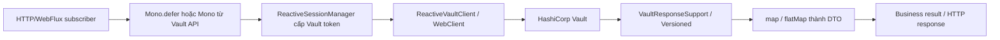

# Đọc, ghi, xóa và ánh xạ dữ liệu theo chuỗi reactive

## 1. Bài toán và mục tiêu

Một dịch vụ thanh toán viết bằng **Spring WebFlux** cần đọc endpoint và credential của đối tác từ **HashiCorp Vault**, cập nhật secret khi được phép, xóa version cũ khi hết nhu cầu, và trả kết quả xử lý bất đồng bộ mà không chặn event-loop. Trong **Spring Vault**, API dành cho nhu cầu này là `ReactiveVaultOperations`, thường do `ReactiveVaultTemplate` triển khai.

Khác với `VaultTemplate` đồng bộ, các phương thức reactive trả về `Mono<T>` hoặc `Flux<T>`. Người viết code không nhận dữ liệu ngay tại dòng gọi `read()`; họ tạo **một chuỗi công việc** có thể ghép nối, xử lý lỗi, giới hạn thời gian và được thực thi khi có subscriber.

Bài **“Đọc, ghi, xóa và ánh xạ dữ liệu theo chuỗi reactive”** thuộc chương **API reactive** của module **SPRING_VAULT**. Nó tiếp nối mục tiêu ứng dụng Java truy cập Vault theo danh tính workload và Vault ACL policy, sử dụng KV secrets, đồng thời giúp bạn xây pipeline phù hợp cho các thao tác Transit/PKI nếu về sau cần mở rộng.

Sau bài học, bạn có thể:

- Phân biệt `ReactiveVaultOperations`, `ReactiveVaultKeyValueOperations` và `ReactiveVaultVersionedKeyValueOperations`.
- Đọc, ghi, xóa KV v1/KV v2 bằng path và phương thức phù hợp.
- Ánh xạ `VaultResponseSupport<T>` hoặc `Versioned<T>` sang DTO/record Java mà vẫn giữ ý nghĩa của metadata.
- Viết chuỗi `map`, `flatMap`, `then`, `zip`, `switchIfEmpty` và `onErrorResume` đúng với Reactor.
- Phân biệt `Mono.empty()` (không có kết quả), `Mono<Void>` (hoàn thành) và `Mono.error(...)` (thất bại).
- Tránh `block()`, `subscribe()` tùy tiện, retry ghi đè và rò rỉ token/secret vào log.
- Kiểm thử đơn vị bằng Reactor `StepVerifier` và kiểm thử tích hợp với Vault/KV v2 thật.

## 2. Tổng quan các interface và kiểu reactive

| API | Mục đích | Trả về tiêu biểu |
| --- | --- | --- |
| `ReactiveVaultOperations.read(path)` | Đọc HTTP Vault API theo path | `Mono<VaultResponse>` |
| `ReactiveVaultOperations.read(path, DTO.class)` | Đọc và ánh xạ trường `data` của response | `Mono<VaultResponseSupport<DTO>>` |
| `ReactiveVaultOperations.write(path, body)` | Ghi một request Vault API | `Mono<VaultResponse>` |
| `ReactiveVaultOperations.delete(path)` | Xóa theo API path | `Mono<Void>` |
| `ReactiveVaultOperations.list(path)` | Liệt kê keys ở path có hỗ trợ LIST | `Flux<String>` |
| `opsForKeyValue("secret", KV_2).get(path, DTO.class)` | Đọc dữ liệu KV v2 theo **logical path** | `Mono<VaultResponseSupport<DTO>>` |
| `opsForKeyValue("secret", KV_2).put(path, data)` | Ghi toàn bộ data của KV | `Mono<Void>` |
| `opsForKeyValue("secret", KV_2).delete(path)` | Xóa logical key theo semantics backend | `Mono<Void>` |
| `opsForVersionedKeyValue("secret").get(path, DTO.class)` | Đọc dữ liệu KV v2 và version | `Mono<Versioned<DTO>>` |
| `opsForVersionedKeyValue("secret").put(path, data)` | Ghi KV v2, nhận metadata của version | `Mono<Versioned.Metadata>` |

`ReactiveVaultTemplate` **thread-safe sau khi được cấu hình**, vì vậy nên đăng ký thành Spring bean dùng chung, inject bằng **interface `ReactiveVaultOperations`** thay vì tạo template mới cho mỗi request.

### Luồng dữ liệu nhìn dưới góc độ Reactor



**Lưu ý:** backpressure trong Reactive Streams giúp bên nhận điều tiết dòng `Flux`; nó **không biến một lệnh ghi Vault thành giao dịch**, cũng không giúp Vault tự động hủy công việc đã được server thực thi sau khi client cancel. Với `Mono`, mỗi subscription cho tối đa một `onNext` rồi complete/error.

## 3. Cấu hình hạ tầng Reactive Vault

Spring Vault dùng `ReactiveVaultClient`, `VaultTokenSupplier` và `ReactiveSessionManager` để gửi request có xác thực qua client HTTP non-blocking. **`AbstractReactiveVaultConfiguration`** cung cấp hạ tầng này từ `VaultEndpoint` và `ClientAuthentication`.

Ví dụ tối giản (Spring Vault 4.1.x, Java 17+, Spring WebFlux trên classpath):

```java
import java.net.URI;

import org.springframework.context.annotation.Configuration;
import org.springframework.vault.authentication.ClientAuthentication;
import org.springframework.vault.authentication.TokenAuthentication;
import org.springframework.vault.client.VaultEndpoint;
import org.springframework.vault.config.AbstractReactiveVaultConfiguration;

@Configuration
public class ReactiveVaultConfiguration
        extends AbstractReactiveVaultConfiguration {

    @Override
    public VaultEndpoint vaultEndpoint() {
        return VaultEndpoint.from(
            URI.create("https://vault.internal.example:8200"));
    }

    @Override
    public ClientAuthentication clientAuthentication() {
        // Chỉ minh họa token được inject từ môi trường bảo vệ.
        // Trong production, ưu tiên Kubernetes/IAM/JWT workload auth.
        String token = System.getenv("VAULT_TOKEN");
        if (token == null || token.isBlank()) {
            throw new IllegalStateException("Missing Vault credential");
        }
        return new TokenAuthentication(token);
    }
}
```

Sau khi cấu hình, bean `ReactiveVaultTemplate` có thể được inject dưới kiểu `ReactiveVaultOperations`:

```java
import org.springframework.stereotype.Service;
import org.springframework.vault.core.ReactiveVaultOperations;

@Service
public final class VaultHealthReader {

    private final ReactiveVaultOperations vault;

    public VaultHealthReader(ReactiveVaultOperations vault) {
        this.vault = vault;
    }
}
```

Đây là *khung cấu hình*; code không biên dịch/test tại bước viết bài. Khi dùng **Spring Cloud Vault auto-configuration**, tránh tạo nhiều bean `ReactiveVaultTemplate`/token supplier cạnh tranh; hãy chọn cách cấu hình phù hợp phiên bản Spring Boot/Spring Cloud đã sử dụng. Cấu hình SSL phải tin cậy CA hợp lệ và xác minh hostname; **không tắt xác minh TLS**.

**Phân biệt phiên:** `ReactiveSessionManager` giữ token dùng trong request reactive; nó khác `SessionManager` của template blocking. Một request cần token có thể kéo theo reactive login/renew tùy authentication method. Không tự `block()` để lấy token trước rồi đưa vào mọi request.

### Dependencies cần thiết

Ở dự án Spring Boot/WebFlux, thường có:

```xml
<!-- BOM Spring Boot/Spring Cloud/Spring Vault cần tương thích. -->
<dependency>
    <groupId>org.springframework.vault</groupId>
    <artifactId>spring-vault-core</artifactId>
</dependency>
<dependency>
    <groupId>org.springframework.boot</groupId>
    <artifactId>spring-boot-starter-webflux</artifactId>
</dependency>
<dependency>
    <groupId>io.projectreactor</groupId>
    <artifactId>reactor-test</artifactId>
    <scope>test</scope>
</dependency>
```

Ví dụ dependency là **định hướng**, không phải một `pom.xml` hoàn chỉnh. Với Spring Cloud Vault starter, Spring Vault/Reactive dependencies có thể đã được quản lý gián tiếp; không tự thêm bản khác phiên bản.

## 4. Hiểu path trước khi viết chuỗi CRUD

Một trong những lỗi thường gặp nhất là dùng sai path giữa KV v1 và KV v2.

| Secrets engine | Logical key | HTTP read | HTTP write | HTTP list |
| --- | --- | --- | --- | --- |
| KV v1 tại `secret/` | `apps/payment/config` | `secret/apps/payment/config` | Cùng path | `secret/apps/payment/` |
| KV v2 tại `secret/` | `apps/payment/config` | `secret/data/apps/payment/config` | `secret/data/apps/payment/config` | `secret/metadata/apps/payment/` |

Nếu dùng **`opsForKeyValue("secret", KV_2)`**, chỉ truyền **`apps/payment/config`**, không đưa `secret/data/` hoặc `data/` vào path logic. Spring Vault sẽ xử lý `data/`, `metadata/` đúng chỗ.

Nếu sử dụng trực tiếp `ReactiveVaultOperations.read("secret/data/apps/payment/config")`, bạn đang gọi **HTTP API path** nên phải hiểu chính xác JSON của KV v2: trường `data` phía ngoài chứa cả `data` bên trong và `metadata`, khác với JSON trả từ KV v1. Vì vậy với CRUD của KV, nên ưu tiên **`opsForKeyValue`** hoặc **`opsForVersionedKeyValue`**.

### Phản hồi Vault KV v2 thô

Ví dụ rút gọn (dữ liệu hoàn toàn giả):

```json
{
  "data": {
    "data": {
      "endpoint": "https://sandbox.payments.example",
      "apiKey": "<REDACTED>"
    },
    "metadata": {
      "version": 3,
      "destroyed": false
    }
  }
}
```

`opsForKeyValue("secret", KV_2).get(..., PaymentSecret.class)` xử lý bao bọc KV v2 và ánh xạ payload **`data.data`** thành DTO được yêu cầu. Nếu bạn đọc raw path `secret/data/...`, không được mặc định `VaultResponse.getData().get("endpoint")` nằm ở tầng ngoài.

## 5. Đọc KV v2 reactive và ánh xạ thành Java record

Giả sử KV v2 mount `secret/`, logical path `apps/payment/config` chứa hai field:

```json
{
  "endpoint": "https://sandbox.payments.example",
  "apiKey": "<REDACTED>"
}
```

Java record đại diện cho payload:

```java
public record PaymentSecret(
        String endpoint,
        String apiKey) {
}
```

Spring Vault sử dụng codec của `WebClient` để ánh xạ JSON thành đối tượng. Với record/POJO, field names phải khớp; nếu key Vault là `api_key`, cần DTO thích hợp, cấu hình Jackson hoặc `@JsonProperty("api_key")`. Dùng codec chuẩn thay vì ép `Map<String, Object>` sang class bằng cast.

### Service reactive hoàn chỉnh cho read/put/delete

```java
import java.time.Duration;
import java.util.Map;
import java.util.NoSuchElementException;

import org.springframework.stereotype.Service;
import org.springframework.vault.core.ReactiveVaultKeyValueOperations;
import org.springframework.vault.core.ReactiveVaultOperations;
import org.springframework.vault.core.VaultKeyValueOperationsSupport.KeyValueBackend;

import reactor.core.publisher.Mono;

@Service
public final class PaymentSecretRepository {

    private static final String PATH = "apps/payment/config";
    private static final Duration TIMEOUT = Duration.ofSeconds(5);

    private final ReactiveVaultKeyValueOperations kv;

    public PaymentSecretRepository(ReactiveVaultOperations vault) {
        this.kv = vault.opsForKeyValue("secret", KeyValueBackend.KV_2);
    }

    public Mono<PaymentSecret> read() {
        return kv.get(PATH, PaymentSecret.class)
            .flatMap(response -> Mono.justOrEmpty(response.getData()))
            .switchIfEmpty(Mono.error(
                new NoSuchElementException("Payment secret is absent")))
            .map(secret -> {
                validate(secret);
                return secret;
            })
            .timeout(TIMEOUT);
    }

    public Mono<Void> put(PaymentSecret secret) {
        return Mono.defer(() -> {
            validate(secret);
            return kv.put(PATH, Map.of(
                "endpoint", secret.endpoint(),
                "apiKey", secret.apiKey()
            ));
        }).timeout(TIMEOUT);
    }

    public Mono<Void> delete() {
        return kv.delete(PATH).timeout(TIMEOUT);
    }

    private static void validate(PaymentSecret secret) {
        if (secret == null
                || secret.endpoint() == null || secret.endpoint().isBlank()
                || secret.apiKey() == null || secret.apiKey().isBlank()) {
            throw new IllegalArgumentException(
                "Payment secret is incomplete");
        }
    }
}
```

**Các điểm kỹ thuật:**

1. `kv.get(PATH, PaymentSecret.class)` trả `Mono<VaultResponseSupport<PaymentSecret>>`. Dùng `flatMap(response -> Mono.justOrEmpty(response.getData()))` để loại giá trị `null` an toàn: Reactor **không cho phép `null` được emit**.
2. `switchIfEmpty` biến trường hợp secret không tồn tại/response không có dữ liệu thành **lỗi nghiệp vụ**, không nhầm với `403` do thiếu Vault ACL.
3. `validate` chạy trong pipeline: lỗi được Reactor đưa tới `onError`, không âm thầm bỏ qua field.
4. `put` trả `Mono<Void>`: tín hiệu `onComplete` xác nhận request hoàn thành; **không có giá trị `onNext` để `map`**.
5. `delete` ở KV v2 thường là **soft-delete của version mới nhất** (qua API `DELETE /data/<path>`). Nó **không destroy** toàn bộ version history.
6. `timeout` giới hạn thời gian chờ tổng chuỗi, bao gồm thời gian cấp token và I/O; bị timeout không chứng minh server **chưa** thực hiện write/delete. Cần đọc lại trạng thái trước khi retry mutation.

**Không trả trực tiếp `PaymentSecret` qua HTTP endpoint công khai**. Mẫu DTO chứa secret, chỉ dùng nội bộ ở nơi được cấp quyền.

## 6. `map`, `flatMap`, `then`: ghép chuỗi đúng với kiểu dữ liệu

Reactor cung cấp nhiều operator; chọn theo việc bước tiếp theo đồng bộ hay trả thêm Publisher.

| Operator | Ví dụ | Khi dùng |
| --- | --- | --- |
| `map` | `Mono<Response> → Mono<DTO>` | Biến đổi **đồng bộ** 1:1, ví dụ lấy data hoặc chuẩn hóa URL. |
| `flatMap` | `Mono<DTO> → Mono<Result>` | Bước kế tiếp **bất đồng bộ**, như gọi Vault lần nữa, gọi HTTP, database. |
| `flatMapMany` | `Mono<T> → Flux<U>` | Bước kế tiếp tạo nhiều phần tử, ví dụ một danh sách để xử lý. |
| `then` | `Mono<Void>.then(other)` | Chờ một tác vụ hoàn tất rồi chạy tác vụ sau, **bỏ kết quả onNext trước đó**. |
| `thenReturn` | `Mono<Void>.thenReturn(value)` | Chờ completion rồi phát một giá trị xác nhận an toàn. |
| `Mono.when` | `Mono.when(a, b)` | Chờ các tác vụ kết thúc, trả `Mono<Void>`, không thu thập dữ liệu. |
| `zip` | `Mono.zip(a, b)` | Kết hợp **hai kết quả có giá trị onNext**; cần cả hai phát dữ liệu. |
| `switchIfEmpty` | `...switchIfEmpty(Mono.error(...))` | Xử lý **hoàn thành không có dữ liệu**, không phải `onError`. |
| `onErrorResume` | `onErrorResume(ex -> fallback)` | Quyết định fallback theo **loại lỗi** và policy nghiệp vụ. |

### 6.1. Ghi → đọc lại để kiểm chứng

```java
public Mono<PaymentSecret> writeThenRead(
        PaymentSecretRepository repo, PaymentSecret input) {

    return repo.put(input)     // Mono<Void> khi ghi xong
               .then(repo.read()); // Mono<PaymentSecret>
}
```

Cách này bảo đảm **thứ tự subscribe**: đọc diễn ra **sau** khi ghi hoàn tất. Nó **không tạo transaction** hai bước hay ngăn writer khác sửa key trong khoảng giữa write/read.

Đừng dùng:

```java
// SAI về ngữ nghĩa: Mono<Void> không có onNext -> map không chạy.
repo.put(input).map(ignored -> "updated");
```

Thay bằng `repo.put(input).thenReturn("updated")` khi chỉ cần thông báo hoàn tất.

### 6.2. Ghép hai secrets độc lập

Giả sử muốn đọc credential dịch vụ thanh toán và cấu hình webhook từ hai path, mỗi path trả `Mono`:

```java
Mono<PaymentSecret> payment = paymentRepo.read();
Mono<WebhookSettings> webhook = webhookRepo.read();

Mono<CombinedSettings> combined = Mono.zip(payment, webhook)
    .map(tuple -> new CombinedSettings(
        tuple.getT1(), tuple.getT2()));
```

`WebhookSettings`, `CombinedSettings` chỉ là DTO ứng dụng (không phải lớp Spring Vault). `Mono.zip` **không atomic**: hai request có thể đọc hai version khác thời điểm. Để cần tính nhất quán liên-secret, thiết kế version/generation và quy trình cập nhật riêng.

**Không dùng `zip` với `Mono<Void>`**:

```java
// Không đúng mục đích: write completion không phát value.
Mono.zip(repo.put(input), repo.read());
```

Nhánh `put` không phát `onNext`, nên `zip` có thể hoàn thành rỗng/cancel thành phần khác. Sử dụng `then` khi yêu cầu thứ tự hoặc `Mono.when` nếu chỉ cần chờ nhiều completion.

### 6.3. Đọc một map rồi ánh xạ có kiểm chứng

Trong trường hợp dữ liệu không có DTO phù hợp:

```java
import java.util.Map;
import java.util.NoSuchElementException;

import org.springframework.vault.core.ReactiveVaultOperations;
import org.springframework.vault.support.VaultResponse;

import reactor.core.publisher.Mono;

public Mono<String> readEndpointViaMap(
        ReactiveVaultOperations vault) {

    return vault.read("secret/data/apps/payment/config")
        .flatMap((VaultResponse response) -> {
            Map<String, Object> outer = response.getData();
            if (outer == null) {
                return Mono.empty();
            }
            Object raw = outer.get("data"); // KV v2 nested data
            if (!(raw instanceof Map<?, ?> inner)) {
                return Mono.empty();
            }
            Object endpoint = inner.get("endpoint");
            return endpoint instanceof String value && !value.isBlank()
                    ? Mono.just(value)
                    : Mono.empty();
        })
        .switchIfEmpty(Mono.error(
            new NoSuchElementException("Endpoint unavailable")));
}
```

Đây là ví dụ cho **raw path KV v2**; ưu tiên `opsForKeyValue` với typed mapping khi có thể. Chỉ cast map sau khi kiểm tra kiểu. Không bao giờ xuất toàn bộ `response`/`data` ra log vì có thể chứa secret.

## 7. Xóa và quản lý version KV v2: Delete khác Destroy

Ở KV v2, “xóa” có nhiều mức khác nhau:

| Operation | Tác động | Khả năng phục hồi |
| --- | --- | --- |
| `ReactiveVaultKeyValueOperations.delete(path)` với KV v1 | Xóa key của KV v1 | Không có version history để undelete. |
| `ReactiveVaultKeyValueOperations.delete(path)` với KV v2 | Soft-delete version **mới nhất** | Version vẫn có thể được undelete theo chính sách Vault. |
| `ReactiveVaultVersionedKeyValueOperations.delete(path, versions...)` | Soft-delete các version chỉ định | Có thể `undelete` nếu chưa destroy. |
| `ReactiveVaultVersionedKeyValueOperations.destroy(path, versions...)` | Xóa dữ liệu **vĩnh viễn** của version chỉ định | Không thể phục hồi nội dung. |
| `opsForKeyValueMetadata().delete(path)` | Xóa **metadata và tất cả version history** của key | Xóa toàn bộ lịch sử; cần quyền đặc biệt và cảnh báo. |

### 7.1. Reactive versioned API với metadata

```java
import java.util.Map;
import java.util.NoSuchElementException;

import org.springframework.vault.core.ReactiveVaultOperations;
import org.springframework.vault.core.ReactiveVaultVersionedKeyValueOperations;
import org.springframework.vault.support.Versioned;

import reactor.core.publisher.Mono;

public final class VersionedVaultRepository {

    private final ReactiveVaultVersionedKeyValueOperations versioned;

    public VersionedVaultRepository(ReactiveVaultOperations vault) {
        versioned = vault.opsForVersionedKeyValue("secret");
    }

    public Mono<Integer> write(Map<String, Object> data) {
        return versioned.put("apps/payment/config", data)
            .map(meta -> meta.getVersion().getVersion());
    }

    public Mono<PaymentSecret> readLatest() {
        return versioned.get("apps/payment/config", PaymentSecret.class)
            .flatMap(v -> Mono.justOrEmpty(v.getData()))
            .switchIfEmpty(Mono.error(new NoSuchElementException(
                "No readable current version")));
    }

    public Mono<Void> softDeleteVersion(int version) {
        return versioned.delete(
            "apps/payment/config", Versioned.Version.from(version));
    }

    public Mono<Void> restoreVersion(int version) {
        return versioned.undelete(
            "apps/payment/config", Versioned.Version.from(version));
    }

    public Mono<Void> destroyVersion(int version) {
        return versioned.destroy(
            "apps/payment/config", Versioned.Version.from(version));
    }
}
```

`write` lấy version mới từ `Versioned.Metadata` của kết quả `put`; `readLatest` tách `Versioned<T>` bằng `getData()`. Một version đã deleted/destroyed có thể không có data; **đừng xem `Versioned<T>` luôn chứa secret**.

Cách lấy version mới bằng `meta.getVersion().getVersion()` sử dụng Javadoc `Versioned.Metadata` và `Versioned.Version`. Nếu mục đích chỉ xác nhận có write, có thể dùng `.then()` để trả `Mono<Void>` mà không tiết lộ metadata cho caller.

### 7.2. CAS khi nhiều tiến trình cùng ghi

Một KV v2 key có thể bị nhiều worker cập nhật đồng thời. Với API versioned, có thể gửi `Versioned.create(data, expectedVersion)` để bật **Compare-and-Set (CAS)**:

```java
import java.util.Map;
import org.springframework.vault.support.Versioned;
import reactor.core.publisher.Mono;

public Mono<Void> writeIfVersionMatches(
        ReactiveVaultVersionedKeyValueOperations kv,
        int expectedVersion,
        Map<String, Object> candidate) {

    Versioned<Map<String, Object>> value =
        Versioned.create(
            candidate, Versioned.Version.from(expectedVersion));

    return kv.put("apps/payment/config", value).then();
}
```

CAS của Vault chỉ ghi nếu version hiện tại phù hợp; khi mismatch, request lỗi và caller cần **đọc lại/merge/đưa ra quyết định**. **Không retry nguyên request CAS vô hạn** mà không thay điều kiện. Trường hợp tạo lần đầu dùng CAS=0 theo semantics KV v2; hãy đối chiếu chính sách `cas_required` của mount/key.

**Cảnh báo:** `opsForKeyValue("secret", KV_2).put` tiện cho ghi thường nhưng không cho bạn truyền expected version qua interface đó. Dùng `opsForVersionedKeyValue` khi yêu cầu optimistic concurrency.

## 8. Liệt kê nhiều key theo `Flux` và kiểm soát concurrency

`ReactiveVaultOperations.list(path)` và `ReactiveVaultKeyValueOperations.list(path)` trả `Flux<String>`. Với KV v2, `list` phải có quyền `list` tại metadata path phù hợp; **quyền `read` trên data path không tự cấp quyền liệt kê metadata**.

Giả sử cần đọc tối đa 50 logical keys dưới `apps/payment/` và chỉ lấy một DTO an toàn. Pattern:

```java
import java.util.NoSuchElementException;
import java.util.regex.Pattern;

import org.springframework.vault.core.ReactiveVaultKeyValueOperations;
import reactor.core.publisher.Flux;
import reactor.core.publisher.Mono;

public Flux<PaymentSecret> readMany(
        ReactiveVaultKeyValueOperations kv) {

    Pattern safeName = Pattern.compile("[a-z0-9-]{1,48}");

    return kv.list("apps/payment")
        .filter(key -> safeName.matcher(key).matches())
        .take(50)
        .flatMap(key ->
            kv.get("apps/payment/" + key, PaymentSecret.class)
              .flatMap(response -> Mono.justOrEmpty(response.getData())),
            4 // Giới hạn tối đa bốn request đọc đồng thời.
        );
}
```

`flatMap(..., 4)` giới hạn số request in-flight, giảm đột biến tới Vault. Kết quả có thể **không giữ thứ tự** list; dùng `flatMapSequential(..., concurrency)` nếu cần đúng thứ tự phát ra. `take(50)` chỉ giới hạn **client xử lý**, không biến một API LIST của Vault thành phân trang server-side và không bảo đảm chi phí network luôn theo 50 phần tử.

**Quan trọng:** `list` có thể trả key dạng thư mục có dấu `/`; ví dụ ở trên cố tình lọc chỉ key đơn cấp. Với cây nhiều tầng cần thuật toán duyệt riêng, giới hạn độ sâu và tổng số request.

### Backpressure và subscribe

`Flux` đưa tín hiệu về demand cho downstream; nhưng **một lệnh Vault LIST** vẫn là một request HTTP có thể trả danh sách lớn. `flatMap` có concurrency prefetch riêng và network operation đã gửi tới Vault có thể tiếp tục xử lý sau cancellation. Luôn giới hạn concurrency, timeouts, tổng key và quyền truy cập.

Không tạo `Flux.interval` liên tục đọc lại secret để “giám sát” nếu không có nhu cầu; với KV v2, dùng cơ chế polling/refresh có cadence rõ, còn secret động cần quản lý lease/token tách biệt.

## 9. Xử lý thiếu secret, lỗi quyền và lỗi tạm thời

### 9.1. `Mono.empty()` không phải `Mono.error()`

- `Mono.just(value)` phát đúng một giá trị rồi complete.
- `Mono.empty()` complete mà **không phát value**. Ở một số API Vault, không có path có thể được biểu diễn như vậy.
- `Mono.error(exception)` phát lỗi, ví dụ `403 permission denied`, network timeout, lỗi decode hoặc `VaultException`.
- `Mono<Void>` chỉ biểu diễn việc kết thúc hoặc lỗi; không phát giá trị `Void`.

Sơ đồ tín hiệu:

```text
GET  key tồn tại       : onNext(VaultResponse), onComplete
GET  key không tồn tại : onComplete            (trong trường hợp API chọn Mono.empty)
GET  quyền bị từ chối  : onError(...)          (403, không phải "empty")
PUT  thành công        : onComplete            (Mono<Void> của KV put)
PUT  thất bại          : onError(...)
DELETE thành công      : onComplete            (Mono<Void>)
```

**Không coi mọi `404` ở mọi endpoint là `Mono.empty()`:** hành vi còn tùy phương thức, Vault response và phiên bản implementation. Test từng API thực. Ví dụ `KV2 deleted version` có thể trả trạng thái metadata riêng hoặc lỗi; dùng `Versioned<T>` để xem phiên bản khi quan trọng.

### 9.2. Fallback có điều kiện

Một fallback có thể phù hợp với **secret thật sự optional**, nhưng không dùng để che lỗi authentication:

```java
public Mono<String> optionalPublicEndpoint(
        ReactiveVaultKeyValueOperations kv) {

    return kv.get("apps/demo/public-settings")
        .flatMap(response ->
            Mono.justOrEmpty(response.getData()))
        .map(data -> (String) data.get("endpoint"))
        .switchIfEmpty(Mono.just("https://public-fallback.example"));
}
```

Ví dụ chỉ dành cho **public endpoint không nhạy cảm** và giả định `endpoint` đã được validate kiểu dữ liệu; trong production nên kiểm tra `instanceof String` thay vì cast trực tiếp. `switchIfEmpty` không biến `403` thành fallback, đó là tính năng mong muốn. **Không fallback API key, database password hoặc PKI private key** sang credential dev.

Nếu muốn bắt một loại lỗi đã xác định, dùng `onErrorResume(SomeException.class, ex -> ...)`. Không dùng `onErrorResume(ex -> Mono.empty())` chung cho tất cả lỗi, vì nó biến Vault outage/403 thành “secret không tồn tại”.

### 9.3. Timeouts, retry và idempotence

```java
import java.time.Duration;
import reactor.util.retry.Retry;

// Chỉ retry ĐỌC và chỉ khi classifier xác định lỗi tạm thời.
public Mono<PaymentSecret> readWithBoundedRetry(
        PaymentSecretRepository repo) {

    return repo.read()
        .retryWhen(
            Retry.backoff(2, Duration.ofMillis(250))
                .filter(this::isRetryableVaultFailure)
        );
}

// Helper do ứng dụng tự định nghĩa, không thuộc Spring Vault.
// Phải phân biệt HTTP 429/5xx, timeout, network với 403/404.
private boolean isRetryableVaultFailure(Throwable error) {
    return false; // Mặc định an toàn; bổ sung classifier đã kiểm thử.
}
```

Code cho biết **vị trí** đặt retry và yêu cầu classifier; `return false` là placeholder cố ý để **không retry** khi chưa có phân loại lỗi an toàn. Trong production, cần xây classifier theo exception chain thực tế, mã HTTP và giới hạn tổng thời gian.

**Tuyệt đối không blind retry thao tác ghi/xóa:**

- KV v2 `put` **tạo version mới**, mỗi subscription thực thi có thể làm tăng version.
- Nếu HTTP response bị mất sau khi Vault đã ghi thành công, retry có thể **ghi lần nữa**, dù người gọi tưởng chưa có kết quả.
- `delete`/`destroy` có thể có tác động không thể đảo ngược; cần policy, kiểm tra version và xác thực mục tiêu.
- Reactor `retryWhen` / `repeat` có thể **resubscribe** toàn pipeline, do đó nhân số lần gọi Vault.
- CAS giúp ngăn ghi đè nhưng không miễn trừ trách nhiệm xử lý trường hợp request đã commit mà response bị timeout.

Khi retry read, giới hạn số lần, delay/backoff, timeout tổng và **không retry 403 do policy**, 404 do thiếu key hoặc lỗi DTO không hợp lệ.

## 10. Subscription, `block()` và side effect

Một chuỗi Reactor là khai báo công việc. Ví dụ:

```java
Mono<Void> pendingWrite = repository.put(
    new PaymentSecret("https://sandbox.example", "test-only-secret"));

// Không có subscriber -> không bảo đảm write được thực thi.
// pendingWrite chỉ là một publisher.
```

Trong `WebFlux`, hãy **trả publisher** cho controller/framework:

```java
import org.springframework.http.ResponseEntity;
import org.springframework.web.bind.annotation.DeleteMapping;
import org.springframework.web.bind.annotation.GetMapping;
import org.springframework.web.bind.annotation.RequestMapping;
import org.springframework.web.bind.annotation.RestController;
import reactor.core.publisher.Mono;

@RestController
@RequestMapping("/internal/payment-settings")
public final class PaymentSettingsController {

    private final PaymentSecretRepository repository;

    public PaymentSettingsController(PaymentSecretRepository repository) {
        this.repository = repository;
    }

    // Chỉ trả một trường không nhạy cảm; endpoint nội bộ có phân quyền.
    @GetMapping
    public Mono<ResponseEntity<String>> publicEndpoint() {
        return repository.read()
            .map(value -> ResponseEntity.ok(value.endpoint()));
    }

    @DeleteMapping
    public Mono<ResponseEntity<Void>> deleteSecret() {
        // Route nguy hiểm: chỉ minh họa kỹ thuật, không public.
        return repository.delete()
            .thenReturn(ResponseEntity.noContent().build());
    }
}
```

**Cảnh báo:** controller DELETE là minh họa kỹ thuật, **không triển khai nguyên trạng lên internet**. Phải có authentication, authorization, audit, CSRF/endpoint policy phù hợp và ideally approval/quy trình quản trị cho thao tác xóa. Không đưa apiKey vào response.

Các anti-patterns:

```java
// KHÔNG NÊN dùng trong reactive request/event loop:
PaymentSecret secret = repository.read().block();

// KHÔNG NÊN tự tạo side-effect fire-and-forget:
repository.delete().subscribe();

// ĐÚNG: compose để controller hoặc subscriber có trách nhiệm xử lý:
Mono<Void> result = repository.delete();
```

- `block()` có thể khóa Reactor Netty event-loop và phá tính non-blocking; trên một số thread, Reactor ném lỗi khi chặn. Nếu bắt buộc tích hợp API blocking, cô lập ở ranh giới bất đồng bộ thích hợp, không trộn tùy tiện vào `flatMap`.
- `subscribe()` tự gọi có thể tách lifecycle, mất trace/cancellation, khó test và dễ bỏ qua error. Chỉ dùng ở **boundary có chủ sở hữu rõ** như scheduled job/service thực hiện side effect và quản lý subscription.
- Dùng `doOnNext`/`doOnError` cho telemetry nhẹ, **không log secret** và không biến operator quan sát thành nơi thực hiện I/O bắt buộc.

## 11. Security, policy và path validation

Vault vẫn kiểm tra quyền ở mỗi HTTP API, dù Java viết theo mô hình reactive.

Policy tối thiểu đọc/ghi/xóa một logical KV v2 path:

```hcl
path "secret/data/apps/payment/config" {
  capabilities = ["create", "update", "read", "delete"]
}
```

Đây là policy phục vụ **bài tập CRUD** trong môi trường test, không phải quyền nên cấp cho mọi workload. Production thường tách role **đọc** khỏi role **ghi/xóa**, và hạn chế metadata/list/version operations theo chính sách riêng.

| API | Vault path quyền thường liên quan | Chú ý |
| --- | --- | --- |
| `kv.get` KV v2 | `secret/data/apps/payment/config`, `read` | Read secret. |
| `kv.put` KV v2 | `secret/data/apps/payment/config`, `create`/`update` | Write toàn bộ payload, version mới. |
| `kv.delete` KV v2 | `secret/data/apps/payment/config`, `delete` | Soft-delete current version. |
| `kv.list` KV v2 | `secret/metadata/apps/payment/*`, `list` | Metadata listing là một quyền khác. |
| `versioned.destroy` | `secret/destroy/apps/payment/config`, `update` | Không thể khôi phục version đã destroy. |
| `versioned.undelete` | `secret/undelete/apps/payment/config`, `update` | Phục hồi version đã soft-delete. |
| `versioned metadata delete` | `secret/metadata/apps/payment/config`, `delete` | Có thể xóa toàn bộ lịch sử. |

**Không tạo Vault path từ user input chưa được xác thực.** `ReactiveVaultOperations` còn có khả năng xử lý path dạng absolute URI. Nếu client ghép URI từ input không đáng tin, có thể vô tình gửi token/header xác thực tới endpoint ngoài ý muốn. Dùng path cố định hoặc whitelist segments và **không nhận URI đầy đủ từ người dùng**.

```java
import java.util.regex.Pattern;

public final class VaultPathRules {

    private static final Pattern SAFE_SEGMENT =
        Pattern.compile("[a-z0-9-]{1,48}");

    public static String logicalPath(String tenant) {
        if (tenant == null
                || !SAFE_SEGMENT.matcher(tenant).matches()) {
            throw new IllegalArgumentException("Invalid tenant segment");
        }
        return "apps/" + tenant + "/config";
    }
}
```

Hạn chế cả việc đưa secret vào `Reactor Context`, MDC, metrics labels, tracing spans hoặc exception messages. Vault response có thể chứa token, API key, private key PKI hoặc database password. Ở controller, chỉ ánh xạ **phần công khai cần trả về**, không serialize toàn bộ `VaultResponse`.

## 12. Quản lý vòng đời token và lease trong pipeline

**Reactive Vault access** có hai loại vòng đời độc lập:

- **Vault client token:** cần xác thực workload (Kubernetes/IAM/JWT/AppRole...) và có TTL/renewal riêng, do `ReactiveSessionManager` hoặc token supplier phù hợp quản lý.
- **Dynamic secret lease:** Database credentials, PKI và một số engine cấp lease; cần renew/rotate/revoke riêng theo loại engine và chính sách. `Mono` hoàn thành một lần đọc **không tự gia hạn** lease secret được nhận.

Với **KV v2**, dữ liệu versioned không có renewable lease động như Database. Việc ghi một version mới cũng không phát sự kiện push tới tất cả service đang dùng `ReactiveVaultTemplate`.

Trước khi dùng secret trong WebFlux pipeline:

1. Xác thực workload có policy phù hợp.
2. Đảm bảo token/lease còn trong thời hạn theo cơ chế quản lý đã chọn.
3. Đọc key và ánh xạ thành DTO, validate bắt buộc.
4. Không cache credential quá hạn vô điều kiện bằng `cache()` ở `Mono`.
5. Với secret được rotate, xây lại resource/client cần thiết; chỉ read lại secret không tự đổi JDBC pool hoặc SSL context.

Một `Mono.cache()` có thể lưu **giá trị secret cũ** lâu hơn TTL nếu không giới hạn thời gian và không có invalidation. Khi cần cache, quy định TTL dựa trên policy, invalidation rõ và xử lý error/cancellation. Tránh chia sẻ một publisher chứa secret tới subscriber không đủ quyền.

## 13. Kiểm thử đơn vị và tích hợp

### 13.1. Unit test tín hiệu Reactor với `StepVerifier`

Ví dụ kiểm thử cho hàm chuyển đổi một kết quả giả, **không cần Vault thật**:

```java
import java.util.NoSuchElementException;

import reactor.core.publisher.Mono;
import reactor.test.StepVerifier;

public final class PaymentSecretReactorTest {

    static Mono<String> endpoint(Mono<PaymentSecret> source) {
        return source
            .map(PaymentSecret::endpoint)
            .filter(value -> !value.isBlank())
            .switchIfEmpty(Mono.error(
                new NoSuchElementException("No valid endpoint")));
    }

    public static void main(String[] args) {
        StepVerifier.create(endpoint(
                Mono.just(new PaymentSecret(
                    "https://sandbox.example", "dummy-token"))))
            .expectNext("https://sandbox.example")
            .verifyComplete();

        StepVerifier.create(endpoint(Mono.empty()))
            .expectError(NoSuchElementException.class)
            .verify();
    }
}
```

Ví dụ `main` minh họa assertions, không thay thế JUnit test runner. Khi test code repository, mock `ReactiveVaultKeyValueOperations` hoặc fake `ReactiveVaultOperations` và xác minh **đúng path**, **đúng payload**, **đúng tín hiệu**; không đưa credential thật vào test fixtures.

### 13.2. Integration test với Vault thật

Chuẩn bị Vault dev/Testcontainers, KV v2 mount `secret/`, policy riêng cho ứng dụng test. Với một Vault test đã enable KV v2:

```bash
# Chỉ dùng dữ liệu giả. Lệnh không chứa secret production.
vault kv put -mount=secret apps/payment/config \
  endpoint="https://sandbox.example" \
  apiKey="dummy-token"

vault kv get -mount=secret apps/payment/config
vault kv metadata get -mount=secret apps/payment/config
```

Không phụ thuộc root token trong ứng dụng test: tạo token/role có quyền tối thiểu, cô lập Vault instance, xóa dữ liệu test và revoke credential khi hoàn tất. Dữ liệu giả có thể log an toàn theo chính sách, nhưng code sản xuất không được log API key thật.

### 13.3. Ma trận kiểm thử

| Ca | Hành động | Kết quả mong đợi |
| --- | --- | --- |
| A — Read KV v2 | `kv.get(path, DTO.class)` trên key tồn tại | `Mono<VaultResponseSupport<DTO>>`, DTO được map đúng. |
| B — Read missing | Path chưa được ghi | `Mono.empty()` hoặc error theo API cụ thể; repository biến thành lỗi nghiệp vụ rõ ràng. |
| C — Write | `kv.put(path, data)` | `Mono<Void>` hoàn thành, đọc lại thấy payload. |
| D — Delete | `kv.delete(path)` | Version mới nhất soft-deleted; metadata/history còn. |
| E — Destroy | `versioned.destroy(path, version)` | Version đã chỉ định bị xóa vĩnh viễn; dùng Vault test riêng. |
| F — Typed mapping | DTO có key sai tên/kiểu | Phát lỗi decode hoặc validation, không âm thầm cast sai. |
| G — Mono<Void> | `put(...).map(...)` và `put(...).thenReturn(...)` | Xác nhận chỉ `thenReturn` emit giá trị sau completion. |
| H — Zip | Ghép hai reads bằng `Mono.zip` | Cả hai có dữ liệu thì tạo DTO kết hợp; nếu một empty thì không có pair. |
| I — HTTP 403 | Token thiếu `read` data path | `onError`, không biến thành missing/default secret. |
| J — LIST permission | Có `read` nhưng thiếu `list` metadata path | LIST thất bại; tăng quyền có chủ đích hoặc bỏ LIST. |
| K — Timeout write | Mất response sau khi server đã ghi | Không blind retry; kiểm tra version/trạng thái trước lần ghi khác. |
| L — CAS conflict | Hai client cùng expected version | Chỉ một write thành công; còn lại xử lý conflict rõ ràng. |
| M — Retry policy | Vault tạm `429`/`5xx` khi read | Retry giới hạn và chỉ lỗi phù hợp; không retry 403/404. |
| N — Concurrency | `Flux` có nhiều keys | Số request đồng thời đúng giới hạn `flatMap(..., 4)`. |
| O — Cancellation | Subscriber hủy trong lúc request chậm | Không coi cancel là rollback write/delete ở server. |
| P — Secret leakage | Bật log/trace/test HTTP response | Không có apiKey/token/lease ID trong log, metrics hoặc response. |
| Q — KV v1/v2 mismatch | Chọn `KV_1` cho mount KV v2 hoặc ngược lại | Request lỗi/khác cấu trúc; sửa đúng backend enum và path. |
| R — Versioned history | Delete/undelete/destroy có điều kiện | Phân biệt rõ các cấp xóa trên KV v2. |

**Kiểm thử tải:** có thể đo số request in-flight, latency p95/p99, heap allocation, pool HTTP và Vault response code khi tăng `flatMap` concurrency. Backpressure là cơ chế điều tiết luồng, không thay cho rate limiting/Vault capacity planning.

## 14. Chẩn đoán các lỗi thường gặp

| Hiện tượng | Nguyên nhân thường gặp | Cách xử lý |
| --- | --- | --- |
| Viết `Mono<Void>.map` không chạy | Publisher chỉ emit completion | Dùng `then` hoặc `thenReturn`. |
| Đã gọi `repository.put(...)` nhưng Vault không thay đổi | Không ai subscribe | Trả publisher đến WebFlux/runner hoặc chủ động subscribe ở boundary được quản lý. |
| Dùng `block()` trên WebFlux event-loop và ứng dụng treo | Chặn thread non-blocking | Giữ pipeline reactive end-to-end. |
| `getData()` trả `null` gây NPE | Dùng `map` tạo `null` | `Mono.justOrEmpty`, validation, `switchIfEmpty`. |
| DTO fields null | JSON field names không khớp DTO/Jackson codecs | Sửa DTO và key naming, dùng `@JsonProperty` khi phù hợp. |
| KV v2 read có nested `data` | Dùng raw `read("secret/data/...")` | Dùng `opsForKeyValue(..., KV_2)` hoặc unwrapping đúng. |
| Delete xong metadata vẫn còn | KV v2 soft-delete | Dùng versioned/metadata API chỉ khi thực sự cần destructive action. |
| Read đúng, LIST `403` | Thiếu `list` tại metadata path KV v2 | Policy tách biệt cho LIST; không cấp `root`. |
| `Mono.zip` hoàn thành rỗng | Một nhánh empty hoặc `Mono<Void>` | Dùng `then` hoặc kết quả bắt buộc; handle missing rõ ràng. |
| Retry write tạo nhiều version | `retryWhen` resubscribe | Dùng CAS và reconciliation; không retry mutation mặc định. |
| Timeouts nhưng server vẫn có secret mới | Write hoàn thành nhưng response timeout | Kiểm tra Vault state/idempotency, không kết luận timeout là rollback. |
| Auth `403`/token hết hạn | ReactiveSessionManager, workload identity hoặc Vault policy | Kiểm tra nguồn credential, token lifecycle, audit đã che bí mật. |
| Phát tán token qua path tùy ý | Input tạo absolute URI / path injection | Sanitize, whitelist path segments, chỉ dùng Vault endpoint tin cậy. |
| Dữ liệu không tự đổi sau KV put | Không có push/cached Mono | Thiết kế reload/invalidation hoặc đọc lại có chủ đích. |

## 15. Câu hỏi tự kiểm tra

1. `ReactiveVaultOperations` khác `VaultOperations` ở điểm cốt lõi nào? `Mono` có nghĩa thao tác đã thực thi chưa?
2. Khi đọc KV v2, vì sao nên dùng `opsForKeyValue("secret", KV_2)` với path `apps/payment/config` thay vì thêm `data/` tùy ý?
3. `Mono<VaultResponseSupport<T>>` khác `Mono<Versioned<T>>` thế nào về metadata?
4. Vì sao `Mono<Void>.map(...)` không cho bạn một chuỗi xác nhận ghi thành công? Thay bằng operator gì?
5. `map` và `flatMap` khác nhau thế nào khi bước sau cần gọi Vault thêm một lần?
6. Có thể dùng `Mono.zip` kết hợp `kv.put` (`Mono<Void>`) với `kv.get` được không? Vì sao?
7. Soft-delete KV v2 khác `destroy` và xóa metadata thế nào?
8. Khi hai worker cùng ghi, tại sao cần CAS? Trường hợp timeout của write có nguy cơ gì?
9. `Flux.flatMap(..., 4)` đem lại bảo đảm gì, và điều gì nó **không bảo đảm**?
10. Khi nào `switchIfEmpty` thích hợp, khi nào `onErrorResume` có thể khiến ứng dụng che lỗi permission?
11. Vì sao không nên gọi `block()` và `subscribe()` tùy tiện trong controller WebFlux?
12. Vì sao `Mono.cache()` có thể nguy hiểm khi cache Vault credential có TTL/lease?
13. Khi Vault login token được gia hạn nhưng secret động đã hết lease, pipeline cần quan tâm thêm điều gì?
14. Hãy thiết kế test chứng minh lỗi `403` không bị biến thành kết quả `Mono.empty()` hoặc secret mặc định.

**Điểm ghi nhớ:** `ReactiveVaultTemplate` giúp Java thực hiện **đọc, ghi, xóa và ánh xạ** qua Reactor `Mono`/`Flux`. Hãy chọn **typed KV operations** để tránh nhầm KV v1/v2, xử lý `Mono.empty` và `Mono.error` riêng, dùng `then` cho `Mono<Void>`, giới hạn concurrency và cẩn trọng retry mutations. Reactive không thay thế Vault policy, token/lease lifecycle, yêu cầu bảo vệ secret và kiểm thử tích hợp.

## 16. Tài liệu tham khảo

- Spring Vault, [Reactive Infrastructure](https://docs.spring.io/spring-vault/reference/vault/reactive-template.html): `ReactiveVaultTemplate`, reactive authentication, WebClient và callbacks.
- Spring Vault Javadoc, [ReactiveVaultOperations](https://docs.spring.io/spring-vault/reference/api/java/org/springframework/vault/core/ReactiveVaultOperations.html): `read`, `write`, `delete`, `list` và các typed backends.
- Spring Vault Javadoc, [ReactiveVaultKeyValueOperations](https://docs.spring.io/spring-vault/reference/api/java/org/springframework/vault/core/ReactiveVaultKeyValueOperations.html): `get`, `put`, `patch` và kiểu Mono trả về.
- Spring Vault Javadoc, [ReactiveVaultKeyValueOperationsSupport](https://docs.spring.io/spring-vault/reference/api/java/org/springframework/vault/core/ReactiveVaultKeyValueOperationsSupport.html): `delete`, `getApiVersion` và `list`.
- Spring Vault Javadoc, [ReactiveVaultVersionedKeyValueOperations](https://docs.spring.io/spring-vault/reference/api/java/org/springframework/vault/core/ReactiveVaultVersionedKeyValueOperations.html): versioned read/write, CAS, delete/undelete/destroy.
- Spring Vault Javadoc, [ReactiveVaultKeyValueMetadataOperations](https://docs.spring.io/spring-vault/reference/api/java/org/springframework/vault/core/ReactiveVaultKeyValueMetadataOperations.html): quản lý KV v2 metadata và xóa toàn bộ history.
- Spring Vault Javadoc, [AbstractReactiveVaultConfiguration](https://docs.spring.io/spring-vault/reference/api/java/org/springframework/vault/config/AbstractReactiveVaultConfiguration.html): cấu hình reactive session/template.
- Spring Vault Javadoc, [Versioned](https://docs.spring.io/spring-vault/reference/api/java/org/springframework/vault/support/Versioned.html) và [VaultResponseSupport](https://docs.spring.io/spring-vault/reference/api/java/org/springframework/vault/support/VaultResponseSupport.html): typed data và metadata.
- Reactor, [Project Reactor Reference Guide](https://projectreactor.io/docs/core/release/reference/): Mono/Flux, composition, error handling, retry và backpressure.
- HashiCorp Vault, [KV v2 API](https://developer.hashicorp.com/vault/api-docs/secret/kv/kv-v2): KV v2 data/metadata, CAS và version deletion.
- HashiCorp Vault, [Policies](https://developer.hashicorp.com/vault/docs/concepts/policies): ACL capabilities trên API path.
