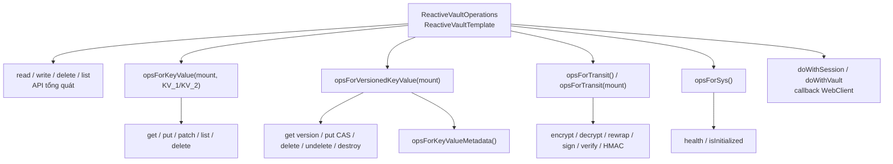
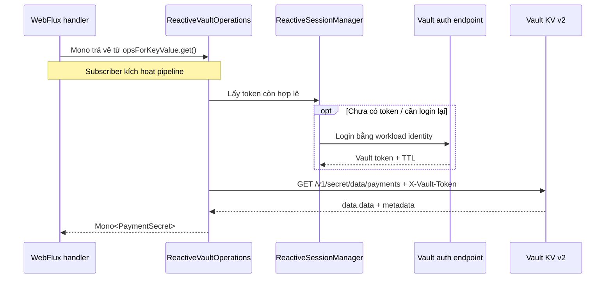

# Nhóm thao tác chuyên biệt có trong API reactive

Spring Vault không chỉ có `VaultTemplate` và `VaultOperations` kiểu đồng bộ. Trong ứng dụng Java dùng Reactor/WebFlux, **`ReactiveVaultTemplate`** triển khai **`ReactiveVaultOperations`**, cho phép ghép các thao tác với HashiCorp Vault thành `Mono` hoặc `Flux` mà không cần chặn luồng chờ kết quả HTTP. Bên cạnh các thao tác `read`, `write`, `delete` và `list` tổng quát, API reactive còn cung cấp những **nhóm thao tác chuyên biệt** cho Key/Value, Key/Value v2 có version, Transit và một phần System API.

Bài thuộc chương **API reactive** trong module `SPRING_VAULT`. Mục tiêu là nhận diện chính xác các nhóm API có sẵn, khi nào cần dùng mỗi nhóm, dữ liệu/đường dẫn nào được ánh xạ, và giới hạn so với `VaultOperations` imperative. Những kỹ năng này giúp Java service dùng workload authentication và policy để truy cập KV secrets, Transit encryption, các API PKI khi cần, đồng thời quản lý lỗi, token và kiểm thử tích hợp.

> **Phạm vi phiên bản:** `ReactiveVaultOperations` xuất hiện từ Spring Vault 2.0; các convenience groups `opsForKeyValue`, `opsForVersionedKeyValue`, `opsForTransit` và `opsForSys` có từ **Spring Vault 3.1**. Các chữ ký bên dưới được đối chiếu với JavaDoc Spring Vault 3.1–4.1. Kiểm tra phiên bản `spring-vault-core` thực sự được resolve trước khi sao chép mã; không suy từ riêng phiên bản Spring Boot.

## 1. Sơ đồ các nhóm thao tác reactive



| Nhóm | Cách lấy từ `ReactiveVaultOperations` | Kiểu trả về chính | Khi nên dùng |
| --- | --- | --- | --- |
| **Tổng quát** | `read`, `write`, `list`, `delete` | `Mono<VaultResponse>`, `Flux<String>`, `Mono<Void>` | API Vault chưa có abstraction chuyên biệt hoặc truy vấn đơn giản |
| **KV v1/v2 tiện ích** | `opsForKeyValue("secret", KeyValueBackend.KV_2)` | `ReactiveVaultKeyValueOperations` | Đọc/ghi key-value thường gặp, không cần CAS version |
| **KV v2 có version** | `opsForVersionedKeyValue("secret")` | `ReactiveVaultVersionedKeyValueOperations` | Đọc version chỉ định, ghi có kiểm soát version/CAS, khôi phục hoặc hủy version |
| **KV v2 metadata** | `opsForVersionedKeyValue("secret").opsForKeyValueMetadata()` | `ReactiveVaultKeyValueMetadataOperations` | Quản trị metadata và danh sách version |
| **Transit** | `opsForTransit()` hoặc `opsForTransit("transit-team")` | `ReactiveVaultTransitOperations` | Encrypt, decrypt, rewrap, sign, verify, HMAC, quản lý key khi được cấp quyền |
| **System subset** | `opsForSys()` | `ReactiveVaultSysOperations` | Health và trạng thái Vault đã initialize |
| **Callback HTTP** | `doWithSession(...)`, `doWithVault(...)` | Kiểu `Publisher` do callback trả | API chưa có helper như PKI issue, hoặc cần điều khiển HTTP method/body |

**Quan trọng:** danh sách trên là API reactive hiện có, **không phải bản sao 1:1 của imperative**. Trên `ReactiveVaultOperations` ở nhánh 4.1 không có các convenience method `opsForPki()`, `opsForToken()`, `opsForWrapping()` hay `opsForTransform()`, mặc dù `VaultOperations` imperative có nhiều nhóm như vậy. Không viết `reactiveVault.opsForPki()` nếu JavaDoc của phiên bản client không khai báo phương thức đó.

## 2. Phân biệt `Mono`, `Flux` và thời điểm thực thi

| Kiểu | Ý nghĩa | Ví dụ trong Spring Vault |
| --- | --- | --- |
| `Mono<T>` | Không có hoặc có **một** phần tử, hoặc lỗi | Đọc một secret, encrypt một plaintext, xem health |
| `Flux<T>` | Có thể có **nhiều** phần tử, hoặc lỗi | Liệt kê key name, danh sách Transit key, kết quả batch |
| `Mono<Void>` | Chỉ biểu thị hoàn thành hoặc lỗi | Xóa dữ liệu, tạo key hoặc tác vụ ghi không có payload |

Ví dụ:

```java
import reactor.core.publisher.Flux;
import reactor.core.publisher.Mono;
import org.springframework.vault.core.ReactiveVaultOperations;
import org.springframework.vault.support.VaultResponse;

class BasicReactiveExamples {
    private final ReactiveVaultOperations vault;

    BasicReactiveExamples(ReactiveVaultOperations vault) {
        this.vault = vault;
    }

    Mono<VaultResponse> readOne() {
        return vault.read("secret/data/orders");
    }

    Flux<String> listKeys() {
        return vault.list("secret/metadata/apps");
    }
}
```

Trong đoạn trên, `read("secret/data/orders")` gọi API Vault tổng quát ở một path cụ thể, còn `list` yêu cầu quyền `list` trên path tương ứng. **Không có nghĩa** cả hai request đã chạy khi phương thức Java trả `Mono`/`Flux`. Thông thường pipeline chỉ bắt đầu khi được subscribe bởi WebFlux, `StepVerifier` hoặc subscriber khác.

Không gọi `.block()` trong luồng event-loop WebFlux để ép kết quả về đồng bộ; điều đó làm mất lợi ích non-blocking, có thể gây nghẽn request hoặc lỗi runtime. Reactive API cũng **không tự động làm thao tác truy cập JDBC/HSM/SDK blocking trở thành non-blocking**. Nếu phải tích hợp một thư viện blocking, cần tách khỏi event-loop bằng cách phù hợp và đánh giá tải; ưu tiên API reactive thực sự khi có.

## 3. Nhóm KV thông dụng: `opsForKeyValue`

`ReactiveVaultKeyValueOperations` hỗ trợ cả KV v1 và KV v2, với enum `VaultKeyValueOperationsSupport.KeyValueBackend`. Ví dụ đọc credential KV v2 từ mount `secret` và logical key `payments`:

```java
import org.springframework.vault.core.ReactiveVaultOperations;
import org.springframework.vault.core.ReactiveVaultKeyValueOperations;
import org.springframework.vault.core.VaultKeyValueOperationsSupport.KeyValueBackend;
import org.springframework.vault.support.VaultResponseSupport;
import reactor.core.publisher.Mono;

record PaymentSecret(String username, String password) {}

class PaymentSecretService {
    private final ReactiveVaultKeyValueOperations kv;

    PaymentSecretService(ReactiveVaultOperations vault) {
        this.kv = vault.opsForKeyValue("secret", KeyValueBackend.KV_2);
    }

    Mono<PaymentSecret> load() {
        return kv.get("payments", PaymentSecret.class)
                .switchIfEmpty(Mono.error(
                        new IllegalStateException("Secret not found")))
                .map(VaultResponseSupport::getRequiredData)
                .map(secret -> {
                    if (secret.username() == null || secret.username().isBlank()
                            || secret.password() == null || secret.password().isBlank()) {
                        throw new IllegalStateException("Secret is incomplete");
                    }
                    return secret;
                });
    }
}
```

Lệnh `kv.get("payments", PaymentSecret.class)` trừu tượng hóa đường dẫn REST `GET /v1/secret/data/payments` và lớp JSON `data.data` của KV v2. Tên `payments` chỉ là **key tương đối bên trong mount**, không truyền nguyên `secret/data/payments` cho `get()`. `Mono.empty()` có thể biểu thị secret không tồn tại; code dùng `switchIfEmpty` để phân biệt với payload có dữ liệu thiếu. HTTP `403` vì ACL không đủ quyền là **lỗi**, không nên biến thành `Mono.empty()`.

Các phương thức chính:

| Phương thức | Kiểu trả về | Ý nghĩa và lưu ý |
| --- | --- | --- |
| `get(path)` | `Mono<VaultResponse>` | Đọc dữ liệu generic |
| `get(path, T.class)` | `Mono<VaultResponseSupport<T>>` | Đọc và ánh xạ payload sang domain type |
| `put(path, body)` | `Mono<Void>` | Ghi secret; tránh retry mù khi không chắc server đã ghi chưa |
| `patch(path, Map<String, ?>)` | `Mono<Boolean>` | Cập nhật một phần dữ liệu; yêu cầu KV v2 hỗ trợ thao tác atomic patch |
| `list(path)` | `Flux<String>` | Liệt kê key, phải có policy `list` ở path phù hợp |
| `delete(path)` | `Mono<Void>` | Với KV v2 thường là soft delete phiên bản mới nhất, không đồng nghĩa destroy |

Ví dụ một phép ghi có thể được ghép vào pipeline:

```java
import java.util.Map;
import reactor.core.publisher.Mono;

Mono<Void> saved = vault
        .opsForKeyValue("secret", KeyValueBackend.KV_2)
        .put("orders", Map.of("mode", "readonly"));
```

Đây là biểu thức minh họa khi biến `vault` kiểu `ReactiveVaultOperations` đã tồn tại. Không gọi `subscribe()` chỉ để “kích hoạt” write rồi bỏ qua error: nên trả `Mono` lên tầng chịu trách nhiệm response và quan sát thành công/thất bại.

## 4. Nhóm KV v2 chuyên sâu: `opsForVersionedKeyValue`

KV v2 không chỉ chứa một map mà còn quản lý **version**. `ReactiveVaultVersionedKeyValueOperations` trả `Versioned<T>` thay vì `VaultResponseSupport<T>`, cho phép xác định version đọc, lấy version metadata và chọn chính sách ghi. Nó chỉ dành cho **KV v2**.

```java
import org.springframework.vault.core.ReactiveVaultOperations;
import org.springframework.vault.core.ReactiveVaultVersionedKeyValueOperations;
import org.springframework.vault.support.Versioned;
import reactor.core.publisher.Mono;

record EndpointConfig(String url, String apiKey) {}

class VersionedConfigReader {
    private final ReactiveVaultVersionedKeyValueOperations versioned;

    VersionedConfigReader(ReactiveVaultOperations vault) {
        this.versioned = vault.opsForVersionedKeyValue("secret");
    }

    Mono<EndpointConfig> latest() {
        return versioned.get("apps/orders", EndpointConfig.class)
                .switchIfEmpty(Mono.error(
                        new IllegalStateException("No KV v2 version found")))
                .map(Versioned::getRequiredData);
    }

    Mono<EndpointConfig> versionTwo() {
        return versioned.get(
                "apps/orders", Versioned.Version.from(2), EndpointConfig.class)
                .map(Versioned::getRequiredData);
    }
}
```

Các method chuyên biệt trên versioned operations:

| API | Tác dụng | Cẩn trọng |
| --- | --- | --- |
| `get(path)`, `get(path, T.class)` | Đọc bản mới nhất | Có thể `Mono.empty()` nếu key không tồn tại |
| `get(path, Version, T.class)` | Đọc đúng một version | Version đã bị xóa/hủy có thể không còn dữ liệu |
| `put(path, body)` | Ghi version mới; trả `Mono<Versioned.Metadata>` | Dùng `Versioned` với CAS phù hợp để tránh ghi đè đồng thời |
| `delete(path, Version...)` | Soft delete version được chọn | Có thể `undelete` nếu chưa destroy |
| `undelete(path, Version...)` | Phục hồi version bị soft delete | Không thể khôi phục version đã destroy |
| `destroy(path, Version...)` | Hủy vĩnh viễn version được chỉ định | Không dùng làm cleanup tùy tiện |
| `opsForKeyValueMetadata()` | Truy cập metadata operations | Thường cần quyền `secret/metadata/*` riêng |

Ví dụ **compare-and-set (CAS)** để bảo vệ thao tác cập nhật:

```java
import java.util.Map;
import org.springframework.vault.support.Versioned;
import reactor.core.publisher.Mono;

// Chỉ ghi khi current version của key đang là 3.
Versioned<Map<String, String>> candidate = Versioned.create(
        Map.of("mode", "readonly"), Versioned.Version.from(3));

Mono<Versioned.Metadata> result = vault
        .opsForVersionedKeyValue("secret")
        .put("apps/orders", candidate);
```

`vault` ở đây là `ReactiveVaultOperations` do ứng dụng inject. Đối số `Versioned.Version.from(3)` là version mà phép ghi kỳ vọng theo CAS, **không phải lệnh ghi đè trực tiếp vào version 3**. Với cấu hình Vault bắt buộc CAS, các phép ghi không cung cấp precondition phù hợp có thể bị Vault từ chối.

### Metadata KV v2

`ReactiveVaultKeyValueMetadataOperations` cung cấp `get(path)`, `put(path, VaultMetadataRequest)` và `delete(path)`. Ví dụ chỉ đọc metadata:

```java
import org.springframework.vault.core.ReactiveVaultKeyValueMetadataOperations;
import org.springframework.vault.support.VaultMetadataResponse;
import reactor.core.publisher.Mono;

ReactiveVaultKeyValueMetadataOperations metadataOps = vault
        .opsForVersionedKeyValue("secret")
        .opsForKeyValueMetadata();

Mono<VaultMetadataResponse> metadata = metadataOps.get("apps/orders");
```

Phần **metadata** nằm dưới endpoint `/v1/secret/metadata/apps/orders`, không phải `/v1/secret/data/apps/orders`. Một policy chỉ cho `read` dữ liệu KV v2 không nhất thiết cho `read` hoặc `delete` metadata. Đặc biệt `metadataOps.delete(path)` có thể **xóa mọi version** của một key; phải giới hạn quyền và đánh giá kỹ trước khi sử dụng.

## 5. Nhóm Transit: `opsForTransit`

Transit secrets engine cung cấp phép toán mật mã mà ứng dụng không phải tải **khóa Transit** ra ngoài Vault. `ReactiveVaultTransitOperations` dùng được khi mount là `transit` (mặc định) hoặc tên khác:

```java
import org.springframework.vault.core.ReactiveVaultOperations;
import org.springframework.vault.core.ReactiveVaultTransitOperations;
import reactor.core.publisher.Mono;

class OrderCryptoService {
    private final ReactiveVaultTransitOperations transit;

    OrderCryptoService(ReactiveVaultOperations vault) {
        this.transit = vault.opsForTransit("transit-app");
    }

    Mono<String> encrypt(String text) {
        return transit.encrypt("orders", text);
    }

    Mono<String> decrypt(String ciphertext) {
        return transit.decrypt("orders", ciphertext);
    }

    Mono<String> rewrap(String oldCiphertext) {
        return transit.rewrap("orders", oldCiphertext);
    }
}
```

Khi dùng `opsForTransit("transit-app")`, `encrypt("orders", ...)` sẽ gọi endpoint kiểu `POST /v1/transit-app/encrypt/orders`. Tên `orders` là **Transit key**, không phải auth role, KV logical key hay PKI role. Phương thức `encrypt(String, String)` xử lý việc chuyển plaintext sang định dạng yêu cầu của Vault; nếu cần kiểm soát chính xác charset và binary data, dùng overload nhận `Plaintext` hoặc `byte[]` cùng `VaultTransitContext` phù hợp. Ciphertext thường có prefix kiểu `vault:v1:...`.

Những nhóm chức năng của `ReactiveVaultTransitOperations`:

| Công việc | Phương thức tiêu biểu | Kiểu phản hồi |
| --- | --- | --- |
| Encrypt/decrypt một giá trị | `encrypt`, `decrypt` | `Mono<String>`, `Mono<Plaintext>` hoặc `Mono<byte[]>` tùy overload |
| Batch encryption/decryption | `encrypt(key, List<Plaintext>)`, `decrypt(key, List<Ciphertext>)` | `Flux<VaultEncryptionResult>`, `Flux<VaultDecryptionResult>` |
| Đổi ciphertext sang key version mới | `rewrap` | `Mono<String>` hoặc `Flux<VaultEncryptionResult>` |
| Ký và xác minh chữ ký | `sign`, `verify` | `Mono<Signature>`, `Mono<Boolean>` hoặc `Mono<SignatureValidation>` |
| Tạo HMAC | `getHmac` | `Mono<Hmac>` |
| Xem danh sách/thuộc tính key | `getKeys`, `getKey` | `Flux<String>`, `Mono<VaultTransitKey>` |
| Quản trị key | `createKey`, `configureKey`, `rotate`, `deleteKey`, `exportKey` | Tùy phương thức; **quyền nhạy cảm** |

Nên tách **application policy** chỉ cho phép encrypt/decrypt/rewrap cần thiết khỏi **operator policy** có quyền rotate, export hoặc delete key. Ví dụ quyền `transit-app/encrypt/orders` không tự cấp quyền `transit-app/keys/orders`. Không log plaintext, decrypted data, private material hay toàn bộ response nhạy cảm. `rewrap` nâng ciphertext sang version mới **mà không trả plaintext**, nhưng việc chọn nơi lưu ciphertext mới vẫn do ứng dụng quyết định.

## 6. Nhóm System: `opsForSys`

`ReactiveVaultSysOperations` trong nhánh Spring Vault 3.1–4.1 chỉ cung cấp một tập nhỏ phương thức:

```java
import org.springframework.vault.core.ReactiveVaultOperations;
import org.springframework.vault.support.VaultHealth;
import reactor.core.publisher.Mono;

class VaultStatusService {
    private final ReactiveVaultOperations vault;

    VaultStatusService(ReactiveVaultOperations vault) {
        this.vault = vault;
    }

    Mono<Boolean> initialized() {
        return vault.opsForSys().isInitialized();
    }

    Mono<VaultHealth> health() {
        return vault.opsForSys().health();
    }
}
```

Hai API tương ứng với `GET /v1/sys/init` và `GET /v1/sys/health`. Chúng hữu ích cho kiểm tra trạng thái Vault và một số kịch bản quản trị/giám sát, **không thay thế khả năng kiểm tra toàn bộ policy, secrets engine hoặc ứng dụng**. Một Vault cluster có health OK nhưng token của ứng dụng vẫn thiếu quyền đọc KV.

Đừng nhầm `ReactiveVaultSysOperations` với `VaultSysOperations` imperative: reactive interface **không có đầy đủ** các lệnh initialize, seal, unseal, mount hoặc policy management theo nhóm helper này. Việc thiếu convenience method không làm Vault server thiếu endpoint tương ứng; nó chỉ cho biết cần cách gọi khác và quyền quản trị phù hợp.

## 7. Khi API reactive thiếu nhóm chuyên biệt: callback WebClient

`ReactiveVaultOperations` có hai callback:

- `doWithSession(callback)`: sử dụng WebClient trong **phiên đã xác thực**, thuận tiện cho các Vault endpoint đòi hỏi token.
- `doWithVault(callback)`: tạo request **không gắn session token**, thích hợp với endpoint không cần authentication như một số thao tác khởi tạo/trạng thái.

Ví dụ một ứng dụng cần **PKI issue**, nhưng reactive interface đang dùng không có `opsForPki()`. Có thể gọi trực tiếp endpoint PKI thông qua callback:

```java
import java.util.Map;
import org.springframework.vault.core.ReactiveVaultOperations;
import org.springframework.vault.support.VaultResponse;
import reactor.core.publisher.Mono;

class ReactivePkiIssuer {
    private final ReactiveVaultOperations vault;

    ReactivePkiIssuer(ReactiveVaultOperations vault) {
        this.vault = vault;
    }

    Mono<VaultResponse> issueForTest() {
        return vault.doWithSession(client -> client.post()
                .uri("pki_int/issue/service-short")
                .bodyValue(Map.of(
                        "common_name", "orders.internal.example",
                        "ttl", "30m"))
                .retrieve()
                .bodyToMono(VaultResponse.class));
    }
}
```

`pki_int` là **PKI mount**, `service-short` là **PKI role** do Vault quản lý. Response issue có thể chứa certificate, CA chain, serial và **private key** nếu dùng chế độ Vault tạo key. Đó là dữ liệu tuyệt đối không đưa vào log/trace hoặc metrics label. Phân quyền cần capability `update` trên `pki_int/issue/service-short`; chỉ có Vault token hợp lệ chưa đồng nghĩa có quyền issue certificate.

Nếu cần `auth/token/lookup-self`, wrapping hoặc một endpoint đặc thù khác, áp dụng cùng nguyên tắc **tra JavaDoc trước, rồi gọi callback với path/method/body chính xác**. `ReactiveVaultOperations.write(path, body)` cũng có thể dùng cho các endpoint POST tổng quát, nhưng callback rõ ràng hơn khi cần kiểm soát response type, status và HTTP method đặc biệt.

**Cảnh báo bảo mật về URI:** `ReactiveVaultTemplate` có thể chấp nhận path/URI đầy đủ. API callback được cấu hình với Vault session có thể gắn authentication headers. Tuyệt đối không lấy URI hoặc host tùy ý từ dữ liệu người dùng rồi gửi qua authenticated client, vì có nguy cơ **rò rỉ Vault token sang server ngoài ý muốn**. Dùng mount/path cố định hoặc whitelist chặt chẽ, giữ Vault endpoint đáng tin cậy và TLS verification.

## 8. Reactive authentication và token lifecycle

Hầu hết thao tác phía trên cần `X-Vault-Token` hợp lệ. Trong API reactive, Spring Vault dùng `VaultTokenSupplier` và `ReactiveSessionManager` (ví dụ `ReactiveLifecycleAwareSessionManager`) để quản lý token, thay vì bắt lớp service tự copy token vào HTTP header.



Các auth method hỗ trợ qua reactive client phải được kiểm tra theo **phiên bản Spring Vault** và các dependency, nhất là khi token gốc đến từ Kubernetes JWT, AppRole, AWS, Azure hoặc TLS certificate. Đừng trộn `SessionManager` kiểu imperative vào một pipeline reactive rồi giả định sẽ quản lý token non-blocking.

Vault login token có TTL riêng, khác với `lease_duration` của database dynamic credentials. Reactive KV/Transit gọi thành công không tự gia hạn dynamic lease của hệ thống khác. Nếu một API chưa có lifecycle helper reactive tương ứng, cần thiết kế vòng đời tại tầng được hỗ trợ thay vì khẳng định mọi chức năng imperative đều được nhân đôi trong reactive.

## 9. Xử lý lỗi, retry, timeout và backpressure

Reactor cho phép ghép `timeout`, `onErrorResume` và `retryWhen`, nhưng loại lỗi quyết định chính sách:

| Trường hợp | Đặc điểm | Phản ứng nên dùng |
| --- | --- | --- |
| `Mono.empty()` khi đọc KV | Key không tồn tại hoặc API không trả dữ liệu | `switchIfEmpty(Mono.error(...))` nếu secret bắt buộc |
| HTTP `403` do policy | Token không đủ capability hoặc path sai | Điều tra ACL/auth mount; không retry login vô hạn |
| Token hết hạn/bị revoke | Có thể lỗi renew hoặc request nghiệp vụ | Dựa vào reactive session lifecycle; không khẳng định tự retry mọi request |
| HTTP `429`, `502/503` | Quá tải/rate limit hoặc Vault tạm gián đoạn | Retry có điều kiện, backoff, jitter, giới hạn tổng thời gian |
| HTTP `404` ở KV v2 | Sai mount/path hoặc secret không tồn tại | Phân biệt thiếu dữ liệu với cấu hình sai |
| Ghi KV v2 không rõ kết quả | Server có thể đã tạo version dù client timeout | CAS/kiểm tra version trước retry |
| PKI issue timeout | Chưa biết chứng thư đã được cấp chưa | Không tự POST lại vô hạn, có thể sinh nhiều serial |
| Transit encrypt lặp lại | Ciphertext có thể khác theo nonce/mode | Không suy ra retry idempotent chỉ từ cùng plaintext |

Ví dụ đặt timeout cho một phép đọc:

```java
import java.time.Duration;
import reactor.core.publisher.Mono;

Mono<PaymentSecret> result = secrets.load()
        .timeout(Duration.ofSeconds(3))
        .onErrorMap(ex -> new IllegalStateException(
                "Could not load payment configuration", ex));
```

Chỉ nên áp dụng `retryWhen(Retry.backoff(...))` cho **lỗi tạm thời đã phân loại**, tránh retry `403` do policy, schema mismatch và side effect không idempotent. `Flux` có backpressure ở ranh giới publisher/subscriber, nhưng **không** đảm bảo Vault server có streaming/flow control vô hạn: mỗi request HTTP và batch vẫn phải có kích thước, concurrency và rate limit hợp lý.

## 10. Kiểm thử nhóm reactive bằng StepVerifier

Một unit test có thể mock `ReactiveVaultOperations` và nhóm KV. Test không cần Vault thật nhưng xác minh được việc service dùng đúng mount/backend và xử lý kết quả `Mono`:

```java
import static org.junit.jupiter.api.Assertions.assertEquals;
import static org.mockito.Mockito.*;

import org.junit.jupiter.api.Test;
import org.springframework.vault.core.ReactiveVaultKeyValueOperations;
import org.springframework.vault.core.ReactiveVaultOperations;
import org.springframework.vault.core.VaultKeyValueOperationsSupport.KeyValueBackend;
import org.springframework.vault.support.VaultResponseSupport;
import reactor.core.publisher.Mono;
import reactor.test.StepVerifier;

class PaymentSecretServiceTest {

    @Test
    void readsPaymentSecretUsingKv2() {
        ReactiveVaultOperations vault = mock(ReactiveVaultOperations.class);
        ReactiveVaultKeyValueOperations kv = mock(ReactiveVaultKeyValueOperations.class);
        VaultResponseSupport<PaymentSecret> response = new VaultResponseSupport<>();
        response.setData(new PaymentSecret("readonly", "test-only"));

        when(vault.opsForKeyValue("secret", KeyValueBackend.KV_2)).thenReturn(kv);
        when(kv.get("payments", PaymentSecret.class)).thenReturn(Mono.just(response));

        StepVerifier.create(new PaymentSecretService(vault).load())
                .assertNext(secret -> assertEquals("readonly", secret.username()))
                .verifyComplete();

        verify(kv).get("payments", PaymentSecret.class);
    }

    @Test
    void rejectsMissingSecret() {
        ReactiveVaultOperations vault = mock(ReactiveVaultOperations.class);
        ReactiveVaultKeyValueOperations kv = mock(ReactiveVaultKeyValueOperations.class);
        when(vault.opsForKeyValue("secret", KeyValueBackend.KV_2)).thenReturn(kv);
        when(kv.get("payments", PaymentSecret.class)).thenReturn(Mono.empty());

        StepVerifier.create(new PaymentSecretService(vault).load())
                .expectError(IllegalStateException.class)
                .verify();
    }
}
```

Ví dụ dùng Java 17+, JUnit 5, Mockito và `reactor-test`. Nó chỉ kiểm tra **service-level composition**, không chứng minh HTTP method, JSON KV v2 envelope, token header hoặc Vault ACL. Các test sau nên dùng fake HTTP server và một Vault test instance cô lập.

| Cấp độ | Nội dung kiểm tra | Công cụ phù hợp |
| --- | --- | --- |
| Unit | `Mono.empty()`, validation, map lỗi, chọn đúng `opsFor...` | Mockito + `StepVerifier` |
| HTTP contract | KV v2 path `/data/`, Transit request, header `X-Vault-Token`, mapping response | MockWebServer/WireMock qua WebClient |
| Tích hợp | Login workload, KV v2 CAS/policy, Transit encrypt/decrypt, metadata access, `sys/health` | Vault test instance có mount và role thử nghiệm |
| Failure | 403, 404, timeout, 429, 5xx, token hết hạn, callback trả lỗi | Fake HTTP + kịch bản Vault thật khi thích hợp |
| Concurrency | Nhiều subscriber, giới hạn parallelism, cancel, retry | StepVerifier/virtual time và kiểm tra request count |

Đặc biệt, mỗi subscription vào một cold `Mono` có thể tạo HTTP request mới. Nếu test tự `subscribe()` một lần rồi `StepVerifier.create(mono)` lần hai, đừng ngạc nhiên khi thấy hai request. Phải quan sát đúng thời điểm subscribe và không tự mặc định method invocation đã gọi Vault.

## 11. Ma trận quyền và giới hạn cần nhớ

| Nhóm | Ví dụ path Vault | Capability cần cân nhắc |
| --- | --- | --- |
| KV v2 data read | `secret/data/payments` | `read` |
| KV v2 data write | `secret/data/payments` | `create` hoặc `update` tùy tình huống |
| KV v2 metadata | `secret/metadata/apps/orders` | `read`, `list`, `update` hoặc `delete` tùy thao tác |
| Transit encrypt | `transit-app/encrypt/orders` | `update` |
| Transit decrypt | `transit-app/decrypt/orders` | `update` |
| Transit key rotate | `transit-app/keys/orders/rotate` | Quyền operator phù hợp, thường `update` |
| PKI issue qua callback | `pki_int/issue/service-short` | `update` và ràng buộc PKI role |
| Vault sys health | `sys/health` | Còn tùy Vault listener và policy, nhiều cấu hình cho phép kiểm tra không login |

Không nhầm **auth role**, **secrets engine mount**, **secret key** và **policy**. Reactive API không nới lỏng điều kiện Vault authorization.

## 12. Bài thực hành

**Bối cảnh:** ứng dụng WebFlux `orders-api` đăng nhập Vault bằng Kubernetes workload identity, cần đọc KV v2 `secret/payments`, dùng Transit mount `transit-app` key `orders`, xem health và đôi lúc xin chứng thư PKI tại `pki_int/issue/service-short`.

1. Liệt kê các nhóm `ReactiveVaultOperations` hiện có; giải thích vì sao không gọi `opsForPki()` nếu phiên bản đang dùng không cung cấp.
2. Viết service `Mono<PaymentSecret>` dùng `opsForKeyValue("secret", KV_2)`, xử lý `Mono.empty()` và field bắt buộc.
3. Dùng `opsForVersionedKeyValue("secret")` đọc version 2 của key `apps/orders`; thêm phép ghi theo CAS và đọc metadata qua `opsForKeyValueMetadata()`.
4. Thực hiện `opsForTransit("transit-app").encrypt("orders", plaintext)`, `decrypt` và `rewrap`; kiểm tra chính sách cấp quyền cho từng endpoint.
5. Gọi `opsForSys().health()` và `isInitialized()`; chỉ ra vì sao Vault health OK không chứng minh KV policy hợp lệ.
6. Dùng `doWithSession` tạo request PKI issue được kiểm soát; không log private key và không retry POST vô hạn khi response không rõ ràng.
7. Viết test `StepVerifier` cho happy path, `Mono.empty()`, `403`, timeout và hai subscriber; đếm số request thực tế tới fake HTTP server.
8. Kiểm tra dependency `spring-vault-core` và Javadoc; so sánh với `VaultOperations` imperative để nhận diện rõ các nhóm chưa có reactive counterpart.

**Tiêu chí hoàn thành:** học viên lựa chọn đúng nhóm API cho KV v1/v2, version/metadata, Transit và sys; hiểu `Mono`/`Flux`, token lifecycle và subscription; biết dùng callback khi thiếu helper; kiểm thử được luồng non-blocking mà không để lộ credential.

## Tài liệu tham khảo

- [Spring Vault — Reactive Infrastructure](https://docs.spring.io/spring-vault/reference/vault/reactive-template.html)
- [ReactiveVaultOperations JavaDoc](https://docs.spring.io/spring-vault/reference/api/java/org/springframework/vault/core/ReactiveVaultOperations.html)
- [ReactiveVaultKeyValueOperations JavaDoc](https://docs.spring.io/spring-vault/reference/api/java/org/springframework/vault/core/ReactiveVaultKeyValueOperations.html)
- [ReactiveVaultVersionedKeyValueOperations JavaDoc](https://docs.spring.io/spring-vault/reference/api/java/org/springframework/vault/core/ReactiveVaultVersionedKeyValueOperations.html)
- [ReactiveVaultKeyValueMetadataOperations JavaDoc](https://docs.spring.io/spring-vault/reference/api/java/org/springframework/vault/core/ReactiveVaultKeyValueMetadataOperations.html)
- [ReactiveVaultTransitOperations JavaDoc](https://docs.spring.io/spring-vault/reference/api/java/org/springframework/vault/core/ReactiveVaultTransitOperations.html)
- [ReactiveVaultSysOperations JavaDoc](https://docs.spring.io/spring-vault/reference/api/java/org/springframework/vault/core/ReactiveVaultSysOperations.html)
- [HashiCorp Vault — KV v2 API](https://developer.hashicorp.com/vault/api-docs/secret/kv/kv-v2)
- [HashiCorp Vault — Transit API](https://developer.hashicorp.com/vault/api-docs/secret/transit)
