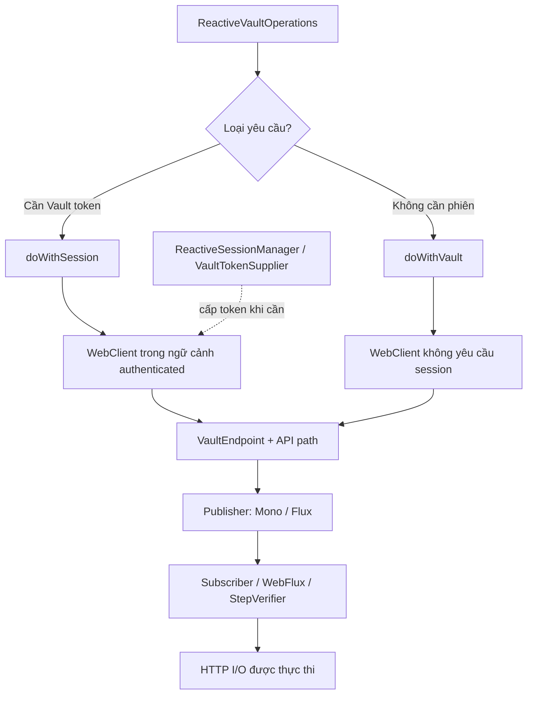
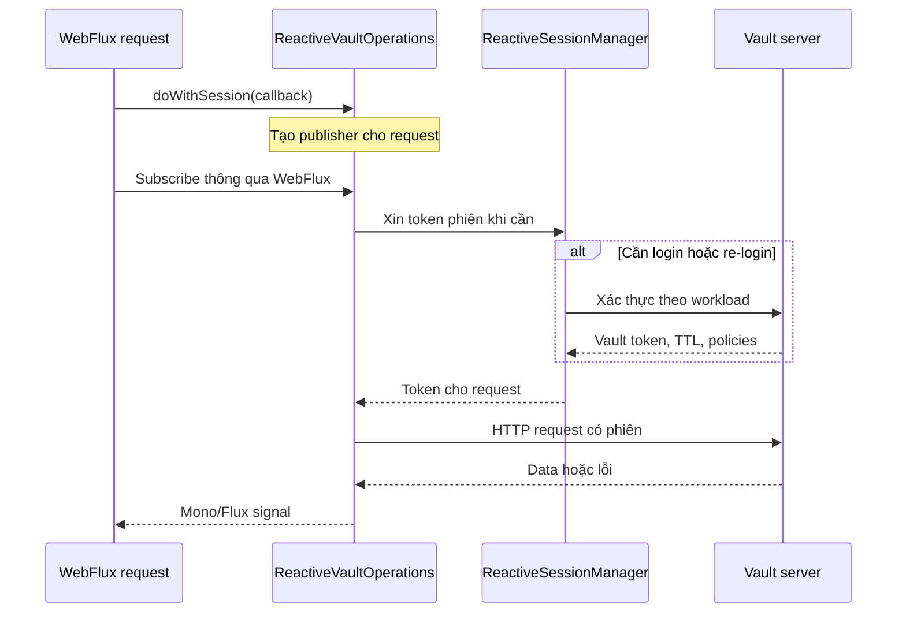

# Callback cho yêu cầu có phiên và không có phiên

Trong **SPRING_VAULT**, ứng dụng Java có thể dùng Spring Vault để truy cập HashiCorp Vault bằng **`VaultTemplate`** (đồng bộ) hoặc **`ReactiveVaultTemplate`** (reactive). Hai client đều phải phân biệt những request **cần Vault token** — ví dụ đọc KV secrets, mã hóa bằng Transit, thao tác với PKI — và những request **không yêu cầu phiên xác thực**, chẳng hạn truy vấn thông tin sức khỏe Vault thông qua endpoint cho phép truy cập không cần token.

Đối với API reactive, Spring Vault cung cấp hai callback quan trọng trên `ReactiveVaultOperations`: **`doWithSession(...)`** và **`doWithVault(...)`**. Cả hai nhận một hàm sử dụng `WebClient` để xây dựng yêu cầu HTTP, trả về một `Publisher` như `Mono` hoặc `Flux` để ghép vào reactive pipeline. Khác biệt không chỉ là cú pháp: nó nằm ở **ngữ cảnh phiên, cách cung cấp Vault token, quyền truy cập và nguy cơ rò rỉ header xác thực**.

Bài thuộc chương **API reactive**. Sau khi học, bạn cần phân biệt đúng callback có phiên và không có phiên, dùng callback cho Vault API chưa có convenience method, tích hợp với Reactor và `ReactiveSessionManager`, xử lý lỗi đúng lớp, đồng thời kiểm thử các trường hợp bảo mật và timeout.

## 1. Vì sao ReactiveVaultTemplate có hai loại callback?

Spring Vault có các operation bậc cao như `read`, `write`, `opsForKeyValue` và `opsForTransit`. Chúng đủ cho phần lớn tác vụ thường gặp. Tuy nhiên Vault còn nhiều endpoint riêng — một số được gọi để kiểm tra sức khỏe, một số thuộc auth hoặc sys API, một số thuộc secrets engine mở rộng mà phiên bản thư viện chưa có phương thức tương ứng.

**Execute callback** cung cấp một `WebClient` được cấu hình theo Vault endpoint và client infrastructure, từ đó lập request tùy biến mà không cần tự dựng toàn bộ HTTP stack. Spring Vault phân biệt:

- **`doWithSession`**: sử dụng `WebClient` trong **ngữ cảnh phiên có xác thực**. Thao tác có thể lấy token qua nguồn session được cấu hình và gửi request với header xác thực phù hợp.
- **`doWithVault`**: sử dụng `WebClient` **không yêu cầu session**, dành cho endpoint được phép gọi mà không có Vault token. Không nên suy ra endpoint bất kỳ trở thành public chỉ vì có callback này.



Điểm phân biệt: hai callback **không** đồng nghĩa với hai Vault cluster khác nhau, cũng không nhất thiết là hai luồng Java riêng. Chúng là hai **ngữ cảnh HTTP** trên client reactive. Một request có phiên vẫn cần Vault policy tương ứng; một request không phiên vẫn có thể nhận `403` nếu endpoint yêu cầu xác thực.

## 2. Giao diện và kiểu trả về

`ReactiveVaultOperations` là API nên được inject vào business service. `ReactiveVaultTemplate` là implementation phổ biến.

Các chữ ký API chủ chốt có thể diễn giải như sau:

```java
// Rút gọn từ ReactiveVaultOperations, chỉ thể hiện hai callback.
<V, T extends org.reactivestreams.Publisher<V>> T doWithSession(
    java.util.function.Function<
        org.springframework.web.reactive.function.client.WebClient,
        ? extends T
    > sessionCallback
);

<V, T extends org.reactivestreams.Publisher<V>> T doWithVault(
    java.util.function.Function<
        org.springframework.web.reactive.function.client.WebClient,
        ? extends T
    > clientCallback
);
```

Ví dụ `WebClient` gọi một endpoint Vault và trả `Mono<VaultResponse>` hoặc `Mono<Integer>`; callback vẫn trả về publisher đó, cho phép dùng `map`, `flatMap`, `timeout`, `retryWhen` hay `onErrorResume` ở lớp ứng dụng.

| Tiêu chí | `doWithSession(...)` | `doWithVault(...)` |
| --- | --- | --- |
| Ngữ cảnh | Authenticated session | Không yêu cầu session |
| Token | Có thể được gắn qua session/token supplier được cấu hình | Không nên gửi Vault token; dùng client không phiên |
| Đối tượng gọi | API yêu cầu danh tính và policy Vault | Endpoint public hoặc được thiết kế không cần login |
| Ví dụ | GET KV v2, thao tác Transit, truy vấn tự thân token nếu được phép | `sys/health` hoặc endpoint hệ thống cho phép gọi không token |
| Kết quả callback | Publisher như `Mono<T>`/`Flux<T>` | Publisher như `Mono<T>`/`Flux<T>` |
| Điều không được suy ra | Có token ≠ có mọi quyền KV/Transit/PKI | Không phiên ≠ vô hiệu hóa Vault ACL |
| Rủi ro nổi bật | Token lộ qua URI tuyệt đối, header, logging | Gọi nhầm API riêng tư rồi hiểu `403` là lỗi Vault |

**Lưu ý:** callback là nơi tự mô tả request, HTTP method, payload và response mapping. Nó không tự bảo đảm rằng path, method và Vault ACL bạn chọn đúng. Đối với thao tác bậc cao đã có sẵn trong Spring Vault, ưu tiên API chuyên dụng để hạn chế lỗi đường dẫn và response shape.

## 3. Reactive session được quản lý như thế nào?

Để gọi endpoint được bảo vệ, ứng dụng cần `VaultToken` từ một cơ chế xác thực phù hợp. Trong reactive infrastructure, Spring Vault định nghĩa nguồn token bất đồng bộ qua `VaultTokenSupplier` và quản lý phiên qua `ReactiveSessionManager`, với một implementation có quản lý vòng đời như `ReactiveLifecycleAwareSessionManager`.



Với workload Kubernetes, AppRole, AWS/Azure/GCP, nguồn credential ban đầu có thể nằm trong file JWT, metadata identity hoặc secret được phân phối an toàn. Session manager quản lý **Vault token sau login**, còn nguồn workload credential có quy tắc rotation riêng. Khi token tới hạn, login/renew/re-login phải được thiết kế theo loại token, TTL và implementation; **không tạo một token mới cho mỗi HTTP request nghiệp vụ**.

Một lời gọi `doWithSession(...)` không bảo đảm login thành công: nếu token đã hết hiệu lực, Vault unavailable hoặc auth role không còn cho workload đăng nhập, publisher có thể phát `onError`. Ngay cả khi login thành công, thao tác `secret/data/...` vẫn có thể bị `403 permission denied` do policy thiếu capability.

### Reactive không có nghĩa tự động gia hạn mọi lease

Vault token có TTL, dynamic database credentials có lease/TTL riêng, chứng chỉ PKI có thời hạn riêng. `ReactiveLifecycleAwareSessionManager` phục vụ vòng đời **session token**; nó không tự xoay vòng JDBC credentials hay inject lại secret đã dùng để tạo bean. Khi dùng `SecretLeaseContainer`/listener hoặc cơ chế rotation khác, cần quản lý riêng consumer và xử lý shutdown đúng owner.

## 4. Callback không phiên: kiểm tra trạng thái Vault

Một ví dụ an toàn và dễ minh họa cho `doWithVault` là gọi **`GET /v1/sys/health`**. Endpoint này được thiết kế để hệ thống kiểm tra trạng thái Vault mà không cần token (cấu hình proxy/mạng của môi trường vẫn có thể hạn chế truy cập).

```java
import org.springframework.stereotype.Service;
import org.springframework.vault.core.ReactiveVaultOperations;
import reactor.core.publisher.Mono;

@Service
public class VaultHealthQuery {

    private final ReactiveVaultOperations vault;

    public VaultHealthQuery(ReactiveVaultOperations vault) {
        this.vault = vault;
    }

    public Mono<Integer> httpStatus() {
        return vault.doWithVault(client ->
            client.get()
                .uri("sys/health")
                .exchangeToMono(response ->
                    Mono.just(response.statusCode().value())
                )
        );
    }
}
```

Ở đây:

1. `doWithVault` cung cấp `WebClient` không yêu cầu session.
2. `client.get().uri("sys/health")` mô tả path **tương đối** với Vault endpoint do client quản lý.
3. `exchangeToMono` cho phép đọc **mã HTTP kể cả non-2xx**, không vội biến mọi trạng thái khác 200 thành exception.
4. Kết quả `Mono<Integer>` sẽ phát status khi được subscribe; controller/service có thể phân loại health theo chính sách.

Vault health endpoint có mã trạng thái mang ý nghĩa đặc thù. Chẳng hạn trong cấu hình mặc định, `200` thường là node active và healthy; `429` có thể là standby; `501` là chưa initialize; `503` là sealed. Có các tình huống standby/performance standby/DR standby khác, và Vault hỗ trợ query parameter thay đổi mã trạng thái. **Không diễn giải “khác 200 = không có Vault token”** hay “standby = JVM phải restart”.

### Vì sao dùng exchangeToMono thay vì retrieve?

`WebClient.retrieve()` thường biến các trạng thái HTTP lỗi thành publisher lỗi. Với `sys/health`, nhiều trạng thái như `429` hoặc `503` mang thông tin **sức khỏe Vault**, nên chương trình muốn nhìn status để quyết định readiness. `exchangeToMono` phù hợp khi cần chủ động phân loại status. Đối với API đọc KV, lại nên giữ `403` thành lỗi authorization thay vì coi nó là dữ liệu bình thường.

**Không dùng callback không phiên để thực hiện cấu hình quản trị nhạy cảm** (như initialize/unseal) trong health probe hoặc ứng dụng nghiệp vụ. Những endpoint đó có quy trình và mức bảo mật riêng. `doWithVault` chỉ có nghĩa “không yêu cầu session ở client”, không phải “được phép thao tác mọi endpoint”.

## 5. Callback có phiên: đọc dữ liệu KV v2

Giả sử Vault mount **KV v2** tại `secret/` và ứng dụng được cấp quyền `read` cho `secret/data/apps/orders`. Callback đọc trực tiếp endpoint Vault API có thể viết:

```java
import org.springframework.stereotype.Service;
import org.springframework.vault.core.ReactiveVaultOperations;
import org.springframework.vault.support.VaultResponse;
import reactor.core.publisher.Mono;

@Service
public class OrdersSecretApi {

    private final ReactiveVaultOperations vault;

    public OrdersSecretApi(ReactiveVaultOperations vault) {
        this.vault = vault;
    }

    public Mono<VaultResponse> rawKvV2Response() {
        return vault.doWithSession(client ->
            client.get()
                .uri("secret/data/apps/orders")
                .retrieve()
                .bodyToMono(VaultResponse.class)
        );
    }
}
```

Vì `doWithSession` sử dụng session đã cấu hình, yêu cầu có thể nhận Vault token qua `ReactiveSessionManager`. Vault kiểm tra capability tại **đúng API path**. Nếu không có `read`, Vault thường từ chối request với `403`; nếu secret không tồn tại hoặc path sai có thể nhận `404`.

**Đừng nhầm response shape:** callback ở ví dụ gửi GET thẳng tới KV v2 API. Trong raw Vault JSON, dữ liệu ứng dụng thường nằm trong `data.data`, còn `data.metadata` chứa version và metadata. `VaultResponse.getData()` của raw response do đó có thể còn chứa lớp `data` bên trong; không mặc định `getData().get("username")` đọc thẳng giá trị. Nếu dùng API KV v2 chuyên dụng của Spring Vault, abstraction có thể xử lý phần bọc này.

### Dùng operation bậc cao khi chỉ cần KV

Đối với thao tác chuẩn, có thể viết ngắn hơn và rõ semantics:

```java
import org.springframework.stereotype.Service;
import org.springframework.vault.core.ReactiveVaultOperations;
import org.springframework.vault.core.VaultKeyValueOperationsSupport.KeyValueBackend;
import org.springframework.vault.support.VaultResponse;
import reactor.core.publisher.Mono;

@Service
public class OrdersConfigService {

    private final ReactiveVaultOperations vault;

    public OrdersConfigService(ReactiveVaultOperations vault) {
        this.vault = vault;
    }

    public Mono<String> loadServiceEndpoint() {
        return vault
            .opsForKeyValue("secret", KeyValueBackend.KV_2)
            .get("apps/orders")
            .switchIfEmpty(Mono.error(
                new IllegalStateException("Required Vault config missing")
            ))
            .map(response -> {
                Object value = response.getData()
                    .get("serviceEndpoint");
                if (!(value instanceof String text)
                        || text.isBlank()) {
                    throw new IllegalStateException(
                        "Missing field serviceEndpoint");
                }
                return text;
            });
    }
}
```

Giả định secret tồn tại và có field `serviceEndpoint` kiểu chuỗi; application dùng Java 17+. Với Spring Vault API KV v2, abstraction chuyên dụng xử lý logical path `apps/orders`, trong khi Vault ACL vẫn cần cho API path `secret/data/apps/orders`. Không log toàn bộ `VaultResponse`, vì có thể chứa username/password.

`doWithSession` hữu ích khi cần endpoint tùy biến; **không nên thay tất cả operation chuẩn bằng raw HTTP** nếu Spring Vault đã hỗ trợ typed operations tương ứng.

## 6. Một callback có phiên cho endpoint chưa có API chuyên dụng

Ví dụ ứng dụng cần gọi một endpoint trong secrets engine tùy chỉnh đã được bật tại `custom/`. Giả sử API nội bộ này hỗ trợ `POST /v1/custom/signed-operation`, body JSON có `input`, trả kết quả với field `signature`. **Đây là endpoint giả định dành cho minh họa, không phải API chuẩn của HashiCorp Vault.**

```java
import java.util.Map;
import org.springframework.stereotype.Service;
import org.springframework.vault.core.ReactiveVaultOperations;
import reactor.core.publisher.Mono;

record SignedResult(String signature) {}

@Service
public class CustomVaultOperation {

    private final ReactiveVaultOperations vault;

    public CustomVaultOperation(ReactiveVaultOperations vault) {
        this.vault = vault;
    }

    public Mono<SignedResult> sign(String input) {
        if (input == null || input.isBlank()) {
            return Mono.error(new IllegalArgumentException(
                "Input must not be blank"));
        }

        return vault.doWithSession(client ->
            client.post()
                .uri("custom/signed-operation")
                .bodyValue(Map.of("input", input))
                .retrieve()
                .bodyToMono(SignedResult.class)
        );
    }
}
```

API nghiệp vụ thật phải định nghĩa rõ contract, policy path/capability, timeout, response schema và idempotency. Với Vault Transit encryption/signing hoặc PKI đã có operations hỗ trợ, ưu tiên các abstraction `opsForTransit()` hoặc API chuyên biệt phù hợp thay vì tự gọi raw endpoint. Một POST có side effect không thể retry mù chỉ vì HTTP client thấy timeout: server có thể đã thực hiện thao tác nhưng response thất lạc.

### Quyền kiểm tra độc lập với callback

| Vault operation | Callback có thể dùng | Vault policy mẫu |
| --- | --- | --- |
| `GET secret/data/apps/orders` (KV v2) | `doWithSession` | `read` tại `secret/data/apps/orders` |
| `POST transit/encrypt/orders` | `doWithSession` | `update` tại `transit/encrypt/orders` |
| `POST transit/decrypt/orders` | `doWithSession` | `update` tại `transit/decrypt/orders` |
| `POST pki/issue/orders` | `doWithSession` | `update` tại `pki/issue/orders` |
| `GET sys/health` | `doWithVault` | Không yêu cầu Vault token ở endpoint mặc định |

Các path Transit/PKI ví dụ giả định engine/key/role đã tồn tại và token thực sự mang policy phù hợp. **Đăng nhập thành công không cấp thêm capability**, và `doWithSession` không tự làm một URL sai trở thành hợp lệ.

## 7. Reactor: khi nào HTTP request thực sự xảy ra?

Một callback tạo `Mono` hoặc `Flux` để ghép pipeline. Với `WebClient`, network I/O thường bắt đầu khi publisher có **subscription**, chẳng hạn WebFlux controller trả publisher về runtime hoặc test gọi `StepVerifier.create(publisher).verify()`.

```java
Mono<VaultResponse> secretMono = vault.doWithSession(client ->
    client.get()
        .uri("secret/data/apps/orders")
        .retrieve()
        .bodyToMono(VaultResponse.class)
);

// Chưa nên hiểu dòng trên là "đã đọc secret xong".
Mono<String> responseState = secretMono
    .map(response -> response.getData() != null
        ? "DATA_PRESENT" : "EMPTY_DATA")
    .switchIfEmpty(Mono.just("NO_RESPONSE"));
```

**Cold publisher:** mỗi lần subscribe vào một chuỗi `WebClient` thông thường có thể tạo HTTP request mới. Không viết một hàm service vừa tự `subscribe()`, vừa trả về publisher để controller lại subscribe: điều đó có thể dẫn đến hai lần gọi Vault.

**Không gọi `block()` trên event-loop của WebFlux.** Việc block có thể làm nghẽn thread xử lý request, giảm thông lượng và gây timeout dây chuyền. Nếu buộc phải tích hợp thư viện blocking legacy, cần tách phần blocking sang scheduler phù hợp và hiểu chi phí tài nguyên, chứ không biến reactive callback thành synchronous method tùy tiện.

### flatMap, concatMap và kiểm soát số request

Nếu cần đọc nhiều secret, `Flux.fromIterable(paths).flatMap(path -> vault.read(path))` có thể tạo nhiều request đồng thời. Phải giới hạn concurrency khi dữ liệu đầu vào lớn:

```java
import reactor.core.publisher.Flux;
import reactor.core.publisher.Mono;
import java.util.List;

Flux<String> discoveredPaths = Flux.fromIterable(
    List.of("secret/data/apps/a", "secret/data/apps/b")
);

Flux<String> status = discoveredPaths.flatMap(
    path -> vault.read(path)
        .map(response -> "PRESENT")
        .switchIfEmpty(Mono.just("MISSING")),
    4 // concurrency tối đa theo thiết kế ứng dụng
);
```

Mã trên **chỉ minh họa giới hạn số request**. Trong production không xây đường dẫn secret từ chuỗi người dùng chưa được kiểm soát; các path phải được whitelist theo ứng dụng, role và domain. Với nhiều request có thứ tự cần giữ, cân nhắc `concatMap`, còn nếu có side effect thì cần thêm idempotency và kiểm soát retry.

## 8. Lỗi HTTP, Reactor và chính sách xử lý

Lỗi Vault đi vào reactive pipeline dưới dạng `onError`. Đừng gộp mọi lỗi thành “không có dữ liệu” hoặc trả response thành công rỗng.

| Lỗi | Vị trí | Cách xử lý phù hợp |
| --- | --- | --- |
| `401`/`403` khi login hoặc lấy session | Authentication và token lifecycle | Kiểm tra nguồn JWT/AppRole/cloud identity, auth role, renew/re-login; không thử root token |
| `403` khi gọi KV/Transit/PKI | Vault ACL trên secret engine | Kiểm tra Vault token policy, path và capability; retry không sửa được thiếu quyền cố định |
| `404` khi đọc secret | Path/mount/secret không tồn tại | Chỉ chuyển thành missing nếu tài nguyên **được phép vắng mặt** |
| `429` hoặc Vault `5xx` | Vault HA/overload/hạ tầng | Có thể retry có giới hạn với backoff và jitter, tùy idempotency |
| Timeout/DNS/connection reset | Network | Phân loại là tạm thời, giới hạn latency và tổng retry budget |
| TLS hostname/CA lỗi | Transport/trust | Khắc phục chứng chỉ, không tắt TLS verification |
| Decode/serialization lỗi | Payload/schema sai | Kiểm tra response contract và version; không log raw secret response |

Ví dụ chuyển riêng `404` của một secret **tùy chọn** thành giá trị dự phòng **không nhạy cảm**:

```java
import org.springframework.web.reactive.function.client.WebClientResponseException;
import reactor.core.publisher.Mono;

Mono<String> optionalFlag = vault.doWithSession(client ->
        client.get()
            .uri("secret/data/apps/optional-flags")
            .retrieve()
            .bodyToMono(String.class)
    )
    .map(rawBody -> "PRESENT") // Không trả raw secret ra API.
    .onErrorResume(
        WebClientResponseException.NotFound.class,
        error -> Mono.just("ABSENT")
    );
```

**Không làm như trên cho secret bắt buộc**, như database password hoặc Transit key material. Với dữ liệu bắt buộc, `404`/`403` nên làm thao tác thất bại, cập nhật trạng thái tính năng và phát alert phù hợp. `onErrorResume(error -> Mono.empty())` cho mọi lỗi có thể che mất policy sai, Vault outage và sự cố bảo mật.

### Timeout và retry có giới hạn

Một pipeline có thể dùng `timeout(Duration)` và `retryWhen(Retry.backoff(...))`, nhưng phải xem xét loại request:

```java
import java.time.Duration;
import reactor.core.publisher.Mono;
import reactor.util.retry.Retry;

Mono<Integer> healthCheck = vault.doWithVault(client ->
        client.get()
            .uri("sys/health")
            .exchangeToMono(response ->
                Mono.just(response.statusCode().value()))
    )
    .timeout(Duration.ofSeconds(2))
    .retryWhen(
        Retry.backoff(2, Duration.ofMillis(200))
            .maxBackoff(Duration.ofSeconds(1))
            .filter(error ->
                !(error instanceof IllegalArgumentException))
    );
```

Đây là **mẫu kỹ thuật**, filter minh họa **chưa phân loại đầy đủ** các lỗi retryable. Đối với production, chỉ retry khi xác định được lỗi tạm thời (ví dụ timeout, lỗi mạng phù hợp); nếu đã trả một HTTP status `503` làm **giá trị `Integer`**, `retryWhen` sẽ **không** retry vì pipeline không phát `onError`. Muốn retry health status nhất định, cần chuyển status đó thành lỗi có kiểu riêng hoặc xử lý logic dựa trên giá trị.

Không retry vô hạn POST cấp PKI, ghi KV, hoặc thao tác có side effect sau timeout khi không có idempotency contract. `timeout` ở phía subscriber không phải bằng chứng chắc chắn server đã hủy toàn bộ thao tác.

## 9. An toàn URL và header xác thực

Đây là ranh giới bảo mật quan trọng nhất khi dùng callback raw `WebClient`.

Spring Vault thường xem API path là **tương đối với `VaultEndpoint`**. API cũng có thể xử lý các URI tuyệt đối. Trong ngữ cảnh **có session**, token/header xác thực có thể được gắn vào request dù đích là URI tuyệt đối. Vì vậy **không** nhận URL/hostname tùy ý từ request người dùng rồi truyền thẳng vào `doWithSession`.

### Ví dụ nguy hiểm — không sử dụng

```java
// KHÔNG LÀM: người dùng có thể điều khiển đích request.
// vault.doWithSession(client ->
//     client.get()
//         .uri(userSuppliedAbsoluteUrl)
//         .retrieve()
//         .bodyToMono(String.class)
// );
```

Một attacker có thể chọn hostname khác để cố làm request chứa `X-Vault-Token` đi ra khỏi Vault. Các biến thể SSRF, redirect và proxy routing phải được coi là nguy cơ an ninh. Sự tồn tại của Vault policy không ngăn một client tự gửi token đến nơi không tin cậy nếu ứng dụng xây URI không an toàn.

**Phương án an toàn:**

1. Dùng path cố định như `secret/data/apps/orders`, hoặc lựa chọn từ một **whitelist** hữu hạn do server kiểm soát.
2. Nếu có tenant ID hoặc key động, validate theo domain rồi encode **path segment** đúng cách; không nối raw URL từ input.
3. Không thêm header `X-Vault-Token` thủ công cho request do `doWithSession` quản lý, trừ khi có yêu cầu đặc biệt đã được xác minh. Tránh vô tình giữ token trong log/tracing.
4. Không dùng `doWithSession` để gọi AWS metadata, Google identity endpoint hay dịch vụ HTTP tùy ý; những bước lấy workload identity có client/flow xác thực riêng.
5. Giới hạn egress qua network policy/proxy, TLS truststore/hostname verification và hạn chế redirect nếu phù hợp với hạ tầng.
6. Không ghi response KV, JWT, `client_token`, `secret_id`, private key hoặc payload Transit nhạy cảm trong `doOnNext`/`doOnError`.

`doWithVault` không yêu cầu session nên giảm nguy cơ gửi Vault token, nhưng **không** là công cụ chung để thực hiện HTTP bên ngoài. Hãy dùng `WebClient` riêng có cấu hình/allowlist rõ ràng cho dịch vụ bên ngoài.

## 10. Session callback khác request không phiên ở góc độ quyền

Giả sử ứng dụng đã có Kubernetes ServiceAccount, Vault auth role `orders-app` và token policy:

```hcl
# Ví dụ policy tối thiểu cho KV v2 và Transit encrypt.
path "secret/data/apps/orders" {
  capabilities = ["read"]
}

path "transit/encrypt/orders" {
  capabilities = ["update"]
}
```

Trong tình huống này:

- `doWithSession` đọc `secret/data/apps/orders` có thể thành công vì token có `read`.
- `doWithSession` gọi `transit/encrypt/orders` bằng POST có thể thành công nếu Transit key/engine hợp lệ, vì token có `update`.
- `doWithSession` gọi `transit/decrypt/orders` sẽ thất bại nếu token không có capability tương ứng — ngay cả khi login thành công.
- `doWithVault` gọi KV v2 protected path **không tự có token**, nên bị từ chối theo cơ chế Vault.
- `doWithVault` gọi `sys/health` có thể nhận HTTP status phù hợp dù chưa login.

Khi gặp `403`, trước hết xác định **phase và URL**: credential cloud/Kubernetes, Vault auth endpoint, token renew, hay secret engine. Chỉ khi đã xác nhận login và session hợp lệ mới kết luận nguyên nhân nằm ở ACL của KV/Transit/PKI. Không cấp quyền `root` hoặc `sudo` để khắc phục nhanh một callback chọn sai ngữ cảnh.

## 11. WebFlux controller và request scope

Một controller WebFlux thường trả `Mono` do service tạo:

```java
import org.springframework.http.ResponseEntity;
import org.springframework.web.bind.annotation.GetMapping;
import org.springframework.web.bind.annotation.RestController;
import reactor.core.publisher.Mono;

@RestController
class VaultHealthController {

    private final VaultHealthQuery vaultHealth;

    VaultHealthController(VaultHealthQuery vaultHealth) {
        this.vaultHealth = vaultHealth;
    }

    @GetMapping("/internal/vault-health")
    Mono<ResponseEntity<String>> health() {
        return vaultHealth.httpStatus()
            .map(status -> status == 200
                ? ResponseEntity.ok("VAULT_ACTIVE")
                : ResponseEntity.status(503)
                    .body("VAULT_NOT_ACTIVE"));
    }
}
```

Đây là **ví dụ định nghĩa trạng thái riêng của ứng dụng**, không phải health indicator hoàn chỉnh cho một Vault cluster HA. `standby` có thể phục vụ hoặc chuyển tiếp request theo topology; cách ánh xạ status Vault sang readiness cần xét `standbyok`, `perfstandbyok`, HA routing và chính sách deployment.

Không đặt secret data trực tiếp vào response controller hoặc lộ `VaultToken` qua API. Với health endpoint do bạn tự viết, áp dụng hạn chế truy cập/monitoring thích hợp. Không nên gắn một network request đến Vault vào **liveness** mỗi vài giây vì Vault outage tạm thời có thể gây vòng lặp restart Pod; readiness hoặc health cache phù hợp hơn.

## 12. Kiểm thử callback có phiên và không có phiên

Một unit test cho một `Mono` thuần không chứng minh client đã gắn hay không gắn Vault token. Cần test cả **đường HTTP** và **kết quả policy** trong môi trường được kiểm soát.

| Tình huống | Bố trí test | Kỳ vọng |
| --- | --- | --- |
| `doWithVault` với `sys/health` | Vault dev/Testcontainers hoặc mock HTTP response | Nhận status kể cả non-2xx, không cần login |
| `doWithSession` đọc KV v2 | Vault auth role/token ít quyền + KV v2 fixture | Có phiên hợp lệ thì đọc được đúng path |
| `doWithVault` đọc KV protected | Cùng fixture nhưng gọi không phiên | Request bị từ chối do thiếu authentication |
| Session login thất bại | JWT/AppRole test sai hoặc auth mount sai | Publisher phát lỗi; không trả secret hoặc tạo token admin |
| Có session nhưng thiếu policy | Token thiếu `read` trên `secret/data/...` | Vault từ chối với `403`; phân loại ACL đúng |
| Health code standby/sealed | Giả lập `429`/`503` bằng server test | `exchangeToMono` giữ nguyên mã để phân loại |
| URL ngoài Vault | HTTP test server riêng quan sát header | API phải từ chối URL không có trong allowlist; không rò `X-Vault-Token` |
| Hai subscription | Subscribe cùng một publisher HTTP hai lần | Xác minh số request thực tế và tránh trùng side effect |
| Timeout/retry | Gây chậm network hoặc trả status/lỗi có kiểm soát | Timeout và retry đúng ngân sách, không retry `403` |
| Logout/expiry/re-login | Token TTL ngắn hoặc revoke test token | Session lifecycle xử lý đúng; callback không giữ token cũ |
| Shutdown | Đóng Spring context khi có request đang chờ | Tài nguyên có owner được dừng, không tạo request sau shutdown |

### StepVerifier kiểm tra kết quả

Ví dụ kiểm thử service với test double đã kiểm soát nhằm xác minh một luồng xử lý HTTP status thành công. `VaultHealthQuery` được test trong môi trường mà `ReactiveVaultOperations` đã trả kết quả từ test HTTP client.

```java
import static org.junit.jupiter.api.Assertions.assertEquals;

import org.junit.jupiter.api.Test;
import reactor.core.publisher.Mono;
import reactor.test.StepVerifier;

class HealthStatusMappingTest {

    @Test
    void mapsHealthCodeCorrectly() {
        Mono<String> result = Mono.just(429)
            .map(status -> status == 200
                ? "ACTIVE"
                : "NOT_ACTIVE");

        StepVerifier.create(result)
            .assertNext(value -> assertEquals("NOT_ACTIVE", value))
            .verifyComplete();
    }
}
```

Đây chỉ là **unit test phép ánh xạ status**, chưa kiểm tra `doWithVault` hay header. Với integration test, sử dụng Vault được quản lý riêng cho test và một HTTP test server kiểm chứng request. Để khẳng định **không gửi `X-Vault-Token` trong `doWithVault`**, test cần quan sát request thực tế tại server mock; không suy chỉ từ việc method tên “không phiên”. Cấu hình HTTP client/interceptor tùy biến của ứng dụng có thể thêm header ngoài ý muốn.

### Kiểm tra tương tác thật và tránh lộ bí mật

- Vault dev/root token chỉ dùng để **dựng fixture** (enable KV, auth backend, policy), không dùng làm token của business client.
- Tạo auth role chỉ có capability cần thiết, ví dụ `read` tại `secret/data/apps/orders`.
- Kiểm tra request KV được gọi **một lần** với một subscriber theo dự kiến; nếu có retry, xem có request bị lặp hay không.
- Với test URL tuyệt đối, dùng hostname localhost/server test cô lập; bảo đảm không có egress ra Internet và không đưa token thật vào request.
- Không ghi full HTTP exchange chứa token/secret vào test report, snapshot file hoặc CI log.
- Dùng `StepVerifier` để khẳng định `onNext`, `onError` và `onComplete`; dùng test HTTP client thực để xác minh header, path, status.

## 13. Khi nào không cần callback?

Hai callback rất linh hoạt nhưng cũng yêu cầu caller tự gánh trách nhiệm URI, body và error mapping. Ưu tiên abstraction có sẵn nếu phù hợp:

| Nhu cầu | Ưu tiên |
| --- | --- |
| Đọc KV v2 thông thường | `reactiveVaultOperations.opsForKeyValue(..., KV_2).get(...)` |
| Đọc KV bằng path đơn giản | `reactiveVaultOperations.read(path)` khi path đúng API |
| Encrypt/decrypt Transit | `reactiveVaultOperations.opsForTransit()` hoặc API Transit liên quan |
| Các operation `sys` đã có | `reactiveVaultOperations.opsForSys()` |
| Gọi Vault API chưa được thư viện bọc | `doWithSession` khi cần token hoặc `doWithVault` khi endpoint thực sự không cần phiên |
| Gọi dịch vụ ngoài Vault | Một `WebClient` riêng có cấu hình TLS, headers và allowlist rõ ràng |

Lợi ích của callback là **mở rộng khả năng gọi Vault mà vẫn tái sử dụng HTTP infrastructure**. Không nên dùng nó để bỏ qua chính sách authentication, bypass session manager hoặc tạo đường dẫn API tự do từ input người dùng.

## 14. Những lỗi thiết kế thường gặp

1. **Dùng `doWithVault` để đọc KV/Transit/PKI được bảo vệ.** Không có session nên thường bị `403`.
2. **Dùng `doWithSession` cho URL người dùng nhập.** Có nguy cơ gửi Vault token đến endpoint ngoài Vault.
3. **Tự gắn header token bằng chuỗi hardcode.** Vừa rò rỉ secret, vừa phá cơ chế renew/re-login của session manager.
4. **Tưởng `Mono` đã thực hiện HTTP chỉ vì object được tạo.** HTTP client thường thực thi khi subscribe.
5. **Tự `subscribe()` trong service rồi trả lại publisher.** Dễ tạo request kép, race và lỗi không được xử lý.
6. **Gọi `block()` trong WebFlux event-loop.** Nguy cơ nghẽn luồng xử lý.
7. **Gộp `403`, `404`, timeout thành `Mono.empty()`.** Che giấu lỗi cấu hình, phân quyền và sự cố thực.
8. **Retry mọi POST không kiểm tra idempotency.** Có thể tạo certificate/credential mới nhiều lần nếu response bị mất.
9. **Dùng `doOnNext(System.out::println)` trên response Vault.** Dễ lộ nội dung KV, certificate hoặc token.
10. **Nhầm KV v1/v2 API path.** `secret/data/...` của KV v2 khác logical path dùng với operations API.
11. **Cho rằng reactive session manager tự rotate mọi secret.** Token, dynamic lease, PKI certificate và KV data có vòng đời riêng.
12. **Dùng Vault health làm liveness tuyệt đối.** Vault tạm lỗi làm restart-loop không cần thiết.

## 15. Tự kiểm tra kiến thức

**Câu 1.** `doWithSession` và `doWithVault` khác nhau ở đâu?  
**Trả lời:** Ở ngữ cảnh token/session của `WebClient`; loại có phiên dành cho API cần authentication, loại không phiên dành cho endpoint không yêu cầu Vault session.

**Câu 2.** Vì sao `doWithVault` có thể đọc `sys/health` nhưng không đọc `secret/data/apps/orders`?  
**Trả lời:** Endpoint health mặc định có thể gọi không token; KV v2 được Vault ACL bảo vệ và thường cần phiên có token và policy `read`.

**Câu 3.** `Mono<VaultResponse>` được trả từ callback đã là dữ liệu hoàn chỉnh chưa?  
**Trả lời:** Chưa. Đây là publisher; HTTP I/O thường xảy ra khi subscription thực thi.

**Câu 4.** Có session hợp lệ nhưng KV trả `403`, cần renew token ngay?  
**Trả lời:** Chưa chắc. Nếu token login thành công nhưng thiếu capability/path, cần kiểm tra Vault ACL; renew không tự cấp policy mới.

**Câu 5.** Có nên dùng `doWithSession` với URL tuyệt đối nhận từ body HTTP của người dùng?  
**Trả lời:** Không. Session header có thể bị gửi đến hostname không tin cậy; dùng path cố định/allowlist và validate input.

**Câu 6.** Khi `sys/health` trả `429`, pipeline dùng `exchangeToMono` trả Integer 429 thì `retryWhen` có tự retry không?  
**Trả lời:** Không. Vì giá trị là `onNext`, không phải `onError`; retryWhen phản ứng với lỗi, không với mã status bình thường.

**Câu 7.** Tại sao không `block()` trong một controller WebFlux?  
**Trả lời:** Vì chặn event-loop, giảm thông lượng và tăng nguy cơ timeout; controller nên trả publisher cho runtime quản lý subscription.

**Câu 8.** Vì sao nên dùng `opsForKeyValue` thay callback raw khi đọc KV v2?  
**Trả lời:** Abstraction hỗ trợ logical path/backend version và response mapping phù hợp; callback raw bắt caller tự quản lý URI và cấu trúc response.

**Câu 9.** Renew Vault token có tự gia hạn lease credential database không?  
**Trả lời:** Không. Token và lease là hai vòng đời khác nhau; cần cơ chế lease/rotation riêng cho secret động.

**Kết luận:** Trong Spring Vault reactive, **`doWithSession`** cho thao tác HTTP nằm trong ngữ cảnh phiên được xác thực, còn **`doWithVault`** cho request không yêu cầu phiên. Cả hai cho phép xây dựng `Mono`/`Flux` để ghép với Reactor, nhưng an toàn và tính đúng đắn vẫn phụ thuộc **path, Vault policy, loại endpoint, quản lý session, lỗi HTTP và kiểm soát URI**. Khi API chuyên dụng đã có sẵn, hãy ưu tiên abstraction đó; dùng callback khi thực sự cần truy cập những endpoint Vault chưa được bọc.

### Tài liệu tham khảo

- [Spring Vault Reference — Reactive Infrastructure](https://docs.spring.io/spring-vault/reference/vault/reactive-template.html)
- [Spring Vault API — ReactiveVaultOperations](https://docs.spring.io/spring-vault/reference/api/java/org/springframework/vault/core/ReactiveVaultOperations.html)
- [Spring Vault API — ReactiveVaultTemplate](https://docs.spring.io/spring-vault/reference/api/java/org/springframework/vault/core/ReactiveVaultTemplate.html)
- [Spring Framework — WebClient](https://docs.spring.io/spring-framework/reference/web/webflux-webclient.html)
- [Project Reactor — Reference Guide](https://projectreactor.io/docs/core/release/reference/)
- [HashiCorp Vault API — Health](https://developer.hashicorp.com/vault/api-docs/system/health)

