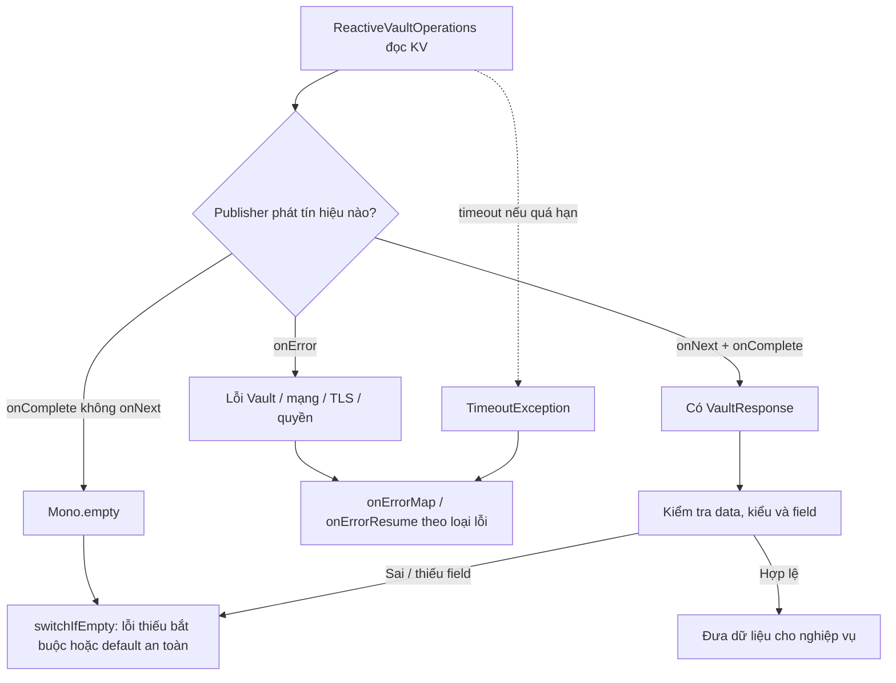

# Xử lý kết quả rỗng, lỗi và timeout trong Reactor

## 1. Vì sao phải phân biệt rỗng, lỗi và quá hạn?

Trong **Spring Vault**, ứng dụng Java có thể gọi HashiCorp Vault theo kiểu reactive bằng `ReactiveVaultOperations` hoặc `ReactiveVaultTemplate`. Các lệnh đọc KV secrets, sử dụng Transit encryption hay làm việc với PKI thường trả về một **Reactor `Mono<T>`**; các lệnh liệt kê có thể dùng `Flux<T>`. Mô hình này khác lời gọi đồng bộ ở cách biểu diễn kết quả:

- **Có giá trị:** Publisher phát `onNext(value)` rồi `onComplete`.
- **Không có giá trị:** Publisher kết thúc bằng `onComplete` mà **không phát** `onNext`.
- **Có lỗi:** Publisher phát `onError(error)` thay vì hoàn tất thành công.
- **Quá hạn do client quy định:** toán tử `timeout` tạo **error signal** nếu không nhận được tín hiệu cần thiết trong thời hạn.
- **Bị hủy:** downstream có thể `cancel` subscription; hủy không phải một kết quả dữ liệu và không bảo đảm thao tác Vault đã bị đảo ngược phía server.

Cùng một dòng code có thể xử lý cả ba tín hiệu đầu bằng `switchIfEmpty`, `onErrorResume` và `timeout`, nhưng **mỗi toán tử có ý nghĩa khác nhau**. Nếu lẫn lộn, ứng dụng có thể âm thầm coi việc không đọc được secret là “secret rỗng”, hoặc che lỗi phân quyền bằng giá trị mặc định không an toàn.

Bài thuộc chương **API reactive**. Mục tiêu là thiết kế cách xử lý kết quả cho Vault một cách rõ ràng, bảo vệ token/secret, kiểm soát retry và kiểm thử các tình huống bất lợi trong Reactor.

### Sơ đồ các tín hiệu



Sơ đồ không khẳng định tất cả lỗi HTTP `404` đều thành `Mono.empty()`. Cách ánh xạ HTTP response thành Publisher tùy method, backend và phiên bản Spring Vault. **Phải quan sát contract của API đang dùng**, không suy đoán từ status code đơn lẻ.

## 2. Bảng phân biệt các toán tử quan trọng

| Toán tử | Tình huống kích hoạt | Tác dụng | Lỗi sử dụng thường gặp |
| --- | --- | --- | --- |
| `switchIfEmpty(fallbackMono)` | Upstream kết thúc mà không có `onNext` | Chuyển sang Publisher khác | Tưởng rằng nó xử lý `onError` |
| `defaultIfEmpty(value)` | Upstream rỗng | Phát một giá trị mặc định | Gán default cho secret bảo mật bắt buộc |
| `onErrorResume(...)` | Upstream phát `onError` khớp điều kiện | Chuyển sang Publisher khác | Nuốt tất cả lỗi, kể cả `403` và lỗi cấu hình |
| `onErrorMap(...)` | Upstream phát `onError` | Chuyển đổi exception để giữ ngữ nghĩa nghiệp vụ | Làm mất nguyên nhân hoặc lộ secret trong message |
| `doOnError(...)` | Có error signal đi qua | Side effect quan sát, **không phục hồi** | Coi logging là xử lý thành công |
| `timeout(duration)` | Không nhận tín hiệu đủ sớm | Phát `TimeoutException` và hủy upstream subscription | Tưởng rằng server sẽ tự rollback request |
| `retryWhen(Retry...)` | Upstream lỗi được phép retry | Đăng ký lại nguồn theo policy | Retry vô hạn hoặc lặp tác vụ cấp secret không idempotent |
| `onErrorComplete(...)` | Lỗi khớp điều kiện | Chuyển lỗi thành hoàn tất rỗng | Che lỗi truy cập dữ liệu nhạy cảm |
| `Mono.defer(...)` | Mỗi subscription | Tạo Publisher mới tại thời điểm subscribe | Tạo lại login/token không cần thiết ở mỗi request |

**Quy tắc:** `switchIfEmpty` xử lý **không có dữ liệu**, `onErrorResume` xử lý **lỗi**, còn `timeout` là một **quyết định deadline của client**. Không dùng một toán tử để thay thế trách nhiệm của toán tử khác.

## 3. Spring Vault trả về gì khi đọc KV v2?

Giả sử Vault đã bật KV v2 tại mount `kv` và ứng dụng cần đọc secret ở logical path `apps/order-service`. Đầu tiên, chọn backend rõ ràng:

```java
import org.springframework.vault.core.ReactiveVaultKeyValueOperations;
import org.springframework.vault.core.ReactiveVaultOperations;
import org.springframework.vault.core.VaultKeyValueOperationsSupport.KeyValueBackend;

ReactiveVaultKeyValueOperations kv =
        vault.opsForKeyValue("kv", KeyValueBackend.KV_2);
```

`vault` trong ví dụ là bean `ReactiveVaultOperations`. Lệnh `kv.get("apps/order-service")` trả `Mono<VaultResponse>`. `KV_2` khiến Spring Vault dùng đúng API path `kv/data/apps/order-service`; caller **không** thêm `data/` vào logical path.

Với API này, một trường hợp path không tồn tại có thể được biểu diễn bằng Publisher không phát giá trị. Tuy nhiên, đừng ngầm giả định mọi lỗi `404` được ánh xạ như vậy ở mọi integration và phiên bản. Cũng cần xử lý các trường hợp riêng:

| Trạng thái | Tín hiệu/giá trị có thể thấy | Cách ứng xử |
| --- | --- | --- |
| Secret tồn tại và có field cần dùng | `onNext(VaultResponse)` với `getData()` chứa key | Validate kiểu và sử dụng |
| Logical path không tồn tại | Có thể `Mono.empty()` theo contract reactive read | `switchIfEmpty` nếu secret bắt buộc |
| VaultResponse có `data == null` | Có response nhưng thiếu dữ liệu ứng dụng | Validate và coi là thiếu/sai cấu trúc |
| Map data không có key | Có response nhưng field bắt buộc vắng mặt | Không lấy `null` đưa vào `Mono.just` |
| Field có kiểu không đúng | Có response nhưng dữ liệu không hợp đồng | Phát lỗi validation rõ ràng |
| Token thiếu policy | Thường là error signal từ Vault (`403`) | Không tự xem như `Mono.empty` |
| Mạng/TLS/Vault không sẵn sàng | Error signal | Quan sát, timeout và retry có chọn lọc |

Đối với **raw API** `ReactiveVaultOperations.read("kv/data/apps/order-service")`, dữ liệu KV v2 trong response HTTP có thể có cấu trúc `data.data`. Trong khi đó, `ReactiveVaultKeyValueOperations` xử lý route và abstraction của KV version để caller sử dụng `VaultResponse.getData()` theo hợp đồng của operations chuyên dụng.

Không viết code nhận mọi `404` thành `Mono.empty()` mà không biết nguyên nhân. Một path sai, mount chưa bật, phiên bản KV bị chọn nhầm hay secret thật sự không có là những nguyên nhân khác nhau, dù có thể xuất hiện status giống nhau.

## 4. `switchIfEmpty`: bí mật bắt buộc phải thất bại rõ ràng

Ví dụ `order-service` cần `webhookSigningKey` để xác thực webhook. Nếu Vault không có key đó, ứng dụng **không được** tự chuyển sang khóa mặc định, bỏ qua chữ ký hay dùng chuỗi rỗng.

### 4.1. Một service hoàn chỉnh

```java
import java.time.Duration;
import java.util.Map;
import java.util.concurrent.TimeoutException;

import org.springframework.stereotype.Service;
import org.springframework.vault.core.ReactiveVaultKeyValueOperations;
import org.springframework.vault.core.ReactiveVaultOperations;
import org.springframework.vault.core.VaultKeyValueOperationsSupport.KeyValueBackend;
import org.springframework.vault.support.VaultResponse;

import reactor.core.publisher.Mono;

@Service
public final class WebhookSigningKeyReader {

    private static final String SECRET_PATH = "apps/order-service";
    private final ReactiveVaultKeyValueOperations kv;

    public WebhookSigningKeyReader(ReactiveVaultOperations vault) {
        this.kv = vault.opsForKeyValue("kv", KeyValueBackend.KV_2);
    }

    public Mono<String> requireSigningKey() {
        return kv.get(SECRET_PATH)
                .flatMap(this::extractValidKey)
                .switchIfEmpty(Mono.error(
                        () -> new MissingSecretException(
                                "Required webhook configuration is missing")))
                .timeout(Duration.ofSeconds(3))
                .onErrorMap(TimeoutException.class,
                        cause -> new VaultReadTimeoutException(
                                "Vault read exceeded its deadline", cause));
    }

    private Mono<String> extractValidKey(VaultResponse response) {
        Map<String, Object> values = response.getData();
        if (values == null) {
            return Mono.empty();
        }

        Object value = values.get("webhookSigningKey");
        if (!(value instanceof String key) || key.isBlank()) {
            return Mono.empty();
        }

        return Mono.just(key);
    }

    public static final class MissingSecretException
            extends IllegalStateException {
        public MissingSecretException(String message) {
            super(message);
        }
    }

    public static final class VaultReadTimeoutException
            extends RuntimeException {
        public VaultReadTimeoutException(
                String message, Throwable cause) {
            super(message, cause);
        }
    }
}
```

Đây là ví dụ Java 17 trở lên dùng pattern matching của `instanceof`. Contract `opsForKeyValue(..., KV_2)` và `ReactiveVaultKeyValueOperations` cần tương thích với Spring Vault mà dự án đang dùng.

**Tại sao thứ tự toán tử này hợp lý?**

1. `kv.get(...)` chuẩn bị phép đọc KV từ Vault.
2. `flatMap(...)` trả `Mono.empty()` nếu response không có map/key hợp lệ; Reactor không cho phép phát giá trị `null`.
3. `switchIfEmpty(Mono.error(...))` quy cả **path thiếu** và **field thiếu** về một lỗi cấu hình bảo mật bắt buộc, không lộ giá trị secret.
4. `timeout(3 giây)` đặt giới hạn thời gian cho chuỗi công việc phía trên, tính từ khi subscribe.
5. `onErrorMap(TimeoutException.class, ...)` giữ nguyên nguyên nhân trong exception cho tầng quan sát và xử lý lỗi, nhưng không chuyển timeout thành “không có secret”.

Các exception trong ví dụ không chứa secret value, Vault token, SecretID hoặc toàn bộ response body. Tên secret/path cũng nên tránh đưa ra response công khai nếu tiết lộ cấu trúc hạ tầng.

### 4.2. Không biến mọi dữ liệu sai thành một “thiếu secret” nếu cần chẩn đoán chi tiết

Ví dụ trên gom **key không tồn tại** và **key sai kiểu** cùng một `MissingSecretException` để code ngắn gọn. Trong production có thể muốn phân biệt:

- `MissingSecretException`: path hoặc key chưa được cấu hình.
- `InvalidSecretFormatException`: có key nhưng kiểu dữ liệu hoặc format không hợp lệ.
- `VaultUnavailableException`: request bị timeout, network hoặc server không sẵn sàng.
- `VaultPermissionException`: danh tính đã login nhưng thiếu policy.

Tách loại lỗi giúp vận hành mà vẫn không phơi bày dữ liệu bí mật. Nếu policy chặn đọc thì thường là `onError` từ Vault; `switchIfEmpty` không nên che nó.

## 5. `defaultIfEmpty`: chỉ dùng khi có mặc định an toàn

Không phải giá trị nào cũng bắt buộc. Ví dụ feature flag `experimentalCheckout` có thể được quy ước là **tắt nếu chưa khai báo**. Đây là một fallback hợp lệ khi được product/security chấp thuận.

```java
public Mono<Boolean> experimentalCheckoutEnabled() {
    return kv.get("apps/order-service")
            .flatMap(response -> {
                Map<String, Object> data = response.getData();
                if (data == null) {
                    return Mono.empty();
                }

                Object value = data.get("experimentalCheckout");
                return value instanceof Boolean flag
                        ? Mono.just(flag)
                        : Mono.empty();
            })
            .defaultIfEmpty(false);
}
```

Hàm dùng cùng field `kv` của service ở trên, trình bày như một method minh họa. Nếu thiếu path/key, kết quả là `false`. **Nhưng nếu Vault trả `403`, `5xx` hoặc timeout, `defaultIfEmpty(false)` không phục hồi error signal**; tầng gọi sẽ nhận lỗi. Đó là sự khác biệt quan trọng và thường là lựa chọn an toàn.

Trong một ứng dụng có yêu cầu fail-open cho tính năng không nhạy cảm, fallback khi Vault unavailable có thể được cân nhắc **riêng**, kèm quyết định nghiệp vụ, cache TTL và telemetry. Đừng dùng `onErrorReturn(false)` toàn cục vì sẽ nuốt cả lỗi quyền hoặc cấu hình sai.

### Chọn mặc định theo tác động bảo mật

| Giá trị | Khi thiếu | Khi Vault lỗi |
| --- | --- | --- |
| Khóa ký webhook | **Thất bại**, không bỏ kiểm tra chữ ký | Thất bại có kiểm soát |
| API token tới hệ thống thanh toán | **Thất bại** | Không dùng token giả hoặc hard-code fallback |
| Flag bật tính năng thử nghiệm | Có thể mặc định `false` nếu đã có hợp đồng | Thường báo lỗi hoặc dùng last-known-good được kiểm soát |
| Timeout HTTP nội bộ không nhạy cảm | Có thể dùng default đã duyệt | Có thể dùng default nếu thiết kế cho phép |
| Database credentials động | Không có credential là lỗi dependency | Không tạo user/password tạm giả; cần tái cấp credential |

## 6. `onErrorMap` và `onErrorResume`: chuyển lỗi hay phục hồi?

`onErrorMap` dùng khi muốn **giữ luồng thất bại nhưng đổi cách biểu diễn exception**. `onErrorResume` dùng khi muốn **thay lỗi bằng một Publisher khác**. Với Spring Vault, hai hành vi không thể tráo đổi cho nhau.

### 6.1. Chuyển lỗi cho tầng REST/API

Một WebFlux controller không nên trả toàn bộ stack trace Vault hoặc message chứa auth path ra người dùng. Tầng adapter có thể biến các lỗi hạ tầng thành lỗi có ý nghĩa cho ứng dụng:

```java
public Mono<String> fetchSigningKey() {
    return reader.requireSigningKey()
            .onErrorMap(
                    WebhookSigningKeyReader.MissingSecretException.class,
                    ex -> new ServiceConfigurationException(
                            "Signing service is not configured", ex));
}

public static final class ServiceConfigurationException
        extends RuntimeException {
    public ServiceConfigurationException(
            String message, Throwable cause) {
        super(message, cause);
    }
}
```

Đây là code minh họa đặt trong một lớp có field `reader` kiểu `WebhookSigningKeyReader`. Khi map lỗi, giữ `cause` để điều tra nội bộ; nhưng không được serialize cause chain hay thông tin Vault nhạy cảm vào HTTP response.

**Không map tất cả lỗi thành “404 secret missing”**: network timeout, thiếu policy, Vault sealed và key sai đường dẫn có cách giải quyết khác nhau.

### 6.2. Chỉ fallback đối với tình huống thực sự được cho phép

Ví dụ một giá trị giao diện không nhạy cảm có thể lấy từ cache khi Vault timeout:

```java
Mono<String> currentTheme =
        vaultThemeSource()
                .timeout(Duration.ofSeconds(2))
                .onErrorResume(
                        TimeoutException.class,
                        timeout -> lastKnownThemeFromCache());
```

`vaultThemeSource()` và `lastKnownThemeFromCache()` trong ví dụ là hai Publisher được cung cấp bởi ứng dụng, không phải phương thức của Spring Vault. Fallback cache phải có TTL và nguồn cập nhật rõ, đặc biệt nếu giá trị ảnh hưởng bảo mật.

**Hành vi cần tránh:**

```java
// SAI: nuốt mọi lỗi, kể cả permission denied và chứng cứ đăng nhập sai.
return vault.read("kv/data/apps/order-service")
        .onErrorResume(ex -> Mono.empty());

// SAI: biến mọi lỗi thành "thành công" giả, che tình trạng Vault.
return vault.read("kv/data/apps/order-service")
        .onErrorComplete();
```

Nếu dùng `onErrorResume` để trả về `Mono.empty()`, downstream `switchIfEmpty` sẽ không biết sự khác biệt giữa “secret vắng mặt” và “Vault bị lỗi”. Lỗi thực tế phải được phân loại trước khi quyết định phục hồi.

## 7. Timeout trong Reactor: giới hạn client, không phải TTL của Vault

`Mono.timeout(Duration)` đặt thời hạn chờ tín hiệu của Publisher. Nếu trong khoảng đó không có tín hiệu phù hợp, Reactor phát `TimeoutException` và hủy subscription upstream. Timeout này **không đồng nghĩa** server chắc chắn không xử lý request.

### 7.1. Các lớp timeout khác nhau

| Lớp | Ví dụ | Phạm vi |
| --- | --- | --- |
| Kết nối TCP/TLS | Connect/handshake timeout | Khởi tạo kết nối tới Vault |
| HTTP response | Response/read timeout | Chờ phản hồi ở HTTP client |
| Reactor `Mono.timeout` | Deadline ứng dụng | Giới hạn toàn bộ pipeline nằm phía trước toán tử |
| Token TTL | Thời hạn Vault client token | Vault quyết định khi nào token hết hiệu lực |
| Secret lease TTL | Thời hạn dynamic credential | Secrets engine/lease manager quyết định |
| HTTP request deadline phía người dùng | Deadline của API Gateway/controller | Khả năng phục vụ request từ ứng dụng |

Không dùng cùng tên “timeout” rồi đặt một giá trị cho mọi lớp. Nếu API Gateway cho 4 giây, Reactor pipeline có thể cần deadline nhỏ hơn để còn thời gian chuyển lỗi. Nếu HTTP client timeout là 30 giây nhưng Reactor timeout 2 giây, subscription có thể bị hủy ở giây 2; mức độ ngừng tác vụ HTTP thực tế còn phụ thuộc transport.

### 7.2. Timeout không rollback các thao tác Vault

Đối với **KV read**, nếu client chờ quá lâu, việc retry có thể hợp lý vì request là đọc. Nhưng đối với **ghi secret, cấp dynamic credentials, yêu cầu PKI hoặc một lệnh sinh tài nguyên**, server có thể đã thực hiện xong trước khi client timeout. Lặp lại lệnh có nguy cơ tạo bản ghi, credential hoặc chứng chỉ mới.

Với Transit encryption, kết quả từ một lần retry có thể khác dù plaintext không đổi (tùy thuật toán/nonce). Ứng dụng phải quyết định cách tương quan các nỗ lực; không mặc định mọi thao tác Vault idempotent.

### 7.3. Timeout cho từng lần thử và deadline tổng

```java
Mono<VaultResponse> read =
        kv.get("apps/order-service")
                .timeout(Duration.ofSeconds(2))
                .retryWhen(
                        Retry.backoff(2, Duration.ofMillis(200))
                                .filter(this::isRetryableReadError))
                .timeout(Duration.ofSeconds(5));
```

Đây là minh họa một method trong lớp có field `kv` và helper `isRetryableReadError`. `Retry.backoff(2, ...)` cho phép **tối đa 2 lần retry sau lần đầu**; `timeout(2s)` áp dụng cho mỗi lần subscribe nguồn, còn `timeout(5s)` phía cuối giới hạn cả chuỗi thử lại.

**Không tự copy ví dụ này vào mọi Vault operation.** Phải phân loại lỗi retry, xác minh trạng thái của API và kiểm soát số subscriber. Với bài toán chỉ đọc KV, một lần thử lại có thể hữu ích; với phát hành secret động hoặc PKI, cần một chiến lược riêng.

## 8. Retry có chọn lọc và backoff

### 8.1. Vì sao không retry tất cả?

Một lỗi `403 permission denied` thường do policy Vault không cho phép path cần đọc. Login lại hoặc lặp GET vài chục lần không giúp cấp thêm quyền. Một lỗi `404` có thể do logical path bị sai; retry không tạo ra secret. Lỗi `429`, lỗi kết nối và một số `5xx` có thể tạm thời, nhưng phải tránh auth storm khi nhiều Pod gặp lỗi cùng lúc.

| Nhóm lỗi | Retry mặc định? | Lý do |
| --- | --- | --- |
| Timeout/network tạm thời khi **đọc KV** | Có thể, số lần nhỏ | Đọc thường an toàn để thử lại |
| HTTP `429`/`503` có thể phục hồi | Có thể, theo backoff và rate limit | Chờ Vault hoặc hạ tầng phục hồi |
| Policy denial `403` | **Không** | Cần sửa role/policy, không phải chờ |
| Auth request sai / SecretID hết hạn | **Không** với cùng bằng chứng | Cần re-bootstrap hoặc sửa identity |
| KV logical path không tồn tại | **Không** mặc định | Dữ liệu không tự xuất hiện chỉ vì retry |
| Field secret sai kiểu | **Không** | Đây là lỗi dữ liệu/cấu hình |
| PKI issue/dynamic credential issuance | Không retry mù | Có thể tạo tài nguyên/lease mới |
| Transit encrypt | Cân nhắc contract và idempotency | Có thể sinh ciphertext khác |

### 8.2. Ví dụ predicate retry rõ ràng

Nếu tầng WebClient của phiên bản đang dùng **phát ra** exception của Spring WebFlux, có thể phân loại như sau:

```java
import java.util.concurrent.TimeoutException;

import org.springframework.web.reactive.function.client.WebClientRequestException;
import org.springframework.web.reactive.function.client.WebClientResponseException;

private static boolean isRetryableReadError(Throwable error) {
    if (error instanceof TimeoutException) {
        return true;
    }
    if (error instanceof WebClientRequestException) {
        return true;
    }
    if (error instanceof WebClientResponseException response) {
        int status = response.getStatusCode().value();
        return status == 429 || status == 502
                || status == 503 || status == 504;
    }
    return false;
}
```

**Lưu ý quan trọng:** Spring Vault có thể chuyển lỗi HTTP thành các exception Vault-specific hoặc bọc exception qua nhiều tầng; không có bảo đảm mọi lỗi đến service là `WebClientResponseException`. Predicate trên là **một ví dụ nhận diện hẹp**, phải được điều chỉnh bằng integration test đối với exception thực tế; nếu không nhận diện được lỗi thì **không retry** là lựa chọn mặc định an toàn hơn retry mọi lỗi.

Với một lỗi I/O mạng `WebClientRequestException`, thử lại vẫn có thể thất bại nếu DNS/TLS/trust cấu hình sai. Chỉ retry hữu hạn và phân tích root cause nếu lỗi kéo dài.

### 8.3. Cấu hình Retry phù hợp

```java
import java.time.Duration;

import reactor.util.retry.Retry;

Retry readRetry = Retry
        .backoff(2, Duration.ofMillis(250))
        .maxBackoff(Duration.ofSeconds(1))
        .jitter(0.5)
        .filter(MyVaultReadPolicy::isRetryableReadError)
        .onRetryExhaustedThrow((spec, signal) -> signal.failure());
```

`MyVaultReadPolicy::isRetryableReadError` ở đây là predicate helper của ứng dụng. `maxBackoff`/`jitter` giúp tránh nhiều instance cùng thử lại chính xác một mốc, nhưng không thay thế rate limit hoặc tổng request deadline.

Nếu request cần Vault token và token đã hết hạn, **ReactiveSessionManager** là nơi quản lý renew/re-auth theo auth method đã cấu hình. Tự retry `kv.get` vô hạn không tạo ra bằng chứng danh tính mới và có thể làm tệ hơn tình trạng Vault quá tải.

## 9. Thứ tự các toán tử thay đổi kết quả

Một pipeline Reactor đọc từ trái sang phải về mặt dữ liệu, nhưng **thứ tự toán tử** quyết định phần nào bị timeout hoặc retry.

| Cách ghép | Hệ quả |
| --- | --- |
| `read().switchIfEmpty(error)` | Chuyển rỗng thành lỗi được định nghĩa |
| `read().onErrorResume(error -> empty()).switchIfEmpty(default)` | Lỗi bị che thành “không có dữ liệu”, có thể sai |
| `read().timeout(2s).retryWhen(policy)` | Retry được áp dụng cả khi lần đọc tạo TimeoutException nếu policy cho phép |
| `read().retryWhen(policy).timeout(5s)` | Deadline bao phủ tổng các lần thử lại |
| `read().timeout(2s).retryWhen(policy).timeout(5s)` | Vừa có deadline từng lần thử vừa có deadline tổng |
| `read().map(transform).switchIfEmpty(error)` | Chỉ xử lý rỗng Publisher; một `map` ném exception sẽ phát error |
| `read().flatMap(validateOrEmpty).switchIfEmpty(error)` | Có thể gom cả field thiếu thành rỗng để xử lý một chỗ |
| `read().cache()` | Có thể dùng lại value/error/completion giữa subscriber; cần chính sách hạn định phù hợp |

### 9.1. Fallback phải được tạo đúng thời điểm

Một fallback có chi phí (đọc cache, đọc file, truy vấn cấu hình khác) thường cần khởi tạo **lười** khi upstream thực sự rỗng:

```java
return primarySource()
        .switchIfEmpty(Mono.defer(() -> backupSource()));
```

`primarySource()` và `backupSource()` là phương thức ứng dụng minh họa. `Mono.defer` tạo Publisher dự phòng khi có subscription tới nhánh đó, không phải bằng chứng fallback được phép trong mọi tình huống. Với secret bắt buộc, nhánh dự phòng phải được bảo vệ và có nguồn tin cậy tương đương; tránh đọc từ file secret cũ không được rotate.

### 9.2. Khi ghép nhiều Mono

`Mono.zip(a, b)` cần mỗi nguồn phát ít nhất một giá trị để tạo tuple. Nếu một nguồn là `Mono.empty()`, toàn bộ kết quả ghép có thể hoàn tất mà không phát giá trị; việc subscribe/short-circuit các nguồn còn lại cũng có thể bị ảnh hưởng.

Với hai secret bắt buộc, chuyển **mỗi nguồn** thành Mono có giá trị hoặc lỗi bằng `switchIfEmpty(Mono.error(...))` **trước** khi `zip`. Như vậy không làm biến mất nguyên nhân thiếu cấu hình:

```java
Mono<String> signingKey = requiredSigningKey();
Mono<String> region = requiredRegion();

return Mono.zip(signingKey, region)
        .map(tuple -> buildRuntimeSettings(
                tuple.getT1(), tuple.getT2()));
```

Các method `requiredSigningKey`, `requiredRegion`, `buildRuntimeSettings` do ứng dụng định nghĩa. Nếu một nguồn là optional, xác định default hợp đồng **trước khi zip**, thay vì nhìn thấy kết quả empty rồi đoán nguồn nào thiếu.

## 10. Không chặn event-loop khi phục hồi lỗi

`ReactiveVaultOperations` trả về Publisher nhằm kết hợp với Reactor. Tránh gọi:

```java
// Không làm trong WebFlux handler hoặc trên Netty event-loop:
String value = reader.requireSigningKey().block();
```

`block()` chờ đồng bộ, có thể làm nghẽn event-loop và tăng latency. Tương tự, một `onErrorResume` đi gọi SDK chỉ hỗ trợ blocking vẫn có thể chặn luồng xử lý nếu thực hiện trực tiếp.

Khi bất khả kháng phải dùng adapter blocking, cô lập phần việc đó trên scheduler có giới hạn:

```java
Mono<String> fromLegacyStore =
        Mono.fromCallable(() -> legacyStore.readNonSensitiveSetting())
                .subscribeOn(reactor.core.scheduler.Schedulers.boundedElastic());
```

Đây là phương án chuyển tiếp, **không phải biến SDK thành non-blocking**. Giới hạn concurrency, timeout, thread pool và thời gian shutdown; ưu tiên SDK async/reactive nếu hỗ trợ. Đặc biệt không gọi đăng nhập Vault blocking ở từng lần đọc secret; dùng session/token management đúng vòng đời.

Việc gắn `timeout` lên Publisher cũng không sửa blocking call đã xảy ra **trước khi Publisher được tạo**. Đặt logic có khả năng chặn bên trong cơ chế lazy/bounded phù hợp, không chạy trong constructor hoặc controller trước khi trả `Mono`.

## 11. Quan sát lỗi mà không làm lộ secret

### 11.1. Quan sát theo nhóm lỗi

Nên quan sát các chỉ số:

- Thời gian hoàn tất thao tác KV/Transit/PKI và tỷ lệ timeout.
- Số lần upstream hoàn tất rỗng, số lần thiếu key bắt buộc.
- Lỗi Vault auth, permission denial, HTTP `429`, `5xx` và lỗi transport.
- Số retry thực tế, tỷ lệ retry thành công/thất bại, tổng thời gian request.
- Số lần session token renew/re-auth và lỗi sau khi token TTL hết.
- Event-loop lag, scheduler queue hoặc số blocking threads của adapter, nếu có.

Chỉ dùng các nhãn như `operation=kv-read`, `result=empty`, `result=timeout`, `result=denied` và tên dịch vụ đã cho phép quan sát. Không dùng Vault token, SecretID, JWT, khóa bí mật, ciphertext, đường dẫn chứa thông tin cá nhân hay giá trị KV làm metric label.

### 11.2. doOnError khác onErrorResume

```java
return reader.requireSigningKey()
        .doOnError(error -> {
            // Chỉ ghi nhóm lỗi qua logger an toàn, KHÔNG log token
            // hoặc nguyên payload HTTP/Vault response.
            safeMetricRecorder.recordReadFailure(
                    classifyError(error));
        });
```

`safeMetricRecorder`/`classifyError` là helper ứng dụng. `doOnError` chỉ thực hiện side effect, **Publisher vẫn lỗi**; điều đó thường là mong muốn đối với secret bắt buộc. Nếu cần chuyển error thành HTTP response, tầng WebFlux controller/exception handler xử lý sau khi phân loại, trả thông báo trung tính và giữ thông tin điều tra trong kênh nội bộ đã bảo vệ.

**Cảnh báo:** Throwable từ HTTP/Vault có thể chứa request URI, header hoặc thông tin nhạy cảm tùy implementation. Đừng log toàn bộ `error.toString()`, stack trace và response body ở mức công khai. Có thể ghi stack trace có kiểm soát trong hệ thống log giới hạn quyền sau khi đã cấu hình redaction.

## 12. Kiểm thử bằng StepVerifier

`reactor-test` cung cấp `StepVerifier` để kiểm tra tín hiệu của Publisher, tránh dùng `block()` chỉ để xem kết quả. Test nghiệp vụ nên dùng dummy secret, không dùng credential production.

### 12.1. Kiểm tra có dữ liệu, rỗng và lỗi

```java
import org.junit.jupiter.api.Test;
import reactor.core.publisher.Mono;
import reactor.test.StepVerifier;

class ReactorVaultSignalTest {

    static final class SecretMissingException
            extends IllegalStateException {
        SecretMissingException() {
            super("Required Vault data is missing");
        }
    }

    static Mono<String> requireNonEmpty(Mono<String> input) {
        return input.switchIfEmpty(
                Mono.error(SecretMissingException::new));
    }

    @Test
    void emitsConfiguredValue() {
        StepVerifier.create(requireNonEmpty(Mono.just("demo-value")))
                .expectNext("demo-value")
                .verifyComplete();
    }

    @Test
    void missingSecretBecomesSpecificError() {
        StepVerifier.create(requireNonEmpty(Mono.empty()))
                .expectError(SecretMissingException.class)
                .verify();
    }

    @Test
    void upstreamErrorIsNotHiddenAsEmpty() {
        RuntimeException denied =
                new RuntimeException("permission denied");

        StepVerifier.create(
                        requireNonEmpty(Mono.error(denied)))
                .expectErrorMatches(error -> error == denied)
                .verify();
    }
}
```

Test thứ ba chứng minh `switchIfEmpty` không che mất error signal. Trong integration test cần thêm trường hợp Vault trả `403` thật để phân biệt policy denial với logical path không tồn tại.

### 12.2. Kiểm tra timeout bằng thời gian ảo

Đối với `Mono.never()` không phát giá trị, có thể dùng virtual time thay vì đợi đồng hồ thực:

```java
import java.time.Duration;
import java.util.concurrent.TimeoutException;

import org.junit.jupiter.api.Test;

import reactor.core.publisher.Mono;
import reactor.test.StepVerifier;

class VaultTimeoutTest {

    @Test
    void timeoutIsAnErrorSignal() {
        StepVerifier.withVirtualTime(
                        () -> Mono.<String>never()
                                .timeout(Duration.ofSeconds(5)))
                .expectSubscription()
                .thenAwait(Duration.ofSeconds(5))
                .expectError(TimeoutException.class)
                .verify();
    }
}
```

`withVirtualTime` yêu cầu Publisher/timer được **tạo trong lambda supplier** để scheduler ảo được áp dụng. Không tạo sẵn Publisher có timer trước rồi đưa biến đó vào test; timer có thể gắn với scheduler thật.

### 12.3. Kiểm tra retry có giới hạn

```java
import java.time.Duration;
import java.util.concurrent.atomic.AtomicInteger;

import org.junit.jupiter.api.Test;

import reactor.core.publisher.Mono;
import reactor.test.StepVerifier;
import reactor.util.retry.Retry;

class VaultRetryPolicyTest {

    @Test
    void retriesTransientFailureTwiceThenSucceeds() {
        AtomicInteger attempts = new AtomicInteger();

        Mono<String> source = Mono.defer(() -> {
            int call = attempts.incrementAndGet();
            if (call < 3) {
                return Mono.error(
                        new IllegalStateException("temporary failure"));
            }
            return Mono.just("demo-value");
        });

        Mono<String> result = source.retryWhen(
                Retry.fixedDelay(2, Duration.ofMillis(10))
                        .filter(error ->
                                error.getMessage().equals(
                                        "temporary failure")));

        StepVerifier.create(result)
                .expectNext("demo-value")
                .verifyComplete();
        org.junit.jupiter.api.Assertions.assertEquals(
                3, attempts.get());
    }
}
```

Test này chỉ kiểm tra **cơ chế Reactor retry**, không đề xuất retry mọi `IllegalStateException` trong production. Predicate dựa vào message trong test được dùng để dễ quan sát; production phải phân loại theo exception/status đáng tin cậy như đã thảo luận ở trên.

### 12.4. Integration test với Vault thật

Một bộ integration test tốt cần Vault thử nghiệm với KV v2, auth role cho workload và policy cụ thể:

1. Tạo secret giả ở `kv/data/apps/order-service` và gọi bằng `opsForKeyValue("kv", KV_2).get("apps/order-service")`. Xác nhận Publisher phát một response và các field đúng.
2. Đọc một logical path chưa tồn tại; xác nhận contract empty/error của **phiên bản Spring Vault thực tế**.
3. Xóa một field bắt buộc nhưng giữ path tồn tại; xác nhận service báo lỗi validation, không trả `null`.
4. Đổi policy để token không có quyền đọc secret; xác nhận error không bị xử lý như `Mono.empty()` hoặc fallback.
5. Làm request chậm có kiểm soát (proxy hoặc fault injection), xác minh deadline và cancellation; đừng suy ra thao tác server bị rollback.
6. Thử `429`/`5xx`/network failure, đối chiếu exception runtime thực tế với predicate retry.
7. Thu hồi client token hoặc làm TTL hết hạn; phân biệt lỗi session/authentication với lỗi thiếu KV secret.
8. Thử nhiều subscriber song song; quan sát timeout/retry storm và bảo đảm session manager không tạo lại token cho mỗi request.

Các test dựa trên mock `ReactiveVaultOperations` phù hợp để kiểm tra pipeline, nhưng **không chứng minh** Vault auth/policy/route KV v2 hoặc server-side cancellation đã đúng. Với ứng dụng dùng PKI hay dynamic database credentials, cần thêm test idempotency, lease TTL và cách xử lý khi một request timeout nhưng Vault đã cấp tài nguyên.

## 13. Checklist đưa vào production

- Xác định mỗi Vault operation là **required**, **optional**, **read-only** hay **có side effect**; không áp dụng một chính sách fallback/retry cho tất cả.
- Xử lý `Mono.empty()` bằng `switchIfEmpty`/`defaultIfEmpty` theo hợp đồng; **required secret phải fail closed**.
- Validate `VaultResponse.getData()`, field name, kiểu và định dạng; không nhét `null` vào `Mono.just`.
- Phân biệt `onErrorMap`, `onErrorResume` và `doOnError`; không dùng `onErrorComplete` để giấu lỗi bảo mật.
- Đặt `timeout` ở vị trí phù hợp với deadline từng nỗ lực và deadline tổng, phối hợp với HTTP client/network timeout.
- Chỉ retry lỗi tạm thời có thể phục hồi; giới hạn số lần, backoff/jitter, quan sát và tránh retry mù các lệnh cấp credential/PKI.
- Kiểm tra exception thực tế của Spring Vault theo phiên bản trước khi viết predicate dựa trên `WebClientResponseException`.
- Giữ logic login/renew/re-auth ở `ReactiveSessionManager` và tầng hạ tầng; không login lại theo mỗi lần đọc KV.
- Không gọi `block()` trên event-loop và không chạy blocking SDK trong `onErrorResume` hoặc callback xử lý dữ liệu.
- Giữ Vault policy tối thiểu cho KV, Transit, PKI; `403` do thiếu quyền không được chuyển thành secret rỗng.
- Bảo vệ Vault token, SecretID, JWT, ciphertext và nội dung KV khỏi log/metrics/tracing.
- Dùng `StepVerifier` và kiểm thử tích hợp để bao phủ nonempty/empty/error/timeout/retry/token-expiration, concurrent subscribers và lỗi Vault.

**Ghi nhớ:** Trong Reactor, **`Mono.empty()` là hoàn tất không có giá trị**, còn **`Mono.error()` là thất bại**. `switchIfEmpty` không bắt lỗi; `onErrorResume` không phải phương án mặc định cho secret bắt buộc; `timeout` đặt deadline chứ không đảm bảo Vault hủy thao tác server-side. Phân loại rõ từng tín hiệu và chỉ retry/fallback khi có hợp đồng nghiệp vụ sẽ giúp ứng dụng Spring Vault reactive an toàn, dễ chẩn đoán và vận hành ổn định.

## Tài liệu tham khảo

- Spring Vault — ReactiveVaultOperations API: https://docs.spring.io/spring-vault/reference/api/java/org/springframework/vault/core/ReactiveVaultOperations.html
- Spring Vault — ReactiveVaultKeyValueOperations API: https://docs.spring.io/spring-vault/reference/api/java/org/springframework/vault/core/ReactiveVaultKeyValueOperations.html
- Project Reactor — Error handling: https://projectreactor.io/docs/core/release/reference/coreFeatures/error-handling.html
- Project Reactor — Testing, StepVerifier và virtual time: https://projectreactor.io/docs/core/release/reference/testing.html

