# Kiểm soát số yêu cầu đồng thời tới Vault

## 1. Bài toán: reactive không có nghĩa là gửi vô hạn request

Trong **SPRING_VAULT**, một ứng dụng Java dùng HashiCorp Vault để lấy KV secrets, đăng nhập theo danh tính workload, gọi Transit encryption, cấp chứng chỉ PKI hoặc lấy database credentials có lease. Với Spring WebFlux, `ReactiveVaultTemplate` trả `Mono` hoặc `Flux` và không buộc một luồng xử lý phải chờ HTTP response theo kiểu blocking. Điều đó giúp tiết kiệm thread, **nhưng cũng khiến việc tạo hàng nghìn yêu cầu cùng lúc trở nên rất dễ dàng** nếu không kiểm soát.

Ví dụ: một batch xử lý 2.000 đơn hàng, mỗi đơn hàng gọi `transit/encrypt/orders`. Nếu dùng `Flux.flatMap(...)` không giới hạn rõ ràng rồi có thêm nhiều replica, hàng trăm hoặc hàng nghìn HTTP request có thể cùng hướng tới Vault. Lúc này độ trễ, hàng đợi kết nối, tỷ lệ timeout và retry có thể tăng mạnh; bản thân Vault còn phải kiểm tra token, policy và thực hiện cryptographic operation cho từng request.

Mục tiêu bài học là thiết kế **ngân sách đồng thời (concurrency budget)** phù hợp với một dịch vụ reactive: vừa bảo vệ Vault, vừa giữ ứng dụng đủ khả năng phản hồi và không làm rò rỉ bí mật qua log. Sau bài, bạn có thể:

- Phân biệt giới hạn **số request đang xử lý**, **tốc độ request/giây**, **số kết nối HTTP** và **kích thước hàng đợi**.
- Sử dụng `flatMap(..., concurrency)` hoặc `concatMap` trong Project Reactor để giới hạn fan-out.
- Dựng cơ chế **bulkhead dùng chung cho toàn instance**, tránh nhầm giới hạn theo một `Flux` với giới hạn trên cả service.
- Thiết lập timeout, retry có backoff, connection pool và phản hồi khi quá tải.
- Đo lường và kiểm thử tải với `ReactiveVaultOperations`, nhiều replica, token renewal và secrets engines khác nhau.

> **Phạm vi:** Các đoạn mã minh họa cho Reactor và Spring Vault reactive API; tên mount `secret`, `transit`, `pki` và `database` chỉ là ví dụ. Các con số 8, 16 hoặc 32 là ngưỡng **giả định để thử nghiệm**, không phải giới hạn mặc định hay khuyến nghị cố định của Vault.

## 2. Mỗi request Vault đi qua những tầng nào?

```mermaid
flowchart LR
    A[WebFlux request hoặc batch job] --> B[Reactor publisher]
    B --> C[Concurrency limiter / bulkhead]
    C --> D[ReactiveVaultOperations]
    D --> E[ReactiveSessionManager]
    E --> F[ReactiveVaultClient / WebClient]
    F --> G[HTTP connection pool]
    G --> H[Vault auth, ACL và secrets engine]
    H --> I[KV / Transit / PKI / Database]
```



`ReactiveVaultOperations` là interface được triển khai bởi `ReactiveVaultTemplate`. Các API như `read(path)`, `write(path, body)`, `opsForTransit(...)` và `opsForKeyValue(...)` tạo publisher có thể được kết hợp với Reactor. Một `Mono` thường **chưa gửi request cho đến khi được subscribe**. Nếu mỗi HTTP request nghiệp vụ tạo một subscription mới, mỗi subscription ấy có thể tạo request Vault riêng, trừ khi ứng dụng dùng một cơ chế cache/đồng bộ hóa phù hợp.

| Thành phần | Phạm vi kiểm soát | Điều dễ bị nhầm |
| --- | --- | --- |
| `Flux.flatMap(mapper, concurrency)` | Số **inner publishers đang được subscribe** đồng thời trong **một subscription** của Flux đó. | Không tự giới hạn tổng request của mọi request HTTP và mọi replica. |
| Bulkhead/semaphore ứng dụng | Số công việc Vault đang hoạt động **trong một JVM** nếu mọi đường gọi đều đi qua nó. | Không giới hạn những client không dùng chung bulkhead. |
| HTTP connection pool | Số kết nối TCP/HTTP khả dụng, số lần chờ lấy kết nối. | Số kết nối không nhất thiết tương đương số request đang thực thi, đặc biệt khi có multiplexing hoặc queue. |
| Rate limiter | Số request được phép bắt đầu trong mỗi cửa sổ thời gian. | `8` request đồng thời không đồng nghĩa tối đa `8` request/giây. |
| Vault quota/rate limiting | Giới hạn do phía Vault quản trị và áp dụng ở các phạm vi cấu hình. | Không nên chỉ dựa vào giới hạn server để ứng dụng tự điều chỉnh. |

**Reactive backpressure** kiểm soát nhu cầu tiêu thụ item giữa publisher và subscriber; nó không tự hiểu năng lực của Vault. Một `flatMap` được subscribe với giới hạn quá cao vẫn có thể gây bão HTTP. Ngược lại, một tác vụ chậm nhưng không blocking vẫn chiếm chỗ trong ngân sách đồng thời cho đến khi hoàn tất, timeout hoặc bị cancel.

## 3. Xây dựng concurrency budget từ lưu lượng và độ trễ

Khi một request Vault có độ trễ trung bình `L` giây và ứng dụng gửi trung bình `R` request/giây, số request đang xử lý trung bình xấp xỉ `R × L` trong điều kiện ổn định. Đây là cách dùng thực tế của **Little's Law**, không phải công thức bảo đảm năng lực tối đa của Vault.

Giả sử mỗi instance phát 100 request Vault/giây, độ trễ trung bình 0,08 giây thì số request in-flight trung bình gần `8`. Tuy nhiên, p95/p99 latency có thể cao hơn nhiều; nếu có retry, queue và nhiều tenant, số request đỉnh cũng cao hơn. Vì thế phải **đo tải**, không dùng công thức trung bình làm giới hạn cuối cùng.

Một cách lập ngân sách ban đầu:

1. Đo số request Vault/giây theo loại API: KV read, Transit encrypt/decrypt, PKI issue, database creds, token login/renew.
2. Đo latency trung bình, p95/p99, tỷ lệ lỗi, thời gian lấy connection, thời gian Vault xử lý và số replica đồng thời.
3. Chọn một **giới hạn thử nghiệm theo instance** nhỏ, ví dụ 8 request in-flight cho tác vụ Transit; nâng/giảm sau khi load test với Vault staging.
4. Tính tác động khi scale: nếu 6 replica cùng có giới hạn 8, đỉnh từ nhóm đó có thể lên **48 request in-flight** vào Vault, chưa kể job khác và hệ thống dùng chung.
5. Chừa ngân sách cho tác vụ thiết yếu như login/renew, rotate dynamic credentials và health check; nếu tất cả bị chiếm bởi batch encryption, token refresh có thể bị trễ.

| Nhóm công việc | Độ ưu tiên vận hành | Hướng kiểm soát |
| --- | --- | --- |
| Đăng nhập/renew token | Rất quan trọng để những lời gọi khác tiếp tục xác thực. | Dùng session manager tái sử dụng token; tránh tạo client/session mới cho mỗi request. |
| KV read thông thường | Thường có thể tận dụng caching nếu dữ liệu và chính sách cho phép. | Giới hạn fan-out, cân nhắc cache với TTL/rotation đúng. |
| Transit encryption/decryption | Có thể tốn CPU tại Vault và phát sinh hàng loạt từ batch. | Bulkhead riêng và batch phù hợp với API thực tế; không retry mù quáng. |
| PKI issue/sign | Có tác dụng phụ: cấp chứng chỉ, audit và tạo tài nguyên. | Giới hạn nghiêm, kiểm tra tính idempotent trước khi retry. |
| Dynamic database credentials | Mỗi lần đọc có thể tạo user/lease mới. | Không fan-out vô hạn; phối hợp lifecycle và cleanup lease. |

Một giải pháp có thể dành **hai ngân sách riêng**: một cho request nghiệp vụ khối lượng lớn, một cho thao tác giữ phiên/secret lifecycle. Không nhất thiết các tác vụ dùng cùng một connection pool hoặc semaphore; cần kiểm tra cấu hình của `ReactiveVaultClient` và Spring Cloud Vault đang dùng để bảo đảm chúng thực sự đi qua những giới hạn đã định.

## 4. Giới hạn fan-out với `flatMap` trong Reactor

### 4.1. Ví dụ đọc nhiều Vault paths

`ReactiveVaultOperations.read(String)` trả `Mono<VaultResponse>`; giá trị có thể rỗng nếu path không tồn tại. Đoạn sau giới hạn mỗi subscription của batch đọc tối đa **8 inner publishers**:

```java
import java.time.Duration;
import java.util.List;
import org.springframework.stereotype.Service;
import org.springframework.vault.core.ReactiveVaultOperations;
import org.springframework.vault.support.VaultResponse;
import reactor.core.publisher.Flux;
import reactor.core.publisher.Mono;

@Service
public class BoundedVaultReader {

    private static final int MAX_CONCURRENCY = 8;
    private final ReactiveVaultOperations vault;

    public BoundedVaultReader(ReactiveVaultOperations vault) {
        this.vault = vault;
    }

    public Flux<SecretResult> readAll(List<String> paths) {
        return Flux.fromIterable(paths)
            .flatMap(path -> vault.read(path)
                .switchIfEmpty(Mono.error(
                    new IllegalStateException("Không tìm thấy Vault path: " + path)))
                .timeout(Duration.ofSeconds(4))
                .map(response -> new SecretResult(path, response)),
                MAX_CONCURRENCY);
    }

    public record SecretResult(String path, VaultResponse response) { }
}
```

**Quan trọng:** các path được nạp phải do server kiểm soát. Không nối trực tiếp một URI tùy ý của người dùng vào `vault.read(...)`: tài liệu Spring Vault cảnh báo `ReactiveVaultTemplate` có thể nhận absolute URI và vẫn thêm authentication headers; phải kiểm soát/sanitize đường dẫn để không chuyển Vault token sang endpoint ngoài ý muốn. Mẫu code trên là minh họa giới hạn tải, không phải API công khai để trả secret thô cho client.

Khi chạy batch, `MAX_CONCURRENCY=8` nghĩa là tại một thời điểm trong **một subscription**, Reactor sẽ không subscribe quá tám `Mono` do mapper sinh ra. Độ dài danh sách có thể là 10 hay 10.000 nhưng không tạo 10.000 request active ngay. Nếu hai người gọi `readAll(paths)` và subscribe độc lập, mỗi luồng có thể có 8 request, **tổng là 16**. Nếu có 10 request HTTP nghiệp vụ đồng thời, tổng có thể cao hơn nữa: đó là lý do cần giới hạn toàn instance ở mục tiếp theo.

### 4.2. Chọn operator theo yêu cầu nghiệp vụ

| Operator | Hành vi cần biết | Khi nên dùng |
| --- | --- | --- |
| `concatMap(mapper)` | Chỉ subscribe một tác vụ con tại một thời điểm và giữ thứ tự. | Thao tác phụ thuộc thứ tự, chẳng hạn cập nhật metadata trước khi đọc lại. |
| `flatMap(mapper, concurrency)` | Chạy tối đa `concurrency` inner publishers; kết quả có thể về khác thứ tự input. | Đọc nhiều KV paths độc lập hoặc xử lý Transit được phép chạy song song. |
| `flatMapSequential(mapper, concurrency)` | Có concurrency nhưng **phát kết quả theo thứ tự** input; có thể cần buffer để giữ kết quả đến sớm. | Cần kết quả đúng thứ tự, vẫn muốn tận dụng I/O đồng thời. |
| `parallel()` / `runOn(...)` | Dùng rail/scheduler để tổ chức tính toán song song. | Không phải cách mặc định để giới hạn HTTP request tới Vault; dễ thêm chi phí scheduling. |

**Không gọi `.block()` trong handler WebFlux** để “đợi cho đủ tám kết quả”. Việc blocking Netty event-loop có thể làm giảm năng lực phục vụ, ngay cả khi Reactor chỉ cho chạy tám request Vault. Phải trả `Flux`/`Mono` hoặc compose tiếp trong pipeline.

## 5. Giới hạn toàn instance bằng bulkhead có chia sẻ

Đối với API WebFlux, mỗi request từ người dùng có một subscription riêng. Để một instance không bao giờ gửi quá N request Vault qua một lối vào thống nhất, tạo **một service singleton** có bộ đếm permit và yêu cầu mọi lời gọi liên quan phải đi qua service đó.

Ví dụ sau dùng `Semaphore.tryAcquire()` (không blocking) và `Mono.using(...)` để **trả permit khi completed, error hoặc cancellation**:

```java
import java.time.Duration;
import java.util.concurrent.RejectedExecutionException;
import java.util.concurrent.Semaphore;
import org.springframework.stereotype.Component;
import org.springframework.vault.core.ReactiveVaultOperations;
import org.springframework.vault.support.VaultResponse;
import reactor.core.publisher.Mono;

@Component
public class VaultReadBulkhead {

    private final ReactiveVaultOperations vault;
    private final Semaphore permits = new Semaphore(12);

    public VaultReadBulkhead(ReactiveVaultOperations vault) {
        this.vault = vault;
    }

    public Mono<VaultResponse> read(String trustedPath) {
        return Mono.using(
            () -> {
                if (!permits.tryAcquire()) {
                    throw new RejectedExecutionException("Vault đang đủ tải");
                }
                return Boolean.TRUE;
            },
            acquired -> vault.read(trustedPath)
                .timeout(Duration.ofSeconds(4)),
            acquired -> permits.release()
        );
    }
}
```

`Mono.using` trì hoãn việc lấy permit tới lúc subscribe và bảo đảm nhánh cleanup khi publisher kết thúc; một request bị từ chối khi hết permit không được gửi tới Vault. **Đây là bulkhead từ chối ngay, không phải hàng đợi.** Tầng HTTP có thể chuyển lỗi quá tải nội bộ thành `503 Service Unavailable` hoặc `429 Too Many Requests` tùy contract, kèm thông tin retry phù hợp; không trả nguyên thông điệp nội bộ hay Vault secret cho client.

Các giới hạn của ví dụ:

- Chỉ bảo vệ những nơi gọi `VaultReadBulkhead.read(...)`; code dùng trực tiếp `vault.read(...)`, Transit hoặc PKI sẽ **không** đi qua semaphore này. Muốn ngân sách chung cho nhiều thao tác, thiết kế abstraction nhận `Supplier<Mono<T>>` và bao tất cả lời gọi Vault.
- Semaphore nằm trong JVM. Với sáu replica, mỗi replica có 12 permit thì toàn hệ thống vẫn có thể tạo **72 lời gọi đồng thời**. Dùng quota phù hợp ở Vault, budget theo replica hoặc cơ chế điều phối phân tán nếu cần giới hạn chung.
- `tryAcquire()` là thao tác không chặn; **không** thay bằng `acquire()` trong event-loop WebFlux vì nó sẽ block thread. Không chạy việc ký hoặc đọc file đồng bộ ngay trong callback nếu chúng có thể block.
- Timeout làm giải phóng permit ở phía Java, nhưng request đã gửi có thể vẫn được xử lý phía Vault hoặc secrets engine; cancellation không phải bảo đảm rollback. Đặc biệt cẩn trọng với PKI issue, tạo database credentials và các lệnh ghi.
- Trả permit sau khi publisher kết thúc không có nghĩa kết nối TCP sẽ được đóng; HTTP client có connection pool riêng để tái sử dụng kết nối.

Trong sản xuất có thể dùng bulkhead/rate limiter từ một thư viện resilience tương thích Reactor thay vì tự giữ semaphore. Dù chọn thư viện nào, phải kiểm thử cleanup khi success/error/cancel và sự công bằng giữa các tenant; một khách hàng có batch lớn không nên chiếm hết ngân sách của các request quan trọng khác.

## 6. Backpressure, hàng đợi hữu hạn và chính sách quá tải

Giới hạn in-flight là lớp bảo vệ đầu tiên nhưng không đủ. Nếu đầu vào vẫn sinh request vô hạn, những tác vụ chưa chạy có thể nằm trong queue, chiếm bộ nhớ và tăng latency đến mức response hết hạn trước khi được gửi đi.

Một cách nhìn thực dụng:

```text
Nguồn yêu cầu (HTTP / batch / message queue)
    → admission control và rate limit
    → hàng đợi HỮU HẠN (nếu cần)
    → bulkhead giới hạn in-flight
    → HTTP client pool
    → Vault
```

| Khi vượt khả năng xử lý | Chiến lược | Trade-off |
| --- | --- | --- |
| API cần trả nhanh | **Fail fast** khi hết permit, thông báo client retry sau. | Bảo vệ latency và bộ nhớ; client phải xử lý quá tải đúng. |
| Batch không cần realtime | Queue hữu hạn với deadline và giới hạn tải. | Tăng latency có kiểm soát; queue đầy phải có xử lý rõ. |
| Message broker | Giới hạn consumer/prefetch và pause/resume nhận message. | Phù hợp xử lý nền; cần thiết kế ack, retry và idempotency. |
| Caching KV có thể chấp nhận | Cache theo thời hạn, invalidation/version hoặc refresh có kiểm soát. | Giảm Vault traffic nhưng phải xét staleness, token và rotation. |
| Hệ thống nhiều tenant | Quota/bulkhead riêng theo tenant hoặc loại thao tác. | Tránh nhóm tải lớn làm starvation nhóm khác. |

Tránh dùng `onBackpressureBuffer()` không giới hạn vì nó có thể chuyển vấn đề từ Vault sang bộ nhớ JVM. Ngay cả buffer hữu hạn cũng phải có **overflow policy**, timeout và metric số phần tử đang chờ. Trong một pipeline lỗi, nếu chỉ `onErrorResume(e -> Mono.empty())` để che quá tải thì phía nghiệp vụ có thể nhầm lỗi thành “secret không tồn tại” hoặc tiếp tục mà thiếu credential — đây là hành vi không an toàn.

**Rate limiter** và **bulkhead** khác nhau: rate limiter kiểm soát tốc độ khởi tạo request (ví dụ 50 request/giây), còn bulkhead kiểm soát số request chưa hoàn tất (ví dụ 12 request). Khi độ trễ tăng 10 lần, cùng rate vẫn có thể tạo in-flight rất lớn, nên hai cơ chế thường cần phối hợp. Ngược lại, giới hạn 12 in-flight vẫn có thể phát hàng trăm request/giây nếu mỗi request hoàn tất rất nhanh.

## 7. Connection pool và HTTP timeout trong Reactor Netty

`ReactiveVaultTemplate` dựa trên reactive HTTP infrastructure; khi dùng Reactor Netty, `ConnectionProvider` có các cấu hình như `maxConnections`, `pendingAcquireMaxCount`, `pendingAcquireTimeout`. Chúng giới hạn kết nối và thời gian đợi connection, **không thay thế** giới hạn in-flight ở tầng nghiệp vụ.

Ví dụ cấu hình một `WebClient` dùng Reactor Netty:

```java
import java.time.Duration;
import org.springframework.http.client.reactive.ReactorClientHttpConnector;
import org.springframework.web.reactive.function.client.WebClient;
import reactor.netty.http.client.HttpClient;
import reactor.netty.resources.ConnectionProvider;

ConnectionProvider provider = ConnectionProvider.builder("vault-http")
    .maxConnections(16)
    .pendingAcquireMaxCount(32)
    .pendingAcquireTimeout(Duration.ofSeconds(2))
    .build();

HttpClient httpClient = HttpClient.create(provider)
    .responseTimeout(Duration.ofSeconds(5));

WebClient webClient = WebClient.builder()
    .clientConnector(new ReactorClientHttpConnector(httpClient))
    .build();
```

**Đây chỉ là cấu hình `WebClient` minh họa.** Nó **không tự thay thế HTTP client** đang được Spring Vault/Spring Cloud Vault auto-configure. Nếu tự tạo `ReactiveVaultClient`, cần gắn `WebClient` đã cấu hình vào đúng API/bean theo phiên bản thư viện; kiểm tra SSL truststore, Vault URI và authentication. Không dùng cấu hình TLS “trust all certificates” để giải quyết lỗi test hay tăng hiệu năng.

| Tham số | Điều nó giới hạn | Khi cấu hình sai |
| --- | --- | --- |
| `maxConnections` | Số connection tối đa trong một pool tới endpoint. | Quá nhỏ gây chờ; quá lớn gây bão kết nối và tăng tải Vault. |
| `pendingAcquireMaxCount` | Số tác vụ đợi lấy connection. | Không giới hạn tạo backlog bộ nhớ; quá thấp có thể từ chối tải đột biến hợp lệ. |
| `pendingAcquireTimeout` | Thời gian tối đa chờ connection khả dụng. | Quá cao gây latency kéo dài; quá thấp tạo lỗi khi burst ngắn. |
| `responseTimeout` | Giới hạn chờ response theo cấu hình HTTP client. | Cần xét latency thực tế của secrets engine và mạng. |
| Reactor `timeout(...)` | Deadline cho một publisher hoặc phần pipeline. | Không phân biệt nguyên nhân chậm; cancellation có thể diễn ra sau khi server đã nhận lệnh. |

Tối ưu dựa trên metric **active connections**, **pending acquisitions**, **acquire time**, **response latency**, số timeout và memory. Đừng chọn `maxConnections=1000` chỉ để tránh lỗi chờ connection; nó có thể đẩy quá tải sang Vault và làm timeout ở tầng mạng trầm trọng hơn.

## 8. Retry, 429 và xử lý lỗi theo ngữ nghĩa của API

Vault có thể từ chối request do policy, quota/rate limiting hoặc tài nguyên; mạng cũng có thể timeout. **Không áp dụng cùng một chính sách retry cho mọi API**. Retry không kiểm soát sẽ nhân số request khi Vault đang quá tải, gây *retry storm*.

| Loại thao tác/lỗi | Hướng xử lý |
| --- | --- |
| KV read thất bại vì timeout kết nối hoặc HTTP lỗi tạm thời | Có thể retry hữu hạn với exponential backoff, jitter và tổng deadline; kiểm tra client error mapping. |
| Vault phản hồi giới hạn tốc độ, ví dụ HTTP `429` khi quota áp dụng | Tôn trọng `Retry-After` nếu có và phù hợp; giảm tốc, không để tất cả replica retry đồng loạt. |
| HTTP `403` do thiếu ACL | Sửa policy/role; retry cùng credential hầu như không giải quyết. |
| Login theo workload bị từ chối do credential không hợp lệ | Điều tra token/JWT/SecretID, không retry vô hạn để thử may rủi. |
| `database/creds/<role>` để tạo credentials mới | Mỗi retry có thể tạo **thêm lease/user** nếu request trước đã được Vault xử lý nhưng response mất; phải quản lý kết quả không chắc chắn và cleanup. |
| PKI issue hoặc ghi secret | Có tác dụng phụ, có nguy cơ tạo nhiều chứng chỉ/phiên bản hoặc xung đột; chỉ retry khi đã thiết kế idempotency phù hợp. |
| Transit encryption | Phân loại lỗi transport/ACL và hiểu yêu cầu bảo mật của ciphertext trước khi retry; không suy ra việc gọi lặp luôn có cùng kết quả. |

Với các **request đọc an toàn để retry**, Reactor có `Retry.backoff(...)` và `jitter(...)`. Ví dụ mang tính cấu trúc:

```java
// isTransientVaultFailure là Predicate<Throwable> do dự án định nghĩa,
// dựa vào HTTP status, loại exception và chính sách của thao tác.
Mono<VaultResponse> readWithBoundedRetry(String trustedPath) {
    return bulkhead.read(trustedPath)
        .retryWhen(Retry.backoff(2, Duration.ofMillis(250))
            .maxBackoff(Duration.ofSeconds(2))
            .jitter(0.5)
            .filter(isTransientVaultFailure));
}
```

Trong ví dụ, `bulkhead`, `isTransientVaultFailure` và `Retry` imports/bean phải được cung cấp bởi service thật; đây là **mẫu phối hợp**, không phải một class tự chứa. Mỗi lần retry sẽ subscribe lại vào `bulkhead.read(...)` và phải **xin permit lại**; không giữ một permit chung suốt thời gian ngủ backoff. Không retry `RejectedExecutionException` quá tải nội bộ ngay lập tức, vì như vậy sẽ tạo vòng xoáy request bên trong ứng dụng.

Thiết kế timeout có nhiều lớp: timeout lấy connection, HTTP response timeout, deadline của một request Vault và deadline tổng của request nghiệp vụ. Nếu retry hai lần mà mỗi lần có timeout bốn giây, tổng thời gian thực có thể lớn hơn bốn giây; cần đặt **deadline tổng** ở pipeline phía ngoài và đảm bảo phù hợp SLO. Khi client hủy một request sau timeout, server vẫn có thể đã thực hiện PKI issuance hay cấp dynamic secret; bắt buộc đánh giá side effect trước khi thử lại.

## 9. Token/session và tác động của concurrent login

Mỗi request đọc KV/Transit/PKI cần Vault client token. Trong mô hình reactive, `ReactiveSessionManager` quản lý việc cấp token từ cơ chế xác thực tương thích; việc **tái sử dụng một `ReactiveVaultTemplate` và session manager** tránh tạo session mới cho mỗi HTTP request. Tài liệu Spring Vault ghi nhận `ReactiveVaultTemplate` thread-safe và có thể tái sử dụng.

Những tình huống cần kiểm thử đặc biệt:

- **Cold start:** nhiều request đến trước khi có token đầu tiên. Kiểm tra ứng dụng không phát sinh quá nhiều login tới `auth/approle/login`, Kubernetes auth hoặc cloud auth.
- **Token gần hết TTL:** một đợt request đồng thời có thể cùng gặp lỗi nếu re-login/renew bị trì hoãn; cần quan sát hành vi session manager thực tế của phiên bản đang chạy.
- **AppRole SecretID giới hạn lượt:** tạo `ClientAuthentication`/session manager cho từng request có thể tiêu thụ hết SecretID và khiến login sau thất bại.
- **Cloud identity:** AWS/Azure/GCP có thể phải truy cập metadata service hoặc SDK. Bên ngoài `WebClient` vẫn có thao tác blocking tiềm tàng; cần đo riêng độ trễ lấy danh tính.
- **Dynamic secret lease:** việc tạo nhiều lời gọi `database/creds/...` có thể cấp nhiều database users và leases, không thể chữa bằng tăng concurrency.

Nếu phiên có nhu cầu ưu tiên đăng nhập/renew, có thể tách phần maintenance khỏi bulkhead nghiệp vụ hoặc dành một ngân sách nhỏ cho các tác vụ sống còn. Không tự triển khai cache token bằng `.cache()` vô thời hạn vì token có TTL, khả năng revoke và ràng buộc policy; hãy ưu tiên session manager có lifecycle phù hợp với Spring Vault/Spring Cloud Vault version đang sử dụng.

**Tách ba giai đoạn khi điều tra lỗi:** (1) lấy danh tính workload và login lấy token; (2) renew/re-login khi token gần hết hạn; (3) dùng token trên secrets engine. `403` tại `transit/encrypt/...` có thể là thiếu ACL dù login trước đó thành công. Các nhóm lỗi cần có metric và xử lý khác nhau, không gộp thành một nhãn `vault_down`.

## 10. Quan sát số request đồng thời và năng lực phục vụ

Hệ thống nên thu thập ít nhất bốn nhóm chỉ số:

| Nhóm metric | Ví dụ cần đo | Câu hỏi trả lời |
| --- | --- | --- |
| Admission và bulkhead | `vault_inflight`, `vault_bulkhead_rejected_total`, queue depth. | Có bao nhiêu request được phép chạy và bao nhiêu request bị từ chối? |
| HTTP client | Active/idle connections, pending acquire, acquire timeout, HTTP latency. | Nghẽn ở HTTP connection pool hay Vault xử lý chậm? |
| Vault API | Tỷ lệ thành công/lỗi theo **nhóm** KV/Transit/PKI/Auth, status, p95/p99 latency. | Secrets engine nào gây tải, có lỗi quota hay ACL? |
| Session và lease | Token renew/re-login, secret lease renew/rotation, lỗi cấp credentials. | Khi burst, các hoạt động duy trì phiên có bị đói tài nguyên không? |

Các tên metric trên là **gợi ý thiết kế**, không phải metric mặc định được bảo đảm có sẵn từ Spring Vault. Nếu bật Micrometer cho Reactor Netty hoặc Spring Boot Actuator, hãy đối chiếu tên metric/thẻ trong phiên bản sử dụng và không công khai endpoint nhạy cảm.

Không ghi `VaultToken`, SecretID, JWT, database password, signed AWS request, dữ liệu KV hay ciphertext vào log. Nếu cần phân nhóm tải, dùng tên engine/loại tác vụ (`kv-read`, `transit-encrypt`) thay vì nhãn chứa **full secret path** có thể rò rỉ tên khách hàng hoặc thông tin nội bộ. Thông tin `request_id`, thời điểm và HTTP status cần được xử lý theo policy log; tránh biến `lease_id` hay token accessor thành nhãn cardinality cao.

### Cách đọc biểu hiện quá tải

| Quan sát | Khả năng cần điều tra |
| --- | --- |
| Active connections đạt trần, pending acquire tăng | Pool nhỏ so với lưu lượng hoặc Vault phản hồi chậm; xem cả request budget. |
| Bulkhead rejected tăng nhưng HTTP latency vẫn ổn | Cơ chế admission đang chặn burst; cần điều chỉnh capacity, queue và SLA. |
| HTTP `429`/throttling từ Vault | Có quota/rate limiter; giảm request rate và retry có backoff. |
| p99 tăng dù RPS không tăng | Operation nặng (Transit/PKI), GC, mạng, auth/session hoặc engine đang chậm. |
| Lỗi login tăng đúng đợt traffic | Token bị refresh đồng thời, identity provider chậm hoặc credential đã hết hạn/lượt. |
| Database users/leases tăng qua thời gian | Có thể gọi `database/creds` quá thường xuyên hoặc thiếu cleanup/rotation. |

Để xác định ngưỡng phù hợp, chạy kiểm thử nâng dần concurrency từ thấp đến cao, ghi thông lượng thành công, error rate và p95/p99. Ngưỡng tốt không phải nơi Vault bắt đầu từ chối mà là nơi ứng dụng **còn khoảng dự phòng** cho token/lease maintenance và các tác vụ khác dùng chung Vault.

## 11. Kiểm thử unit: chứng minh giới hạn của `flatMap`

Với unit test thuần Reactor, có thể mô phỏng inner publisher chậm rồi đo số subscription đồng thời. Đoạn sau không cần Vault thật:

```java
import static org.junit.jupiter.api.Assertions.assertTrue;

import java.time.Duration;
import java.util.concurrent.atomic.AtomicInteger;
import org.junit.jupiter.api.Test;
import reactor.core.publisher.Flux;
import reactor.core.publisher.Mono;
import reactor.test.StepVerifier;

class FluxConcurrencyTest {

    @Test
    void doesNotSubscribeMoreThanEightInnerPublishers() {
        AtomicInteger active = new AtomicInteger();
        AtomicInteger peak = new AtomicInteger();

        Mono<Void> workload = Flux.range(1, 50)
            .flatMap(index -> Mono.defer(() -> {
                int now = active.incrementAndGet();
                peak.accumulateAndGet(now, Math::max);
                return Mono.delay(Duration.ofMillis(50))
                    .doFinally(signal -> active.decrementAndGet());
            }), 8)
            .then();

        StepVerifier.create(workload).verifyComplete();
        assertTrue(peak.get() <= 8);
        assertTrue(peak.get() > 1);
    }
}
```

Test xác minh **fan-out của một subscription**, không chứng minh tổng concurrency toàn JVM. Cần thêm test tạo nhiều subscriptions vào cùng `VaultReadBulkhead`, kiểm tra số permit thực không vượt ngưỡng và **không rò permit sau cancel/timeout/error**. Trong bài test xác nhận cancel, gửi một `Mono.never()` qua bulkhead, hủy subscription rồi kiểm tra một request mới vẫn xin permit được.

`StepVerifier.withVirtualTime(...)` có ích cho timeout/retry/backoff được tạo bằng Reactor scheduler; nhưng **không điều khiển được đồng hồ Vault thật** và thời gian trả lời của server. Để kiểm tra race trong một application với nhiều user, phải kết hợp integration test có tải song song thật.

## 12. Kiểm thử tích hợp: Vault, WebFlux và nhiều replica

Một môi trường test nên có Vault tách biệt, auth role/policy tối thiểu, Spring WebFlux service, metric in-flight, kịch bản KV/Transit/PKI hoặc database tương ứng. Testcontainers có thể giúp khởi động Vault phục vụ integration test, nhưng vẫn phải cấu hình auth mount, secret engine và policy — container dev mode không tự sinh các role của bài.

| Kịch bản | Cách thử | Kỳ vọng |
| --- | --- | --- |
| 200 KV reads qua một Flux | Đặt `flatMap(..., 8)`, ghi số request active. | Đỉnh của **một subscription** không vượt 8; kết quả đủ khi không lỗi. |
| Nhiều HTTP requests đồng thời | 20 client gọi endpoint đọc Vault; dùng bulkhead 12 permit. | In-flight toàn instance không vượt 12; vượt hạn có phản hồi quá tải kiểm soát. |
| Cancellation từ client | Hủy request khi Vault chậm; kiểm tra metric permit. | Permit được trả, không leak và không làm event-loop block. |
| Connection pool bị đầy | Giảm `maxConnections`, đặt pending acquire hữu hạn. | Không có queue vô tận; timeout/throttling được giám sát. |
| Vault tạm chậm hoặc rate-limited | Fault injection hoặc quota trong môi trường test. | Retry chỉ với lỗi/transient operation hợp lệ; không gây retry storm. |
| Token hết hạn đúng lúc burst | TTL token test ngắn; bắn nhiều request vào giai đoạn renew/re-login. | Session lấy lại token theo cấu hình, không gọi login quá mức hoặc nuốt lỗi auth. |
| Transit/PKI dưới tải | Gửi workload mô phỏng sát giới hạn thử nghiệm. | Mỗi nhóm có budget phù hợp, chính sách lỗi/retry rõ; không cấp tài nguyên trùng do retry. |
| Dynamic credentials | Nhiều request lấy `database/creds/<role>` và rotate. | Số lease/users hợp lý, cleanup khi cần; không dùng credentials hết hạn. |
| Scale từ 1 lên 6 replica | Giữ budget từng replica, tăng tải tổng. | Đếm tổng in-flight, Vault p99 và quota; điều chỉnh budget khi scale. |
| Quá tải kéo dài (soak) | Chạy nhiều vòng token/lease lifecycle và traffic liên tục. | Memory, queue, connection count, số lease và lỗi ở trạng thái ổn định. |

**Điều kiện đạt cần kiểm chứng bằng số đo**, không chỉ thấy endpoint trả `200`. Ví dụ một kịch bản đặt concurrency 12 phải theo dõi peak in-flight trong application; nếu chỉ nhìn số HTTP connections ở Vault sẽ không chứng minh semaphore hoạt động. Với các thao tác có tác dụng phụ, lưu ID nghiệp vụ và kiểm tra không tạo hai chứng chỉ/lease ngoài ý muốn khi request timeout rồi bị retry.

Giới hạn request không thay thế Vault ACL: nếu token thiếu quyền `read secret/data/...` hoặc `update transit/encrypt/...`, service vẫn trả lỗi dù concurrency bằng 1. Kịch bản integration test nên phân biệt lỗi **authorization**, **authentication**, **HTTP transport**, **throttling** và **business data**.

## 13. Bài tập tình huống: cùng giới hạn 8 nhưng Vault vẫn quá tải

Đội vận hành triển khai `orders-api` WebFlux trên **5 replica**, mỗi replica có endpoint xử lý batch 100 đơn hàng. Code dùng:

```java
return Flux.fromIterable(orders)
    .flatMap(order -> transitEncrypt(order), 8);
```

Mỗi replica nhận 10 HTTP batch requests đồng thời. Người phát triển kết luận “chỉ có 8 request tới Vault mỗi lúc”, nhưng khi rollout, Vault latency tăng mạnh.

**Phân tích:**

1. Con số `8` giới hạn **mỗi subscription của từng batch**. Một replica có 10 batch cùng chạy có thể sinh tới **80 inner operations** đang hoạt động, nếu không có bulkhead chung.
2. Năm replica cùng lúc có thể tạo tới **400 operations** đang hoạt động từ nhóm batch này, chưa kể login, KV và PKI. Đây là **giới hạn lý thuyết theo cách tính fan-out**, không phải số request quan sát thực tế.
3. Nếu connection pool mỗi replica chỉ cho 16 connections, các tác vụ còn lại có thể xếp hàng chờ connection. Điều đó giới hạn connection nhưng vẫn tạo backlog và tăng response latency.
4. Thêm một **bulkhead singleton** theo replica, ví dụ 12 permits, sẽ hạ trần nhóm thao tác đang thực thi xuống **60 trên cả năm replica** nếu tất cả cùng tuân thủ. Đây vẫn không phải giới hạn cluster nếu có thêm service khác gọi Vault.
5. Cần đặt rate limit/admission theo nhu cầu và bảo vệ token/lease maintenance; tối ưu số lần gọi bằng cách cân nhắc cache hay batch API phù hợp trước khi tăng concurrency.

**Câu hỏi tự kiểm tra:** Nếu Vault trả timeout sau một lệnh cấp database credentials, có thể retry ngay và chắc chắn không tạo thêm user không? **Không.** Request cũ có thể đã hoàn tất trên server nhưng response chưa tới client. Cần xác định semantic/idempotency và cơ chế cleanup trước khi thử lại.

**Câu hỏi:** Dùng `Schedulers.boundedElastic()` có tự giới hạn HTTP requests tới Vault không? **Không.** Scheduler định vị tác vụ trên thread pool; giới hạn subscribe, rate và HTTP connection là những cơ chế khác.

**Câu hỏi:** Một phép đo peak `8` trong unit test có bảo đảm peak `8` trên production khi có 20 request HTTP song song không? **Không.** Mỗi subscription có giới hạn riêng, cần phép đo và bulkhead chung cho instance hoặc nhóm tác vụ.

## 14. Nguyên tắc triển khai và tài liệu tham khảo

- **Bắt đầu với một ngân sách có số đo:** quan sát RPS, latency và p99 ở Vault, rồi chọn concurrency theo loại thao tác và số replica.
- **Giới hạn từ đầu pipeline:** dùng `flatMap(..., concurrency)` để tránh fan-out không kiểm soát; dùng bulkhead dùng chung để bảo vệ toàn service.
- **Dùng queue hữu hạn và chính sách quá tải rõ ràng:** không biến buffer không giới hạn thành một nơi giữ request bất tận.
- **Giới hạn HTTP pool, không phóng đại:** cấu hình connection count, pending acquire và timeout phù hợp; đo cả thời gian chờ connection.
- **Retry có chọn lọc:** chỉ retry hữu hạn với thao tác/lỗi phù hợp, dùng backoff/jitter và total deadline; không retry vô hạn khi thiếu ACL hoặc token/SecretID sai.
- **Bảo vệ session và lease:** không đăng nhập lại ở mỗi request; tránh tạo dynamic secrets/PKI certificates dư thừa trong đợt burst.
- **Xác minh dưới tải thật:** test từng subscription, toàn JVM, nhiều replica, cancellation, timeout và token re-login; giữ log/metric không chứa bí mật.

Tài liệu chính thức để kiểm tra theo phiên bản:

- [Spring Vault — Reactive Infrastructure](https://docs.spring.io/spring-vault/reference/vault/reactive-template.html): `ReactiveVaultTemplate`, `ReactiveVaultOperations`, session và đường dẫn request.
- [Javadoc `ReactiveVaultOperations`](https://docs.spring.io/spring-vault/reference/api/java/org/springframework/vault/core/ReactiveVaultOperations.html): `Mono<VaultResponse> read(String)` và API reactive.
- [Project Reactor — Flux Javadoc](https://projectreactor.io/docs/core/release/api/reactor/core/publisher/Flux.html): `flatMap`, `flatMapSequential`, `concatMap` và tham số concurrency.
- [Reactor Netty — Connection Provider](https://projectreactor.io/docs/netty/release/reference/http-client.html): cấu hình pool, pending acquire, timeout và metrics.
- [HashiCorp Vault — Rate Limit Quotas](https://developer.hashicorp.com/vault/docs/enterprise/quotas): cách giới hạn phía Vault và hành vi từ chối khi quá tải.

Trong **SPRING_VAULT**, mục tiêu không phải tạo được nhiều `Mono` nhất mà là **đảm bảo tổng số yêu cầu đang thực thi phù hợp với năng lực Vault và SLA của workload**. Khi phối hợp Reactor concurrency, bulkhead, HTTP pool, rate limiting, timeout/retry và quản lý token/lease, ứng dụng Java có thể dùng KV, Transit, PKI và dynamic secrets an toàn mà không đẩy quá tải từ WebFlux sang HashiCorp Vault.
