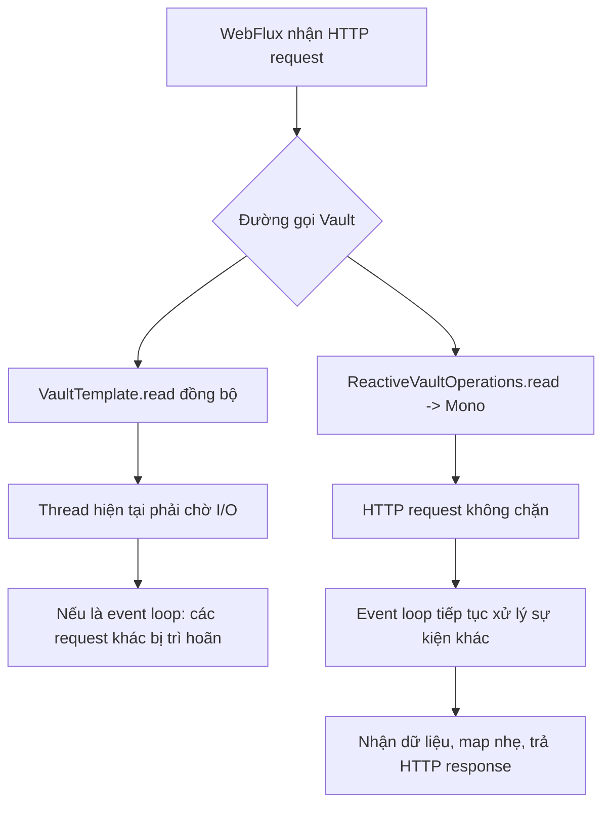

# Tránh đưa thao tác chặn vào luồng xử lý không chặn

## 1. Bối cảnh và mục tiêu

Trong chương **API reactive** của module **Spring Vault**, một ứng dụng Java có thể dùng `ReactiveVaultTemplate` để giao tiếp với HashiCorp Vault mà không giữ một thread chờ phản hồi mạng cho mỗi request. Ứng dụng có thể đăng nhập bằng workload identity, đọc KV secrets, gọi Transit encryption hoặc truy cập các API khác theo Vault token và ACL được cấp.

Tình huống điển hình: `orders-api` chạy Spring WebFlux, tiếp nhận nhiều HTTP request và cần đọc một cờ tính năng từ **KV v2** trước khi xử lý. Nhóm phát triển đã dùng controller trả `Mono<String>`, nhưng bên trong lại gọi `VaultTemplate.read(...)` đồng bộ. Khi Vault phản hồi chậm, các thread xử lý sự kiện bị giữ lại; cả các request không liên quan cũng có thể tăng độ trễ.

**Điểm trọng tâm:** một hàm trả về `Mono` hoặc `Flux` **không tự động trở thành không chặn**. Điều quyết định là *thao tác được thực thi ở đâu, khi nào và có giữ thread chờ I/O hay không*.

Sau bài này, bạn có thể:

1. Phân biệt `VaultTemplate` đồng bộ với `ReactiveVaultOperations` / `ReactiveVaultTemplate`.
2. Nhận diện thao tác chặn thường bị giấu bên trong `map`, `flatMap`, `Mono.just`, `Mono.defer` và controller.
3. Thiết kế đường truy cập KV v2 thực sự reactive, không gọi `block()` tại event loop.
4. Dùng `Mono.fromCallable(...).subscribeOn(Schedulers.boundedElastic())` **chỉ khi bắt buộc** tích hợp thư viện đồng bộ.
5. Kiểm soát concurrency, timeout, retry, bảo vệ Vault token và kiểm thử hiệu năng/lỗi bằng Reactor.
6. Giải thích mối liên hệ với reactive authentication, token lifecycle và các secret engines KV, Transit, PKI.

## 2. Tại sao chặn event loop lại nguy hiểm?

Trong kiến trúc WebFlux phổ biến với Reactor Netty, một số ít thread **event loop** đảm nhiệm xử lý sự kiện kết nối và tiếp tục các bước không chặn khi dữ liệu sẵn sàng. Nếu một callback giữ một event-loop thread đợi I/O trong một khoảng thời gian dài, những kết nối khác do thread đó phụ trách cũng phải chờ.

| Tác vụ | Có thể chặn thread? | Hướng phù hợp |
|---|---|---|
| `ReactiveVaultOperations.read(...)` | API reactive trả `Mono`, dùng HTTP client không chặn | Giữ nguyên chuỗi reactive, chuyển đổi nhẹ bằng `map` |
| `VaultTemplate.read(...)` | **Có**, HTTP đồng bộ | Đổi sang reactive API; nếu không thể, offload đúng scheduler |
| JDBC truyền thống / `JdbcTemplate` | **Có** | Ưu tiên client reactive nếu có; nếu phải dùng JDBC, cô lập tác vụ chặn |
| `Thread.sleep(...)` / `Future.get()` / `Mono.block()` | **Có** | Không gọi trong reactive request path |
| Đọc file đồng bộ / keystore lớn | Có thể chặn | Chuẩn bị ngoài request hoặc offload khi thực sự cần |
| Chuyển đổi `Map` nhỏ, kiểm tra một field | Thường không chặn | `map` trên reactive pipeline |
| Mã hóa CPU nặng hoặc ký số đồng bộ | Có thể chiếm CPU lâu | Đánh giá scheduling phù hợp; `boundedElastic` dành cho blocking I/O, không là giải pháp chung cho CPU-intensive |

**Ví dụ tác động:** nếu Vault mất hai giây để phản hồi, một lời gọi đồng bộ bên trong event loop có thể giữ thread đó trong hai giây. Reactor operator không biến lời gọi này thành không chặn chỉ bằng cách bọc trong `Mono`.

### 2.1. Sơ đồ đối chiếu



Nếu mã đồng bộ là ràng buộc chưa thể thay, có thể chuyển nó sang một scheduler chuyên xử lý blocking. Đây là **biện pháp cô lập**, không phải phép biến đổi bản chất đồng bộ thành không chặn.

## 3. API Spring Vault nào phù hợp với luồng reactive?

Spring Vault cung cấp hai kiểu truy cập:

| Thành phần | Kiểu | Đặc trưng |
|---|---|---|
| `VaultOperations` / `VaultTemplate` | Đồng bộ | Trả `VaultResponse` hoặc kết quả trực tiếp; caller chờ hoàn tất |
| `ReactiveVaultOperations` / `ReactiveVaultTemplate` | Reactive | `read` trả `Mono<VaultResponse>`, `list` trả `Flux<String>`, `write` trả `Mono<VaultResponse>` |
| `ReactiveSessionManager` / `VaultTokenSupplier` | Reactive token/session | Cung cấp token cho request, có triển khai quản lý lifecycle không chặn |
| Reactor `Mono` và `Flux` | Container cho chuỗi xử lý | Chỉ không chặn nếu các nguồn và callback bên trong phù hợp |

`ReactiveVaultTemplate` tích hợp HTTP client dựa trên `WebClient` và cho phép `ReactiveVaultOperations` truy cập KV, Transit và Vault API. Theo tài liệu Spring Vault, nó có thể được tái sử dụng an toàn giữa các thread sau khi cấu hình đúng.

Ví dụ:

```java
Mono<VaultResponse> result =
        reactiveVaultOperations.read("kv-lab/data/orders/config");
```

`read(...)` tạo một publisher mô tả thao tác. Thông thường công việc HTTP diễn ra khi có **subscription**; vì thế nên trả publisher về WebFlux và để framework điều khiển việc subscribe, thay vì tự gọi `subscribe()` trong service rồi tách kết quả khỏi vòng đời HTTP request.

**KV v2 có hai kiểu đường dẫn cần phân biệt:** lệnh CLI dùng `vault kv get -mount=kv-lab orders/config`, trong khi API chung `read("kv-lab/data/orders/config")` dùng đường dẫn REST của KV v2. Spring Vault cũng có `opsForVersionedKeyValue("kv-lab")` để truy cập KV v2 theo API mức cao; ví dụ dưới đây dùng `read` để thấy rõ cấu trúc dữ liệu.

## 4. Ví dụ đúng: đọc KV v2 và trả kết quả cho WebFlux

Giả sử Vault thử nghiệm có KV v2 mount `kv-lab`, secret `orders/config` chứa `feature=enabled`, workload có quyền `read` trên `kv-lab/data/orders/config`.

Lớp service sau chỉ thực hiện các thao tác biến đổi nhẹ bên trong `map`:

```java
import java.util.Map;

import org.springframework.stereotype.Service;
import org.springframework.vault.core.ReactiveVaultOperations;
import org.springframework.vault.support.VaultResponse;

import reactor.core.publisher.Mono;

@Service
public class ReactiveFeatureService {

    private static final String PATH =
            "kv-lab/data/orders/config";

    private final ReactiveVaultOperations vault;

    public ReactiveFeatureService(ReactiveVaultOperations vault) {
        this.vault = vault;
    }

    public Mono<String> readFeature() {
        return vault.read(PATH)
                .switchIfEmpty(Mono.error(
                        new IllegalStateException("Vault secret missing")))
                .map(ReactiveFeatureService::extractFeature);
    }

    private static String extractFeature(VaultResponse response) {
        if (response.getData() == null) {
            throw new IllegalStateException("Vault response has no data");
        }

        // KV v2: response.data.data chứa payload của secret.
        Object raw = response.getData().get("data");
        if (!(raw instanceof Map<?, ?> payload)) {
            throw new IllegalStateException("Invalid KV v2 payload");
        }

        Object flag = payload.get("feature");
        if (!(flag instanceof String value)) {
            throw new IllegalStateException("Feature is missing");
        }
        return value;
    }
}
```

Controller WebFlux truyền tiếp publisher mà không chờ:

```java
import org.springframework.web.bind.annotation.GetMapping;
import org.springframework.web.bind.annotation.RequestMapping;
import org.springframework.web.bind.annotation.RestController;

import reactor.core.publisher.Mono;

@RestController
@RequestMapping("/api/config")
public class ReactiveFeatureController {

    private final ReactiveFeatureService service;

    public ReactiveFeatureController(ReactiveFeatureService service) {
        this.service = service;
    }

    @GetMapping("/feature")
    public Mono<FeatureView> getFeature() {
        return service.readFeature().map(FeatureView::new);
    }

    public record FeatureView(String feature) {}
}
```

Khi HTTP subscriber của WebFlux xuất hiện, Spring Vault lấy Vault token từ session và thực hiện request. Phần trích xuất dữ liệu chỉ duyệt một `Map` nhỏ, không truy cập file/database/chờ network.

**Không trả payload secret nguyên vẹn ra HTTP chỉ vì demo.** API trên chỉ công bố một cờ tính năng **không nhạy cảm**. Trong ứng dụng thật, phân loại secret trước khi sử dụng và tuyệt đối không trả database password, Transit key, token hoặc chứng thư private key cho client.

## 5. Các anti-pattern khiến code “reactive” vẫn chặn

### 5.1. Bọc lời gọi đồng bộ bằng `Mono.just`

```java
// SAI: VaultTemplate.read(...) chạy ngay trong lúc tạo Mono.
public Mono<VaultResponse> bad(VaultTemplate blockingVault) {
    return Mono.just(
            blockingVault.read("kv-lab/data/orders/config"));
}
```

`Mono.just` cần giá trị đã có. Lời gọi `read` xảy ra **trước khi** tạo publisher; nếu method được gọi trên event loop, event loop bị chặn ngay.

### 5.2. Dùng `Mono.defer` nhưng không đổi scheduler

```java
// VẪN SAI nếu subscriber chạy trên event loop.
public Mono<VaultResponse> alsoBad(VaultTemplate blockingVault) {
    return Mono.defer(() -> Mono.justOrEmpty(
            blockingVault.read("kv-lab/data/orders/config")));
}
```

`defer` hoãn việc tạo publisher đến subscription, nhưng callback mặc định vẫn thực thi trên thread của subscriber. **Hoãn thời gian thực thi không đồng nghĩa chuyển thread.**

### 5.3. Gọi `block()` để lấy kết quả trong WebFlux

```java
// SAI: chặn chính luồng xử lý reactive.
public String wrong(ReactiveVaultOperations reactiveVault) {
    VaultResponse response =
            reactiveVault.read("kv-lab/data/orders/config").block();
    return response == null ? "missing" : "present";
}
```

`block()` biến thao tác bất đồng bộ thành chờ đồng bộ. Trên thread được Reactor đánh dấu non-blocking, nó còn có thể ném lỗi kiểu “blocking is not supported”. Trên thread khác, nó vẫn tiêu tốn thread trong thời gian chờ.

Tương tự, tránh `toFuture().get()`, `CountDownLatch.await()`, `Thread.sleep()` hoặc gọi một SDK đồng bộ bên trong `map`/`flatMap`:

```java
// SAI: JDBC đồng bộ nằm trên luồng xử lý callback.
return reactiveVault.read(PATH)
        .map(response -> jdbcTemplate.queryForObject(
                "select count(*) from demo_table", Long.class));
```

`flatMap` cũng không tự loại bỏ blocking nếu lambda bên trong gọi API chặn. Một publisher trả về từ `flatMap` chỉ hữu ích khi **bản thân các thao tác mà publisher thực hiện** có scheduling đúng.

### 5.4. Gọi `subscribe()` thủ công rồi trả kết quả tách rời

```java
// SAI: request HTTP kết thúc trước khi Vault hoàn thành,
// lỗi và cancellation không còn đi theo pipeline của controller.
public Mono<String> wrongFireAndForget(ReactiveVaultOperations vault) {
    vault.read("kv-lab/data/orders/config")
            .subscribe(response -> {
                // Đừng tự lưu kết quả vào mutable shared state ở đây.
            });
    return Mono.just("done");
}
```

Trong WebFlux, hãy **return publisher**, không tự subscribe để lấy dữ liệu rồi trả một kết quả giả. `subscribe()` thủ công chỉ phù hợp ở ranh giới đã được thiết kế riêng (ví dụ consumer sự kiện có lifecycle và error handling), không phải mặc định trong request/response.

## 6. Khi bất khả kháng: offload API đồng bộ bằng `boundedElastic`

Nếu một thư viện legacy chỉ cung cấp `VaultTemplate` đồng bộ hoặc một SDK không hỗ trợ reactive, cách chuyển tiếp phù hợp là bọc từng lời gọi chặn trong một publisher **cold** và đăng ký chạy bằng `Schedulers.boundedElastic()`:

```java
import org.springframework.stereotype.Service;
import org.springframework.vault.core.VaultOperations;
import org.springframework.vault.support.VaultResponse;

import reactor.core.publisher.Mono;
import reactor.core.scheduler.Schedulers;

@Service
public class LegacyVaultAdapter {

    private final VaultOperations blockingVault;

    public LegacyVaultAdapter(VaultOperations blockingVault) {
        this.blockingVault = blockingVault;
    }

    public Mono<VaultResponse> readViaBlockingApi() {
        return Mono.fromCallable(() ->
                        blockingVault.read("kv-lab/data/orders/config"))
                .subscribeOn(Schedulers.boundedElastic())
                .switchIfEmpty(Mono.error(
                        new IllegalStateException("Vault secret missing")));
    }
}
```

Tại sao cần đúng dạng này?

- `fromCallable` **trì hoãn** công việc đồng bộ đến khi publisher được subscribe.
- `subscribeOn(Schedulers.boundedElastic())` chỉ định scheduler cho việc subscribe/thi hành nguồn đó.
- `boundedElastic` có giới hạn thread/hàng đợi, phù hợp cho **blocking I/O** mà chưa thay được.
- Kết quả sau đó vẫn là `Mono` nên timeout, error handling và request cancellation có thể được phối hợp ở tầng reactive.

**Giới hạn:** API bên trong `fromCallable` vẫn **chặn một worker thread**. Đây không phải giải pháp tiết kiệm thread như client HTTP reactive. Nếu lưu lượng lớn hoặc Vault chậm, hàng đợi `boundedElastic` vẫn có thể đầy, gây tăng latency. Ưu tiên **đổi sang `ReactiveVaultOperations`** nếu đường code cho phép.

### 6.1. Bẫy về vị trí `subscribeOn`

```java
// SAI: lệnh blocking đã chạy trước khi publisher được tạo.
VaultResponse response = blockingVault.read(PATH);
Mono<VaultResponse> result =
        Mono.justOrEmpty(response)
                .subscribeOn(Schedulers.boundedElastic());
```

`subscribeOn` không thể chuyển ngược một lời gọi đã được thực hiện. Hãy đặt thao tác chặn **bên trong** `fromCallable`, và đặt `subscribeOn` sát nguồn đó cho dễ đọc.

`publishOn(Schedulers.boundedElastic())` có thể chuyển các operator **phía sau** sang scheduler khác, nhưng nó không sửa được các thao tác chặn xảy ra **trước `publishOn`**. Với một nguồn chặn, cách `fromCallable + subscribeOn` thường rõ nghĩa hơn.

### 6.2. Không lạm dụng boundedElastic

Một số tác vụ cần chính sách khác:

- **CPU-heavy mapping/crypto lớn:** không mặc định coi `boundedElastic` là thread pool tối ưu; cân nhắc thuật toán, giới hạn đồng thời và scheduler dành cho tác vụ CPU nếu thực sự cần.
- **Thread-bound transaction / MDC / security context:** việc chuyển scheduler có thể làm mất giả định về `ThreadLocal`. Reactor `Context` và cơ chế truyền context tương thích là hướng phù hợp.
- **Thao tác có timeout nhưng SDK không hỗ trợ hủy I/O:** `timeout()` của publisher có thể dừng chờ kết quả, **không bảo đảm cắt ngay** blocking I/O dưới nền. Cần cấu hình timeout tại HTTP client/SDK legacy.

## 7. Giới hạn đồng thời và backpressure khi gọi Vault nhiều lần

`Flux` và backpressure giúp điều phối lượng dữ liệu, nhưng **không đồng nghĩa vô hạn request song song**. Một vòng xử lý tạo nhiều Vault HTTP request cùng lúc có thể làm quá tải auth/session, Vault hoặc mạng.

Ví dụ lấy cài đặt cho một danh sách vùng **được kiểm soát nội bộ**, không lấy trực tiếp path từ input người dùng:

```java
import java.util.List;

import org.springframework.vault.core.ReactiveVaultOperations;
import org.springframework.vault.support.VaultResponse;

import reactor.core.publisher.Flux;

public class RegionConfigReader {

    private final ReactiveVaultOperations vault;

    public RegionConfigReader(ReactiveVaultOperations vault) {
        this.vault = vault;
    }

    public Flux<VaultResponse> readEnabledRegions() {
        List<String> allowedRegions = List.of("asia", "eu", "us");

        return Flux.fromIterable(allowedRegions)
                .flatMap(region ->
                    vault.read("kv-lab/data/regions/"
                            + region + "/config"), 3);
    }
}
```

Số `3` là giới hạn **concurrency của `flatMap`** trong đoạn code, không phải cấu hình tổng thể cho toàn hệ thống. Khi cần bảo toàn thứ tự, xem xét `concatMap` hoặc `flatMapSequential`. Với lượng request lớn, cần đo tốc độ từ upstream, pool kết nối, timeout, retry và quota Vault; đừng chỉ tăng concurrency để giảm thời gian trong test nhỏ.

**Không dùng `parallel()` để che một lời gọi đồng bộ không kiểm soát.** Tăng số luồng CPU không khắc phục việc những task đang chờ I/O, và không thay thế chính sách giới hạn request.

## 8. Authentication và token lifecycle cũng phải phù hợp reactive

Spring Vault cần Vault token cho các request có xác thực. Với reactive client:

- `VaultTokenSupplier` cung cấp token theo hợp đồng reactive.
- `ReactiveSessionManager` giữ phiên và quản lý việc lấy token.
- `ReactiveLifecycleAwareSessionManager` hỗ trợ vòng đời token/renewal theo cơ chế reactive.
- Workload authentication như AppRole/Kubernetes/certificate cần được cấu hình **đúng nhánh reactive**, không tự lấy token bằng `VaultTemplate` đồng bộ trong request reactive.

`ReactiveVaultTemplate` không biến việc khởi tạo credential từ **một nguồn chặn tùy biến** thành không chặn. Ví dụ supplier nhận SecretID từ file đồng bộ lớn hoặc API legacy vẫn có thể gây blocking nếu được gọi trên event loop; cần phân phối credential an toàn, cache/refresh hợp lý, hoặc cô lập nguồn chặn đúng cách khi xây dựng authentication flow.

**Không login lại trên từng request** chỉ vì ứng dụng reactive. Session/token có TTL, renewal và ACL riêng; token có thể được dùng lại đến khi session cần lấy token mới. Nếu token bị revoke hoặc hết hạn, cần phân loại lỗi xác thực với lỗi secret engine, và bảo đảm luồng re-login không gây burst gọi auth endpoint.

Phân biệt:

| Vòng đời | Nơi xử lý | Điều cần tránh |
|---|---|---|
| Vault token | Reactive session/token supplier | Chặn event loop để tự login/renew, log `client_token` |
| Lease của dynamic secret | Cơ chế lease/engine và vòng đời ứng dụng | Giả định `Mono` tự gia hạn hoặc thu hồi lease |
| KV v2 static secret | Read/write KV API | Nhầm TTL/token với lease secret, hoặc ghi lộ nội dung |
| Transit | Reactive operation hoặc WebClient session-bound | Đưa mã hóa/giải mã bằng SDK đồng bộ vào callback không chặn |
| PKI | Endpoint API và quyền token theo policy | Tự động đưa private key/cert credential ra trace/log |

Phương thức `ReactiveVaultOperations.read(...)` trả publisher, nhưng **chính sách secret engine** (KV, Transit, PKI) vẫn độc lập: endpoint có thể yêu cầu token policy riêng. Non-blocking không làm giảm nhu cầu TLS, authentication và least privilege.

## 9. Timeout, retry và xử lý lỗi trong reactive pipeline

Một Vault request có thể thất bại do TLS, Vault không sẵn sàng, token không hợp lệ, ACL 403 hoặc secret không tồn tại. Một pipeline hợp lý cần phản ánh lỗi, không che giấu bằng một giá trị giả.

```java
import java.time.Duration;

import reactor.core.publisher.Mono;

public Mono<String> readWithTimeout(ReactiveFeatureService service) {
    return service.readFeature()
            .timeout(Duration.ofSeconds(3))
            .onErrorMap(throwable ->
                new IllegalStateException(
                    "Vault configuration unavailable", throwable));
}
```

Ví dụ trên minh họa timeout và chuẩn hóa lỗi, nhưng trong hệ thống thật **không log root cause chứa credential hoặc payload secret** nếu thư viện có thể đặt thông tin nhạy cảm trong exception; chọn error mapping an toàn.

### 9.1. Đừng retry mọi lỗi

Chỉ retry có giới hạn đối với lỗi **tạm thời** như mất mạng, timeout hoặc một số 5xx. Lỗi 403 do policy sai, AppRole SecretID sai, path bị cấm hay cấu hình TLS sai thường không được giải quyết bằng retry liên tục.

```java
import java.time.Duration;
import reactor.core.publisher.Mono;
import reactor.util.retry.Retry;

// retryableVaultFailure là Predicate<Throwable> do ứng dụng định nghĩa,
// kiểm tra nguyên nhân gốc đã được phân loại, KHÔNG retry 403/4xx do cấu hình.
public <T> Mono<T> retryTransient(
        Mono<T> operation,
        java.util.function.Predicate<Throwable> retryableVaultFailure) {
    return operation.retryWhen(
            Retry.backoff(2, Duration.ofMillis(250))
                    .maxBackoff(Duration.ofSeconds(2))
                    .filter(retryableVaultFailure));
}
```

Hãy xác định **idempotency** trước khi retry write hoặc tác vụ có tác động bên ngoài. Đọc KV thường là trường hợp đơn giản hơn; thao tác tạo credential động, issue PKI hoặc thay đổi Transit key có thể không an toàn để lặp lại tùy endpoint. `timeout` và `retry` không được dùng để che giấu nguyên nhân gốc hoặc gây bão request khi Vault đang lỗi.

### 9.2. Cancellation và giới hạn bảo đảm

Khi HTTP client đóng kết nối, subscription có thể bị cancel. Với reactive HTTP client, cancellation có cơ hội giải phóng chuỗi xử lý; nhưng một blocking call đã đưa sang `boundedElastic` **có thể tiếp tục chạy** nếu thư viện chặn không hỗ trợ ngắt. Vì vậy cần cả timeout mạng, giới hạn connection pool và cơ chế cleanup của dịch vụ kế thừa.

## 10. Kiểm thử không chặn với Reactor và WebFlux

### 10.1. Kiểm tra hành vi của service bằng StepVerifier

Khi Vault test đã cấu hình và `ReactiveFeatureService` là bean hợp lệ:

```java
import static org.junit.jupiter.api.Assertions.assertEquals;

import org.junit.jupiter.api.Test;
import org.springframework.beans.factory.annotation.Autowired;
import org.springframework.boot.test.context.SpringBootTest;

import reactor.test.StepVerifier;

@SpringBootTest
class ReactiveFeatureServiceIT {

    @Autowired
    ReactiveFeatureService service;

    @Test
    void readsEnabledFlag() {
        StepVerifier.create(service.readFeature())
                .expectNext("enabled")
                .verifyComplete();
    }
}
```

`StepVerifier.verifyComplete()` **đợi hoàn thành trong test**, không phải một mẫu để đem sang request handler. Test xác minh dữ liệu và terminal signal, nhưng một mình nó **không chứng minh không có blocking** trong pipeline.

Thư viện `reactor-test` được dùng cho `StepVerifier`. Để tránh test treo khi Vault mất kết nối, hãy đặt HTTP client timeout và dùng các overload kiểm soát thời gian test phù hợp.

### 10.2. Kiểm tra adapter đã được offload

```java
import static org.junit.jupiter.api.Assertions.assertFalse;

import org.junit.jupiter.api.Test;
import reactor.core.publisher.Mono;
import reactor.core.scheduler.Schedulers;
import reactor.test.StepVerifier;

class BlockingBridgeTest {

    @Test
    void blockingBridgeRunsOutsideNonBlockingThread() {
        Mono<String> bridged = Mono.fromCallable(() -> {
                    // Một API đồng bộ nếu cần được gọi ở đây.
                    assertFalse(Schedulers.isInNonBlockingThread());
                    return "ok";
                })
                .subscribeOn(Schedulers.boundedElastic());

        StepVerifier.create(bridged)
                .expectNext("ok")
                .verifyComplete();
    }
}
```

Test này xác minh **việc chọn scheduler** cho nguồn đồng bộ, không thay thế đo hiệu năng dưới tải. Có thể bổ sung **BlockHound** ở môi trường test được hỗ trợ để phát hiện một số blocking calls trên thread non-blocking. BlockHound cần được cài đặt theo yêu cầu tương thích JVM/Reactor và nên chạy trước khi runtime khởi tạo; không xem nó là công cụ nhận diện mọi kiểu blocking.

### 10.3. Ma trận kiểm thử đề xuất

| Mã | Trường hợp | Điều cần xác nhận |
|---|---|---|
| R1 | Reactive KV read với token đúng | Publisher hoàn thành, trả đúng dữ liệu không nhạy cảm |
| R2 | Thử `Mono.just(blockingVault.read(...))` trên event loop test | Chỉ ra blocking xảy ra trước publisher |
| R3 | Bridge `fromCallable + boundedElastic` | Blocking call không chạy trên non-blocking thread |
| R4 | `ReactiveVaultOperations.read(...)` trả 404 hoặc empty | Không trả giá trị giả; xử lý lỗi/vắng mặt rõ ràng |
| R5 | Workload thiếu ACL `read` | Phân loại 403 thay vì retry vô hạn |
| R6 | Vault timeout hoặc 5xx | Timeout/retry hữu hạn; không làm bão request |
| R7 | Concurrent reads tăng cao | Đo độ trễ và số request/pool, giới hạn concurrency |
| R8 | Token hết hạn và cần re-login | Không xuất hiện login chặn trong event loop; session phục hồi theo policy |
| R9 | HTTP request bị hủy | Quan sát cancellation và số công việc legacy còn chạy |
| R10 | Log, trace, lỗi Java | Không chứa Vault token, SecretID, raw secret hoặc private key |

## 11. Lỗi hiệu năng và cách chẩn đoán

| Triệu chứng | Khả năng thường gặp | Cách xử lý |
|---|---|---|
| WebFlux chậm hàng loạt khi Vault chậm | `VaultTemplate` hoặc SDK đồng bộ chạy trên event loop | Đổi sang reactive client, hoặc cô lập bằng boundedElastic |
| Reactor báo không cho phép `block()` | `block` bị gọi trên thread non-blocking | Trả `Mono` tới framework; không ép lấy kết quả đồng bộ |
| `Mono.defer` vẫn có latency cao trên event loop | Callback vẫn thực hiện I/O đồng bộ | Dùng reactive API hoặc thêm scheduling cho nguồn chặn |
| boundedElastic quá tải | Nhiều nguồn đồng bộ, queue và worker có giới hạn | Hạn chế concurrency, giảm blocking, dùng reactive client |
| Retry gây tăng số lần login/Vault API | Retry tất cả lỗi, thiếu backoff hoặc mỗi request tự auth | Giới hạn retry và phân loại lỗi, dùng reactive session |
| Đọc secret được nhưng downstream vẫn chậm | JDBC/file/SDK blocking bên trong `map` | Kiểm tra toàn pipeline, không chỉ lệnh gọi Vault |
| Có `Mono` nhưng trả HTTP trước khi Vault xong | Service gọi `subscribe()` rồi trả kết quả khác | Return publisher và để WebFlux subscribe |
| Kết quả lỗi lộ password | Log cả VaultResponse hoặc exception kèm request body | Redact/sanitize log, không đưa secret vào metric/tracing |

Khi đo đạc, tập trung vào **event-loop latency**, p95/p99 latency, số thread `boundedElastic` đang bận, queue task, thời gian chờ Vault, connection pool HTTP và tỷ lệ lỗi. Đo cả đường đi từ controller đến database/secret engine, vì một operator có blocking sau bước Vault vẫn có thể khiến toàn endpoint bị nghẽn.

## 12. ACL, TLS và bảo vệ dữ liệu trong reactive code

Ví dụ policy chỉ đọc một KV v2 key:

```hcl
path "kv-lab/data/orders/config" {
  capabilities = ["read"]
}
```

Trong môi trường Vault **test cô lập**, secret có thể được tạo bằng CLI:

```bash
# Chỉ bật mount nếu chưa tồn tại.
vault secrets enable -path=kv-lab -version=2 kv
vault kv put -mount=kv-lab orders/config feature=enabled
```

Lệnh mount/writes cần quyền quản trị test, không thuộc quyền của ứng dụng runtime. Workload đăng nhập theo danh tính được cấp, token chỉ đọc đúng key test. Với KV v2, API path `data/` khác đường dẫn logic CLI.

Lưu ý bảo mật đặc thù với reactive pipeline:

- `doOnNext(response -> log.info("{}", response))` có thể in toàn bộ secret. **Không log VaultResponse**.
- Truyền raw token/SecretID qua `Reactor Context`, headers HTTP hoặc tags metrics tùy tiện vẫn có thể gây lộ; tránh đặt credential vào nơi không cần.
- Dữ liệu secret đi qua `cache()`, `share()` hoặc `replay()` có thể tồn tại lâu hơn dự kiến. Chỉ cache với TTL/ownership được thiết kế rõ ràng.
- Không ghép path Vault từ user input không kiểm soát, nhất là callback `doWithSession(WebClient)` có quyền gửi header xác thực.
- `timeout` hoặc `onErrorResume` không được tự động trả **secret cũ** khi token/ACL thất bại trừ khi có chính sách cache an toàn minh bạch.

**Non-blocking không thay thế least privilege.** Reactive request vẫn cần TLS, workload authentication, token renewal/re-login, policy KV/Transit/PKI và quy trình quản lý lease khi có dynamic secrets.

## 13. Checklist triển khai và câu hỏi tự kiểm tra

Trước khi đưa một endpoint reactive có gọi Vault vào production, kiểm tra:

- [ ] Dịch vụ dùng `ReactiveVaultOperations` / `ReactiveVaultTemplate` thay vì `VaultTemplate` trong đường WebFlux chính.
- [ ] Không có `block()`, `Future.get()`, `Thread.sleep()` hoặc JDBC đồng bộ trong event-loop path.
- [ ] Không bọc blocking call bằng `Mono.just`; trường hợp legacy dùng `fromCallable + boundedElastic` và giới hạn concurrency.
- [ ] Controller **trả publisher**, không tự `subscribe()` để lấy dữ liệu.
- [ ] Có timeout HTTP client, retry chọn lọc, backoff, metrics và hành vi rõ ràng khi Vault/auth mất kết nối.
- [ ] Token/credential được quản lý bởi reactive session và có ACL tối thiểu.
- [ ] Không log secret, token, response body nhạy cảm hoặc private key.
- [ ] Có kiểm thử dữ liệu đúng, lỗi quyền, timeout, cancellation và tải đồng thời.

**Câu 1.** Tại sao `Mono.just(blockingVault.read(path))` vẫn chặn event loop?

**Trả lời:** `read(path)` được gọi ngay để tạo đối số cho `Mono.just`. Publisher chỉ nhận kết quả sau khi I/O đồng bộ đã hoàn tất.

**Câu 2.** `Mono.defer(() -> Mono.just(blockingVault.read(path)))` có tự sửa blocking không?

**Trả lời:** Không. `defer` hoãn thời điểm thực thi, nhưng không chuyển công việc sang scheduler khác. Nếu subscription diễn ra trên event loop, lệnh `read` vẫn chặn event loop.

**Câu 3.** Khi bắt buộc dùng `VaultTemplate` legacy, mẫu nào cô lập blocking?

**Trả lời:** `Mono.fromCallable(() -> blockingVault.read(path)).subscribeOn(Schedulers.boundedElastic())`. Cách này dùng một worker thread cho blocking; ưu tiên chuyển sang `ReactiveVaultOperations` để có non-blocking I/O thực sự.

**Câu 4.** Nếu `ReactiveVaultOperations.read(path)` hoạt động, có cần kiểm tra JDBC hoặc file I/O ở bước sau không?

**Trả lời:** Có. Tính không chặn phải đúng cho **toàn pipeline**, không chỉ đoạn gọi Vault.

**Câu 5.** Có nên retry mọi response 403 bằng `Retry.backoff` không?

**Trả lời:** Không. Lỗi ACL hoặc credential sai thường cần sửa cấu hình/identity, không phải retry; retry hữu hạn chỉ dành cho nhóm lỗi tạm thời đã phân loại.

## 14. Tài liệu tham khảo

- [Spring Vault – Reactive Infrastructure](https://docs.spring.io/spring-vault/reference/vault/reactive-template.html)
- [Spring Vault API – ReactiveVaultOperations](https://docs.spring.io/spring-vault/reference/api/java/org/springframework/vault/core/ReactiveVaultOperations.html)
- [Spring Vault API – ReactiveVaultTemplate](https://docs.spring.io/spring-vault/reference/api/java/org/springframework/vault/core/ReactiveVaultTemplate.html)
- [Project Reactor – FAQ: Wrap a synchronous, blocking call](https://projectreactor.io/docs/core/release/reference/faq.html)
- [Project Reactor – Testing with StepVerifier](https://projectreactor.io/docs/core/release/reference/testing.html)
- [Spring WebFlux – Execution model and concurrency](https://docs.spring.io/spring-framework/reference/web/webflux/new-framework.html)

**Kết luận:** một đường xử lý reactive an toàn phải **không chặn từ nguồn I/O đến controller**, không chỉ có kiểu trả về `Mono`/`Flux`. Với Spring Vault, ưu tiên `ReactiveVaultOperations` và HTTP client không chặn; nếu còn `VaultTemplate`/SDK đồng bộ, cô lập từng lời gọi bằng `fromCallable + boundedElastic`, giới hạn tải và kiểm thử. Đồng thời giữ nguyên các yêu cầu bảo mật token, ACL, TLS và vòng đời credential của Vault.
