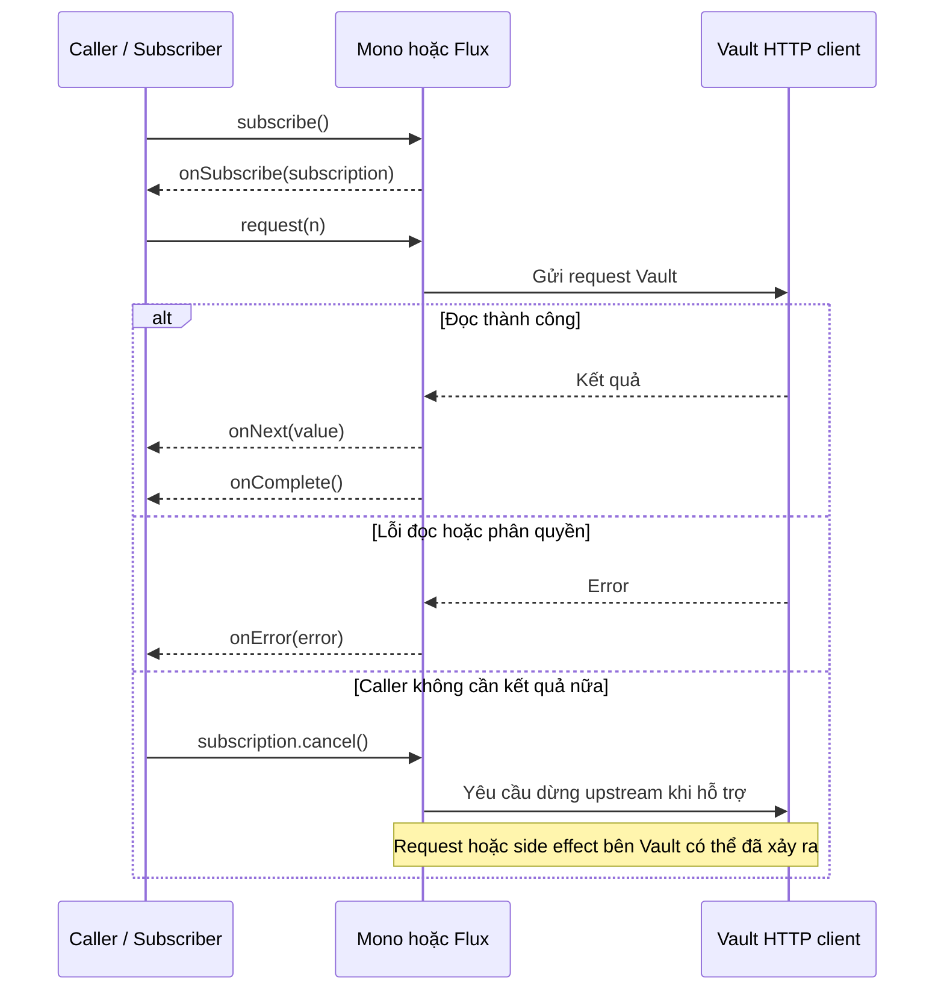
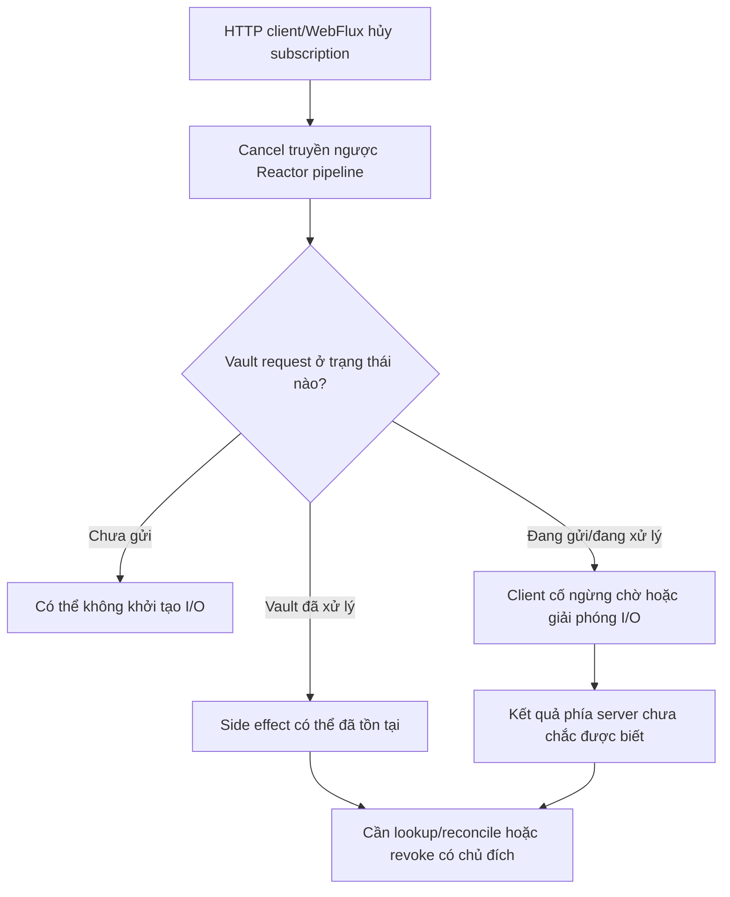

# Kiểm thử pipeline cùng việc hủy đăng ký trong Spring Vault Reactive API

## 1. Mục tiêu bài học

Trong module **SPRING_VAULT**, ứng dụng Java có thể dùng `VaultTemplate` để đọc KV secrets, gọi Transit encryption, PKI hoặc quản lý những thao tác Vault khác. Với ứng dụng WebFlux hoặc luồng I/O bất đồng bộ, Spring Vault còn cung cấp **`ReactiveVaultTemplate`**, triển khai interface **`ReactiveVaultOperations`**, cho phép ghép các thao tác Vault thành pipeline Reactor `Mono` và `Flux`.

Một pipeline reactive cần được kiểm thử ở ít nhất hai khía cạnh: **những tín hiệu mà subscriber nhận được** (`onNext`, `onComplete`, `onError`) và **điều gì xảy ra khi subscriber hủy đăng ký** (`cancel`). Điểm sau rất quan trọng khi một request WebFlux bị người dùng ngắt, một thao tác bị `timeout`, hoặc một nguồn `Flux` bị dừng bởi `take`.

Bài thuộc chương **API reactive** này tập trung vào:

- Tạo và kiểm thử pipeline đọc Vault bằng `ReactiveVaultOperations` và `ReactiveVaultKeyValueOperations`.
- Dùng `StepVerifier` kiểm tra dữ liệu, kết thúc bình thường, lỗi, subscription và cancellation.
- Dùng `PublisherProbe`, `doOnCancel`, `doFinally` để quan sát việc hủy ở **đúng tầng**.
- Dùng `StepVerifier.withVirtualTime` cho các toán tử hẹn giờ, với giới hạn rõ ràng khi thao tác thực tế là I/O qua HTTP.
- Phân biệt **cancel subscription** với **rollback một thao tác đã được Vault xử lý**, thu hồi Vault token hay revoke secret lease.
- Kiểm thử timeout, retry, backpressure, resource cleanup và kịch bản tích hợp với Vault cô lập.
- Giữ bí mật Vault token, lease ID, password, nội dung KV và các key liên quan trong cả pipeline lẫn báo cáo kiểm thử.

> **Nguyên tắc:** `cancel()` là tín hiệu điều khiển ở tầng Reactive Streams. Nó không phải lệnh `vault token revoke`, `sys/leases/revoke` hay bảo đảm một HTTP request đã tới Vault được đảo ngược.

## 2. Các tín hiệu của Reactive Streams

Một `Publisher` chưa nhất thiết gửi request HTTP lúc được **khai báo**. Khi có `Subscriber`, chuỗi thường bắt đầu bằng `onSubscribe(Subscription)`. Subscriber yêu cầu dữ liệu bằng `request(n)`; sau đó publisher gửi tối đa số phần tử phù hợp với demand và kết thúc bằng một trong `onComplete` hoặc `onError`.



### Phân biệt `Mono` và `Flux`

| Đặc điểm | `Mono<T>` | `Flux<T>` |
| --- | --- | --- |
| Số lượng phần tử | Tối đa một `onNext` | 0 đến N `onNext` |
| Kết thúc thành công | `onComplete`, có hoặc không có giá trị | `onComplete` sau chuỗi giá trị |
| Kết thúc lỗi | `onError` | `onError` |
| Hủy đăng ký | `Subscription.cancel()` | `Subscription.cancel()` |
| Ví dụ Spring Vault | `kv.get("apps/demo")` | `vault.list("path")` |
| Hành vi khi hủy | Dừng việc giao giá trị còn chưa phát theo khả năng upstream | Dừng nhu cầu nhận thêm phần tử và yêu cầu upstream dừng |

Ở thời điểm **cancellation**, subscriber không nhận một terminal signal `onCancel`. `cancel` là yêu cầu gọi trên `Subscription`, **khác** với `onComplete` hoặc `onError`. Các hook như `doOnCancel` và `doFinally(SignalType.CANCEL)` cho phép quan sát yêu cầu hủy ở tầng Reactor.

### Ba kết cục cần test tách biệt

| Kết cục | Điều kiểm thử nên chứng minh |
| --- | --- |
| Thành công | Đúng giá trị và có `onComplete` |
| Lỗi | Đúng lớp lỗi/điều kiện lỗi và có `onError` |
| Hủy đăng ký | Cancellation được gửi đến tầng mong muốn; không giả định sau đó có `onComplete` hoặc `onError` |

Một test chỉ xác nhận `Mono` trả đúng value chưa chứng minh đường cancellation hoạt động khi client rời trang hoặc request bị hủy.

## 3. Reactive Vault API: tạo pipeline đúng cách

Spring Vault cung cấp `ReactiveVaultTemplate` và `ReactiveVaultOperations`. Từ đó có thể chọn API chuyên biệt cho KV v2, Transit hoặc các endpoint khác. API này sử dụng cơ chế reactive authentication/token supplier phù hợp, sau đó gửi HTTP qua reactive client.

Ví dụ với KV v2:

```java
import org.springframework.vault.core.ReactiveVaultOperations;
import org.springframework.vault.core.ReactiveVaultKeyValueOperations;
import org.springframework.vault.core.VaultKeyValueOperationsSupport.KeyValueBackend;
import reactor.core.publisher.Mono;
import org.springframework.vault.support.VaultResponse;

ReactiveVaultKeyValueOperations kv =
        reactiveVaultOperations.opsForKeyValue("kv", KeyValueBackend.KV_2);

Mono<VaultResponse> result = kv.get("apps/demo");
```

Ở đây:

- `kv` là **mount** của KV v2; `apps/demo` là secret path tương đối trong mount.
- `get` trả `Mono<VaultResponse>`; cần kiểm tra dữ liệu trước khi chuyển sang DTO nghiệp vụ.
- Với secret không tồn tại, reactive API có thể cho ra `Mono.empty()`. Thiết kế service phải xác định đây là tình trạng tùy chọn hay lỗi nghiệp vụ.
- Các request thực tế cần Vault token có quyền `read` trên `kv/data/apps/demo`.

### Đừng trộn `VaultTemplate` blocking vào pipeline reactive

Ví dụ không nên dùng trên event-loop:

```java
// Tránh đặt lệnh I/O blocking vào map() của pipeline WebFlux.
return Mono.just("apps/demo")
        .map(path -> vaultTemplate.read(path));
```

`VaultTemplate` là API đồng bộ; khi gọi trực tiếp trong `map` có thể chặn thread reactive. Nếu đang xây dựng dịch vụ reactive, ưu tiên `ReactiveVaultOperations`. Khi buộc phải tích hợp thư viện blocking, cần tách scheduler (`Schedulers.boundedElastic()`) và nêu rõ giới hạn; đó không tự biến I/O blocking thành non-blocking.

## 4. Một service mẫu có thể kiểm thử

Ví dụ dịch vụ chỉ trả một **cờ tính năng** công khai, trong khi dữ liệu Vault có thể chứa thêm trường bí mật. Ta đưa interface `ReactiveVaultKeyValueOperations` vào constructor để unit test thay nguồn bằng mock, đồng thời tránh lộ nguyên `VaultResponse` qua API.

```java
package example.vault;

import java.util.Map;

import org.springframework.vault.core.ReactiveVaultKeyValueOperations;
import org.springframework.vault.support.VaultResponse;
import reactor.core.publisher.Mono;

public final class FlagService {

    public record PublicFlag(boolean enabled) {}

    private final ReactiveVaultKeyValueOperations kv;

    public FlagService(ReactiveVaultKeyValueOperations kv) {
        this.kv = kv;
    }

    public Mono<PublicFlag> readFlag() {
        return Mono.defer(() -> kv.get("apps/feature"))
                .switchIfEmpty(Mono.error(
                        new IllegalStateException("Feature settings unavailable")))
                .map(this::toPublicFlag);
    }

    private PublicFlag toPublicFlag(VaultResponse response) {
        Map<String, Object> data = response.getData();
        Object raw = data == null ? null : data.get("enabled");

        if (!(raw instanceof Boolean)) {
            throw new IllegalStateException("Invalid feature settings");
        }

        return new PublicFlag((Boolean) raw);
    }
}
```

`Mono.defer(...)` có tác dụng cụ thể: lệnh gọi `kv.get(...)` diễn ra **khi subscriber subscribe**, không phải khi service xây publisher. Nó cũng hỗ trợ kiểm thử được số lần thực sự khởi tạo request theo subscription. Ngay cả khi bỏ `defer`, đa số reactive I/O publisher của Spring Vault vẫn chỉ thực hiện request khi được subscribe; `defer` ở đây làm ranh giới khởi tạo dễ quan sát hơn.

Một bean cấu hình cấp adapter `ReactiveVaultKeyValueOperations` từ `ReactiveVaultOperations`:

```java
import org.springframework.context.annotation.Bean;
import org.springframework.context.annotation.Configuration;
import org.springframework.vault.core.ReactiveVaultKeyValueOperations;
import org.springframework.vault.core.ReactiveVaultOperations;
import org.springframework.vault.core.VaultKeyValueOperationsSupport.KeyValueBackend;

@Configuration(proxyBeanMethods = false)
class ReactiveVaultKvConfiguration {

    @Bean
    ReactiveVaultKeyValueOperations reactiveKv(
            ReactiveVaultOperations vault) {
        return vault.opsForKeyValue("kv", KeyValueBackend.KV_2);
    }

    @Bean
    FlagService flagService(ReactiveVaultKeyValueOperations reactiveKv) {
        return new FlagService(reactiveKv);
    }
}
```

Ví dụ chỉ trình bày bean adapter, **giả định ứng dụng đã cấu hình `ReactiveVaultOperations`, Vault endpoint, TLS và authentication**. Một thiết lập đầy đủ có thể dùng Spring Cloud Vault hoặc reactive client configuration của Spring Vault. Không gắn Vault token tĩnh vào source code chỉ để chạy test.

## 5. Chuẩn bị Reactor Test

Trong dự án Maven đã có Spring Vault và Reactor từ dependency quản lý phiên bản, cần bổ sung `reactor-test` cho test:

```xml
<dependency>
    <groupId>io.projectreactor</groupId>
    <artifactId>reactor-test</artifactId>
    <scope>test</scope>
</dependency>
```

Test có thể sử dụng JUnit Jupiter, AssertJ và Mockito theo cách dự án đã cấu hình. Tên API chính:

| API | Dùng để làm gì? |
| --- | --- |
| `StepVerifier.create(publisher)` | Subscribe và xác minh thứ tự signal |
| `expectSubscription()` | Xác nhận có subscription |
| `expectNext(...)` / `assertNext(...)` | Kiểm tra dữ liệu của `onNext` |
| `verifyComplete()` | Xác nhận pipeline kết thúc thành công |
| `expectError(...)` / `verifyError(...)` | Kiểm tra `onError` |
| `thenCancel()` | Gửi `Subscription.cancel()`, kết thúc kịch bản kiểm thử |
| `verify(Duration)` | Chạy verification với timeout thực, tránh treo test |
| `PublisherProbe.of(...)` | Quan sát upstream có được subscribe/request/cancel không |
| `TestPublisher` | Phát các signal được điều khiển trong test |
| `withVirtualTime(...)` | Kiểm tra toán tử phụ thuộc scheduler/timer mà không chờ đồng hồ thật |

Điểm dễ bỏ sót: **`StepVerifier` không thực sự chạy chỉ vì bạn tạo chuỗi expectations**; phải gọi `verify()`, `verify(Duration)` hoặc các shortcut có verify.

## 6. Kiểm thử thành công, rỗng và lỗi

### 6.1. Thành công: trả đúng DTO và kết thúc

```java
import static org.mockito.Mockito.when;

import java.time.Duration;
import java.util.Map;

import org.junit.jupiter.api.Test;
import org.springframework.vault.core.ReactiveVaultKeyValueOperations;
import org.springframework.vault.support.VaultResponse;

import reactor.core.publisher.Mono;
import reactor.test.StepVerifier;

class FlagServiceTest {

    private final ReactiveVaultKeyValueOperations kv =
            org.mockito.Mockito.mock(ReactiveVaultKeyValueOperations.class);

    @Test
    void readsApprovedFieldOnly() {
        VaultResponse response = new VaultResponse();
        response.setData(Map.of(
                "enabled", true,
                "internalApiKey", "FAKE_VALUE_DO_NOT_RETURN"));

        when(kv.get("apps/feature")).thenReturn(Mono.just(response));

        FlagService service = new FlagService(kv);

        StepVerifier.create(service.readFlag())
                .expectNext(new FlagService.PublicFlag(true))
                .expectComplete()
                .verify(Duration.ofSeconds(2));
    }
}
```

`record PublicFlag` có `equals` theo giá trị nên `expectNext(...)` kiểm tra đúng boolean. `internalApiKey` được bỏ qua có chủ đích. Với dữ liệu nhạy cảm thực, không log `VaultResponse` hoặc serialize nguyên nó cho frontend.

### 6.2. Khi KV secret không tồn tại

```java
@Test
void missingSecretIsDomainError() {
    when(kv.get("apps/feature")).thenReturn(Mono.empty());

    StepVerifier.create(new FlagService(kv).readFlag())
            .expectErrorMatches(error ->
                    error instanceof IllegalStateException
                    && error.getMessage().contains("unavailable"))
            .verify(Duration.ofSeconds(2));
}
```

`Mono.empty()` từ API nguồn có thể mang nghĩa “không có secret”; trong service này ta **chủ động** đổi thành lỗi. Nếu nghiệp vụ cho phép thiếu secret, có thể trả `Mono.empty()` hoặc DTO fallback an toàn, nhưng phải kiểm thử hành vi cụ thể.

### 6.3. Lỗi Vault hoặc lỗi mạng

```java
@Test
void upstreamFailurePropagates() {
    RuntimeException simulated =
            new RuntimeException("simulated upstream failure");

    when(kv.get("apps/feature")).thenReturn(Mono.error(simulated));

    StepVerifier.create(new FlagService(kv).readFlag())
            .expectErrorSatisfies(error ->
                    org.assertj.core.api.Assertions.assertThat(error)
                            .isSameAs(simulated))
            .verify(Duration.ofSeconds(2));
}
```

Test chỉ xác nhận **signal error**. Với ứng dụng thật, lỗi HTTP 403, timeout, token expired và network failure cần được phân loại để trả mã lỗi ứng dụng phù hợp; không chuyển raw exception, Vault token, path nội bộ hoặc auth response ra HTTP client.

## 7. Cancellation là gì trong thực tế?

Khi subscriber đã `subscribe` một pipeline rồi gọi `cancel()`, yêu cầu hủy được truyền ngược qua các operator về upstream theo hợp đồng Reactive Streams. Reactor có thể ngừng timer, request demand hoặc giải phóng tài nguyên tương thích. Tuy nhiên, thực tế phụ thuộc **vị trí quan sát**, trạng thái cạnh tranh và loại upstream.

### Phân biệt bốn tình huống

| Tình huống | Ý nghĩa |
| --- | --- |
| Chưa có ai subscribe | Không có subscription để cancel; network request thông thường chưa bắt đầu |
| Đang chờ `Mono` chưa emit | Cancel có thể đi ngược upstream và yêu cầu ngừng công việc |
| `onComplete`/`onError` đã phát | Pipeline đã kết thúc; cancel sau đó không có nghĩa đã hủy thành công một tác vụ |
| Vault đã xử lý request ghi trước khi nhận cancel | Server-side effect **có thể đã xảy ra** dù client không nhận kết quả |

**Không suy từ việc nhận `SignalType.CANCEL` rằng Vault chưa đọc, ghi, mã hóa, cấp chứng thư hoặc cấp dynamic credential.** Cancellation là một tín hiệu của client; rollback phải có cơ chế khác nếu nghiệp vụ thực sự cần.

## 8. Kiểm thử `thenCancel()` và quan sát upstream

`StepVerifier.thenCancel()` giúp tạo kịch bản dừng một pipeline chưa hoàn tất. Không dùng `verifyComplete()` cho một pipeline đang bị hủy do test; completion và cancellation là hai kết cục khác nhau.

### 8.1. Kiểm tra bằng `PublisherProbe`

`PublisherProbe` cho phép xác minh **upstream thật sự nhận cancel** từ pipeline:

```java
import static org.mockito.Mockito.when;

import java.time.Duration;
import org.junit.jupiter.api.Test;
import org.springframework.vault.support.VaultResponse;
import reactor.core.publisher.Mono;
import reactor.test.StepVerifier;
import reactor.test.publisher.PublisherProbe;

@Test
void cancellingPipelineCancelsVaultSourcePublisher() {
    PublisherProbe<VaultResponse> probe =
            PublisherProbe.of(Mono.<VaultResponse>never());

    when(kv.get("apps/feature")).thenReturn(probe.mono());

    FlagService service = new FlagService(kv);

    StepVerifier.create(service.readFlag())
            .expectSubscription()
            .thenCancel()
            .verify(Duration.ofSeconds(2));

    probe.assertWasSubscribed();
    probe.assertWasRequested();
    probe.assertWasCancelled();
}
```

Giải thích:

- `Mono.never()` không tự emit value/complete/error, nên test có thời gian hủy trước khi kết thúc.
- `probe.mono()` là upstream được instrument để quan sát subscription, demand và cancel.
- `thenCancel()` là hành động của subscriber trong test.
- `probe.assertWasCancelled()` chứng minh tầng adapter/upstream **đã nhận cancellation**.
- Vì đây là **stub**, test **không chứng minh HTTP socket thật bị đóng**, Vault đã ngừng xử lý hay lease bị revoke.

Khi `Mono` đã complete quá nhanh, bạn không thể đảm bảo cancel thắng race. Dùng nguồn chưa hoàn tất hoặc latches/fixtures để kiểm soát trình tự, thay vì trông đợi một request Vault thật tình cờ chậm.

### 8.2. Kiểm tra hook `doOnCancel`

`doOnCancel` phù hợp với logic quan sát khi cancellation được gửi xuống:

```java
import static org.assertj.core.api.Assertions.assertThat;

import java.time.Duration;
import java.util.concurrent.atomic.AtomicBoolean;
import reactor.core.publisher.Mono;
import reactor.test.StepVerifier;

@Test
void doOnCancelIsInvoked() {
    AtomicBoolean cancelled = new AtomicBoolean();

    Mono<String> pipeline = Mono.<String>never()
            .doOnCancel(() -> cancelled.set(true));

    StepVerifier.create(pipeline)
            .expectSubscription()
            .thenCancel()
            .verify(Duration.ofSeconds(2));

    assertThat(cancelled).isTrue();
}
```

Hook chỉ nên thực hiện công việc nhẹ như tăng metric hoặc chuyển cờ trạng thái; không đưa Vault token, lease ID hay secret data vào log. Đừng bắt đầu một request revoke bất đồng bộ trong `doOnCancel` mà không quản lý lỗi, thứ tự và lifetime của nó; làm như vậy có thể tạo công việc “fire and forget” khó kiểm chứng.

### 8.3. `doFinally` theo dõi mọi cách kết thúc

`doFinally(signal -> ...)` nhận một trong các loại `ON_COMPLETE`, `ON_ERROR` hoặc `CANCEL`. Nó thích hợp để đo thời gian và tăng metric theo lý do kết thúc:

```java
import reactor.core.publisher.SignalType;

Mono<FlagService.PublicFlag> instrumented =
        service.readFlag()
                .doFinally(signal -> {
                    if (signal == SignalType.CANCEL) {
                        cancellationCounter.increment();
                    } else if (signal == SignalType.ON_ERROR) {
                        errorCounter.increment();
                    } else if (signal == SignalType.ON_COMPLETE) {
                        successCounter.increment();
                    }
                });
```

Trong ví dụ, các counter là thành phần đo đạc được inject từ hệ thống metrics; snippet không phải class chạy độc lập. Reactor chạy `doFinally` **sau khi gửi terminal signal/cancel về downstream**, nên trong một test cần lưu ý thứ tự quan sát nếu assert ngay sau completion. Dùng `PublisherProbe` khi cần bằng chứng cụ thể rằng **upstream đã nhận cancel**.

## 9. Hủy ở một vị trí khác với hủy downstream

Một pipeline có thể nhìn như kết thúc bình thường ở downstream nhưng **cancel upstream**. Ví dụ toán tử `take(1)` kết thúc chuỗi giá trị sau phần tử đầu tiên và hủy subscription upstream để không nhận thêm.

```java
import static org.assertj.core.api.Assertions.assertThat;

import java.util.concurrent.atomic.AtomicBoolean;
import reactor.core.publisher.Flux;
import reactor.test.StepVerifier;

@Test
void takeOneCompletesDownstreamAndCancelsUpstream() {
    AtomicBoolean upstreamCancelled = new AtomicBoolean();

    Flux<Integer> upstream = Flux.range(1, 100)
            .doOnCancel(() -> upstreamCancelled.set(true));

    StepVerifier.create(upstream.take(1))
            .expectNext(1)
            .verifyComplete();

    assertThat(upstreamCancelled).isTrue();
}
```

`StepVerifier` ở cuối `take(1)` nhìn thấy `onComplete`, nhưng upstream có thể nhìn thấy `cancel`. Điều này cho thấy khi điều tra sự cố, **phải biết hook được đặt ở đâu** và đang quan sát tầng nào.

Các toán tử như `next()`, `take(n)`, `timeout`, `switchMap`, `flatMap` khi bị thay thế hoặc kết thúc sớm có thể hủy những publisher upstream liên quan. Kiểm thử cần định nghĩa rõ việc hủy **subscription nào**, tránh kết luận toàn bộ pipeline không còn tác vụ nền.

## 10. `Disposable.dispose()` trong code ứng dụng

Khi gọi `subscribe()` thủ công, Reactor trả về một `Disposable` để dừng subscription:

```java
import reactor.core.Disposable;
import reactor.core.publisher.Mono;

Mono<String> source = Mono.never();

Disposable disposable = source
        .doOnCancel(() -> System.out.println("subscription cancelled"))
        .subscribe();

disposable.dispose();
```

Đây là ví dụ minh họa `dispose()`, không phải pattern mặc định cho controller WebFlux. Nếu code ứng dụng tự gọi `subscribe()`, nó đã tự nhận trách nhiệm quản lý lifetime, cancel và error; `subscribe()` thường không nên được gọi bên trong một reactive service chỉ để “kích hoạt” Vault.

**Trong WebFlux**, hãy trả `Mono`/`Flux` từ service/controller và để framework subscribe theo request. Việc dùng `subscribe()` rồi tách kết quả khỏi request khiến cancellation của HTTP client khó truyền đến tác vụ đã chạy độc lập.

### Test `dispose()` bằng nguồn có thể kiểm soát

```java
import static org.assertj.core.api.Assertions.assertThat;

import java.util.concurrent.atomic.AtomicBoolean;

import org.junit.jupiter.api.Test;
import reactor.core.Disposable;
import reactor.core.publisher.Mono;

@Test
void disposingSubscriptionInvokesCancellation() {
    AtomicBoolean cancelled = new AtomicBoolean();

    Disposable d = Mono.<String>never()
            .doOnCancel(() -> cancelled.set(true))
            .subscribe();

    d.dispose();

    assertThat(d.isDisposed()).isTrue();
    assertThat(cancelled).isTrue();
}
```

Không coi `dispose()` là thao tác xóa data trong Vault. Nó chỉ chấm dứt subscription đang được quản lý bởi `Disposable`.

## 11. Kiểm thử thời gian bằng `withVirtualTime`

Một pipeline có `delay`, `interval`, `timeout` hoặc `retryWhen` với backoff có thể khiến test chạy rất lâu nếu dùng thời gian thực. `StepVerifier.withVirtualTime` thay thế scheduler Reactor mặc định trong phạm vi test để đưa đồng hồ tiến nhanh.

Ví dụ kiểm tra hủy trước khi timer phát phần tử:

```java
import static org.assertj.core.api.Assertions.assertThat;

import java.time.Duration;
import java.util.concurrent.atomic.AtomicBoolean;

import reactor.core.publisher.Mono;
import reactor.test.StepVerifier;

@Test
void cancelsBeforeDelayedEmission() {
    AtomicBoolean cancelled = new AtomicBoolean();

    StepVerifier.withVirtualTime(() ->
            Mono.delay(Duration.ofMinutes(10))
                    .doOnCancel(() -> cancelled.set(true)))
            .expectSubscription()
            .expectNoEvent(Duration.ofMinutes(2))
            .thenCancel()
            .verify(Duration.ofSeconds(2));

    assertThat(cancelled).isTrue();
}
```

Chú ý:

- **Tạo publisher bên trong supplier** của `withVirtualTime`, như `() -> Mono.delay(...)`. Tạo publisher trước rồi chỉ trả biến có sẵn có thể làm một số scheduler không được thay thế.
- `expectNoEvent` tính cả signal **subscription**, nên cần `expectSubscription()` trước khi đặt kỳ vọng không có signal.
- `thenAwait(duration)` chỉ thúc đẩy thời gian; `expectNoEvent(duration)` còn kiểm tra không có tín hiệu nào trong khoảng đó.
- `verify(Duration.ofSeconds(2))` giới hạn **thời gian thực của test** và tránh test treo.
- Virtual time **không làm Vault HTTP server, TCP network, Kubernetes TokenReview hoặc lease TTL trong Vault chạy nhanh hơn**. Dùng nó cho logic Reactor chạy trên scheduler được kiểm soát; những thao tác Vault thật phải được test bằng fixture/integration môi trường riêng.

Một bẫy hay gặp là sử dụng một scheduler tùy chỉnh ngoài phạm vi virtual time hoặc block thread chờ dữ liệu cần thời gian ảo tiến lên. Khi test treo, cần kiểm tra operator được tạo lúc nào và scheduler thực sự được sử dụng.

## 12. Hủy subscription khi `timeout`

`timeout` là toán tử có thể biến việc chờ quá lâu thành `onError(TimeoutException)` ở downstream, trong khi **hủy upstream** để ngừng công việc không còn cần thiết:

```java
import java.time.Duration;
import java.util.concurrent.TimeoutException;
import reactor.core.publisher.Mono;
import reactor.test.StepVerifier;

@Test
void timeoutProducesError() {
    Mono<String> pipeline =
            Mono.<String>never()
                    .timeout(Duration.ofMillis(50));

    StepVerifier.create(pipeline)
            .expectError(TimeoutException.class)
            .verify(Duration.ofSeconds(2));
}
```

Để kiểm tra hủy upstream:

```java
import java.time.Duration;

import reactor.core.publisher.Mono;
import reactor.test.StepVerifier;
import reactor.test.publisher.PublisherProbe;

@Test
void timeoutCancelsUpstream() {
    PublisherProbe<String> probe =
            PublisherProbe.of(Mono.<String>never());

    StepVerifier.create(probe.mono().timeout(Duration.ofMillis(50)))
            .expectError(java.util.concurrent.TimeoutException.class)
            .verify(Duration.ofSeconds(2));

    probe.assertWasCancelled();
}
```

Sự khác nhau:

- Đối với **caller**, kết quả là `TimeoutException`.
- Đối với **upstream**, subscription được yêu cầu hủy.
- Đối với **Vault server**, request có thể chưa đến, đang chạy hoặc đã hoàn tất. Timeout phía client **không xác nhận trạng thái server-side operation**.

Với thao tác đọc KV thông thường, client có thể thử lại theo policy phù hợp. Với thao tác ghi KV, phát hành credential, Transit operations có side effect, tạo chứng thư PKI hoặc revoke lease, cần đánh giá khả năng idempotency và hậu quả của retry trước khi tự động gửi lại.

## 13. Backpressure và hủy sớm trong `Flux`

Backpressure cho phép downstream thể hiện nhu cầu bằng `request(n)`. Nó đặc biệt có ích với `Flux` nhiều phần tử, chẳng hạn kết quả `list(...)` hoặc các chuỗi xử lý dữ liệu sau khi nhận Vault response.

Một ví dụ chỉ yêu cầu phần tử đầu tiên:

```java
import reactor.core.publisher.Flux;
import reactor.test.StepVerifier;

@Test
void requestsOneThenCancels() {
    Flux<String> source = Flux.just("first", "second", "third");

    StepVerifier.create(source, 0)
            .expectSubscription()
            .thenRequest(1)
            .expectNext("first")
            .thenCancel()
            .verify(Duration.ofSeconds(2));
}
```

Ở đây `StepVerifier.create(source, 0)` bắt đầu với initial request bằng 0 rồi chủ động `thenRequest(1)`. Test xác nhận phần tử đầu được nhận trong phạm vi demand trước khi hủy.

Tuy nhiên, **backpressure không bảo đảm Vault HTTP server từng trả kết quả theo từng phần tử**. Một endpoint Vault có thể trả toàn bộ JSON trong một HTTP response; sau đó Spring Vault mới chuyển thành `Flux` để tiêu thụ. Do vậy, giới hạn demand ở Reactor **không nhất thiết giảm tài nguyên mà request Vault ban đầu đã dùng**.

### Khi nào dùng `TestPublisher`?

`TestPublisher` trong `reactor-test` cho phép chủ động phát `next`, `complete`, `error` hoặc kiểm tra tình huống race. Đây là lựa chọn tốt khi cần test một toán tử/service độc lập với HTTP. Tuy nhiên, nó không mô phỏng chính xác Vault auth, TLS, JSON decoding hoặc thời điểm server thực thi side effect.

Ví dụ:

```java
import reactor.test.StepVerifier;
import reactor.test.publisher.TestPublisher;

@Test
void cancellationStopsTestPublisherSubscriber() {
    TestPublisher<Integer> source = TestPublisher.create();

    StepVerifier.create(source.flux())
            .expectSubscription()
            .thenCancel()
            .verify(Duration.ofSeconds(2));

    source.assertCancelled();
}
```

Nếu muốn thử publisher vi phạm Reactive Streams, `TestPublisher.createNoncompliant(...)` cho phép dựng nguồn không tuân thủ trong test riêng. Không dùng publisher cố tình không tuân thủ làm hành vi chuẩn của Spring Vault API.

## 14. Cancel có đảo ngược request Vault không?

Câu trả lời là **không thể kết luận như vậy**.



| Thao tác | Điều cancellation có thể đạt | Điều **không** thể giả định |
| --- | --- | --- |
| Đọc KV v2 | Không chờ kết quả không còn cần thiết | Request chắc chắn không đi đến Vault |
| Liệt kê secret | Giảm nhu cầu tiêu thụ các phần tử phía client | Vault server đã giảm đúng số phần tử như backpressure |
| Ghi/patch KV v2 | Client ngừng chờ | Bản ghi chưa được tạo hoặc được rollback |
| Transit encrypt/decrypt | Client ngừng xử lý kết quả | Vault chưa thực thi thao tác hoặc chưa sinh audit event |
| Cấp chứng thư PKI/dynamic credential | Client ngừng nhận response | Chứng thư/credential và lease chưa được cấp |
| Renew/revoke lease hoặc token | Client không còn chờ phản hồi | Vault không làm hoặc đã làm thành công |

**Reactor cancellation không phải transaction rollback.** Với tác vụ có ảnh hưởng ngoài tiến trình, cần thiết kế business operation có trạng thái, request id hoặc correlation ID phù hợp, tra cứu kết quả sau timeout, retry an toàn và kế hoạch cleanup.

Ví dụ, nếu request cấp dynamic database credential bị timeout sau khi Vault đã cấp credential, phản hồi của client có thể không chứa `lease_id` để application thu hồi tức thì. Phụ thuộc TTL và cơ chế thu hồi/orphan cleanup của Vault là một phần của thiết kế, không chỉ gọi `dispose()`.

## 15. Retry, `repeat` và idempotency

Các operator `retry`/`retryWhen` tạo **subscription mới** tới upstream khi có lỗi. Nếu upstream chứa request Vault, việc retry có thể thực hiện **request mới**. Điều này khác với “tiếp tục request đang bị hủy”.

### Cẩn thận khi retry

```java
// Chỉ là ví dụ cho một read operation idempotent sau khi đã phân loại lỗi.
Mono<FlagService.PublicFlag> pipeline =
        service.readFlag()
                .retryWhen(
                        reactor.util.retry.Retry.backoff(
                                2, Duration.ofMillis(100))
                        .filter(TransientVaultFailure::isRetryable));
```

`TransientVaultFailure` ở đây là **hàm phân loại lỗi do ứng dụng tự định nghĩa**, không phải class sẵn có của Spring Vault; để dùng snippet trong dự án cần tự implement quy tắc nhận biết network/5xx/rate limit tùy yêu cầu.

Không retry vô điều kiện lỗi 403 (policy/auth), 404 secret bị thiếu hoặc validation data sai. Với thao tác **ghi hoặc cấp credential**, cần xem liệu request có idempotency/khả năng tra cứu kết quả. Retry sau một timeout không chắc server chưa tạo kết quả lần trước.

`repeat` và việc hai subscriber cùng subscribe một cold publisher cũng có thể dẫn đến nhiều lượt gọi Vault. Khi cần chia sẻ kết quả, `cache` hoặc `share` có thể thay đổi vòng đời subscription và cancellation; hãy test rõ số lần gọi, TTL cache, phạm vi bảo mật và cách vô hiệu hóa. Không cache raw Vault token, private key hoặc credential vượt thời hạn cho phép.

## 16. Kết nối với Spring WebFlux

Một controller WebFlux thường **trả publisher** cho framework quản lý subscription:

```java
import org.springframework.web.bind.annotation.GetMapping;
import org.springframework.web.bind.annotation.RequestMapping;
import org.springframework.web.bind.annotation.RestController;
import reactor.core.publisher.Mono;

@RestController
@RequestMapping("/api/features")
class FeatureController {

    private final FlagService service;

    FeatureController(FlagService service) {
        this.service = service;
    }

    @GetMapping("/enabled")
    Mono<FlagService.PublicFlag> enabled() {
        return service.readFlag();
    }
}
```

Nếu người gọi đóng kết nối hoặc gateway hủy xử lý, WebFlux **có thể truyền cancellation** tới publisher tương ứng, tùy thời điểm request và cách HTTP adapter xử lý. Không coi đó là cam kết mọi request Vault đang diễn ra sẽ chắc chắn bị hủy trên server.

Một controller sai về vòng đời:

```java
@GetMapping("/bad")
Mono<String> badExample() {
    service.readFlag().subscribe(flag -> {
        // Công việc tách khỏi vòng đời request; thiếu quản lý error/cancel.
        System.out.println(flag.enabled());
    });
    return Mono.just("started");
}
```

Trong code trên, service tự `subscribe()` bên trong request rồi trả một publisher khác. Hủy subscription của HTTP response không tự bảo đảm hủy công việc đã chạy riêng. Cần giữ pipeline được **compose** bằng `map`, `flatMap`, `zip`... và trả thẳng `Mono`/`Flux`.

## 17. Kiểm thử ở nhiều tầng

Không có một test đơn lẻ nào chứng minh toàn bộ đường đi từ Reactor cancellation đến Vault server. Nên phân biệt ba tầng bằng bằng chứng cụ thể.

| Tầng | Công cụ | Điều có thể chứng minh |
| --- | --- | --- |
| Unit test của service/operator | `StepVerifier`, mock, `PublisherProbe`, `TestPublisher` | Các signal đúng và cancel truyền đến mock/upstream |
| HTTP client adapter | Mock HTTP server / test client có kiểm soát | Request được gửi, response/connection bị ngắt ở thời điểm dự kiến |
| Tích hợp Vault thực | Vault dev/Testcontainers, policy riêng, audit, lookup | Tác động **thật** của một request và trạng thái secret/lease sau khi bị timeout hoặc hủy |

### 17.1. Kịch bản tích hợp với Vault cô lập

Chuẩn bị một Vault dev cô lập, enable KV v2 tại mount `kv`, tạo secret `apps/feature` chỉ chứa dữ liệu giả và cho identity test `read` trên `kv/data/apps/feature`.

Thử nghiệm lần lượt:

1. Đọc secret qua `ReactiveVaultOperations`, kiểm tra data và completion bằng `StepVerifier`.
2. Đọc path không tồn tại, kiểm tra behavior `Mono.empty()`/domain mapping theo API phiên bản thực tế.
3. Dùng token thiếu quyền, xác nhận HTTP 403 được biến thành lỗi và không log credential.
4. Làm chậm HTTP response **trong test proxy/mocked server**, hủy upstream trước khi trả response; quan sát cancellation ở client adapter.
5. Khi dùng Vault thật, mô phỏng mất kết nối ở thời điểm đã gửi request và **tra cứu trạng thái Vault sau đó**. Không tự kết luận server chưa xử lý.
6. Ghi nhận số lần đăng nhập/renew/retry khi một publisher được subscribe nhiều lần. Tránh tạo những token hoặc lease không cần thiết trong test.
7. Dùng dữ liệu sentinel để xác nhận DTO, headers, logs và test reports không xuất raw Vault token hoặc secret.

Trong integration test, giới hạn thời gian thực tế, đảm bảo cleanup mount/test data theo quyền và chỉ trong môi trường test. Không dùng Vault production để cố tạo timeout/cancel.

### 17.2. Test WebFlux bằng `WebTestClient`

`WebTestClient` phù hợp xác minh status/JSON response bình thường và lỗi sau khi service chuyển `VaultResponse` sang DTO. Với hủy request, cần một test transport **có chủ đích**, ví dụ mock HTTP server giữ kết nối cho đến khi client ngắt; test unit Reactor là bằng chứng để xác định cancellation đi tới service.

Việc `WebTestClient` trả kết quả timeout không tự chứng minh Vault đã dừng thao tác. Khi test integration liên quan cancellation, đo cả **thời điểm gửi request**, **khi cancel**, **request đã tới mock server chưa**, và **tình trạng request sau khi cancel**. Tránh các test chỉ dựa vào `Thread.sleep` khiến kết quả không ổn định.

## 18. Ma trận kiểm thử đề xuất

| Trường hợp | Setup | Kỳ vọng |
| --- | --- | --- |
| Pipeline thành công | `kv.get` trả data hợp lệ | `expectNext` đúng DTO và `onComplete` |
| Không có secret | `Mono.empty()` | Domain error hoặc fallback đúng contract |
| Lỗi đọc Vault | `Mono.error` | `onError` đúng loại và nội dung an toàn |
| Cancel trước response | `PublisherProbe.of(Mono.never())` | Upstream nhận cancellation |
| Cancel khi đang chờ | Nguồn chưa complete, `thenCancel` | Hook `doOnCancel` chạy |
| Đã complete rồi mới cancel | `Mono.just(...)` | Completion đã xảy ra; không suy thành hủy request |
| Downstream kết thúc sớm | `Flux.take(1)` | Downstream complete, upstream nhận cancel |
| Timeout | `Mono.never().timeout(...)` | Downstream `TimeoutException`, upstream bị cancel |
| Virtual time | `Mono.delay` tạo trong supplier | Không cần chờ đồng hồ thật để test cancel |
| Backpressure | `StepVerifier.create(flux, 0)` | Chỉ nhận số item đã request |
| Retry read | Lỗi transient có phân loại | Số subscription/request phù hợp policy |
| Retry write có side effect | Timeout sau khi request đã gửi | Có cơ chế tra cứu/reconcile, không double-write vô điều kiện |
| Hủy HTTP connection | Test server giữ response | Chứng minh được hành vi adapter theo mức instrument |
| Token/lease | Vault dev cấp token/lease thử | Cần revoke/expire riêng; cancellation không thay thế |
| Security | Sentinel giả trong secret/token fixture | Không rò token/data qua response, logs hoặc reports |

## 19. Những sai lầm phổ biến

1. **Gọi `StepVerifier.create(...)` mà quên `verify(...)`**: test chỉ mô tả expectations, chưa subscribe.
2. **Xem `thenCancel()` như `verifyComplete()`**: cancellation không phải completion signal.
3. **Kiểm tra `doFinally(CANCEL)` nhưng không rõ hook ở tầng nào**: downstream có thể complete còn upstream cancel.
4. **Dùng `Mono.just(vaultTemplate.read(...))` trong WebFlux**: lệnh Vault blocking đã chạy ngay khi tạo publisher; không trở thành non-blocking.
5. **Dùng virtual time để kết luận HTTP server đã đợi hoặc đã dừng**: đồng hồ ảo chỉ điều khiển scheduler Reactor được thay thế.
6. **Gọi `subscribe()` trong service/controller**: tách công việc khỏi lifetime của request và khó hủy đúng lúc.
7. **Tự động retry thao tác side effect sau cancel/timeout**: có thể tạo secret, chứng thư hoặc request ghi nhiều lần.
8. **Coi `dispose()` là token revoke hoặc lease revoke**: hai phạm vi độc lập.
9. **Không định nghĩa deadline cho test**: `verify()` có thể treo khi publisher không phát tín hiệu.
10. **Log `VaultResponse`/Vault token để xem cancellation**: làm lộ dữ liệu bảo mật không cần thiết.

## 20. Câu hỏi tự đánh giá và bài tập

**Câu hỏi:**

1. `Mono` và `Flux` có những terminal signal nào? `cancel` có phải `onError` không?
2. Vì sao `StepVerifier.thenCancel()` cần được dùng cho pipeline chưa hoàn tất?
3. Làm thế nào chứng minh upstream đã nhận cancel bằng `PublisherProbe`?
4. Khi `Flux.take(1)` hoàn tất, vì sao upstream vẫn có thể thấy `SignalType.CANCEL`?
5. `withVirtualTime` có giúp Vault hết TTL lease nhanh hơn không?
6. `TimeoutException` phía client có chứng minh request cấp PKI certificate chưa được Vault xử lý không?
7. Vì sao cần tránh `subscribe()` thủ công trong controller WebFlux?
8. Nếu một request cấp dynamic database credential đã tới Vault trước cancel, cần xử lý lease như thế nào?
9. Vì sao retry đọc KV có thể dễ kiểm soát hơn retry ghi KV hoặc phát hành credential?
10. Những bằng chứng nào mới đủ để khẳng định một request Vault thật đã bị chấm dứt ở phía server?

**Bài tập thực hành:** Tạo một `FlagService` như trong bài, dùng mock `ReactiveVaultKeyValueOperations`, viết test `StepVerifier` cho success/empty/error; viết test cancellation bằng `PublisherProbe.of(Mono.never())`; viết test `withVirtualTime` có delay 10 phút nhưng cancel tại phút thứ 2. Cuối cùng, dựng Vault dev và một mock HTTP server riêng để so sánh điều `StepVerifier` chứng minh với trạng thái của request HTTP/Vault thực tế.

## 21. Ghi nhớ

- Spring Vault reactive cung cấp `ReactiveVaultOperations`/`ReactiveVaultTemplate` và các interface KV/Transit reactive. Pipeline chỉ hoạt động khi có subscription.
- `StepVerifier` cần xác minh cả value, completion, error **và** cancellation theo yêu cầu.
- `thenCancel()` gửi cancellation; `PublisherProbe.assertWasCancelled()` xác minh upstream nhận signal ở tầng được instrument.
- `doOnCancel` và `doFinally(SignalType.CANCEL)` phục vụ cleanup/metrics nhẹ; vị trí hook quyết định thứ đang được quan sát.
- `withVirtualTime` dùng cho timer/scheduler của Reactor, không mô phỏng thời gian của Vault HTTP server.
- Timeout thường tạo `onError` ở downstream và cancel upstream, nhưng **không bảo đảm đảo ngược thao tác Vault**.
- Vault token TTL, dynamic secret lease, certificate PKI và tác động ghi dữ liệu có vòng đời riêng; muốn revoke/rollback phải dùng API hoặc quy trình phù hợp.
- Test cần có deadline, kiểm tra retry/idempotency và bảo vệ token/secret khỏi log và response.

## Tài liệu tham khảo

- [Spring Vault — Reactive Infrastructure](https://docs.spring.io/spring-vault/reference/vault/reactive-template.html)
- [Spring Vault — ReactiveVaultOperations API](https://docs.spring.io/spring-vault/reference/api/java/org/springframework/vault/core/ReactiveVaultOperations.html)
- [Spring Vault — ReactiveVaultTemplate API](https://docs.spring.io/spring-vault/reference/api/java/org/springframework/vault/core/ReactiveVaultTemplate.html)
- [Spring Vault — ReactiveVaultKeyValueOperations API](https://docs.spring.io/spring-vault/reference/api/java/org/springframework/vault/core/ReactiveVaultKeyValueOperations.html)
- [Project Reactor — Testing with StepVerifier, TestPublisher and PublisherProbe](https://projectreactor.io/docs/core/release/reference/testing.html)
- [Project Reactor — StepVerifier API](https://projectreactor.io/docs/test/release/api/reactor/test/StepVerifier.html)
- [Project Reactor — PublisherProbe API](https://projectreactor.io/docs/test/release/api/reactor/test/publisher/PublisherProbe.html)
- [Project Reactor — Mono lifecycle hooks](https://projectreactor.io/docs/core/release/api/reactor/core/publisher/Mono.html)
- [Reactive Streams Specification](https://www.reactive-streams.org/)
- [HashiCorp Vault — Lease lifecycle](https://developer.hashicorp.com/vault/docs/concepts/lease)
- [HashiCorp Vault — Token lifecycle](https://developer.hashicorp.com/vault/docs/concepts/tokens)
