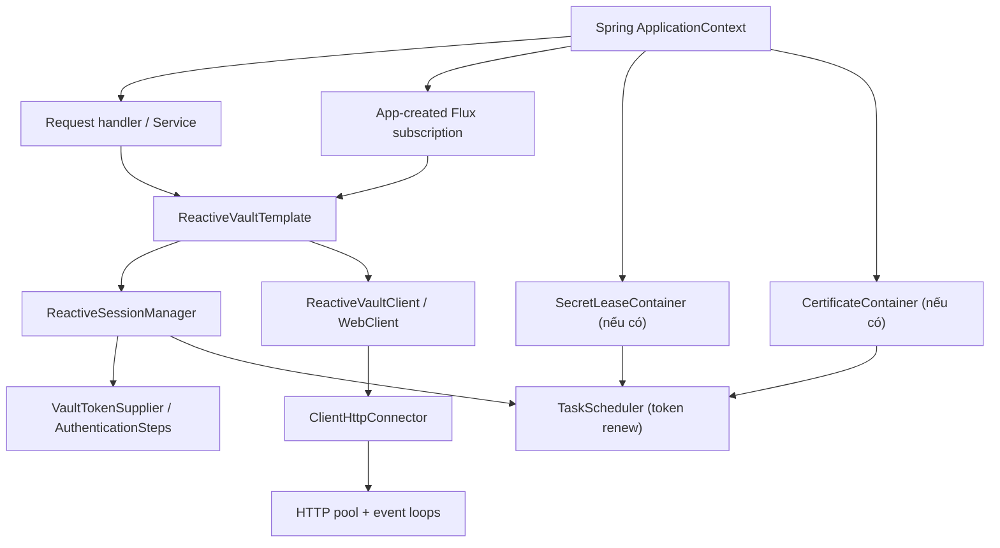
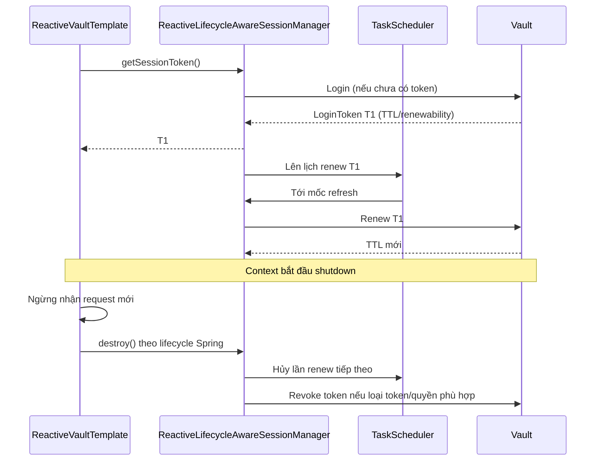
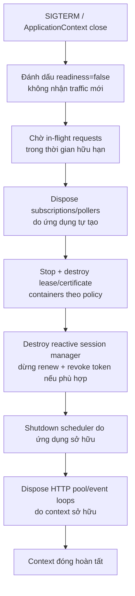

# Đóng client, session manager và tài nguyên nền

Ứng dụng Java dùng **Spring Vault Reactive API** thường không chỉ tạo một `ReactiveVaultTemplate` để đọc KV secrets. Phía sau một lời gọi `Mono`/`Flux` còn có **Vault token đang được gia hạn**, HTTP connection pool, event-loop threads, timer hoặc `TaskScheduler`, các subscription do ứng dụng tự tạo và có thể cả container quản lý **dynamic secret lease** hoặc **chứng thư PKI**. Nếu dừng ứng dụng mà bỏ sót các tài nguyên này, chương trình có thể giữ thread sống, tiếp tục gửi request renew sau khi ngừng phục vụ, làm lộ token qua thời gian tồn tại kéo dài hoặc gây ảnh hưởng đến các ứng dụng dùng chung client.

Bài trong chương **API reactive** tập trung vào câu hỏi: **“Phải đóng cái gì, ai sở hữu nó và đóng theo thứ tự nào?”** Trong module **SPRING_VAULT**, câu trả lời còn liên quan tới xác thực workload, chính sách Vault token, vòng đời token/lease, Transit encryption, PKI, xử lý lỗi, giám sát và kiểm thử tích hợp.

**Thông điệp cốt lõi:** `ReactiveVaultTemplate` không sở hữu tất cả tài nguyên phía dưới. Không có một lệnh `reactiveVaultTemplate.close()` để đóng trọn hệ thống. Phải quản lý riêng **subscription**, **session/token**, **secret/certificate lifecycle**, **scheduler** và **HTTP transport** theo đúng quyền sở hữu của ứng dụng.

## 1. Mục tiêu học tập

Sau bài này, bạn có thể:

1. Phân biệt `ReactiveVaultTemplate`, `ReactiveVaultClient`, `WebClient`, `ReactiveSessionManager` và `ReactiveLifecycleAwareSessionManager`.
2. Xác định thành phần nào có lifecycle `destroy()`, `stop()`, `dispose()`, `revoke()`; thành phần nào không có API đóng riêng.
3. Giải thích vì sao **hủy subscription** khác với **thu hồi Vault token** và khác với **đóng connection pool/event loop**.
4. Thiết kế shutdown có thứ tự để không cắt mạng trước khi revoke token hoặc revoke lease.
5. Dùng `ReactorResourceFactory` quản lý tài nguyên Reactor Netty thuộc riêng một Spring context, tránh đóng nhầm tài nguyên dùng chung.
6. Xử lý tương tác với `SecretLeaseContainer`, `CertificateContainer`, scheduled token renewal và credential một lần.
7. Kiểm thử shutdown trong tình huống request đang bay, Vault mất kết nối, context restart và nhiều context dùng chung HTTP resources.

## 2. Bản đồ tài nguyên và quyền sở hữu



Mỗi mũi tên là quan hệ **sử dụng/phụ thuộc**, không nhất thiết là quan hệ sở hữu. Ví dụ một `WebClient` dùng `Reactor Netty HttpResources` toàn cục, nên việc hủy một Spring bean không đồng nghĩa được phép đóng cả pool đang phục vụ những client khác.

| Thành phần | Vai trò | Cách kết thúc hợp lý |
| --- | --- | --- |
| `ReactiveVaultTemplate` / `ReactiveVaultOperations` | Tạo `Mono`/`Flux` cho KV, Transit, sys... | **Không có `close()` riêng**; ngừng dùng, đóng dependencies do bạn sở hữu |
| `ReactiveVaultClient` (Spring Vault 4.1+) | Client HTTP reactive tới Vault | **Không có `close()` riêng**; lifecycle nằm ở HTTP connector/resources |
| `WebClient` | HTTP client dùng để gửi request | Không có `close()`; xử lý HTTP resources phía dưới |
| `ReactiveSessionManager` | Contract cung cấp/reuse Vault token | Phụ thuộc implementation; không phải mọi manager đều có `destroy()` |
| `ReactiveLifecycleAwareSessionManager` | Login, cache, tự lên lịch renew/re-login | `DisposableBean.destroy()`; hỗ trợ `revoke()` và `revokeNow()` |
| `TaskScheduler` / `ThreadPoolTaskScheduler` | Chạy tác vụ renew token, lease, certificate | Đóng scheduler **do ứng dụng sở hữu**, sau khi ngừng producers |
| `SecretLeaseContainer` | Renew/rotate dynamic secret lease | `stop()` để dừng job; `destroy()` dừng và **revoke lease** theo contract |
| `CertificateContainer` | Theo dõi và xoay vòng chứng thư PKI | `stop()`/`destroy()` để dừng rotation |
| `Disposable` từ `Flux.subscribe(...)` | Subscription do app khởi tạo | Gọi `dispose()`, hoặc cho subscription đi theo lifecycle bean |
| `ReactorResourceFactory` | Quản lý Reactor Netty event loops/pool | Cho Spring quản lý `Lifecycle`/`DisposableBean`; đóng khi context được đóng |

**Quy tắc trách nhiệm:** tài nguyên **do Spring Boot hoặc `AbstractReactiveVaultConfiguration` tạo dưới dạng bean** nên do `ApplicationContext` quản lý. Tài nguyên **tự `new` bên ngoài container** phải có chủ sở hữu và quy trình đóng rõ ràng. Tránh để cùng một tài nguyên vừa bị đóng thủ công vừa bị Spring đóng thêm lần nữa.

## 3. Reactive không có nghĩa là không cần cleanup

Trong Reactor, nhiều phép tính là **lazy**: mã tạo `Mono<VaultResponse>` chưa đồng nghĩa đã gửi HTTP, và `Flux.interval(...)` sẽ tiếp tục phát sự kiện khi subscription còn hoạt động.

```java
import reactor.core.publisher.Mono;
import org.springframework.vault.core.ReactiveVaultOperations;
import org.springframework.vault.support.VaultResponse;

final class ReactiveReadExample {
    Mono<VaultResponse> declareRead(ReactiveVaultOperations vault) {
        // Chỉ tạo publisher, chưa thực hiện HTTP request.
        return vault.read("secret/data/payment/runtime");
    }
}

// Publisher được kích hoạt khi có subscriber.
```

Trong ứng dụng WebFlux, request HTTP của người dùng thường đi cùng một subscription do framework quản lý. Tuy nhiên **job chạy nền** do ứng dụng tự `subscribe()`, chẳng hạn poll Vault 60 giây một lần, cần có handle để hủy.

### Ví dụ subscription cần được đóng khi shutdown

```java
import java.time.Duration;
import org.springframework.beans.factory.DisposableBean;
import org.springframework.vault.core.ReactiveVaultOperations;
import org.springframework.vault.support.VaultResponse;
import reactor.core.Disposable;
import reactor.core.publisher.Flux;
import reactor.core.publisher.Mono;

public final class VaultConfigurationPoller implements DisposableBean {
    private final Disposable polling;

    public VaultConfigurationPoller(ReactiveVaultOperations vault) {
        this.polling = Flux.interval(Duration.ZERO, Duration.ofMinutes(1))
                .concatMap(tick ->
                        vault.read("secret/data/payment/runtime")
                                .doOnError(this::recordErrorSafely)
                                .onErrorResume(error -> Mono.empty()))
                .subscribe(this::applyWithoutLoggingSecrets);
    }

    private void applyWithoutLoggingSecrets(VaultResponse response) {
        // Áp dụng dữ liệu đã kiểm tra; không log payload bí mật.
    }

    private void recordErrorSafely(Throwable error) {
        // Ghi nhóm lỗi, mã trạng thái, request ID (nếu an toàn).
    }

    @Override
    public void destroy() {
        polling.dispose(); // Ngừng phát tick và hủy subscription còn sống.
    }
}
```

Đây là **ví dụ lifecycle của một bean**, không phải khuyến nghị polling một KV v2 secret ở mọi ứng dụng. Nếu class được khai báo bằng `@Bean` hoặc `@Component` dưới quyền Spring, `DisposableBean.destroy()` sẽ được gọi khi context bị đóng.

`dispose()` là **cancellation** ở cấp reactive stream:

- Nó chặn việc tiếp tục nhận tick và bắt đầu những lần gọi kế tiếp.
- Nó **không phải lệnh `POST sys/leases/revoke` hay `auth/token/revoke-self`**.
- Với HTTP request đã được gửi, cancellation **không bảo đảm** Vault chưa xử lý request.
- Reactor scheduler dùng chung cho `Flux.interval` **không do subscription sở hữu**, vì vậy không được gọi lệnh đóng scheduler toàn cục chỉ để tắt một poller.

Nếu có nhiều job, có thể gom các `Disposable` vào `Disposables.composite()` rồi hủy composite một lần khi shutdown. Đừng tự `subscribe()` trong handler WebFlux nếu framework đã có thể quản lý việc subscribe/complete.

## 4. Session manager sở hữu gì?

`ReactiveVaultTemplate` cần Vault token cho request đã xác thực. `ReactiveSessionManager` là interface cung cấp token (`getSessionToken()`; contract `VaultTokenSupplier` có `getVaultToken()`). Hai implementation quan trọng:

- `CachingVaultTokenSupplier`: cache token từ một delegate supplier; không phải lifecycle-aware renewer và **không có `destroy()` riêng** trong API.
- `ReactiveLifecycleAwareSessionManager`: tạo token khi cần, tránh nhiều login trùng trong cùng thời điểm, tự gia hạn token có TTL, phát authentication events và có cleanup qua `DisposableBean`.

Tài liệu Spring Vault 4.1 nêu `ReactiveLifecycleAwareSessionManager` renew token bất đồng bộ **thường khoảng 5 giây trước thời điểm hết hạn** theo refresh trigger mặc định. Cơ chế thực tế còn chịu TTL, refresh configuration, lỗi HTTP và loại token.



**Không nhầm “ngừng tạo request mới” với “thu hồi token”.** Token có thể còn được dùng bởi nhiều tiến trình nếu ứng dụng tự cấu hình dùng chung; thu hồi sai token sẽ làm ảnh hưởng bên ngoài process hiện tại.

## 5. `destroy()`, `revoke()` và `revokeNow()` khác nhau

Spring Vault 4.1 có API:

```java
final class SessionShutdownExample {
    Mono<Void> declareRevocation(ReactiveLifecycleAwareSessionManager manager) {
        // Mono<Void>: lazy; chỉ chạy khi được subscribe/chờ có kiểm soát.
        return manager.revoke();
    }
}

// manager.revokeNow(): chủ động thu hồi theo API blocking.
// manager.destroy(): Spring gọi khi đóng bean DisposableBean.
```

| API | Ý nghĩa | Khi dùng |
| --- | --- | --- |
| `destroy()` | Cleanup session manager khi bean bị destroy; dừng renew, thực hiện revocation theo contract | **Ưu tiên để Spring gọi tự động** nếu là bean container-managed |
| `revoke()` | Trả `Mono<Void>` để thu hồi và bỏ token hiện tại | Khi muốn gắn một bước revoke **vào một chuỗi reactive có subscription** |
| `revokeNow()` | Yêu cầu revoke và chờ theo API đồng bộ/blocking | Chỉ dùng từ **shutdown coordinator không chạy trên event loop** nếu thực sự cần |
| `getVaultToken()` | Cấp token, có thể login mới nếu chưa có token | **Không gọi để kiểm tra trước khi đóng** vì có thể tạo login không mong muốn |

Theo Javadoc, session manager chỉ tự **revoke token được `VaultTokenSupplier` cung cấp nếu đó là service token**. Batch token có các giới hạn revocation khác; không kết luận `destroy()` sẽ thu hồi mọi loại token.

### Tính quan trọng của quyền sở hữu token

Phân biệt hai trường hợp:

1. **Ứng dụng nhận token service riêng qua AppRole/Kubernetes/AWS**, chính token này được manager giữ và quản lý. Cleanup có thể thu hồi nó khi process dừng.
2. **Ứng dụng dùng token service dùng chung/được cấp sẵn từ bên ngoài**, ví dụ một token chung cho nhiều replica. Tự động thu hồi token tại shutdown của một replica có thể làm các replica khác mất quyền, và có thể ảnh hưởng các lease phụ thuộc.

Thiết kế xác thực nên **tránh chia sẻ login token giữa nhiều workload**, nhưng nếu có, phải xác định rõ lifecycle owner và không mặc định tạo một manager sẽ revoke khi context đóng. Để an toàn, dùng token riêng có TTL ngắn và đúng policies cho từng workload.

### Vì sao không gọi `.block()` trong event loop?

`revokeNow()` có thể đợi HTTP response; gọi từ một Reactor Netty event-loop thread có thể làm nghẽn I/O hoặc gây exception nếu Reactor phát hiện blocking. Nếu quy trình shutdown không thể tránh bước chờ, **chỉ thực hiện ở shutdown thread không phải event loop**, có timeout, lỗi được ghi nhận và **để HTTP client còn sống trong thời gian revoke**.

Không gọi đồng thời `manager.revoke().subscribe()` rồi lập tức đóng `ReactorResourceFactory`: vì subscription bất đồng bộ chưa chắc hoàn thành trước khi connection pool bị hủy. Nếu cần chờ revoke chủ động, hãy **đợi terminal signal trong thời gian hữu hạn** trong shutdown coordinator, hoặc để Spring quản lý thứ tự destroy đúng dependency.

## 6. Bean lifecycle: để Spring đóng đúng đối tượng

Khi dùng `AbstractReactiveVaultConfiguration` hoặc Spring Boot/Spring Cloud Vault auto-configuration, framework đã khai báo phần lớn các bean liên quan: `ReactiveVaultTemplate`, `ReactiveSessionManager`, scheduler và client HTTP. Hãy ưu tiên **đóng `ApplicationContext`** thay vì tự tìm và gọi `destroy()` lên từng bean.

`ReactiveLifecycleAwareSessionManager` triển khai `DisposableBean`, nghĩa là nếu nó là bean do Spring quản lý, Spring sẽ gọi `destroy()` trong quá trình đóng context. `ThreadPoolTaskScheduler` và `ReactorResourceFactory` cũng có lifecycle khi được quản lý bằng Spring.

### Ví dụ một session manager được Spring sở hữu

```java
import org.springframework.context.annotation.Bean;
import org.springframework.context.annotation.Configuration;
import org.springframework.scheduling.TaskScheduler;
import org.springframework.vault.authentication.ReactiveLifecycleAwareSessionManager;
import org.springframework.vault.authentication.VaultTokenSupplier;
import org.springframework.vault.client.ReactiveVaultClient;

@Configuration(proxyBeanMethods = false)
class ReactiveVaultSessionConfig {

    @Bean
    ReactiveLifecycleAwareSessionManager vaultReactiveSessionManager(
            VaultTokenSupplier authenticationFlow,
            TaskScheduler vaultTaskScheduler,
            ReactiveVaultClient vaultClient) {

        // Spring sở hữu bean và sẽ gọi DisposableBean.destroy().
        return new ReactiveLifecycleAwareSessionManager(
                authenticationFlow, vaultTaskScheduler, vaultClient);
    }
}
```

Đây là **một cấu hình bộ phận**, giả định `VaultTokenSupplier`, `TaskScheduler` và `ReactiveVaultClient` đã có bean phù hợp. Constructor dùng `ReactiveVaultClient` xuất hiện từ **Spring Vault 4.1**; các bản cũ hơn dùng overload `WebClient`. **Không khai báo thêm bean này nếu auto-configuration đã tạo một `ReactiveSessionManager`**; tránh có hai nơi sở hữu cùng một Vault token.

Để quản lý scheduler riêng bằng Spring, có thể khai báo:

```java
import org.springframework.context.annotation.Bean;
import org.springframework.scheduling.concurrent.ThreadPoolTaskScheduler;

@Bean
ThreadPoolTaskScheduler vaultTaskScheduler() {
    ThreadPoolTaskScheduler scheduler = new ThreadPoolTaskScheduler();
    scheduler.setPoolSize(1);
    scheduler.setThreadNamePrefix("vault-session-");
    scheduler.setRemoveOnCancelPolicy(true);
    return scheduler; // Spring xử lý init/shutdown của bean.
}
```

Trong project thực, đặt method này **bên trong class `@Configuration`**. Chỉ tạo scheduler riêng nếu có lý do; một scheduler do Spring quản lý có thể được **chia sẻ có chủ đích** bởi nhiều thành phần, và không được shutdown trước khi mọi renew job dùng nó đã dừng.

**Spring `ApplicationContext.stop()` khác `close()`:**

- `stop()` dừng các `Lifecycle`/`SmartLifecycle` beans, nhưng không đồng nghĩa mọi `DisposableBean.destroy()` đều được gọi.
- `close()` thực hiện shutdown context, bao gồm dừng lifecycle beans và giai đoạn hủy bean/cleanup.
- Vì vậy, nếu cần chắc chắn kết thúc token renewal và đóng HTTP resources, phải thiết kế quy trình **đóng context** hoặc chủ động điều phối các resource đã tạo ngoài Spring.

## 7. HTTP client reactive thực sự sở hữu thread và pool

`ReactiveVaultClient` (trong Spring Vault 4.1+) là API bao bọc request reactive dựa trên `WebClient`. `ReactiveVaultTemplate` cũng sử dụng client HTTP reactive. Nhưng `WebClient` và template **không có phương thức `close()`** để hủy hết event loops và connection pools.

Trong cấu hình Reactor Netty, tài nguyên nằm ở:

- **`ConnectionProvider` / HTTP connection pool:** duy trì kết nối TCP/TLS nhàn rỗi cho nhiều request.
- **`LoopResources` / event loops:** xử lý network I/O.
- **`HttpResources` toàn cục:** tài nguyên Reactor Netty có thể được chia sẻ giữa các `WebClient` và cả WebFlux server.
- **`ReactorResourceFactory`:** bean Spring hỗ trợ quản lý toàn bộ hoặc tài nguyên riêng theo vòng đời context.

### Hai mô hình sở hữu HTTP resources

| Mô hình | Tính chất | Cách đóng |
| --- | --- | --- |
| **Global Reactor Netty resources** (mặc định ở nhiều cấu hình) | Chia sẻ event loops và pool, hiệu quả cho process có nhiều clients | Thường sống tới khi process kết thúc; nếu dùng `ReactorResourceFactory` với `useGlobalResources=true`, Spring có thể quản lý shutdown global lúc context đóng |
| **Dedicated resources** (`useGlobalResources=false`) | Một pool/event loops riêng do factory tạo cho ứng dụng/nhóm clients | Đóng `ReactorResourceFactory` **do context sở hữu** sau khi dừng request và token/lease cleanup |

**Không tự gọi `HttpResources.disposeLoopsAndConnections()` trên global resources khi có ứng dụng/client khác vẫn dùng.** Tương tự, không tự dispose một `ConnectionProvider` được share bởi những service khác.

### Cấu hình resources riêng bằng Spring bean

Ví dụ dùng **Spring Framework với Reactor Netty**:

```java
import java.time.Duration;
import org.springframework.context.annotation.Bean;
import org.springframework.context.annotation.Configuration;
import org.springframework.http.client.ReactorResourceFactory;
import org.springframework.http.client.reactive.ClientHttpConnector;
import org.springframework.http.client.reactive.ReactorClientHttpConnector;

@Configuration(proxyBeanMethods = false)
class VaultHttpResourcesConfig {

    @Bean
    ReactorResourceFactory vaultNettyResources() {
        ReactorResourceFactory factory = new ReactorResourceFactory();
        factory.setUseGlobalResources(false);
        return factory; // Spring quản lý lifecycle của pool/event loops.
    }

    @Bean
    ClientHttpConnector vaultConnector(
            ReactorResourceFactory vaultNettyResources) {
        return new ReactorClientHttpConnector(
                vaultNettyResources,
                http -> http.responseTimeout(Duration.ofSeconds(5)));
    }
}
```

**Quan trọng:** connector `vaultConnector` chỉ có ý nghĩa với các Vault clients **được cấu hình sử dụng chính connector này**. Tự tạo bean mà không nối vào `ReactiveVaultClient`/`ReactiveVaultTemplate` sẽ không tự đổi connector hiện hành. Khi Spring Boot đã cấu hình `ReactorResourceFactory` và `WebClient.Builder` dùng chung, cần tránh ghi đè tài nguyên của toàn server ngoài ý muốn; cân nhắc `@Qualifier` và quyền sở hữu rõ ràng.

Nếu dùng Jetty thay Reactor Netty, tầng HTTP có `JettyResourceFactory` hoặc lifecycle của Jetty `HttpClient` tương ứng. Chỉ dừng tài nguyên khi bạn thực sự sở hữu chúng; không suy rằng mọi connector của WebClient đều dùng Netty.

### Tài nguyên toàn cục trong môi trường có nhiều context

Với ứng dụng WebFlux Spring Boot chạy cả server và Vault client trên Reactor Netty, một lệnh dispose global có thể **làm gián đoạn server**. Đặc biệt ở integration tests khi tạo/đóng nhiều Spring context trong cùng JVM, đóng global HTTP resources không đúng thời điểm có thể làm các context khác lỗi “event loop disposed” hoặc timeout.

Kiểm tra từng tình huống:

1. Một context sở hữu toàn bộ ứng dụng và HTTP resources → đóng cùng context.
2. Hai context chia sẻ global resources → không cho một context tùy tiện dispose thay context khác.
3. Một thư viện tự tạo `HttpClient`/`ConnectionProvider` riêng → chính thư viện phải có API lifecycle hoặc bên gọi quản lý resource; không đẩy trách nhiệm sang `ReactiveVaultTemplate`.

## 8. Tài nguyên nền: scheduler, lease và chứng thư

Từ góc nhìn reactive app, không phải mọi công việc liên quan Vault đều được thực thi reactive end-to-end.

### Scheduler gia hạn Vault token

`ReactiveLifecycleAwareSessionManager` cần `TaskScheduler` để lên lịch renew. Nếu scheduler chạy sau khi manager đã bị hủy, sẽ có nguy cơ callback trễ hoặc lỗi khi client HTTP không còn sẵn sàng. Vì vậy cần **hủy lịch renew** qua lifecycle của manager trước khi ngừng scheduler mà nó sử dụng.

### Dynamic secret lease

Nếu ứng dụng đồng thời dùng `SecretLeaseContainer` (ví dụ quản lý `database/creds/reporting`):

- `stop()`: dừng renew/rotation và phát sự kiện; **không revoke lease chỉ vì stop**.
- `destroy()`: shutdown container, **disable lease renewal và revoke các lease do container quản lý** theo contract.
- Container sử dụng `VaultOperations` kiểu imperative cho API lease trong các phiên bản Spring Vault thông thường; **không chạy `destroy()` blocking của container trên Reactor event loop**.
- Nếu muốn revoke lease lúc shutdown, HTTP transport và Vault token tương ứng phải còn khả dụng trong giai đoạn revoke.

### PKI certificates

`CertificateContainer` (Spring Vault 4.1+) hỗ trợ đăng ký và xoay vòng chứng thư từ Vault PKI. `stop()`/`destroy()` dừng rotation; **không đồng nghĩa X.509 certificate đã phát hành trước đó lập tức bị thu hồi trong PKI backend**. Khi cần thu hồi chứng thư, phải có quy trình revoke phù hợp với PKI issuer/serial.

### Transit encryption

Các lời gọi `ReactiveVaultTemplate.opsForTransit(...)` được thực hiện khi subscribe và hoàn tất theo request; kết quả encryption không có dynamic database-style lease cần một scheduler rotation riêng. Tuy nhiên **các subscription do ứng dụng tự tạo** vẫn cần hủy, và token/transport vẫn có lifecycle như những API khác.

| Tài nguyên nền | Khi dừng | Lưu ý |
| --- | --- | --- |
| Vault token refresh task | Hủy qua session manager | Chỉ revoke token khi token thuộc quyền sở hữu phù hợp |
| Secret lease renewal task | `SecretLeaseContainer.stop()/destroy()` | `destroy()` có thể gọi Vault để revoke lease |
| PKI certificate rotation task | `CertificateContainer.stop()/destroy()` | Dừng local rotation khác việc revoke chứng thư ở CA |
| `Flux.interval`/custom retry stream | `Disposable.dispose()` | Cancellation không hủy request đã hoàn thành ở Vault |
| Scheduler tự tạo | `shutdown()` sau khi producer dừng | Không shutdown scheduler dùng chung với service khác |
| Reactor Netty pool/event loops | Context/`ReactorResourceFactory` đóng | Không dispose global trong khi context khác còn dùng |

## 9. Thứ tự shutdown đề xuất

Không có một thứ tự duy nhất phù hợp mọi ứng dụng. Với dịch vụ có **token riêng**, **dynamic lease riêng**, và **HTTP client/pool riêng**, thứ tự mục tiêu hợp lý như sau:



**Vì sao tài nguyên HTTP phải còn sống tương đối lâu?** Thu hồi token và lease là các request gửi đến Vault. Nếu dispose connection pool trước, cleanup sẽ không thể hoàn tất bình thường.

**Vì sao lease trước token?** Nếu Vault token đã bị thu hồi, request revoke lease có thể thất bại. Ngoài ra, revoke token có thể dẫn tới revoke các lease phụ thuộc, nhưng không nên mặc định đó là thay thế phù hợp cho mọi quy trình cleanup và audit. Khi ứng dụng dùng **static/shared token**, hãy áp dụng policy ownership khác: không tự revoke token dùng chung.

**Vì sao dừng traffic trước?** Request chưa hoàn tất có thể đang cần Vault token hoặc credential sống. Nếu revoke khi vẫn nhận request mới, ứng dụng sẽ tự tạo loạt lỗi 403/permission denied.

### Spring có tự bảo đảm chính xác thứ tự trên?

Không hoàn toàn. Spring sẽ quản lý `SmartLifecycle`, `DisposableBean` và destruction dependencies, nhưng thứ tự giữa các bean **độc lập** không nhất thiết chính là timeline mong muốn ở trên. Cần:

- Thiết lập dependencies rõ ràng (`@DependsOn` hoặc cấu trúc bean sở hữu/phụ thuộc phù hợp), tránh chu kỳ phụ thuộc.
- Dùng `SmartLifecycle` với phase thích hợp cho thành phần cần quiesce và drain trước khi destroy.
- Thiết kế một shutdown coordinator nếu yêu cầu **thứ tự revoke lease → revoke token → shutdown HTTP** là bắt buộc, nhất là khi có bước async cần đợi hoàn thành.
- Không gọi `destroy()` hai lần; đừng vừa để Spring tự hủy manager vừa gọi thủ công trong `@PreDestroy` của bean khác mà không có thiết kế idempotency.

### Cấu hình graceful shutdown của Spring Boot

```yaml
server:
  shutdown: graceful

spring:
  lifecycle:
    timeout-per-shutdown-phase: 30s
```

Cấu hình này giúp **web server** có thời gian xử lý các request đang chạy trong một giai đoạn shutdown. Nó **không tự động dispose** những background subscriptions tự tạo, không bảo đảm gọi revoke thành công khi Vault đang mất kết nối và không đảm bảo thứ tự bean destroy tùy ý. Nên chọn giới hạn thời gian theo deployment, ví dụ Kubernetes `terminationGracePeriodSeconds` và thời gian tối đa của request.

## 10. Shutdown coordinator và hành vi khi timeout

Trong một ứng dụng có thứ tự cleanup đặc biệt, tách trách nhiệm như sau:

```text
shutdown() {
    markNotReady()
    stopAcceptingNewWork()
    awaitInFlightRequestsUpTo(deadline)
    disposeOwnedReactorSubscriptions()

    stopAndDestroyOwnedLeaseContainers()  // Có thể gọi Vault
    stopAndDestroyOwnedCertificateContainers()
    destroyOwnedReactiveSessionManager()   // Có thể revoke service token

    shutdownOwnedSchedulers()
    shutdownOwnedHttpResourcesLast()
}
```

Đây là **pseudocode minh họa thứ tự**, không phải API Java `shutdown()` có sẵn của Spring Vault.

Một số lưu ý:

- **Giới hạn thời gian** cho mọi bước network. Nếu Vault down, ứng dụng cần tiến tới shutdown có thể dự đoán được; log/audit lỗi cleanup để điều tra.
- **Không tự động retry revoke vô hạn.** Nếu không thể revoke, TTL và quy trình vận hành cần giới hạn thời gian credential còn hiệu lực.
- **Không thực thi cleanup blocking trong Netty event loop.** Nếu dùng `revokeNow()` hoặc `destroy()` đồng bộ, hãy thực thi từ shutdown thread.
- **Không tự tạo một login mới chỉ để revoke khi shutdown.** Đừng gọi `getSessionToken()` để “kiểm tra token” ở cuối vòng đời.
- **Idempotency:** nếu shutdown bị gọi hai lần (context close rồi signal handler khác), tránh tạo request revoke trùng và đóng resource đã bị dispose một cách không kiểm soát.

### Đảm bảo subscription được xử lý xong khi cần

`Disposable.dispose()` yêu cầu hủy, nhưng không có nghĩa tất cả side effect đã hoàn tất trước thời điểm hàm trả về. Nếu job đang xử lý một state transition quan trọng, cân nhắc có `Mono<Void>` đại diện cho bước hoàn tất và đợi terminal signal có timeout. Với thao tác hủy subscription, cancellation vẫn có thể khiến HTTP request đã được gửi tới Vault được server xử lý.

Nếu dùng `manager.revoke()`:

```java
import java.time.Duration;
import reactor.core.publisher.Mono;

Mono<Void> cleanup =
        manager.revoke()
               .timeout(Duration.ofSeconds(4));

// Chỉ trong shutdown coordinator KHÔNG phải event-loop:
// cleanup.block(Duration.ofSeconds(5));
//
// Nếu để Spring tự gọi destroy(), không gọi thêm cleanup trên.
```

Mã trên **không tự thực thi** cho tới khi subscribe hoặc block. Timeout phải hợp lý với Vault endpoint và policy của ứng dụng; khi timeout, không coi token đã được revoke thành công. `destroy()` của manager vẫn là lựa chọn mặc định cho bean do Spring sở hữu.

## 11. Token ownership, ACL và tác động lên lease

Ví dụ ứng dụng đăng nhập Vault bằng AppRole hoặc Kubernetes và nhận token `T1`, rồi lấy dynamic database credential có lease `L1`. Khi shutdown:

1. Dừng dùng `L1` ở các request mới; hoàn thành hoặc huỷ giao dịch cũ theo policy.
2. `SecretLeaseContainer.destroy()` có thể cố revoke lease `L1`.
3. `ReactiveLifecycleAwareSessionManager.destroy()` có thể revoke token service `T1` nếu manager được cấp quyền sở hữu tương ứng.
4. Vault token revocation có thể ảnh hưởng **child tokens và leases** của token đó tùy quan hệ và loại token.

Nếu hai replica chia sẻ token `T1`, replica A dừng và revoke `T1` sẽ có thể làm replica B lỗi dù nó còn đang chạy. Vì vậy **token riêng cho từng workload instance** và chính sách TTL/renew phù hợp là một phần của thiết kế shutdown.

| Loại tài nguyên | Tác động khi revoke/destroy | Không nên suy luận |
| --- | --- | --- |
| Vault login **service token** do manager sở hữu | Có thể bị revoke khi manager bị hủy | Không phải mọi token luôn bị revoke |
| Vault **batch token** | Giới hạn revocation khác service token | `destroy()` chắc chắn xóa batch token |
| Dynamic secret lease | Container có thể revoke lease khi destroy | `stop()` cũng revoke lease |
| PKI certificate | Container dừng rotation local | Certificate đã được revoke bởi CA |
| KV v2 static secret | Không có database-style lease tự động | Đóng client sẽ xóa secret trong Vault |
| Transit ciphertext/key | Không có lease kiểu database trên mỗi encrypt | Đóng session xóa key material trong Vault |

**Phân quyền tối thiểu:** client cần `read` ở endpoint KV v2 hoặc `database/creds/...` khi cần; quyền renew/revoke token/lease phải theo cơ chế mà Vault hỗ trợ. Không cấp `root` hay quyền `sys/leases/*` toàn cục chỉ để chắc chắn shutdown thành công. Với token do bên ngoài sở hữu, không mặc định thu hồi khi process dừng.

## 12. Các lỗi thường gặp khi shutdown

| Triệu chứng | Nguyên nhân có thể | Cách xử lý |
| --- | --- | --- |
| JVM không thoát sau khi đóng server | Custom scheduler, event loops hoặc `Flux.interval` subscription còn hoạt động | Kiểm tra thread dump; để Spring sở hữu scheduler/resources và dispose polling |
| Ứng dụng còn gọi Vault sau SIGTERM | Polling chưa bị hủy, renew task chưa ngừng | Dừng producers/subscriptions trước khi đóng manager/client |
| Revoke token thất bại “connection closed” | HTTP resources đã bị dispose trước | Giữ transport đến cuối, cấu hình dependency/order |
| Replica khác lỗi 403 khi một replica shutdown | Cùng sử dụng token service được revoke bởi replica đã dừng | Cấp token riêng mỗi replica, xác định ownership |
| Test context thứ hai lỗi Netty event loop disposed | Test đầu đóng global Reactor Netty resources dùng chung | Dùng factory/context ownership phù hợp; không dispose global tùy tiện |
| `manager.revoke()` dường như không chạy | Mono được tạo nhưng không subscribe | Compose/subscribe một lần hoặc dùng lifecycle destroy |
| Startup sau restart có login lại bất ngờ | Không quản lý bootstrap credential dùng một lần | Thiết kế cấp credential mới, tránh reuse wrapping token cũ |
| Shutdown kéo dài quá hạn | Vault không phản hồi, retry vô hạn, scheduler không tắt | Timeout, bounded retry, metric và fallback theo policy |
| Lease revoke không thành công | Vault token đã bị revoke trước, backend không sẵn sàng | Đổi thứ tự cleanup; quan sát TTL và thực hiện remediation |
| Mọi request mới lỗi khi chuẩn bị đóng | Token bị revoke trong khi ingress vẫn chấp nhận request | Mark not ready, quiesce rồi mới revoke |
| Polling/refresh leak khi hot reload | Resource do library tự tạo không được hủy | Mỗi context có owner, `DisposableBean` và test repeated start/stop |

### Những chỉ số nên theo dõi

- `vault_token_renew_attempts_total`, `vault_token_renew_errors_total`.
- `vault_token_revoke_attempts_total`, `vault_token_revoke_errors_total` và kết quả cleanup.
- `vault_shutdown_inflight_requests`, thời gian drain, số task nền còn chạy.
- Số **Reactor Netty active connections**/pending connections nếu connector cung cấp metrics.
- Số scheduler threads còn sống sau context close trong integration test.
- `vault_secret_lease_revoke_errors_total` khi có dynamic leases.
- Số lượng subscription do ứng dụng tạo/đã dispose.

Không log `X-Vault-Token`, dữ liệu response `VaultResponse` chứa secret, certificate private key, secret lease payload hoặc credential ở bất kỳ mức log nào. Khi ghi audit, dùng request ID, token accessor nếu chính sách cho phép và loại sự kiện; tránh labels metrics có cardinality cao hoặc lộ dữ liệu.

## 13. Thiết kế kiểm thử tích hợp cho cleanup

Nên kiểm thử với **Vault test server** và môi trường Spring tách biệt production, cùng fake HTTP server để mô phỏng shutdown khi Vault mất kết nối.

| Kịch bản | Thiết lập | Kỳ vọng |
| --- | --- | --- |
| 1. Context close cơ bản | Spring sở hữu `ReactiveLifecycleAwareSessionManager` | `destroy()` được thực thi theo bean lifecycle |
| 2. Token service riêng | Login token renewable, context close | Renew dừng; token được revoke nếu contract/permission cho phép |
| 3. Batch token | Token type batch | Không giả định revoke tương đương service token |
| 4. Token shared giữa replicas | Hai clients cùng bearer token | Phát hiện rủi ro; thiết kế không cho replica này revoke của replica kia |
| 5. Polling stream | `Flux.interval` đã subscribe | Sau dispose không có tick/request mới |
| 6. Request đang bay | Vault HTTP response bị delay | Graceful stop đợi bounded; không revoke quá sớm |
| 7. Vault down lúc revoke | Mô phỏng 5xx/timeout | Shutdown có timeout, ghi error; không treo vô hạn |
| 8. Dedicated Netty resources | `ReactorResourceFactory(useGlobalResources=false)` | Pool/event loops dừng khi context đóng |
| 9. Shared global Netty resources | Hai Spring contexts dùng chung | Một context close không được phá context khác khi ownership chưa được thiết kế |
| 10. Secret lease container | Dynamic lease được quản lý | `stop()` ngừng renew; `destroy()` cố revoke lease |
| 11. CertificateContainer | PKI rotation được bật | Khi destroy không còn công việc rotate mới |
| 12. Context restart nhiều lần | Start/close 10 lần trong cùng JVM | Không tăng vĩnh viễn số thread, subscription, pool |
| 13. Reactive cleanup lazy | Tạo `manager.revoke()` nhưng không subscribe | Không gọi revoke; test bắt lỗi thiết kế này |
| 14. Session renew gần shutdown | Refresh task scheduled đúng lúc close | Không tiếp tục login/retry vô hạn sau khi đóng |
| 15. Invalid or expired bootstrap token | Token khởi tạo một lần bị dùng lại | Phân loại lỗi; không retry vô hạn hoặc dùng token rỗng |

### Assertions cần tập trung

```text
start application context (test Vault + dedicated HTTP resources)
obtain a Vault token through ReactiveSessionManager
subscribe to one application-owned periodic task
assert request to KV works and token has expected policy

initiate graceful shutdown:
    mark application as not ready
    wait for in-flight operations (bounded)
    close ApplicationContext

assert no further periodic Vault requests occur
assert no token renewal tasks remain active
assert dedicated client event loops/pools can shut down
assert token revocation result matches actual token type/ownership
assert no credentials appear in logs
```

Đây là **pseudocode**, không phải một file JUnit chạy độc lập. Không nên kiểm tra thiếu thread bằng việc đếm tất cả thread của JVM, vì Reactor/Spring có tài nguyên chia sẻ ngoài ứng dụng; cần quan sát thread names, resource ownership và metric của các pool do test tạo.

Khi dùng `StepVerifier`, có thể chứng minh một `Mono`/`Flux` hoàn tất hay bị cancel. Nhưng test cancellation ở Reactor **không chứng minh** Vault đã revoke token hoặc lease; điều đó cần xác minh qua Vault API/audit trong test environment.

## 14. Checklist trước khi triển khai production

| Câu hỏi | Tiêu chí đạt |
| --- | --- |
| Ai tạo `ReactiveVaultTemplate`? | Spring bean hay chủ sở hữu rõ ràng |
| Ai giữ token? | `ReactiveSessionManager` được xác định, token không dùng chung vô tình |
| Ai hủy lịch renew? | `ReactiveLifecycleAwareSessionManager` có lifecycle đúng |
| Có tự tạo `subscribe()` không? | Mọi subscription lâu dài có `Disposable`/owner |
| Ai sở hữu scheduler? | Không đóng scheduler chung quá sớm |
| Có dynamic database lease/PKI không? | `SecretLeaseContainer`/`CertificateContainer` được dừng đúng cách |
| HTTP connector nào đang dùng? | Biết Netty/Jetty và pool/event loop owner |
| HTTP resources global hay dedicated? | Có chính sách đóng phù hợp context |
| Khi Vault down lúc shutdown? | Có timeout, alert và không treo vô hạn |
| Replica có dùng chung token không? | Tránh revoke token của workload khác |
| Có in-flight requests không? | Drain bounded và readiness trước revocation |
| Có kiểm thử repeated context close? | Không leak scheduler/subscription/connection pool |

**Tổng kết:** Spring Vault reactive đòi hỏi phân biệt rõ **“hủy subscription”**, **“kết thúc session và có thể revoke token”**, **“dừng renewal/rotation lease”** và **“đóng HTTP resources”**. `ReactiveVaultTemplate` chỉ là điểm vào API; shutdown đúng cần dựa trên **lifecycle của các bean và ownership của từng tài nguyên**. Với token/lease riêng và HTTP pool riêng, hãy **dừng traffic → drain request → dispose jobs → cleanup lease → cleanup token → shutdown scheduler → đóng HTTP pool cuối cùng**. Khi dùng Spring Boot auto-configuration, ưu tiên để `ApplicationContext` quản lý các bean, chỉ bổ sung coordinator khi có thứ tự đặc biệt và xác minh bằng integration test.

## Tài liệu tham khảo

- [Spring Vault Reference — Reactive Infrastructure và Session Management](https://docs.spring.io/spring-vault/reference/vault/reactive-template.html)
- [Spring Vault API — ReactiveVaultTemplate](https://docs.spring.io/spring-vault/reference/api/java/org/springframework/vault/core/ReactiveVaultTemplate.html)
- [Spring Vault API — ReactiveVaultClient (4.1+)](https://docs.spring.io/spring-vault/reference/api/java/org/springframework/vault/client/ReactiveVaultClient.html)
- [Spring Vault API — ReactiveSessionManager](https://docs.spring.io/spring-vault/reference/api/java/org/springframework/vault/authentication/ReactiveSessionManager.html)
- [Spring Vault API — ReactiveLifecycleAwareSessionManager](https://docs.spring.io/spring-vault/reference/api/java/org/springframework/vault/authentication/ReactiveLifecycleAwareSessionManager.html)
- [Spring Vault API — AbstractReactiveVaultConfiguration](https://docs.spring.io/spring-vault/reference/api/java/org/springframework/vault/config/AbstractReactiveVaultConfiguration.html)
- [Spring Vault API — SecretLeaseContainer](https://docs.spring.io/spring-vault/reference/api/java/org/springframework/vault/core/lease/SecretLeaseContainer.html)
- [Spring Vault API — CertificateContainer](https://docs.spring.io/spring-vault/reference/api/java/org/springframework/vault/core/certificate/CertificateContainer.html)
- [Spring Framework — WebClient Configuration: Reactor Netty Resources](https://docs.spring.io/spring-framework/reference/web/webflux-webclient/client-builder.html)
- [Spring Framework API — ReactorResourceFactory](https://docs.spring.io/spring-framework/docs/current/javadoc-api/org/springframework/http/client/ReactorResourceFactory.html)
- [Spring Boot — Reactive Web Applications: Server Resources](https://docs.spring.io/spring-boot/reference/web/reactive.html)
- [Reactor Core — Disposable và Disposables](https://projectreactor.io/docs/core/release/api/reactor/core/Disposables.html)
