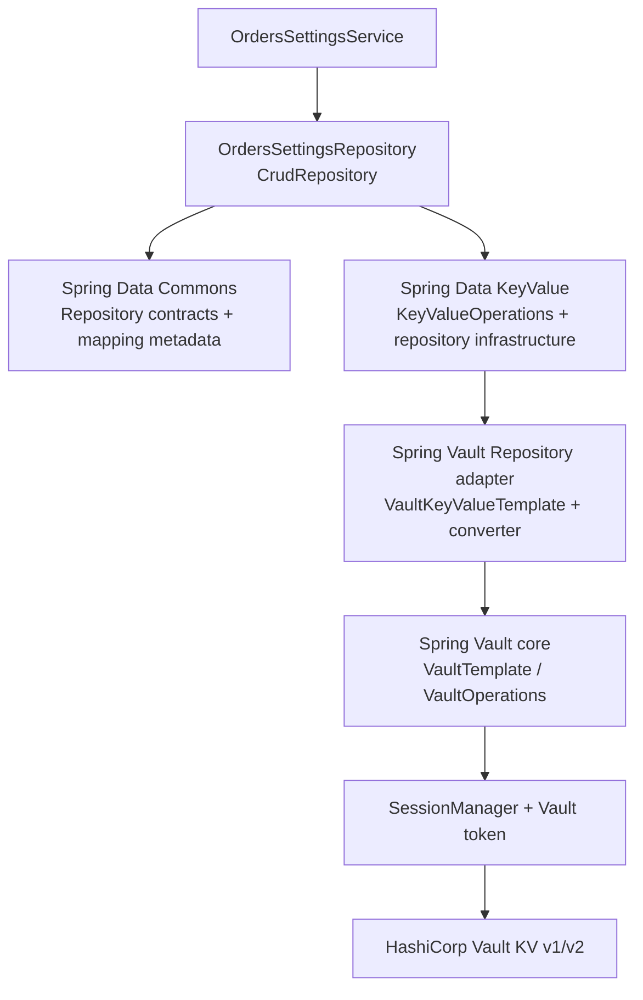
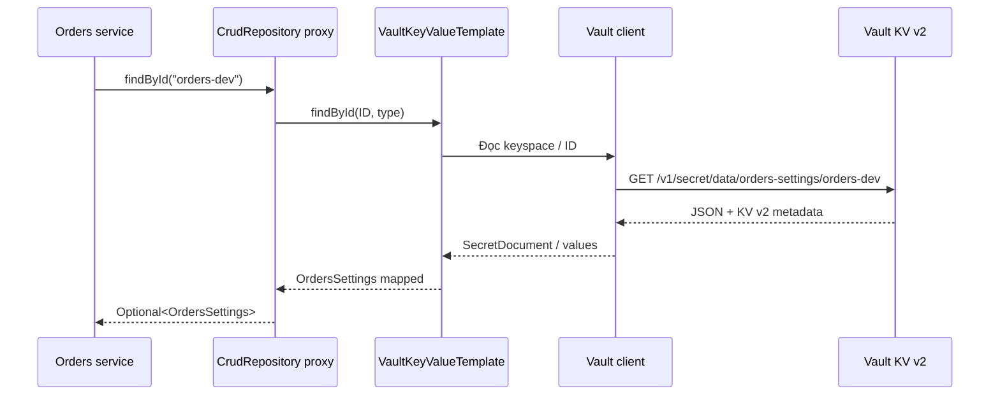
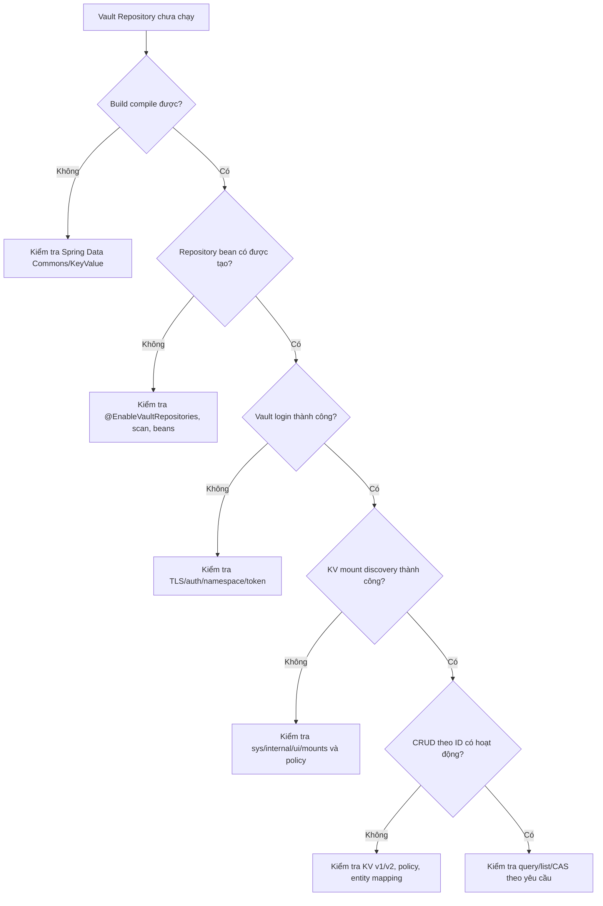

# Phụ thuộc Spring Data Commons và Spring Data KeyValue trong Vault Repository

## 1. Vấn đề: có Spring Vault rồi, tại sao Repository vẫn chưa hoạt động?

**Spring Vault** cung cấp `VaultTemplate` và `VaultOperations` để ứng dụng Java tương tác với HashiCorp Vault: đọc KV secrets, làm việc với token/lease, Transit encryption và PKI. Tuy nhiên, khi muốn thao tác dữ liệu KV theo phong cách Spring Data như `CrudRepository<Settings, String>`, bạn cần thêm **các thư viện Spring Data**.

Ví dụ, một service quản lý những tài liệu cấu hình thử nghiệm dưới KV secrets engine có thể muốn gọi:

```java
OrdersSettings settings = repository.findById("orders-dev")
    .orElseThrow();
repository.save(settings);
repository.deleteById("orders-dev");
```

Câu hỏi thiết kế không chỉ là "dùng annotation nào", mà là:

- Vì sao `spring-vault-core` không tự bảo đảm có đầy đủ Spring Data repository infrastructure?
- `spring-data-commons` cung cấp phần nào, `spring-data-keyvalue` cung cấp phần nào?
- Thêm dependency bằng Maven/Gradle ra sao mà không trộn các phiên bản Spring Data?
- Khi đã biên dịch được, ứng dụng cần thêm cấu hình, Vault policy và secrets engine gì để chạy thật?
- Giới hạn truy vấn, KV v2, optimistic locking và sự khác biệt với `VaultTemplate` nằm ở đâu?

Bài thuộc chương **Vault Repository** của module **SPRING_VAULT**, tập trung vào kiến trúc dependency, cách khai báo, kiểm tra classpath và kết nối các lớp abstraction với Vault thật. Ví dụ dùng **Vault KV v2** cho dữ liệu test, không ngầm áp dụng repository cho mọi engine (Transit, PKI, Database dynamic secrets).

## 2. Ba tầng của Vault Repository

Có thể hình dung cấu trúc như sau:



Sơ đồ mô tả **vai trò khái niệm**, không phải thứ tự lời gọi bytecode cố định: Spring Vault triển khai repository adapter/mapping, Spring Data Commons và KeyValue cung cấp nền tảng, còn HTTP request thực tới Vault đi qua những thành phần Vault client liên quan.

| Artifact | Vai trò chính | Ví dụ API |
| --- | --- | --- |
| `org.springframework.vault:spring-vault-core` | Vault client, `VaultTemplate`, auth/session, repository integration cụ thể của Vault | `@Secret`, `@EnableVaultRepositories`, `VaultKeyValueTemplate` |
| `org.springframework.data:spring-data-commons` | Hợp đồng chung cho repositories, entity IDs, version, paging/sorting, metadata và kết quả truy vấn | `CrudRepository`, `@Id`, `@Version`, `Pageable` |
| `org.springframework.data:spring-data-keyvalue` | Abstraction cho kho key/value: keyspace, mapping, `KeyValueOperations`, `KeyValueTemplate` và hạ tầng key-value repository | `KeyValueTemplate`, `KeySpace`, `KeyValueOperations` |
| `org.springframework.data:spring-data-bom` | **Quản lý phiên bản**, không phải implementation của repository | Đồng bộ phiên bản Spring Data modules khi build |
| Jackson implementation phù hợp | Serialization/deserialization JSON giữa Vault và đối tượng Java | Dữ liệu map/JSON và DTO/entities |

**Phải có cả Spring Data Commons và Spring Data KeyValue ở runtime classpath.** Tuy nhiên, `spring-data-keyvalue` thông thường đã khai báo phụ thuộc chuyển tiếp (**transitive**) tới `spring-data-commons`, nên với dependency management đúng, một dòng dependency trực tiếp tới `spring-data-keyvalue` thường đủ kéo cả hai.

Nếu tổ chức áp dụng chính sách khai báo mọi dependency được dùng trực tiếp, có thể khai báo thêm `spring-data-commons` tường minh, **không gán version riêng lệch khỏi BOM**.

### 2.1. Không cần Repository khi chỉ đọc KV một vài lần

Một phép đọc đơn giản:

```java
VaultResponse response = vaultOperations.read("secret/data/orders");
```

không cần Spring Data Commons/KeyValue chỉ để gọi `read`. Chúng trở thành yêu cầu khi ứng dụng **chọn repository abstraction** (`CrudRepository`, domain entity mapping, Spring Data queries).

Điều đó cũng giải thích vì sao nhiều dự án Spring Vault core chạy bình thường, nhưng sau khi thêm một repository interface thì build hoặc Spring context mới báo lỗi thiếu loại `org.springframework.data...`.

## 3. Chính xác Spring Data Commons đóng góp điều gì?

`spring-data-commons` chứa những abstraction chia sẻ giữa Spring Data JPA, MongoDB, Redis, JDBC, KeyValue và các store khác.

| Thành phần Commons | Chức năng trong Vault Repository |
| --- | --- |
| `Repository<T, ID>` | Marker/interface gốc cho repository |
| `CrudRepository<T, ID>` | `save`, `findById`, `findAll`, `deleteById`, `count`... |
| `PagingAndSortingRepository<T, ID>` | Phân trang, sắp xếp theo hợp đồng Spring Data |
| `org.springframework.data.annotation.Id` | Đánh dấu định danh domain object |
| `org.springframework.data.annotation.Version` | Khai báo version dùng cho optimistic locking khi backend hỗ trợ |
| Query derivation framework | Phân tích tên method như `findByIdStartsWith(...)` |
| Repository factory support | Dựng repository proxy từ interface do người dùng viết |
| Mapping infrastructure | Thông tin entity/properties để adapter ánh xạ ra dữ liệu lưu trữ |

**Commons không biết endpoint `/v1/secret/data/...` là gì.** Nó cũng không tự mở HTTP connection tới Vault hay quyết định Vault policy.

Ví dụ interface:

```java
import org.springframework.data.repository.CrudRepository;

public interface OrdersSettingsRepository
        extends CrudRepository<OrdersSettings, String> {

    // Kế thừa save, findById, findAll, deleteById, count...
}
```

Khi code biên dịch, `CrudRepository` đến từ Spring Data Commons. Nhưng riêng interface này chưa đủ để chạy; cần Spring Data KeyValue infrastructure, Vault adapter, `VaultOperations` và cấu hình scan.

### 3.1. Vì sao `@Id` quan trọng?

Vault Repository xây dựng đường dẫn lưu từ **keyspace** và **ID**. Theo Spring Vault, một entity được đánh dấu `@Secret` và có trường `@Id` kiểu `String` sẽ được ánh xạ vào đường dẫn keyspace/ID. Trường tên `id` cũng có thể được nhận diện theo quy ước, nhưng khai báo `@Id` rõ ràng giúp tài liệu hóa và tránh nhầm.

Chẳng hạn:

```text
Secrets engine mount: secret
Keyspace:             orders-settings
Entity ID:            orders-dev

Logical key:          secret/orders-settings/orders-dev
KV v2 data API:       /v1/secret/data/orders-settings/orders-dev
KV v2 metadata API:   /v1/secret/metadata/orders-settings/orders-dev
```

Đây là **path logic** minh họa cho entity có keyspace `orders-settings` tại mount `secret`; adapter và KV version thực tế quyết định endpoint HTTP cuối. Không truyền `secret/data/...` như ID của entity.

## 4. Spring Data KeyValue đóng góp điều gì?

`spring-data-keyvalue` hỗ trợ các kho dữ liệu theo mô hình **key → value**. Nó bổ sung `KeyValueOperations`, `KeyValueTemplate`, keyspace metadata và cơ chế truy cập thông qua adapter của store cụ thể.

Trong Vault Repository:

1. Spring Data repository proxy chuyển `save/findById/delete` thành các thao tác ở tầng KeyValue.
2. `VaultKeyValueTemplate` là implementation dành cho Vault trên nền `KeyValueTemplate`.
3. Adapter/converter của Spring Vault ánh xạ entity thành cấu trúc secret và gọi Vault KV qua client.
4. Vault trả dữ liệu và Vault converter ánh xạ ngược thành entity.



**Spring Data KeyValue không đồng nghĩa với Redis.** KeyValue là abstraction chung; adapter Vault không lưu vào Redis hay vào Java `Map` trong bộ nhớ. Dữ liệu được lưu tại **HashiCorp Vault KV secrets engine** với ACL và lifecycle riêng.

### 4.1. Keyspace là đường dẫn, không phải bảng quan hệ

Ở JPA, repository thường ánh xạ entity vào bảng với cột và SQL. Ở Vault Repository, keyspace là phần tiền tố để lưu entity dưới một key; bản thân Vault không có SQL query engine.

Điều này kéo theo những giới hạn thực tế:

- Query derivation **chủ yếu giới hạn predicate theo ID**, không phải tự động lọc tùy ý theo từng thuộc tính của JSON.
- Phân trang/sắp xếp có thể cần list IDs và xử lý phía client, không phải câu lệnh SQL `LIMIT/OFFSET` chạy trong Vault.
- `count`/`findAll` và các truy vấn liệt kê thường cần quyền `list` tương ứng, có thể phát sinh nhiều API calls.
- Không nên biến Vault Repository thành cơ sở dữ liệu truy vấn giao dịch có số lượng bản ghi lớn, nhiều điều kiện tìm kiếm hoặc cập nhật cạnh tranh cao.

Repository phù hợp hơn cho **quản lý các cấu hình/secret được định danh theo key** khi đội ngũ muốn API Spring Data nhất quán và chấp nhận giới hạn của Vault.

## 5. Maven: dependency management được khuyến nghị

Tài liệu Spring Vault chính thức đưa ví dụ ghép `spring-vault-core` với Spring Data BOM và dependency `spring-data-keyvalue`. Ví dụ dưới đây chọn một bộ phiên bản minh họa **Spring Vault 4.1.2 + Spring Data BOM 2026.0.3** theo tài liệu tham khảo cho dòng 4.1, không phải khẳng định chúng luôn là bộ mới nhất trong mọi dự án.

### 5.1. Maven không có Spring Boot parent/BOM quản lý Spring Data

```xml
<dependencyManagement>
  <dependencies>
    <dependency>
      <groupId>org.springframework.data</groupId>
      <artifactId>spring-data-bom</artifactId>
      <version>2026.0.3</version>
      <type>pom</type>
      <scope>import</scope>
    </dependency>
  </dependencies>
</dependencyManagement>

<dependencies>
  <dependency>
    <groupId>org.springframework.vault</groupId>
    <artifactId>spring-vault-core</artifactId>
    <version>4.1.2</version>
  </dependency>

  <dependency>
    <groupId>org.springframework.data</groupId>
    <artifactId>spring-data-keyvalue</artifactId>
    <!-- Version được kế thừa từ spring-data-bom -->
  </dependency>

  <!-- Chỉ cần khai báo trực tiếp nếu chính sách dependency yêu cầu.
       KeyValue thường kéo Commons thông qua transitive dependency. -->
  <!--
  <dependency>
    <groupId>org.springframework.data</groupId>
    <artifactId>spring-data-commons</artifactId>
  </dependency>
  -->
</dependencies>
```

**Nguyên lý:**

- `dependencyManagement` **chỉ đặt/quản lý version**, không tự thêm thư viện vào classpath.
- `dependencies` mới khai báo artifact thực tế cần giải quyết.
- `spring-data-bom` đồng bộ những thư viện Spring Data trong cùng release train.
- `spring-vault-core` cung cấp implementation Vault và repository adapter.
- `spring-data-keyvalue` kéo phần KeyValue và thông thường cả `spring-data-commons`.
- Với dòng Spring Vault 4.x, kiểm tra có Jackson implementation phù hợp với Spring Framework/Jackson version đang dùng; Spring Vault không luôn mang Jackson vào transitive dependencies.

Nếu bạn chỉ khai báo `spring-data-bom` mà thiếu `spring-data-keyvalue`, repository infrastructure vẫn có thể thiếu khi chạy.

### 5.2. Maven với Spring Boot

Nếu dự án đã dùng **Spring Boot dependency management**, thường hãy để BOM của Boot quản lý Spring Data. Ví dụ các dependency bên trong `pom.xml`:

```xml
<dependencies>
  <!-- Project sử dụng Spring Boot parent/BOM phù hợp trước đó. -->

  <dependency>
    <groupId>org.springframework.vault</groupId>
    <artifactId>spring-vault-core</artifactId>
    <version>4.1.2</version>
    <!-- Nếu Spring Cloud BOM đang quản lý version thì có thể bỏ version -->
  </dependency>

  <dependency>
    <groupId>org.springframework.data</groupId>
    <artifactId>spring-data-keyvalue</artifactId>
    <!-- Không đặt version riêng: lấy từ BOM của Boot -->
  </dependency>
</dependencies>
```

**Điều kiện quan trọng:** Spring Vault 4.1 cần dòng Spring Framework 7 phù hợp. Không copy `spring-vault-core:4.1.2` vào một dự án Spring Boot cũ đang dùng Spring Framework 6 mà không kiểm tra ma trận tương thích. Tương tự, một Boot BOM quá cũ có thể quản lý Spring Data KeyValue/Commons không tương thích với Vault version bạn đang dùng.

Khi dự án sử dụng Spring Cloud BOM để quản lý `spring-cloud-starter-vault-config`, hãy kiểm tra phiên bản Spring Cloud Vault ↔ Spring Vault ↔ Spring Boot; tránh khai báo lại `spring-vault-core` thủ công với version lệch BOM.

### 5.3. Khi nào cần khai báo cả Commons và KeyValue tường minh?

| Trường hợp | Khuyến nghị |
| --- | --- |
| Dự án dùng `spring-data-keyvalue` chuẩn, transitive dependencies còn nguyên | Một khai báo trực tiếp KeyValue thường đủ; kiểm chứng dependency tree |
| Công ty yêu cầu mọi thư viện dùng ở source code phải khai báo trực tiếp | Khai báo cả Commons và KeyValue, cùng dùng BOM, không set version riêng |
| Dependency tree cho thấy Commons bị exclude hoặc bị conflict | Bỏ exclusion sai; khai báo trực tiếp nếu cần và giải quyết version alignment |
| Chỉ dùng `VaultTemplate` không có repository | Không thêm Commons/KeyValue vì không có nhu cầu đó |
| Muốn dùng `CrudRepository` nhưng có `spring-data-jpa` sẵn | Commons có thể đã có, **nhưng KeyValue vẫn cần** cho Vault Repository |

Không thêm `spring-data-redis`, `spring-data-jpa` hoặc `spring-boot-starter-data-jpa` chỉ để có `CrudRepository`. Các module ấy có logic storage riêng và có thể gây repository auto-configuration ambiguity hoặc làm ứng dụng khởi tạo kết nối database không cần thiết.

## 6. Gradle: thêm artifact và đồng bộ phiên bản

Đối với Gradle, nguyên tắc giống Maven. Khi dự án Spring Boot đã quản lý Spring Data dependencies qua BOM phù hợp, phần `dependencies` có thể như sau:

```kotlin
dependencies {
    // Spring Vault version này chỉ là ví dụ, phải khớp Boot/Cloud BOM.
    implementation("org.springframework.vault:spring-vault-core:4.1.2")

    // Phiên bản KeyValue được quản lý bởi BOM của dự án.
    implementation("org.springframework.data:spring-data-keyvalue")

    // Commons thường là transitive dependency của KeyValue.
    // Thêm trực tiếp nếu build policy yêu cầu:
    // implementation("org.springframework.data:spring-data-commons")
}
```

Nếu đây là dự án **Gradle thuần không import BOM**, không thể bỏ trống version của KeyValue mà trông chờ Gradle tự tìm release train phù hợp. Hãy import `platform("org.springframework.data:spring-data-bom:...")` hoặc khai báo constraints đồng bộ một cách có kiểm soát:

```kotlin
dependencies {
    implementation(platform(
        "org.springframework.data:spring-data-bom:2026.0.3"
    ))

    implementation("org.springframework.vault:spring-vault-core:4.1.2")
    implementation("org.springframework.data:spring-data-keyvalue")
}
```

Không trộn nhiều Spring Data BOM khác release train hoặc kết hợp phiên bản `spring-data-keyvalue` mới với `spring-data-commons` cũ do thư viện khác ép về. Kết quả có thể compile nhưng lỗi `NoSuchMethodError` hoặc `NoClassDefFoundError` ở runtime.

### 6.1. Câu lệnh kiểm tra dependency graph

Maven:

```bash
mvn dependency:tree \
  -Dincludes=org.springframework.vault:spring-vault-core,org.springframework.data:spring-data-keyvalue,org.springframework.data:spring-data-commons
```

Gradle:

```bash
./gradlew dependencies --configuration runtimeClasspath

./gradlew dependencyInsight \
  --dependency spring-data-keyvalue \
  --configuration runtimeClasspath

./gradlew dependencyInsight \
  --dependency spring-data-commons \
  --configuration runtimeClasspath
```

Trong Windows PowerShell có thể dùng `.\gradlew.bat` thay `./gradlew`. Các câu lệnh này là **hướng dẫn cho người học chạy trong dự án của họ**; bài viết không thực thi build hoặc sửa metadata của module hiện tại.

**Kỳ vọng:** thấy `spring-vault-core`, `spring-data-keyvalue` và `spring-data-commons` được resolve ở cùng một cấu hình runtime phù hợp; không có version bị ép ngược ngoài BOM.

## 7. Ví dụ domain entity: `@Secret`, `@Id` và keyspace

Ví dụ đơn giản nhất dùng Java class có no-arg constructor, getters/setters để framework mapping có thể đọc/ghi.

```java
package com.example.orders.vault;

import org.springframework.data.annotation.Id;
import org.springframework.vault.repository.mapping.Secret;

@Secret(value = "orders-settings", backend = "secret")
public class OrdersSettings {

    @Id
    private String id;

    private String endpoint;

    private String apiKey;

    public OrdersSettings() {
    }

    public OrdersSettings(String id, String endpoint, String apiKey) {
        this.id = id;
        this.endpoint = endpoint;
        this.apiKey = apiKey;
    }

    public String getId() {
        return id;
    }

    public void setId(String id) {
        this.id = id;
    }

    public String getEndpoint() {
        return endpoint;
    }

    public void setEndpoint(String endpoint) {
        this.endpoint = endpoint;
    }

    public String getApiKey() {
        return apiKey;
    }

    public void setApiKey(String apiKey) {
        this.apiKey = apiKey;
    }
}
```

Ở đây:

- `@Secret` đến từ **Spring Vault**, xác định entity được lưu ở Vault và đặt **keyspace = orders-settings**, mount `secret`.
- `@Id` đến từ **Spring Data Commons**; ID là `String`.
- `@Secret.value` ánh xạ keyspace, không phải cấu hình Vault URI hoặc auth mount.
- `@Secret.backend` (và API alias `engine` ở một số phiên bản) dùng để chỉ secrets engine mount, **không** phải Vault auth backend.
- Spring Vault converter ánh xạ các property Java thành JSON/Map để lưu trong KV.

Không dùng `@Entity` của JPA để mong repository này trở thành Vault repository; đó là annotation cho một mô hình persistence khác. Cũng không coi `@Secret` là cách lưu một credential vào JVM memory an toàn vô điều kiện: object Java có thể chứa `apiKey` trong heap, log, debug hoặc heap dump.

### 7.1. Stored JSON và lưu ý ghi đè nguyên entry

Spring Vault Repository mapping sử dụng JSON và `VaultConverter`. Dữ liệu lưu có thể có field `_class` để giữ type information, cùng các field entity:

```json
{
  "_class": "com.example.orders.vault.OrdersSettings",
  "endpoint": "https://orders-api.example.test",
  "apiKey": "<REDACTED_TEST_KEY>"
}
```

ID được biểu diễn qua **key/path** (ví dụ `orders-settings/orders-dev`), không nhất thiết xuất hiện như một field `id` trong JSON vì mapper biết ID từ key. Về phía Vault, KV v2 còn có envelope `data` và `metadata` bao ngoài nội dung này.

**Cảnh báo ghi đè:** repository save có thể thay toàn bộ nội dung secret entry bằng những field mà mapper biết. Nếu một operator đã lưu thêm field thủ công nhưng Java entity không có mapping, lần `save` tiếp theo có nguy cơ làm mất field đó. Tách keyspace/ownership rõ ràng và không đồng thời quản lý cùng một key bằng nhiều bộ mapper không tương thích.

## 8. Repository interface và cấu hình Spring

Interface từ Spring Data Commons:

```java
package com.example.orders.vault;

import org.springframework.data.repository.CrudRepository;

public interface OrdersSettingsRepository
        extends CrudRepository<OrdersSettings, String> {
}
```

Cấu hình Java để kích hoạt Vault repositories:

```java
package com.example.orders.vault;

import org.springframework.context.annotation.Configuration;
import org.springframework.vault.repository.configuration.EnableVaultRepositories;

@Configuration
@EnableVaultRepositories(
    basePackageClasses = OrdersSettingsRepository.class)
public class VaultRepositoryConfiguration {
    // Cần có VaultOperations bean, mặc định tên "vaultTemplate".
    // Có thể đến từ AbstractVaultConfiguration / app setup.
}
```

`@EnableVaultRepositories` scan các repository interfaces trong package đã chọn và tạo bean/proxy tương ứng. Mặc định annotation tham chiếu:

- `vaultTemplateRef = "vaultTemplate"`: tên bean `VaultOperations` làm việc với Vault.
- `keyValueTemplateRef = "vaultKeyValueTemplate"`: tên bean `KeyValueOperations` để repository proxy sử dụng.

Cần tránh cấu hình trùng bean, nhiều `VaultTemplate` khác namespace/token hoặc scan sai package. Nếu ứng dụng có nhiều backend Spring Data khác (JPA, Redis, MongoDB), đặt repository Vault trong package riêng và chỉ định `basePackageClasses`/`basePackages` để giảm nguy cơ interface bị nhận diện nhầm.

### 8.1. Spring Vault core kết nối Vault ở đâu?

`@EnableVaultRepositories` **không** tự tạo Vault token, TLS truststore hoặc permission. Ứng dụng vẫn phải có:

1. `VaultEndpoint`/Vault URL và cấu hình TLS đáng tin cậy.
2. `ClientAuthentication` theo workload, hoặc token test được cấp từ bên ngoài.
3. `SessionManager` dùng lại Vault token và quản lý lifecycle thích hợp.
4. `VaultOperations`/`VaultTemplate` bean để repository adapter gửi API requests.
5. Mount KV v1/v2 tồn tại và Vault policy cấp đúng capability.

Ví dụ cấu hình tối giản cho **test** theo `AbstractVaultConfiguration`:

```java
package com.example.orders.vault;

import java.net.URI;

import org.springframework.context.annotation.Configuration;
import org.springframework.vault.authentication.ClientAuthentication;
import org.springframework.vault.authentication.TokenAuthentication;
import org.springframework.vault.client.VaultEndpoint;
import org.springframework.vault.config.AbstractVaultConfiguration;

@Configuration
public class TestVaultClientConfig extends AbstractVaultConfiguration {

    @Override
    public VaultEndpoint vaultEndpoint() {
        String uri = System.getenv("VAULT_URI");
        if (uri == null || uri.isBlank()) {
            throw new IllegalStateException("Missing VAULT_URI");
        }
        return VaultEndpoint.from(URI.create(uri));
    }

    @Override
    public ClientAuthentication clientAuthentication() {
        String token = System.getenv("VAULT_TEST_TOKEN");
        if (token == null || token.isBlank()) {
            throw new IllegalStateException("Missing VAULT_TEST_TOKEN");
        }
        return new TokenAuthentication(token);
    }
}
```

Đây là ví dụ **test**, không phải khuyến nghị production dùng static Vault token. Trong production ưu tiên workload identity tương ứng (AppRole/Kubernetes/Azure/cert auth), TLS/namespace và policy tối thiểu.

## 9. Service sử dụng Repository: không tự gọi auth mỗi lần

Một service có thể inject repository và làm CRUD:

```java
package com.example.orders.vault;

import org.springframework.stereotype.Service;

@Service
public class OrdersSettingsService {

    private final OrdersSettingsRepository repository;

    public OrdersSettingsService(OrdersSettingsRepository repository) {
        this.repository = repository;
    }

    public OrdersSettings load(String id) {
        return repository.findById(id)
            .orElseThrow(() ->
                new IllegalArgumentException("Settings not found"));
    }

    public void saveTestSettings() {
        OrdersSettings settings = new OrdersSettings(
            "orders-dev",
            "https://orders-api.example.test",
            "test-only-value"
        );
        repository.save(settings);
    }
}
```

Code nghiệp vụ không gọi `ClientAuthentication.login()` vì Spring Vault client/session chịu trách nhiệm có token hợp lệ khi repository gửi request. Nếu mỗi HTTP request lại tự tạo một `VaultTemplate` và session manager, có thể mất khả năng tái sử dụng token.

**Không dùng ví dụ này để xuất `apiKey` ra HTTP**. Với production, DTO không chứa secret trong `toString`, không log cả entity và có policy kiểm soát nơi lưu/đọc.

## 10. Vault KV v2 và policy: runtime còn cần gì ngoài classpath?

Một dự án compile thành công **không đồng nghĩa** repository sẽ hoạt động trên Vault. Repository phải biết backend mount, KV version và quyền truy cập.

Giả sử mount `secret` là KV v2:

```bash
# Chỉ operator/test fixture được cấp quyền thực hiện:
vault secrets enable -path=secret -version=2 kv

# Kiểm tra mount đang là KV v2.
vault secrets list -detailed
```

Nếu `secret` đã tồn tại, không enable lại; lệnh trên giả định Vault thử nghiệm chưa có mount này.

Spring Vault Repository từ Spring Vault 2.4 trở đi hỗ trợ KV v2 và **phát hiện phiên bản engine lúc chạy**. Theo tài liệu chính thức, repository xác định mount path qua Vault endpoint:

```text
sys/internal/ui/mounts/...
```

Vault token/policy phải có khả năng truy cập đường tra cứu mount cần thiết. Nếu KV read trực tiếp bằng `VaultTemplate` thành công mà repository không tạo được mapping backend, hãy kiểm tra log/audit tại endpoint này và policy/namespace của token. Không tự động cấp `sys/*` rộng hoặc root token chỉ để sửa lỗi mount discovery.

### 10.1. Policy ví dụ cho một repository test

```hcl
# KV v2: bản thân giá trị được đọc/ghi qua /data/.
path "secret/data/orders-settings/*" {
  capabilities = ["create", "read", "update", "delete"]
}

# Một số thao tác liệt kê/findAll/count cần /metadata/ list.
path "secret/metadata/orders-settings" {
  capabilities = ["list"]
}

path "secret/metadata/orders-settings/*" {
  capabilities = ["list", "read"]
}

# Quyền với sys/internal/ui/mounts cần tuân theo phiên bản
# Vault và cách tra cứu mount; kiểm chứng audit/policy thật.
# Không cấp sys/* hoặc root quyền rộng.
```

Các path này minh họa khả năng thao tác với **KV v2**; tùy operation thực tế, role có thể cần điều chỉnh, và Vault hỗ trợ phân biệt đọc dữ liệu, ghi dữ liệu và liệt kê metadata. Hạn chế `delete` nếu workload chỉ cần `read`; tạo role/policy riêng cho quản trị và cho ứng dụng.

Với **KV v1**, endpoint và policy paths khác (không có `data/`/`metadata/` tách biệt). Đừng copy KV v2 policy sang KV v1 rồi kết luận thư viện bị lỗi.

### 10.2. Delete của repository không phải destroy vĩnh viễn

Ở KV v2, repository `delete(...)` sử dụng Vault **DELETE**, tức soft delete version thích hợp, **không** có nghĩa mọi lịch sử secret bị destroy vĩnh viễn. Vault có API `destroy` và `metadata delete` riêng với chính sách/quyền khác.

Điều này quan trọng với dữ liệu nhạy cảm và compliance: application gọi `repository.deleteById(id)` có thể làm version hiện tại không đọc được, nhưng version cũ vẫn tồn tại cho tới khi policy Vault và operator xử lý theo quy tắc retention.

## 11. Query derivation có giới hạn, không phải Spring Data JPA

Spring Vault hỗ trợ một số query methods theo tên method, nhưng **predicate chỉ được hỗ trợ theo identifier field**. Ví dụ:

```java
import java.util.List;
import org.springframework.data.repository.CrudRepository;

public interface OrdersSettingsRepository
        extends CrudRepository<OrdersSettings, String> {

    List<OrdersSettings> findByIdStartsWith(String prefix);
}
```

Hàm này có thể dựa trên danh sách IDs rồi áp dụng predicate trước khi đọc các entity cần thiết. Nó **không** biến Vault thành một search engine.

Ví dụ **không nên giả định sẽ chạy**:

```java
// Không phải truy vấn được Vault Repository hỗ trợ như SQL:
// List<OrdersSettings> findByEndpointContaining(String substring);
```

Repository query method theo các field bất kỳ ngoài ID có thể bị từ chối hoặc không hoạt động đúng kỳ vọng. Với yêu cầu lọc/search dữ liệu ứng dụng có index phức tạp, dùng cơ sở dữ liệu phù hợp và giữ Vault cho secrets/trust boundary.

### 11.1. Paging và sorting

Paging/sorting của repository có thể phải **list IDs** và thao tác/lọc/sắp xếp ở phía client. Khi số secret lớn, chi phí mạng và số HTTP request tăng. Nếu dùng `PagingAndSortingRepository` trong các thế hệ Spring Data mới, nhớ rằng nó không nhất thiết kế thừa `CrudRepository`, nên khai báo cả hai nếu cần API CRUD **và** paging/sorting.

```java
import org.springframework.data.repository.CrudRepository;
import org.springframework.data.repository.PagingAndSortingRepository;

public interface PageableOrdersSettingsRepository
        extends CrudRepository<OrdersSettings, String>,
                PagingAndSortingRepository<OrdersSettings, String> {
}
```

Đừng mở rộng phạm vi `list` cho tất cả secrets trong Vault chỉ để hỗ trợ một trang tìm kiếm nhỏ. Có thể chọn repository chỉ dùng `findById` trên khóa biết trước để giảm quyền và chi phí.

## 12. KV v2 optimistic locking với `@Version`

Đối với KV v2, Vault có versioning và check-and-set (**CAS**) để chống ghi đè cạnh tranh. Spring Vault Repository có hỗ trợ mapping `@Version` thành CAS khi ghi.

```java
import org.springframework.data.annotation.Id;
import org.springframework.data.annotation.Version;
import org.springframework.vault.repository.mapping.Secret;

@Secret(value = "orders-settings", backend = "secret")
public class VersionedOrdersSettings {

    @Id
    private String id;

    @Version
    private Integer version;

    private String endpoint;

    public VersionedOrdersSettings() {
    }

    // Getters/setters theo Java Bean chuẩn cho id, version, endpoint.
}
```

Thực hành:

1. Hai thread/request cùng đọc entity ID `orders-dev` tại version 3.
2. Thread A cập nhật entity và `save`; Vault nhận CAS version 3 và ghi thành version 4.
3. Thread B cố `save` object cũ vẫn ở version 3.
4. Vault từ chối CAS mismatch; Spring Vault báo lỗi optimistic locking tương ứng.

`@Version` đến từ **Spring Data Commons**, còn việc mapping sang **KV v2 CAS** do Spring Vault adapter thực hiện. Nó không áp dụng như nhau cho KV v1, không bảo đảm transaction nhiều keys và không sửa được mọi vấn đề lost update nếu một ứng dụng khác ghi KV ngoài repository mà không theo CAS.

Với các hệ thống cần cập nhật an toàn, nên đọc lại version mới, đối chiếu xung đột và quyết định merge/retry có kiểm soát. Không tự retry vô hạn khi có `OptimisticLockingFailureException`.

## 13. Chẩn đoán lỗi dependency và runtime theo từng tầng

| Hiện tượng | Tầng nghi vấn | Cách kiểm tra |
| --- | --- | --- |
| `package org.springframework.data.repository does not exist` | Thiếu Spring Data Commons ở compile classpath | Dependency tree; thêm KeyValue/Commons theo BOM |
| `ClassNotFoundException: KeyValueTemplate` | Thiếu Spring Data KeyValue ở runtime classpath | Kiểm tra runtimeClasspath và exclusions |
| `NoSuchMethodError` liên quan Spring Data | Lệch version Commons/KeyValue/Spring Framework | Kiểm tra BOM, dependency mediation/constraints |
| `@EnableVaultRepositories` không được resolve | Thiếu `spring-vault-core` hoặc version không có annotation phù hợp | Kiểm tra Vault artifact và phiên bản |
| `NoSuchBeanDefinitionException` với repository | Chưa bật scan, package sai, context không tạo repository | Kiểm tra `@EnableVaultRepositories` và `basePackageClasses` |
| `NoSuchBeanDefinitionException` với `vaultTemplate` | Chưa có Vault client bean đúng tên/kiểu | Kiểm tra `AbstractVaultConfiguration` hoặc `vaultTemplateRef` |
| `NoSuchBeanDefinitionException` với `vaultKeyValueTemplate` | Repository adapter/infrastructure chưa khởi tạo được | Kiểm tra KeyValue dependency, Vault repository wiring |
| Vault login 400/403 | Workload auth mount/role/token lỗi | Kiểm tra identity, Vault auth method, audit |
| KV `read`/`save` bị 403 | Vault ACL/policy | Đối chiếu `secret/data/...`, path engine và capability |
| Repository lỗi khi khám phá mount | Mount metadata lookup không được phép hoặc sai namespace | Kiểm tra `sys/internal/ui/mounts/...` và Vault audit log |
| `findAll`/`count` không hoạt động nhưng `findById` được | Thiếu `list` metadata path hoặc backend semantics | Policy `secret/metadata/...` và số lượng keys |
| Lỗi khi đọc JSON entity | Field/constructor/mapping/Jackson không tương thích | Kiểm tra entity, converter, phiên bản Jackson, không log secret |
| `save` mất field trước đó | Repository ghi toàn nội dung key từ entity | Quản trị schema và ownership; tránh nhiều writer không đồng nhất |
| `delete` nhưng version cũ còn trong Vault | KV v2 soft-delete, không phải destroy | Kiểm tra Vault KV version retention/destroy API |

### 13.1. Cách phân loại nhanh



**Không thay tất cả bằng root token để debug.** Hãy phân biệt lỗi classpath, lỗi bean wiring, lỗi auth, lỗi discovery và lỗi ACL vì chúng xảy ra ở những tầng khác nhau.

## 14. Kiểm thử dependency và wiring trước khi dùng Vault thật

### 14.1. Kiểm tra build/classpath

- Maven: dùng `mvn dependency:tree` và kiểm tra ba artifacts chính; xác nhận BOM/version.
- Gradle: dùng `dependencies`, `dependencyInsight` và kiểm tra `runtimeClasspath`.
- Kiểm tra có Jackson phù hợp khi Spring Vault version yêu cầu.
- Đảm bảo dependency không bị đặt nhầm scope `test`/`testImplementation` nếu cần lúc chạy thật.
- Với executable JAR, kiểm tra cách đóng gói dependencies và behavior của classloader trong môi trường deployment.

**Đừng chỉ kiểm tra compile classpath.** Class có thể compile qua dependency từ IDE hoặc test, nhưng runtime artifact lại thiếu library vì exclusions hoặc scope sai.

### 14.2. Spring context test

Trong test context có `VaultTemplate` mock hoặc Vault test fixture, assert:

1. Repository interface được scan và có bean đúng tên/kiểu.
2. `VaultOperations`/`vaultTemplate` được inject vào repository infrastructure.
3. Không có hai module repository factory tranh nhau nhận diện cùng một interface.
4. Các entity `@Secret` có backend/keyspace đúng.
5. Bỏ `spring-data-keyvalue` trong một module thử nghiệm gây lỗi cần thiết; khôi phục dependency rồi wiring PASS. Không cố gây lỗi này trên production artifact.

### 14.3. Integration test Vault KV v2

Một bài test Vault thực nên dùng namespace/mount riêng và token quyền tối thiểu, không chỉ mock repository.

```java
import static org.junit.jupiter.api.Assertions.*;

import java.util.Optional;
import org.junit.jupiter.api.Test;

class OrdersSettingsRepositoryIntegrationTest {

    // Được inject bởi test context đã kết nối Vault sandbox.
    private final OrdersSettingsRepository repository;

    OrdersSettingsRepositoryIntegrationTest(
            OrdersSettingsRepository repository) {
        this.repository = repository;
    }

    @Test
    void savesReadsAndDeletesOneEntry() {
        String id = "test-orders-dev";

        OrdersSettings value = new OrdersSettings(
            id, "https://api.example.test", "test-only-key");

        try {
            repository.save(value);

            Optional<OrdersSettings> stored = repository.findById(id);
            assertTrue(stored.isPresent());
            assertEquals("https://api.example.test",
                stored.orElseThrow().getEndpoint());
        } finally {
            repository.deleteById(id);
        }
    }
}
```

Đoạn test minh họa **lõi assertions**, chưa có `@SpringBootTest` hoặc fixture Vault nên không chạy độc lập nếu chỉ copy một class. Trong suite thực, test class cần đúng annotation/config để inject repository và Vault client, và phần cleanup phải chịu được trường hợp save chưa thành công. Tách **test credential** khỏi dữ liệu production.

Các ca bổ sung:

| Ca | Điều cần xác minh |
| --- | --- |
| Save/findById | Object được ánh xạ đúng theo keyspace/ID |
| Thiếu Spring Data KeyValue | Không thể wiring repository dù Vault client hiện diện |
| Auth role thiếu `read` | Vault từ chối read đúng path |
| Auth role thiếu `list` | findById có thể OK nhưng count/findAll không hoạt động |
| KV v2 enabled | Mount discovery và HTTP data/metadata paths đúng |
| Delete KV v2 | Soft delete, không hiểu sai thành destroy |
| `@Version` CAS | Hai writer cập nhật cùng version → một writer bị optimistic locking error |
| Query theo ID | `findByIdStartsWith` hoạt động trong giới hạn adapter |
| Query theo non-ID | Bị từ chối/không có phép tìm tùy ý trên JSON fields |
| Restart process | Repository mapping vẫn đọc được dữ liệu Vault đã ghi |

## 15. Khi nào chọn Vault Repository, khi nào chọn `VaultTemplate`?

| Nhu cầu | Chọn | Lý do |
| --- | --- | --- |
| Đọc/ghi entity KV có ID, muốn CRUD kiểu Spring Data | **Vault Repository** | Có mapping và API `CrudRepository` rõ ràng |
| Chỉ đọc một key KV cho cấu hình | `VaultOperations.opsForKeyValue(...)` hoặc `VaultTemplate` | Ít dependency và abstraction hơn |
| Đọc dynamic database credentials và quản lý lease | `VaultTemplate`/`SecretLeaseContainer` | Cần quản lý lease/renew/rotate, không phải entity KV |
| Transit encrypt/decrypt/rewrap | `VaultOperations.opsForTransit(...)` | API nghiệp vụ Transit, không phải repository |
| PKI issue/revoke certificate | `VaultOperations.opsForPki(...)` và vòng đời PKI | Không thuộc mô hình CRUD KV entity |
| KV v2 cần CAS/version entity | Vault Repository + `@Version` hoặc KV API version-aware | Có thể bảo vệ update khi writer cạnh tranh |
| Cần tìm kiếm sâu trên nhiều field, transaction nhiều entity | Database/search engine phù hợp | Vault KV không có SQL/index engine như JPA |
| Cần cấu hình tự vào Spring Boot `Environment` | Spring Cloud Vault ConfigData | Không phải nhiệm vụ của Repository |

Không nên thêm cả Spring Data stack chỉ vì "framework luôn tốt hơn". Với vài giá trị cấu hình và requirement low-level API rõ, một `VaultTemplate` đơn giản có thể ít rủi ro và dễ kiểm soát hơn.

## 16. An toàn và vận hành

Repository biến các secrets thành Java objects, nhưng không làm chúng ít nhạy cảm hơn:

- **Vault policy** vẫn quyết định có thể read/write/delete/list path nào. Repository không bỏ qua ACL.
- Đừng log entity `OrdersSettings` hoặc serialise nó tự do nếu chứa `apiKey`; cẩn trọng Lombok `@Data`/`@ToString`.
- Dùng token theo workload, tránh static root token; quản lý `SessionManager` và TTL.
- Với KV v2, quản lý version, retention và soft delete; không dùng `delete` như cam kết xóa vật lý.
- Nhiều writer cùng sửa entry cần CAS/`@Version` hoặc quy trình merge kiểm soát; tránh lost updates.
- Không lưu secret động của Database/PKI bằng repository rồi giả định lease được gia hạn từ CRUD.
- Hạn chế paging/findAll trên hàng nghìn keys; Vault có rate limits và danh sách keys có thể tiết lộ metadata.
- Theo dõi lỗi theo loại: auth, mount discovery, mapping, policy, CAS và transport, không ghi raw secret vào metric labels.

## 17. Câu hỏi tự đánh giá

1. Vì sao ứng dụng chỉ sử dụng `VaultTemplate.read(...)` không bắt buộc khai báo `spring-data-keyvalue`?
2. `spring-data-commons` cung cấp những lớp quan trọng nào cho Vault Repository?
3. `spring-data-keyvalue` đóng góp gì mà Commons và Vault client riêng lẻ chưa thay thế được?
4. Khai báo `spring-data-bom` trong `dependencyManagement` có tự thêm repository implementation vào classpath không?
5. Vì sao dependency `spring-data-keyvalue` thường kéo theo `spring-data-commons` dù không khai báo trực tiếp?
6. Khi nào nên để Spring Boot BOM quản lý version thay vì import Spring Data BOM thứ hai?
7. Vì sao dùng Spring Vault 4.1 với Spring Framework 6 có nguy cơ không tương thích?
8. `@Secret(value = "orders-settings", backend = "secret")` khác `@Id` ở điểm nào?
9. Vì sao `@EnableVaultRepositories` và `VaultTemplate` bean vẫn cần thiết sau khi build đã resolve đủ libraries?
10. Tại sao repository cần quyền tra cứu `sys/internal/ui/mounts/...`, bên cạnh policy trên KV data path?
11. Khi `findById` hoạt động nhưng `count` thất bại, tại sao cần xem quyền `list` ở KV metadata?
12. Vì sao `findByEndpointContaining(...)` không nên được coi là truy vấn có hỗ trợ như Spring Data JPA?
13. Ở KV v2, `repository.deleteById` có xóa vĩnh viễn mọi version không?
14. `@Version` hỗ trợ gì khi hai thread cập nhật cùng entity, và tại sao nó không phải transaction nhiều key?
15. Những dấu hiệu nào giúp phân biệt lỗi thiếu dependency với lỗi Vault role/policy?
16. Khi nào nên dùng Vault Repository, và khi nào `VaultTemplate` hoặc Spring Cloud Vault ConfigData là lựa chọn đơn giản hơn?

## 18. Checklist trước khi dùng Vault Repository

- [ ] Có nhu cầu entity CRUD trên KV, không nhầm với Transit/PKI/dynamic secrets.
- [ ] `spring-vault-core` ở version phù hợp với Spring Framework/Boot/Cloud trong dự án.
- [ ] `spring-data-commons` **và** `spring-data-keyvalue` đều xuất hiện trong runtime classpath.
- [ ] Spring Data versions được quản lý bằng **một BOM/release train nhất quán**, không khóa tùy tiện từng module.
- [ ] JSON mapper/Jackson implementation phù hợp, dependency không bị exclude.
- [ ] `@Secret`, `@Id`, keyspace và backend mount được xác định rõ.
- [ ] `@EnableVaultRepositories` scan đúng package, Vault client/`VaultTemplate` bean hoạt động.
- [ ] Vault auth/`SessionManager` và TLS/namespace được cấu hình trước khi repository cần truy cập Vault.
- [ ] KV mount đúng phiên bản; cho phép mount discovery trong phạm vi policy phù hợp.
- [ ] Policy cấp đúng quyền `read`/`create`/`update`/`delete`/`list` với data/metadata paths thực tế.
- [ ] Đã kiểm thử `findById`, `save`, `deleteById` và các query theo ID nếu có.
- [ ] Đã kiểm tra xử lý KV v2 soft delete và CAS/`@Version` khi có nhiều writer.
- [ ] Không log entity/secrets, không xem repo là search/relational database.
- [ ] Có Maven/Gradle dependency graph readback và integration test Vault sandbox.
- [ ] Code có phân tầng Repository / application service / Vault auth, không tạo `VaultTemplate` mới mỗi request.

## 19. Tổng kết và tài liệu tham khảo

**Spring Vault core** cung cấp Vault client và phần tích hợp Vault Repository; **Spring Data Commons** cung cấp repository contracts và metadata; **Spring Data KeyValue** cung cấp hạ tầng key/value để gắn repository proxy với Vault adapter. Vì vậy, khi chọn **Vault Repository**, cả Commons lẫn KeyValue phải xuất hiện trong classpath. Dùng BOM thích hợp, `@Secret` và `@Id`, bật `@EnableVaultRepositories`, cấu hình `VaultTemplate` và Vault ACL đúng rồi mới kiểm thử CRUD. Nhớ rằng Vault Repository chỉ phục vụ mô hình **KV secrets engine**, không phải một database với truy vấn tùy ý.

Tài liệu chính thức:

- [Spring Vault — Vault Repositories: dependencies, mapping, CRUD, queries, KV v2](https://docs.spring.io/spring-vault/reference/vault/vault-repositories.html)
- [Spring Vault — Dependencies và version alignment](https://docs.spring.io/spring-vault/reference/introduction/dependencies.html)
- [Spring Vault API — @EnableVaultRepositories](https://docs.spring.io/spring-vault/reference/api/java/org/springframework/vault/repository/configuration/EnableVaultRepositories.html)
- [Spring Vault API — @Secret mapping](https://docs.spring.io/spring-vault/reference/api/java/org/springframework/vault/repository/mapping/Secret.html)
- [Spring Vault API — VaultKeyValueTemplate](https://docs.spring.io/spring-vault/reference/api/java/org/springframework/vault/repository/core/VaultKeyValueTemplate.html)
- [Spring Data Commons — Repository interfaces](https://docs.spring.io/spring-data/commons/reference/repositories/core-concepts.html)
- [Spring Data KeyValue — KeyValueOperations và Keyspaces](https://docs.spring.io/spring-data/keyvalue/reference/keyvalue.html)
- [Spring Data — Dependency Management với BOM và Spring Boot](https://docs.spring.io/spring-data/keyvalue/reference/data-commons/dependencies.html)
- [HashiCorp Vault — KV Secrets Engine](https://developer.hashicorp.com/vault/docs/secrets/kv)
- [HashiCorp Vault — Policies](https://developer.hashicorp.com/vault/docs/concepts/policies)
