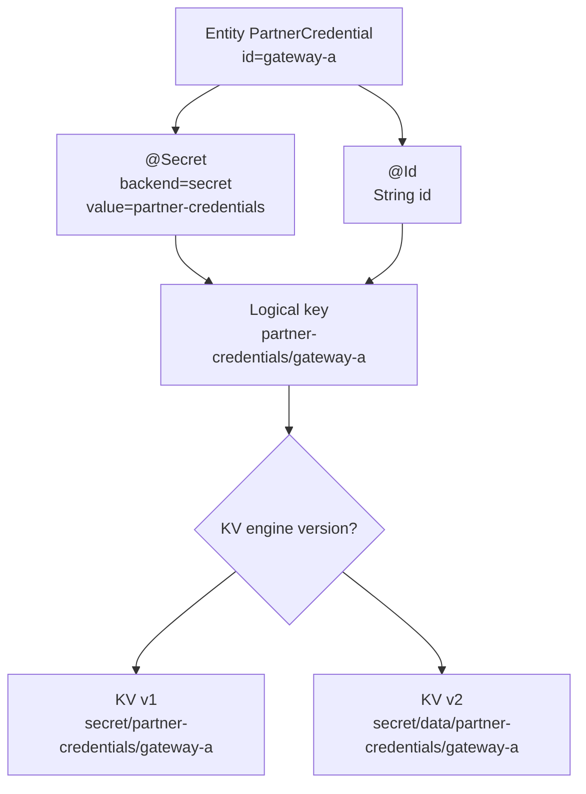
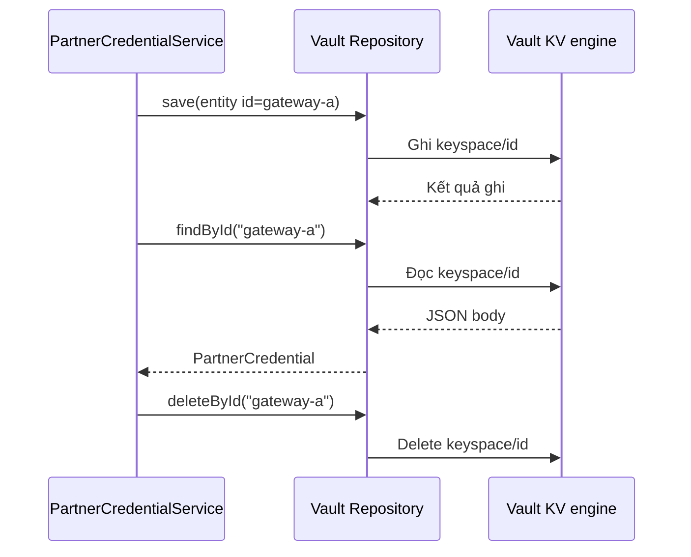

# @Id và cách hình thành khóa lưu trữ

## 1. Vì sao định danh của entity quyết định nơi lưu secret?

Trong chương **Vault Repository**, ta sử dụng **Spring Vault** để làm việc với **HashiCorp Vault** theo phong cách **Spring Data Repository**. Thay vì mỗi lần gọi `VaultTemplate.read(...)` hoặc `VaultOperations.opsForKeyValue(...)`, ứng dụng định nghĩa một entity Java và một repository interface; Spring Vault sẽ chuyển các thao tác `save`, `findById`, `deleteById` thành yêu cầu tới **KV secrets engine**.

Khác cơ sở dữ liệu quan hệ, KV không có bảng, primary key và index tùy ý. Mỗi đối tượng được lưu tại **một khóa/path của Vault**. Vì vậy, việc chọn trường `@Id` không chỉ xác định identity trong bộ nhớ Java: nó tham gia trực tiếp vào **đường dẫn lưu trữ**, khả năng đọc lại, quyền truy cập và tính nhất quán khi cập nhật.

Tài liệu Spring Vault mô tả quy tắc cốt lõi:

```text
@Secret(backend = "secret", value = "partner-credentials")
@Id String id = "gateway-a"

Vault secrets engine mount: secret
Repository keyspace:         partner-credentials
Entity identifier:           gateway-a
Logical key:                 partner-credentials/gateway-a
Logical location:            secret/partner-credentials/gateway-a
KV v2 HTTP data endpoint:    /v1/secret/data/partner-credentials/gateway-a
```

**Mục tiêu học tập:** Giải thích đúng vai trò của `@Id`, `@Secret`, mount, keyspace và KV API path; tránh trùng khóa, kiểm soát ID an toàn, hiểu sự khác biệt giữa KV v1/KV v2 và kiểm thử được hành vi lưu/đọc/xóa theo ID.

## 2. Các thành phần tham gia hình thành khóa

| Thành phần | Nguồn | Ví dụ | Vai trò |
|---|---|---|---|
| **Vault mount** | `@Secret(backend = "...")` | `secret` | KV secrets engine được mount ở đâu |
| **Keyspace** | `@Secret(value = "...")` hoặc tên suy ra theo loại entity | `partner-credentials` | Tiền tố logic nhóm entity |
| **ID** | Thuộc tính `@Id` hoặc thuộc tính tên `id` khi không có annotation | `gateway-a` | Phần định danh cuối của khóa |
| **Logical key** | `keyspace + "/" + id` | `partner-credentials/gateway-a` | Đường dẫn tương đối trong KV mount |
| **KV v1 HTTP path** | Mount + logical key | `/v1/secret/partner-credentials/gateway-a` | Đọc/ghi KV v1 qua HTTP |
| **KV v2 HTTP data path** | Mount + `data/` + logical key | `/v1/secret/data/partner-credentials/gateway-a` | Đọc/ghi versioned KV v2 |
| **KV v2 metadata path** | Mount + `metadata/` + keyspace | `/v1/secret/metadata/partner-credentials` | List các khóa trong keyspace; không chứa plaintext data |

Trình tự ánh xạ trong repository:



**Không được nhập nhằng ba lớp path**: `@Secret.value` là **keyspace**, `@Secret.backend` là **mount**, còn phần `data/` hoặc `metadata/` là chi tiết của **KV v2 HTTP API**. Khi repository đã nhận diện loại mount, lập trình viên không cần tự thêm `data/` vào `@Secret.value`.

## 3. `@Id` trong Spring Vault thực sự là annotation nào?

Trên entity Repository, `@Id` là annotation **`org.springframework.data.annotation.Id`** của Spring Data. `@Secret` thuộc package **`org.springframework.vault.repository.mapping.Secret`**.

```java
import org.springframework.data.annotation.Id;
import org.springframework.vault.repository.mapping.Secret;

@Secret(value = "partner-credentials", backend = "secret")
public class PartnerCredential {

    @Id
    private String id;

    private String provider;
    private String apiKey;

    public PartnerCredential() {
        // Để cơ chế mapping tạo entity khi đọc từ Vault.
    }

    public PartnerCredential(String id, String provider, String apiKey) {
        this.id = id;
        this.provider = provider;
        this.apiKey = apiKey;
    }

    public String getId() { return id; }
    public void setId(String id) { this.id = id; }

    public String getProvider() { return provider; }
    public void setProvider(String provider) { this.provider = provider; }

    public String getApiKey() { return apiKey; }
    public void setApiKey(String apiKey) { this.apiKey = apiKey; }

    @Override
    public String toString() {
        return "PartnerCredential[id=" + id + ", apiKey=REDACTED]";
    }
}
```

Các quy tắc cần ghi nhớ:

1. **ID phải ánh xạ sang `String`** trong Vault Repository. Interface thường là `CrudRepository<PartnerCredential, String>`; không dùng `Long`, `UUID` hoặc composite key làm kiểu định danh Repository rồi mong Vault tự chuyển đổi như JPA.
2. **Tên field không nhất thiết là `id`.** Ví dụ `@Id private String integrationKey` vẫn được xem là ID. Ngược lại, một property tên `id` có thể được tự nhận diện nếu không annotation, nhưng khai báo `@Id` minh bạch hơn.
3. **Khi annotation và property tên `id` cùng tồn tại**, property được đánh dấu `@Id` có độ ưu tiên theo quy tắc mapping của Spring Vault. Tránh thiết kế một class có hai trường cạnh tranh làm ID.
4. **`@Id` không đồng nghĩa auto-generation.** Với ví dụ này, ứng dụng chủ động gán ID ổn định trước khi lưu; không dựa vào repository tự phát sinh UUID hoặc số sequence như ở database khác.
5. **Không dùng nhầm `jakarta.persistence.Id` hoặc `javax.persistence.Id`** của JPA cho mapping Vault Repository. Hai loại repository khác nhau, có cách xử lý identity và persistence khác nhau.

Spring Vault có thể dựng lại thuộc tính ID từ **khóa Vault dùng để tìm object**. Trong ví dụ mapping mặc định của Spring Vault, JSON body lưu thuộc tính thông thường và `_class`; ID đóng vai trò identifier của path chứ không cần xuất hiện như một cột/field độc lập trong JSON body.

### Trường hợp dùng ID khác tên `id`

```java
@Secret(value = "partner-credentials", backend = "secret")
class PartnerCredentialByCode {
    @Id
    String integrationCode;

    String apiKey;
}
```

Với `integrationCode="gateway-a"`, logical key vẫn là `partner-credentials/gateway-a`. **Tên Java field** quyết định property nào là định danh; **giá trị của field** quyết định phần hậu tố trong path.

## 4. `@Secret` xác định keyspace và mount

`@Secret` đánh dấu aggregate root của Vault Repository. Hai thuộc tính quan trọng:

| Thuộc tính | Mặc định | Ví dụ tùy chỉnh |
|---|---|---|
| `backend` | `secret` | `backend="kv-app"` |
| `value` | Chuỗi rỗng, dùng quy tắc keyspace của mapping | `value="partner-credentials"` |

Khi không cấu hình `value`, Spring Vault thường sử dụng keyspace suy ra từ loại entity (ví dụ `Credentials` thành `credentials` trong tài liệu chính thức). Không nên dựa vào tên class mặc định cho lưu trữ lâu dài nếu có kế hoạch đổi tên class/package: **khai báo keyspace rõ ràng** giúp path không thay đổi khi refactor.

Ví dụ đổi mount nhưng giữ keyspace:

```java
@Secret(value = "partner-credentials", backend = "kv-app")
class PartnerCredential {
    @Id String id;
    String apiKey;
}
```

Với `id="gateway-a"`, logical location là `kv-app/partner-credentials/gateway-a`. Nếu `kv-app` là KV v2, Vault HTTP data endpoint là `kv-app/data/partner-credentials/gateway-a`.

**Không tự tiện đổi `backend` hoặc `value` khi đã có dữ liệu**: một lần đổi đó làm Repository nhìn sang tập khóa khác. Những secret cũ không tự di chuyển; việc migrate cần kế hoạch đọc, ghi path mới, xác minh, chuyển consumer và thu hồi/xóa path cũ.

Javadoc của `@Secret` cho phép sử dụng **SpEL** để tính keyspace hoặc mount theo từng operation. Chức năng này hữu ích trong trường hợp đặc thù nhưng dễ tạo path động khó phân quyền. Với workload production, nên ưu tiên mount/keyspace cố định hoặc được kiểm soát từ cấu hình đáng tin cậy; không ghép raw input của người dùng thành Vault path.

## 5. Một ví dụ `save`, `findById`, `deleteById` từ đầu đến cuối

Spring Vault repository dùng Spring Data API, nên chỉ cần interface:

```java
import org.springframework.data.repository.CrudRepository;

public interface PartnerCredentialRepository
        extends CrudRepository<PartnerCredential, String> {
}
```

Khai báo bật repositories tại package được quét:

```java
import org.springframework.context.annotation.Configuration;
import org.springframework.vault.repository.configuration.EnableVaultRepositories;

@Configuration
@EnableVaultRepositories(basePackageClasses =
        PartnerCredentialRepository.class)
class VaultRepositoryConfiguration {
    // Giả định ứng dụng đã cấu hình bean VaultTemplate/VaultOperations,
    // authentication, TLS và SessionManager hợp lệ.
}
```

Dependency quan trọng (version do BOM/dependency management tương thích quyết định):

```xml
<dependencies>
    <dependency>
        <groupId>org.springframework.vault</groupId>
        <artifactId>spring-vault-core</artifactId>
    </dependency>
    <dependency>
        <groupId>org.springframework.data</groupId>
        <artifactId>spring-data-keyvalue</artifactId>
    </dependency>
</dependencies>
```

Spring Data Commons là thành phần cần thiết và thường được dependency management / Spring Data KeyValue đưa vào classpath. Spring Vault Repository không tự hoạt động chỉ vì có Spring Cloud Vault Config Data; phải có repository support, cấu hình quét và Vault client phù hợp.

Nghiệp vụ sử dụng repository:

```java
import java.util.Optional;
import org.springframework.stereotype.Service;

@Service
public final class PartnerCredentialService {
    private final PartnerCredentialRepository repository;

    public PartnerCredentialService(PartnerCredentialRepository repository) {
        this.repository = repository;
    }

    public void createDemo(String apiKey) {
        String id = "gateway-a"; // ID do ứng dụng cấp, không tự sinh.
        PartnerCredential record =
                new PartnerCredential(id, "gateway", apiKey);
        repository.save(record);
    }

    public Optional<PartnerCredential> findDemo() {
        return repository.findById("gateway-a");
    }

    public void deleteDemo() {
        repository.deleteById("gateway-a");
    }
}
```

Luồng xử lý:



Trong ứng dụng thật, `apiKey` là bí mật: không đặt giá trị thật trong test logs, request path, exception hoặc source code. Ngoài ra, `PartnerCredential` thường nên được truy cập qua interface nghiệp vụ hẹp, không trả trực tiếp ra HTTP response.

### Kiểm tra từ Vault CLI

Nếu mount là `secret` và engine **KV v2**, người vận hành lab có thể kiểm tra:

```bash
# Dùng credential/sandbox riêng; không in secret thật trong terminal.
# Chỉ kiểm tra metadata và phiên bản nếu có quyền phù hợp.
vault kv metadata get -mount=secret \
  partner-credentials/gateway-a
```

Không nhầm `partner-credentials/gateway-a` (logical key) với `secret/data/partner-credentials/gateway-a` (HTTP API path). Trong code `@Secret` không nên chứa hậu tố `data/` của KV v2.

## 6. Cách Vault lưu body JSON và vai trò của `@Id`

Spring Vault repositories dùng `VaultConverter` và `SecretDocument` để ánh xạ entity Java sang JSON và ngược lại. Với `PartnerCredential`, dữ liệu được lưu tương tự:

```json
{
  "_class": "com.example.vault.PartnerCredential",
  "provider": "gateway",
  "apiKey": "<REDACTED>"
}
```

Đây là **minh họa payload logic** của mapping mặc định; nội dung cụ thể phụ thuộc converters và class package. Trong KV v2, Vault REST API còn bao bọc payload trong trường `data` và cung cấp `metadata` phiên bản; phần bọc ngoài không phải field do entity tự khai báo.

Các quy tắc:

- Trường kiểu đơn giản được lưu dưới dạng thuộc tính JSON; object lồng nhau thành object JSON; list/map có ánh xạ tương ứng.
- `_class` là metadata kiểu mà mapping có thể ghi tại root/nested polymorphic types để đọc lại object đúng class. Không xem `_class` là một bí mật hoặc định danh path.
- `@Id` phục vụ xây dựng key `keyspace/id`. Khi dữ liệu đọc từ đúng key, repository có thông tin định danh để gán lại cho entity.
- **`save` ghi lại toàn bộ nội dung được mapping**. Thuộc tính lạ đã tồn tại trong Vault nhưng không được converter ánh xạ có thể **bị mất** sau lần save. Repository không mặc nhiên thực hiện JSON merge/patch.
- Nếu entity đã được lưu bằng một ID và sau đó **đổi ID** rồi `save`, kết quả có thể tạo một khóa khác. Bản ghi ở ID cũ không tự biến mất; muốn "đổi tên" phải thực hiện quy trình migrate và dọn dẹp rõ ràng.

Do đó `@Id` nên là định danh **ổn định**, tách khỏi các field có thể thay đổi như display name, tên nhà cung cấp có thể đổi branding hoặc trạng thái chứng thư.

## 7. KV v1 và KV v2: cùng ID nhưng HTTP path khác nhau

Spring Vault Repository sử dụng KV v1 và, từ Spring Vault 2.4, hỗ trợ cả **KV v2** với phiên bản secrets engine được nhận diện lúc chạy.

| Nghiệp vụ | KV v1 | KV v2 |
|---|---|---|
| Lưu entity theo ID | Path `secret/partner-credentials/gateway-a` | HTTP path `secret/data/partner-credentials/gateway-a` |
| Đọc entity | Đọc path KV | Đọc `data` và chuyển payload bên trong thành entity |
| List các IDs | List prefix phù hợp trong KV | List `secret/metadata/partner-credentials` |
| `deleteById` | Xóa key theo khả năng KV v1 | **Soft-delete latest version**, không destroy mọi version |
| Phiên bản | Không có lịch sử version KV v2 | Có metadata version; hỗ trợ `@Version` để optimistic locking |
| Chính sách Vault | Path dưới mount `secret/...` | Phân quyền `data/...` và `metadata/...` riêng |

**Chú ý an toàn:** Trong KV v2, `CrudRepository.delete(...)` hoặc `deleteById(...)` dùng **DELETE** theo semantics versioned KV, không phải `destroy` xóa vĩnh viễn giá trị khỏi các phiên bản đã lưu. Nếu yêu cầu pháp lý/bảo mật buộc xóa vĩnh viễn, cần quy trình KV v2 destroy/metadata operations có quyền riêng và được kiểm soát, không xem `deleteById` là đủ.

### Ví dụ policy KV v2 cho Repository

```hcl
# Read/write/delete dữ liệu trong keyspace được chỉ định.
path "secret/data/partner-credentials/*" {
  capabilities = ["create", "read", "update", "delete"]
}

# Chỉ khi cần count/findAll/derived ID queries dùng LIST:
path "secret/metadata/partner-credentials" {
  capabilities = ["list"]
}
```

Tùy cách liệt kê/đọc metadata, có thể cần rà soát thêm đường dẫn metadata con trong môi trường thật, nhưng **không mở rộng `secret/metadata/*` một cách mặc định**. Repository còn sử dụng endpoint **`sys/internal/ui/mounts/...`** để xác định mount path/version, nên cần bảo đảm token có thể truy cập endpoint này theo hành vi Vault và policy thực tế.

Phân quyền KV là trách nhiệm của Vault **policy**, không do Java `@Id` tự tạo bảo mật. Ngay cả khi repository chỉ lưu trong `partner-credentials`, một token được cấp quyền rộng `secret/data/*` vẫn có thể đọc nhiều secret khác qua client thấp hơn.

## 8. `@Id` và `@Version` không phải cùng một trường

Với KV v2, một secret có nhiều **revisions/versions** dưới **cùng logical key**. `@Id` chọn **khóa nào**, còn `@Version` dùng để kiểm soát **phiên bản nào đang được cập nhật**.

```java
import org.springframework.data.annotation.Id;
import org.springframework.data.annotation.Version;
import org.springframework.vault.repository.mapping.Secret;

@Secret(value = "partner-credentials", backend = "secret")
public class VersionedPartnerCredential {
    @Id String id;
    @Version int version;
    String apiKey;
}
```

| Field | Kiểu | Vai trò |
|---|---|---|
| `id` | `String` | Tạo khóa `partner-credentials/gateway-a` |
| `version` | `int` / `long` hoặc kiểu số được hỗ trợ | Gắn với KV v2 version/CAS để chống ghi đè không chủ ý |
| `apiKey` | `String` | Nội dung secret, có thể thay đổi nhưng không đổi path |

Ví dụ hai instances đọc cùng key version 3. Instance A thay apiKey và `save`, Vault tăng version lên 4. Instance B còn object version 3, nếu `save` với `@Version`, Spring Vault gửi compare-and-set và từ chối ghi không khớp; ứng dụng thấy `OptimisticLockingFailureException`.

```text
Repository ID: partner-credentials/gateway-a

Thread A: read version=3 ------ save with CAS=3 ---> version=4
Thread B: read version=3 --------------------------> CAS=3 rejected

ID không đổi; version kiểm soát xung đột cập nhật.
```

Không coi `@Version` là dynamic-secret lease TTL. Nó là optimistic locking cho **KV v2 storage**, khác với `lease_id`/`lease_duration` của Database/AWS dynamic secrets.

**Cần nhớ:** Với entity **không có `@Version`**, hai lần save cùng ID có thể ghi đè nhau và mất thay đổi của người khác. Nếu cần kiểm soát cạnh tranh hoặc bảo vệ version, thiết kế `@Version`/CAS với KV v2 và kiểm thử tình huống cập nhật đồng thời.

## 9. ID và query derivation: chỉ lọc theo định danh

Vault không có engine truy vấn như SQL. Spring Vault repository cung cấp một tập query methods đơn giản nhưng **predicates chỉ được hỗ trợ trên ID property**; sorting, paging và `count` liên quan tới liệt kê keyspace bằng API của Vault, không phải chạy một indexed query trong Vault.

Ví dụ:

```java
import java.util.List;
import org.springframework.data.repository.CrudRepository;

interface PartnerCredentialRepository
        extends CrudRepository<PartnerCredential, String> {

    List<PartnerCredential> findByIdStartsWith(String prefix);
}
```

`findByIdStartsWith("gateway-")` liệt kê các IDs trong keyspace rồi lọc theo tiền tố ID. Nó **không** sử dụng SQL `LIKE` hay index theo field `provider`. Không viết `findByProvider(...)` và mặc nhiên nghĩ Spring Vault hỗ trợ truy vấn theo dữ liệu JSON như database quan hệ.

| Method | Hành vi đại ý | Cần lưu ý |
|---|---|---|
| `findById("gateway-a")` | Đọc một key chính xác | Thường hiệu quả và dễ cấp quyền nhất |
| `existsById("gateway-a")` | Kiểm tra key có tồn tại | Vẫn là yêu cầu Vault, phụ thuộc ACL |
| `findByIdStartsWith("gateway-")` | Liệt kê/nhặt IDs rồi lọc theo prefix | Cần LIST, có chi phí theo số lượng IDs |
| `findAll()` | Truy xuất tập entity trong keyspace | Có thể gây nhiều lời gọi network |
| `count()` | Đếm IDs theo khả năng list của Vault | Không phải `COUNT(*)` của database |
| Sorting/paging | Chọn/sắp xếp từ dữ liệu/IDs đã lấy | Không phải phân trang có index phía Vault |

**Hệ quả vận hành:** Không dùng Vault Repository như kho giao dịch quy mô lớn hoặc công cụ search nhiều trường. Nó phù hợp với số lượng secret/đối tượng cấu hình có kiểm soát và nhu cầu CRUD theo ID. Với dữ liệu nghiệp vụ cần query nhiều cột/quan hệ, dùng database phù hợp; chỉ lưu bí mật cần bảo vệ ở Vault.

## 10. Thiết kế ID an toàn, ổn định và phù hợp Vault path

ID là một phần của path: các ký tự trong ID có thể ảnh hưởng cấu trúc keyspace, ACL, audit logs và hoạt động list. **Không** nhận trực tiếp một chuỗi bất kỳ từ HTTP request để làm `@Id` của một thực thể nhạy cảm.

Các nguyên tắc:

1. **Giữ ID ổn định** theo đối tượng nghiệp vụ. Dùng `gateway-a` hoặc surrogate UUID dạng string nếu object cần thay tên hiển thị.
2. **Một segment đã chuẩn hóa**: tránh `/`, `..`, backslash, query/control characters hoặc cách viết URL-encoded gây nhầm lẫn. Không coi việc validate client-side là đủ để ngăn người dùng chọn path khác.
3. **Không nhúng credential vào ID**: token, API key, password hoặc email/PII có thể xuất hiện trong path, audit logs, telemetry và kết quả LIST.
4. **Tách namespace bằng keyspace/mount và Vault policy** thay vì chỉ dùng prefix ID do user cung cấp.
5. **Không đổi ID chỉ vì display name hoặc partner label thay đổi**, bởi việc đó tạo path mới và có thể để lại secret ở path cũ.
6. **Định nghĩa quy tắc độ dài và uniqueness** trong ứng dụng; không mặc định Vault Repository có SQL unique constraint hay transaction nhiều key.

Ví dụ hàm validate ID cho ứng dụng dùng một segment ASCII có quy tắc rõ:

```java
import java.util.Objects;
import java.util.regex.Pattern;

public final class VaultKeyIds {
    private static final Pattern SAFE =
            Pattern.compile("[a-z0-9][a-z0-9_-]{2,63}");

    private VaultKeyIds() {}

    public static String requireSafeId(String id) {
        Objects.requireNonNull(id, "id");
        if (!SAFE.matcher(id).matches()) {
            throw new IllegalArgumentException(
                "ID phải là một path segment hợp lệ");
        }
        return id;
    }
}
```

Đây là **chính sách ID của ứng dụng**, không phải giới hạn ký tự bắt buộc của Spring Vault. Nó cố ý không cho ký tự `/` để một ID không phá cấu trúc keyspace đã định. Nếu cần composite identity như tenant+integration, có thể tạo một **surrogate key** hoặc canonical ID có phép kiểm tra collisions; kiểm tra thêm quyền tenant ở business layer.

### Multi-tenant không thể chỉ dựa trên `@Id`

Ví dụ tenant A và tenant B đều có integration `gateway-a`. Nếu bạn lưu cả hai dưới cùng keyspace và dùng `id="gateway-a"` thì **cùng một logical key** sẽ bị ghi đè. Có thể giải quyết bằng:

- Một ID được cấp duy nhất toàn cục, không chứa dữ liệu nhạy cảm; application giữ mapping tenant+integration → ID trong kho metadata phù hợp.
- Hoặc phân vùng bằng keyspace/mount được quản lý đáng tin cậy và Vault policy theo tenant, nhưng phải phân tích cách repository cấu hình keyspace, mount và role auth.

**Không** tự ghép `tenantId + "/" + integrationId` từ request thành ID rồi xem đó là chính sách phân quyền. `@Id` xác định key, **Vault policy mới là chốt chặn truy cập**, còn Java phải xác thực/ủy quyền tenant ở tầng nghiệp vụ.

## 11. Quan hệ với workload authentication, token và lease

Repository dùng **KV secrets engine**. Sau khi workload xác thực bằng Kubernetes, cloud IAM, AppRole hay phương thức phù hợp, `VaultTemplate` mang Vault token tới các endpoint KV theo policy.

Các khái niệm không nên lẫn lộn:

| Khái niệm | Ý nghĩa | Tác động đến `@Id` |
|---|---|---|
| Workload identity | Bằng chứng cho phép ứng dụng login Vault | Không sinh hoặc thay ID |
| Vault token/policies | Quyền để đọc/ghi/list keyspace | Giới hạn các path có thể truy cập |
| KV v1/v2 key | Nơi entity được lưu | Được tạo từ mount + keyspace + ID |
| KV v2 version | Phiên bản của cùng logical key | Có thể kiểm soát bằng `@Version`, không đổi ID |
| Dynamic lease | Vòng đời một secret động từ Database/AWS | **Không phải** lease của mỗi lần đọc KV Repository |
| Transit/PKI operations | API mật mã và certificate issuance | Không dùng Repository ID để thay cho các API này |

Một token bị revoke có thể khiến các thao tác Repository tiếp theo bị từ chối, nhưng **không tự xóa giá trị KV đã lưu**, cũng không đổi `@Id`. Nếu client đã có bản sao `apiKey` trong RAM, Vault không xóa được bản sao đó. Rotation của secret tĩnh cần phối hợp issuer/đối tác, version KV và cache/consumer Java riêng.

Với Database secrets engine, credential động có lease và cần `SecretLeaseContainer` hoặc cơ chế lease-aware khác để renew/rotate. Không dùng `CrudRepository<Credential, String>` như cách thay thế quản lý lease. Với Transit encryption và PKI, dùng `VaultOperations` và các operations/client chuyên biệt phù hợp.

## 12. Những lỗi thường gặp khi key không nằm ở nơi dự kiến

| Triệu chứng | Nguyên nhân có thể | Cách kiểm tra |
|---|---|---|
| `findById` trả empty dù đã `save` | ID khác nhau, keyspace đổi, mount khác, lưu ở KV v1/v2 khác | So sánh `backend`, `value`, ID và version mount |
| Vault 404 ở `secret/data/...` | Sai logical path/mount hoặc version mount, bản KV v2 đã bị soft-delete | Kiểm tra keyspace/id và metadata bằng quyền phù hợp |
| Vault 403 ở bước repository init/list | Token không có policy, mount detection `sys/internal/ui/mounts` bị chặn hoặc thiếu `list` metadata | Phân biệt lỗi auth, read data, list metadata và mount discovery |
| Đổi tên class khiến entity cũ không còn đọc được | Dựa keyspace mặc định từ tên class | Dùng `@Secret(value=...)` cố định, thiết kế migrate |
| `save` đối tượng khác nhưng mất dữ liệu trước đó | Hai object trùng ID/keyspace hoặc toàn bộ JSON bị ghi lại | Validate uniqueness, dùng `@Version`/CAS nếu cần |
| Sau `deleteById` còn version cũ trong KV v2 | DELETE chỉ soft-delete latest version | Phân biệt soft delete, destroy, metadata deletion |
| Query theo `provider` không hoạt động như SQL | Vault query derivation chỉ lọc theo ID | Đổi thiết kế hoặc dùng database/index khác |
| `count` hoặc `findAll` chậm | LIST và fetch nhiều keys, không có index server-side | Giới hạn keyspace, tránh full scans |
| ID lộ tên tài khoản/tenant | Dùng email/PII trong path Vault | Chọn opaque/surrogate ID và sanitize logging |
| Test chạy được với root token, prod lỗi ACL | Root bypass nhiều ràng buộc và có quyền metadata | Test bằng token policy tối thiểu thực tế |

Khi chẩn đoán, tách theo thứ tự: **authentication → mount discovery → backend/keyspace → ID → KV version/path → data/list policy → JSON mapping**. Không sửa đồng thời tất cả cấu hình khiến khó xác định nguyên nhân.

## 13. Kiểm thử: chứng minh `@Id` được dùng đúng

### 13.1. Unit test định dạng ID

Không cần Vault thật để kiểm tra rule của ứng dụng:

```java
import static org.junit.jupiter.api.Assertions.*;
import org.junit.jupiter.api.Test;

class VaultKeyIdsTest {
    @Test
    void acceptsStableSingleSegment() {
        assertEquals("gateway-a", VaultKeyIds.requireSafeId("gateway-a"));
    }

    @Test
    void rejectsPathCharactersAndEmptyIds() {
        assertThrows(IllegalArgumentException.class,
                () -> VaultKeyIds.requireSafeId("../other"));
        assertThrows(IllegalArgumentException.class,
                () -> VaultKeyIds.requireSafeId("tenant/a"));
        assertThrows(IllegalArgumentException.class,
                () -> VaultKeyIds.requireSafeId(""));
    }
}
```

Đây là unit test của **chính sách chọn ID**. Nó chưa kiểm tra Spring Vault mapping hay HTTP path.

### 13.2. Integration test với KV v2

Sử dụng Vault sandbox/Testcontainers hoặc môi trường Vault test cách ly đã mount `secret` là KV v2; cấu hình Repository và Vault token có quyền hẹp.

```java
import static org.junit.jupiter.api.Assertions.*;
import java.util.UUID;
import org.junit.jupiter.api.Test;
import org.springframework.beans.factory.annotation.Autowired;
import org.springframework.boot.test.context.SpringBootTest;

@SpringBootTest
class PartnerCredentialRepositoryIT {

    @Autowired PartnerCredentialRepository repository;

    @Test
    void storesAndReadsByStringId() {
        String id = "it-" + UUID.randomUUID().toString();
        PartnerCredential item =
                new PartnerCredential(id, "demo", "test-only-secret");

        try {
            repository.save(item);

            PartnerCredential loaded =
                    repository.findById(id).orElseThrow();
            assertEquals(id, loaded.getId());
            assertEquals("demo", loaded.getProvider());

            repository.deleteById(id);
            assertTrue(repository.findById(id).isEmpty());
        } finally {
            // Cleanup riêng theo scope test, không dùng path production.
            repository.deleteById(id);
        }
    }
}
```

Ví dụ giả định test bootstrap đã thiết lập auth, TLS, KV mount, repository scanning và dependency đầy đủ. Test không tạo Vault container/database thật trong đoạn Java trên. Với KV v2, `deleteById` là soft-delete chứ không destroy toàn bộ history; sandbox cần quy trình cleanup version/metadata theo quyền quản trị test riêng.

**Các kiểm thử nên bổ sung:**

1. **Đúng path:** Sau `save`, người vận hành test xác minh key nằm dưới `partner-credentials/<id>`, còn HTTP path KV v2 tương ứng `secret/data/partner-credentials/<id>`.
2. **ID field khác tên:** Entity thử nghiệm có `@Id String integrationCode` vẫn lưu theo giá trị `integrationCode`.
3. **Đổi keyspace:** Entity khác `@Secret(value="other-space")` không đọc được cùng ID nếu dữ liệu chỉ có ở keyspace cũ.
4. **Collision:** Hai lần save cùng ID ghi cùng key; thử `@Version` để bắt lost update theo KV v2.
5. **Query prefix:** `findByIdStartsWith(...)` chỉ trả IDs phù hợp và cần quyền LIST; không kỳ vọng filter theo field JSON.
6. **Permission negative:** Token chỉ có `read` không được `save`; token không có `list` metadata không thể dùng đầy đủ các phương thức scan.
7. **Mount discovery:** Xác minh policy của test workload tương thích việc Repository gọi `sys/internal/ui/mounts/...`.
8. **Soft delete:** Sau `deleteById`, verify latest version bị delete theo KV v2 và không coi đó là destroy tất cả versions.
9. **Bảo mật:** Không có token, password, raw JSON secret, PII trong log/test output.

### Tiêu chí nghiệm thu

| Assertion | Kết quả cần chứng minh |
|---|---|
| `repo.save(entity)` + `findById(id)` | Entity đọc lại được qua **cùng keyspace/id** |
| `repo.findById(otherId)` | Không đọc nhầm một khóa khác |
| `@Secret.backend` thay đổi | Entity nằm ở mount mới, không vô tình ghi mount cũ |
| Query derivation theo ID | Có kết quả đúng, và policy LIST được xác minh |
| KV v2 + `@Version` | Update stale version tạo optimistic locking failure |
| Token quyền thấp | Không vượt Vault ACL khi gọi Repository |
| Delete v2 | Phân biệt soft delete với destroy vĩnh viễn |

## 14. Bài tập vận dụng

**Tình huống A — Tại sao tìm không thấy object?** Một entity `Credentials` đã `save` khi `@Secret` không có `value`. Sau đó nhóm đổi tên class thành `PartnerCredential`. Repository không tìm được các object cũ với cùng ID. Hãy phân tích keyspace mặc định và thiết kế migration an toàn.

**Tình huống B — Collision giữa hai tenants.** Tenant A và tenant B đều có `id="gateway-a"` trong cùng keyspace. Hãy chứng minh họ đang trỏ về cùng logical key, giải thích Vault policy và đề xuất phương án surrogate ID hoặc phân vùng keyspace.

**Tình huống C — Đọc được nhưng không list được.** `findById` thành công nhưng `findAll`/`count` lỗi 403 trên KV v2. Hãy viết policy tối thiểu cho data read và metadata list, đồng thời kiểm tra mount detection.

**Tình huống D — Cập nhật đồng thời.** Hai processes tải cùng entity version 8 rồi đều sửa `apiKey`. Hãy vẽ timeline CAS với `@Version` và cách xử lý `OptimisticLockingFailureException` mà không ghi đè dữ liệu mới nhất.

**Tình huống E — DELETE không phải destroy.** Audit thấy `deleteById` đã thành công, nhưng phiên bản cũ vẫn tồn tại trong KV v2 metadata/history. Hãy phân biệt soft-delete, destroy và trách nhiệm xóa dữ liệu theo quy trình bảo mật.

**Tình huống F — Chọn công cụ phù hợp.** Một ứng dụng cần (1) lưu vài chục integration credentials theo ID, (2) phát hành database users động, (3) mã hóa trường dữ liệu bằng Transit, và (4) cấp chứng thư PKI. Hãy xác định nhu cầu nào hợp Vault Repository và nhu cầu nào cần `VaultOperations`/engine-specific API cùng quản lý token/lease.

Một lời giải đầy đủ phải nêu được **mount + keyspace + ID → logical key**, quyền truy cập theo HTTP path, tính ổn định của ID, semantics KV v1/v2 và cách kiểm thử.

## 15. Tài liệu tham khảo chính thức

- [Spring Vault — Vault Repositories](https://docs.spring.io/spring-vault/reference/vault/vault-repositories.html): `@Id`, `@Secret`, keyspace/id, JSON mapping, KV v1/v2, query methods và `@Version`.
- [Spring Vault — Secret annotation Javadoc](https://docs.spring.io/spring-vault/reference/api/java/org/springframework/vault/repository/mapping/Secret.html): `value` (keyspace), `backend` (mount), SpEL.
- [Spring Vault — EnableVaultRepositories Javadoc](https://docs.spring.io/spring-vault/reference/api/java/org/springframework/vault/repository/configuration/EnableVaultRepositories.html): cách bật quét repository.
- [Spring Vault — Vault Secrets Engines](https://docs.spring.io/spring-vault/reference/vault/vault-secret-engines.html): KV v1/v2 API path, mount detection và versioning.
- [Spring Vault — SecretDocument Javadoc](https://docs.spring.io/spring-vault/reference/api/java/org/springframework/vault/repository/convert/SecretDocument.html): identifier, version và JSON body.
- [Spring Data Commons — Repositories](https://docs.spring.io/spring-data/commons/reference/repositories.html): `CrudRepository`, query derivation và repository configuration.
- [HashiCorp Vault — KV v2](https://developer.hashicorp.com/vault/docs/secrets/kv/kv-v2): path `data`/`metadata`, soft-delete/destroy và CAS.
- [HashiCorp Vault — Policy concepts](https://developer.hashicorp.com/vault/docs/concepts/policies): ACL theo path và nguyên tắc quyền tối thiểu.
