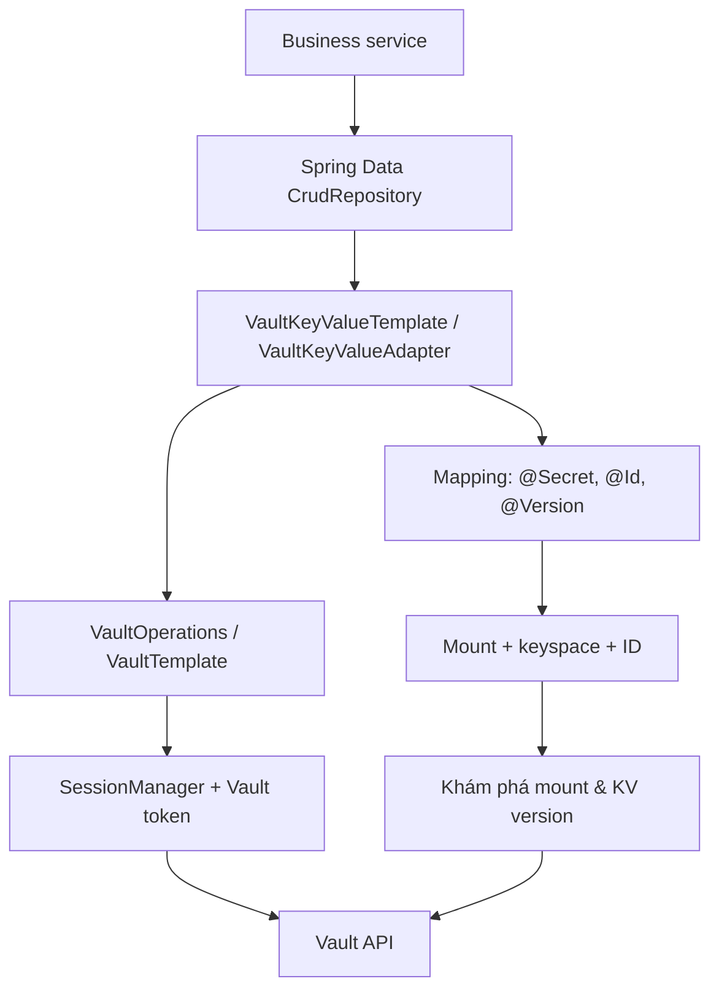
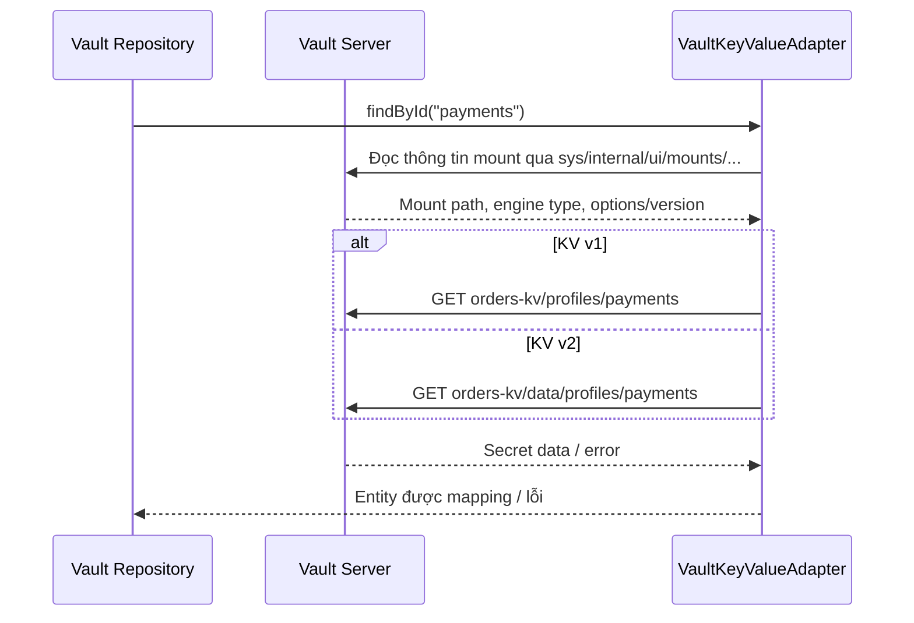

# Lựa chọn mount và nhận diện phiên bản KV

Trong **SPRING_VAULT**, ứng dụng Java có thể truy cập HashiCorp Vault bằng `VaultTemplate` và quản lý dữ liệu dạng key–value qua Spring Vault Repository. Khi một repository gọi `save(...)` hoặc `findById(...)`, nó phải biết **ghi vào secrets engine mount nào**, **đường dẫn logic của entity là gì** và **mount đang chạy KV v1 hay KV v2**. Nhầm một trong ba yếu tố có thể dẫn tới `403 permission denied`, `404`, dữ liệu không xuất hiện ở path mong đợi hoặc thao tác ghi không đúng cấu trúc API.

Bài thuộc chương **Vault Repository**, tập trung vào cách chọn mount bằng `@Secret`, cách Spring Vault nhận diện KV version khi chạy, quyền cần cho phát hiện mount, tác động tới CRUD, optimistic locking và cách kiểm thử bằng Vault độc lập. Những phần khác của module — xác thực theo workload, policy, vòng đời token/lease, Transit, PKI, lỗi và giám sát — được đặt vào đúng vai trò để tránh hiểu nhầm repository có khả năng tự xử lý tất cả các secrets engine.

> **Phạm vi:** Vault Repository dùng **KV secrets engine** để lưu entity dạng document. Spring Vault từ phiên bản **2.4** có khả năng hỗ trợ repository trên KV v2 với **tự phát hiện phiên bản engine khi runtime**. API, khả năng auto-configuration và hành vi chi tiết cần được xác minh theo phiên bản dependency thực tế của ứng dụng.

## 1. Ba thành phần của một địa chỉ secret

Trong Vault, **mount** là nơi một secrets engine được gắn vào cây đường dẫn API. Một mount tên `orders-kv/` có thể chạy KV v1 hoặc KV v2. Phía Spring Vault Repository, **keyspace** gom các entity cùng loại, còn **ID** xác định một entity bên trong keyspace.

Ví dụ entity `OrdersSettings` được cấu hình:

```java
@Secret(value = "profiles", backend = "orders-kv")
class OrdersSettings {

    @Id
    String id;
    String endpoint;
}
```

Địa chỉ logic của entity với `id = "payments"` sẽ có dạng:

```text
Mount (secrets engine):  orders-kv
Keyspace (entity type):  profiles
Entity identifier:       payments

Logical secret path:     orders-kv/profiles/payments
```

Nhưng đường dẫn **HTTP thật** mà Vault nhận phụ thuộc KV version:

| Mount | Logical path | Phiên bản | API đọc dữ liệu |
| --- | --- | --- | --- |
| `orders-kv` | `profiles/payments` | KV v1 | `GET /v1/orders-kv/profiles/payments` |
| `orders-kv` | `profiles/payments` | KV v2 | `GET /v1/orders-kv/data/profiles/payments` |

Với KV v2, `data/` là **đoạn API do Vault định nghĩa**, không phải tên thư mục mà ứng dụng phải thêm thủ công vào `@Secret.value`. Tương tự, `metadata/` phục vụ các thao tác list/metadata theo quy định của KV v2.

### Mount không phải keyspace

Những khai báo sau **không tương đương**:

```java
// A: Mount orders-kv, keyspace profiles
@Secret(value = "profiles", backend = "orders-kv")
class PaymentProfile { }

// B: Mount mặc định secret, keyspace orders-kv/profiles
@Secret("orders-kv/profiles")
class OtherProfile { }
```

Ở B, nếu không chỉ định `backend`, annotation mặc định dùng mount `secret`. Vì vậy repository có thể cố tìm dữ liệu dưới `secret/...` thay vì `orders-kv/...`. Tên keyspace không nên được dùng để “giấu” mount trong một chuỗi path duy nhất.

Với phiên bản Spring Vault mới có alias `engine` trên `@Secret`, bạn vẫn có thể dùng `backend` để minh họa cú pháp tương thích với nhiều dòng phiên bản. Không tự giả định hai thuộc tính cùng tồn tại trong mọi phiên bản thư viện.

## 2. Repository khác gì VaultTemplate?

**`VaultTemplate`** / `VaultOperations` là client thao tác Vault trực tiếp. Repository đặt một tầng **Spring Data** lên trên để ánh xạ entity và thực hiện CRUD/query theo ID.



Repository hữu ích cho các tài liệu cấu hình/application secrets được lưu thành entity. Nó **không phải** một relational database, **không** hỗ trợ SQL joins và không thay thế lifecycle manager của dynamic secrets. Các hàm derived queries chủ yếu giới hạn predicate theo **ID**; việc paging/sorting có thể phải list/fetch nhiều bản ghi, khiến chi phí và policy khác `findById`.

| Nhu cầu | Hướng tiếp cận |
| --- | --- |
| CRUD các entity trong KV | Vault Repository với `@Secret` và `CrudRepository` |
| Đọc một secret KV v1/v2 qua logical path | `VaultOperations.opsForKeyValue(mount, KV_1/KV_2)` |
| Đọc secret động có lease và rotation | `VaultOperations`/`SecretLeaseContainer` hoặc giải pháp lease phù hợp |
| Transit encrypt/decrypt/sign | Transit operations tương ứng |
| PKI issue/rotate certificate | PKI operations / certificate lifecycle |
| Kiểm tra hoặc quản trị mount | System backend hoặc Vault CLI với identity có quyền operator |

Khả năng tự nhận diện KV version của **repository** không có nghĩa mọi cuộc gọi `VaultTemplate.read("orders-kv/profiles/payments")` sẽ tự đổi `data/` và unwrap response KV v2. Với raw API, caller vẫn phải hiểu đường dẫn và cấu trúc response.

## 3. Chọn mount bằng @Secret(backend = ...)

Trong Spring Vault Repository, annotation `org.springframework.vault.repository.mapping.Secret` đánh dấu entity root. Hai thuộc tính chính là:

- **`value`**: keyspace/prefix của entity, có thể rỗng để lấy quy ước mặc định; dùng giá trị rõ ràng giúp tránh thay đổi khi đổi tên lớp.
- **`backend`**: secrets engine mount path, mặc định là **`secret`**. Đây là nơi repository sẽ truy cập, không phải tên của authentication mount như `auth/kubernetes`.

Ví dụ entity ánh xạ vào mount `orders-kv`:

```java
package example.orders.vault;

import org.springframework.data.annotation.Id;
import org.springframework.data.annotation.Version;
import org.springframework.vault.repository.mapping.Secret;

@Secret(value = "profiles", backend = "orders-kv")
public class OrdersSettings {

    @Id
    public String id;

    @Version
    public long version; // Dùng cho KV v2 optimistic locking.

    public String endpoint;
    public boolean enabled;

    // Constructors/getters/setters theo mapping style của dự án.
}
```

Ở đây `@Id` có kiểu `String` theo yêu cầu của Vault Repository. Với KV v2, `@Version` kiểu số cho phép repository sử dụng thông tin version và CAS khi cập nhật. Nếu mount thực tế là KV v1, **đừng kỳ vọng optimistic locking hay lịch sử revision** tồn tại.

### Tránh nhầm annotation cùng tên

`@Secret` nói trên là annotation **Spring Vault Repository**. `@Id`/`@Version` thuộc Spring Data. Chúng khác với `@VaultPropertySource` dùng để đưa key/value từ Vault vào `Environment`, cũng khác annotation cấu hình auth theo workload. Import đúng package là cần thiết để repository nhận diện entity và version.

### Vì sao không tùy tiện dùng SpEL để đổi backend?

`@Secret.value` và `@Secret.backend` có thể hỗ trợ biểu thức SpEL tùy phiên bản. Điều đó không có nghĩa nên nối tên tenant hoặc chuỗi input của người dùng vào mount path trong mỗi request. Việc chọn mount dựa trên dữ liệu thiếu kiểm soát có thể dẫn đến đọc/ghi nhầm secrets engine hoặc rủi ro phân tách tenant.

Một chiến lược tốt hơn là ánh xạ tập mount được phê duyệt thành cấu hình tường minh, và phân quyền theo từng workload identity. Mỗi mount cần kiểm thử ACL và KV version riêng; không cho request HTTP quyết định backend path tùy ý.

## 4. Bật Vault Repository trong Spring

Vault Repository tích hợp với Spring Data Commons và Spring Data KeyValue. Ngoài `spring-vault-core`, dependency `spring-data-keyvalue` phải sẵn sàng, được quản lý phiên bản tương thích theo BOM của dự án.

Định nghĩa repository:

```java
package example.orders.vault;

import java.util.List;
import org.springframework.data.repository.CrudRepository;

public interface OrdersSettingsRepository
        extends CrudRepository<OrdersSettings, String> {

    List<OrdersSettings> findByIdStartsWith(String prefix);
}
```

Cấu hình bật scan repository:

```java
package example.orders.vault;

import org.springframework.context.annotation.Configuration;
import org.springframework.vault.repository.configuration.EnableVaultRepositories;

@Configuration(proxyBeanMethods = false)
@EnableVaultRepositories(
    basePackageClasses = OrdersSettingsRepository.class,
    vaultTemplateRef = "vaultTemplate"
)
public class OrdersVaultRepositoryConfiguration {
}
```

Cấu hình này **giả định** Spring đã tạo một bean `vaultTemplate` với endpoint, TLS và `ClientAuthentication`/`SessionManager` hợp lệ. Annotation `@EnableVaultRepositories` không tự bật KV engine trên Vault hay tự cấp quyền cho token. Mặc định nó dùng `vaultTemplate` và một `KeyValueOperations` theo tên/cơ chế configuration của repository; khi tùy biến bean, cần kiểm tra các thuộc tính như `vaultTemplateRef`, `keyValueTemplateRef` trên phiên bản thực tế.

### Quy trình gọi CRUD

```java
import org.springframework.stereotype.Service;

@Service
public class OrdersSettingsService {

    private final OrdersSettingsRepository repository;

    public OrdersSettingsService(OrdersSettingsRepository repository) {
        this.repository = repository;
    }

    public OrdersSettings requireSettings(String id) {
        return repository.findById(id)
            .orElseThrow(() -> new IllegalStateException(
                "Vault settings are missing for the requested ID"));
    }
}
```

Đọc qua repository sử dụng mount/keyspace được ánh xạ từ `@Secret`. Nếu cấu hình repository ghi nhầm dữ liệu vào một mount khác, `findById` có thể trả empty trong khi một secret cùng ID vẫn tồn tại ở mount dự định. Cần kiểm tra mount trước khi kết luận secret bị xóa.

## 5. Hai phiên bản KV ảnh hưởng API như thế nào?

KV v1 và KV v2 có thể cùng cung cấp một “document” cho business code, nhưng semantics API khác nhau.

| Đặc điểm | KV v1 | KV v2 |
| --- | --- | --- |
| Dữ liệu | Một giá trị hiện tại | Nhiều version của một key |
| API đọc | `mount/keyspace/id` | `mount/data/keyspace/id` |
| API ghi | `mount/keyspace/id` | `mount/data/keyspace/id` với body có `data` |
| API list key | `LIST mount/keyspace` | `LIST mount/metadata/keyspace` |
| Response data | `data` chứa key/value | `data.data` và `data.metadata` |
| Optimistic locking | Không có CAS/version KV v2 | Có thể dùng CAS với `@Version` |
| Delete | Xóa secret hiện tại theo cơ chế v1 | Delete version có thể là soft delete; lịch sử không nhất thiết bị destroy |
| Revision | Không có revision engine | Có thể truy xuất revision nếu repository hỗ trợ |
| Repository | Hỗ trợ | Hỗ trợ từ Spring Vault 2.4; nhận diện version khi chạy |

Ví dụ:

```text
Entity:  @Secret(value="profiles", backend="orders-kv")
ID:      payments

KV v1:
  GET /v1/orders-kv/profiles/payments
  LIST /v1/orders-kv/profiles

KV v2:
  GET /v1/orders-kv/data/profiles/payments
  LIST /v1/orders-kv/metadata/profiles
```

**Không thêm `data` vào `@Secret.value`** để “báo” rằng dùng KV v2. Repository phải nhận diện đúng version để tự chọn path và format. Nếu thêm `data` thủ công vào keyspace, repository có thể tạo những path không mong muốn.

### Ghi và xoá trên KV v2

Khi `repository.save(entity)` ghi entity vào KV v2, repository cần tuân theo định dạng CAS/version của engine khi có `@Version`. Nếu hai luồng đọc cùng version, luồng ghi sau có thể nhận `OptimisticLockingFailureException`; ứng dụng phải đọc lại, giải quyết xung đột và thử lại có kiểm soát, không ghi đè mù.

**`repository.delete(...)` với KV v2 không đồng nghĩa destroy toàn bộ lịch sử.** Spring Vault dùng thao tác DELETE của KV v2; các version cũ hoặc metadata có thể tiếp tục tồn tại theo cơ chế của Vault. Xóa vĩnh viễn là operation nhạy cảm khác, cần quyền và quy trình quản trị riêng.

## 6. Spring Vault nhận diện mount và KV version khi runtime

Đây là điểm trung tâm của bài: Spring Vault Repository có thể **khám phá mount path và KV version khi chạy**, thay vì suy phiên bản từ tên `orders-kv` hay từ mã Java.

Theo tài liệu Spring Vault, repository sử dụng thông tin trả về từ endpoint nội bộ Vault:

```http
GET /v1/sys/internal/ui/mounts/<requested-secret-path>
```

Ví dụ khi repository đang xử lý `orders-kv/profiles/payments`, framework có thể truy vấn thông tin mount tương ứng qua `sys/internal/ui/mounts/...`. Câu trả lời giúp biết **mount nào bao phủ path** và các tùy chọn engine, trong đó KV v2 thể hiện `options.version = "2"`.



Sơ đồ mô tả **dòng logic**, không cam kết một request lookup mount luôn được gửi cho **mỗi** lần gọi repository: implementation có thể cache hoặc tái sử dụng mount metadata. Chính sách cache và thời điểm invalidation cần được kiểm tra theo phiên bản thực tế.

Đặc điểm quan trọng:

1. **Mount được phát hiện qua thông tin Vault**, không bằng cách so sánh chuỗi tên mount có chữ `v2`.
2. **Version là thuộc tính của secrets engine**, không phải số `@Version` của entity. `KV v2` (phiên bản engine) khác `version=7` (phiên bản dữ liệu).
3. **Không có khả năng đọc mount metadata ≠ mount đang chạy KV v1**. Lỗi từ endpoint introspection phải được xử lý như lỗi quyền hoặc cấu hình, không âm thầm hạ xuống KV v1.
4. **Quyền đọc dữ liệu và quyền khám phá mount là hai kiểm tra khác nhau**. Chỉ cấp `read` ở `orders-kv/data/profiles/*` có thể chưa đủ cho repository nếu endpoint mount lookup không truy cập được.
5. **Vault namespace** (nếu dùng Vault Enterprise) ảnh hưởng phạm vi mount được nhìn thấy. Cùng tên `orders-kv` trong namespace khác là mount khác; bảo đảm endpoint, token và namespace trùng nhau.

### Nhận diện KV version bằng Vault CLI dành cho operator

Để biết mount thực tế, operator có đủ quyền có thể chạy:

```bash
vault secrets list -detailed
```

Ví dụ dạng thông tin cần quan sát:

```text
Path        Type    Options
orders-kv/  kv      map[version:2]
legacy-kv/  kv      map[version:1]
```

Dòng output chỉ là **minh họa**; định dạng phụ thuộc CLI version và cách hiển thị. Nếu mount là KV v1, thuộc tính `version` có thể không được hiển thị theo cùng cách; nên dựa vào `type` và `options` thực tế thay vì một mẫu chuỗi cứng.

Một cách khác dành cho operator là đọc mount metadata bằng sys backend theo quyền được cấp. **Không cấp `sys/mounts/*` quyền admin cho mọi ứng dụng** chỉ để debug repository; repository cần một đường phát hiện mount phù hợp với policy và phiên bản Vault đang dùng.

## 7. Vault policy: phải cấp quyền cho data, metadata và mount lookup

Giả sử `orders-service` chỉ cần đọc `orders-kv/profiles/payments` từ KV v2. Policy hẹp có thể gồm:

```hcl
# Quyền đọc nội dung của đúng một entity
path "orders-kv/data/profiles/payments" {
  capabilities = ["read"]
}

# Mount information phục vụ việc Spring Vault phát hiện KV engine.
# Kiểm chứng path thực tế mà repository truy vấn và cơ chế ACL Vault đang dùng.
path "sys/internal/ui/mounts/orders-kv" {
  capabilities = ["read"]
}

path "sys/internal/ui/mounts/orders-kv/*" {
  capabilities = ["read"]
}
```

Một số phiên bản Vault xử lý `sys/internal/ui/mounts` theo quy tắc đặc biệt dựa trên khả năng truy cập mount đích. Vì vậy **phải chạy integration test với chính token của ứng dụng**; đừng suy ra rằng mọi cấu hình ACL giống nhau hay rằng thêm quyền này luôn giải quyết được tất cả trường hợp. Quan trọng nhất là **không bỏ qua lỗi introspection** và không cấp toàn bộ `sys/*`.

Nếu cần `CrudRepository.findAll()`, `count()` hoặc query `findByIdStartsWith(...)`, repository thường phải **list** keys trong keyspace. Với KV v2:

```hcl
# List đúng thư mục keyspace, không cần list toàn bộ engine.
path "orders-kv/metadata/profiles" {
  capabilities = ["list"]
}

# Nếu cần duyệt nested IDs: giới hạn theo path phù hợp.
path "orders-kv/metadata/profiles/*" {
  capabilities = ["list"]
}
```

Để `save(...)` tạo/cập nhật entity, phải cấp capabilities ghi tại **data path** chính xác, ví dụ:

```hcl
path "orders-kv/data/profiles/*" {
  capabilities = ["create", "read", "update"]
}
```

Đây là **policy minh họa cho vai trò được phép ghi trên tập profiles**; không nên cấp wildcard này cho workload chỉ đọc một profile. Thao tác `delete` cần capability `delete` phù hợp; không tự cấp `destroy` hoặc quyền delete metadata trừ khi yêu cầu sản phẩm thật sự cần xóa vĩnh viễn.

### Policy KV v1 khác KV v2

| Operation | KV v1 (mount `legacy-kv`) | KV v2 (mount `orders-kv`) |
| --- | --- | --- |
| Đọc profile | `read` trên `legacy-kv/profiles/payments` | `read` trên `orders-kv/data/profiles/payments` |
| Liệt kê profiles | `list` trên `legacy-kv/profiles` | `list` trên `orders-kv/metadata/profiles` |
| Tạo/sửa profile | `create/update` trên `legacy-kv/profiles/*` | `create/update` trên `orders-kv/data/profiles/*` |
| Xóa profile | `delete` trên path dữ liệu KV v1 | `delete` trên `orders-kv/data/profiles/*`, thường soft delete version |

**Lưu ý với `list`:** capability list trên parent path có thể làm lộ **tên key** ngay cả khi dữ liệu ở một số key bị giới hạn đọc. Do đó không cấp `list` toàn engine cho service chỉ cần `findById("payments")`. Chính sách least privilege cho từng repository method phải được cân nhắc riêng.

## 8. Thực hành: tạo hai mount và quan sát cùng một entity

Trong một môi trường **Vault dev/test cô lập** với operator token dùng chỉ để setup:

```bash
# Tạo hai KV engine khác nhau. Chỉ chạy khi mount chưa tồn tại.
vault secrets enable -path=legacy-kv -version=1 kv
vault secrets enable -path=orders-kv -version=2 kv

# Dùng CLI KV, phiên bản API được CLI xử lý theo mount.
vault kv put legacy-kv/profiles/payments endpoint=https://legacy.test.invalid
vault kv put orders-kv/profiles/payments endpoint=https://modern.test.invalid

# Operator kiểm tra phiên bản:
vault secrets list -detailed

# Đọc lại bằng CLI:
vault kv get legacy-kv/profiles/payments
vault kv get orders-kv/profiles/payments
```

Đây là URL và dữ liệu giả; không lưu credential production trong script hay log CLI. Trong một application thực, hai bản ghi cùng logical ID nhưng thuộc hai mount khác nhau là **hai secret độc lập**.

### Hai entity cùng keyspace, khác backend

```java
import org.springframework.data.annotation.Id;
import org.springframework.vault.repository.mapping.Secret;

@Secret(value = "profiles", backend = "legacy-kv")
class LegacyProfile {
    @Id String id;
    String endpoint;
}

@Secret(value = "profiles", backend = "orders-kv")
class ModernProfile {
    @Id String id;
    String endpoint;
}
```

Khi repository cho `LegacyProfile` đọc `payments`, nó thao tác KV v1 tại `legacy-kv/profiles/payments`. Khi repository cho `ModernProfile` đọc cùng ID, nó phải nhận biết mount `orders-kv` là KV v2 và dùng `orders-kv/data/profiles/payments`.

Không dùng class mặc định `@Secret` rồi tin rằng Spring tự chọn `orders-kv` theo tên `ModernProfile`; backend mặc định là `secret`.

### Đối chiếu với VaultOperations chuyên dụng

Nếu cần bỏ qua abstraction repository để kiểm tra nguyên nhân, dùng API KV với mount/version được cấu hình **tường minh**:

```java
import org.springframework.stereotype.Service;
import org.springframework.vault.core.VaultKeyValueOperationsSupport.KeyValueBackend;
import org.springframework.vault.core.VaultOperations;
import org.springframework.vault.support.VaultResponse;

@Service
class ProfilesDiagnosticService {

    private final VaultOperations vault;

    ProfilesDiagnosticService(VaultOperations vault) {
        this.vault = vault;
    }

    VaultResponse readModernProfile(String id) {
        if (!id.matches("[a-zA-Z0-9_-]{1,64}")) {
            throw new IllegalArgumentException("Invalid profile identifier");
        }

        return vault
            .opsForKeyValue("orders-kv", KeyValueBackend.KV_2)
            .get("profiles/" + id);
    }
}
```

`opsForKeyValue("orders-kv", KV_2)` giúp code nói rõ mount và engine version cần dùng. Nhưng đây là lựa chọn **tường minh của caller**, không tương đương việc repository tự phát hiện version bằng metadata. Nếu repo báo lỗi mà operations API này chạy được, hãy kiểm tra mount introspection, mapping `@Secret`, bean client, quyền `list` và repository configuration.

## 9. KV v2: @Version, CAS và lịch sử revision

KV v2 có version history ở cấp secret. Vault Repository hỗ trợ một số tính năng Spring Data dựa trên đó.

### Optimistic locking

Đặt `@Version` trên một thuộc tính số (ví dụ `long`). Khi lưu entity đã có version, repository có thể dùng CAS để đảm bảo không ghi đè một update do process khác vừa thực hiện.

```java
import org.springframework.data.annotation.Id;
import org.springframework.data.annotation.Version;
import org.springframework.vault.repository.mapping.Secret;

@Secret(value = "profiles", backend = "orders-kv")
class VersionedProfile {
    @Id
    String id;

    @Version
    long version;

    String endpoint;
}
```

Giả định hai request cùng đọc version 4. Request A sửa rồi save, secret được lên version 5. Request B vẫn giữ version 4 và cố save; Vault từ chối CAS cũ và Spring Data có thể ném `OptimisticLockingFailureException`. Ứng dụng cần đọc lại, hợp nhất thay đổi và thử lưu có giới hạn, không bỏ `@Version` chỉ để “làm hết lỗi”.

**KV v2 (engine version) ≠ 4 hoặc 5 (document version).** Một là cách mount triển khai API; cái còn lại là số revision của dữ liệu trong mount.

### RevisionRepository

Với ID kiểu `String` và revision kiểu `Integer`, repository có thể mở rộng `RevisionRepository` để truy vấn các version trước đó:

```java
import org.springframework.data.repository.CrudRepository;
import org.springframework.data.repository.history.RevisionRepository;

interface ProfileRevisionRepository
        extends CrudRepository<VersionedProfile, String>,
                RevisionRepository<VersionedProfile, String, Integer> {
}
```

Các thao tác revision chỉ có ý nghĩa khi backend thực sự là KV v2, history còn tồn tại và token có các quyền đọc metadata/version cần thiết. Không nhầm version trong `@Version` là một “database transaction”; KV v2 có CAS ở cấp key nhưng không cung cấp multi-key transaction như RDBMS.

### Delete không nhất thiết destroy

Trong KV v2, `CrudRepository.delete(...)` không mặc nhiên xóa sạch tất cả version. Một secret bị soft delete vẫn có thể nằm trong metadata/history và có thể được phục hồi qua Vault API nếu quyền cho phép. Nếu yêu cầu tuân thủ cần xóa vĩnh viễn, hãy thiết kế operation/policy đặc biệt cho `destroy` hoặc xóa metadata, không phụ thuộc một lệnh repository delete thông thường.

## 10. Sự cố thường gặp khi nhận diện sai mount hoặc KV version

| Triệu chứng | Nguyên nhân có thể | Kiểm tra đầu tiên |
| --- | --- | --- |
| Repository đọc empty nhưng CLI tìm thấy secret | `@Secret.backend` mặc định `secret`, sai keyspace/id hoặc namespace | So sánh mount + keyspace + ID của entity với CLI |
| `403` tại `sys/internal/ui/mounts/...` | Token không thể tra metadata mount hoặc ràng buộc mount visibility | Dùng đúng token test kiểm tra endpoint; xét ACL/tính đặc biệt của internal endpoint |
| `403` tại `orders-kv/data/...` | Thiếu `read`/`create`/`update` tại data path v2 | Kiểm tra policy được gắn cho token sau login |
| `403` khi `count`/`findAll` | Thiếu `list` trên `metadata` path v2 | Kiểm tra khả năng list keyspace, không chỉ read một ID |
| `404`/`unsupported path` | Sai mount, nhầm KV v1/v2 hoặc thêm `data` ở keyspace | Kiểm tra phiên bản mount và HTTP path thật |
| Raw `VaultTemplate.read` lấy data sai cấu trúc | KV v2 bọc response ở `data.data` | Dùng `opsForKeyValue(..., KV_2)` hoặc unwrap đúng response |
| Save bị `OptimisticLockingFailureException` | Document đã bị process khác cập nhật | Đọc lại version, giải quyết concurrent update |
| Repo xóa rồi dữ liệu vẫn trong history | KV v2 DELETE chỉ soft delete version | Kiểm tra metadata/undelete/destroy semantics |
| Sau khi thay engine v1→v2, repo lỗi hàng loạt | Không có migration/test/metadata cache/ACL phù hợp | Kiểm tra lại mount options, dữ liệu, policy và khởi tạo client |
| Có Vault token nhưng repository không hoạt động | Auth thành công chưa đủ quyền tại data/metadata/introspection | Tách kiểm tra cloud/Kubernetes auth, Vault role, Vault ACL |

Không kết luận mọi lỗi là “Spring Vault không nhận ra version”. Một `403` trên Vault auth endpoint cho biết quá trình xác thực chưa thành công. Một `403` trên `secret/data/...` thường nằm ở policy/path; một `403` ở `sys/internal/ui/mounts/...` liên quan mount discovery. Ghi **loại request và phase** thay vì in credential, HTTP payload hoặc JWT vào log.

## 11. Chuyển mount hoặc nâng KV v1 lên KV v2 có an toàn tự động không?

**Không.** Spring Vault Repository phát hiện KV version khi chạy giúp nó chọn API path thích hợp, **không** là công cụ migrate dữ liệu, chuyển policy, preserve lease, hoặc đổi mount một cách không gián đoạn.

Ví dụ hệ thống muốn chuyển từ `legacy-kv` v1 sang `orders-kv` v2:

1. Xác định dữ liệu và entity mapping hiện tại: keyspace/IDs, trường JSON, secret nào thuộc từng ứng dụng.
2. Dựng `orders-kv` v2 trong môi trường staging, sao chép dữ liệu bằng quy trình operator được phê duyệt; kiểm tra quyền đọc/ghi ở mount mới.
3. Cấp Vault policy tách biệt cho `orders-kv/data/...`, `orders-kv/metadata/...` và mount discovery tương ứng, đúng role/workload.
4. Chạy integration test cho `CrudRepository`, query cần list, `@Version`/CAS và lịch sử revision nếu sử dụng.
5. Cập nhật `@Secret.backend`/cấu hình theo quy trình release có kiểm soát; tránh một số instance ghi vào mount cũ trong khi instance khác ghi vào mount mới nếu không có kế hoạch đồng bộ.
6. Giám sát lỗi 403/404, độ trễ read/write và lượng request discovery/list, có rollback plan cho ứng dụng và dữ liệu.
7. Khi đã xác minh không còn consumer cũ, thu hồi quyền mount cũ theo chính sách và xử lý dữ liệu tồn dư theo yêu cầu bảo mật.

Một hệ thống KV v2 có thể giữ nhiều revision và CAS, nhưng điều đó không bảo đảm dữ liệu được viết trên mount v1 tự xuất hiện ở mount v2. Tương tự, giữ nguyên **tên mount** nhưng thay phiên bản trên Vault không phải một “flip flag” vô hại: cần hiểu thủ tục nâng cấp KV engine mà Vault hỗ trợ, downtime/rollback và ảnh hưởng đến client đang hoạt động.

## 12. Kiểm thử đúng ba lớp: discovery, CRUD, ACL

Để chứng minh repository chọn đúng mount/version, unit test mock `CrudRepository` là chưa đủ. Cần Vault test cô lập (dev/Testcontainers hoặc instance test được quản lý) với ít nhất **hai mount thật** v1/v2 và token test tối thiểu.

### Ma trận kiểm thử

| Ca kiểm thử | Bố trí | Kỳ vọng |
| --- | --- | --- |
| Mount v1 đúng | `legacy-kv` v1, entity backend `legacy-kv` | Repo đọc/ghi ở path v1 |
| Mount v2 đúng | `orders-kv` v2, entity backend `orders-kv` | Repo đọc/ghi data path v2 |
| Mount mặc định sai | Entity không đặt `backend` trong khi dữ liệu ở `orders-kv` | Không đọc nhầm dữ liệu; phát hiện cấu hình sai |
| Thiếu quyền mount discovery | Token không được nhìn thấy `sys/internal/ui/mounts/...` trong lab | Repo báo lỗi có ngữ cảnh; không mặc định v1 |
| Chỉ có `read` data | `findById` trên key được cho phép | Đọc thành công nếu mount metadata discovery hợp lệ |
| Thiếu `list` metadata | Gọi `findAll` hoặc query theo prefix | Thất bại phân quyền rõ ràng, không cấp quyền list toàn bộ engine |
| Optimistic locking | Hai bản copy cùng version của một secret v2 | Update thứ hai nhận lỗi concurrency |
| KV v2 delete | Gọi `deleteById` trên secret có history | Quan sát soft delete và metadata đúng semantics |
| Sai keyspace | Repo dùng `profiles`, dữ liệu nằm trong `settings` | Không coi là lỗi auth; chẩn đoán path |
| Namespace khác | Token/request chọn Vault namespace không đúng | Không vô tình đọc mount cùng tên ở namespace khác |
| Role auth sai | Workload JWT/AppRole test không hợp lệ | Login fail trước discovery; không sửa bằng data policy |
| Vault unavailable | Tắt proxy test trong lúc lookup/CRUD | Timeout/retry có giới hạn, không log credential |

### Kiểm tra bằng Vault CLI

CLI `vault kv` là công cụ xác minh thuận tiện vì nó hiểu mount engine:

```bash
# Dùng operator credential hợp lệ và dữ liệu giả.
vault kv get orders-kv/profiles/payments
vault kv list orders-kv/profiles
vault kv metadata get orders-kv/profiles/payments
```

`vault kv metadata get` áp dụng cho KV v2. Đối với KV v1, đừng suy ra không có secret chỉ vì lệnh metadata thất bại: engine v1 không có metadata API của v2.

**Hai danh tính kiểm thử khác nhau:** operator token có quyền dựng fixture; application token được cấp qua Kubernetes/AppRole/cloud login với policy tối thiểu. Không chạy application bằng root token để “cho test dễ pass”, bởi khi đó các lỗi discovery và ACL của workload bị che khuất.

### Ví dụ test Spring Boot minh họa

```java
import static org.assertj.core.api.Assertions.assertThat;
import org.junit.jupiter.api.Test;
import org.springframework.beans.factory.annotation.Autowired;
import org.springframework.boot.test.context.SpringBootTest;

@SpringBootTest
class VaultRepositoryMountIntegrationTest {

    @Autowired
    OrdersSettingsRepository repository;

    @Test
    void readsFromDeclaredMount() {
        // Fixture: Vault test đã bật orders-kv KV v2,
        // ghi entity profiles/payments, cấp role đọc tương ứng.
        OrdersSettings entity = repository.findById("payments")
            .orElseThrow();

        assertThat(entity.endpoint).isNotBlank();
    }
}
```

Ví dụ test cần chuẩn bị Vault instance, mount, dữ liệu test và cấu hình bean `vaultTemplate` trước khi Spring context tạo repository. `@SpringBootTest` tự nó không bật Vault, không cấp policy và không kiểm tra revision. Để xác nhận **v1 khác v2**, thêm test tương tự cho repository `LegacyProfile` và kiểm tra trực tiếp path bằng CLI hoặc server audit/test HTTP proxy.

## 13. Giám sát và bảo mật khi repository khám phá mount

Các tín hiệu nên theo dõi:

- **Authentication:** số lần login/re-login thất bại, TTL Vault token, lỗi identity Kubernetes/AppRole/cloud.
- **Mount discovery:** tần suất và latency `sys/internal/ui/mounts/...`, lỗi `403`/`404`, mount resolved, engine version đã phát hiện.
- **Repository CRUD:** lỗi theo operation `read/write/list/delete` và mount **được phép log**, tránh path chứa tenant hoặc ID cá nhân.
- **KV v2 CAS:** số `OptimisticLockingFailureException` để phát hiện concurrent updates.
- **Availability:** timeout, Vault HA routing, network/TLS lỗi; readiness cho tính năng phụ thuộc Vault.
- **Security:** bảo đảm token không có `sudo`/root hoặc `list` toàn engine chỉ vì một repository cần đọc một ID.

Không log `X-Vault-Token`, nội dung `VaultResponse`, `secret_id`, JWT, value trong entity, toàn bộ exception body hoặc raw property data. Kể cả JSON do Vault Repository mapping có thể chứa thông tin nhạy cảm: không dùng `entity.toString()` trong request log. Tách tên/path metadata được phép quan sát khỏi giá trị của secret.

Ngoài ra, một repository đọc thành công document cấu hình tại KV **không** chứng minh lease credentials động đã được renew hoặc PKI certificate còn hợp lệ. Vòng đời token và lease/rotation cần cơ chế quản lý riêng; mount `transit/` hay `pki/` không phải KV và không nên được đưa vào `@Secret.backend`.

## 14. Checklist trước khi đưa repository vào production

1. Entity có `@Secret(value=..., backend=...)` đúng mount/namespace không, hay đang vô tình dùng backend mặc định `secret`?
2. Mount thực tế là KV v1 hay KV v2? Có bằng chứng từ Vault mount metadata/operator CLI không?
3. Ứng dụng chạy phiên bản Spring Vault có repository KV v2 và runtime discovery phù hợp không?
4. Token workload có **quyền đọc dữ liệu** và **quyền/phạm vi nhìn thấy mount** tại `sys/internal/ui/mounts/...` không?
5. Những method như `findAll`, `count`, query ID prefix có cần `list` trên data/metadata path phù hợp không?
6. Với KV v2, policy có tách `data`, `metadata`, quyền `delete` và `destroy` theo nguyên tắc least privilege không?
7. Nếu dùng `@Version`, đã test CAS và xử lý `OptimisticLockingFailureException` hay chưa?
8. Repository `delete` có đáp ứng nghĩa “xóa” nghiệp vụ không, hay cần quy trình destroy riêng?
9. Có test riêng cho mount v1, v2, path sai, token thiếu quyền, namespace và tình huống Vault unavailable không?
10. Khi đổi mount hoặc nâng engine, đã có quy trình migration dữ liệu/policy và kế hoạch rollout/rollback chưa?

**Kết luận:** Với Vault Repository, **chọn mount là lựa chọn vị trí secrets engine**, còn **nhận diện KV version là lựa chọn giao thức HTTP phù hợp cho engine đó**. `@Secret.backend` và `@Secret.value` xác định nơi lưu entity logic; Spring Vault Repository từ 2.4 có thể tra thông tin mount qua `sys/internal/ui/mounts/...` để quyết định thao tác KV v1 hoặc KV v2. Thiết kế đúng phải đi cùng Vault token/policy phù hợp, hiểu semantics `data`/`metadata` và CAS/versioning, và kiểm thử bằng chính identity của ứng dụng — thay vì giả định một tên path tự động bảo đảm truy cập đúng secret.

### Tài liệu tham khảo

- [Spring Vault Reference — Vault Repositories](https://docs.spring.io/spring-vault/reference/vault/vault-repositories.html)
- [Spring Vault Reference — Secrets Engines](https://docs.spring.io/spring-vault/reference/vault/vault-secret-engines.html)
- [Spring Vault API — Secret annotation](https://docs.spring.io/spring-vault/reference/api/java/org/springframework/vault/repository/mapping/Secret.html)
- [Spring Vault API — EnableVaultRepositories](https://docs.spring.io/spring-vault/reference/api/java/org/springframework/vault/repository/configuration/EnableVaultRepositories.html)
- [Spring Vault API — VaultKeyValueAdapter](https://docs.spring.io/spring-vault/reference/api/java/org/springframework/vault/repository/core/VaultKeyValueAdapter.html)
- [Spring Vault API — KeyValueDelegate](https://docs.spring.io/spring-vault/reference/api/java/org/springframework/vault/core/util/KeyValueDelegate.html)
- [HashiCorp Vault — KV Version 2 API](https://developer.hashicorp.com/vault/api-docs/secret/kv/kv-v2)

