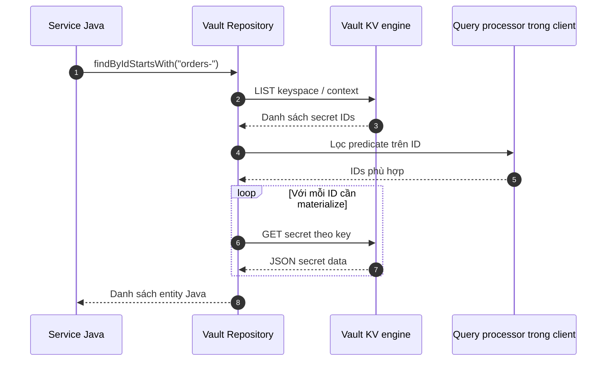
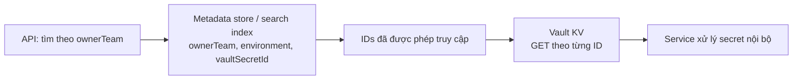

# Giới hạn truy vấn suy diễn theo thuộc tính định danh

## 1. Vấn đề: Repository có nghĩa là tìm kiếm được mọi thuộc tính?

Trong **Spring Vault**, ứng dụng Java dùng `VaultTemplate` hoặc `VaultOperations` để đọc, ghi và xóa secret trong HashiCorp Vault. Khi dữ liệu được ánh xạ thành Java object, **Vault Repository** giúp áp dụng một phần mô hình Spring Data Repository: khai báo entity, `@Id`, interface `CrudRepository` và các phương thức truy vấn suy diễn từ tên method.

Dễ xuất hiện ngộ nhận: nếu Spring Data JPA hỗ trợ `findByOwnerTeam(String ownerTeam)` hoặc `findByStatusAndRegion(...)` thì Vault Repository cũng sẽ thực hiện các truy vấn tương tự. **Không đúng.** Vault KV được tổ chức theo **key/path → secret**, không có query engine hoặc secondary index trên các trường JSON bên trong secret. Vault Repository hỗ trợ **derived query với predicate ràng buộc thuộc tính định danh (ID)**, không phải bộ lọc trên các trường nghiệp vụ bất kỳ.

Ví dụ một entity chứa:

- `id = "orders-prod-gateway"` — định danh ánh xạ tới secret path.
- `ownerTeam = "payments"` — một trường dữ liệu trong body.
- `environment = "prod"` — một trường dữ liệu trong body.
- `clientSecret = "<redacted>"` — giá trị cần bảo vệ.

`findByIdStartsWith("orders-prod-")` là truy vấn có dạng được hỗ trợ vì **điều kiện lọc nhắm tới ID**. Ngược lại, `findByOwnerTeam("payments")` **không phải derived query được Vault Repository hỗ trợ**, dù field `ownerTeam` tồn tại trong entity.

Điểm cần lưu ý thứ hai: **được hỗ trợ về cú pháp không đồng nghĩa được tối ưu trên server**. Với truy vấn theo prefix hoặc regex ID, framework phải làm việc với danh sách key của Vault và áp dụng predicate phía ứng dụng. Khi keyspace lớn, chi phí và quyền `list` có thể trở thành vấn đề chính.

> Phạm vi bài học: **Vault Repository** của Spring Vault trên KV secrets engine, cách suy diễn truy vấn theo ID, phân biệt lọc/sắp xếp/phân trang, hạn chế hiệu năng và bảo mật. Đây không phải tài liệu về query engine của SQL, Elasticsearch hay một API tìm kiếm secret theo nội dung.

## 2. Các khái niệm nền tảng

| Khái niệm | Ví dụ | Vai trò |
| --- | --- | --- |
| **Secrets engine mount** | `kv` | Nơi Vault mount KV v1 hoặc KV v2 |
| **Keyspace** | `integrations` | Tiền tố lưu entity loại `IntegrationSecret` |
| **ID** | `orders-prod-gateway` | Phần định danh cuối của secret; kiểu `String` |
| **Logical secret path** | `integrations/orders-prod-gateway` | Đường dẫn logic tương đối với mount |
| **KV v2 raw data API** | `kv/data/integrations/orders-prod-gateway` | Đường HTTP API thực tế để đọc/ghi secret |
| **ID predicate** | `IdStartsWith("orders-")` | Điều kiện mà Vault Repository có thể áp dụng lên danh sách key |
| **Payload property** | `ownerTeam`, `environment` | Field trong JSON secret; không được tự động index để tìm kiếm |
| **Vault token policy** | `read`/`list` theo path | Xác định workload nào được truy cập key hoặc nhìn thấy danh sách key |

Một **entity ID** có thể được khai báo bằng `@Id` thuộc Spring Data. Thuộc tính tên `id` cũng có thể được coi là định danh khi không gắn annotation, nhưng nên dùng `@Id` để hợp đồng ánh xạ rõ ràng. Với Vault Repository, ID cần là `String`.

### Vì sao Vault không thể xử lý `WHERE ownerTeam = 'payments'`?

Vault KV bảo vệ bí mật gắn với đường dẫn. Một request đọc có dạng logic là “đọc key đã biết”, hoặc một request liệt kê là “liệt kê tên key dưới một context”. Vault không cung cấp truy vấn kiểu “đọc mọi JSON, tìm field `ownerTeam` rồi chỉ trả bản ghi khớp” như database có chỉ mục.

Do đó, Spring Vault Repository chủ yếu có hai chiến lược:

1. Khi **biết đúng ID**, truy cập trực tiếp theo path.
2. Khi **muốn lọc tập ID**, liệt kê các key nằm trong keyspace rồi xử lý điều kiện định danh trong client, có thể tiếp tục đọc các secret khớp và sắp xếp.

Chiến lược thứ hai có thể tăng số lần gọi API, lượng dữ liệu tải và quyền Vault cần cấp. Nó không nên được dùng để thay thế một hệ thống tìm kiếm nghiệp vụ.

## 3. Entity và Repository tối thiểu

Ví dụ dùng KV engine mount tại `kv`, keyspace `integrations`. Định danh secret do ứng dụng quản lý, chẳng hạn `orders-prod-gateway`.

### 3.1. Khai báo entity

```java
package com.example.vault;

import org.springframework.data.annotation.Id;
import org.springframework.vault.repository.mapping.Secret;

@Secret(value = "integrations", backend = "kv")
public class IntegrationSecret {

    @Id
    private String id;

    private String ownerTeam;
    private String environment;
    private String clientSecret;

    public IntegrationSecret() {
        // Constructor cho object mapping.
    }

    public IntegrationSecret(
            String id, String ownerTeam,
            String environment, String clientSecret) {
        this.id = id;
        this.ownerTeam = ownerTeam;
        this.environment = environment;
        this.clientSecret = clientSecret;
    }

    public String getId() { return id; }
    public void setId(String id) { this.id = id; }

    public String getOwnerTeam() { return ownerTeam; }
    public void setOwnerTeam(String ownerTeam) {
        this.ownerTeam = ownerTeam;
    }

    public String getEnvironment() { return environment; }
    public void setEnvironment(String environment) {
        this.environment = environment;
    }

    public String getClientSecret() { return clientSecret; }
    public void setClientSecret(String clientSecret) {
        this.clientSecret = clientSecret;
    }
}
```

Annotation `@Secret` đánh dấu aggregate root và chỉ ra:

- `value = "integrations"`: **keyspace**; dữ liệu được đặt tại `integrations/<id>` trong mount.
- `backend = "kv"`: tên KV **mount** của Vault, không phải `data/` hoặc `metadata/`.
- `@Id String id`: thuộc tính định danh sử dụng để ánh xạ Java object tới key.

**Không lưu giá trị `clientSecret` vào log, `toString()`, exception hay HTTP response**. Entity dùng cho Persistence có thể chứa secret; tách DTO công khai khỏi entity nếu service có API ra ngoài.

Khi repository lưu `IntegrationSecret("orders-prod-gateway", ...)`, logical secret path là `integrations/orders-prod-gateway`. Nếu mount `kv` chạy KV v2, HTTP data API phía Vault tương ứng `kv/data/integrations/orders-prod-gateway`. Spring Vault Repository có cơ chế xác định version KV mount và chọn đúng route; không chèn `data/` vào `@Secret.value` hoặc `id`.

### 3.2. Khai báo Repository

```java
package com.example.vault;

import java.util.List;

import org.springframework.data.repository.CrudRepository;

public interface IntegrationSecretRepository
        extends CrudRepository<IntegrationSecret, String> {

    // Derived query có điều kiện trên thuộc tính định danh.
    List<IntegrationSecret> findByIdStartsWith(String prefix);

    List<IntegrationSecret> findByIdIn(List<String> ids);

    // Điều kiện vẫn trên ID, sorting dùng field khác.
    List<IntegrationSecret>
            findTop5ByIdStartsWithOrderByEnvironmentAsc(String prefix);
}
```

`findById(...)`, `existsById(...)`, `save(...)` và `deleteById(...)` đã có từ `CrudRepository`; không cần khai báo lại. Trong ví dụ này, `findByIdStartsWith(...)` và `findByIdIn(...)` là những derived query dùng predicate trên ID.

Method có `OrderByEnvironmentAsc` minh họa một điểm dễ hiểu nhầm: **giới hạn chỉ áp dụng cho predicate của truy vấn**, còn sorting có thể dựa vào thuộc tính khác. Điều đó **không** có nghĩa Vault tự sắp xếp theo `environment`; Spring Vault thực hiện phần xử lý cần thiết ở phía client.

### 3.3. Bật repository và dependency

```java
package com.example.vault;

import org.springframework.context.annotation.Configuration;
import org.springframework.vault.repository.configuration.EnableVaultRepositories;

@Configuration
@EnableVaultRepositories(
        basePackageClasses = IntegrationSecretRepository.class)
public class VaultRepositoryConfiguration {
    // Cấu hình ứng dụng phải cung cấp VaultOperations/VaultTemplate
    // cùng endpoint, auth, TLS và session management tương ứng.
}
```

Ví dụ dependency Gradle ở mức khái niệm:

```groovy
dependencies {
    implementation("org.springframework.vault:spring-vault-core")
    implementation("org.springframework.data:spring-data-keyvalue")
    // spring-data-commons được Spring Data KeyValue sử dụng.
}
```

Cần quản lý version bằng BOM tương thích của Spring/Spring Data và xác nhận cơ chế cấu hình bean theo **phiên bản thực tế**. `@EnableVaultRepositories` mặc định sử dụng bean `vaultTemplate`/các thành phần KeyValue phù hợp; nếu ứng dụng đã có Spring Cloud Vault autoconfiguration, tránh tạo bean session/client cạnh tranh.

Spring Vault Repository là abstraction dựa trên Spring Data **imperative**. Không mặc định suy rằng một `ReactiveCrudRepository` cho Vault sẽ hoạt động chỉ vì cùng dự án dùng WebFlux. Khi cần truy cập non-blocking, đánh giá `ReactiveVaultOperations` riêng.

## 4. Truy vấn suy diễn được phép: predicate trên ID

Các tên method sau diễn tả các điều kiện theo **thuộc tính định danh**, không tìm trong JSON payload.

| Ví dụ | Ý nghĩa đối với ID | Ghi chú |
| --- | --- | --- |
| `findByIdStartsWith("orders-")` | ID bắt đầu bằng chuỗi `orders-` | Cần xét chi phí liệt kê keyspace |
| `findByIdEndsWith("-prod")` | ID có hậu tố `-prod` | Lọc ID ở client |
| `findByIdContaining("-gateway-")` | ID chứa chuỗi cho trước | Không phải tìm trong field dữ liệu |
| `findByIdBetween("a", "m")` | ID nằm trong khoảng theo quy tắc so sánh | ID là chuỗi, không phải phép so sánh số |
| `findByIdGreaterThan("orders-m")` | ID lớn hơn chuỗi mốc | Không hiểu như so sánh timestamp của secret |
| `findByIdIn(List.of("a", "b"))` | ID thuộc tập truyền vào | Không tự suy rằng một request tối ưu theo index |
| `findByIdNot("old")` | ID khác chuỗi cho trước | Có thể phải xem nhiều key |
| `findByIdRegex(Pattern)` | ID khớp regex | Cần giới hạn độ phức tạp và số key |
| `findByIdStartsWithAndIdEndsWith(...)` | Ghép điều kiện trên ID | Cả hai vế vẫn phải nhắm tới ID |

Một số keyword như `In`, `Between`, `Regex` hoặc `Not` có thể được Spring Vault hỗ trợ tùy phiên bản. Hãy xác minh danh sách keyword và chữ ký method trong tài liệu chính thức của bản đang dùng, đồng thời viết test với Vault thật. Đặc biệt, **cú pháp được Spring Data PartTree phân tích không bảo đảm có một query engine server-side tương ứng**.

### 4.1. Ví dụ ID cấu trúc theo workload

Giả sử quy ước ID của một ứng dụng là:

```text
integrations/
  orders-dev-gateway
  orders-prod-gateway
  orders-prod-billing
  inventory-prod-gateway
```

Với entity keyspace `integrations`:

```java
List<IntegrationSecret> ordersSecrets =
        repository.findByIdStartsWith("orders-");

List<IntegrationSecret> productionOrders =
        repository.findByIdStartsWith("orders-prod-");
```

Kết quả lọc theo chuỗi ID, **không** xác nhận nội dung field `environment` là `prod`. Nếu ID và payload mâu thuẫn (ID có `prod` nhưng payload ghi `environment=dev`), derived query vẫn ra kết quả theo ID.

Quy ước ID có cấu trúc giúp một số truy vấn trở nên biểu diễn được. Tuy vậy, chỉ nên đặt **metadata không nhạy cảm** vào ID; tên secret hoặc đối tác có thể bị lộ khi người dùng có quyền `list`. Không nhét password, access token, email cá nhân hoặc thông tin bí mật vào path.

### 4.2. Các trường hợp không được hỗ trợ

Các method sau minh họa **điều không nên đưa vào repository Vault** như một derived query:

```java
// KHÔNG khai báo các method này trong Vault Repository thực tế.
// Ví dụ sai về khả năng query của backend:
List<IntegrationSecret> findByOwnerTeam(String ownerTeam);
List<IntegrationSecret> findByEnvironmentAndOwnerTeam(
        String environment, String ownerTeam);
List<IntegrationSecret> findByClientSecretContaining(String substring);
```

Mặc dù những tên method có vẻ hợp lệ trong Spring Data JPA, **Vault Repository không hỗ trợ predicate theo các field này**. Tùy phiên bản và thời điểm query được phân tích, ứng dụng có thể lỗi lúc khởi tạo repository hoặc lúc thực thi. Đừng dựa vào việc code **biên dịch Java thành công** để cho rằng Vault có thể tìm kiếm payload.

Ngoài ra, **không dùng quy ước tên giống ID để đánh lừa truy vấn**: `findByEnvironment(...)` vẫn là predicate trên field `environment`, dù giá trị của environment có mặt trong ID.

### 4.3. Truy vấn ID bằng direct lookup không giống query by prefix

`repository.findById("orders-prod-gateway")` có thể truy cập trực tiếp secret tương ứng. Trong khi đó, `findByIdStartsWith("orders-prod-")` cần có cách **liệt kê các ID** thuộc keyspace trước khi lọc.

Tương tự, `findByIdIn(ids)` biểu diễn predicate trên ID theo repository query derivation, nhưng không nên mặc định nó thực thi chính xác như một batch các lời gọi `findById` đã biết key. Nếu đã có tập ID nhỏ, có thể cân nhắc các direct lookups có kiểm soát (và kiểm tra yêu cầu đồng thời) thay vì quét keyspace.

## 5. Repository thực thi derived query như thế nào?

Các bước logic của một truy vấn theo ID:



Sơ đồ là mô hình luồng tổng quát. Thứ tự chi tiết giữa lọc, sort, offset/limit và việc đọc body **phụ thuộc kiểu query**: ví dụ sort bằng payload field buộc phải tải dữ liệu đủ để sắp xếp.

**Không có một request Vault dạng** `GET /query?ownerTeam=payments` do Vault Repository tự sinh ra. Nếu tác vụ cần tìm theo ownerTeam, một repository method chỉ có tên giống SQL không khiến Vault thêm index.

### 5.1. LIST khác GET

- **GET/read:** truy cập secret path đã biết, cần Vault capability `read`.
- **LIST:** khám phá tên key dưới context, cần capability `list` tại đúng đường dẫn KV metadata/list.
- **Metadata listing:** đối với KV v2, endpoint liệt kê sử dụng phần `metadata`; nó tách khỏi `data` path dùng để đọc secret.
- **Repository mount detection:** framework có thể cần gọi `sys/internal/ui/mounts/...` để xác định mount/version KV; policy và cấu hình phải cho phép hoạt động nhận diện mount tương ứng.

Điều này dẫn tới một tình huống rất thực tế: **`findById` có thể đọc được secret nhưng `findByIdStartsWith` thất bại vì không có quyền `list`**. Không sửa lỗi bằng cách cấp `read` trên toàn mount; cần xác định đúng quyền cần thiết và xem việc liệt kê ID có được nghiệp vụ cho phép không.

### 5.2. Filtering không phải authorization

Giả sử API nội bộ nhận `tenantId` rồi gọi:

```java
List<IntegrationSecret> matches =
        repository.findByIdStartsWith(tenantId + "-");
```

**Không coi prefix filter là ranh giới bảo mật tenant.** Truy vấn có thể cần list toàn bộ keyspace; token Vault đang dùng quyết định quyền nhìn thấy ID và đọc secret. Nếu service dùng chung một token quá rộng, mã lọc theo prefix không đảm bảo cách ly tenant trong mọi trường hợp.

Các biện pháp nên kết hợp:

1. Giới hạn danh tính workload bằng Vault role/token policy cho các path được phép.
2. Xác thực/ủy quyền tenant ở tầng API, không cho caller truyền path tuỳ ý.
3. Chuẩn hóa và kiểm tra ID/prefix theo allowlist; không tạo path bằng input chứa `../`, slash hoặc ký tự không hợp lệ.
4. Tách keyspace/mount hoặc token/policy theo tenant hay nhóm workload khi cần ranh giới rõ ràng.
5. Kiểm tra rằng chức năng `list` không tiết lộ tên secret của tenant khác.

## 6. Sorting và paging: hỗ trợ nhưng tốn chi phí

Một điểm đặc thù trong Spring Vault Repository:

**Predicate chỉ hỗ trợ trên ID; sorting có thể dựa vào thuộc tính khác.** Ví dụ:

```java
List<IntegrationSecret> firstFive =
        repository.findTop5ByIdStartsWithOrderByEnvironmentAsc("orders-");
```

Dòng code này không có nghĩa Vault chạy `ORDER BY environment LIMIT 5` trên server. Repository có thể phải liệt kê ID, lấy những secret thích hợp và sắp xếp các Java object ở phía ứng dụng. Với paging/sorting, tài liệu Spring Vault mô tả việc lấy danh sách ID rồi xử lý để đảm bảo kết quả ổn định ngay cả khi thứ tự LIST của Vault thay đổi; việc tải và sắp xếp dữ liệu có thể khiến chi phí đáng kể.

| Hoạt động | Điều dễ hiểu nhầm | Thực tế cần tính đến |
| --- | --- | --- |
| `findByIdStartsWith(prefix)` | Vault tìm prefix bằng index | Query processor lọc danh sách ID |
| `findTop5ByIdStartsWith(...)` | Vault chỉ đọc tối đa 5 key | Cần đánh giá cách lấy ID và áp dụng limit trong client |
| `OrderByEnvironmentAsc` | Vault server sort field payload | Sorting theo field có thể phải tải secret và sort trong memory |
| `Pageable` | Server-side cursor/offset giống database | Offset/limit áp dụng trên tập key/ID; không là cursor query engine |
| `count()`/`findAll()` | Chỉ một lookup rẻ, không cần list | Có thể liệt kê context; cần cân nhắc số key và quyền |
| `findByIdRegex(...)` | Có full-text search engine | Regex áp dụng cho chuỗi ID, không cho nội dung JSON |

**Hệ quả:** `Top5` và `Pageable.ofSize(5)` không phải cam kết chi phí O(5) đối với tất cả query. Nếu có 50.000 key, việc tạo trang đầu theo sort trên payload có thể vẫn rất đắt. Không dùng repository query cho listing dashboard quy mô lớn nếu không có giới hạn dữ liệu và phép đo cụ thể.

### 6.1. Paging và consistency

Vault KV không cung cấp một transaction snapshot cho “LIST tất cả key → lọc → GET từng secret”. Trong thời gian query chạy, một tác vụ khác có thể ghi hoặc xóa secret:

- Một ID xuất hiện trong LIST nhưng GET sau đó trả missing.
- Một secret được cập nhật giữa hai lượt đọc, khiến kết quả sắp xếp không phản ánh một thời điểm thống nhất.
- Các trang truy vấn thực hiện ở thời điểm khác nhau có thể trùng hoặc bỏ sót item nếu keyset thay đổi.
- Pagination dựa trên offset không thích hợp để bảo đảm exactly-once processing trong môi trường cập nhật thường xuyên.

Nếu cần danh sách có consistency và truy vấn phong phú, nên dùng một data store được thiết kế cho indexing/search; Vault tiếp tục giữ nhiệm vụ **bảo vệ và cung cấp secret**, không làm database cho toàn bộ nghiệp vụ.

### 6.2. Đừng trả entity chứa secret chỉ để liệt kê

Một endpoint kiểu `GET /integrations` chỉ cần ID và mô tả metadata nhưng query repository có thể tải toàn bộ entity, bao gồm `clientSecret`. Nếu trả trực tiếp entity qua REST hoặc log collection khi debug, nguy cơ lộ secret rất cao.

Hãy tách DTO kết quả, hạn chế quyền của token, giới hạn số kết quả và tránh các endpoint listing public khi không thật sự cần.

## 7. Quy ước thiết kế ID khi có nhu cầu tìm theo ID

Do predicate tập trung vào ID, việc đặt ID có cấu trúc giúp biểu diễn được truy vấn cần thiết mà không thêm secondary index.

Một quy ước minh họa:

```text
<service>-<environment>-<resource>
orders-prod-gateway
orders-prod-billing
orders-dev-gateway
inventory-prod-gateway
```

**Ưu điểm:** có thể dùng `findByIdStartsWith("orders-prod-")` khi tập key nhỏ và việc list được cho phép.

**Nhược điểm:** dữ liệu không được tối ưu chỉ nhờ tên ID; query vẫn có chi phí list, ID lộ metadata, thay đổi environment có thể đòi hỏi đổi path và không có update nguyên tử xuyên nhiều key. Mã hóa tất cả thuộc tính nghiệp vụ trong ID tạo ràng buộc khó bảo trì.

### Các lựa chọn thiết kế và đánh đổi

| Thiết kế | Khi phù hợp | Rủi ro |
| --- | --- | --- |
| ID ngẫu nhiên không chứa metadata | Direct lookup bằng ID đã biết | Không hỗ trợ lọc theo thuộc tính nghiệp vụ |
| ID có prefix theo workload | Keyspace nhỏ, cần nhóm key theo ID | Tăng khả năng tiết lộ metadata qua LIST |
| Tách keyspace theo dịch vụ/môi trường | Muốn thu hẹp phạm vi và phân quyền | Cần quản lý nhiều path/role và migration |
| Dùng mapping metadata bên ngoài | Cần tìm theo ownerTeam/status/region | Phải quản lý index đồng bộ và bảo mật |
| Dùng database/search chuyên dụng | Cần query/paging/sort phức tạp ở quy mô lớn | Thêm datastore và đồng bộ tham chiếu Vault |

**Lưu ý:** nếu chọn tách path theo tenant, Vault policy phải được thiết kế đồng bộ; tên path trong code không tự cấp ranh giới phân quyền. Nếu không muốn để lộ `tenantId` trong Vault ID, dùng ID ngẫu nhiên và mapping an toàn trong metadata store riêng.

## 8. Khi cần tìm theo field không phải ID

Yêu cầu “tìm mọi integration thuộc `ownerTeam=payments`” không thể được giải quyết chỉ bằng derived query của Vault Repository. Một số phương án:

### 8.1. Biết ID ở tầng nghiệp vụ: dùng direct lookup

Nếu request đã có `integrationId`, ưu tiên:

```java
import java.util.Optional;

import org.springframework.stereotype.Service;

@Service
public final class IntegrationLookupService {

    private final IntegrationSecretRepository repository;

    public IntegrationLookupService(IntegrationSecretRepository repository) {
        this.repository = repository;
    }

    public Optional<String> findClientSecret(String integrationId) {
        if (integrationId == null
                || !integrationId.matches("[a-z0-9-]{1,80}")) {
            throw new IllegalArgumentException("Invalid integration ID");
        }

        // Tầng gọi phải xác thực/ủy quyền quyền truy cập ID này;
        // regex chỉ kiểm tra format chứ không phải authorization.
        return repository.findById(integrationId)
                .map(IntegrationSecret::getClientSecret);
    }
}
```

Ví dụ minh họa API nội bộ. Trong ứng dụng thực, **không trả client secret trực tiếp qua REST**, mà chỉ dùng secret trong thành phần thực thi đúng quyền. Có thể chọn cho service không trả raw secret, mà gọi endpoint bên ngoài hoặc ký request ngay trong lớp tích hợp.

Đây là direct lookup, không dùng derived query scan theo field. Cần hạn chế input path và bảo vệ quyền thực tế bằng Vault policy.

### 8.2. Index metadata bên ngoài — chỉ lưu tham chiếu không nhạy cảm

Nếu truy vấn theo `ownerTeam` là nghiệp vụ cốt lõi, có thể lưu **metadata an toàn** và Vault secret ID trong database tìm kiếm:



Nguyên tắc:

1. Database/index giữ **ID tham chiếu** và metadata thực sự không nhạy cảm; tuyệt đối không replicate `clientSecret`, token, SecretID, private key.
2. Khi nhận tập IDs từ index, service vẫn phải **kiểm tra quyền ở tầng nghiệp vụ và Vault** trước khi đọc từng secret.
3. Cần chiến lược cập nhật metadata và secret khi tạo, đổi hoặc xóa: outbox/saga, reconciliation job, version/checkpoint hoặc quy trình cleanup phù hợp.
4. Chấp nhận **eventual consistency** giữa metadata store và Vault. Index có thể trỏ tới key đã bị xóa hoặc thiếu key vừa tạo.
5. Giới hạn số secret được đọc trong một request; dùng concurrency cap, timeout và observability.
6. Kiểm tra yêu cầu tuân thủ: **ngay cả tên ID, ownerTeam và đường dẫn** có thể là metadata nhạy cảm với một số hệ thống.

Không cung cấp quyền Vault `list` rộng chỉ vì index cần tìm kiếm. Tách hệ thống tìm kiếm không tự mở rộng quyền của các workload.

### 8.3. Client-side filtering sau findAll — chỉ cân nhắc quy mô rất nhỏ

Về kỹ thuật, ứng dụng có thể gọi `findAll()` rồi lọc `ownerTeam` bằng Java Stream. Nhưng đó **không phải derived query theo ownerTeam**, đồng thời có thể tải toàn bộ secret vào memory và làm lộ nhiều giá trị ngoài phạm vi cần dùng.

Chỉ cân nhắc như biện pháp nội bộ có kiểm soát khi **keyspace rất nhỏ**, quyền truy cập rõ ràng, giới hạn số record, không có dữ liệu nhạy cảm không cần thiết và đã đo hiệu năng. Với use case production có tăng trưởng, ưu tiên metadata store hoặc thiết kế lookup theo ID.

## 9. Policy Vault: đọc ID khác quyền liệt kê ID

Một bài thử nghiệm với KV v2 mount `kv`, keyspace `integrations`, có thể dùng policy HCL:

```hcl
# Quyền đọc secret theo ID đã biết.
path "kv/data/integrations/*" {
  capabilities = ["read"]
}

# Nếu thực sự cần derived query phải liệt kê các key.
path "kv/metadata/integrations" {
  capabilities = ["list"]
}
```

Policy này chỉ là **minh họa trên Vault test**. Mẫu wildcard `*` cho phép đọc nhiều integration, có thể **quá rộng cho production**. Trên hệ thống thật, giới hạn capability theo ứng dụng/môi trường/tenant và chỉ cấp `list` khi được phê duyệt.

Với KV v1, đường dẫn read/list tương ứng không có phân đoạn `data/metadata` của KV v2. Spring Vault Repository tự xác định version của mount theo hỗ trợ phiên bản và cấu hình; tài liệu Spring Vault cũng lưu ý việc xác định mount qua endpoint `sys/internal/ui/mounts/...`, do đó workload cần được phép thực hiện **đúng thao tác nhận diện mount** khi backend yêu cầu. Đừng suy rằng thêm `list` cho KV là đủ để giải quyết mọi lỗi bootstrap.

### 9.1. So sánh hai chính sách

| Policy của workload | `findById(id)` | `findByIdStartsWith(prefix)` |
| --- | --- | --- |
| `read` trên đúng secret path, không có `list` | Có thể thành công | Có thể thất bại ở bước liệt kê |
| `list` trên keyspace, không có `read` | Có thể thất bại ở bước đọc | Có thể nhìn thấy ID nhưng không materialize entity |
| `read` + `list` đủ trên phạm vi cần thiết | Đọc được secret được cấp quyền | Lọc ID và đọc secret theo scope được cấp |
| Token root/admin | Có thể “test pass” giả tạo | Che lỗi least-privilege; **không dùng cho app test** |

Kết quả còn phụ thuộc vào việc nhận diện KV mount, auth role, namespace và path thực tế. Khi kiểm thử, dùng token workload và policy định dùng trong production, không dùng root token để kết luận rằng query repository chạy đúng.

### 9.2. LIST có thể là rò rỉ metadata

Một token có `list` tại `kv/metadata/integrations` có thể biết **tên key** dù không có `read` dữ liệu. Trong nhiều tổ chức, tên service, khách hàng hoặc môi trường thể hiện qua ID cũng là thông tin đáng bảo vệ.

Do đó, query derivation trên ID cần được đánh giá như một tính năng **enumeration**: ai được quyền liệt kê, số lượng key tối đa, tần suất và audit đều cần kiểm soát.

## 10. KV v2, versioning và hành vi delete

Vault Repository có hỗ trợ KV v2 ở các phiên bản Spring Vault mới hơn; tài liệu Spring Vault nêu khả năng tự nhận diện engine version tại runtime. Đừng tự gắn `/data/` vào ID hoặc keyspace để “bật KV v2”.

Điểm bổ sung cần nhớ khi repository lưu object:

- KV v2 lưu phiên bản của secret; có thể dùng `@Version` cho optimistic locking/CAS khi phù hợp.
- `save(...)` của repository ghi dữ liệu entity theo cách mapper chuyển thành JSON; nếu có dữ liệu chưa được map mà vẫn nằm cùng path, việc ghi có thể **thay thế body** và làm mất những field đó. Nên quản lý schema keyspace rõ ràng.
- `delete(...)` trên KV v2 có semantics khác việc **destroy vĩnh viễn mọi version**. Không hiểu `CrudRepository.delete(...)` là dữ liệu đã bị phá hủy không thể phục hồi.
- `RevisionRepository` (khi có ở phiên bản dùng) cho phép truy cập các revision theo **ID**, không tạo khả năng query theo thuộc tính JSON.

Ví dụ entity dùng optimistic locking:

```java
import org.springframework.data.annotation.Id;
import org.springframework.data.annotation.Version;
import org.springframework.vault.repository.mapping.Secret;

@Secret(value = "integrations", backend = "kv")
class VersionedIntegrationSecret {

    @Id String id;
    @Version int version;
    String ownerTeam;
    String clientSecret;
}
```

Nếu có hai tiến trình sửa cùng một secret từ version cũ, một thao tác có thể thất bại do CAS. Đây là bảo vệ **ghi đè cạnh tranh theo ID**, không phải tính năng lọc `findByOwnerTeam`. Khi sử dụng, kiểm tra kiểu numeric của field `@Version`, chính sách KV v2 và cách xử lý xung đột `OptimisticLockingFailureException`.

## 11. Hiệu năng, quan sát và xử lý lỗi

### 11.1. Mô hình chi phí

Giả sử có `N` secret IDs trong keyspace, và `K` IDs thỏa predicate. Một truy vấn theo ID prefix có thể phải nhận danh sách nhiều IDs trước khi xác định `K` secret cần đọc. Nếu sort theo field body, framework có thể phải materialize nhiều hoặc toàn bộ entity thích hợp trước khi sắp xếp.

Chi phí thực tế phụ thuộc engine, cách Vault trả LIST, phiên bản repository và mode sorting/paging; tuy nhiên **không có đảm bảo truy vấn prefix có chi phí tỉ lệ với số kết quả cuối cùng** như một query được index.

Ví dụ `Top10` là giới hạn **đầu ra**, không phải bằng chứng chỉ có 10 network calls. Đo Vault audit/HTTP metrics để biết số LIST/GET thực tế thay vì đoán từ tên method.

### 11.2. Những chỉ số cần theo dõi

- Thời gian chạy các operation `findById`, `findByIdStartsWith`, `findAll` và `count`.
- Số lần gọi LIST và GET trên Vault theo keyspace, nhóm workload.
- Số ID được liệt kê so với số entity trả về, đặc biệt khi filter hiếm.
- Tỷ lệ `403` thiếu quyền, `404` không thấy key, `429`/`5xx` và network timeout.
- Memory usage/GC khi sắp xếp hoặc phân trang tập lớn.
- Mức tăng số key theo thời gian và tỷ lệ request mang predicate rộng.
- Login/renew/re-auth của `VaultSessionManager`, vì token hết hạn có thể làm repository query giữa chừng thất bại.

Không đưa `clientSecret`, Vault token, SecretID, ciphertext, full JSON entity hoặc tên ID nhạy cảm vào log/metrics/tracing. Nếu cần audit một truy vấn, dùng ID đã được hash/redact và kênh nội bộ có kiểm soát.

### 11.3. Bảng chẩn đoán

| Hiện tượng | Nguyên nhân có thể | Cách xác định |
| --- | --- | --- |
| Repository không khởi tạo được khi thêm `findByOwnerTeam` | Predicate không nằm trên `@Id` | Chuyển sang direct ID lookup hoặc metadata index |
| `findById` chạy nhưng `findByIdStartsWith` trả `403` | Thiếu `list` trên context KV | Kiểm tra `metadata` path của KV v2, keyspace và policy |
| Cả `findById` lẫn query list không hoạt động | Auth role/path, KV mount/version hoặc mount detection permission | Kiểm tra chính xác workload token và `sys/internal/ui/mounts` |
| `findByIdStartsWith` trả thiếu key | ID không theo quy ước, keyspace sai hoặc concurrent change | Kiểm tra logical path và danh sách IDs trong test |
| `findTop10ByIdStartsWith` phản hồi chậm | Repository list nhiều IDs hoặc phải fetch/sort entity | Đo số LIST/GET, giới hạn keyspace và thiết kế query |
| `findAll` tải quá nhiều dữ liệu | Keyspace tăng nhưng API không giới hạn | Không expose endpoint này; thay data store/index |
| `deleteById` trên KV v2 nhưng phiên bản cũ vẫn còn | Soft delete/versioning semantics | Phân biệt delete, undelete và destroy theo quyền |
| `save` gây mất field JSON ngoài entity | Mapper ghi lại body secret | Quản lý schema và tránh chia sẻ secret path giữa writer khác |
| Unit test pass nhưng production `403` | Test dùng root token hoặc mock không kiểm tra policy | Integration test bằng token/policy workload thật |

## 12. Thực hành: chứng minh giới hạn derived query

Dùng Vault thử nghiệm cô lập và KV v2 mount `kv`. Không dùng production secrets hoặc root token trong ứng dụng kiểm thử. Quy trình:

1. **Khởi tạo dữ liệu:** lưu 4 entity `IntegrationSecret` với ID `orders-dev-gateway`, `orders-prod-gateway`, `orders-prod-billing`, `inventory-prod-gateway`; dùng secret giả như `test-only-credential`.
2. **Xác minh direct lookup:** gọi `repository.findById("orders-prod-gateway")`, kiểm tra object được trả với đúng ID.
3. **Lọc ID:** gọi `findByIdStartsWith("orders-prod-")`, xác minh chỉ thu được các ID tương ứng, không suy ra field `ownerTeam`.
4. **Kiểm thử field khác ID:** thử khai báo `findByOwnerTeam(...)` trong **test repository riêng** và ghi nhận cơ chế từ chối/không hỗ trợ của phiên bản thực tế. Không đưa method sai vào repository production vì có thể khiến application context không khởi động.
5. **Kiểm thử sorting:** gọi `findTop5ByIdStartsWithOrderByEnvironmentAsc("orders-")`; so sánh thứ tự và quan sát lượng LIST/GET.
6. **Policy chỉ read:** tạo token test chỉ có `read` đúng secret, không có `list`; kiểm tra direct lookup và derived query để tái hiện thiếu capability.
7. **Policy có read/list:** cấp `list` trên đúng keyspace, xác minh query hoạt động; kiểm tra token không thể đọc path ngoài scope.
8. **Đánh giá hiệu năng:** thêm nhiều dummy IDs rồi so sánh latency và số request; giới hạn dataset để không gây tải lớn.
9. **Thử concurrency:** xóa hoặc cập nhật một secret trong khi đang list/GET; quan sát handling cho dữ liệu mất hoặc thay đổi giữa query.
10. **Kiểm tra log:** xác nhận không có token, username/password hoặc toàn bộ entity trong exception, stdout hay trace.

### 12.1. Unit test cho logic nghiệp vụ theo ID

Ví dụ mock repository để xác nhận service chỉ đọc một ID được phép:

```java
import static org.junit.jupiter.api.Assertions.assertEquals;
import static org.mockito.Mockito.verify;
import static org.mockito.Mockito.when;

import java.util.Optional;

import org.junit.jupiter.api.Test;
import org.mockito.Mockito;

class IntegrationLookupServiceTest {

    @Test
    void looksUpByExactId() {
        IntegrationSecretRepository repository =
                Mockito.mock(IntegrationSecretRepository.class);

        IntegrationSecret secret = new IntegrationSecret(
                "orders-prod-gateway", "payments", "prod", "demo-only");
        when(repository.findById("orders-prod-gateway"))
                .thenReturn(Optional.of(secret));

        IntegrationLookupService service =
                new IntegrationLookupService(repository);

        assertEquals(Optional.of("demo-only"),
                service.findClientSecret("orders-prod-gateway"));
        verify(repository).findById("orders-prod-gateway");
    }
}
```

Unit test này **không chứng minh Vault Repository có query engine**, chỉ kiểm tra service gọi đúng `findById`. Để thử query derivation và policy, phải có **integration test với Vault thật**.

### 12.2. Integration test quan trọng hơn cho giới hạn backend

Trong môi trường test có thể dùng Testcontainers Vault hoặc Vault server cô lập:

- Bật KV v2 mount và tạo data path tương ứng với keyspace.
- Chạy cấu hình `@EnableVaultRepositories`, Vault client và auth workload bằng dependency thật.
- Xác nhận framework nhận diện đúng KV mount version; kiểm tra policy cần thiết cho `sys/internal/ui/mounts/...`.
- Kiểm tra `findByIdStartsWith` có kết quả và thiếu `list` gây từ chối theo hành vi Vault.
- Kiểm tra reject hoặc failure của method lọc `ownerTeam`, tránh suy từ test mock.
- Kiểm tra sorting/paging và số API calls trên dataset đủ lớn để bộc lộ chi phí.
- Kiểm tra không thể đọc hoặc liệt kê ID ngoài phạm vi role/policy; kiểm tra case multi-tenant.

Các lỗi permission trong repository được ánh xạ thành exception Java theo từng phiên bản; tránh khẳng định một exception subclass cố định khi chưa quan sát runtime thực tế.

## 13. Checklist trước khi triển khai

- Xác định mục tiêu: **lookup theo ID** hay **tìm kiếm theo thuộc tính nội dung**. Vault Repository chỉ hỗ trợ derived query predicate theo `@Id`.
- Khai báo `@Secret` và `@Id String` rõ ràng, đặt mount/keyspace theo thiết kế phân quyền.
- Ưu tiên `findById(id)` khi đã biết ID; không gọi `findAll()` để tự tìm một key.
- Hiểu rằng `findByIdStartsWith`, `findByIdIn`, `findByIdRegex` có thể phải liệt kê danh sách IDs và áp dụng predicate ở client.
- Không dùng `findByOwnerTeam`/`findByEnvironment` như một derived query Vault; chuyển sang metadata index hoặc backend tìm kiếm thích hợp.
- Sorting theo field khác ID có thể hợp lệ, **nhưng không được đẩy xuống Vault**; paging/`TopN` không đảm bảo ít request hoặc ít memory.
- Cấp đúng `read` và `list` trên KV v1/v2 path, đồng thời kiểm tra quyền mount detection khi repository khởi tạo.
- Coi quyền `list` là quyền **nhìn thấy tên secret IDs**, không tự động cấp cho mọi workload.
- Thiết kế prefix ID không làm lộ thông tin bí mật; kiểm tra input path và **không coi prefix filter là tenant authorization**.
- Với KV v2, hiểu revision, `@Version`/CAS và delete/undelete/destroy; chúng không tạo secondary index.
- Không lưu dữ liệu secret trong external index; nếu cần search, chỉ dùng metadata phù hợp và có cơ chế đối soát nhất quán.
- Giám sát LIST/GET, latency, số IDs, memory, policy denial, token/session lifecycle và giới hạn concurrency.
- Test với Vault thật và token quyền tối thiểu, không chỉ mock repository; không đưa secret ra log/REST.

**Ghi nhớ:** Vault Repository dùng mô hình Spring Data nhưng vẫn chịu giới hạn của HashiCorp Vault KV: **định danh quyết định key/path, còn dữ liệu JSON không có index tìm kiếm**. Derived queries chỉ áp dụng predicate lên `@Id`; sorting/paging được xử lý ở phía client và có thể tốn nhiều tài nguyên. Hãy dùng direct lookup theo ID cho secret, cấp quyền `list` một cách thận trọng và đặt truy vấn theo field nghiệp vụ ở một metadata store/search system phù hợp.

## Tài liệu tham khảo

- Spring Vault — Vault Repositories, query derivation, paging/sorting và KV v2: https://docs.spring.io/spring-vault/reference/vault/vault-repositories.html
- Spring Vault — API `VaultQuery` (predicate chỉ theo ID): https://docs.spring.io/spring-vault/reference/api/java/org/springframework/vault/repository/query/VaultQuery.html
- Spring Vault — Annotation `@Secret`: https://docs.spring.io/spring-vault/reference/api/java/org/springframework/vault/repository/mapping/Secret.html
- Spring Vault — `@EnableVaultRepositories`: https://docs.spring.io/spring-vault/reference/api/java/org/springframework/vault/repository/configuration/EnableVaultRepositories.html

