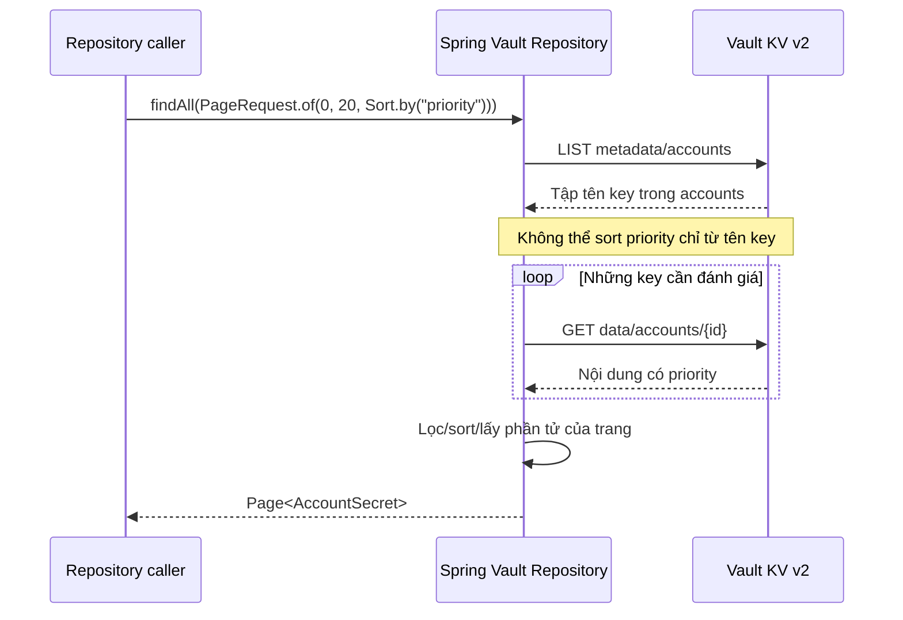

# Phân trang, sắp xếp và chi phí đọc khóa trong Vault Repository

## 1. Bài toán: API repository có Page nhưng Vault không phải cơ sở dữ liệu truy vấn

Trong chương **Vault Repository** của module **Spring Vault**, ứng dụng Java có thể sử dụng repository theo phong cách Spring Data để lưu và đọc object tại HashiCorp Vault KV secrets engine. So với gọi từng endpoint bằng `VaultTemplate`, repository giúp đơn giản hóa CRUD, truy vấn dựa trên định danh, phân trang và sắp xếp.

Tuy nhiên, một interface có phương thức `findAll(Pageable)` **không có nghĩa Vault hỗ trợ truy vấn `OFFSET/LIMIT/ORDER BY` ở phía server như PostgreSQL**. Vault KV được tối ưu cho truy xuất bí mật theo đường dẫn, không phải tìm kiếm nhiều bản ghi. Với repository, việc phân trang và sắp xếp có thể dẫn tới nhiều lượt **LIST tên khóa**, **GET từng secret**, rồi lọc, sort và lấy trang trong bộ nhớ ứng dụng.

Ví dụ: dịch vụ `orders-api` quản lý một số secret cấu hình bằng `AccountSecretRepository`. Người dùng nội bộ muốn xem “trang đầu tiên gồm 20 bản ghi, sắp theo `priority` giảm dần”. Dù chỉ cần 20 bản ghi ở giao diện, ứng dụng có thể cần biết các bản ghi khác để tìm ra 20 phần tử đứng đầu theo `priority`. Nếu keyspace có hàng nghìn secret, việc dùng repository để làm một API tìm kiếm tổng quát có thể gây tải và độ trễ không mong muốn.

Sau bài này, bạn có thể:

1. Mô tả giới hạn truy vấn của Vault KV: **LIST key name**, GET từng secret, không có search/pagination/sort tổng quát phía server.
2. Khai báo repository hỗ trợ `PagingAndSortingRepository`, `Pageable` và `Sort` đúng cách.
3. Phân biệt lọc theo `@Id` với sắp xếp theo trường payload, và dự đoán chi phí tương ứng.
4. Hiểu tại sao `findAll(PageRequest.of(...))` không chắc tiết kiệm GET theo tỷ lệ kích thước trang.
5. Dùng định danh, keyspace và kiến trúc index phù hợp để giảm phạm vi liệt kê.
6. Cấu hình KV v2 ACL, workload authentication, đo số request và viết kiểm thử tích hợp không làm lộ bí mật.

## 2. Cơ chế lưu trữ của Vault Repository

Vault Repository dùng **key/value secrets engine** làm storage. Một class có `@Secret` và trường `@Id` được ánh xạ tới đường dẫn dạng:

```text
<kv-mount>/<keyspace>/<id>
        |        |     |
       kv-lab  accounts acct-001
```

Với KV v2 mount `kv-lab/` và entity `@Secret(value="accounts", backend="kv-lab")`, đường dẫn logic ví dụ là `kv-lab/accounts/acct-001`; HTTP API đọc nội dung tương ứng dùng `kv-lab/data/accounts/acct-001`. Spring Vault Repository tự phát hiện version của mount theo cơ chế hỗ trợ của thư viện, không yêu cầu ứng dụng tự ghép `data/` trong `@Secret`.

Ví dụ một aggregate đơn giản cho lab:

```java
import org.springframework.data.annotation.Id;
import org.springframework.vault.repository.mapping.Secret;

@Secret(value = "accounts", backend = "kv-lab")
public class AccountSecret {

    @Id
    private String id;

    private String label;
    private int priority;

    public AccountSecret() {
        // Spring Data mapping
    }

    public AccountSecret(String id, String label, int priority) {
        this.id = id;
        this.label = label;
        this.priority = priority;
    }

    public String getId() {
        return id;
    }

    public String getLabel() {
        return label;
    }

    public int getPriority() {
        return priority;
    }
}
```

Trong ứng dụng thật, entity có thể chứa username/password/API credential. **Không log hoặc trả về HTTP toàn bộ entity**. Các trường `label` và `priority` ở ví dụ chỉ dùng để học về sort, không chứa bí mật.

Một repository mặc định không cung cấp tất cả tính năng của JPA: không có JOIN, aggregation, secondary index hay truy vấn server-side theo trường bất kỳ. Các query method của **Vault Repository** được Spring Vault triển khai dựa trên khả năng của KV và thao tác bổ sung phía client.

## 3. LIST trong KV v2: đầu vào quan trọng của phân trang

KV v2 có endpoint liệt kê **tên** các key tại một thư mục:

```http
LIST /v1/kv-lab/metadata/accounts
X-Vault-Token: <TOKEN>
```

Response minh họa:

```json
{
  "data": {
    "keys": [
      "acct-001",
      "acct-002",
      "acct-003",
      "archive/"
    ]
  }
}
```

Những điểm cần nhớ:

- LIST trả **key name**, không trả payload đầy đủ như `label`, `priority` hay password.
- Với KV v2, quyền LIST nằm trên path **`metadata/`**, còn quyền GET dữ liệu nằm trên **`data/`**.
- LIST hoạt động trên **đường dẫn thư mục**, có thể trả tên thư mục con với dấu `/`.
- Vault không thực hiện **lọc tên khóa theo ACL cho từng key** khi trả LIST. Không mã hóa thông tin nhạy cảm (email, số định danh, token, tenant secret...) trong tên key.
- Không có API phân trang/sắp xếp tổng quát theo tham số SQL-style `page`, `size`, `sort` trên endpoint LIST KV v2.

Do đó, khi một repository cần truy vấn `N` key trong keyspace, ứng dụng có thể phải xử lý danh sách tên của chúng trước. Nếu cần sắp theo một thuộc tính **không nằm trong tên khóa**, phải đọc dữ liệu của các ứng viên để biết giá trị trường đó.

### 3.1. Mối liên hệ giữa LIST và đọc secret



Đây là mô hình khái niệm. **Số GET thực tế phụ thuộc query, sort, cách cài đặt repository và phiên bản thư viện**; không coi sơ đồ là cam kết luôn GET đúng `N` hoặc chỉ GET đúng `pageSize`. Điều chắc chắn là Vault không thể sort theo `priority` từ phản hồi LIST chỉ chứa tên.

## 4. Khai báo repository hỗ trợ phân trang và sắp xếp

Spring Vault tích hợp Spring Data repository. Với Spring Data 3.x/4.x, `PagingAndSortingRepository` là một **repository fragment riêng**, không mặc nhiên mở rộng `CrudRepository`. Nếu cần cả CRUD và phân trang, hãy khai báo rõ hai interface:

```java
import java.util.List;

import org.springframework.data.domain.Pageable;
import org.springframework.data.repository.CrudRepository;
import org.springframework.data.repository.PagingAndSortingRepository;

public interface AccountSecretRepository
        extends CrudRepository<AccountSecret, String>,
                PagingAndSortingRepository<AccountSecret, String> {

    // Truy vấn dựa trên Id, nhận tham số phân trang.
    List<AccountSecret> findByIdStartsWith(
            String prefix, Pageable pageable);

    // Sắp xếp theo trường nội dung priority.
    List<AccountSecret> findTop5ByIdStartsWithOrderByPriorityDesc(
            String prefix);
}
```

Cấu hình quét repository:

```java
import org.springframework.context.annotation.Configuration;
import org.springframework.vault.repository.configuration.EnableVaultRepositories;

@Configuration
@EnableVaultRepositories(
        basePackageClasses = AccountSecretRepository.class)
public class VaultRepositoryConfiguration {
    // VaultTemplate, VaultEndpoint, SessionManager, TLS và auth
    // đã được khai báo theo cấu hình Spring Vault của ứng dụng.
}
```

Cần `spring-vault-core`, Spring Data Commons/KeyValue cùng **các phiên bản tương thích**. Đường dẫn secret được quyết định bởi `@Secret` và `@Id`. Workload đăng nhập qua AppRole, Kubernetes Auth hoặc cert auth; token cấp cho repository phải có ACL đúng mount và keyspace.

Một đoạn service gọi repository:

```java
import org.springframework.data.domain.Page;
import org.springframework.data.domain.PageRequest;
import org.springframework.data.domain.Sort;
import org.springframework.stereotype.Service;

@Service
public class AccountSecretSearch {

    private final AccountSecretRepository repository;

    public AccountSecretSearch(AccountSecretRepository repository) {
        this.repository = repository;
    }

    public Page<AccountSecret> firstPageById() {
        return repository.findAll(
                PageRequest.of(0, 20, Sort.by("id").ascending()));
    }

    public Page<AccountSecret> firstPageByPriority() {
        return repository.findAll(
                PageRequest.of(0, 20, Sort.by("priority").descending()));
    }
}
```

**Page index bắt đầu từ 0**. `PageRequest.of(0, 20, ...)` nghĩa là trang đầu với `size=20`, không phải “lấy từ key thứ 1 trong Vault” bằng một tham số server-side. Khi cần dùng kết quả làm HTTP response, chỉ chuyển sang DTO an toàn đã lọc trường bí mật.

## 5. Lọc theo `@Id` và sắp xếp theo trường khác có chi phí khác nhau

Spring Vault hỗ trợ **query derivation** chỉ với predicate áp dụng trên `@Id`. Ví dụ:

- `findByIdStartsWith("acct-")`: lọc tên ID có prefix.
- `findByIdBetween("acct-100", "acct-200")`: lọc theo khoảng giá trị ID.
- `findByIdIn(ids)`: lọc trên tập ID định trước.
- `findByIdRegex(pattern)`: lọc ID theo biểu thức regex.

Những predicate đó là điều kiện đối với **ID**, không phải query Vault để tìm những secret có nội dung `priority > 5`. Ví dụ phương thức `findByPriorityGreaterThan(5)` **không phải một query dẫn xuất được Vault Repository hỗ trợ** chỉ vì class có trường `priority`.

Ngược lại, **sorting có thể chỉ định trường khác ID**, ví dụ `Sort.by("priority")` hoặc `OrderByPriorityDesc`. Nhưng lúc đó repository phải biết giá trị `priority` từ nội dung secret để so sánh các ứng viên, nên có nguy cơ phát sinh nhiều GET.

| Yêu cầu | Lọc/sắp trên gì? | Điều phải xem xét |
|---|---|---|
| `findById("acct-001")` | Một ID đã biết | Truy xuất trực tiếp, tránh quét keyspace |
| `findByIdStartsWith("acct-")` | ID string | Cần danh sách ID của ngữ cảnh, lọc phía ứng dụng |
| `findAll(PageRequest.of(0,20, Sort.by("id")))` | ID | Cần list ID; tối ưu đọc data phụ thuộc triển khai |
| `findAll(PageRequest.of(0,20, Sort.by("priority")))` | Trường payload | Có thể phải đọc rộng các ứng viên trước khi sort |
| `findTop5ByIdStartsWithOrderByPriorityDesc("acct-")` | ID filter + payload sort | “Top 5” **không bảo đảm chỉ 5 GET** |
| `findAll(Sort.by("label"))` | Payload sort toàn keyspace | Dễ cần đọc nhiều secret; không phù hợp keyspace lớn |

**Phân trang không có nghĩa Vault chỉ đọc 20/`pageSize` key**. Nếu bạn sort theo field của secret, ứng dụng không thể biết item nào đứng đầu nếu chưa nắm được dữ liệu để so sánh.

### 5.1. Tránh hiểu nhầm query method

Trong RDBMS, `WHERE priority >= 5 ORDER BY priority DESC LIMIT 5` thường được đẩy xuống database, nhất là khi có index. Vault KV **không có query planner/index đó**. Khi sử dụng Spring Data Vault Repository, tên method trông giống Spring Data JPA nhưng ngữ nghĩa thực thi phải tuân theo tính năng KV: predicate dựa trên ID, còn sorting/paging phần lớn được xử lý trong lớp repository.

## 6. Chi phí đọc khóa: mô hình để dự toán

Gọi:

- `N`: số key trong keyspace mà thao tác LIST có thể trả về.
- `M`: số ứng viên còn lại sau khi áp điều kiện ID.
- `P`: kích thước trang cần lấy.
- `L`: số request LIST thực tế.
- `R`: số request GET dữ liệu secret thực tế.
- `t_list`, `t_get`: latency điển hình của LIST và GET.

Một mô hình trực giác:

```text
Chi phí request ≈ L + R
Chi phí dữ liệu ≈ danh sách N tên key + tổng payload của R secret

Nếu GET chạy tuần tự:
  latency gần đúng ≈ L * t_list + R * t_get + xử lý phía Java

Nếu có đồng thời:
  latency khác, nhưng R request vẫn tiêu thụ tải phía Vault.
```

Đây là **mô hình dự toán**, không phải công thức ràng buộc implementation. Các yếu tố khác còn có TLS, authentication/token renewal, Vault storage latency, retry và thời gian chuyển đổi JSON.

Ví dụ minh họa hoàn toàn giả định:

| Phép đọc | `N` | `P` | `R` minh họa | Ý nghĩa |
|---|---:|---:|---:|---|
| Lấy `findById("acct-001")` | Không cần list toàn bộ | 1 | 1 | Đọc đúng key |
| Trang 1 theo ID | 2.000 | 20 | Có thể gần số phần tử trang, tùy cách triển khai | LIST vẫn phải xét keyspace rộng |
| Trang 1 theo `priority` | 2.000 | 20 | Có thể lên tới số ứng viên cần so sánh | Sort theo payload tốn thêm GET |
| `findAll(Sort.by("label"))` | 2.000 | Không giới hạn | Có thể xấp xỉ 2.000 | Tránh tải toàn bộ secret để tạo UI |

Nếu giả định mỗi GET mất trung bình 15 ms và thực hiện tuần tự 2.000 GET thì riêng phần GET đã tương đương **30 giây**. Đây là phép tính minh họa, **không phải số đo Vault**. Thực tế cần đo số request, latency, concurrency và tốc độ xử lý trên phiên bản đang triển khai.

### 6.1. Page, Slice và việc đếm

`Page<T>` thường chứa thông tin tổng số phần tử để hiển thị số trang; việc xác định tổng số trong KV có thể yêu cầu quét/liệt kê ID của context. `Slice<T>` về mặt khái niệm chỉ quan tâm còn trang kế tiếp, nhưng không được mặc định rằng một phương thức trả `Slice` hoặc `List` sẽ giúp Vault **tránh LIST hoặc GET**. Tối ưu thực thi phụ thuộc repository implementation và query thực tế.

## 7. Cách giảm chi phí trong thiết kế

### 7.1. Dùng truy cập trực tiếp khi biết ID

Nếu nghiệp vụ đã biết key, ưu tiên:

```java
repository.findById("acct-001");
```

Điều này tránh nhu cầu chọn key từ một tập lớn. Khi cần truy cập bí mật theo định danh workload, kho KV thường phù hợp hơn mô hình duyệt mọi account.

### 7.2. Thiết kế keyspace hẹp và có mục đích

Thay vì gom tất cả secret vào `accounts/` với hàng chục nghìn key, có thể phân chia theo domain, môi trường hoặc chủ sở hữu:

```text
kv-lab/
  accounts/
    orders/
      acct-001
      acct-002
    reporting/
      acct-101
      acct-102
    billing/
      acct-201
```

Khi sử dụng `@Secret`/repository, nên chọn keyspace phù hợp với ngữ cảnh dữ liệu, và khi cần phân cấp sâu cần xác nhận cách ánh xạ path trong phiên bản Spring Vault đang dùng. **Chỉ thêm prefix vào ID nhưng vẫn LIST cả một keyspace lớn có thể không giảm số tên key phải đọc**, bởi Vault trả danh sách theo folder path chứ không có filter `startswith` phía server.

### 7.3. Tách index tra cứu khỏi Vault

Nếu ứng dụng phải tìm hàng nghìn bản ghi theo `priority`, `createdAt` hoặc nhiều thuộc tính:

1. Lưu **dữ liệu tra cứu không nhạy cảm** (ID, nhóm, trạng thái, thứ tự) trong database/index phù hợp.
2. Dùng index server-side để lọc/sắp xếp/phân trang ID.
3. Chỉ đọc bí mật từ Vault theo **những ID được phép hiển thị/sử dụng**.
4. Đảm bảo ACL Vault vẫn kiểm tra quyền truy cập thực tế; index không phải quyền đọc secret.

Ví dụ:

```text
Client -> Search API -> Database index
                      -> 20 IDs của trang
                      -> Vault GET 20 key theo ID và ACL
                      -> DTO an toàn
```

Cần kế hoạch đồng bộ khi key bị xóa, thay version hoặc chuyển namespace; index không được giữ bản sao password/token/khóa riêng. Với yêu cầu chỉ xem metadata, có thể **không cần đọc payload bí mật** ở bước hiển thị danh sách.

### 7.4. Giới hạn đầu vào từ API và không giả định cache là miễn phí

- Đặt `maxPageSize`, ví dụ 20–50 theo ngân sách request, giới hạn số lần gọi và concurrency.
- Validate `page >= 0`, `size > 0`, chỉ cho phép sort theo những field xác định.
- Không cho client tùy ý truyền `Sort` để kích hoạt quét và đọc cả secret theo field bất kỳ.
- Cache metadata/ID khi thích hợp, nhưng **không cache toàn bộ secret** tùy tiện. Cache phải có TTL, kiểm soát quyền và quy trình xóa khi secret đổi/thu hồi.

## 8. ACL và bảo mật khi cần LIST + GET

Policy chỉ đọc một key:

```hcl
path "kv-lab/data/accounts/acct-001" {
  capabilities = ["read"]
}
```

Policy này **không đủ** cho query cần liệt kê mọi key dưới `accounts/`. Với **KV v2**, cần quyền LIST trên metadata folder và quyền đọc data theo phạm vi thực tế:

```hcl
# Chỉ dùng nếu workload được phép liệt kê các key thuộc accounts.
path "kv-lab/metadata/accounts" {
  capabilities = ["list"]
}

# Chỉ cấp quyền read đúng phạm vi nghiệp vụ.
path "kv-lab/data/accounts/*" {
  capabilities = ["read"]
}
```

Đây là policy **minh họa cho môi trường cô lập**; trong production cần thu hẹp keyspace và identity phù hợp. Đừng cấp wildcard chỉ để “làm paging chạy được” nếu workload chỉ cần một secret theo ID.

Spring Vault Repository xác định mount thông qua `sys/internal/ui/mounts/...`; bảo đảm đường lookup này hoạt động theo cấu hình Vault và policy hiện tại, nếu không repository có thể lỗi ngay trước khi đọc dữ liệu. Khi cần đi qua thư mục con, quyền LIST của các thư mục cấp dưới cũng phải được xem xét.

**Cảnh báo từ Vault:** LIST không áp dụng lọc trả về key name theo policy của từng key. Một token chỉ có quyền READ một số key nhưng được phép LIST folder có thể vẫn nhìn thấy tên của key khác. Vì vậy, tránh đặt email, số định danh, thông tin tài chính hoặc secrets trong **tên key**, và tách folder theo ranh giới quyền.

### 8.1. Không làm lộ secret khi trả kết quả phân trang

`Page<AccountSecret>` là đối tượng chứa entity được đọc từ Vault. Nếu entity thật chứa `password` hoặc `apiKey`, việc trả nguyên `Page` ra REST controller có thể làm lộ dữ liệu. Chỉ dùng các field được phê duyệt:

```java
public record AccountSummary(String id, String label) {}

public Page<AccountSummary> summaries(int page, int size) {
    int safeSize = Math.min(Math.max(size, 1), 20);
    return repository.findAll(
            PageRequest.of(page, safeSize, Sort.by("id")))
            .map(item -> new AccountSummary(
                    item.getId(), item.getLabel()));
}
```

Đoạn code minh họa transformation; **`Page.map(...)` không làm giảm các request Vault đã phát sinh** vì lúc đó repository đã truy vấn xong. Hãy đưa kiểm soát truy cập và danh sách metadata phù hợp lên **trước** lúc GET bí mật nếu cần thực sự tiết kiệm I/O.

## 9. Thực hành trên Vault dev/test với KV v2

Các lệnh dưới đây chỉ dành cho **Vault thử nghiệm cô lập**. Chỉ bật mount khi chưa tồn tại, không sửa hay xóa dữ liệu production.

```bash
# Một lần trong môi trường test chưa có kv-lab.
vault secrets enable -path=kv-lab -version=2 kv

# Hai bản ghi giả. Trong production, tránh truyền secret thật qua shell args.
vault kv put -mount=kv-lab accounts/acct-001 \
  label="Test account A" priority=3

vault kv put -mount=kv-lab accounts/acct-002 \
  label="Test account B" priority=8

# LIST tên key, không phải lấy các payload.
vault kv list -mount=kv-lab accounts/

# GET từng payload khi cần.
vault kv get -mount=kv-lab accounts/acct-001
```

Các lệnh `vault kv put` này cho phép quan sát KV list/read độc lập với repository mapping; với kiểm thử repository đầy đủ, có thể **dùng `repository.save(...)` để tạo fixture** do Spring Data Converter quản lý, bảo đảm định dạng lưu phù hợp.

Nếu dùng role Spring Vault Repository để tạo fixture từ code, token lab phải có `create`/`update` phù hợp với `kv-lab/data/accounts/*`. Trong runtime production **chỉ đọc**, không cấp các quyền ghi này. Test cần có bước dọn fixture theo đúng semantics KV v2: xóa phiên bản mới nhất thường là soft delete; không dùng destroy bừa bãi.

### 9.1. Quan sát đường đi của request

Trong môi trường test, đo:

- **Số request LIST** vào `kv-lab/metadata/accounts`.
- **Số request GET** vào `kv-lab/data/accounts/*`.
- Thời gian phản hồi của từng API và tổng thời gian của lời gọi repository.
- Số key trong keyspace, `page`/`size` và sort field (không chứa bí mật).
- Tỷ lệ lỗi 403/404, timeout, 5xx, token renewal hoặc request bị retry.

Không log `X-Vault-Token`, toàn bộ `VaultResponse`, password/API key hoặc payload repository entity. Vault audit log và HTTP client metrics cần tuân thủ chính sách bảo mật; không đưa identifier nhạy cảm vào metric label có cardinality lớn.

## 10. Kiểm thử chi phí thực tế thay vì suy từ tên phương thức

Một test chức năng có thể xác minh phân trang theo ID:

```java
import static org.junit.jupiter.api.Assertions.assertEquals;
import static org.junit.jupiter.api.Assertions.assertTrue;

import java.util.List;

import org.junit.jupiter.api.Test;
import org.springframework.beans.factory.annotation.Autowired;
import org.springframework.boot.test.context.SpringBootTest;
import org.springframework.data.domain.Page;
import org.springframework.data.domain.PageRequest;
import org.springframework.data.domain.Sort;

@SpringBootTest
class VaultRepositoryPagingIT {

    @Autowired
    AccountSecretRepository repository;

    @Test
    void readsFirstPageInDeterministicIdOrder() {
        // Fixture đã được tạo riêng bằng repository.save(...)
        // trong Vault test, với ít nhất acct-001 và acct-002.
        Page<AccountSecret> page = repository.findAll(
                PageRequest.of(0, 2, Sort.by("id").ascending()));

        List<String> ids = page.getContent().stream()
                .map(AccountSecret::getId)
                .toList();

        assertEquals(2, ids.size());
        assertTrue(ids.contains("acct-001"));
        assertTrue(ids.contains("acct-002"));
    }
}
```

Test phải chạy trên **keyspace test cô lập**, không có bản ghi từ worker khác. `@SpringBootTest` yêu cầu context đã cấu hình `VaultTemplate`, auth, TLS, repositories và chính sách KV v2 phù hợp. Test trên chứng minh kết quả dữ liệu; **chưa chứng minh chi phí thấp**.

Để kiểm tra hiệu năng, hãy dựng kịch bản có thể tái lập (ví dụ 50, 500 rồi 2.000 key giả), đo LIST/GET và latency ở từng cách đọc:

| Test | Truy vấn | Điều cần quan sát |
|---|---|---|
| T1 | `findById("acct-001")` | Direct GET, không cần toàn bộ keyspace |
| T2 | `findAll(PageRequest.of(0, 20, Sort.by("id")))` | List ID và số GET thực tế |
| T3 | `findAll(PageRequest.of(0, 20, Sort.by("priority")))` | Chi phí sort theo payload so với ID |
| T4 | `findTop5ByIdStartsWithOrderByPriorityDesc("acct-")` | `Top5` có thực sự giảm GET hay không |
| T5 | Trang `page=0` và `page=50` | Hiệu ứng offset lớn |
| T6 | Người dùng thêm/bớt key giữa hai request page | Tính ổn định của kết quả |
| T7 | Token chỉ có GET, không có LIST metadata | Repository query thất bại đúng theo ACL |
| T8 | LIST được phép, READ một số ID bị 403 | Không trả kết quả “thành công” một phần một cách âm thầm |
| T9 | Vault timeout/5xx hoặc token hết hạn | Retry hữu hạn, tránh bão LIST + GET |
| T10 | Logging/Actuator/controller | Không tiết lộ tên key nhạy cảm hay payload secret |

Dùng đo từ Vault audit/metrics và HTTP client instrumentation trong môi trường thử nghiệm, hoặc một proxy test đếm request đã được bảo vệ; **không căn cứ duy nhất vào `Page.getSize()`** để kết luận chỉ đọc `pageSize` secret.

## 11. Thứ tự sắp xếp và tính ổn định giữa các trang

### 11.1. Thứ tự tự nhiên của Vault không phải hợp đồng paging

Vault LIST trả tên key nhưng ứng dụng không nên giả định thứ tự tự nhiên sẽ ổn định và phù hợp để phân trang. Spring Vault Repository có logic xử lý sorting/paging phía client nhằm hạn chế phụ thuộc vào thứ tự Vault trả về.

Nếu sort theo một field có **nhiều giá trị trùng nhau** như `priority`, cần cân nhắc thêm khóa phụ duy nhất như ID để đạt thứ tự xác định, khi phiên bản repository và cú pháp sort hỗ trợ:

```java
Sort order = Sort.by(
        Sort.Order.desc("priority"),
        Sort.Order.asc("id"));
```

Dù có thứ tự xác định, **offset paging không phải snapshot transaction**. Nếu key được thêm, xóa hoặc thay đổi `priority` giữa hai lần yêu cầu, phần tử có thể dịch trang và UI có thể gặp lặp/bỏ sót. Đối với kho lớn và thay đổi thường xuyên, nên dùng một index có hỗ trợ cursor/snapshot rõ ràng hoặc thiết kế truy cập bằng ID.

### 11.2. Không nhầm paging entity với paging revision

KV v2 lưu **nhiều version của một key**. Spring Vault còn hỗ trợ `RevisionRepository` để lấy lịch sử phiên bản của **một entity**. Paging `findRevisions(id, Pageable)` thuộc bài toán duyệt các revision của **một ID**, khác với `findAll(Pageable)` để phân trang **nhiều entity/key**. Cả hai vẫn cần quyền và chi phí đọc phù hợp; không coi revision history là một index để tìm entity theo payload.

## 12. Khi nào nên dùng Vault Repository, khi nào không?

| Nhu cầu | Quyết định thực tế |
|---|---|
| Một số ít config/credential theo ID ổn định | Vault Repository hoặc `VaultTemplate` đều phù hợp |
| CRUD đối tượng dạng KV và cần mapping Java tiện dụng | Vault Repository là abstraction hữu ích |
| Tìm kiếm, lọc theo nhiều trường payload, sort theo ngày/priority với hàng nghìn key | Dùng database/search index cho metadata; Vault giữ secret |
| Chỉ muốn xem list tên key | Cân nhắc `VaultTemplate.list(...)` với ACL LIST thay vì đọc mọi secret |
| API public trả `Page<Credentials>` | Không an toàn khi entity chứa secret; chỉ trả DTO/metadata đã kiểm soát |
| WebFlux high-throughput | Repository/VaultTemplate là API đồng bộ; tránh chạy trực tiếp trên event loop |
| Nhiều tenant với quyền truy cập khác nhau | Phân chia keyspace/namespace, ACL và index theo tenant; không chỉ lọc ID phía client |

**Quy tắc lựa chọn:** nếu mục tiêu chính là **lấy đúng một secret khi biết key**, Vault KV rất phù hợp. Nếu mục tiêu chính là **truy vấn nhiều bản ghi có filter/sort/pagination linh hoạt**, nên để một hệ thống được thiết kế cho query làm phần index và chỉ dùng Vault làm nguồn bí mật có phân quyền.

## 13. Câu hỏi tự kiểm tra

**Câu 1.** Vì sao `findAll(PageRequest.of(0, 20, Sort.by("priority")))` không bảo đảm chỉ có 20 GET tới Vault?

**Trả lời:** `priority` nằm trong nội dung các secret; LIST chỉ trả tên key. Để biết 20 phần tử có priority cao nhất, repository có thể phải đọc nhiều ứng viên trước khi sort.

**Câu 2.** Với KV v2, ACL nào cần cho `LIST accounts/` và ACL nào cho `GET acct-001`?

**Trả lời:** LIST dùng `kv-lab/metadata/accounts` với capability `list`, còn GET dữ liệu dùng `kv-lab/data/accounts/acct-001` với capability `read`.

**Câu 3.** Có thể viết `findByPriorityGreaterThan(5)` và mong Vault truy vấn server-side không?

**Trả lời:** Không. Query derivation của Spring Vault Repository chỉ hỗ trợ predicate trên trường ID; Vault KV không có query engine cho `priority`.

**Câu 4.** Spring Data 3.x có `PagingAndSortingRepository` tự kế thừa `CrudRepository` không?

**Trả lời:** Không. Nếu cần cả CRUD và paging/sorting, khai báo đồng thời hai interface hoặc repository fragment phù hợp với phiên bản Spring Data đang dùng.

**Câu 5.** Một trang đã sort theo ID có thể bị đổi phần tử khi một key mới được thêm giữa hai request page không?

**Trả lời:** Có. Sắp xếp ổn định không tương đương snapshot transaction; offset paging vẫn bị ảnh hưởng bởi thay đổi dữ liệu giữa các lần truy vấn.

## 14. Tài liệu tham khảo

- [Spring Vault – Vault Repositories: Queries, Sorting and Paging](https://docs.spring.io/spring-vault/reference/vault/vault-repositories.html)
- [Spring Vault – @Secret annotation](https://docs.spring.io/spring-vault/reference/api/java/org/springframework/vault/repository/mapping/Secret.html)
- [Spring Data Commons – PagingAndSortingRepository](https://docs.spring.io/spring-data/commons/docs/current/api/org/springframework/data/repository/PagingAndSortingRepository.html)
- [HashiCorp Vault – KV v2 API: List secrets](https://developer.hashicorp.com/vault/api-docs/secret/kv/kv-v2)
- [HashiCorp Vault – ACL Policies](https://developer.hashicorp.com/vault/docs/concepts/policies)

**Ghi nhớ:** Spring Vault Repository hỗ trợ `Pageable` và `Sort` ở tầng Spring Data, nhưng Vault KV chỉ có **LIST tên key và READ theo path**. Lọc theo ID, sắp xếp và phân trang có thể kéo theo nhiều request; đặc biệt sort theo trường payload có thể phải đọc nhiều secret trước khi trả một trang nhỏ. Hãy đo số LIST/GET, thu hẹp keyspace, ưu tiên truy cập trực tiếp bằng ID và dùng index bên ngoài nếu cần truy vấn quy mô lớn.
