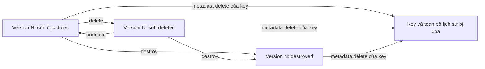

# Ý nghĩa `delete` trên engine KV có phiên bản

Khi ứng dụng Java dùng **Spring Vault** để đọc hoặc ghi bí mật vào **HashiCorp Vault**, một thao tác mang tên `delete` có thể gây hiểu lầm: xóa một secret có đồng nghĩa với việc dữ liệu biến mất vĩnh viễn không? Với **KV secrets engine phiên bản 2 (KV v2)**, câu trả lời là **không**. Phần lớn thao tác `delete` chỉ *đánh dấu xóa* một phiên bản, giữ lại dữ liệu để có thể khôi phục. Muốn hủy dữ liệu thật sự, phải gọi một thao tác khác với quyền truy cập riêng.

Bài này thuộc chương **Vault Repository** và giải thích đầy đủ ý nghĩa của `delete` đối với kho KV có version, cách nó ảnh hưởng tới các lần đọc của ứng dụng, cách thao tác qua `VaultTemplate`, cũng như các hệ quả về phân quyền, xử lý lỗi và vận hành.

## 1. Trước tiên: KV v1 và KV v2 khác nhau ở đâu?

Vault có hai kiểu KV engine cần phân biệt:

| Thuộc tính | KV v1 | KV v2 |
|---|---|---|
| Lưu các phiên bản trước | Không: ghi lại sẽ thay thế giá trị | Có: mỗi lần ghi tạo một version mới |
| `delete` thông thường | Xóa secret khỏi key, không có cơ chế `undelete` theo version | Soft delete, đánh dấu version không còn đọc được |
| Khôi phục version đã soft delete | Không hỗ trợ | Có, dùng `undelete` nếu version chưa bị destroy/loại bỏ |
| Xóa vĩnh viễn một version | Không có khái niệm version | `destroy` |
| Xóa toàn bộ lịch sử của một key | Xóa key | `metadata delete` |
| Đường dẫn API dữ liệu | `secret/<path>` | `secret/data/<path>` |

Trong bài, giả sử KV v2 được mount tại `secret/`, còn secret của ứng dụng nằm ở đường dẫn tương đối `apps/payments`. Vì vậy:

- **Mount:** `secret` — tên KV engine.
- **Secret path:** `apps/payments` — key nằm bên trong engine.
- **API đọc/ghi secret:** `/v1/secret/data/apps/payments`.
- **API quản lý lịch sử:** những endpoint riêng như `/v1/secret/metadata/apps/payments`.

Trong `VaultVersionedKeyValueOperations` của Spring Vault, ta truyền `secret` làm tên mount và `apps/payments` làm path. Không tự nối `data/` vào path, bởi API của Spring Vault xử lý tiền tố tương ứng.

## 2. Version là gì và điều gì xảy ra sau khi delete?

Giả sử một ứng dụng lưu ba lần giá trị của `apps/payments`:

| Version | Giá trị minh họa | Trạng thái ban đầu |
|---|---|---|
| 1 | `api-key=demo-01` | Còn đọc được |
| 2 | `api-key=demo-02` | Còn đọc được |
| 3 | `api-key=demo-03` | Còn đọc được, là version mới nhất |

Khi thực hiện:

```bash
vault kv delete -mount=secret apps/payments
```

Vault **soft delete version 3**, tức là version mới nhất tại thời điểm yêu cầu được xử lý. Dữ liệu của version 3 chưa bị hủy khỏi KV v2; nó chỉ bị đánh dấu là đã xóa:

| Version | Sau lệnh delete | Đọc trực tiếp theo version |
|---|---|---|
| 1 | Còn hoạt động | Được |
| 2 | Còn hoạt động | Được |
| 3 | Soft deleted | Không được, trừ khi undelete |

Có bốn điểm dễ nhầm:

1. **`delete` không tự chọn version 2 làm `latest` mới.** Metadata vẫn ghi nhận version 3 là `current_version`. Một lần đọc mặc định không âm thầm quay về version 2: phiên bản mới nhất đã bị xóa nên secret không còn đọc được qua đường đọc `latest`.
2. **Version cũ vẫn tồn tại theo chính sách lưu trữ.** Nếu biết số version và có quyền đọc, ứng dụng vẫn có thể yêu cầu version 1 hoặc 2. Điều này không có nghĩa version cũ sẽ tự thay thế version vừa bị xóa.
3. **Khôi phục không tạo version mới.** `undelete` version 3 đưa chính version 3 trở lại trạng thái có thể đọc; version number không tăng vì thao tác đó.
4. **Ghi tiếp tạo một version mới.** Sau khi version 3 bị soft delete, một lần `put` hợp lệ có thể sinh version 4. Version 3 vẫn bị đánh dấu xóa cho tới khi được phục hồi hoặc bị destroy.

### Vòng đời một version



`Destroyed` là trạng thái không thể đảo ngược bằng `undelete`. `Metadata delete` còn rộng hơn: xóa metadata của key cùng tất cả version thuộc key. Sơ đồ trên mô tả *trạng thái logic của dữ liệu trong KV v2*, không đại diện cho việc xóa các bản sao mà ứng dụng, backup hoặc hệ thống khác đã lưu ở bên ngoài.

## 3. Bốn thao tác phải phân biệt

### 3.1. `delete`: soft delete version mới nhất hoặc các version chỉ định

**Xóa version mới nhất**:

```http
DELETE /v1/secret/data/apps/payments
X-Vault-Token: <token>
```

Tương đương CLI:

```bash
vault kv delete -mount=secret apps/payments
```

**Xóa cụ thể version 1 và 3**:

```http
POST /v1/secret/delete/apps/payments
X-Vault-Token: <token>
Content-Type: application/json

{"versions":[1,3]}
```

CLI:

```bash
vault kv delete -mount=secret -versions=1,3 apps/payments
```

Hai endpoint có ý nghĩa khác nhau. `DELETE .../data/...` nhắm vào **latest version tại thời điểm xử lý**, còn `POST .../delete/...` nhắm vào **danh sách số version cụ thể**. Cả hai đều là soft delete; dữ liệu chưa bị hủy vĩnh viễn.

### 3.2. `undelete`: phục hồi một hoặc nhiều version

```http
POST /v1/secret/undelete/apps/payments
X-Vault-Token: <token>
Content-Type: application/json

{"versions":[3]}
```

CLI:

```bash
vault kv undelete -mount=secret -versions=3 apps/payments
```

Lệnh này chỉ phục hồi dữ liệu đã **soft delete** và còn được lưu trong KV v2. Nó không phục hồi được version đã `destroy`, phiên bản đã bị loại do giới hạn lưu trữ, hay toàn bộ key đã bị xóa metadata. `undelete` một version cũ cũng không làm version đó trở thành version mới nhất.

### 3.3. `destroy`: xóa vĩnh viễn dữ liệu của version được chọn

```http
PUT /v1/secret/destroy/apps/payments
X-Vault-Token: <token>
Content-Type: application/json

{"versions":[1,2]}
```

CLI:

```bash
vault kv destroy -mount=secret -versions=1,2 apps/payments
```

Sau thao tác này, dữ liệu của version 1 và 2 không còn được khôi phục qua API KV v2. Lịch sử metadata có thể vẫn biểu thị các version đó với trạng thái `destroyed=true`; các version khác của cùng key không bị destroy theo lệnh này.

### 3.4. `metadata delete`: xóa cả key và mọi version

```http
DELETE /v1/secret/metadata/apps/payments
X-Vault-Token: <token>
```

CLI:

```bash
vault kv metadata delete -mount=secret apps/payments
```

Đây là thao tác có phạm vi rộng nhất: xóa metadata, lịch sử và dữ liệu của **toàn bộ các version** thuộc `apps/payments`. Sau đó việc đọc metadata hoặc một version cũ của key đều không còn thực hiện được. Nếu key được tạo lại, đó là một chuỗi version mới; không thể dùng `undelete` để hồi phục lịch sử đã xóa.

### Bảng đối chiếu để chọn đúng thao tác

| Mục tiêu | CLI | API KV v2 | Có thể undo? |
|---|---|---|---|
| Tạm ẩn latest | `vault kv delete` | `DELETE /data/:path` | Có, `undelete` version đó |
| Tạm ẩn version 2, 3 | `vault kv delete -versions=2,3` | `POST /delete/:path` | Có, nếu chưa destroy/loại bỏ |
| Phục hồi version 2 | `vault kv undelete -versions=2` | `POST /undelete/:path` | Áp dụng cho soft deleted |
| Hủy dữ liệu version 2 | `vault kv destroy -versions=2` | `PUT /destroy/:path` | Không |
| Xóa toàn bộ key và lịch sử | `vault kv metadata delete` | `DELETE /metadata/:path` | Không qua KV v2 |

Trong cột API, các đường dẫn viết tắt đều nằm dưới `/v1/secret/`. Đường dẫn `:path` là path tương đối `apps/payments`. Đừng nhầm `vault kv delete` với `vault kv metadata delete` chỉ vì cả hai đều có từ `delete`.

## 4. Thực hành kiểm chứng bằng Vault CLI

Chỉ thực hiện bài lab trên **KV v2 dành riêng cho thử nghiệm**, với token có quyền phù hợp. Những giá trị dưới đây đều là dữ liệu giả; không dùng khóa truy cập thật.

Nếu chưa có mount `secret/` trên Vault thử nghiệm:

```bash
vault secrets enable -path=secret -version=2 kv
```

Nếu mount đã tồn tại, không chạy lệnh enable lần nữa; hãy kiểm tra cấu hình mount trước khi thao tác. Tiếp theo, tạo hai version:

```bash
vault kv put -mount=secret apps/payments api-key=demo-01
vault kv put -mount=secret apps/payments api-key=demo-02

# Kiểm tra version mới nhất và hai version cụ thể
vault kv get -mount=secret apps/payments
vault kv get -mount=secret -version=1 apps/payments
vault kv get -mount=secret -version=2 apps/payments
vault kv metadata get -mount=secret apps/payments
```

Kết quả mong đợi: `current_version` là 2; cả version 1 và version 2 có thể được đọc khi chưa bị xóa.

**Bước 1 — Soft delete latest (version 2)**:

```bash
vault kv delete -mount=secret apps/payments

# Lệnh này không còn lấy được latest v2
vault kv get -mount=secret apps/payments

# Version 1 vẫn có thể đọc theo số version
vault kv get -mount=secret -version=1 apps/payments

# Kiểm tra deletion_time và destroyed của v2
vault kv metadata get -mount=secret apps/payments
```

Kết quả mong đợi: đọc `latest` không thành công, nhưng version 1 còn nguyên. Metadata version 2 có `deletion_time`, trong khi `destroyed` vẫn là `false`.

**Bước 2 — Phục hồi version 2**:

```bash
vault kv undelete -mount=secret -versions=2 apps/payments
vault kv get -mount=secret apps/payments
vault kv metadata get -mount=secret apps/payments
```

Kết quả mong đợi: latest đọc lại được `demo-02`, `deletion_time` của version 2 được làm trống; không sinh version 3.

**Bước 3 — Hủy riêng version 1**:

```bash
vault kv destroy -mount=secret -versions=1 apps/payments
vault kv metadata get -mount=secret apps/payments
vault kv get -mount=secret -version=1 apps/payments
```

Kết quả mong đợi: metadata version 1 có `destroyed=true`; đọc version 1 thất bại. Version 2 vẫn còn.

**Bước 4 — Xóa toàn bộ key và lịch sử**:

```bash
vault kv metadata delete -mount=secret apps/payments
vault kv metadata get -mount=secret apps/payments
vault kv get -mount=secret apps/payments
```

Kết quả mong đợi: không còn metadata hoặc dữ liệu của key. Hai lệnh kiểm tra sau cùng có thể trả trạng thái lỗi vì key không tồn tại. Đây là bước hủy không thể hoàn tác bằng `undelete`.

> **Cách quan sát hiệu quả:** Luôn so sánh dữ liệu trả về từ `vault kv get` với `vault kv metadata get`. Việc `get` thất bại **chưa đủ** để kết luận dữ liệu đã bị destroy: nó cũng xảy ra khi latest chỉ đang soft deleted hoặc token không có quyền đọc.

## 5. Thực hiện cùng thao tác bằng Spring Vault

Trong Java, nên dùng `VaultOperations`/`VaultTemplate` với **`VaultVersionedKeyValueOperations`** để thao tác rõ ràng theo số version. Mẫu sau áp dụng cho Spring Vault có API versioned KV:

```java
import java.util.Map;

import org.springframework.stereotype.Service;
import org.springframework.vault.core.VaultOperations;
import org.springframework.vault.core.VaultVersionedKeyValueOperations;
import org.springframework.vault.support.Versioned;

@Service
public class PaymentSecretHistoryService {

    private static final String PATH = "apps/payments";

    private final VaultVersionedKeyValueOperations kv;

    public PaymentSecretHistoryService(VaultOperations vaultOperations) {
        // "secret" là KV v2 mount, PATH không kèm "data/".
        this.kv = vaultOperations.opsForVersionedKeyValue("secret");
    }

    public int writeDemoValue(String value) {
        Versioned.Metadata metadata =
                kv.put(PATH, Map.of("api-key", value));
        return metadata.getVersion().getVersion();
    }

    public Versioned<Map<String, Object>> readLatest() {
        return kv.get(PATH);
    }

    public Versioned<Map<String, Object>> readVersion(int number) {
        return kv.get(PATH, Versioned.Version.from(number));
    }

    public void softDeleteLatest() {
        // Phương thức kế thừa: soft delete version mới nhất.
        kv.delete(PATH);
    }

    public void softDeleteVersion(int number) {
        kv.delete(PATH, Versioned.Version.from(number));
    }

    public void restoreVersion(int number) {
        kv.undelete(PATH, Versioned.Version.from(number));
    }

    public void permanentlyDestroyVersion(int number) {
        kv.destroy(PATH, Versioned.Version.from(number));
    }

    public void permanentlyDeleteEntireKey() {
        kv.opsForKeyValueMetadata().delete(PATH);
    }
}
```

Điều quan trọng nhất trong ví dụ không nằm ở cú pháp `delete` mà là **API mà bạn chọn gọi**:

- `kv.delete(PATH)`: thao tác trên latest, tương ứng soft delete KV v2.
- `kv.delete(PATH, Version.from(n))`: soft delete **version n** xác định.
- `kv.undelete(PATH, Version.from(n))`: phục hồi version n đã bị soft delete.
- `kv.destroy(PATH, Version.from(n))`: hủy dữ liệu version n.
- `kv.opsForKeyValueMetadata().delete(PATH)`: xóa **toàn bộ** lịch sử của key.

Khi chỉ cần CRUD đơn giản, `vaultOperations.opsForKeyValue("secret", KeyValueBackend.KV_2)` cũng cung cấp `delete(path)`. Tuy nhiên, với yêu cầu chỉ định số version, phục hồi hoặc destroy, interface `VaultVersionedKeyValueOperations` thể hiện mục đích chính xác hơn.

### Tránh hai giả định sai trong code ứng dụng

**Một là:** sau khi gọi `softDeleteLatest()`, không được giả định `readLatest()` sẽ trả về version cũ còn hoạt động. Nó có thể trả `null` hoặc phát sinh lỗi tùy phản hồi Vault và cách client xử lý; ứng dụng nên có xử lý trường hợp không còn version đọc được.

**Hai là:** đừng tự suy ra số version phải xóa từ một lượt đọc rất lâu trước đó. Nếu hai tiến trình cùng cập nhật secret, việc xóa `latest` có thể tác động tới version do tiến trình khác vừa ghi. Với thao tác vận hành cần kiểm soát chính xác, hãy ghi nhận và truyền **số version xác định**, đồng thời kiểm soát quyền ghi và quản lý tương tranh bằng cơ chế CAS khi cập nhật dữ liệu.

### Khi nào một lỗi là bình thường?

| Tình huống | Cách diễn giải và xử lý |
|---|---|
| Đọc latest sau soft delete | Xử lý như secret hiện không khả dụng; không âm thầm sử dụng key cũ |
| Đọc version đã destroy | Dữ liệu version đó không còn trong KV; đừng lặp `undelete` |
| HTTP `403` / permission denied | Kiểm tra Vault policy và token đang dùng; không kết luận key không tồn tại |
| HTTP `404` / không tìm thấy version | Kiểm tra lại path, mount, số version và metadata nếu được cấp quyền |
| Lệnh destroy hoặc metadata delete thất bại | Ghi nhận lỗi và xác minh trạng thái từ Vault; không đánh dấu thao tác đã thành công trước khi kiểm tra |

Các thao tác quản lý version chịu ảnh hưởng của token/session Vault và policy tương ứng. Đây **không** phải cùng một khái niệm với thu hồi token hoặc hết hạn lease: xóa version của static KV secret không đồng nghĩa với việc vô hiệu hóa mọi thông tin mà ứng dụng đã lấy ra, và ngược lại.

## 6. ACL: vì sao delete, undelete và destroy phải có quyền riêng?

Đường dẫn HTTP KV v2 có các tiền tố `data/`, `delete/`, `undelete/`, `destroy/` và `metadata/`. Vì thế policy phải áp cho **endpoint thực** chứ không chỉ cho tên key logic.

Ví dụ policy HCL cho một vai trò vận hành được phép đọc, ghi và soft delete, nhưng **không** được destroy hoặc xóa metadata:

```hcl
path "secret/data/apps/payments" {
  capabilities = ["create", "read", "update", "delete"]
}

path "secret/delete/apps/payments" {
  capabilities = ["update"]
}

path "secret/undelete/apps/payments" {
  capabilities = ["update"]
}

path "secret/metadata/apps/payments" {
  capabilities = ["read"]
}
```

Policy này cố ý **không cấp** quyền `update` trên `secret/destroy/apps/payments` và không cấp quyền `delete` trên `secret/metadata/apps/payments`. Nếu cần cấp quyền hủy vĩnh viễn, nên dành cho vai trò quản trị tách biệt:

```hcl
# Chỉ dành cho vai trò được phê duyệt hủy dữ liệu
path "secret/destroy/apps/payments" {
  capabilities = ["update"]
}

path "secret/metadata/apps/payments" {
  capabilities = ["read", "delete"]
}
```

Ứng dụng runtime chỉ cần đọc secret thường chỉ nên có `read` trên `secret/data/apps/payments`. Việc service thông thường có quyền `destroy` hoặc `metadata delete` làm tăng đáng kể mức độ ảnh hưởng của lỗi lập trình hay token bị lộ.

Lưu ý: các quyền `list` trên cây `metadata/`, nếu cần, phải được cấp riêng theo nhu cầu duyệt key. Không nên cấp wildcard toàn bộ `secret/*` chỉ để thao tác một secret.

## 7. Metadata nói gì về tình trạng bị xóa?

KV v2 lưu các thông tin phục vụ quản lý version. Những trường thường gặp khi đọc metadata gồm:

| Field | Ý nghĩa thực tế |
|---|---|
| `current_version` | Số version cao nhất được tạo cho key; **không tự giảm** khi latest bị soft delete |
| `versions[n].deletion_time` | Thời điểm version n bị đánh dấu xóa; rỗng khi chưa bị soft delete hoặc đã được undelete |
| `versions[n].destroyed` | `true` nếu dữ liệu version n đã bị destroy, không còn khôi phục qua undelete |
| `oldest_version` | Thông tin về giới hạn/phần lịch sử version cũ hiện được giữ |
| `max_versions` | Giới hạn lượng version lưu trữ (có thể bị chi phối bởi cấu hình engine) |
| `delete_version_after` | Thời hạn tự động soft delete phiên bản mới theo cấu hình tương ứng |

Hai thiết lập vòng đời rất đáng chú ý:

1. **`delete_version_after`** có thể khiến một version tự chuyển sang trạng thái soft deleted khi hết thời gian quy định. Nó **không** có nghĩa dữ liệu đã bị destroy ngay khi hết hạn.
2. **`max_versions`** giới hạn lịch sử được giữ lại; các version cũ vượt giới hạn có thể bị loại bỏ vĩnh viễn. Vì vậy, không nên hứa rằng một version đã soft delete sẽ *luôn* có thể khôi phục về sau.

Từ góc nhìn ứng dụng, metadata giúp trả lời ba câu hỏi riêng: **version có từng được tạo không, hiện có thể đọc không, và đã bị destroy chưa?** Muốn phân biệt chúng cần có quyền metadata tương ứng và cách xử lý lỗi phù hợp.

## 8. Thiết kế hành vi xóa trong ứng dụng Java

Trong một hệ thống quản lý cấu hình hoặc bí mật, hành vi mong đợi thường thuộc các tình huống sau:

| Nhu cầu nghiệp vụ | Thao tác khuyến nghị | Lý do |
|---|---|---|
| Tạm vô hiệu một cấu hình và còn cần rollback | `delete` version cụ thể | Có thể `undelete` nếu version còn được lưu |
| Xử lý sự cố xóa nhầm | `undelete` version xác định | Khôi phục chính dữ liệu cũ, không tạo version mới |
| Xóa key chứa secret không còn được phép giữ | `destroy` các version liên quan hoặc `metadata delete` theo phạm vi | Hủy dữ liệu thay vì chỉ che nó khỏi `get` |
| Xóa mọi lịch sử của một secret | `metadata delete` | Loại bỏ toàn bộ key và lịch sử trong KV v2 |
| Thay giá trị bí mật và vẫn cần lưu lịch sử | `put` tạo version mới, kết hợp CAS khi phù hợp | `delete` không phải cơ chế cập nhật giá trị |

Đối với API nội bộ, tránh đặt một endpoint mơ hồ như `DELETE /secrets/{path}` rồi cho phép nó tùy ý thực hiện cả soft delete lẫn xóa metadata. Nên thiết kế hợp đồng rõ ràng: ví dụ "vô hiệu version", "khôi phục version", "hủy version" và "xóa toàn bộ lịch sử", mỗi chức năng có phân quyền, audit và yêu cầu xác nhận phù hợp.

Khi cần xác minh hành vi của hệ thống tích hợp:

1. Ghi hai version và lưu số version trả về.
2. Soft delete latest, kiểm tra truy cập latest thất bại nhưng version cũ vẫn có thể đọc trực tiếp.
3. Undelete latest, kiểm tra dữ liệu cũ trở lại và `current_version` không tăng.
4. Destroy một version, kiểm tra `destroyed=true` và không thể undelete version đó.
5. Chỉ trong môi trường thử nghiệm, metadata delete và kiểm tra toàn bộ key không còn.
6. Chạy các kịch bản bằng hai token: token có quyền thao tác và token bị giới hạn quyền, để phân biệt kết quả do trạng thái dữ liệu với lỗi `403`.

**Giới hạn quan trọng:** `destroy` và `metadata delete` diễn đạt hành vi hủy dữ liệu theo API và lưu trữ logic của KV v2. Chúng không tự thu hồi secret đã được ứng dụng đọc vào bộ nhớ, log, cache hoặc lưu trong một bản sao/backup độc lập. Nếu mục tiêu là ứng phó lộ khóa, còn cần luân chuyển hoặc thu hồi khóa tại hệ thống phát hành khóa và kiểm tra đường dẫn lưu trữ khác.

## 9. Câu hỏi tự kiểm tra

1. Một key có version 1, 2, 3. Sau khi `delete` latest, vì sao `get` không tự trả về version 2?
2. Nếu gọi `vault kv delete -versions=1,3`, version 2 có bị ảnh hưởng không? Dữ liệu version 1 và 3 đã bị hủy vĩnh viễn chưa?
3. Vì sao `undelete` không thể cứu version đã `destroy`?
4. Sự khác nhau giữa `kv.destroy(PATH, Version.from(2))` và `kv.opsForKeyValueMetadata().delete(PATH)` là gì?
5. Một Java service chỉ cần đọc latest nên có quyền nào trên `secret/data/...`? Có cần quyền `destroy` không?
6. Sau khi latest bị soft delete, một lần ghi mới có làm version cũ tự động được undelete không?

**Gợi ý đối chiếu:** `delete` là dấu mốc không đọc được; `undelete` khôi phục dấu mốc đó; `destroy` hủy payload của version được chọn; `metadata delete` xóa cả key và lịch sử. Mỗi thao tác có endpoint, quyền ACL và khả năng phục hồi riêng.

## Tài liệu chính thức

- [HashiCorp Vault — KV secrets engine, so sánh KV v1/v2](https://developer.hashicorp.com/vault/docs/secrets/kv)
- [HashiCorp Vault — KV v2 HTTP API](https://developer.hashicorp.com/vault/api-docs/secret/kv/kv-v2)
- [HashiCorp Vault — `kv delete` CLI](https://developer.hashicorp.com/vault/docs/commands/kv/delete)
- [HashiCorp Vault — `kv destroy` CLI](https://developer.hashicorp.com/vault/docs/commands/kv/destroy)
- [Spring Vault — `VaultVersionedKeyValueOperations`](https://docs.spring.io/spring-vault/docs/current/api/org/springframework/vault/core/VaultVersionedKeyValueOperations.html)
- [Spring Vault — `VaultKeyValueMetadataOperations`](https://docs.spring.io/spring-vault/reference/api/java/org/springframework/vault/core/VaultKeyValueMetadataOperations.html)
