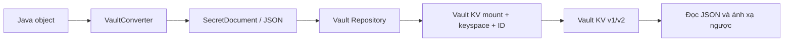

# Kiểm thử ánh xạ và tránh giả định tính năng của cơ sở dữ liệu quan hệ

> **Phạm vi:** Spring Vault — chương **Vault Repository**. Bài này tập trung vào cách kiểm chứng dữ liệu Java được lưu và đọc lại qua Vault Repository, đồng thời xác định rõ những hành vi **không nên suy diễn** từ Spring Data/JPA sang HashiCorp Vault. Các ví dụ dành cho KV secrets engine, đặc biệt là KV v2.

## 1. Vì sao phải kiểm thử khác với Repository của cơ sở dữ liệu quan hệ?

Spring Vault cung cấp **Vault Repository** dựa trên các abstraction quen thuộc của Spring Data như `CrudRepository`. Khi lập trình, ta có thể gọi `save`, `findById`, `findAll`, `count`, `deleteById`, khai báo entity với `@Secret` và `@Id`, hoặc định nghĩa một số query method. Điều này làm giao diện trông giống JPA Repository, nhưng cơ chế lưu trữ phía sau hoàn toàn khác:

- **Vault KV lưu secret theo đường dẫn.** Một repository lưu một object thành dữ liệu key/value dưới đường dẫn gắn với keyspace và ID, ví dụ mount `secret`, keyspace `client-secrets`, ID `client-a`.
- **Nội dung object được ánh xạ thành tài liệu JSON**, không thành các dòng và cột của bảng SQL. `VaultConverter` chuyển giữa kiểu Java và `SecretDocument`.
- **Vault KV không có query engine cho thuộc tính nghiệp vụ.** Query derivation của Vault Repository giới hạn điều kiện tìm kiếm theo thuộc tính ID. Việc liệt kê ID, phân trang và sắp xếp có thể kéo theo truy xuất dữ liệu và xử lý phía client.
- **Không có quan hệ bảng, foreign key, JOIN hay giao dịch ACID trên nhiều entity** chỉ vì repository kế thừa `CrudRepository`. Mỗi đường dẫn secret là một phạm vi dữ liệu độc lập.
- **KV v2 có phiên bản và CAS**, nhưng phiên bản secret không biến Vault thành một cơ sở dữ liệu quan hệ. Xóa qua repository trên KV v2 không đồng nghĩa với hủy vĩnh viễn mọi phiên bản của secret.

Sơ đồ tư duy khi kiểm thử:



**Mục tiêu sau bài học:** thiết kế được bài kiểm thử round-trip Java → Vault → Java; kiểm tra field lồng nhau, collection, đường dẫn và phiên bản; phân biệt query theo ID với query theo cột SQL; và phát hiện những kiểm thử “xanh giả” do mock, quyền Vault quá rộng hoặc dữ liệu thử bị rò sang môi trường khác.

## 2. Hợp đồng ánh xạ thực sự của Vault Repository

Một mẫu domain tối giản:

```java
import java.util.List;
import org.springframework.data.annotation.Id;
import org.springframework.data.domain.Pageable;
import org.springframework.data.repository.CrudRepository;
import org.springframework.vault.repository.mapping.Secret;

@Secret(value = "client-secrets", backend = "secret")
public class ClientSecret {

    @Id
    public String id;
    public String owner;
    public List<String> scopes;
    public ConnectionInfo connection;

    public ClientSecret() {
    }
}

public class ConnectionInfo {
    public String region;
    public boolean tlsEnabled;

    public ConnectionInfo() {
    }
}

public interface ClientSecretRepository
        extends CrudRepository<ClientSecret, String> {

    // Hợp lệ: predicate đặt trên thuộc tính ID.
    List<ClientSecret> findByIdStartsWith(String prefix);

    // Pageable được xử lý theo semantics của Vault Repository.
    List<ClientSecret> findByIdStartsWith(String prefix, Pageable page);
}
```

Trong dự án Java thực tế, đặt các type `public` trên vào **các file .java riêng**; ví dụ gom chúng ở đây để trình bày hợp đồng ánh xạ. `@Secret.value` chọn keyspace, `@Secret.backend` chọn mount Vault (ví dụ mount `secret`), `@Id` chọn khóa của entity và có kiểu `String`. Đường dẫn logic của ví dụ là `secret/client-secrets/<id>`; đối với **KV v2**, Vault API sử dụng các route kỹ thuật `/data/` và `/metadata/` bên trong mount. Không tự thêm `data/` vào `@Secret.value`.

Một tài liệu được tạo ra có dạng **minh họa** như sau (thông tin kỹ thuật bổ sung và định dạng thực tế có thể thay đổi theo converter/phiên bản):

```json
{
  "_class": "example.ClientSecret",
  "owner": "billing",
  "scopes": ["read:invoices", "write:invoices"],
  "connection": {
    "region": "ap-southeast-1",
    "tlsEnabled": true
  }
}
```

Các điểm cần xác minh:

1. **Đường dẫn dựa trên ID.** ID là `String` xác định secret, không nên giả định hệ thống tự cấp auto-increment như SQL. Kiểm tra việc đọc lại đúng ID từ path. Nên giới hạn ID thành một path segment an toàn (ví dụ UUID hoặc slug đã kiểm tra), tránh chuỗi có dấu `/` hoặc thành phần điều hướng path.
2. **Field đơn giản và collection.** Chuỗi, boolean, danh sách và map cần được khôi phục đúng giá trị, đúng phần tử và đúng cấu trúc. Không chỉ kiểm tra `findById().isPresent()`.
3. **Object lồng nhau.** `ConnectionInfo` được lưu dưới dạng tài liệu lồng nhau; không có bảng con, khóa ngoại hay JOIN ngầm.
4. **Thông tin kiểu.** Mapping mặc định có thể ghi trường `_class` để nhận diện kiểu khi đọc, đặc biệt ở root hoặc kiểu đa hình. Việc đổi tên package/class phải được xem như thay đổi tương thích dữ liệu; đừng kiểm thử bằng cách phụ thuộc cứng vào mọi chi tiết nội bộ của JSON nếu không có hợp đồng rõ ràng.
5. **Trường không được map.** `save` ghi lại toàn bộ tài liệu. Khi ghi đè bằng object thiếu những trường có sẵn trong secret, nội dung không được ánh xạ có thể bị mất. Đây không phải thao tác `UPDATE table SET one_column=...` của SQL.
6. **Kiểu đặc biệt.** Nếu dùng kiểu domain như value object, enum, ngày giờ hoặc định dạng riêng, phải kiểm tra round-trip thực tế. Với trường hợp mặc định không đủ, dùng `VaultCustomConversions` và kiểm thử converter đi/về trên dữ liệu thật.

**Nguyên tắc:** kiểm tra cả giá trị Java sau khi đọc *và* cấu trúc lưu trữ cần bảo đảm tương thích. Tránh so sánh nguyên JSON chỉ vì thứ tự key, hoặc chỉ kiểm tra repository mock trả về object do chính test gán.

## 3. Chuẩn bị môi trường kiểm thử tích hợp

Kiểm thử unit có thể xác minh logic gọi repository và chuyển đổi object, nhưng **không chứng minh** được mount, ACL, KV v1/v2, đường dẫn, `LIST`, CAS và cách Spring Vault giao tiếp với Vault thật. Với những hợp đồng đó, hãy chạy integration test trên **Vault chỉ dành cho kiểm thử**, có thể là Vault dev container hoặc máy Vault thử nghiệm độc lập.

### Điều kiện trước khi chạy

| Thành phần | Chuẩn bị | Điều cần kiểm tra |
|---|---|---|
| Vault | Instance thử nghiệm, địa chỉ và chứng chỉ TLS phù hợp | Container/instance đã `unsealed` và sẵn sàng nhận yêu cầu |
| KV mount | Mount KV v1 hoặc KV v2 theo test; ghi rõ phiên bản | Repository nhận diện đúng mount và engine version |
| Token/workload identity | Token thử nghiệm theo policy tối thiểu hoặc auth method dành cho CI | Token còn hiệu lực, có quyền đúng path |
| Dữ liệu | Keyspace riêng, ID có tiền tố `it-` hoặc UUID | Không đè secret của bài test khác |
| Thư viện | `spring-vault-core`, `spring-data-commons`, `spring-data-keyvalue`, JUnit 5 | Phiên bản Spring Data phù hợp Spring Vault; repository scanning đã bật |
| Vòng đời test | Setup và cleanup có kiểm soát | Không để lại secret sau test; không ghi token vào log |

Ví dụ cách bật repository trong Spring Context khi dự án đã có bean `VaultTemplate`:

```java
import org.springframework.context.annotation.Configuration;
import org.springframework.vault.repository.configuration.EnableVaultRepositories;

@Configuration
@EnableVaultRepositories(basePackageClasses = ClientSecretRepository.class)
class VaultRepositoryConfiguration {
    // VaultTemplate được tạo trong cấu hình kết nối Vault của ứng dụng.
}
```

Trong dự án Spring Boot, kết nối và xác thực Vault được cấu hình ở lớp hạ tầng; mẫu trên chỉ kích hoạt scan repository. Nếu `VaultTemplate` chưa tồn tại, cần cung cấp bean kết nối Vault hợp lệ theo phiên bản Spring Vault đang dùng. **Không hard-code root token** trong test hoặc trong mã nguồn.

Để tạo mount KV v2 thử nghiệm, khi đã có Vault CLI được trỏ tới **Vault dev/test**:

```bash
export VAULT_ADDR=http://127.0.0.1:8200
export VAULT_TOKEN="<test-token>"

# Chạy một lần nếu mount repo-it chưa tồn tại.
vault secrets enable -path=repo-it -version=2 kv
vault secrets list -detailed
```

Khi đó đặt `backend = "repo-it"` trong entity dùng cho test. Nếu instance dev đã có mount `secret/` là KV v2, có thể sử dụng nó nhưng nên chọn keyspace chỉ dành cho test. Lệnh ví dụ là thao tác **trên môi trường thử nghiệm**; không chạy trên Vault đang chứa secret thật.

### Quyền Vault ảnh hưởng trực tiếp đến kết quả test

Với KV v2, thao tác đọc/ghi và thao tác liệt kê key dùng những route ACL khác nhau: `secret/data/...` và `secret/metadata/...`. Ví dụ policy minh họa khi mount là `repo-it`, keyspace là `client-secrets`:

```hcl
path "repo-it/data/client-secrets/*" {
  capabilities = ["create", "read", "update", "delete"]
}

path "repo-it/metadata/client-secrets" {
  capabilities = ["list"]
}

path "repo-it/metadata/client-secrets/*" {
  capabilities = ["read", "list"]
}

# Repository khám phá thông tin mount qua endpoint nội bộ này.
# Kiểm tra policy thực tế theo phiên bản Vault và cấu trúc mount.
path "sys/internal/ui/mounts/repo-it" {
  capabilities = ["read"]
}
```

Đây là **khung tham khảo**, không phải policy tối thiểu đã được xác nhận cho mọi topology. Việc `findById` thành công **không** chứng minh `findAll`, `count` hoặc query ID sẽ chạy: các thao tác tập hợp có thể cần `list` trên metadata. Một lỗi `403 permission denied` cần được phân biệt với `404` do path/secret không tồn tại, lỗi chọn sai KV version và lỗi chuyển đổi dữ liệu.

## 4. Kiểm thử round-trip: Java → Vault → Java

Mục đích của test đầu tiên là bảo đảm entity đi qua bộ chuyển đổi, request HTTP và engine thực tế. Giả định `ClientSecretRepository` đã được inject từ cấu hình test trỏ đến Vault **chỉ dành cho kiểm thử**.

```java
import static org.junit.jupiter.api.Assertions.*;

import java.util.List;
import java.util.UUID;
import org.junit.jupiter.api.Test;
import org.springframework.beans.factory.annotation.Autowired;
import org.springframework.boot.test.context.SpringBootTest;

@SpringBootTest
class ClientSecretRepositoryIT {

    @Autowired ClientSecretRepository repository;

    @Test
    void saveThenReadRestoresNestedFieldsAndList() {
        String id = "it-" + UUID.randomUUID();

        ClientSecret expected = new ClientSecret();
        expected.id = id;
        expected.owner = "billing";
        expected.scopes = List.of("read:invoices", "write:invoices");
        expected.connection = new ConnectionInfo();
        expected.connection.region = "ap-southeast-1";
        expected.connection.tlsEnabled = true;

        try {
            repository.save(expected);

            ClientSecret actual = repository.findById(id).orElseThrow();
            assertEquals(id, actual.id);
            assertEquals("billing", actual.owner);
            assertEquals(expected.scopes, actual.scopes);
            assertNotNull(actual.connection);
            assertEquals("ap-southeast-1", actual.connection.region);
            assertTrue(actual.connection.tlsEnabled);
        } finally {
            repository.deleteById(id);
        }
    }
}
```

Đây là test ở mức repository trong một ứng dụng đã cấu hình kết nối Vault; phần import và bootstrap của dự án phải tương thích với phiên bản Spring Boot/Spring Vault thực tế. Các điểm giúp test có giá trị:

- **ID ngẫu nhiên** giảm va chạm khi chạy song song; keyspace/mount dành riêng cho CI giới hạn phạm vi cleanup.
- `findById` được gọi **sau khi `save`**, qua Vault thật; test không chấp nhận kết quả lấy từ mock hay object Java chưa từng được serialize.
- So sánh **giá trị bên trong** object lồng nhau và collection, thay vì chỉ so sánh số lượng record hoặc `assertNotNull`.
- `finally` dọn đúng ID tạo ra. Nếu cleanup lỗi, điều tra riêng để tránh test sau bị ảnh hưởng; không gọi `deleteAll` trên keyspace dùng chung.
- Có thể bổ sung bước đọc secret bằng Vault CLI/API để kiểm tra path và định dạng JSON khi đang điều tra sai lệch. Không in password/token thật ra báo cáo kiểm thử.

### Những trường hợp âm cần thêm

| Kịch bản | Thao tác | Kết quả cần chứng minh |
|---|---|---|
| ID không tồn tại | `findById("it-missing-...")` | Trả về `Optional.empty()` khi path không có secret, không tự tạo object |
| ID không hợp lệ với quy ước path | Kiểm tra ở service trước khi gọi repository | Từ chối `/`, chuỗi rỗng hoặc ký tự ngoài chính sách đặt ID của hệ thống |
| Object lồng nhau bị thiếu | Đọc dữ liệu cũ chưa có `connection` | Domain xử lý null/default có chủ đích, không mặc định sẽ tự migrate schema |
| Danh sách rỗng, null, trường thêm mới | Round-trip từng trường hợp | Phân biệt “trống”, “không hiện diện” theo hợp đồng converter của dự án |
| Kiểu tùy chỉnh | Lưu, đọc với `VaultCustomConversions` | Hai chiều chuyển đổi bảo toàn giá trị và lỗi được báo rõ |
| Bản ghi cũ có trường ngoài model | Đọc rồi `save` lại, kiểm tra raw secret | Ghi lại toàn tài liệu có thể làm mất trường không map |
| Token hết hạn/thiếu quyền | Chạy bằng identity test bị giới hạn | Trả lỗi xác thực/phân quyền; không biến lỗi thành “secret không tồn tại” |
| Sai mount hoặc sai phiên bản KV | Trỏ test vào mount không tương thích | Lỗi rõ ràng, không diễn giải như dữ liệu rỗng |

Đừng biến các test này thành một phương thức chạy tất cả bằng một token quản trị. Nên có **một nhóm test thành công** và **một nhóm test truy cập bị từ chối** với identity có scope giới hạn.

## 5. Query derivation: nơi dễ nhầm với SQL nhất

Spring Data cho phép tạo query từ tên method. Đối với Vault Repository, phần **predicate được hỗ trợ chỉ áp dụng cho thuộc tính ID**:

```java
interface ClientSecretRepository
        extends CrudRepository<ClientSecret, String> {

    // Có ý nghĩa: lọc ID có tiền tố.
    List<ClientSecret> findByIdStartsWith(String prefix);

    // KHÔNG được coi như WHERE owner = ? của SQL.
    // List<ClientSecret> findByOwner(String owner);
}
```

Vault KV không lập index thứ cấp trên `owner`, `region`, `scopes` như một database. Hành vi query có thể cần `LIST` các ID dưới context path, lọc các ID đó rồi tải tài liệu phù hợp. Vì vậy cần kiểm thử bằng dữ liệu có tính phân biệt:

1. Tạo `it-alpha-1` có `owner="billing"`.
2. Tạo `it-alpha-2` có `owner="shipping"`.
3. Tạo `it-beta-1` có `owner="billing"`.
4. Gọi `findByIdStartsWith("it-alpha-")` và so sánh **tập ID** nhận về với đúng hai ID alpha.
5. Chứng minh `owner` không phải tiêu chí query được Vault xử lý: nếu ứng dụng cần truy vấn theo owner, hãy thiết kế chỉ mục/nguồn truy vấn riêng (ví dụ cơ sở dữ liệu chuyên dụng) hoặc chủ động quét trong phạm vi nhỏ và tính chi phí.
6. Xóa chính xác ba ID của test, không xóa các ID bên ngoài tiền tố.

Với kết quả từ `LIST`, **không dựa vào thứ tự tự nhiên** của Vault. Trong test chỉ kiểm tra thứ tự khi method thực sự khai báo sorting.

### Phân trang và sắp xếp không tương đương `LIMIT/OFFSET` của SQL

Query method có thể hỗ trợ `Pageable` và `Sort`, nhưng Spring Vault mô tả cơ chế liệt kê ID và xử lý phân trang/sắp xếp **ở phía client**. Để trả kết quả đúng thứ tự, ứng dụng có thể phải đọc nhiều secret hơn số phần tử trên trang. Điều này có ảnh hưởng đến:

- **Chi phí I/O:** mỗi lần lấy danh sách lớn có thể đi kèm nhiều request đọc secret.
- **Độ trễ:** sắp xếp theo thuộc tính dữ liệu yêu cầu tải các object liên quan.
- **Tính ổn định:** ghi/xóa đồng thời giữa hai lần đọc trang có thể làm thay đổi tập dữ liệu.
- **Bảo mật:** quyền `LIST` và quyền đọc secret phải được tính đến riêng.

Để kiểm thử, tạo tối thiểu 10 secret có ID khác nhau, yêu cầu page size nhỏ, rồi xác minh **tập kết quả, tổng số, thứ tự khi có `Sort` và hành vi sau cập nhật/xóa đồng thời**. Có thể đo số request hoặc thời gian ở môi trường test. Không dùng một test với 2 bản ghi để kết luận giải pháp scale như cơ sở dữ liệu có index.

## 6. Bảng giả định dễ sai khi chuyển từ JPA sang Vault Repository

| Giả định từ SQL/JPA | Thực tế cần hiểu về Vault Repository | Bằng chứng nên thu qua test |
|---|---|---|
| `save` tương tự `UPDATE` một vài cột | Repository ghi toàn bộ document; dữ liệu không map có nguy cơ bị thay thế | Chèn trường ngoài model, save lại và kiểm tra dữ liệu gốc |
| `findByOwner` tạo `WHERE owner = ?` | Query predicate chỉ hỗ trợ ID; không có secondary index cho field nghiệp vụ | Kiểm thử `findByIdStartsWith`; không triển khai tìm kiếm owner bằng method name giả định |
| `findAll` là SQL `SELECT` hiệu quả ở mọi quy mô | Cần liệt kê khóa/đọc qua Vault API; phụ thuộc quyền `LIST` | Chạy với policy hạn chế, quan sát số request/độ trễ |
| `Pageable` tương đương `LIMIT` ở máy chủ | Phân trang/sắp xếp có thể xử lý trong bộ nhớ client | So sánh thời gian, request count ở tập lớn |
| Entity có nested object nên có quan hệ bảng | Nested data là JSON, không có FK/JOIN/cascade qua bảng | Đọc raw JSON, kiểm tra dữ liệu lồng nhau |
| `@Id` tự tạo khóa số như database | ID thuộc tính `String` dùng trong đường dẫn secret | Test ID rõ ràng và quy tắc kiểm tra path |
| `@Transactional` đảm bảo atomic nhiều secret | Không có giao dịch quan hệ nhiều bản ghi chỉ từ repository | Mô phỏng lỗi khi ghi hai path và kiểm tra phương án phục hồi |
| `deleteById` xóa sạch mọi vết dữ liệu | Trên KV v2, `DELETE` không `destroy` toàn bộ history | Kiểm tra metadata/version và chính sách giữ/xóa phiên bản |
| Ghi cùng lúc luôn “last write wins” là đủ | KV v2 có `@Version` và CAS để phát hiện xung đột | Test hai bản sao cập nhật cùng một secret |
| Entity mới tự động tương thích dữ liệu cũ | JSON không có schema migration JPA tự động | Test dữ liệu legacy thiếu/đổi tên field |
| Đọc được bằng ID nghĩa là mọi query đều được cấp quyền | Query tập hợp cần quyền `LIST` và khám phá mount cần API nội bộ | Test riêng `findById`, `findAll`, `count`, query ID |

Khi đọc stack trace chứa `DataAccessException` hoặc exception Spring Data, vẫn phải điều tra **HTTP operation, Vault path, KV version và policy**. Tên abstraction Java không làm Vault API biến thành SQL.

## 7. KV v2, `@Version` và kiểm thử cạnh tranh ghi

KV v2 giữ các phiên bản secret. Spring Vault hỗ trợ optimistic locking qua thuộc tính có `@Version` với kiểu số (ví dụ `int` hoặc `long`). Khi cập nhật, repository đưa kỳ vọng phiên bản vào yêu cầu CAS. Nếu secret đã bị thay đổi bởi một luồng khác, cập nhật của phiên bản cũ phải thất bại thay vì âm thầm ghi đè.

```java
import org.springframework.data.annotation.Id;
import org.springframework.data.annotation.Version;
import org.springframework.vault.repository.mapping.Secret;

@Secret(value = "versioned-secrets", backend = "repo-it")
public class VersionedSecret {
    @Id
    public String id;

    @Version
    public long version;

    public String value;

    public VersionedSecret() {
    }
}
```

**Test tối thiểu trên KV v2** (với repository của `VersionedSecret`):

1. Tạo một bản ghi mới và đọc nó thành **hai instance độc lập** A, B.
2. Thay đổi `A.value` rồi gọi `save(A)`. Xác minh cập nhật thành công.
3. Thay đổi `B.value` rồi gọi `save(B)` với phiên bản cũ.
4. Kỳ vọng `OptimisticLockingFailureException`; đọc lại từ Vault để xác nhận giá trị của A vẫn được giữ.
5. Dọn đúng ID đã tạo. Không tái sử dụng cùng object A làm B, vì như vậy không mô phỏng bản sao stale.

Một test chỉ assert “lần ghi cuối cùng thắng” không kiểm thử được hành vi CAS. Với KV v1, **không mặc định** áp dụng cùng test phiên bản vì engine không duy trì version theo cách KV v2.

Việc `deleteById` trên KV v2 tác động theo semantics của delete trong KV engine: khả năng truy cập phiên bản hiện tại thay đổi, nhưng dữ liệu lịch sử chưa chắc bị **destroy**. Nếu yêu cầu tuân thủ bắt buộc xóa vĩnh viễn, phải dùng API/operation quản trị phù hợp, được phân quyền và kiểm tra độc lập. Đừng viết test chỉ kiểm `findById().isEmpty()` rồi tuyên bố mọi version đã bị xóa vật lý.

## 8. Thiết kế bộ test đủ mạnh, chi phí hợp lý

Nên chia ba lớp test theo **thứ chúng thực sự chứng minh**:

| Lớp | Mục đích | Ví dụ assertion đáng tin |
|---|---|---|
| Unit test domain/service | Kiểm tra quy tắc đặt ID, xử lý null, cách service phản ứng với lỗi repository | ID chứa `/` bị từ chối trước khi gọi Vault; service không lộ secret vào log |
| Mapping test | Kiểm tra converter hoặc serializer với type đặc biệt, legacy JSON, nested structures | Java object → `SecretDocument` → object, đủ fields và custom conversion |
| Integration test với Vault | Kiểm tra đường dẫn thật, auth, ACL, KV v2, CRUD, `LIST`, paging/sorting, CAS, delete semantics | Lưu/đọc đúng secret; token thiếu `list` thất bại có chủ đích; stale version bị từ chối |

Ma trận các tình huống nên có cho **module Vault Repository**:

| Mã | Bài test | Điều kiện đầu vào | Kết quả kỳ vọng |
|---|---|---|---|
| M01 | Round-trip cơ bản | ID string + 2 scalar fields | Đọc lại đúng field, đúng ID |
| M02 | Nested object/collection | Object con, List, Map | Giữ nguyên giá trị/cấu trúc |
| M03 | Schema evolution | Raw secret thiếu field mới | Đọc được hoặc lỗi có xử lý rõ ràng theo contract |
| M04 | Overwrite | Secret có field ngoài entity | Nhận diện việc ghi toàn tài liệu làm mất field |
| Q01 | ID query | 3 ID, 2 chung prefix | Kết quả đúng hai ID |
| Q02 | Sorting/paging | Nhiều ID, dữ liệu khác nhau | Thứ tự/page đúng; ghi nhận chi phí client |
| Q03 | Limited ACL | Token có `read` nhưng thiếu `list` | `findById` có thể được; truy vấn tập hợp bị từ chối |
| V01 | KV v2 CAS | Hai object cùng version ban đầu | Lần ghi thứ hai từ object stale bị từ chối |
| V02 | Delete/version history | KV v2 đã có vài version | Delete không bị nhầm với destroy mọi version |
| S01 | Mount discovery | Policy thiếu quyền khám phá mount | Lỗi repository được nhận diện; sửa đúng policy |
| E01 | Token expired/revoked | Identity thử nghiệm hết hạn | Báo lỗi xác thực; không trả null secret như success |

**Chiến lược test data:** tạo tên mount/keyspace test rõ ràng và UUID riêng cho mỗi test. Tránh chạy test phá dữ liệu trong keyspace dùng chung. Nếu cần dọn toàn bộ, chỉ làm trong **fixture được test sở hữu trọn vẹn**, không gọi `deleteAll` để dọn một mount nghiệp vụ.

### Chống “xanh giả” trong CI

1. Không gọi `repository.save` trên một mock rồi lấy chính object đã mock trả về để chứng minh ánh xạ.
2. Không dùng token root để kiểm thử quyền thông thường: root bỏ qua các giới hạn mà policy ứng dụng thật phải tuân theo.
3. Không chỉ dựa vào kiểm thử happy path với một bản ghi: cần tập dữ liệu phân biệt ID/owner, object nested và trường không được map.
4. Không thay đổi cấu hình mount giữa các test đang chạy song song; CI nên tạo môi trường/container riêng hoặc một không gian test cô lập.
5. Khi test thất bại, lưu **mã HTTP, operation, đường dẫn đã che thông tin nhạy cảm, kiểu ngoại lệ và request correlation ID**. Không ghi token, mật khẩu hoặc toàn bộ payload secret vào log.

## 9. Tình huống thực tế: secret của một dịch vụ thanh toán

Giả sử service Java cần lưu cấu hình kết nối nhạy cảm với các trường `clientId`, `clientSecret`, `region`, `allowedScopes`. Nhóm phát triển muốn sử dụng:

```java
// Mong muốn SQL/JPA nhưng không phải hợp đồng query của Vault:
// List<ClientSecret> findByRegionAndOwner(String region, String owner);
```

Vấn đề không nằm ở cú pháp Java; Vault KV không cung cấp truy vấn có chỉ mục theo `region` và `owner`. Một quyết định có cơ sở:

- **Đọc bí mật theo ID đã biết** từ Vault, ví dụ `findById("payment-client-001")`. Dùng Vault để bảo vệ credential, rotation và kiểm soát truy cập.
- **Tìm theo thuộc tính nghiệp vụ** (`region`, `owner`, trạng thái sản phẩm) ở một hệ lưu metadata phù hợp cho truy vấn, hoặc duy trì index ngoài Vault với kiểm soát nhất quán.
- **Kiểm thử ánh xạ** các field nhạy cảm, nested value và fallback cho bản ghi cũ; **kiểm thử phân quyền** cho từng workload.
- **Không trả raw secret ra API hoặc log** chỉ vì entity được Spring Data ánh xạ thành POJO.

Nếu có tiến trình rotate secret song song, thêm `@Version` khi dùng KV v2 và test CAS; thiết kế chiến lược retry dựa trên việc **đọc lại version mới nhất và tính lại thay đổi**, chứ không retry vô điều kiện với object stale.

### Bài tập tự kiểm tra

1. Với 50.000 secret, vì sao `findByIdStartsWith("it-", PageRequest.of(0, 10))` không thể được mặc định coi là truy vấn SQL `LIMIT 10`? Nêu ít nhất hai chi phí.
2. `findById("client-001")` hoạt động nhưng `count()` trả `403`. Bạn sẽ kiểm tra route và capability nào trước?
3. Domain Java thêm field `region`, trong khi secret cũ thiếu nó. Bạn sẽ viết test gì để phát hiện lỗi compatibility?
4. Hai worker cùng sửa một secret KV v2. Một worker đọc version cũ. Test nào chứng minh không có silent lost update?
5. Sau khi `deleteById`, `findById` trả trống. Điều đó đã chứng minh nội dung bí mật bị xóa vĩnh viễn chưa? Vì sao?

**Gợi ý đáp án:** (1) có chi phí `LIST`/fetch và xử lý sort/page phía client; (2) quyền `list` trên KV v2 metadata và quyền khám phá mount; (3) fixture legacy, mapping/null/default và raw document; (4) stale-write/CAS với `@Version`; (5) chưa, vì KV v2 phân biệt delete với destroy lịch sử.

## 10. Tài liệu tra cứu chính thức

- [Spring Vault — Vault Repositories](https://docs.spring.io/spring-vault/reference/vault/vault-repositories.html): cách dùng `@Secret` và `CrudRepository`, ánh xạ JSON, giới hạn query ID, phân trang/sắp xếp, `@Version`, Revision Repository và semantics của delete.
- [Spring Vault — Introduction to VaultTemplate](https://docs.spring.io/spring-vault/reference/vault/imperative-template.html): lớp API VaultOperations/VaultTemplate để xử lý trường hợp cần điều khiển Vault trực tiếp.
- [Spring Vault Javadoc — `@Secret`](https://docs.spring.io/spring-vault/reference/api/java/org/springframework/vault/repository/mapping/Secret.html): ý nghĩa keyspace và mount.
- [Spring Vault Javadoc — `@EnableVaultRepositories`](https://docs.spring.io/spring-vault/reference/api/java/org/springframework/vault/repository/configuration/EnableVaultRepositories.html): cấu hình quét repository và tham chiếu bean Vault.

**Điểm cần giữ khi review:** test thành công phải chứng minh đúng hợp đồng **Spring Vault Repository + Vault KV**, đặc biệt là ánh xạ dữ liệu và kiểm soát phiên bản; tuyệt đối không suy ra khả năng SQL/JPA chỉ từ hình dạng của `CrudRepository`.
