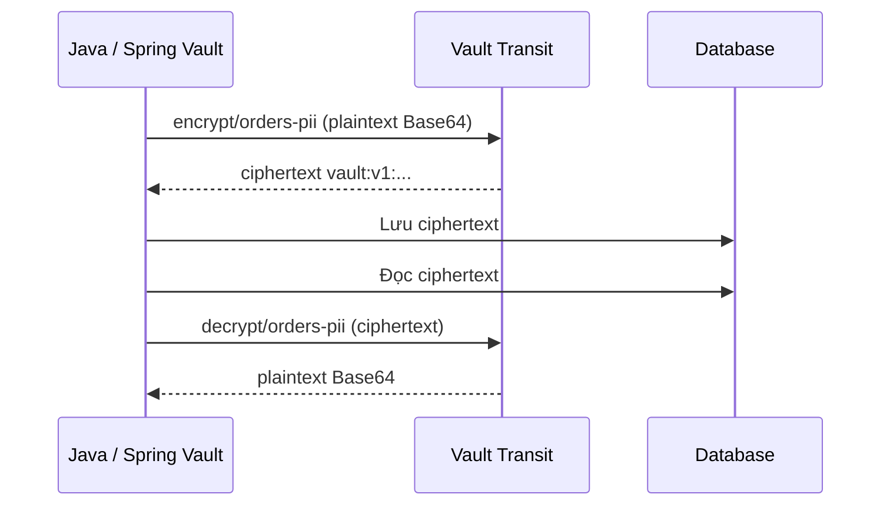
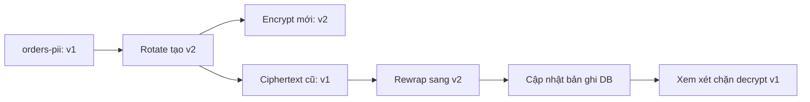

# Tạo khóa, chọn loại khóa và quyền quản lý trong Vault Transit

> **Bối cảnh:** Spring Vault cho phép ứng dụng Java gọi HashiCorp Vault qua `VaultTemplate`. Bài học tập trung vào khóa của **Transit secrets engine**: lựa chọn thuật toán, tạo khóa, cấu hình an toàn, phân quyền theo workload và chuẩn bị vòng đời khóa.

## 1. Mục tiêu

Sau bài học, bạn có thể:

1. Phân biệt khóa Transit với secret của KV engine; mô tả cách ứng dụng lưu ciphertext và Vault giữ key material.
2. Chọn loại khóa phù hợp cho mã hóa, chữ ký số hay MAC.
3. Tạo khóa, đọc metadata, xác định các cài đặt bất biến và cấu hình vòng đời có thể cập nhật.
4. Viết policy riêng cho workload mã hóa, workload giải mã và người quản trị khóa.
5. Dùng `VaultTemplate` để mã hóa/giải mã qua Transit bằng Java, kiểm thử quyền và xử lý lỗi thực tế.

## 2. Transit quản lý khóa như thế nào?

Transit là dịch vụ thực hiện phép mật mã. Ứng dụng gửi plaintext (được Base64 hóa) lên endpoint `transit/encrypt/<key>`, Vault dùng phiên bản khóa hiện hành và trả ciphertext có định dạng như `vault:v1:...`. Ứng dụng lưu ciphertext vào cơ sở dữ liệu. Khi cần giải mã, ứng dụng gửi ciphertext lên `transit/decrypt/<key>` và nhận plaintext ở dạng Base64, **nếu token có quyền**.



Transit **không** mặc định lưu mọi bản mã ứng dụng đã tạo. Vault giữ khóa và phiên bản khóa, còn ứng dụng quyết định lưu, sao lưu và xóa ciphertext. Plaintext vẫn đi qua ứng dụng và Vault trong quá trình xử lý, nên cần TLS, xác thực workload, kiểm soát quyền và tránh ghi payload nhạy cảm vào log.

Ví dụ xuyên suốt: `order-writer` mã hóa dữ liệu đơn hàng, `order-reader` chỉ giải mã khi có nghiệp vụ cho phép, và `order-key-admin` tạo/xoay vòng khóa `orders-pii`. Ba danh tính sử dụng các policy khác nhau.

## 3. Chọn loại khóa

Không nên chọn thuật toán chỉ theo độ dài khóa. Trước hết, phải xác định cần **mã hóa có thể giải mã**, **ký/xác minh chữ ký số** hay **tạo/xác minh MAC**.

| `type` | Chức năng | Khi nên dùng |
| --- | --- | --- |
| `aes256-gcm96` | AES-256-GCM, mã hóa/giải mã có xác thực (AEAD) | Lựa chọn mặc định cho trường dữ liệu nhạy cảm trong Java |
| `aes128-gcm96` | AES-128-GCM, AEAD | Khi chuẩn hệ thống cho phép AES-128 |
| `chacha20-poly1305` | Mã hóa/giải mã AEAD | Khi kiến trúc yêu cầu ChaCha20-Poly1305 |
| `rsa-2048`, `rsa-3072`, `rsa-4096` | Bất đối xứng, hỗ trợ mã hóa/giải mã và ký/xác minh | Tích hợp với hệ thống dùng RSA/public key; payload mã hóa RSA phải nhỏ |
| `ecdsa-p256`, `ecdsa-p384`, `ecdsa-p521` | Ký và xác minh chữ ký | Xác thực thông điệp bằng chữ ký số |
| `ed25519` | Ký và xác minh chữ ký | Khi cần chữ ký Ed25519 |
| `hmac` | Tạo và xác minh HMAC | Kiểm tra tính toàn vẹn và xác thực bằng khóa chung |

Các loại khác (ví dụ managed keys hoặc thuật toán mới) có thể phụ thuộc phiên bản và edition Vault. Luôn xem tài liệu API đúng phiên bản đang triển khai. **HMAC và chữ ký không phải mã hóa có thể khôi phục plaintext.** Base64 cũng chỉ là định dạng biểu diễn byte.

Trong bài này chọn `aes256-gcm96` vì dữ liệu đơn hàng cần giải mã về sau. Tên khóa nên phản ánh mục đích (`orders-pii`, `billing-reference`) và môi trường, không chứa thông tin nhận dạng nhạy cảm.

## 4. Các tùy chọn phải quyết định khi tạo khóa

| Tham số | Mặc định | Ý nghĩa |
| --- | --- | --- |
| `type` | `aes256-gcm96` | Loại khóa; không thể tùy ý đổi bằng endpoint cấu hình |
| `derived` | `false` | Dẫn xuất khóa theo `context` Base64; thao tác tương ứng bắt buộc cung cấp context |
| `convergent_encryption` | `false` | Mã hóa hội tụ, yêu cầu `derived=true`; có thể lộ sự trùng nhau của dữ liệu |
| `exportable` | `false` | Cho phép xuất key material; đã bật thì không tắt lại được |
| `allow_plaintext_backup` | `false` | Cho phép backup khóa ở dạng plaintext; đã bật thì không tắt lại được |
| `auto_rotate_period` | `0` | Chu kỳ tự rotate, `0` là tắt; chu kỳ nhỏ nhất là 1 giờ |

Các cài đặt về loại khóa, derivation và convergent encryption phải được thiết kế trước khi tạo khóa; chúng không thuộc nhóm tùy chọn có thể bật/tắt tự do bằng `/config`. Vault phiên bản mới có thể cung cấp API chuyển thuật toán giữa các phiên bản khóa, nhưng đó là quy trình migration riêng và có điều kiện tương thích.

Đối với khóa bảo vệ dữ liệu ứng dụng thông thường, giữ `exportable=false`, `allow_plaintext_backup=false`, `derived=false` và `convergent_encryption=false`, trừ khi có yêu cầu thiết kế rõ ràng. Một lần bật khả năng xuất hoặc backup plaintext có thể thay đổi vĩnh viễn mức rủi ro của khóa.

### 4.1. Khi nào cần `derived`?

Một khóa với `derived=true` có thể dẫn xuất khóa con từ context, ví dụ một context tương ứng với mỗi tenant. Cả encrypt và decrypt phải gửi cùng `context`; context **không phải cơ chế phân quyền tenant**. Ứng dụng phải kiểm tra tenant được phép truy cập trước khi chọn context.

```bash
vault write transit/keys/tenant-pii type=aes256-gcm96 derived=true

# Base64("hello") = aGVsbG8=
# Base64("tenant:alpha") = dGVuYW50OmFscGhh
vault write transit/encrypt/tenant-pii \
  plaintext=aGVsbG8= \
  context=dGVuYW50OmFscGhh
```

Với khóa derived, một yêu cầu giải mã ciphertext trên phải dùng lại đúng context. Chuyển context sang chuỗi Base64 không khiến context trở thành thông tin bí mật. Mã hóa hội tụ (`convergent_encryption=true`) chỉ dành cho trường hợp có yêu cầu cụ thể và đã phân tích rủi ro; quy tắc nonce tùy phiên bản/định dạng khóa, nên không bật chỉ để làm ciphertext có thể so sánh.

## 5. Tạo khóa và đọc metadata bằng Vault CLI

Ví dụ giả định Vault đang hoạt động, CLI có kết nối TLS hợp lệ, danh tính đang dùng có quyền cần thiết. Mount mặc định dưới đây là `transit/`; nếu hệ thống dùng mount khác, thay đồng bộ các path.

```bash
# Chỉ chạy nếu engine chưa được bật (thường do đội vận hành thực hiện):
vault secrets enable -path=transit transit

# Ngăn encrypt/<name> tự tạo khóa mới khi tên khóa chưa tồn tại:
vault write transit/config/keys disable_upsert=true
vault read transit/config/keys

# Tạo khóa dùng cho dữ liệu đơn hàng:
vault write transit/keys/orders-pii \
  type=aes256-gcm96 \
  derived=false \
  exportable=false \
  allow_plaintext_backup=false

# Kiểm tra metadata; kết quả KHÔNG chứa key material bí mật:
vault read transit/keys/orders-pii

# Xem danh sách tên khóa (nếu danh tính có quyền list):
vault list transit/keys
```

Một số lệnh chỉ chạy được bằng token quản trị engine, không phải token ứng dụng. Với production, đặt tạo khóa vào quy trình provisioning/IaC có kiểm soát thay vì chạy trên mỗi lần ứng dụng khởi động.

**Vì sao cấm upsert?** Endpoint `transit/encrypt/:name` hỗ trợ quyền `create`: khi khóa chưa tồn tại, một token có quyền `create` trên endpoint có thể khiến Vault tạo khóa mặc định. Bật `disable_upsert=true` và chỉ cấp `update` trên encrypt giúp tránh lỗi gõ tên khóa tạo ra khóa ngoài ý muốn.

Tạo khóa bằng HTTP API tương đương:

```http
POST /v1/transit/keys/orders-pii
Content-Type: application/json
X-Vault-Token: <token-quan-tri>

{
  "type": "aes256-gcm96",
  "derived": false,
  "exportable": false,
  "allow_plaintext_backup": false
}
```

Đọc `GET /v1/transit/keys/orders-pii` thường trả các trường `name`, `type`, `latest_version`, `keys`, `derived`, `deletion_allowed`, `min_decryption_version` và `min_encryption_version`. `keys` ở đây là metadata phiên bản/thời điểm tạo, không phải raw key. Giá trị khóa không được xuất nếu không đủ điều kiện cấu hình và phân quyền.

### 5.1. Smoke test encrypt/decrypt

```bash
# "hello" -> Base64: "aGVsbG8="
vault write transit/encrypt/orders-pii plaintext=aGVsbG8=

# Lấy NGUYÊN ciphertext trả về để thử lệnh tiếp theo:
vault write transit/decrypt/orders-pii ciphertext="vault:v1:<ciphertext-thuc-te>"
```

Transit yêu cầu `plaintext` là Base64 của **byte**, không phải plaintext thô. Kết quả decrypt cũng là Base64; decode ở phía client để lấy lại byte/chuỗi UTF-8. Tiền tố `vault:vN:` là một phần của định dạng ciphertext, không tự xóa hoặc sửa.

Chỉ dùng giá trị mẫu trong terminal lab. Trong ứng dụng, không để token hoặc dữ liệu cá nhân lọt vào lịch sử lệnh hay log.

## 6. Phân quyền khóa: tách ứng dụng khỏi quản trị

Vault policy kiểm tra **đường dẫn** và **capability**. Endpoint encrypt/decrypt là HTTP POST, thường yêu cầu `update` cho khóa đã tồn tại. Việc cho `create` trên encrypt có thể kích hoạt upsert nếu chưa vô hiệu hóa tính năng này.

### 6.1. Policy dành cho workload chỉ mã hóa

File policy `order-writer.hcl`:

```hcl
path "transit/encrypt/orders-pii" {
  capabilities = ["update"]
}
```

Workload này có thể mã hóa nhưng không có quyền decrypt hay truy cập `transit/keys/orders-pii`. Dùng policy theo **đúng key name**, tránh các wildcard rộng như `transit/*`.

### 6.2. Policy dành cho workload chỉ giải mã

File policy `order-reader.hcl`:

```hcl
path "transit/decrypt/orders-pii" {
  capabilities = ["update"]
}
```

Nếu một workload phải mã hóa và giải mã, tạo policy riêng chứa hai path. Không dùng một token toàn quyền Transit cho nhiều microservice chỉ vì tiện cấu hình.

### 6.3. Policy dành cho người quản trị khóa

File policy `order-key-admin.hcl`:

```hcl
path "transit/keys/orders-pii" {
  capabilities = ["create", "update", "read"]
}

path "transit/keys/orders-pii/rotate" {
  capabilities = ["update"]
}

path "transit/keys/orders-pii/config" {
  capabilities = ["update"]
}
```

Đây là policy **quản trị riêng một khóa**. Nó không tự cấp quyền decrypt dữ liệu đơn hàng. Các khả năng `list` toàn mount, chỉnh cấu hình `transit/config/keys`, export key, backup khóa và delete phải được xem xét riêng.

Ví dụ lưu policy qua CLI:

```bash
vault policy write order-writer order-writer.hcl
vault policy write order-reader order-reader.hcl
vault policy write order-key-admin order-key-admin.hcl
```

Sau đó ánh xạ mỗi policy vào identity/role thực của Kubernetes Auth, AppRole hoặc cơ chế auth đang dùng. Spring Vault sử dụng token sinh ra từ xác thực theo workload; không hardcode root token hoặc token lâu dài vào mã nguồn hay cấu hình Git.

Một khóa chỉ xóa được khi **đồng thời** có ACL cho phép `delete` trên path khóa và khóa đã được bật `deletion_allowed=true`. Giá trị mặc định là `false`. Không cho các workload nghiệp vụ quyền xóa khóa, vì mất khóa có thể khiến ciphertext không thể giải mã.

### 6.4. Ma trận quyền mẫu

| Tác vụ | `order-writer` | `order-reader` | `order-key-admin` |
| --- | :---: | :---: | :---: |
| Mã hóa bằng `orders-pii` | Cho phép | Từ chối | Từ chối |
| Giải mã bằng `orders-pii` | Từ chối | Cho phép | Từ chối |
| Đọc metadata khóa | Từ chối | Từ chối | Cho phép |
| Rotate khóa | Từ chối | Từ chối | Cho phép |
| Sửa cấu hình phiên bản khóa | Từ chối | Từ chối | Cho phép |
| Delete khóa | Từ chối | Từ chối | Từ chối |

Ma trận áp dụng khi danh tính chỉ mang đúng policy được thiết kế ở trên. Vault cộng gộp quyền từ các policy khác gắn với token/identity, vì vậy phải xác thực kết quả bằng **chính token workload**. Phân quyền không tự thay thế kiểm tra quyền của người dùng cuối ở tầng nghiệp vụ.

## 7. Vòng đời khóa: rotate, rewrap và ngưỡng phiên bản

Mỗi khóa Transit có các phiên bản. Khi rotate, Vault tạo phiên bản mới; thao tác encrypt mặc định dùng phiên bản hiện hành, trong khi ciphertext cũ vẫn chứa thông tin phiên bản đã dùng.



```bash
# Tạo phiên bản mới của khóa (kết quả dự kiến latest_version tăng):
vault write -f transit/keys/orders-pii/rotate
vault read transit/keys/orders-pii

# Ví dụ CHỈ khi đã xác minh latest_version = 2:
vault write transit/keys/orders-pii/config min_encryption_version=2

# Chuyển bản mã cũ sang phiên bản mới, không trả plaintext cho client:
vault write transit/rewrap/orders-pii ciphertext="vault:v1:<ciphertext-thuc-te>"
```

Rewrap trả ciphertext mới; ứng dụng/migration job phải ghi ciphertext mới xuống storage. Cần cấp quyền `update` riêng trên `transit/rewrap/orders-pii` cho một danh tính migration có kiểm soát, không mặc định giao cho writer/reader.

- `min_encryption_version` là phiên bản thấp nhất được phép dùng khi tạo ciphertext mới hoặc thao tác tương đương theo loại khóa. `0` biểu thị sử dụng phiên bản mới nhất.
- `min_decryption_version` là phiên bản thấp nhất còn được phép giải mã. Nâng ngưỡng này khi vẫn còn bản mã cũ có thể làm ứng dụng mất khả năng đọc dữ liệu.
- `deletion_allowed` mặc định `false`; chỉ mở khi có quy trình xóa khóa đã được phê duyệt, xác nhận không còn dữ liệu phụ thuộc.

```bash
# Chỉ thực hiện sau khi xác nhận mọi ciphertext cần giữ đã được rewrap:
vault write transit/keys/orders-pii/config min_decryption_version=2

# Ví dụ cấu hình auto rotation chu kỳ 720 giờ:
vault write transit/keys/orders-pii/config auto_rotate_period=720h
```

Chu kỳ auto rotation phải hợp lệ (không dưới 1 giờ). Rotate không tự viết lại ciphertext trong DB. Theo dõi số phiên bản, bộ dữ liệu chưa rewrap và lỗi đọc bản mã cũ; rotation quá thường xuyên cũng làm tăng số phiên bản được Vault quản lý.

Việc hạ `min_decryption_version` trong tình huống khẩn cấp có thể được cân nhắc khi Vault còn key material của các phiên bản đó, nhưng **không** coi đây là kế hoạch rollback duy nhất. Trước khi thay đổi ngưỡng, cần có kiểm kê dữ liệu, bản sao lưu an toàn, chạy thử migration và kiểm thử khôi phục.

## 8. Java: mã hóa/giải mã bằng Spring Vault `VaultTemplate`

Trong Spring Vault, `VaultTemplate` gọi HTTP API và dùng cơ chế xác thực đã cấu hình cho workload. Ví dụ dưới đây chỉ **sử dụng khóa đã được cấp phát**, không có lệnh tạo khóa trong runtime ứng dụng. Workload cần có policy cho path tương ứng.

```java
import java.nio.charset.StandardCharsets;
import java.util.Base64;
import java.util.Map;

import org.springframework.stereotype.Service;
import org.springframework.vault.core.VaultTemplate;
import org.springframework.vault.support.VaultResponse;

@Service
public class OrderTransitCryptoService {

    private static final String ENCRYPT_PATH = "transit/encrypt/orders-pii";
    private static final String DECRYPT_PATH = "transit/decrypt/orders-pii";

    private final VaultTemplate vaultTemplate;

    public OrderTransitCryptoService(VaultTemplate vaultTemplate) {
        this.vaultTemplate = vaultTemplate;
    }

    public String encrypt(String plaintext) {
        String input = Base64.getEncoder().encodeToString(
                plaintext.getBytes(StandardCharsets.UTF_8));

        VaultResponse response = vaultTemplate.write(
                ENCRYPT_PATH,
                Map.of("plaintext", input)
        );
        return requireResponseField(response, "ciphertext");
    }

    public String decrypt(String ciphertext) {
        VaultResponse response = vaultTemplate.write(
                DECRYPT_PATH,
                Map.of("ciphertext", ciphertext)
        );
        String encoded = requireResponseField(response, "plaintext");

        return new String(
                Base64.getDecoder().decode(encoded),
                StandardCharsets.UTF_8
        );
    }

    private static String requireResponseField(
            VaultResponse response, String field) {

        if (response == null || response.getData() == null) {
            throw new IllegalStateException("Transit response has no data");
        }

        Object value = response.getData().get(field);
        if (!(value instanceof String)
                || ((String) value).isBlank()) {
            throw new IllegalStateException(
                    "Transit response missing field: " + field);
        }

        return (String) value;
    }
}
```

Trong ví dụ trên:

- `Base64.getEncoder()` chuyển byte UTF-8 sang dạng đầu vào mà API Transit yêu cầu. Base64 **không** bảo vệ bí mật.
- `vaultTemplate.write(...)` gọi endpoint tương ứng; Vault kiểm tra token của kết nối và trả về dữ liệu hoặc lỗi.
- Chuỗi ciphertext `vault:vN:...` do Vault trả về có thể lưu nguyên dạng. Không tự parse để giả định phiên bản hay format lâu dài.
- Chỉ `decrypt` mới decode `data.plaintext`; endpoint `encrypt` trả `data.ciphertext`.

Có thể dùng API chuyên biệt Transit của Spring Vault (`opsForTransit`) nếu phiên bản thư viện đang dùng hỗ trợ nhu cầu của dự án. Cách gọi generic qua `VaultTemplate.write` ở đây làm rõ chính xác path và payload mà ACL kiểm soát.

### 8.1. Tích hợp xác thực workload

Trong môi trường triển khai, cấu hình Spring Vault hoặc Spring Cloud Vault để lấy token từ **Kubernetes Auth, AppRole** hay cơ chế thích hợp. Không commit static root token, không xây cơ chế tự lưu token không mã hóa trên disk.

Token có thể hết hạn, được renew hoặc bị revoke; vì thế lớp xác thực và kết nối cần được giám sát song song với Transit. Khi gặp lỗi 403, kiểm tra policy/role và token hiện tại thay vì tự động chuyển sang một credential nhiều quyền hơn.

Cả plaintext và token không nên xuất hiện trong exception message, request log, trace hoặc metric label. Đối với hệ thống lưu nhiều trường dữ liệu, cân nhắc phân loại field nhạy cảm để xác định field nào phải qua Transit, field nào được masking và field nào không được ghi.

### 8.2. Nếu dùng derived key trong Java

Khóa được tạo với `derived=true` đòi hỏi context nhất quán trong cả encrypt lẫn decrypt. Payload ví dụ:

```java
String tenantContext = Base64.getEncoder().encodeToString(
        "tenant:alpha".getBytes(StandardCharsets.UTF_8));

Map<String, Object> encryptBody = Map.of(
        "plaintext", Base64.getEncoder().encodeToString(
                "hello".getBytes(StandardCharsets.UTF_8)),
        "context", tenantContext
);

VaultResponse response = vaultTemplate.write(
        "transit/encrypt/tenant-pii", encryptBody);
```

Đối với decrypt, gửi lại `context` cùng giá trị Base64 và `ciphertext` đã lưu. **Ứng dụng phải xác thực tenant từ identity của người gọi**; không lấy tenant tùy ý từ request rồi coi việc có context là đủ quyền truy cập dữ liệu.

## 9. Xử lý lỗi và vận hành an toàn

| Triệu chứng | Nguyên nhân khả dĩ | Bước kiểm tra |
| --- | --- | --- |
| `permission denied` / HTTP 403 | Token không có capability trên path gọi | Xác nhận danh tính/role, policy hiệu lực, mount và tên key |
| Encrypt báo key không tồn tại | Khóa chưa provisioning hoặc tên sai; `disable_upsert=true` | Đọc metadata bằng danh tính admin, sửa tên khóa/cấp phát khóa |
| Lỗi thiếu `context` | Khóa bật `derived=true` | Kiểm tra context Base64 ở cả hai chiều, cùng quy tắc dẫn xuất |
| Bad request / Base64 sai | Gửi plaintext thô, Base64 lỗi hoặc payload không hợp lệ | Encode byte trước khi gọi, validate ciphertext đầu vào |
| Ciphertext cũ không giải mã được | `min_decryption_version` đã chặn phiên bản cũ | Kiểm tra lịch rotation, migration, bản sao lưu và ngưỡng version |
| Rotate xong dữ liệu cũ vẫn dùng v1 | Rotation không tự cập nhật ciphertext đã lưu | Chạy rewrap, ghi lại ciphertext mới, kiểm thử sau migration |
| Timeout / Vault 5xx | Sự cố kết nối, tải hoặc trạng thái Vault | Kiểm tra health, TLS, timeout và retry có giới hạn |
| Gọi nhầm endpoint loại khóa | Ví dụ dùng `transit/encrypt` với key chỉ để ký | Đối chiếu `type`, khả năng hỗ trợ của key và endpoint |

Không dùng fallback kiểu “Vault lỗi thì lưu plaintext”; việc này làm thay đổi thuộc tính bảo mật của dữ liệu. Phân biệt lỗi cần **sửa cấu hình/không retry** (403, payload 400) và lỗi tạm thời có thể retry có giới hạn (kết nối, một số lỗi 5xx). Không retry vô hạn hoặc log nguyên payload khi điều tra sự cố.

Các tín hiệu vận hành nên theo dõi gồm: tỷ lệ 2xx/4xx/5xx trên Transit, độ trễ, số lỗi 403 sau deployment policy, trạng thái token renewal, `latest_version`, số bản ghi còn dùng ciphertext cũ và tiến độ rewrap. Audit log phải được thiết kế theo chính sách lưu giữ, bảo vệ và che dữ liệu nhạy cảm.

## 10. Bài thực hành: phân quyền một khóa cho ba workload

**Bối cảnh:** ứng dụng đơn hàng cần bảo vệ số tham chiếu nhạy cảm; hai workload `order-writer` và `order-reader` có nhiệm vụ khác nhau. Nhóm quản trị giữ quyền thao tác khóa.

1. **Chọn khóa:** giải thích vì sao chọn `aes256-gcm96` thay vì `hmac`/`ed25519` khi yêu cầu là khôi phục plaintext. Tạo `orders-pii` với hai cờ xuất khóa/backup plaintext bằng `false`.
2. **Chặn tạo khóa ngầm:** bật `disable_upsert=true`; thử mã hóa bằng tên key chưa tồn tại và xác nhận có lỗi. Không sửa bằng cách cấp wildcard cho workload.
3. **Gắn policy:** dùng `order-writer.hcl`, `order-reader.hcl` và `order-key-admin.hcl` với ba danh tính/role riêng.
4. **Thử quyền được phép:** writer mã hóa Base64 của `hello`; reader giải mã ciphertext và decode thành `hello`; admin đọc metadata và rotate key.
5. **Thử quyền bị từ chối:** writer không được decrypt; reader không được rotate; admin không được decrypt nếu không có policy bổ sung.
6. **Kiểm tra vòng đời:** rotate từ v1 sang v2 trong môi trường lab, mã hóa mới, rewrap một ciphertext cũ và thay ciphertext trong dữ liệu thử nghiệm.
7. **Kiểm thử lỗi:** gọi với tên khóa sai, Base64 lỗi, token hết hạn hoặc token không có quyền; quan sát lỗi nhưng không ghi plaintext hay token vào log.

**Tiêu chí đạt:** dữ liệu sau mã hóa và giải mã không đổi khi dùng đúng quyền; quyền mỗi danh tính khớp ma trận; ciphertext cũ vẫn xử lý được theo ngưỡng phiên bản cho phép; sau rewrap ciphertext được cập nhật và quy trình không làm lộ plaintext.

Để kiểm thử tích hợp tự động, có thể chạy Vault dev/test instance với mount và policy tách biệt; thiết lập fixture khóa trước test, thực hiện đường đi hợp lệ và kiểm tra 403 khi gọi path trái quyền. Test nên xác nhận hành vi an toàn khi Vault ngắt kết nối, không tự ý ghi plaintext ra storage.

## 11. Checklist thiết kế đưa vào hệ thống thật

- [ ] Key có owner, mục đích sử dụng và quy ước tên theo môi trường DEV/STAGING/PROD.
- [ ] `type` đúng nhu cầu encryption, signing hoặc MAC; các cờ khó/không thể đảo ngược đã được duyệt.
- [ ] Khóa được tạo trong provisioning; cấu hình upsert và quyền trên `encrypt` được kiểm soát.
- [ ] Workload xác thực theo danh tính riêng; quyền encrypt/decrypt/rotate/config phân tách.
- [ ] Token có TTL, renewal/revocation; credential không được nhúng trong source code.
- [ ] Plaintext, token, context nhạy cảm và dữ liệu phản hồi không xuất hiện trong log.
- [ ] Có phương án backup, rotate, rewrap, recovery và giới hạn phiên bản đã kiểm thử.
- [ ] Có giám sát lỗi Transit, 403, 5xx, timeout và số dữ liệu chưa được rewrap.
- [ ] Kiểm thử chính xác **cả quyền được phép lẫn quyền bị từ chối** bằng token thật của từng workload.

### Tài liệu chính thức

- [HashiCorp Vault — Transit secrets engine](https://developer.hashicorp.com/vault/docs/secrets/transit)
- [HashiCorp Vault — Transit HTTP API](https://developer.hashicorp.com/vault/api-docs/secret/transit)
- [HashiCorp Vault — ACL policies](https://developer.hashicorp.com/vault/docs/concepts/policies)
- [Spring Vault — Reference Documentation](https://docs.spring.io/spring-vault/reference/)


