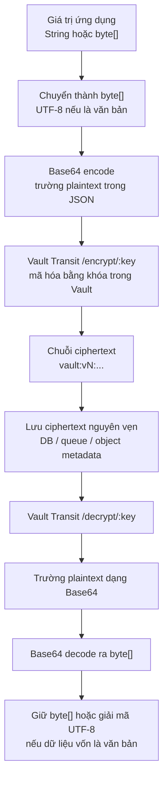

# Plaintext, Ciphertext và biểu diễn dữ liệu nhị phân

**Chương:** Mã hóa Transit  
**Module:** SPRING_VAULT

## 1. Vì sao phải phân biệt dữ liệu gốc, dữ liệu mã hóa và cách biểu diễn?

Trong ứng dụng Java, một giá trị cần bảo vệ có thể là chuỗi Unicode (họ tên, số định danh), một tài liệu PDF, ảnh, khóa ngẫu nhiên hoặc một dãy byte bất kỳ. Với **Spring Vault**, ứng dụng có thể dùng `VaultTemplate`/`VaultOperations` gọi **HashiCorp Vault Transit** để mã hóa trước khi lưu dữ liệu vào cơ sở dữ liệu hoặc truyền cho dịch vụ khác. Ứng dụng không cần trực tiếp quản lý khóa mã hóa Transit; Vault giữ và sử dụng khóa theo cấu hình, quyền của token và chính sách ACL.

Để tích hợp đúng, phải tách biệt ba khái niệm:

- **Plaintext:** dữ liệu đầu vào *chưa được mã hóa*. Dù tên gọi có chữ *text*, đối với Transit đây có thể là **mảng byte** bất kỳ.
- **Ciphertext:** dữ liệu đầu ra sau thao tác mã hóa bằng khóa Transit; chỉ có thể khôi phục nếu có quyền gọi giải mã, khóa phù hợp và các tham số cần thiết.
- **Biểu diễn dữ liệu:** cách chuyển byte thành chuỗi để vận chuyển qua giao diện JSON/HTTP, ví dụ UTF-8 và Base64. Đây là **mã hóa biểu diễn (encoding)**, không phải **mã hóa bảo mật (encryption)**.

Ví dụ điển hình là một hệ thống hồ sơ khách hàng: ứng dụng chuyển thông tin từ Java `String` thành UTF-8, gửi byte tới Transit, lưu lại `ciphertext`; khi cần đọc, ứng dụng gửi đúng chuỗi `ciphertext` cho Vault, nhận lại byte và giải mã UTF-8. Cơ sở dữ liệu chỉ lưu bản mã, còn việc cấp quyền giải mã phụ thuộc Vault policy và thông tin xác thực của workload.

### Mục tiêu sau bài học

1. Phân biệt plaintext, ciphertext, UTF-8, Base64, hex và dữ liệu nhị phân.
2. Giải thích chính xác trường `plaintext`/`ciphertext` của Vault Transit HTTP API.
3. Mã hóa/giải mã chuỗi Unicode và `byte[]` an toàn bằng Spring Vault.
4. Nhận ra lỗi hỏng dữ liệu do charset, Base64, thao tác với chuỗi hoặc làm biến dạng ciphertext.
5. Thiết kế lưu trữ và kiểm thử vòng đi về (round-trip) mà không để lộ dữ liệu nhạy cảm.

## 2. Các lớp dữ liệu trong hành trình mã hóa

| Lớp | Ví dụ | Bản chất | Lưu ý |
| --- | --- | --- | --- |
| Giá trị nghiệp vụ | `"hello"`, `"Tiếng Việt"`, PDF | Ý nghĩa dữ liệu theo ứng dụng | Văn bản phải chọn charset; PDF cần giữ nguyên byte. |
| Plaintext dưới dạng byte | `68 65 6c 6c 6f` (hex của `hello`) | Dãy byte gốc | Transit mã hóa byte, không đòi hỏi dữ liệu phải là chữ. |
| `plaintext` trong JSON Transit | `"aGVsbG8="` | **Base64 của byte gốc** | Base64 không che giấu nội dung; có thể giải ngược ngay. |
| `ciphertext` Vault trả về | `"vault:v1:..."` | Chuỗi bản mã có tiền tố định dạng/phiên bản khóa | Xem như giá trị opaque; giữ nguyên toàn bộ. |
| `plaintext` trong JSON giải mã | `"aGVsbG8="` | Base64 của byte vừa được giải mã | Phải Base64-decode để thu được byte ban đầu. |
| Giá trị sau cùng | `byte[]` hoặc `"hello"` | Byte đã khôi phục; có thể đổi thành String khi thật sự là văn bản | Đối chiếu byte để chứng minh bảo toàn dữ liệu. |

Hành trình với HTTP API:



**Điểm then chốt:** với **HTTP API**, ứng dụng cần Base64-encode plaintext ở phía client trước khi gửi và Base64-decode kết quả sau khi giải mã. Với **`VaultTransitOperations` của Spring Vault**, thư viện thực hiện bước đóng gói và chuyển đổi Base64 của giao thức giúp bạn; các overload nhận `byte[]` làm việc trực tiếp với byte gốc.

## 3. Plaintext: dữ liệu gốc là byte, không nhất thiết là chữ

### 3.1. Văn bản Unicode thành byte UTF-8

Trong Java, `String` biểu diễn ký tự Unicode, còn API mã hóa nhận byte. Chọn **UTF-8 rõ ràng** ở cả hai chiều để tránh lệ thuộc charset mặc định của hệ điều hành:

```java
import java.nio.charset.StandardCharsets;
import java.util.Base64;

String text = "hello";
byte[] originalBytes = text.getBytes(StandardCharsets.UTF_8);

String transportBase64 = Base64.getEncoder()
    .encodeToString(originalBytes);

System.out.println(transportBase64);  // aGVsbG8=

byte[] decodedBytes = Base64.getDecoder()
    .decode(transportBase64);

String roundTrip = new String(decodedBytes, StandardCharsets.UTF_8);
// roundTrip.equals(text) == true
```

Với `hello`, UTF-8 cho 5 byte với dạng hex `68 65 6C 6C 6F`. Base64 `aGVsbG8=` là một biểu diễn của **cùng 5 byte**, không phải bản mã. Ai có chuỗi Base64 đều có thể giải ngược ra `hello` mà không cần khóa.

Với tiếng Việt như `"Dữ liệu nhạy cảm"`, số byte UTF-8 có thể lớn hơn số ký tự hiển thị vì nhiều ký tự dùng nhiều byte. Java `String.length()` đếm đơn vị mã UTF-16; số byte thực cần tính bằng `text.getBytes(StandardCharsets.UTF_8).length`. Vì vậy, không dùng độ dài ký tự để ước lượng chính xác payload JSON, bộ đệm hay giới hạn kích thước.

### 3.2. Dữ liệu nhị phân bất kỳ

Một tập tin, ảnh hoặc giá trị sinh ngẫu nhiên có thể chứa byte `0x00`, `0xFF` và nhiều chuỗi byte **không phải UTF-8 hợp lệ**. Nếu ép sang `String` rồi mã hóa lại, dữ liệu có thể bị thay thế hoặc sai lệch.

```java
import java.util.Arrays;
import java.util.Base64;

byte[] binary = {
    0x00, (byte) 0xFF, 0x10, 0x7F
};

String base64 = Base64.getEncoder().encodeToString(binary);
// base64 = "AP8Qfw=="

byte[] restored = Base64.getDecoder().decode(base64);
boolean identical = Arrays.equals(binary, restored); // true
```

Không sử dụng `new String(binary, UTF_8)` để “lưu tạm” byte tùy ý; khi giải mã UTF-8 sai, các byte không hợp lệ có thể biến thành ký tự thay thế `�`, khiến chuyển ngược sang byte không còn giống dữ liệu gốc.

### 3.3. Base64 và các kiểu biểu diễn thường gặp

| Kiểu biểu diễn | Ví dụ của byte `hello` | Mục đích | Có bảo mật nội dung? |
| --- | --- | --- | --- |
| UTF-8 | 5 byte có giá trị `68 65 6C 6C 6F` | Đổi văn bản thành byte | Không |
| Hex | `68656c6c6f` | Hiển thị từng byte cho người đọc/debug | Không |
| Base64 chuẩn | `aGVsbG8=` | Đưa byte vào trường chuỗi JSON | Không |
| Base64URL | `aGVsbG8=` (ví dụ này trùng; nhiều dữ liệu khác khác ký tự) | Dùng trong URL/token khi giao thức yêu cầu | Không |
| Vault Transit ciphertext | `vault:vN:<payload>` | Bản mã do Transit tạo, có phiên bản khóa | Có, khi dùng đúng khóa và chính sách |

Base64 chuẩn theo RFC 4648 dùng bảng ký tự có `+`, `/` và dấu đệm `=`; Base64URL dùng `-`, `_`. Khi gọi Transit HTTP API, dùng **Base64 chuẩn** theo định dạng API, không tự thay bằng hex hoặc Base64URL. Tránh cắt khoảng trắng, thêm ký tự xuống dòng, escape sai, hoặc encode Base64 hai lần.

Kích thước chuỗi Base64 thông thường xấp xỉ **4/3 số byte gốc** (chính xác `4 × ceil(n / 3)` ký tự với dấu `=` đệm), chưa tính JSON, ciphertext và dữ liệu xác thực của thuật toán mã hóa. Chuyển đổi Base64 không giúp nén dữ liệu.

## 4. Ciphertext của Transit là gì?

Một phản hồi mã hóa điển hình chứa giá trị:

```text
vault:v1:<opaque-payload>
```

Ở đây `<opaque-payload>` chỉ là **ký hiệu minh họa**, không phải một ciphertext hợp lệ để gọi API. Giá trị thật do Vault sinh ra. Với định dạng thường gặp:

- `vault:` cho biết đây là chuỗi ciphertext theo định dạng Vault Transit.
- `v1` cho biết **phiên bản khóa** đã mã hóa bản plaintext đó; sau khi quay vòng khóa, có thể thấy `v2`, `v3`...
- Phần còn lại mang dữ liệu mã hóa được đóng gói theo định dạng của Vault; không tự chia tách, sửa hay tự giải mã phần này để khôi phục plaintext.

Với khóa đối xứng mặc định phổ biến (`aes256-gcm96`), Vault tạo dữ liệu mã hóa có tính xác thực; cùng plaintext có thể tạo ciphertext **khác nhau** ở các lần gọi nhờ nonce/IV. Vì vậy:

- Không so sánh ciphertext để xác định hai plaintext có bằng nhau.
- Không dùng ciphertext làm mã định danh ổn định, mã kiểm tra trùng lặp hay giá trị tìm kiếm theo nội dung.
- Không giả định tiền tố `v1` có nghĩa là API v1, schema v1 của ứng dụng hoặc token phiên bản 1. Đó là **phiên bản khóa Transit**.
- Không bỏ `vault:vN:` và chỉ lưu “phần Base64 phía sau”; Vault cần nguyên chuỗi để nhận biết định dạng và phiên bản khóa.
- Không ghi ciphertext vào log mặc định hoặc để lộ cho bên không cần thiết; dù là bản mã, nó vẫn là dữ liệu cần bảo vệ theo chính sách của hệ thống.

**Khác biệt quan trọng với KV secrets engine:** Transit thực hiện phép mã hóa và trả ciphertext; Vault **không tự lưu bản plaintext hoặc ciphertext ứng dụng** để bạn truy vấn lại. Ứng dụng chịu trách nhiệm lưu ciphertext trong DB hoặc nơi phù hợp. Vault quản lý khóa/phiên bản, còn **KV** phục vụ lưu trữ secret như API key, không thay thế vai trò của Transit trong ví dụ này.

## 5. Minh họa hợp đồng HTTP API

Giả sử quản trị viên đã bật Transit, tạo khóa có tên `customer-pii` và workload Java có token được cấp quyền gọi các endpoint liên quan. Ví dụ dùng chữ `hello` để nhìn rõ quá trình biểu diễn.

### 5.1. Encrypt

```http
POST /v1/transit/encrypt/customer-pii
Content-Type: application/json
X-Vault-Token: <workload-token>

{
  "plaintext": "aGVsbG8="
}
```

Vault giải Base64 thành byte `hello` trước khi mã hóa. Phản hồi rút gọn:

```json
{
  "data": {
    "ciphertext": "vault:v1:<opaque-payload>"
  }
}
```

Giá trị `<opaque-payload>` là placeholder. Trong hệ thống thật, lưu đúng chuỗi mà Vault trả về ở `data.ciphertext`. **Đừng Base64-encode thêm toàn bộ chuỗi `vault:v1:...` để truyền lại cho `decrypt`**, vì API nhận trực tiếp định dạng ciphertext này.

### 5.2. Decrypt

```http
POST /v1/transit/decrypt/customer-pii
Content-Type: application/json
X-Vault-Token: <workload-token>

{
  "ciphertext": "vault:v1:<opaque-payload>"
}
```

Phản hồi rút gọn khi giải mã thành công ciphertext thực:

```json
{
  "data": {
    "plaintext": "aGVsbG8="
  }
}
```

Phải Base64-decode `data.plaintext` để lấy lại byte `hello`. Nếu plaintext gốc là byte ảnh/PDF, đầu ra cũng là byte ảnh/PDF: **không** ép đầu ra thành chuỗi UTF-8.

Hai chiều dùng cùng tên khóa Transit và, nếu khóa được cấu hình **derived**, phải sử dụng đúng ngữ cảnh dẫn xuất `context` đã dùng lúc mã hóa. Tương tự, những tham số bổ sung của thuật toán/mode nếu có phải được cung cấp đúng theo yêu cầu của endpoint. `context` của Transit cũng có dạng Base64 trong HTTP API; đó là dữ liệu tham số, không phải ciphertext.

## 6. Spring Vault: thao tác với byte[] mà không tự đóng gói Base64

Khi đã cấu hình Vault endpoint, phương thức xác thực workload (ví dụ Kubernetes hoặc AppRole), chính sách token và bean `VaultOperations` cho ứng dụng, có thể dùng `VaultTransitOperations`. Lớp sau chủ động phân biệt byte nhị phân và văn bản UTF-8:

```java
import java.nio.ByteBuffer;
import java.nio.charset.CharacterCodingException;
import java.nio.charset.CodingErrorAction;
import java.nio.charset.StandardCharsets;

import org.springframework.stereotype.Service;
import org.springframework.vault.core.VaultOperations;
import org.springframework.vault.core.VaultTransitOperations;
import org.springframework.vault.support.VaultTransitContext;

@Service
public class TransitPayloadService {

    private static final String KEY_NAME = "customer-pii";

    private final VaultTransitOperations transit;

    public TransitPayloadService(VaultOperations vaultOperations) {
        this.transit = vaultOperations.opsForTransit();
    }

    // Mã hóa đúng dãy byte đã nhận; thư viện lo Base64 ở lớp HTTP.
    public String encryptBytes(byte[] plaintext) {
        return transit.encrypt(
            KEY_NAME, plaintext, VaultTransitContext.empty());
    }

    // Trả lại đúng byte gốc, không ép kiểu String.
    public byte[] decryptBytes(String vaultCiphertext) {
        return transit.decrypt(
            KEY_NAME, vaultCiphertext, VaultTransitContext.empty());
    }

    public String encryptUtf8(String value) {
        return encryptBytes(value.getBytes(StandardCharsets.UTF_8));
    }

    // Reject byte không phải UTF-8 hợp lệ, tránh thay thế âm thầm.
    public String decryptUtf8(String vaultCiphertext)
            throws CharacterCodingException {

        byte[] bytes = decryptBytes(vaultCiphertext);
        return StandardCharsets.UTF_8.newDecoder()
            .onMalformedInput(CodingErrorAction.REPORT)
            .onUnmappableCharacter(CodingErrorAction.REPORT)
            .decode(ByteBuffer.wrap(bytes))
            .toString();
    }
}
```

Ví dụ tại tầng gọi nghiệp vụ:

```java
String encryptedName = transitService.encryptUtf8("Nguyễn An");
// Lưu encryptedName vào cột TEXT/VARCHAR đủ dài.

String originalName = transitService.decryptUtf8(encryptedName);
// originalName.equals("Nguyễn An") là true.

byte[] signature = { 0x00, (byte) 0xFF, 0x10, 0x7F };
String encryptedBinary = transitService.encryptBytes(signature);
byte[] restoredSignature = transitService.decryptBytes(encryptedBinary);
// java.util.Arrays.equals(signature, restoredSignature) là true.
```

Trong ví dụ, `transitService` là instance của `TransitPayloadService` được inject; khóa `customer-pii` đã tồn tại và account của workload được phép gọi `encrypt`/`decrypt`. Với mount khác `transit`, khởi tạo bằng `vaultOperations.opsForTransit("ten-mount")`.

**Vì sao chọn API nhận `byte[]`?** Các overload tiện lợi `encrypt(String keyName, String plaintext)` và `decrypt(String keyName, String ciphertext)` dùng **charset mặc định** của môi trường Java để đổi `String` ↔ byte. Mã nghiệp vụ cần quy ước UTF-8 nhất quán, do đó dùng overload byte như trên hoặc các value object `Plaintext.of(text, StandardCharsets.UTF_8)`/`Ciphertext.of(ciphertext)` khi phù hợp. Spring Vault nhận và trả **ciphertext theo chuỗi định dạng của Vault**; bạn không cần tự encode/decode Base64 quanh lời gọi `VaultTransitOperations`.

## 7. Bảo toàn dữ liệu khi lưu, truyền và quay vòng khóa

### 7.1. Lưu ciphertext như giá trị opaque

Có thể lưu ciphertext Vault vào cột `TEXT` hoặc `VARCHAR` phù hợp với kích thước dữ liệu. Không dùng chiều dài cố định giả định cho bản mã: kích thước thay đổi theo dữ liệu đầu vào, thuật toán và thông tin kèm theo. Nếu lưu trong JSON hoặc message queue, truyền toàn chuỗi `vault:vN:...` bằng định dạng chuỗi chuẩn; tránh các phép xử lý như `trim()`, tách dấu `:`, chuyển chữ hoa/thường hoặc giải mã Base64 trên **toàn chuỗi ciphertext**.

Nếu payload là tệp lớn, cân nhắc thiết kế **envelope encryption** với data key của Transit và mã hóa dữ liệu tại ứng dụng/lớp lưu trữ thay vì gửi toàn bộ tệp qua Transit. API HTTP của Vault có giới hạn kích thước request (mặc định được tài liệu nêu là 32 MB, tùy cấu hình listener), chưa kể Base64 làm tăng kích thước. Không tự chia plaintext thành nhiều khối mã hóa rồi ghép ciphertext nếu chưa xác định rõ mô hình bảo mật.

### 7.2. Phân biệt phiên bản khóa và việc rewrap

Sau khi rotate khóa Transit, ciphertext cũ với `vault:v1:...` vẫn có thể giải mã nếu phiên bản khóa tương ứng còn được Vault cho phép giải mã. Encrypt mới thường sử dụng phiên bản khóa mới, ví dụ `vault:v2:...`. Chức năng **rewrap** chuyển ciphertext sang phiên bản khóa mới mà không cần ứng dụng nhận plaintext; đó là một hành động mật mã khác với việc Base64 encode hoặc đổi định dạng chuỗi.

Việc rotate, quyền truy cập `rewrap` và `min_decryption_version` cần được vận hành theo chính sách quản lý khóa; bản thân tiền tố phiên bản khóa chỉ cung cấp metadata, không phải chứng cứ rằng dữ liệu đã được giải mã hay tái mã hóa thành công.

### 7.3. Xác thực workload và phân quyền theo hành động

Tùy luồng nghiệp vụ, token của workload có thể chỉ cần quyền `update` tại `transit/encrypt/customer-pii`; dịch vụ phải đọc lại dữ liệu gốc mới cần quyền `update` trên `transit/decrypt/customer-pii`. Tránh cấp quyền tạo/xóa/xuất khóa, rotate hoặc giải mã cho mọi workload theo mặc định. Ví dụ policy tối thiểu cho dịch vụ **chỉ ghi dữ liệu mã hóa**:

```hcl
path "transit/encrypt/customer-pii" {
  capabilities = ["update"]
}
```

Ứng dụng sử dụng chính cơ chế xác thực workload và quản lý vòng đời token/session trong Spring Vault; không nhúng token bí mật vào source code, tests, log hoặc ví dụ commit. Transit ciphertext không phải Vault lease, cũng không tự hết hạn chỉ vì token của phiên mã hóa hết hạn. Token còn hợp lệ và ACL thích hợp là điều kiện để gọi các thao tác trên Vault trong tương lai.

## 8. Lỗi thường gặp và cách nhận biết

| Triệu chứng | Nguyên nhân có thể xảy ra | Cách xử lý |
| --- | --- | --- |
| Transit trả lỗi đầu vào khi encrypt qua REST | `plaintext` là text thô, hex hoặc Base64 không hợp lệ | Chuyển byte gốc sang **Base64 chuẩn** trước khi gửi; với Spring Vault dùng overload byte. |
| Dữ liệu tiếng Việt bị sai sau decrypt | Encode và decode bằng charset khác nhau | Quy định UTF-8 ở cả hai chiều; cân nhắc từ chối byte UTF-8 không hợp lệ. |
| Ảnh/PDF khôi phục bị hỏng | Đã chuyển byte tùy ý thành String hoặc chỉnh newline | Giữ `byte[]` từ đầu đến cuối; kiểm tra bằng `Arrays.equals` hoặc checksum. |
| Decrypt báo ciphertext không hợp lệ | Cắt tiền tố `vault:vN:`, sửa chuỗi, Base64-encode cả ciphertext hoặc dữ liệu hỏng | Lưu/truyền đúng ciphertext gốc; không tự phân tích payload. |
| Decrypt không thành công sau rotate | Key phiên bản cũ bị vô hiệu hóa cho decrypt hoặc ciphertext bị truyền nhầm sang khóa khác | Kiểm tra key name, policy, `min_decryption_version` và quy trình rotate/rewrap. |
| Encrypt thành công nhưng decrypt bị cấm | Workload chỉ được cấp quyền encrypt | Xác định rõ vai trò và cấp quyền `decrypt` cho đúng service; xem Vault audit log có kiểm soát. |
| Hai lần encrypt cùng plaintext cho kết quả khác nhau | Mã hóa có tính ngẫu nhiên/nonce của thuật toán | Đây thường là hành vi mong đợi; xác nhận bằng phép decrypt và đối chiếu byte. |
| Payload vượt giới hạn HTTP/request | File lớn cộng overhead Base64/JSON | Giới hạn kích thước đầu vào; cân nhắc envelope encryption cho dữ liệu lớn. |

Lỗi HTTP `403` thường gợi ý thiếu quyền hoặc token không hợp lệ; lỗi `400` thường liên quan payload/định dạng/tham số. Cần xem mã trạng thái và thông tin lỗi thực tế thay vì suy luận chỉ từ một triệu chứng. Không in request plaintext, ciphertext đầy đủ, token hoặc khóa ra log khi debug; ưu tiên mã lỗi, loại thao tác, key alias đã được phép công khai, correlation ID và độ dài payload. Theo dõi latency, tỷ lệ lỗi và Vault audit theo chính sách an toàn dữ liệu.

## 9. Kiểm thử round-trip và các trường hợp biên

Khi có môi trường Vault thử nghiệm với khóa `customer-pii` và policy phù hợp, kiểm thử bản chất dữ liệu bằng phép đối chiếu **byte trước và sau decrypt**. Không assert rằng ciphertext phải giống một chuỗi cố định hoặc rằng hai lần encrypt cùng đầu vào trả về cùng ciphertext.

```java
import static org.junit.jupiter.api.Assertions.*;

import java.nio.charset.StandardCharsets;
import org.junit.jupiter.api.Test;

// Ví dụ ý tưởng kiểm thử tích hợp, giả sử đã inject transitService.
@Test
void transitPreservesVietnameseUtf8() throws Exception {
    String source = "Dữ liệu 🔐 có dấu\nvà xuống dòng";
    String ciphertext = transitService.encryptUtf8(source);
    assertTrue(ciphertext.startsWith("vault:v"));
    assertEquals(source, transitService.decryptUtf8(ciphertext));
}

@Test
void transitPreservesArbitraryBinaryBytes() {
    byte[] source = {
        0x00, (byte) 0xFF, 0x10, 0x7F,
        (byte) 0x80, 0x0A
    };
    String ciphertext = transitService.encryptBytes(source);
    assertArrayEquals(source, transitService.decryptBytes(ciphertext));
}
```

Các trường hợp nên bao phủ thêm: đầu vào có byte `0x00`, dấu xuống dòng `\r\n`/`\n`, ký tự tổ hợp Unicode, nhiều byte UTF-8, payload gần giới hạn kích thước ứng dụng, ciphertext hỏng, sai tên khóa, mất quyền `decrypt`, key đã rotate và context thiếu/sai với khóa dẫn xuất. Đối với văn bản, Unicode normalization có thể tạo hai dãy byte khác nhau trông giống nhau; chỉ chuẩn hóa nếu đã có **quy ước nghiệp vụ rõ ràng** và áp dụng đồng nhất trước khi mã hóa.

Có thể kiểm tra charset/Base64 ở unit test thuần Java mà không cần Vault. Kiểm thử thật của `VaultTransitOperations` nên chạy với môi trường Vault cô lập (ví dụ Dev/Testcontainers hoặc Vault thử nghiệm do tổ chức quản lý) để xác nhận auth, ACL, key và phản hồi HTTP. Tuyệt đối không dùng khóa sản xuất và dữ liệu khách hàng thật làm bộ mẫu thử.

## 10. Tự kiểm tra kiến thức

1. Vì sao chuỗi `aGVsbG8=` không được coi là đã mã hóa bảo mật?
2. Khi Vault HTTP API trả `data.plaintext` sau decrypt, giá trị đó đại diện cho gì?
3. Điều gì có thể xảy ra nếu dùng `new String(bytes, UTF_8)` với byte ảnh hoặc khóa ngẫu nhiên?
4. Vì sao không nên loại bỏ phần `vault:v2:` để chỉ lưu đoạn Base64 phía sau?
5. Nếu một service chỉ có quyền `transit/encrypt/...`, tại sao nó không thể đọc lại plaintext từ ciphertext đã lưu?
6. Nên kiểm thử điều kiện nào để chứng minh vòng đi về đúng với tiếng Việt và dữ liệu nhị phân?

**Gợi ý trả lời:** (1) Base64 đảo ngược được, không cần khóa; (2) Base64 của byte gốc; (3) có thể thay thế byte lỗi charset và làm hỏng dữ liệu; (4) mất định dạng/phiên bản khóa mà Vault cần để giải mã; (5) quyền encrypt không mặc nhiên trao quyền decrypt; (6) đối chiếu nội dung và mảng byte sau giải mã, gồm Unicode, byte không phải UTF-8 và ký tự điều khiển.

## Tài liệu tham khảo

- [HashiCorp Vault — Transit secrets engine](https://developer.hashicorp.com/vault/docs/secrets/transit): luồng encrypt/decrypt, định dạng `vault:vN:...`, rotate/rewrap và trách nhiệm lưu ciphertext.
- [HashiCorp Vault — Transit HTTP API](https://developer.hashicorp.com/vault/api-docs/secret/transit): định dạng `plaintext` Base64, `ciphertext`, `context` và giới hạn request.
- [Spring Vault — Transit backend](https://docs.spring.io/spring-vault/reference/vault/vault-secret-engines.html): thao tác Transit qua Spring Vault.
- [Spring Vault — VaultTransitOperations API](https://docs.spring.io/spring-vault/reference/api/java/org/springframework/vault/core/VaultTransitOperations.html): overload nhận `String`, `byte[]` và value object.
- [Spring Vault — Plaintext API](https://docs.spring.io/spring-vault/reference/api/java/org/springframework/vault/support/Plaintext.html): biểu diễn plaintext an toàn nhị phân bằng `byte[]`.
