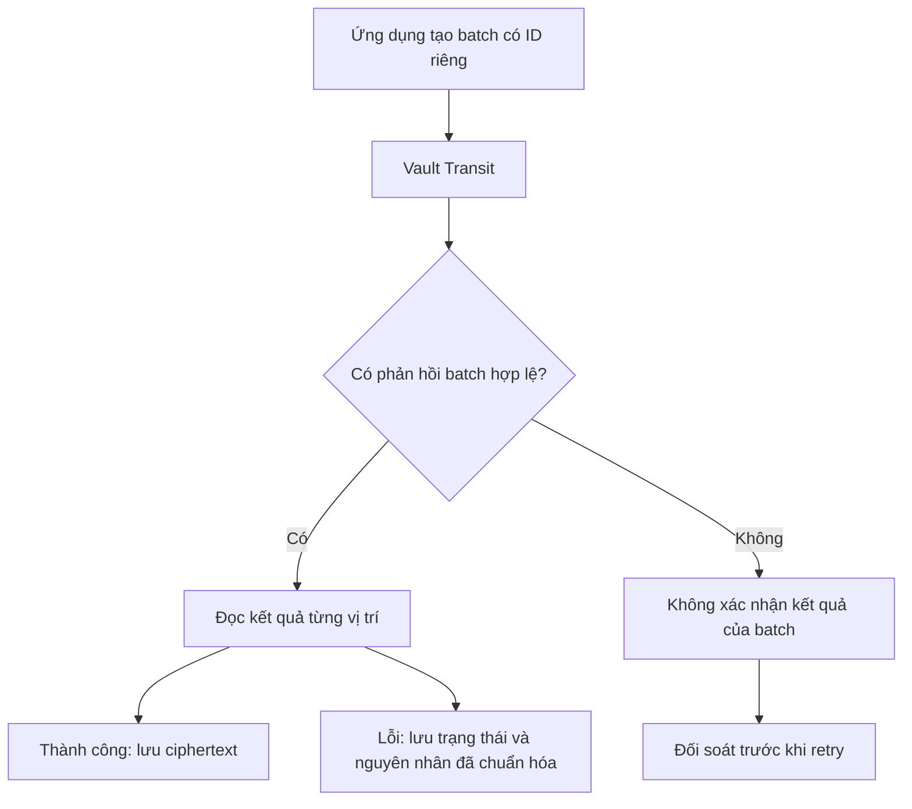

# Xử lý theo lô và lỗi riêng của từng phần tử trong Spring Vault Transit

## Mục tiêu và tình huống sử dụng

Trong **Spring Vault**, ứng dụng Java có thể gọi HashiCorp Vault qua `VaultTemplate` và `VaultTransitOperations` để mã hóa hoặc giải mã dữ liệu mà không cần giữ khóa mã hóa trong tiến trình ứng dụng. Khi một yêu cầu nghiệp vụ có nhiều giá trị cần xử lý, Transit cho phép gửi cả nhóm trong một lời gọi `batch_input`. Lợi ích chính là giảm số lần gọi mạng và chi phí xử lý từng HTTP request; **không nên hiểu batch là một giao dịch nguyên tử**.

Ví dụ: dịch vụ nhập 1.000 đơn hàng phải mã hóa thông tin người nhận. Nếu dữ liệu của một đơn hàng không hợp lệ, ứng dụng cần ghi nhận chính xác đơn đó, giữ kết quả hợp lệ đã xác nhận và xác định phần nào cần xử lý lại. Việc chỉ xem HTTP status hoặc chỉ bắt một ngoại lệ chung sẽ làm mất thông tin quan trọng về từng phần tử.

Sau bài này, bạn có thể:

- Phân biệt lỗi **cả lời gọi** và lỗi **một phần tử** trong Transit batch.
- Dùng API batch của Spring Vault cho `encrypt`, `decrypt` và `rewrap`, đối chiếu kết quả với đầu vào.
- Hiểu `batch_input`, `batch_results`, `reference`, `error` và `partial_failure_response_code` của Vault HTTP API.
- Thiết kế lưu kết quả, retry, giám sát và kiểm thử để không bỏ sót lỗi hoặc xử lý lặp thiếu kiểm soát.

## 1. Giao ước batch của Transit

Giả sử Transit được mount tại đường dẫn `transit` và đã có key `orders-key`:

| Thao tác | Vault HTTP endpoint | Mảng đầu vào | Giá trị thành công từng phần tử |
|---|---|---|---|
| Mã hóa | `POST /v1/transit/encrypt/orders-key` | `batch_input` chứa `plaintext` | `ciphertext` |
| Giải mã | `POST /v1/transit/decrypt/orders-key` | `batch_input` chứa `ciphertext` | `plaintext` |
| Mã hóa lại theo phiên bản khóa mới | `POST /v1/transit/rewrap/orders-key` | `batch_input` chứa `ciphertext` | `ciphertext` mới |

`plaintext` trong Vault HTTP API phải là **Base64 của chuỗi byte gốc**, không phải chuỗi ký tự đưa trực tiếp lên JSON. Kết quả `plaintext` khi giải mã cũng là Base64. Base64 chỉ là cách biểu diễn dữ liệu nhị phân, **không phải mã hóa bảo mật**. Ngược lại, `ciphertext` do Transit trả về thường có dạng `vault:v1:...`, cần lưu nguyên chuỗi để sử dụng về sau.

Ví dụ request mã hóa hai chuỗi `hello` và `world` (Base64 lần lượt là `aGVsbG8=` và `d29ybGQ=`):

```http
POST /v1/transit/encrypt/orders-key HTTP/1.1
X-Vault-Token: <token-do-phien-xac-thuc-cap>
Content-Type: application/json

{
  "batch_input": [
    {"reference": "order-701", "plaintext": "aGVsbG8="},
    {"reference": "order-702", "plaintext": "d29ybGQ="}
  ]
}
```

Phản hồi thành công có cấu trúc `data.batch_results`. Ví dụ **minh họa cấu trúc** dưới đây sử dụng ciphertext rút gọn, không phải ciphertext có thể giải mã:

```json
{
  "data": {
    "batch_results": [
      {"reference": "order-701", "ciphertext": "vault:v1:<ciphertext-701>"},
      {"reference": "order-702", "ciphertext": "vault:v1:<ciphertext-702>"}
    ]
  }
}
```

Vault **giữ nguyên thứ tự** của kết quả batch so với phần tử đầu vào. Trường `reference` là định danh do client tự đặt để đối chiếu kết quả và chỉ có ý nghĩa với request batch. Dù có `reference`, hệ thống vẫn nên kiểm tra số lượng phần tử và đối chiếu ID; không suy ra thứ tự từ thứ tự trả về của một cấu trúc map ở tầng nghiệp vụ.

Một key Transit có thể dùng cho nhiều phần tử trong một batch. Nếu key được tạo với cơ chế *derived*, mỗi phần tử phải cung cấp `context` tương ứng (Base64 ở HTTP API), và khi giải mã/rewrap phải dùng đúng context của dữ liệu đó. `context` thuộc đầu vào mật mã, không phải chỉ là nhãn để phân nhóm.

### Batch không tương đương tính nguyên tử

Khi một số phần tử thành công và một số phần tử lỗi, Vault có thể trả về kết quả riêng từng phần tử. Không có bảo đảm kiểu “thành công hết hoặc rollback hết”. Ứng dụng nên theo dõi trạng thái của từng đối tượng nghiệp vụ độc lập với kết quả của cả HTTP request.



## 2. Ba lớp lỗi cần tách biệt

**Lớp 1 — lỗi dữ liệu của phần tử.** Một phần tử có `ciphertext` sai định dạng, sai `context`, phiên bản khóa bị cấm giải mã hoặc dữ liệu Base64 không hợp lệ. Các phần tử còn lại có thể vẫn được xử lý. Với phản hồi batch đọc được, phần tử lỗi có trường `error` thay vì kết quả thành công. Chuỗi lỗi do Vault trả về là thông tin kỹ thuật; nên ánh xạ sang mã lỗi ứng dụng trước khi trả cho người dùng.

**Lớp 2 — lỗi ở mức request hoặc quyền truy cập.** Token hết hạn, policy không cho gọi `transit/decrypt/orders-key`, key không tồn tại, body JSON không hợp lệ, hoặc toàn bộ phần tử đều thất bại. Khi đó ứng dụng có thể nhận ngoại lệ từ client thay vì danh sách kết quả. Không được tự giả định các phần tử đã hoàn tất.

**Lớp 3 — lỗi truyền thông hoặc không xác định kết quả.** Timeout, reset kết nối, node Vault không sẵn sàng hoặc client bị hủy khi request đang chạy khiến ứng dụng không biết Vault đã xử lý đến đâu. Không ghi tất cả phần tử thành `FAILED` rồi gửi lại một cách mù quáng; trạng thái phù hợp ban đầu là `UNKNOWN`/`PENDING_RECONCILIATION`, có thể kiểm tra nơi lưu dữ liệu và quyết định retry có kiểm soát.

### Điểm dễ nhầm: HTTP 400 nhưng vẫn có phần tử thành công

Theo Vault Transit HTTP API, khi **một số phần tử lỗi, số khác thành công**, mặc định Vault sử dụng HTTP **400**. Tùy cách xử lý lỗi HTTP của client, Spring Vault hoặc một tầng REST có thể ném ngoại lệ trước khi phần ứng dụng đọc được `batch_results`.

Hai điểm cần nhớ:

1. **HTTP 400 không đủ để kết luận mọi phần tử đã thất bại.** Phải xét body phản hồi (nếu client tiếp cận được), và bảo toàn kết quả đã xác nhận.
2. Với endpoint `encrypt` và `decrypt`, Vault hỗ trợ tham số top-level `partial_failure_response_code` để chọn mã HTTP khác cho trường hợp lỗi một phần. Ví dụ đặt `200` có thể giúp client nhận body và đọc `batch_results`; **HTTP 200 lúc này cũng không có nghĩa mọi phần tử đều thành công**. Nếu tất cả phần tử lỗi, Vault vẫn trả mã lỗi.

Không nên đổi `partial_failure_response_code` thành `200` chỉ để “né exception” mà không có mã kiểm tra `error` cho **từng** kết quả. Với dữ liệu nhạy cảm, lỗi giải mã có thể cảnh báo dữ liệu bị thay đổi, sai context hoặc truy cập sai phiên bản khóa và cần được điều tra.

Ví dụ **minh họa** cho một phản hồi giải mã gồm một kết quả tốt và một kết quả sai:

```json
{
  "data": {
    "batch_results": [
      {"reference": "order-701", "plaintext": "aGVsbG8="},
      {"reference": "order-702", "error": "<thong-diep-loi-tu-vault>"}
    ]
  }
}
```

Trong ví dụ này, chỉ `order-701` có dữ liệu giải mã hợp lệ. `order-702` phải được giữ là lỗi riêng; không chuyển thành chuỗi rỗng, `null` ngầm hoặc dữ liệu mặc định để tiếp tục xử lý nghiệp vụ.

## 3. Thao tác batch bằng `VaultTemplate` và `VaultTransitOperations`

Trong môi trường thực tế, tạo key Transit và cấp quyền cho workload trước khi chạy ứng dụng. Chẳng hạn, với Vault đã khởi tạo và một phiên quản trị **chỉ dùng lúc cấu hình**, có thể tạo key bằng:

```bash
vault secrets enable transit
vault write -f transit/keys/orders-key
```

Nếu mount `transit` đã tồn tại thì bỏ qua lệnh `vault secrets enable`. Ví dụ policy tối thiểu cho một ứng dụng cần mã hóa và giải mã:

```hcl
path "transit/encrypt/orders-key" {
  capabilities = ["update"]
}

path "transit/decrypt/orders-key" {
  capabilities = ["update"]
}
```

Thêm `transit/rewrap/orders-key` với `update` khi thực sự cần rewrap. Nên xác thực ứng dụng bằng cơ chế phù hợp workload (ví dụ Kubernetes Auth, AppRole hoặc một phương thức được tổ chức quản lý), sử dụng token ngắn hạn và cấu hình `VaultTemplate`/session management của Spring Vault. Không nhúng root token vào mã nguồn.

Ví dụ Java sau giả định Spring đã có bean `VaultTemplate` và ứng dụng dùng Java 17+ cùng Spring Vault hỗ trợ các API batch:

```java
import java.nio.charset.StandardCharsets;
import java.util.ArrayList;
import java.util.List;
import java.util.Objects;

import org.springframework.stereotype.Service;
import org.springframework.vault.VaultException;
import org.springframework.vault.core.VaultTemplate;
import org.springframework.vault.core.VaultTransitOperations;
import org.springframework.vault.support.Ciphertext;
import org.springframework.vault.support.Plaintext;
import org.springframework.vault.support.VaultEncryptionResult;

@Service
public class TransitBatchService {

    private static final String KEY = "orders-key";
    private final VaultTransitOperations transit;

    public TransitBatchService(VaultTemplate vaultTemplate) {
        this.transit = vaultTemplate.opsForTransit();
    }

    public record OrderInput(String id, String sensitiveValue) {}
    public record OrderResult(String id, String ciphertext, String errorCode) {}

    public List<OrderResult> encrypt(List<OrderInput> inputs) {
        if (inputs.isEmpty()) {
            return List.of();
        }

        List<Plaintext> request = inputs.stream()
            .map(item -> Plaintext.of(item.sensitiveValue(), StandardCharsets.UTF_8))
            .toList();

        final List<VaultEncryptionResult> results;
        try {
            results = transit.encrypt(KEY, request);
        } catch (VaultException ex) {
            // Request thất bại hoặc không có kết quả batch đáng tin cậy.
            // Bộ điều phối đặt trạng thái UNKNOWN và đối soát trước retry.
            throw new IllegalStateException("Không xác nhận được batch Transit", ex);
        }

        if (results == null || results.size() != inputs.size()) {
            throw new IllegalStateException("Số kết quả Transit không khớp đầu vào");
        }

        List<OrderResult> output = new ArrayList<>(results.size());
        for (int i = 0; i < results.size(); i++) {
            VaultEncryptionResult result = results.get(i);
            String id = inputs.get(i).id();

            if (result.isSuccessful()) {
                Ciphertext encrypted = Objects.requireNonNull(result.get());
                output.add(new OrderResult(id, encrypted.getCiphertext(), null));
            } else {
                // result.getCause() chứa nguyên nhân kỹ thuật cho telemetry.
                // Không gọi result.get() khi isSuccessful() == false.
                output.add(new OrderResult(id, null, "TRANSIT_ITEM_FAILED"));
            }
        }
        return List.copyOf(output);
    }
}
```

Điểm mấu chốt của đoạn mã:

- `Plaintext.of(text, StandardCharsets.UTF_8)` chuyển ký tự sang byte đúng charset; Spring Vault lo khâu Base64 khi xây dựng payload HTTP. **Không Base64 lần thứ hai** nếu đã sử dụng `Plaintext`.
- `encrypt(KEY, List<Plaintext>)` là một batch call của Transit; kết quả kiểu `List<VaultEncryptionResult>` cùng thứ tự đầu vào.
- `isSuccessful()` được kiểm tra trước `get()`. Khi có lỗi riêng, `getCause()` cho biết ngoại lệ; `get()` có thể ném `VaultException` nếu gọi trên phần tử thất bại.
- `id` nghiệp vụ giữ bên ngoài danh sách `Plaintext`, được đối chiếu qua chỉ số. Phần giao tiếp kiểu mạnh của Spring Vault không thay thế quy tắc kiểm tra `reference` khi dùng API JSON trực tiếp.
- Ngoại lệ do cả request xảy ra **trước khi nhận danh sách** khác bản chất với `VaultEncryptionResult` thất bại ở một vị trí. Người gọi cần có nhánh xử lý và lưu trạng thái riêng cho hai trường hợp.

### Giải mã và rewrap batch

Các chữ ký liên quan trong `VaultTransitOperations`:

```java
List<VaultDecryptionResult> decrypt(String keyName, List<Ciphertext> batchRequest);
List<VaultEncryptionResult> rewrap(String keyName, List<Ciphertext> batchRequest);
```

Ví dụ giải mã sau khi đã có các ciphertext hợp lệ:

```java
List<Ciphertext> cipherBatch = encryptedValues.stream()
    .map(Ciphertext::of)
    .toList();

List<VaultDecryptionResult> results = transit.decrypt("orders-key", cipherBatch);
for (int i = 0; i < results.size(); i++) {
    VaultDecryptionResult item = results.get(i);
    if (item.isSuccessful()) {
        byte[] clearBytes = item.get().getPlaintext();
        // Dùng clearBytes trực tiếp; chỉ decode UTF-8 khi dữ liệu gốc là văn bản.
        String clearText = new String(clearBytes, StandardCharsets.UTF_8);
        // Gắn clearText với ID đầu vào ở vị trí i và dùng trong phạm vi cần thiết.
    } else {
        // Gắn mã DECRYPT_FAILED với đúng ID tại vị trí i.
    }
}
```

Đoạn trên là **mảnh mã tích hợp**: `encryptedValues`, `transit`, việc lưu kết quả và các kiểm tra đầu vào được cung cấp bởi code ứng dụng. Với `rewrap`, gọi `transit.rewrap("orders-key", cipherBatch)` rồi kiểm tra từng `VaultEncryptionResult` tương tự mã hóa. Rewrap tạo ciphertext theo phiên bản khóa hiện hành mà không đưa plaintext về ứng dụng; không tự động cập nhật ciphertext đang lưu trong cơ sở dữ liệu.

Nếu khóa bật `derived`, có thể tạo context như sau và **cung cấp lại đúng context đó** khi giải mã:

```java
var context = VaultTransitContext.fromContext(
    "tenant-A".getBytes(StandardCharsets.UTF_8));

Plaintext input = Plaintext.of("secret", StandardCharsets.UTF_8).with(context);
Ciphertext encrypted = transit.encrypt("derived-orders-key", input);
Plaintext decrypted = transit.decrypt("derived-orders-key", encrypted.with(context));
```

Ở đây, `VaultTransitContext` thuộc package `org.springframework.vault.support`. Key `derived-orders-key` phải được **cấu hình từ trước** để dùng derivation; snippet chỉ minh họa cách gắn context, không tạo key đó.

## 4. Cần đọc lỗi từng phần tử từ HTTP API: dùng `VaultTemplate.write`

API kiểu mạnh `VaultTransitOperations` tiện lợi cho tác vụ thông thường, nhưng không trực tiếp cho phép truyền tham số top-level `partial_failure_response_code`. Nếu yêu cầu nghiệp vụ cần đọc `batch_results` khi có lỗi một phần và muốn sử dụng HTTP 200 cho nhánh này, có thể gọi endpoint cụ thể bằng `VaultTemplate.write(path, body)` với phiên xác thực Spring Vault đã cấu hình.

Ví dụ dưới đây gửi hai giá trị cần mã hóa và **chủ động kiểm tra từng result**. Các khai báo import cần thiết là `java.util.*`, `java.nio.charset.StandardCharsets`, `org.springframework.vault.core.VaultTemplate`, `org.springframework.vault.support.VaultResponse`:

```java
List<Map<String, Object>> batchInput = List.of(
    Map.of("reference", "order-701", "plaintext",
        Base64.getEncoder().encodeToString("hello".getBytes(StandardCharsets.UTF_8))),
    Map.of("reference", "order-702", "plaintext",
        Base64.getEncoder().encodeToString("world".getBytes(StandardCharsets.UTF_8)))
);

Map<String, Object> body = Map.of(
    "batch_input", batchInput,
    "partial_failure_response_code", 200
);

VaultResponse response = vaultTemplate.write("transit/encrypt/orders-key", body);
if (response == null || response.getData() == null) {
    throw new IllegalStateException("Vault không trả data");
}

Object raw = response.getData().get("batch_results");
if (!(raw instanceof List<?> batchResults)
        || batchResults.size() != batchInput.size()) {
    throw new IllegalStateException("Thiếu hoặc sai số lượng batch_results");
}

for (int i = 0; i < batchResults.size(); i++) {
    if (!(batchResults.get(i) instanceof Map<?, ?> item)) {
        throw new IllegalStateException("Batch item sai định dạng");
    }

    String expectedId = (String) batchInput.get(i).get("reference");
    if (!Objects.equals(expectedId, item.get("reference"))) {
        throw new IllegalStateException("Kết quả không khớp reference");
    }

    if (item.get("error") instanceof String) {
        // Lưu trạng thái FAILED của expectedId, mã hóa nguyên nhân để theo dõi.
    } else if (item.get("ciphertext") instanceof String ciphertext
            && !ciphertext.isBlank()) {
        // Lưu ciphertext cho expectedId theo cơ chế ghi an toàn/idempotent.
    } else {
        throw new IllegalStateException("Batch item không có kết quả hợp lệ");
    }
}
```

`VaultTemplate.write` có thể ném ngoại lệ trên các lỗi HTTP, ví dụ 403, 5xx, lỗi toàn bộ batch hoặc timeout; snippet chỉ minh họa **nhánh có phản hồi đọc được**. Trong ứng dụng thật, bọc lời gọi này bằng xử lý ngoại lệ của request, kiểm tra ID không trùng, giới hạn độ lớn batch và lưu trạng thái sao cho việc ghi một số kết quả rồi bị dừng giữa chừng vẫn có thể đối soát.

Với endpoint `decrypt`, cách tiếp cận tương tự nhưng mỗi phần tử gửi `ciphertext` và nhánh thành công đọc `plaintext` Base64 rồi giải mã bằng `Base64.getDecoder().decode(...)`. Không chuyển mọi lỗi giải mã thành retry tự động: ciphertext bị sửa hoặc context sai là tình huống cần xem xét nguồn dữ liệu và tính toàn vẹn.

## 5. Xử lý trạng thái, retry và hiệu năng

Một thiết kế thực tế lưu trạng thái theo **ID của phần tử**, chẳng hạn `PENDING`, `SUCCEEDED`, `FAILED_VALIDATION`, `FAILED_CRYPTO`, `UNKNOWN`. Có thể ghi `batchId`, `itemId`, `attempt`, `operation`, `keyAlias`, `durationMs`, `reasonCode` và thời điểm cập nhật, nhưng tránh ghi plaintext, token, ciphertext đầy đủ hoặc body lỗi chứa dữ liệu nhạy cảm vào log.

| Tình huống | Có thể kết luận | Hành động phù hợp |
|---|---|---|
| Đọc được `batch_results[i].ciphertext` hợp lệ | Phần tử mã hóa `i` thành công | Lưu ciphertext kèm ID và trạng thái thành công |
| Đọc được `batch_results[i].error` | Chỉ phần tử `i` đã báo lỗi | Ghi mã lỗi, kiểm tra tính chất lỗi trước retry |
| HTTP 400 với một số kết quả thành công | Có thể có kết quả hỗn hợp | Giữ phản hồi chi tiết nếu có; không đánh đồng tất cả phần tử |
| HTTP 403 hoặc lỗi quyền truy cập | Workload không được phép thực hiện thao tác | Sửa authentication/policy; không retry dồn dập |
| Timeout/đứt kết nối, không có phản hồi tin cậy | Chưa biết kết quả chính xác của request | Đặt `UNKNOWN`, đối soát trạng thái và retry có kiểm soát |
| Tất cả phần tử lỗi hoặc body kết quả sai định dạng | Không có tập kết quả đã xác thực | Đánh dấu lỗi request, điều tra đầu vào/contract |

Quy trình retry gợi ý:

1. **Tạo `itemId` ổn định** và lưu bản ghi tác vụ trước khi gửi batch; chia dữ liệu thành các chunk vừa phải.
2. **Xử lý phản hồi theo từng phần tử**; ghi thành công theo ID với cơ chế tránh ghi lặp (ví dụ unique key/upsert có điều kiện).
3. **Phân loại lỗi**: dữ liệu đầu vào sai, context sai, key version bị cấm hoặc thiếu quyền thường cần sửa dữ liệu/cấu hình; 429/503 hoặc lỗi mạng có thể retry với exponential backoff và jitter trong giới hạn.
4. **Chỉ gửi lại phần tử thực sự cần retry** sau đối soát. Với trạng thái `UNKNOWN`, ưu tiên kiểm tra cơ sở dữ liệu, hàng đợi và bản ghi tác vụ trước khi gọi lại.
5. **Giới hạn số lần thử**, chuyển những phần tử vẫn lỗi sang hàng chờ kiểm tra, không để một phần tử làm nghẽn cả luồng xử lý.

Transit encryption thông thường có thể sinh **ciphertext khác nhau cho cùng plaintext** ở những lần gọi khác nhau. Vì thế, retry mã hóa không đảm bảo đầu ra y hệt lần trước. Tính idempotent phải được thực hiện ở **tầng lưu dữ liệu/ID nghiệp vụ**, không dựa vào việc so sánh hai ciphertext. Rewrap cũng cần quy tắc cập nhật có điều kiện để tránh ghi đè ciphertext mới bằng kết quả cũ khi có xử lý đồng thời.

### Chọn kích thước batch

Số lượng phần tử mỗi batch là tham số vận hành cần đo đạc. Batch quá nhỏ làm tăng overhead của HTTP; batch quá lớn tăng bộ nhớ, kích thước body, thời gian chờ và phạm vi phải đối soát khi request lỗi. Vault HTTP API có giới hạn kích thước request mặc định **32 MB**, có thể cấu hình ở listener; đây không phải khuyến nghị gửi batch sát giới hạn đó.

Nên bắt đầu bằng một kích thước chunk vừa phải, đo `p50/p95/p99` latency, tỷ lệ lỗi từng item, kích thước request và mức tải Vault. Nếu có nhiều tenant hoặc key với chính sách khác nhau, gom batch phù hợp theo **key và yêu cầu context**, không trộn các tình huống phải dùng những policy/key không giống nhau trong cùng một endpoint.

## 6. Giám sát và kiểm thử tích hợp

Hệ thống nên có ít nhất các metric phân biệt `batch_request_total`, `transit_item_success_total`, `transit_item_failure_total`, `transit_batch_unknown_total`, `transit_request_duration` và số phần tử trên mỗi batch. Gắn nhãn theo operation, key alias được cho phép, loại lỗi đã chuẩn hóa; tránh nhãn là ID duy nhất của từng bản ghi để không gây bùng nổ cardinality.

Ma trận kiểm thử với Vault thử nghiệm (dev server hoặc Testcontainers nếu hạ tầng hỗ trợ):

| Kiểm thử | Điều cần khẳng định |
|---|---|
| Mã hóa ba chuỗi hợp lệ rồi giải mã lại | Đủ ba kết quả, đúng thứ tự/ID, byte gốc khớp sau round-trip |
| Batch giải mã gồm một ciphertext hợp lệ, một ciphertext không hợp lệ | Ghi nhận kết quả theo từng phần tử; không làm mất phần tử thành công nếu response đã được đọc |
| Sử dụng `partial_failure_response_code: 200` với lỗi một phần | Bắt buộc vẫn kiểm tra `error` trên từng item dù HTTP 200 |
| Tất cả phần tử sai | Ứng dụng xử lý lỗi cấp request; không giả định đã có danh sách hoàn chỉnh |
| Token không có `transit/decrypt/<key>` | Trả lỗi quyền phù hợp, không retry kiểu mạng tạm thời |
| Derived key với context đúng và context sai | Context đúng giải mã được; context sai phải bị xử lý như lỗi mật mã |
| Kết quả trùng ID, thiếu phần tử hoặc sai `reference` giả lập | Phát hiện vi phạm contract và chặn lưu nhầm bản ghi |
| Timeout sau khi request đã gửi | Chuyển sang trạng thái chưa xác nhận, không ghi thành công giả |

Đối với bài thực hành, hãy thử mã hóa một batch bằng `VaultTransitOperations.encrypt`, giải mã lại bằng batch `decrypt`, rồi cố ý đưa một ciphertext sai vào lô giải mã. Quan sát cả **HTTP status**, `batch_results` (khi truy cập HTTP API) và kết quả `isSuccessful()` (khi Spring Vault trả danh sách). Cuối cùng, thử rút quyền `decrypt` của token workload để thấy sự khác biệt giữa lỗi từng phần tử và lỗi ủy quyền của cả request.

## 7. Những quy tắc cần nhớ

- Batch của Transit giúp giảm số lời gọi mạng, nhưng **không có tính nguyên tử** và không tự xử lý retry.
- `reference` trong HTTP API và ID nghiệp vụ phải được liên kết rõ ràng; các API batch kiểu mạnh của Spring Vault bảo toàn thứ tự kết quả để ứng dụng ghép với ID đầu vào.
- **Kiểm tra trạng thái từng item**: `error` ở API JSON hoặc `isSuccessful()`/`getCause()` ở API Java; không chỉ dựa vào HTTP status.
- `partial_failure_response_code` thay đổi cách HTTP báo lỗi một phần cho `encrypt`/`decrypt`; dù chọn `200`, ứng dụng vẫn phải tìm lỗi trong `batch_results`.
- Khi không nhận được phản hồi tin cậy, lưu trạng thái chưa xác nhận, đối soát và retry có giới hạn; giữ token, plaintext và thông tin nhạy cảm khỏi log.

## Tài liệu tham khảo chính thức

1. [HashiCorp Vault — Transit secrets engine HTTP API](https://developer.hashicorp.com/vault/api-docs/secret/transit): `batch_input`, `reference`, `batch_results`, `partial_failure_response_code`, `encrypt`/`decrypt`/`rewrap`.
2. [Spring Vault — `VaultTransitOperations`](https://docs.spring.io/spring-vault/reference/api/java/org/springframework/vault/core/VaultTransitOperations.html): API mã hóa, giải mã và rewrap theo lô.
3. [Spring Vault — `AbstractResult`](https://docs.spring.io/spring-vault/reference/api/java/org/springframework/vault/support/AbstractResult.html): `isSuccessful()`, `getCause()`, `get()` để đọc lỗi theo phần tử.
4. [Spring Vault — `Plaintext`](https://docs.spring.io/spring-vault/reference/api/java/org/springframework/vault/support/Plaintext.html) và [`Ciphertext`](https://docs.spring.io/spring-vault/reference/api/java/org/springframework/vault/support/Ciphertext.html): biểu diễn đầu vào nhị phân, ciphertext và context.
