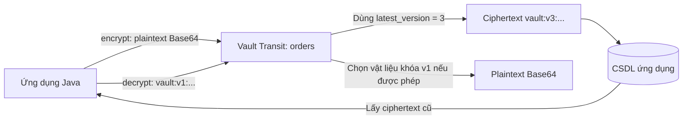
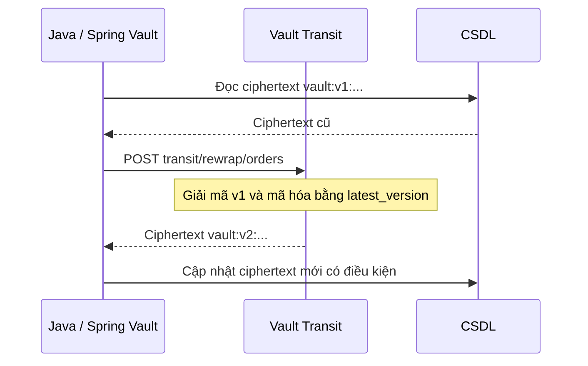

# Xoay phiên bản khóa và khả năng đọc dữ liệu cũ

Khi ứng dụng Java dùng **Spring Vault** để gọi **HashiCorp Vault Transit**, dữ liệu nhạy cảm được mã hóa tại Vault rồi bản mã được lưu trong cơ sở dữ liệu hoặc hệ thống nghiệp vụ. Một yêu cầu vận hành quan trọng là **xoay khóa định kỳ** mà vẫn đọc được các bản ghi đã mã hóa từ nhiều tháng, nhiều năm trước. Bài này giải thích cách Transit quản lý phiên bản khóa, điều kiện để giải mã dữ liệu cũ, cách nâng cấp bản mã bằng `rewrap` và cách tổ chức quy trình triển khai an toàn với `VaultTemplate`.

## 1. Vấn đề: đổi khóa nhưng dữ liệu cũ vẫn cần sử dụng

Giả sử dịch vụ quản lý đơn hàng mã hóa số tham chiếu bằng Transit key `orders`. Sau một thời gian, đội vận hành xoay key để dữ liệu mới được mã hóa với phiên bản mới:

- Tháng 1: bản ghi A được mã hóa bằng khóa phiên bản **v1**.
- Tháng 3: thực hiện `rotate`, bản ghi B được mã hóa bằng **v2**.
- Tháng 6: tiếp tục `rotate`, bản ghi C được mã hóa bằng **v3**.

Đến tháng 7, ứng dụng vẫn cần tra cứu A, B, C. Nếu xóa hoặc cấm sử dụng các phiên bản cũ trước khi cập nhật dữ liệu, những bản ghi đó có thể không còn giải mã được.

**Nguyên tắc cốt lõi:** `rotate` tạo **phiên bản khóa mới** cho các lần mã hóa tiếp theo; thao tác này **không tự giải mã và mã hóa lại các bản mã đã lưu**. Transit duy trì khả năng giải mã bằng phiên bản khóa tương ứng, miễn là phiên bản đó vẫn tồn tại, được phép sử dụng và ứng dụng có quyền truy cập.

## 2. Transit lưu và chọn phiên bản khóa như thế nào?

Transit là **secrets engine cung cấp dịch vụ mật mã**: Vault giữ vật liệu khóa, còn ứng dụng gửi plaintext được mã hóa Base64 để nhận ciphertext và tự lưu ciphertext trong kho dữ liệu của mình. Transit không đóng vai trò kho lưu bản ghi plaintext/ciphertext của nghiệp vụ.

Với định dạng ciphertext phổ biến của Transit, phần đầu có dạng:

```text
vault:v1:<du-lieu-ma-hoa>
vault:v2:<du-lieu-ma-hoa>
vault:v3:<du-lieu-ma-hoa>
```

Tiền tố `vault:vN:` chứa thông tin phiên bản cần thiết để Vault định tuyến tới khóa thích hợp. Đó **không phải** plaintext; không dùng phần tiền tố để tự giải mã hoặc suy đoán giá trị dữ liệu.



| Khái niệm | Vai trò | Điều cần ghi nhớ |
| --- | --- | --- |
| `latest_version` | Phiên bản mới nhất của key | `encrypt` mặc định sử dụng phiên bản mới nhất. |
| `rotate` | Sinh phiên bản mới của cùng một key logic | Không thay tên key và không tự cập nhật bản mã cũ. |
| `min_encryption_version` | Phiên bản thấp nhất được phép dùng để **mã hóa** | Hạn chế yêu cầu cố tình mã hóa bằng phiên bản cũ. |
| `min_decryption_version` | Phiên bản thấp nhất được phép dùng để **giải mã** | Nếu tăng lên 3, bản mã dùng v1/v2 bị từ chối giải mã. |
| `rewrap` | Chuyển ciphertext sang phiên bản hiện hành trong Vault | Phù hợp khi cần nâng cấp dữ liệu đang lưu mà không chuyển plaintext qua ứng dụng. |

**Phân biệt hai điều kiện:** một ciphertext `vault:v1:...` không tự động trở nên vô hiệu khi `latest_version` tăng lên v2/v3. Nó chỉ còn giải mã được nếu phiên bản v1 vẫn khả dụng và không bị chặn bởi cấu hình tối thiểu hay chính sách truy cập.

## 3. Thực hành xoay khóa, sau đó đọc bản mã cũ

Ví dụ dưới đây giả định Vault đã hoạt động, CLI đã đăng nhập bằng cơ chế xác thực thích hợp và secrets engine `transit/` đã được bật. Các lệnh chạy trong shell hỗ trợ `base64`; **không dùng Vault dev token cho môi trường thật**.

### Bước 1: Tạo key và mã hóa dữ liệu bằng v1

```bash
# Chạy một lần nếu key chưa tồn tại:
vault write -f transit/keys/orders

# API Transit nhận plaintext dưới dạng Base64.
PLAINTEXT_B64="$(printf '%s' 'order-2026-001' | base64 | tr -d '\n')"

# Giữ ciphertext v1 để kiểm tra sau khi xoay.
CIPHER_V1="$(vault write -field=ciphertext \
  transit/encrypt/orders plaintext="$PLAINTEXT_B64")"
printf '%s\n' "$CIPHER_V1"  # vault:v1:...
```

### Bước 2: Xoay khóa sang v2

```bash
vault write -f transit/keys/orders/rotate
vault read transit/keys/orders

CIPHER_V2="$(vault write -field=ciphertext \
  transit/encrypt/orders plaintext="$PLAINTEXT_B64")"
printf '%s\n' "$CIPHER_V2"  # vault:v2:...
```

Kết quả cần kiểm tra là `latest_version` tăng từ 1 lên 2, ciphertext mới có phiên bản v2, trong khi giá trị `CIPHER_V1` đã lưu **không thay đổi**.

### Bước 3: Giải mã cả v1 và v2

```bash
vault write -field=plaintext transit/decrypt/orders \
  ciphertext="$CIPHER_V1" | base64 --decode

vault write -field=plaintext transit/decrypt/orders \
  ciphertext="$CIPHER_V2" | base64 --decode
```

Cả hai lệnh phải trả về `order-2026-001` nếu không có hạn chế phiên bản, key còn khả dụng và token có quyền `update` trên endpoint `transit/decrypt/orders`. **Không cần chỉ định `key_version` khi giải mã:** Vault đọc phiên bản từ ciphertext.

> Trong bài tập, ghi nhận **phiên bản**, trạng thái lệnh và kết quả so khớp plaintext; tránh ghi ciphertext hoặc plaintext thật vào log vận hành, báo cáo và hệ thống giám sát.

## 4. `rewrap`: cập nhật bản mã mà không đưa plaintext về ứng dụng

Sau khi xoay khóa, dữ liệu lịch sử vẫn ở dạng `vault:v1:...`. Nếu chính sách bảo mật yêu cầu ngừng giải mã bằng v1, ứng dụng phải **chuyển bản mã đang lưu sang phiên bản mới** trước khi tăng ngưỡng giải mã tối thiểu.

Endpoint `transit/rewrap/:name` nhận ciphertext cũ, Vault giải mã và mã hóa lại **bên trong Vault**, rồi trả ciphertext mới. API không trả plaintext cho client:

```bash
CIPHER_REWRAPPED="$(vault write -field=ciphertext \
  transit/rewrap/orders ciphertext="$CIPHER_V1")"
printf '%s\n' "$CIPHER_REWRAPPED"  # vault:v2:...

vault write -field=plaintext transit/decrypt/orders \
  ciphertext="$CIPHER_REWRAPPED" | base64 --decode
```



So sánh các thao tác:

| Thao tác | Thay đổi key? | Thay đổi bản mã trong CSDL? | Plaintext trả cho ứng dụng? |
| --- | --- | --- | --- |
| `rotate` | Sinh thêm phiên bản key | Không | Không |
| `decrypt` | Không | Không | Có, ở dạng Base64 qua kênh TLS |
| `rewrap` | Không sinh phiên bản | Chỉ khi ứng dụng **ghi kết quả trả về** | Không |
| `min_decryption_version` | Thay chính sách phiên bản được dùng | Không | Không |

**Lưu ý:** `rewrap` chỉ trả bản mã mới; bản ghi lưu trữ không tự cập nhật. Với dữ liệu có nhiều bản ghi, cần một job chuyển đổi theo lô có cơ chế lưu tiến độ, kiểm tra lỗi, cập nhật nguyên tử và tránh ghi đè thay đổi đồng thời. Nếu key dùng chế độ *derived*, phải cung cấp đúng `context` khi thực hiện các thao tác tương ứng; thiếu hoặc thay đổi context có thể khiến thao tác không thành công.

## 5. Hạn chế giải mã bằng phiên bản cũ

Khi đã chứng minh các bản mã còn cần sử dụng đều được `rewrap` sang ít nhất v2, quản trị viên có thể thay cấu hình key:

```bash
# Chỉ thực hiện sau khi thống kê và chuyển đổi dữ liệu cũ hoàn tất.
vault write transit/keys/orders/config min_decryption_version=2
vault read transit/keys/orders
```

Lúc này:

- `CIPHER_REWRAPPED` và `CIPHER_V2` sử dụng v2: vẫn giải mã được.
- `CIPHER_V1` sử dụng v1: bị từ chối bởi ngưỡng `min_decryption_version=2`.
- Sau các lần rotate tiếp theo, key mới vẫn được dùng để mã hóa, còn v2 tiếp tục giải mã được cho đến khi ngưỡng lại tăng.

`min_encryption_version` là cấu hình **khác**: nó giới hạn khả năng chọn phiên bản cũ để **mã hóa**. Việc nâng `min_encryption_version` không thay thế cho việc kiểm kê và `rewrap` dữ liệu cũ. Thao tác `trim` (loại bỏ vật liệu khóa phiên bản cũ) là một quyết định riêng, có thể làm mất khả năng khôi phục dữ liệu vĩnh viễn; không thực hiện nếu chưa có xác nhận đầy đủ về sao lưu, phụ thuộc và thời hạn lưu trữ.

Một trình tự triển khai phù hợp là **rotate → duy trì đọc bản mã cũ → rewrap dữ liệu lịch sử → kiểm tra toàn bộ nơi lưu → tăng ngưỡng giải mã**. Cần tính cả ciphertext trong bản sao lưu, hàng đợi, thông điệp chưa xử lý và các hệ thống phụ trợ, không chỉ bảng dữ liệu chính.

## 6. Gọi Transit bằng Spring Vault và `VaultTemplate`

Với Spring Vault, `VaultOperations` (thường được triển khai bằng `VaultTemplate`) có thể gọi trực tiếp các endpoint Transit. Ví dụ sau dùng key `orders` và đường dẫn mặc định `transit/`; cấu hình xác thực workload/TLS được Spring Vault quản lý bên ngoài lớp nghiệp vụ:

```java
import java.nio.charset.StandardCharsets;
import java.util.Base64;
import java.util.Map;
import org.springframework.stereotype.Service;
import org.springframework.vault.core.VaultOperations;
import org.springframework.vault.support.VaultResponse;

@Service
public class OrderTransitService {
    private static final String KEY_PATH = "orders";
    private final VaultOperations vault;

    public OrderTransitService(VaultOperations vault) {
        this.vault = vault;
    }

    public String encrypt(String value) {
        String plaintextB64 = Base64.getEncoder()
                .encodeToString(value.getBytes(StandardCharsets.UTF_8));
        VaultResponse response = vault.write(
                "transit/encrypt/" + KEY_PATH,
                Map.of("plaintext", plaintextB64));
        return requiredData(response, "ciphertext");
    }

    public String decrypt(String ciphertext) {
        VaultResponse response = vault.write(
                "transit/decrypt/" + KEY_PATH,
                Map.of("ciphertext", ciphertext));
        String plaintextB64 = requiredData(response, "plaintext");
        return new String(Base64.getDecoder().decode(plaintextB64),
                StandardCharsets.UTF_8);
    }

    public String rewrap(String oldCiphertext) {
        VaultResponse response = vault.write(
                "transit/rewrap/" + KEY_PATH,
                Map.of("ciphertext", oldCiphertext));
        return requiredData(response, "ciphertext");
    }

    private static String requiredData(VaultResponse response, String field) {
        if (response == null || response.getData() == null) {
            throw new IllegalStateException("Vault response has no data");
        }
        Object value = response.getData().get(field);
        if (!(value instanceof String) || ((String) value).isEmpty()) {
            throw new IllegalStateException("Vault response missing: " + field);
        }
        return (String) value;
    }
}
```

Giải thích:

1. `encrypt` gửi plaintext mã hóa Base64 qua HTTPS đến Vault; kết quả là ciphertext mang thông tin phiên bản.
2. `decrypt` nhận ciphertext đầy đủ và nhận lại plaintext ở dạng Base64. Chỉ chuyển thành chuỗi UTF-8 khi nghiệp vụ thực sự cần sử dụng.
3. `rewrap` nhận và trả ciphertext; không giữ plaintext trong tiến trình Java.
4. `requiredData` xác minh cấu trúc phản hồi thay vì giả định Vault luôn trả dữ liệu hợp lệ.

**Tách quyền vận hành khỏi quyền nghiệp vụ.** Ứng dụng sử dụng Transit thông thường chỉ nên có các quyền cần thiết, ví dụ:

```hcl
# Policy cho workload ứng dụng, tùy nhu cầu thực tế:
path "transit/encrypt/orders" {
  capabilities = ["update"]
}
path "transit/decrypt/orders" {
  capabilities = ["update"]
}
path "transit/rewrap/orders" {
  capabilities = ["update"]
}
```

Quyền xoay key thuộc tác vụ vận hành riêng:

```hcl
# Policy riêng cho automation/vận hành xoay khóa:
path "transit/keys/orders/rotate" {
  capabilities = ["update"]
}
path "transit/keys/orders" {
  capabilities = ["read"]
}
path "transit/keys/orders/config" {
  capabilities = ["update"]
}
```

Ví dụ Java có thể gọi `vault.write("transit/keys/orders/rotate", Map.of())` từ một dịch vụ quản trị được cấp quyền phù hợp. Không mở endpoint xoay khóa cho mọi request của ứng dụng nghiệp vụ. Nếu Transit được mount tại path khác `transit/`, phải thay đường dẫn tương ứng.

## 7. Kế hoạch chuyển đổi trong hệ thống thực tế

Hãy hình dung bảng `orders` có cột `encrypted_reference` lưu các giá trị `vault:v1:...` và `vault:v2:...`. Một quy trình an toàn cần xử lý **cả dữ liệu mới, dữ liệu cũ và các thay đổi diễn ra đồng thời**.

| Giai đoạn | Việc thực hiện | Điều kiện xác nhận |
| --- | --- | --- |
| Kiểm kê | Xác định các kho chứa ciphertext, phiên bản, yêu cầu giữ bản sao lưu và thời hạn tồn tại dữ liệu | Biết còn những nguồn nào có thể chứa v1 |
| Xoay | Gọi `rotate`; kiểm tra metadata và mã hóa mới | `latest_version` tăng; encrypt mới dùng v2 |
| Tương thích | Đọc thử bản mã cũ và mới bằng workload thật | Dữ liệu v1 và v2 đều giải mã được |
| Chuyển đổi | Theo lô: đọc v1 → `rewrap` → cập nhật CSDL có điều kiện | Không mất cập nhật và có thể tiếp tục sau lỗi |
| Đối soát | Kiểm tra số bản ghi còn v1, queue, cache, backup, luồng ghi trễ | Không còn dữ liệu cần truy cập phụ thuộc v1 |
| Siết chính sách | Nâng `min_decryption_version` theo thay đổi đã duyệt | v2 đọc được, v1 bị từ chối như dự kiến |

Để tránh ghi đè cập nhật đồng thời, job `rewrap` có thể cập nhật theo *compare-and-swap*:

```sql
-- old_ciphertext là giá trị đã đọc lúc bắt đầu xử lý bản ghi.
UPDATE orders
SET encrypted_reference = :new_ciphertext
WHERE id = :id
  AND encrypted_reference = :old_ciphertext;
```

Nếu số hàng được cập nhật là **0**, có thể một tiến trình khác đã thay đổi giá trị; đọc lại bản ghi và đánh giá lại, không cố ghi đè. Nếu dùng giao dịch, cần xác định phạm vi giao dịch và cách retry phù hợp với cơ sở dữ liệu. Không coi prefix `vault:v2:` là bằng chứng duy nhất về sự đúng đắn: vẫn cần xác minh kết quả giải mã và tính toàn vẹn nghiệp vụ với dữ liệu thử nghiệm được kiểm soát.

## 8. Các tình huống lỗi dễ nhầm lẫn

| Biểu hiện | Nguyên nhân cần kiểm tra | Hướng xử lý |
| --- | --- | --- |
| Bản mã v1 lỗi sau khi tăng `min_decryption_version` | Cấu hình đã cấm giải mã v1; job rewrap bỏ sót bản ghi | Kiểm kê lại nguồn dữ liệu, đánh giá phương án khôi phục theo chính sách vận hành |
| Nhận HTTP 403 | Token/workload thiếu policy trên `decrypt`, `rewrap` hoặc `rotate` | Kiểm tra capability đúng đường dẫn và cơ chế xác thực của workload |
| Nhận HTTP 400 khi decrypt | Ciphertext bị cắt/sai định dạng, dùng sai key, phiên bản bị chặn hoặc thiếu `context` với derived key | Xác minh dữ liệu đầu vào, key, ngưỡng phiên bản và context |
| Nhận HTTP 404 | Sai mount path, sai tên key hoặc endpoint không tồn tại | Kiểm tra cấu hình mount và đường dẫn tương ứng |
| `rewrap` thành công nhưng DB vẫn có v1 | Chưa ghi ciphertext mới hoặc ghi thất bại | Kiểm tra bước cập nhật CSDL và cơ chế retry |
| Lỗi mạng, 429 hoặc 5xx | Vault quá tải, giới hạn lưu lượng hoặc sự cố tạm thời | Retry có backoff và giới hạn, ghi nhận số bản ghi còn lỗi |
| Không đọc được dữ liệu trong bản sao lưu | Chính sách giải mã đã nâng nhưng snapshot vẫn chứa phiên bản cũ | Lập kế hoạch phục hồi và thời hạn lưu trữ trước khi khóa phiên bản cũ |

Đối với khả năng quan sát, theo dõi tỷ lệ lỗi Transit theo endpoint, latency, số bản ghi rewrap thành công/thất bại, số ciphertext từng phiên bản và lịch sử thay đổi cấu hình. Dùng audit log của Vault theo chính sách bảo mật; **không tự ghi token, plaintext hay ciphertext nhạy cảm** vào log ứng dụng. Khi thấy lỗi xác thực/ủy quyền, kiểm tra vòng đời token và chính sách workload trước khi kết luận khóa mã hóa đã hỏng.

## 9. Tự kiểm chứng qua bài thực hành

Với môi trường Vault thử nghiệm độc lập, có thể thực hiện tuần tự:

1. Tạo key `orders`, mã hóa plaintext A; giữ ciphertext A ở v1.
2. Xoay khóa; mã hóa plaintext B, xác nhận bản mã B ở v2.
3. Giải mã A và B; so sánh từng giá trị với plaintext ban đầu.
4. `rewrap` A; xác nhận ciphertext mới ở v2 và giải mã được thành A.
5. Lưu ciphertext A mới vào bản ghi thử nghiệm, sau đó đặt `min_decryption_version=2`.
6. Thử decrypt ciphertext A cũ (v1) để quan sát lỗi, đồng thời xác nhận A đã rewrap và B (v2) vẫn đọc được.
7. Kiểm tra token chỉ có `encrypt/decrypt/rewrap` không thể gọi endpoint `rotate` của chính key này.

**Tiêu chí đạt:** dữ liệu đã mã hóa trước khi rotate vẫn đọc được khi chưa chặn phiên bản; sau rewrap và nâng ngưỡng, ứng dụng chỉ cần bản mã mới để tiếp tục đọc dữ liệu lịch sử. Điều này thể hiện đúng vai trò của Spring Vault: ứng dụng gọi các thao tác mật mã với quyền được cấp, còn Vault chịu trách nhiệm quản lý khóa và phiên bản khóa.

## 10. Ghi nhớ

- `rotate` thêm phiên bản khóa để mã hóa dữ liệu mới, **không tự sửa dữ liệu cũ**.
- Transit nhận biết phiên bản cần giải mã qua ciphertext; khả năng giải mã còn tùy phiên bản khóa, `min_decryption_version`, key và quyền truy cập.
- `rewrap` chuyển ciphertext cũ sang phiên bản mới mà **không trả plaintext cho ứng dụng**; ứng dụng phải lưu lại kết quả.
- Chỉ nâng `min_decryption_version` sau khi có bằng chứng những dữ liệu còn cần sử dụng đã chuyển đổi đầy đủ, kể cả nguồn dữ liệu phụ và bản sao lưu có thể cần phục hồi.
- Với Spring Vault, nên tách quyền `encrypt/decrypt/rewrap` của workload khỏi quyền `rotate/config` của hệ thống vận hành, đồng thời bảo vệ nội dung nhạy cảm trên đường truyền và trong log.
