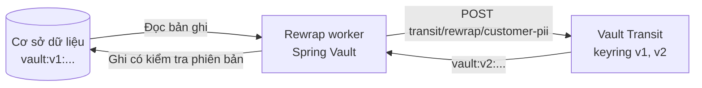

# Rewrap ciphertext sang phiên bản khóa mới trong Spring Vault

## 1. Bài toán: đã rotate khóa, dữ liệu cũ vẫn ở phiên bản cũ

Trong **Mã hóa Transit** của HashiCorp Vault, ứng dụng Java gửi dữ liệu tới Transit secrets engine để mã hóa/giải mã, còn Vault quản lý khóa. Ứng dụng lưu **ciphertext** vào cơ sở dữ liệu của mình; Vault không tự lưu ciphertext đó. Mỗi khóa Transit có thể có nhiều phiên bản, chẳng hạn `customer-pii` phiên bản 1 (`v1`), 2 (`v2`) và 3 (`v3`).

Khi quản trị viên **rotate** khóa `customer-pii` từ `v1` lên `v2`:

- Yêu cầu mã hóa mới mặc định dùng `v2`.
- Ciphertext đã lưu với `v1` **không tự biến thành** ciphertext `v2`.
- Nếu phiên bản cũ còn được phép giải mã, Vault vẫn đọc được ciphertext `v1` bằng keyring tương ứng.
- Muốn chuyển ciphertext đã lưu sang `v2` mà không đưa plaintext ra khỏi Vault, ứng dụng gọi **Transit rewrap**.

Ví dụ minh họa (phần sau dấu `:` đã lược bỏ):

```text
Trước rotate:  database.secret = vault:v1:...
Rotate key:    customer-pii có latest_version = 2
Sau rotate:    database.secret vẫn là vault:v1:...
Gọi rewrap:    vault:v1:...  ->  Vault Transit  ->  vault:v2:...
Cập nhật DB:   database.secret = vault:v2:...
```

`vault:v1:...` là định dạng ciphertext do Transit trả về; `v1` biểu thị phiên bản khóa được sử dụng. **Không thể nâng phiên bản an toàn bằng cách thay chuỗi `v1` thành `v2`**: toàn bộ ciphertext phải được Vault giải mã bên trong engine rồi mã hóa lại bằng khóa đích.

### Mục tiêu sau bài học

Sau bài này, bạn có thể phân biệt rotate với rewrap; gọi rewrap qua `VaultTemplate`/`VaultTransitOperations`; xử lý `context` cho derived key; thiết kế quyền hạn tối thiểu; và di chuyển một tập ciphertext lớn theo cách có thể tiếp tục, kiểm tra và phục hồi khi gặp lỗi.

## 2. Rotate, rewrap và decrypt khác nhau thế nào?

| Thao tác | Tác động chính | Plaintext trả về cho caller? | Dữ liệu đã lưu trong DB tự thay đổi? |
| --- | --- | --- | --- |
| `encrypt` | Mã hóa plaintext bằng phiên bản khóa được chỉ định hoặc phiên bản mới nhất | Không | Không; caller phải lưu kết quả |
| `decrypt` | Trả plaintext từ ciphertext tương ứng | **Có** | Không |
| `rotate` | Tạo phiên bản mới trong keyring của **cùng một khóa** | Không | Không |
| `rewrap` | Giải mã nội bộ rồi mã hóa lại ciphertext bằng phiên bản khóa được chọn, mặc định mới nhất | **Không** | Không; caller phải cập nhật kết quả |

Về mặt logic, một lần rewrap thực hiện:

```text
plaintext = decrypt_internal(key_old_version, old_ciphertext)
new_ciphertext = encrypt_internal(key_target_version, plaintext)
return new_ciphertext
```

Hai thao tác `*_internal` xảy ra phía Vault: API rewrap chỉ nhận ciphertext đầu vào và trả ciphertext đầu ra. Đây là lý do có thể cấp riêng quyền rewrap cho tiến trình bảo trì mà **không cấp quyền `transit/decrypt`**.

Lưu ý phạm vi: `transit/rewrap/customer-pii` chuyển dữ liệu giữa **các phiên bản của cùng khóa `customer-pii`**. Nó không phải API chuyển ciphertext trực tiếp sang một khóa Transit khác, ví dụ từ `customer-pii` sang `archive-key`.



## 3. Điều kiện và hợp đồng của Transit rewrap

Giả sử Transit được mount tại `transit` và khóa mã hóa tên `customer-pii` đã tồn tại. API tương ứng là:

```http
POST /v1/transit/rewrap/customer-pii
Content-Type: application/json
X-Vault-Token: <workload-token>

{
  "ciphertext": "vault:v1:..."
}
```

Phản hồi thành công chứa trường `data.ciphertext`, ví dụ `vault:v2:...` (nội dung phía sau prefix khác nhau ở từng lần mã hóa). Không ghi token thật vào mã nguồn, tài liệu log hoặc tệp cấu hình được commit.

Các tham số quan trọng:

| Trường | Khi nào dùng? | Quy tắc cần nhớ |
| --- | --- | --- |
| `ciphertext` | Luôn bắt buộc với yêu cầu đơn | Gửi **nguyên giá trị** do Transit tạo; không tự base64 lại chuỗi `vault:vN:...` |
| `context` | Khóa Transit được tạo với `derived=true` | Truyền context dưới dạng Base64 của **đúng bytes** đã dùng lúc encrypt |
| `key_version` | Muốn chọn rõ phiên bản đích | Bỏ trống để dùng phiên bản mới nhất; phiên bản được chọn phải tồn tại và thỏa `min_encryption_version` |
| `nonce` | Trường hợp convergent encryption đời cũ cần nonce do client cung cấp | Tuân thủ cấu hình ban đầu; các khóa convergent đời mới thường không yêu cầu nonce do caller cung cấp |

Nếu khóa được mount tại đường dẫn khác, ví dụ `cryptography`, endpoint sẽ là `cryptography/rewrap/customer-pii`. Khóa phải thuộc loại hỗ trợ cả encrypt và decrypt; khóa chỉ dùng ký số không phù hợp với rewrap ciphertext.

**Phân biệt hai giá trị Base64:** API `transit/encrypt` nhận `plaintext` được Base64-encode; API `transit/rewrap` nhận ciphertext dạng chuỗi `vault:vN:...` đã được tạo sẵn. Chuyển đổi nhầm hai định dạng là lỗi rất thường gặp.

## 4. Thực hành với Vault CLI

Ví dụ sau dùng Vault chạy trong môi trường học tập, CLI đã đăng nhập bằng token có quyền quản trị khóa. Trong hệ thống thật, thao tác tạo/rotate khóa nằm ở quy trình quản trị, tách khỏi quyền của ứng dụng.

### Bước 1: Tạo khóa và mã hóa dữ liệu

```bash
# Thực hiện một lần nếu Transit chưa được mount tại path này.
vault secrets enable -path=transit transit

# Khởi tạo khóa; kiểu mã hóa mặc định của Transit là aes256-gcm96.
vault write -f transit/keys/customer-pii

# Base64 chỉ áp dụng cho plaintext được gửi vào API encrypt.
PLAIN_B64=$(printf '%s' 'customer-42@example.test' | base64 | tr -d '\r\n')
OLD_CIPHERTEXT=$(vault write -field=ciphertext \
  transit/encrypt/customer-pii plaintext="$PLAIN_B64")

# Trong môi trường Vault mới, ciphertext sẽ có prefix vault:v1:...
```

Giả sử `OLD_CIPHERTEXT` bắt đầu bằng `vault:v1:`. Ciphertext này được lưu ở DB của ứng dụng. Giá trị `v1` là một phần định dạng đầu ra, không phải trường metadata để tự sửa.

### Bước 2: Rotate và rewrap

```bash
# Quyền quản trị; không chạy bằng token của rewrap worker.
vault write -f transit/keys/customer-pii/rotate

# Kiểm tra latest_version đã là 2 trong môi trường ví dụ.
vault read -field=latest_version transit/keys/customer-pii

# Chỉ gửi ciphertext cũ; không cần gửi plaintext.
NEW_CIPHERTEXT=$(vault write -field=ciphertext \
  transit/rewrap/customer-pii ciphertext="$OLD_CIPHERTEXT")

# NEW_CIPHERTEXT có prefix vault:v2:... trong ví dụ này.
# Ứng dụng phải tự ghi NEW_CIPHERTEXT vào DB.
```

Nếu sau đó bạn gọi `vault read transit/keys/customer-pii` và thấy phiên bản mới, điều đó **không chứng minh** tất cả ciphertext trong DB đã được nâng cấp. Việc chuyển dữ liệu thành công chỉ được xác nhận khi ứng dụng lưu và kiểm tra lại những bản ghi liên quan.

Để kiểm tra tính toàn vẹn dữ liệu trong *môi trường test có quyền decrypt*, có thể giải mã cả ciphertext cũ và mới rồi so sánh plaintext. Worker sản xuất chỉ cần quyền rewrap và không nên được cấp quyền decrypt nhằm phục vụ phép kiểm tra này.

## 5. Gọi rewrap bằng Spring Vault

Spring Vault cung cấp `VaultOperations` (được `VaultTemplate` hiện thực) và nhóm API `opsForTransit()`. Khi tích hợp Spring Boot/Spring Cloud Vault, cấu hình `VaultOperations` để lấy thông tin xác thực theo workload, chẳng hạn Kubernetes auth hoặc AppRole, cùng TLS và namespace/mount phù hợp với hệ thống.

### 5.1. Service cho khóa Transit thông thường

```java
import org.springframework.stereotype.Service;
import org.springframework.vault.core.VaultOperations;

@Service
public class CustomerCiphertextRewrapService {

    private static final String TRANSIT_KEY = "customer-pii";

    private final VaultOperations vaultOperations;

    public CustomerCiphertextRewrapService(VaultOperations vaultOperations) {
        this.vaultOperations = vaultOperations;
    }

    public String rewrapToLatestVersion(String storedCiphertext) {
        if (storedCiphertext == null || storedCiphertext.isBlank()) {
            throw new IllegalArgumentException("Ciphertext must not be empty");
        }

        // Kết quả là ciphertext mới; API không trả plaintext.
        return vaultOperations.opsForTransit()
                .rewrap(TRANSIT_KEY, storedCiphertext);
    }
}
```

`opsForTransit()` mặc định sử dụng mount `transit`. Nếu engine được mount ở `cryptography`, gọi `vaultOperations.opsForTransit("cryptography")`. Spring Vault cung cấp phương thức `rewrap(String keyName, String ciphertext)` và overload có `VaultTransitContext`.

Thao tác rewrap **không tự cập nhật database**. Service ở trên chỉ xử lý lời gọi Vault; tầng lưu trữ cần nhận ciphertext mới và ghi lại theo cơ chế chống ghi đè xung đột.

### 5.2. Rewrap khi khóa dùng key derivation (`derived=true`)

Nếu dữ liệu được mã hóa với context theo tenant, rewrap phải dùng **cùng context bytes** đó. Dùng nhầm tenant, chuẩn hóa ký tự khác hoặc đổi encoding có thể làm yêu cầu thất bại.

```java
import java.nio.charset.StandardCharsets;
import org.springframework.vault.support.VaultTransitContext;

// Ví dụ chỉ hợp lệ nếu encrypt trước đây cũng dùng đúng "tenant:acme".
byte[] contextBytes = "tenant:acme".getBytes(StandardCharsets.UTF_8);
VaultTransitContext context = VaultTransitContext.fromContext(contextBytes);

String upgradedCiphertext = vaultOperations.opsForTransit()
        .rewrap("customer-pii", oldCiphertext, context);
```

`VaultTransitContext.fromContext(byte[])` nhận **raw bytes**; Spring Vault chịu trách nhiệm tuần tự hóa context theo yêu cầu của Vault. Nếu tự gọi HTTP API thì `context` trong JSON phải là chuỗi Base64. Không tạo một context mới chỉ vì muốn đổi phiên bản khóa; việc thay context là thay đổi đầu vào key derivation, khác với rewrap thông thường.

### 5.3. Muốn chỉ định phiên bản đích cụ thể

Với đa số tác vụ bảo trì, nên để Vault chọn `latest_version`. Nếu cần cố định phiên bản đích trong một đợt triển khai, Transit HTTP API cho phép gửi `key_version`. Có thể gọi qua phương thức `write` của `VaultOperations`:

```java
import java.util.HashMap;
import java.util.Map;
import org.springframework.vault.core.VaultOperations;
import org.springframework.vault.support.VaultResponse;

Map<String, Object> request = new HashMap<>();
request.put("ciphertext", oldCiphertext);
request.put("key_version", 2); // Ví dụ: phiên bản đích đã tồn tại.

VaultResponse response = vaultOperations.write(
        "transit/rewrap/customer-pii", request);

if (response == null || response.getData() == null
        || !(response.getData().get("ciphertext") instanceof String)) {
    throw new IllegalStateException("Vault did not return ciphertext");
}

String upgradedCiphertext = (String) response.getData().get("ciphertext");
```

`key_version` không tự tạo hoặc rotate khóa. Không chọn một phiên bản thấp hơn giới hạn `min_encryption_version`. Trong thực tế, cần thống nhất thời điểm rotate và phiên bản đích với nhóm quản lý khóa để tránh việc một số worker ghi `v2`, một số worker ghi `v3` ngoài kế hoạch.

## 6. Phân quyền tối thiểu cho rewrap worker

Điểm mạnh của rewrap là có thể cấp cho workload chỉ một năng lực rất hẹp: **chuyển ciphertext của một named key sang phiên bản mới**, không nhận plaintext, không rotate hoặc sửa cấu hình khóa.

Ví dụ chính sách HCL dành cho workload chạy migration:

```hcl
path "transit/rewrap/customer-pii" {
  capabilities = ["update"]
}
```

Quản trị viên áp dụng policy này qua quy trình hạ tầng và gắn với role xác thực thích hợp. Với Kubernetes auth, Vault kiểm tra service account và role trước khi cấp token; với AppRole, bảo vệ `secret_id` theo cơ chế cấp phát của môi trường. Dù chọn cách nào, không dùng root token cho job rewrap.

Nên tách ba danh tính/quyền hạn:

| Vai trò | Quyền cần thiết |
| --- | --- |
| Quản trị khóa | Tạo, rotate, cấu hình keyring theo quy trình phê duyệt |
| Rewrap worker | `update` trên `transit/rewrap/customer-pii`, cùng quyền đọc/ghi chính xác dữ liệu ứng dụng được giao |
| Workload cần đọc nội dung thật | Quyền decrypt riêng nếu nghiệp vụ đòi hỏi; không suy ra từ quyền rewrap |

Nếu policy chỉ cho `rewrap`, lời gọi đến `transit/decrypt/customer-pii` của cùng token phải bị Vault từ chối. Quyền rewrap vẫn cho phép gửi ciphertext tùy ý tới endpoint được cấp, vì vậy cần giới hạn đối tượng dữ liệu của job, chống lạm dụng API và theo dõi hoạt động trong audit log.

Token/lease có thể hết hạn hoặc bị thu hồi trong đợt migration dài. Cấu hình cơ chế xác thực workload và gia hạn/đăng nhập lại qua Spring Vault phù hợp với loại token; không lưu token cố định vào file chương trình, không tự in token trong exception hay log.

## 7. Di chuyển ciphertext trong database an toàn

Đối với một bản ghi, luồng xử lý chuẩn là **đọc ciphertext cũ → gọi rewrap → lưu ciphertext mới → xác nhận lưu thành công**. Đối với hàng triệu bản ghi, cần thêm checkpoint, chia batch, kiểm soát cạnh tranh và khả năng tiếp tục từ nơi đã dừng.

### 7.1. Dùng optimistic locking để tránh ghi đè

Giả sử bảng `customer_secret` có cột `id`, `ciphertext` và `row_version` (phiên bản *bản ghi DB*, không phải phiên bản khóa Vault). Sau khi rewrap bản ghi có `row_version = 7`, thực hiện:

```sql
UPDATE customer_secret
SET ciphertext = :newCiphertext,
    row_version = row_version + 1
WHERE id = :id
  AND row_version = :oldRowVersion;
```

- Nếu số hàng cập nhật là `1`, lần lưu thành công.
- Nếu số hàng cập nhật là `0`, bản ghi đã thay đổi hoặc không còn tồn tại; tải lại dữ liệu và quyết định có cần rewrap lại không.
- Không giữ giao dịch database mở trong suốt một lời gọi HTTP dài tới Vault nếu có thể tách được; thực hiện compare-and-set khi ghi để tránh giữ khóa hàng không cần thiết.

Ví dụ tình huống cạnh tranh: worker đọc `vault:v1:...`, trong khi yêu cầu nghiệp vụ cập nhật bí mật thành `vault:v2:...`. Nếu worker dùng lệnh `UPDATE` không có điều kiện, ciphertext do nghiệp vụ vừa ghi có thể bị thay thế bằng ciphertext của giá trị cũ. Optimistic locking ngăn lỗi mất cập nhật đó.

### 7.2. Một quy trình migration có thể tiếp tục

1. Quản trị viên rotate khóa và ghi nhận phiên bản đích, ví dụ `v2`; các yêu cầu mã hóa mới sử dụng phiên bản mới.
2. Worker chọn một batch nhỏ theo `id`/cursor ổn định; đọc ciphertext, `row_version` và context (nếu có).
3. Nếu ciphertext đã ở phiên bản đích hoặc mới hơn theo chính sách migration, bỏ qua; nếu chưa, gọi `rewrap`.
4. Kiểm tra kết quả có định dạng ciphertext Transit và phiên bản đích hợp lệ, rồi ghi có optimistic locking.
5. Ghi tiến độ xử lý theo batch, số bản ghi thành công/thất bại và lý do lỗi đã phân loại; lặp lại cho đến khi quét hết dữ liệu.
6. Chạy thêm lượt quét những bản ghi chưa đạt yêu cầu, đồng thời đối chiếu dữ liệu trong bản sao lưu và các luồng ghi cũ trước khi khóa khả năng đọc phiên bản cũ.

Một tiến trình rewrap có thể chạy lại sau timeout. **Không giả định ciphertext mới luôn bằng ciphertext cũ về mặt chuỗi**, kể cả khi gọi lại với cùng phiên bản khóa: mã hóa thông thường sử dụng ngẫu nhiên. Tiêu chí đúng là plaintext được bảo toàn và phiên bản khóa đích hợp lệ; tính idempotent của job nằm ở kiểm tra trạng thái và cơ chế ghi dữ liệu.

Khi có nhiều worker chạy song song, chia vùng bản ghi rõ ràng hoặc dùng cơ chế claim/lease trên hàng đợi. Giới hạn mức song song để không gây quá tải Vault, database và lớp mạng. Nếu Vault hoàn tất rewrap nhưng phản hồi bị mất, có thể thử lại trên ciphertext còn lưu ở DB, vì thao tác trước đó chưa tự ghi dữ liệu vào DB.

### 7.3. Cẩn thận với `min_decryption_version`

Vault cho phép cấu hình `min_decryption_version` để ngăn giải mã ciphertext thuộc phiên bản quá cũ. **Rewrap ciphertext cũ cũng cần Vault giải mã phiên bản nguồn ở bên trong**, nên nếu đặt ngưỡng vượt quá `v1` khi DB vẫn còn ciphertext `v1`, job rewrap các bản ghi đó sẽ thất bại.

```text
Khuyến nghị thứ tự:
  rotate v1 -> v2
  -> rewrap dữ liệu v1 và lưu v2
  -> xác minh DB, backup/restore và các đường ghi còn hoạt động
  -> mới cân nhắc tăng min_decryption_version lên 2
```

Đặt ngưỡng giải mã là quyết định vận hành có thể ảnh hưởng tới dữ liệu trong bản sao lưu hoặc hệ thống chưa migration. Chỉ thay đổi khi đã xác nhận kế hoạch khôi phục và chính sách lưu trữ dữ liệu cũ. Việc đạt 100% trên một bảng hiện tại chưa chứng minh mọi bản ciphertext trong backup hoặc các hệ thống liên quan đều đã được xử lý.

## 8. Xử lý lỗi và giám sát

| Biểu hiện | Nguyên nhân có thể xảy ra | Hướng xử lý |
| --- | --- | --- |
| HTTP `403` | Token thiếu `update` trên endpoint, token bị thu hồi hoặc policy/namespace sai | Kiểm tra role, policy, mount và xác thực workload; không tự tăng quyền |
| HTTP `400` | Ciphertext không hợp lệ, sai key name, thiếu/sai `context`, phiên bản không được phép | Đánh dấu lỗi dữ liệu/cấu hình, kiểm tra một trường hợp đã ẩn thông tin nhạy cảm |
| Lỗi do ciphertext phiên bản cũ | `min_decryption_version` đã loại phiên bản nguồn hoặc keyring không phù hợp | Dừng job và làm rõ thứ tự triển khai với nhóm quản trị khóa |
| HTTP `429`/`5xx` hoặc timeout | Hạn mức, Vault bận, sự cố mạng hoặc backend | Retry có giới hạn, exponential backoff và jitter; ghi nhận số lần thử |
| Rewrap thành công nhưng DB update `0` hàng | Bản ghi đổi giữa lúc đọc và ghi | Tải lại, kiểm tra phiên bản hiện tại rồi xử lý lại có điều kiện |
| Bản ghi đã `vault:v2:` nhưng app vẫn báo lỗi | Sai context lúc decrypt, không tương ứng với key/mount hoặc phân quyền | Kiểm tra cấu hình và context từ lần encrypt gốc, không sửa prefix bằng tay |

Trên hệ thống chạy thực tế, nên quan sát ít nhất số yêu cầu rewrap thành công/thất bại, độ trễ Vault, số retry, tỷ lệ ciphertext còn ở phiên bản cũ, số lần xung đột cập nhật DB và tuổi của những bản ghi chưa hoàn thành. Chỉ sử dụng nhãn metric có cardinality thấp; tránh đưa `id` khách hàng, context bí mật hoặc ciphertext vào log/metric.

Tránh retry vô hạn với lỗi `400`/`403`: chúng thường cần sửa dữ liệu, quyền hoặc cấu hình. Với lỗi mạng hoặc `5xx`, retry phải có giới hạn và có khả năng tiếp tục job. Khi có sự cố auth, để cơ chế xác thực của Spring Vault xử lý vòng đời token theo cấu hình; không phát sinh một token có đặc quyền cao hơn làm giải pháp tạm thời.

## 9. Kiểm thử tích hợp và tiêu chí chấp nhận

Nên kiểm thử bằng Vault thật trong môi trường cô lập, ví dụ Vault dev trong CI/Testcontainers hoặc một instance kiểm thử. Không cần chạy toàn bộ quy trình với root token ở ứng dụng; tài khoản thiết lập môi trường và token của rewrap worker phải được phân tách.

| Trường hợp | Kết quả cần xác nhận |
| --- | --- |
| Ciphertext tạo ở `v1`, rotate sang `v2`, rewrap | Kết quả có prefix `vault:v2:`; một tài khoản test có quyền decrypt xác nhận plaintext trước/sau như nhau |
| Chỉ rotate, chưa rewrap | Giá trị trong DB vẫn `vault:v1:...`; yêu cầu mã hóa mới dùng khóa `v2` |
| Token chỉ có quyền rewrap | Rewrap thành công, gọi API decrypt và rotate bằng token đó bị từ chối |
| Derived key, truyền đúng context cũ | Rewrap thành công, dữ liệu vẫn giải mã được với cùng context |
| Derived key, truyền sai context | Yêu cầu bị từ chối/không giải mã được; không ghi kết quả vào DB |
| Worker đụng bản ghi vừa được app cập nhật | Optimistic lock trả `0` hàng; worker không ghi đè dữ liệu mới |
| Timeout sau khi Vault đã xử lý | Job thử lại có kiểm soát, chỉ tính thành công khi đã lưu DB và xác minh kết quả |
| Tăng `min_decryption_version` quá sớm | Bản ghi dùng phiên bản bị cấm không còn rewrap được; quy trình triển khai phải phát hiện trước |

Một kiểm thử tích hợp tối thiểu sẽ tạo khóa trong Vault test, mã hóa một plaintext biết trước bằng phiên bản ban đầu, rotate, gọi service Java `rewrapToLatestVersion`, giải mã **bằng test principal có quyền riêng**, rồi so sánh byte plaintext và xác minh phiên bản ciphertext. Phần kiểm thử chính sách dùng principal của worker để chứng minh `rewrap` được phép trong khi `decrypt` và `rotate` không được phép.

### Những nhầm lẫn cần tránh

- **Rotate không thay dữ liệu cũ:** luôn cần job cập nhật ciphertext tại nơi lưu trữ nếu muốn nâng phiên bản dữ liệu lịch sử.
- **Rewrap không chuyển giữa hai tên khóa khác nhau:** phiên bản đích thuộc cùng named key.
- **Rewrap không xuất plaintext cho caller:** nhưng Vault vẫn phải xử lý plaintext nội bộ; đường truyền đến Vault cần TLS và audit phù hợp.
- **Prefix mới chưa đủ để xác nhận migration hoàn chỉnh:** phải có số liệu kiểm tra DB, luồng ghi và khả năng khôi phục.
- **Context không phải thông tin tùy ý sau khi đã encrypt:** phải bảo toàn đúng context bytes được dùng với derived key.
- **Không khóa phiên bản cũ trước khi di chuyển xong:** `min_decryption_version` có thể khiến các bản ghi chưa rewrap không thể phục hồi qua API bình thường.

## 10. Tài liệu tham khảo

- [HashiCorp Vault — Transit secrets engine](https://developer.hashicorp.com/vault/docs/secrets/transit): keyring, rotation, định dạng ciphertext và ví dụ rewrap.
- [HashiCorp Vault — Transit HTTP API](https://developer.hashicorp.com/vault/api-docs/secret/transit): endpoint `rewrap`, `rotate`, `key_version`, `context`, `min_decryption_version`.
- [Spring Vault — VaultTransitOperations](https://docs.spring.io/spring-vault/reference/api/java/org/springframework/vault/core/VaultTransitOperations.html): chữ ký hàm `rewrap`, `rotate` và các overload.
- [Spring Vault — VaultTransitContext](https://docs.spring.io/spring-vault/reference/api/java/org/springframework/vault/support/VaultTransitContext.html): truyền context/nonce/key version trong ứng dụng Java.

**Điều cần nhớ:** rotate sinh phiên bản khóa mới; rewrap chuyển ciphertext đã tồn tại sang phiên bản đó mà không trả plaintext ra ứng dụng; Spring Vault giúp thực hiện lời gọi, còn ứng dụng chịu trách nhiệm cập nhật dữ liệu, phân quyền và theo dõi tiến độ migration.
