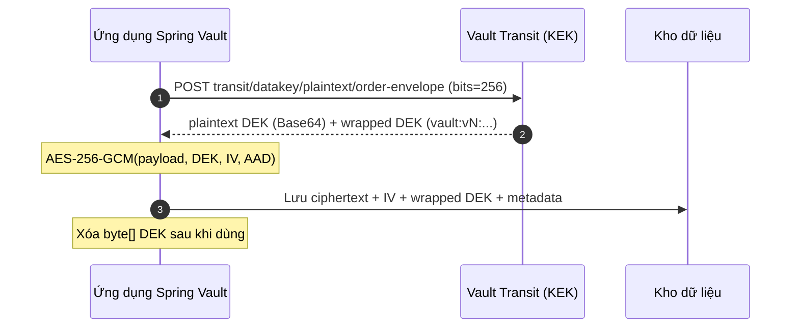
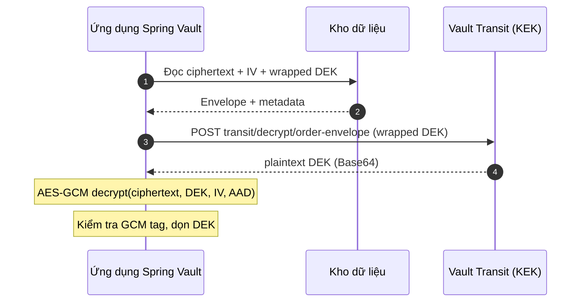

# Data key và mô hình mã hóa phong bì trong Spring Vault

## 1. Bối cảnh và mục tiêu

Khi một ứng dụng Java cần mã hóa tài liệu, hồ sơ khách hàng hoặc đối tượng dung lượng lớn, việc gửi toàn bộ dữ liệu đến Vault Transit để mã hóa ở mỗi lần xử lý có thể làm tăng lưu lượng mạng và khiến ứng dụng phụ thuộc nhiều vào độ trễ của Vault. **Mã hóa phong bì (envelope encryption)** giải quyết bài toán này bằng cách để ứng dụng mã hóa dữ liệu bằng một khóa ngắn hạn, trong khi HashiCorp Vault bảo vệ khóa ngắn hạn đó bằng khóa gốc quản lý tập trung.

Trong hệ sinh thái **SPRING_VAULT**, ứng dụng dùng `VaultTemplate` để gọi API của HashiCorp Vault. Chủ đề này kết hợp Transit encryption với thực hành quản lý secrets, xác thực theo workload, phân quyền theo chính sách, vòng đời khóa và xử lý lỗi. Sau bài học, bạn có thể:

- Phân biệt **data encryption key (DEK)** và **key encryption key (KEK)**; hiểu vì sao một bản ghi phải lưu cả dữ liệu mã hóa lẫn DEK đã được bọc.
- Trình bày luồng mã hóa, giải mã bằng Transit Data Key API và AES-GCM trong ứng dụng Java.
- Triển khai ví dụ tối thiểu sử dụng `VaultTemplate`, một chính sách Vault có quyền tối thiểu và metadata cần lưu.
- Giải thích ảnh hưởng của key rotation, rewrap, thu hồi quyền và lỗi Vault đối với dữ liệu đã mã hóa.

## 2. Hai tầng khóa: DEK và KEK

**DEK (data encryption key)** là khóa đối xứng dùng trực tiếp với thuật toán mã hóa dữ liệu, ví dụ AES-256-GCM. Trong thiết kế phổ biến, mỗi đối tượng hoặc mỗi đợt dữ liệu có DEK riêng. DEK tồn tại dạng rõ (*plaintext DEK*) trong bộ nhớ ứng dụng chỉ khi cần mã hóa hoặc giải mã.

**KEK (key encryption key)** là khóa được quản lý trong Vault Transit và dùng để bảo vệ DEK. Ứng dụng không cần nhận plaintext của KEK; Vault thực hiện thao tác bọc/mở bọc DEK trong phạm vi của mình. Để tránh nhầm lẫn, trong ví dụ dưới đây `order-envelope` là **tên khóa Transit (KEK)**, còn DEK là byte ngẫu nhiên 256 bit do Vault tạo theo từng đối tượng.

| Thành phần | Nơi quản lý | Nhiệm vụ | Được lưu cùng bản ghi? |
| --- | --- | --- | --- |
| Khóa Transit / KEK | Vault Transit | Bọc và mở bọc DEK, quản lý phiên bản khóa | Chỉ lưu tên/tham chiếu; không lưu KEK rõ |
| Plaintext DEK | Bộ nhớ ứng dụng khi xử lý | Mã hóa/giải mã dữ liệu bằng AES-GCM | **Không** |
| Wrapped DEK | Ứng dụng nhận từ Vault, sau đó lưu tại DB/object storage | Khôi phục DEK thông qua Vault khi cần đọc | **Có**, ví dụ `vault:v1:...` |
| IV/nonce, ciphertext và tag | Ứng dụng tạo; lưu tại DB/object storage | Cho phép giải mã và kiểm tra toàn vẹn | **Có** |
| AAD (associated authenticated data) | Metadata của bản ghi | Ràng buộc dữ liệu mã hóa với tenant, ID, ngữ cảnh | Lưu hoặc tái tạo nhất quán |

Đây là *mã hóa phong bì* vì bản ghi chứa hai lớp bảo vệ: **payload đã được mã hóa bằng DEK** và **DEK đã được mã hóa bằng KEK**. Vault Transit là dịch vụ mật mã (*cryptography as a service*); nó không phải nơi tự động lưu ciphertext của payload cho ứng dụng.

### So với gọi Transit trực tiếp

| Cách dùng Transit | Dữ liệu gửi đến Vault | Khóa rõ trong ứng dụng | Tình huống phù hợp |
| --- | --- | --- | --- |
| `transit/encrypt/:key`, `transit/decrypt/:key` | Nội dung cần mã hóa/giải mã | Không nhận khóa mã hóa | Giá trị nhỏ, muốn giao mật mã cho Vault |
| Envelope với `transit/datakey/plaintext/:key` | Yêu cầu tạo DEK; lúc đọc chỉ gửi wrapped DEK | Có plaintext DEK trong thời gian xử lý | Tệp, blob, luồng dữ liệu lớn, mã hóa cục bộ |

Envelope encryption giúp Vault xử lý một DEK nhỏ thay vì toàn bộ payload. Tuy nhiên, **không mặc định giảm số lần gọi Vault**: nếu mỗi đối tượng tạo DEK mới và mỗi lần đọc phải mở bọc, vẫn thường cần một lần gọi Transit cho mỗi thao tác tương ứng. Tối ưu truy cập bằng cache DEK làm thay đổi rủi ro bảo mật và phải được thiết kế riêng.

## 3. Luồng mã hóa và giải mã

### 3.1. Khi ghi dữ liệu

1. Ứng dụng Java đã xác thực với Vault bằng cơ chế phù hợp workload, chẳng hạn Kubernetes auth hoặc AppRole, và có token với policy tối thiểu.
2. Ứng dụng gọi `POST /v1/transit/datakey/plaintext/order-envelope`, truyền `bits=256`.
3. Vault sinh DEK ngẫu nhiên và trả về hai giá trị: `plaintext` (Base64 của DEK thô) và `ciphertext` (DEK đã được Transit bọc, dạng `vault:vN:...`).
4. Ứng dụng giải mã Base64 thành 32 byte DEK, tạo IV ngẫu nhiên 12 byte và mã hóa payload bằng AES-256-GCM. Metadata như tenant ID và document ID có thể được đưa vào **AAD**, để chống tráo bản ghi.
5. Ứng dụng lưu payload ciphertext (bao gồm GCM tag), IV, wrapped DEK và phiên bản định dạng. Plaintext DEK chỉ phục vụ lần xử lý hiện tại, không lưu DB, không in log.



### 3.2. Khi đọc dữ liệu

1. Ứng dụng đọc ciphertext, IV và wrapped DEK từ kho lưu trữ, đồng thời xác định tenant/document ID thực sự được phép truy cập.
2. Ứng dụng gọi `POST /v1/transit/decrypt/order-envelope` với `ciphertext` là **wrapped DEK**, không phải ciphertext của payload.
3. Vault kiểm tra quyền, dùng phiên bản KEK thích hợp để mở bọc DEK và trả `plaintext` dưới dạng Base64.
4. Ứng dụng dùng DEK, IV và **cùng AAD** để giải mã bằng AES-GCM; GCM tag không hợp lệ thì phải coi dữ liệu là không xác thực.
5. Ứng dụng xử lý dữ liệu đã giải mã trong phạm vi quyền được cấp và xóa mảng byte chứa DEK khi có thể.



**Phân biệt hai loại "wrapped":** `transit/datakey/wrapped/:name` chỉ trả về **DEK được mã hóa bằng Transit** mà không trả plaintext DEK. Một dịch vụ chưa mở bọc được DEK sẽ không thể tự AES-GCM mã hóa payload. Đây cũng không phải tính năng **Vault Response Wrapping** (trả token dùng một lần để lấy response), dù cả hai cùng sử dụng từ *wrapping*.

## 4. Các API Transit cần biết

Giả sử engine được mount tại đường dẫn mặc định `transit/`. Nếu tổ chức mount tên khác, phải thay tiền tố đường dẫn tương ứng.

| Endpoint / thao tác | Input chính | Output chính | Vai trò |
| --- | --- | --- | --- |
| `POST transit/datakey/plaintext/:name` | `bits` (128/256), có thể có `context` khi cấu hình khóa dẫn xuất | `data.plaintext` (Base64 DEK), `data.ciphertext` (wrapped DEK) | Tạo DEK để mã hóa cục bộ |
| `POST transit/datakey/wrapped/:name` | `bits`, cấu hình khóa phù hợp | `data.ciphertext`, không có plaintext DEK | Sinh DEK đã bọc cho luồng dùng ở hệ thống khác |
| `POST transit/decrypt/:name` | `ciphertext` = wrapped DEK, `context` nếu cần | `data.plaintext` (Base64 DEK) | Mở bọc DEK |
| `POST transit/rewrap/:name` | `ciphertext` = wrapped DEK, `context` nếu cần | Wrapped DEK mới | Bọc lại bằng phiên bản KEK mới mà không trả plaintext DEK |
| `POST transit/keys/:name/rotate` | Yêu cầu từ người quản trị khóa | Phiên bản KEK mới | Rotation KEK, cần quyền quản trị |

Ví dụ một phản hồi đã được **lược bỏ nội dung bí mật** từ thao tác tạo DEK:

```json
{
  "data": {
    "plaintext": "<BASE64_CUA_32_BYTE_DEK>",
    "ciphertext": "vault:v1:<WRAPPED_DEK>"
  }
}
```

Không lấy `vault:v1:...` đưa trực tiếp vào `SecretKeySpec`: đó là wrapped DEK chứ không phải 32 byte khóa AES. Ngược lại, khi gọi `transit/decrypt`, không gửi ciphertext AES-GCM của ứng dụng; endpoint này cần ciphertext do Transit tạo ra.

## 5. Chuẩn bị Vault và policy tối thiểu

Những lệnh quản trị minh họa dưới đây dùng môi trường phát triển đã có Vault CLI đăng nhập với quyền quản lý engine:

```bash
# Thực hiện một lần bởi người quản trị (bỏ qua nếu Transit đã bật).
vault secrets enable transit

# Tạo KEK trong Transit (Vault giữ vật liệu khóa).
vault write -f transit/keys/order-envelope
```

Ứng dụng chỉ cần tạo DEK và giải mã wrapped DEK; một policy HCL phù hợp là:

```hcl
path "transit/datakey/plaintext/order-envelope" {
  capabilities = ["update"]
}

path "transit/decrypt/order-envelope" {
  capabilities = ["update"]
}
```

Quyền `update` là capability của Vault cho API POST. Không cấp `transit/keys/*` hay `transit/keys/*/rotate` cho workload thường. Nếu có dịch vụ chỉ **ghi** dữ liệu, nó có thể chỉ cần đường dẫn `datakey/plaintext`; dịch vụ chỉ **đọc** dữ liệu cần quyền `decrypt` và quyền đọc kho dữ liệu. Việc bảo vệ dữ liệu theo tenant vẫn phải được kiểm tra tại lớp nghiệp vụ; Vault policy theo một KEK dùng chung không tự động kiểm tra tenant ID của từng bản ghi.

**Xác thực theo workload:** cấu hình Spring Vault để lấy token qua Kubernetes auth, AppRole hoặc phương thức thích hợp với hạ tầng. Không hard-code token/root token trong mã nguồn, file cấu hình được commit hoặc ví dụ chạy production. Token hết hạn hay bị thu hồi phải được coi là lỗi truy cập Vault; dùng hỗ trợ quản lý phiên đăng nhập/renewal của Spring Vault phù hợp với auth method đã chọn.

## 6. Ví dụ Java: VaultTemplate + AES-256-GCM

Ví dụ dưới đây giả định ứng dụng đã cấu hình bean `VaultTemplate` và Java 17+. Chúng ta dùng `VaultTemplate.write(...)` để gọi trực tiếp endpoint Transit Data Key; việc mã hóa payload thực hiện bằng Java Cryptography Architecture. Hàm nhận hai UUID làm AAD để ràng buộc ciphertext vào đúng tenant và tài liệu.

```java
import java.nio.charset.StandardCharsets;
import java.security.GeneralSecurityException;
import java.security.SecureRandom;
import java.util.Arrays;
import java.util.Base64;
import java.util.Map;
import java.util.UUID;

import javax.crypto.Cipher;
import javax.crypto.spec.GCMParameterSpec;
import javax.crypto.spec.SecretKeySpec;

import org.springframework.stereotype.Service;
import org.springframework.vault.core.VaultTemplate;
import org.springframework.vault.support.VaultResponse;

@Service
public class EnvelopeCryptoService {
    private static final String KEY = "order-envelope";
    private static final String DATAKEY_PATH = "transit/datakey/plaintext/" + KEY;
    private static final String DECRYPT_PATH = "transit/decrypt/" + KEY;
    private static final int IV_BYTES = 12;
    private static final int TAG_BITS = 128;
    private static final SecureRandom RANDOM = new SecureRandom();

    private final VaultTemplate vault;

    public EnvelopeCryptoService(VaultTemplate vault) {
        this.vault = vault;
    }

    // Lưu record này cùng tenantId/documentId trong kho dữ liệu.
    // ciphertextB64 chứa ciphertext và GCM authentication tag.
    public record Envelope(
            int formatVersion,
            String wrappedDek,
            String ivB64,
            String ciphertextB64
    ) {}

    public Envelope encrypt(
            byte[] plaintext, UUID tenantId, UUID documentId
    ) throws GeneralSecurityException {
        VaultResponse response = vault.write(
                DATAKEY_PATH, Map.of("bits", 256)
        );
        String rawDekB64 = requiredString(response, "plaintext");
        String wrappedDek = requiredString(response, "ciphertext");
        byte[] dek = Base64.getDecoder().decode(rawDekB64);

        try {
            byte[] iv = new byte[IV_BYTES];
            RANDOM.nextBytes(iv);

            Cipher cipher = Cipher.getInstance("AES/GCM/NoPadding");
            cipher.init(
                    Cipher.ENCRYPT_MODE,
                    new SecretKeySpec(dek, "AES"),
                    new GCMParameterSpec(TAG_BITS, iv)
            );
            cipher.updateAAD(aad(tenantId, documentId));
            byte[] encrypted = cipher.doFinal(plaintext);

            return new Envelope(
                    1,
                    wrappedDek,
                    Base64.getEncoder().encodeToString(iv),
                    Base64.getEncoder().encodeToString(encrypted)
            );
        } finally {
            Arrays.fill(dek, (byte) 0);
        }
    }

    public byte[] decrypt(
            Envelope envelope, UUID tenantId, UUID documentId
    ) throws GeneralSecurityException {
        if (envelope.formatVersion() != 1) {
            throw new IllegalArgumentException("Unsupported envelope format");
        }

        VaultResponse response = vault.write(
                DECRYPT_PATH,
                Map.of("ciphertext", envelope.wrappedDek())
        );
        byte[] dek = Base64.getDecoder().decode(
                requiredString(response, "plaintext")
        );

        try {
            byte[] iv = Base64.getDecoder().decode(envelope.ivB64());
            if (iv.length != IV_BYTES) {
                throw new IllegalArgumentException("Invalid IV length");
            }

            Cipher cipher = Cipher.getInstance("AES/GCM/NoPadding");
            cipher.init(
                    Cipher.DECRYPT_MODE,
                    new SecretKeySpec(dek, "AES"),
                    new GCMParameterSpec(TAG_BITS, iv)
            );
            cipher.updateAAD(aad(tenantId, documentId));
            return cipher.doFinal(
                    Base64.getDecoder().decode(envelope.ciphertextB64())
            );
        } finally {
            Arrays.fill(dek, (byte) 0);
        }
    }

    private static byte[] aad(UUID tenantId, UUID documentId) {
        return ("tenant=" + tenantId + ";document=" + documentId)
                .getBytes(StandardCharsets.UTF_8);
    }

    private static String requiredString(
            VaultResponse response, String field
    ) {
        if (response == null || response.getData() == null
                || !(response.getData().get(field) instanceof String value)) {
            throw new IllegalStateException("Missing Vault data field: " + field);
        }
        return value;
    }
}
```

Minh họa cách gọi từ nghiệp vụ:

```java
UUID tenantId = UUID.fromString("f9740f3e-20f2-4e49-8d81-5077a07f4a9e");
UUID documentId = UUID.fromString("0a7b3536-3935-4c0b-a225-9f6bc1d9c293");

byte[] original = "Dữ liệu ví dụ".getBytes(StandardCharsets.UTF_8);
EnvelopeCryptoService.Envelope envelope =
        envelopeCryptoService.encrypt(original, tenantId, documentId);

// Lưu envelope + tenantId + documentId vào kho dữ liệu.
// Khi đọc, dùng đúng tenantId/documentId đã được xác thực và phân quyền.
byte[] recovered =
        envelopeCryptoService.decrypt(envelope, tenantId, documentId);
```

Nếu thay `tenantId` hoặc `documentId` khi giải mã, AAD sẽ khác và GCM authentication tag không khớp. Điều này phát hiện việc tráo ciphertext giữa các ngữ cảnh, nhưng **không thay thế kiểm tra phân quyền** trước khi truy xuất bản ghi.

**Giới hạn cần hiểu của ví dụ:** Vault trả DEK dạng Base64 `String` trong response; Java không đảm bảo xóa sạch chuỗi bất biến khỏi heap. Đoạn mã xóa mảng `byte[] dek` trong `finally` để giảm thời gian tồn tại của khóa thô, nhưng chưa bảo đảm xóa mọi bản sao nội bộ. Trong triển khai thực tế, cần tránh cache DEK tùy tiện, tránh ghi toàn bộ `VaultResponse` vào log và xem xét quản lý bộ nhớ, luồng và vòng đời dữ liệu rõ ràng.

### Lưu envelope thế nào?

Một cấu trúc JSON minh họa có thể là:

```json
{
  "tenantId": "f9740f3e-20f2-4e49-8d81-5077a07f4a9e",
  "documentId": "0a7b3536-3935-4c0b-a225-9f6bc1d9c293",
  "formatVersion": 1,
  "transitKeyRef": "order-envelope",
  "wrappedDek": "vault:v1:<WRAPPED_DEK>",
  "ivB64": "<RANDOM_12_BYTES_BASE64>",
  "ciphertextB64": "<AES_GCM_CIPHERTEXT_AND_TAG_BASE64>"
}
```

Đây chỉ là mẫu cấu trúc, không phải ciphertext có thể giải mã. Nếu ứng dụng hỗ trợ nhiều KEK, lưu một tham chiếu được kiểm soát/allowlist và xác định endpoint dựa trên cấu hình tin cậy; không ghép tùy ý chuỗi `transitKeyRef` do client gửi vào đường dẫn Vault. Định dạng và cách sinh AAD phải được quản lý theo phiên bản để giải mã được dữ liệu cũ.

## 7. Vòng đời DEK, rotation và rewrap

### DEK theo từng đối tượng

Tạo DEK mới cho mỗi đối tượng thường giúp giới hạn phạm vi ảnh hưởng khi một DEK bị lộ. AES-GCM đòi hỏi **không bao giờ sử dụng lại cùng cặp (DEK, IV)**; ví dụ sinh DEK riêng và IV 96 bit ngẫu nhiên cho từng lần ghi. Nếu ứng dụng mã hóa nhiều khối bằng cùng một DEK, phải thiết kế chiến lược nonce bảo đảm duy nhất, quản lý kích thước dữ liệu và giới hạn sử dụng khóa; không đơn giản lặp lại IV.

### Rotation KEK trong Vault

Người quản trị có thể rotation bằng `POST transit/keys/order-envelope/rotate`. Vault tạo phiên bản KEK mới, wrapped DEK mới dùng phiên bản mới, còn wrapped DEK đã lưu thường vẫn giải mã được bằng phiên bản cũ **nếu phiên bản đó còn khả dụng và chính sách `min_decryption_version` cho phép**. Ký hiệu `vault:v1:...` trong wrapped DEK thể hiện phiên bản khóa Transit dùng để bảo vệ nó.

### Rewrap DEK đã lưu

Khi cần nâng wrapped DEK cũ lên phiên bản KEK mới:

1. Đọc `wrappedDek` cũ trong envelope.
2. Gọi `transit/rewrap/order-envelope` với chính wrapped DEK đó.
3. Lấy `data.ciphertext` mới, cập nhật **chỉ trường wrapped DEK** của bản ghi theo cơ chế ghi an toàn.
4. Kiểm tra có thể đọc lại trước khi nâng `min_decryption_version` hoặc vô hiệu hóa các phiên bản khóa cũ.

**Rewrap không cần tiết lộ plaintext DEK cho client** và **không mã hóa lại payload AES-GCM**: `ivB64` cùng `ciphertextB64` của payload có thể giữ nguyên. Nếu muốn thay chính DEK hoặc thuật toán payload, phải giải mã rồi mã hóa lại dữ liệu bằng một DEK mới trong một quy trình migration riêng.

| Thao tác | KEK thay đổi? | DEK thay đổi? | Payload AES-GCM thay đổi? |
| --- | --- | --- | --- |
| Rotation Transit key | Có phiên bản KEK mới | Không tự động | Không |
| Rewrap wrapped DEK | Dùng phiên bản KEK mới để bọc | Không | Không |
| Re-encrypt bằng DEK mới | Có thể giữ cùng KEK | Có | Có |

Lưu ý khi vận hành: không tăng `min_decryption_version` trước khi kiểm kê và chuyển đổi hết wrapped DEK cần dùng. Sao lưu chỉ database ciphertext mà **mất vật liệu khóa Vault** thì không đủ để phục hồi plaintext. Quy trình backup/restore, phân quyền quản trị và lifecycle của key phải được thiết kế đồng bộ.

## 8. Lỗi thường gặp và nguyên tắc an toàn

| Hiện tượng | Nguyên nhân có thể | Cách xử lý |
| --- | --- | --- |
| Vault trả HTTP 403 | Workload token thiếu policy hoặc token không còn hợp lệ | Kiểm tra auth method, role/policy cho endpoint cụ thể; không thay bằng root token |
| Vault trả 404 hoặc sai đường dẫn | Transit mount/khóa không tồn tại, hoặc sai tên key | Xác minh mount và key bằng quy trình quản trị; không tự tạo khóa mới khi đang giải mã dữ liệu cũ |
| Vault trả lỗi kết nối, timeout, 429 | Mạng/Vault quá tải, giới hạn tốc độ | Timeout hợp lý, retry có giới hạn cho thao tác an toàn, metrics; tránh fallback lưu plaintext |
| GCM báo `AEADBadTagException` | Sai DEK, IV, AAD hoặc ciphertext/tag bị sửa | Coi là lỗi toàn vẹn; từ chối trả plaintext và điều tra nguồn dữ liệu |
| Wrapped DEK cũ không giải mã được | Key version bị vô hiệu hóa/xóa hoặc `min_decryption_version` tăng quá sớm | Xem quy trình rotation, restore và migration; không ghi đè envelope gốc tùy tiện |
| DEK bị ghi vào log/trace | Log request/response Vault quá chi tiết | Loại `data.plaintext`, Authorization và bí mật ra khỏi log, trace, crash dump |

Ứng dụng nên **fail closed**: nếu không có quyền, Vault không khả dụng hoặc GCM kiểm tra toàn vẹn thất bại, không trả dữ liệu chưa xác thực và không chuyển sang mã hóa yếu hơn. Với retry, cần phân biệt yêu cầu mã hóa có thể sinh DEK mới mỗi lần và việc ghi dữ liệu vào DB: dùng ranh giới transaction/idempotency để tránh mất đồng bộ khi request ứng dụng bị thử lại.

Để giám sát, theo dõi thời gian gọi `datakey`/`decrypt` (p50, p95, p99), lỗi theo HTTP status, số lượng token/lease hết hạn, số bản ghi còn wrapped DEK phiên bản cũ và tỷ lệ giải mã thất bại. Chỉ ghi metadata an toàn; tuyệt đối không xuất plaintext payload hay DEK trong metrics, logs, tracing.

## 9. Kiểm thử tích hợp

Có thể dùng Vault chạy cục bộ trong môi trường kiểm thử hoặc Testcontainers cùng Spring Vault, tạo Transit key và policy dành riêng cho test. Một bộ kiểm thử có ý nghĩa nên bao gồm:

1. **Round-trip:** ghi payload Unicode/byte array, lưu envelope, đọc và so sánh dữ liệu giải mã bằng chính DEK đã unwrap.
2. **Integrity:** sửa một byte `ciphertextB64`, IV hoặc sử dụng AAD với `documentId` khác; giải mã phải thất bại khi GCM xác thực.
3. **Least privilege:** token chỉ có quyền `datakey/plaintext` không được `decrypt`; token chỉ `decrypt` không thể tạo DEK mới.
4. **Rotation và rewrap:** mã hóa bằng phiên bản KEK cũ, rotate, xác nhận vẫn đọc được dữ liệu cũ; rewrap wrapped DEK, kiểm tra payload ciphertext giữ nguyên và vẫn giải mã được.
5. **Lỗi vận hành:** mô phỏng Vault 403, 404 và timeout; xác nhận không ghi plaintext vào kho lưu trữ hoặc log, đồng thời ứng dụng trả lỗi an toàn.

Khi test rotation, phải kiểm tra cả hai trường hợp trước/sau thay đổi `min_decryption_version` và bảo đảm quy trình migrate đã hoàn tất trước khi chặn các phiên bản cũ.

## 10. Ghi nhớ

- **DEK mã hóa dữ liệu; KEK trong Vault Transit mã hóa DEK.** Bản ghi lưu ciphertext của payload, IV, wrapped DEK và metadata cần thiết.
- `transit/datakey/plaintext` cho ứng dụng nhận DEK thô để mã hóa cục bộ; `transit/decrypt` mở bọc DEK, không trực tiếp giải mã ciphertext AES-GCM của ứng dụng.
- **AES-GCM** bảo vệ tính bí mật và toàn vẹn khi IV không bị tái sử dụng với cùng khóa; AAD liên kết ciphertext với metadata được xác thực.
- **Rotation** sinh phiên bản KEK mới; **rewrap** cập nhật lớp bọc DEK mà không yêu cầu mã hóa lại payload. Thay DEK cần quy trình re-encrypt riêng.
- Dùng `VaultTemplate` trong Spring Vault cùng workload auth, policy tối thiểu, quản lý token/lease, xử lý lỗi an toàn và kiểm thử tích hợp để có hệ thống vận hành đáng tin cậy.
