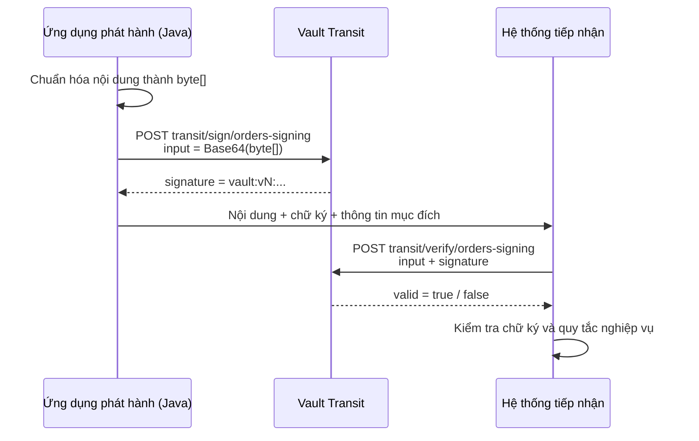

# Ký số và xác minh theo khả năng của loại khóa trong Vault Transit

## 1. Bài toán và mục tiêu

Khi một ứng dụng Java phát hành thông điệp nghiệp vụ như lệnh thanh toán, yêu cầu phê duyệt hoặc sự kiện tích hợp, hệ thống nhận cần xác định **nội dung có bị thay đổi không** và **chữ ký có được tạo bằng khóa được tin cậy không**. HashiCorp Vault cung cấp **Transit secrets engine** để ký và xác minh thông điệp trong Vault, giúp ứng dụng dùng khóa theo chính sách mà không phải lấy private key về bộ nhớ ứng dụng.

Với **Spring Vault**, ứng dụng có thể gọi Transit thông qua `VaultOperations`/`VaultTemplate`, sử dụng phương thức xác thực phù hợp workload (ví dụ Kubernetes, AppRole) và quyền Vault tối thiểu. Bài này tập trung vào hai thao tác `transit/sign` và `transit/verify`, đặc biệt là **khả năng hỗ trợ ký số phụ thuộc vào loại khóa**. Đây là một phần riêng của Transit bên cạnh mã hóa/giải mã, quản lý phiên bản khóa, token/lease, PKI, giám sát và kiểm thử tích hợp.

Sau bài này, bạn có thể:

- Chọn đúng loại khóa Transit để ký số, phân biệt chữ ký bất đối xứng với mã hóa hoặc HMAC.
- Ký và xác minh cùng một chuỗi byte, xử lý đúng Base64 và chuỗi chữ ký có phiên bản khóa.
- Gọi Transit từ Java bằng Spring Vault, phân biệt chữ ký sai với lỗi gọi Vault.
- Thiết kế quyền truy cập, quay vòng khóa và kiểm thử cho luồng ký/xác minh.

## 2. Luồng ký và xác minh



Các điểm quan trọng:

1. `input` là **Base64 của dữ liệu cần ký**; Vault không nhận nguyên văn JSON/text trong trường này.
2. `transit/sign/<key>` dùng khả năng ký của khóa và trả chữ ký dạng `vault:vN:...`, trong đó `vN` biểu thị phiên bản khóa.
3. `transit/verify/<key>` nhận **đúng byte đã ký** cùng chữ ký; dữ liệu phản hồi `valid` là kiểu boolean.
4. Việc Vault trả `valid: true` chứng minh chữ ký hợp lệ với khóa tương ứng trong Vault. Ứng dụng vẫn phải kiểm tra người gửi có được phép thực hiện nghiệp vụ, thông điệp có hết hạn hoặc bị phát lại không.

> Transit hỗ trợ nhiều thao tác mật mã, nhưng **không phải mọi khóa Transit đều ký số được**. Cần chọn đúng `type` ngay từ bước tạo khóa.

## 3. Loại khóa quyết định khả năng ký số

| Loại khóa Transit thường gặp | Ký/xác minh chữ ký | Cách sử dụng phù hợp |
| --- | --- | --- |
| `rsa-2048`, `rsa-3072`, `rsa-4096` | Có | Chữ ký RSA, cần thống nhất chế độ chữ ký và thuật toán băm với bên xác minh. |
| `ecdsa-p256`, `ecdsa-p384`, `ecdsa-p521` | Có | Chữ ký ECDSA với đường cong tương ứng; chú ý định dạng biểu diễn chữ ký khi xác minh ngoài Vault. |
| `ed25519` | Có | Chữ ký Ed25519; không áp dụng các tham số dành riêng cho RSA. |
| `aes128-gcm96`, `aes256-gcm96`, `chacha20-poly1305` | Không | Mã hóa/giải mã đối xứng có xác thực, không phải khóa ký số bất đối xứng. |

Khả năng thực tế còn phụ thuộc **phiên bản Vault và cấu hình khóa**. Trước khi dùng, kiểm tra metadata của khóa và khả năng `supports_signing` nếu được trả về:

```bash
vault read transit/keys/orders-signing
```

**Phân biệt ba khái niệm:**

- **Chữ ký số bất đối xứng:** dùng private key để ký và public key tương ứng để xác minh. RSA, ECDSA, Ed25519 phục vụ mô hình này.
- **HMAC:** tạo và xác minh mã xác thực bằng secret đối xứng. Transit có API HMAC riêng; HMAC **không** có đặc tính xác minh công khai bằng public key.
- **Authenticated encryption:** AES-GCM/ChaCha20-Poly1305 phát hiện bản mã bị thay đổi, nhưng không thay thế chữ ký số cho thông điệp chuyển đến bên thứ ba.

Nếu mục tiêu là **mã hóa dữ liệu lưu trữ**, dùng các endpoint `transit/encrypt`/`transit/decrypt` với loại khóa phù hợp. Nếu mục tiêu là **ký một thông điệp để bên khác kiểm tra**, chọn khóa có hỗ trợ signing; không cố gọi `transit/sign` trên khóa AES.

## 4. Thực hành với Vault CLI

Giả sử Transit đã được mount tại đường dẫn mặc định `transit/` và tài khoản hiện tại có quyền thích hợp.

### 4.1. Tạo khóa dành cho ký số

```bash
# Thực hiện một lần khi khởi tạo, bằng danh tính có quyền quản trị khóa.
vault write transit/keys/orders-signing type=ecdsa-p256

# Xem loại khóa, phiên bản và khả năng được Vault công bố.
vault read transit/keys/orders-signing
```

Trong môi trường thật, nên tạo/điều phối khóa qua bước provisioning có kiểm soát. Tác vụ ký thường ngày không cần quyền tạo, xóa hay cấu hình lại khóa.

### 4.2. Ký dữ liệu

Ví dụ chuỗi `hello` khi mã hóa Base64 là `aGVsbG8=`:

```bash
vault write transit/sign/orders-signing input=aGVsbG8=
```

Kết quả có dạng:

```text
Key          Value
---          -----
signature    vault:v1:<phan-chu-ky-do-Vault-tra-ve>
```

Đoạn `vault:v1:...` ở trên là **minh họa định dạng**, không phải chữ ký thật. Trong chương trình, phải giữ nguyên giá trị `signature` trả về thay vì tự ghép chuỗi.

### 4.3. Xác minh dữ liệu gốc và dữ liệu đã thay đổi

Thay `<SIGNATURE_THAT>` bằng kết quả thực nhận ở bước trước:

```bash
# Kiểm tra thông điệp gốc "hello".
vault write transit/verify/orders-signing \
  input=aGVsbG8= \
  signature='<SIGNATURE_THAT>'

# Kiểm tra thông điệp bị đổi thành "hello!".
vault write transit/verify/orders-signing \
  input=aGVsbG8h \
  signature='<SIGNATURE_THAT>'
```

Với chữ ký hợp lệ cho `hello`, lần đầu sẽ trả `valid: true`; lần thứ hai trả `valid: false`. Không nên nhầm `valid: false` (chữ ký không khớp) với lỗi HTTP 4xx/5xx (thiếu quyền, đầu vào sai định dạng, khóa không có, Vault không sẵn sàng...).

## 5. Gọi ký số và xác minh từ Spring Vault

Ví dụ dưới đây dùng API tổng quát `VaultOperations.write` để thấy rõ request/response của Transit, hoạt động với `VaultTemplate` khi cấu hình Spring Vault thích hợp. Ứng dụng nhận một bean `VaultOperations` đã được cấu hình endpoint, TLS và phương thức xác thực workload; **không ghi Vault token cố định trong source code**.

```java
import java.nio.charset.StandardCharsets;
import java.util.Base64;
import java.util.Map;

import org.springframework.stereotype.Service;
import org.springframework.vault.core.VaultOperations;
import org.springframework.vault.support.VaultResponse;

@Service
public class TransitSignatureService {
    private static final String KEY = "orders-signing";
    private final VaultOperations vault;

    public TransitSignatureService(VaultOperations vault) {
        this.vault = vault;
    }

    public String sign(byte[] message) {
        String input = Base64.getEncoder().encodeToString(message);
        VaultResponse response = vault.write(
                "transit/sign/" + KEY,
                Map.of("input", input)
        );

        Object signature = requireData(response).get("signature");
        if (!(signature instanceof String) || ((String) signature).isBlank()) {
            throw new IllegalStateException("Vault khong tra signature hop le");
        }
        return (String) signature; // Giữ nguyên "vault:vN:..."
    }

    public boolean verify(byte[] message, String signature) {
        String input = Base64.getEncoder().encodeToString(message);
        VaultResponse response = vault.write(
                "transit/verify/" + KEY,
                Map.of("input", input, "signature", signature)
        );

        Object valid = requireData(response).get("valid");
        if (!(valid instanceof Boolean)) {
            throw new IllegalStateException("Vault khong tra valid boolean");
        }
        return (Boolean) valid;
    }

    private static Map<String, Object> requireData(VaultResponse response) {
        if (response == null || response.getData() == null) {
            throw new IllegalStateException("Vault khong tra data");
        }
        return response.getData();
    }
}
```

Ví dụ sử dụng ở tầng nghiệp vụ:

```java
byte[] message = "orderId=42;amount=100000"
        .getBytes(StandardCharsets.UTF_8);

String signature = transitSignatureService.sign(message);
boolean originalValid = transitSignatureService.verify(message, signature); // true

byte[] changed = "orderId=42;amount=900000"
        .getBytes(StandardCharsets.UTF_8);
boolean changedValid = transitSignatureService.verify(changed, signature); // false
```

Mẫu này minh họa cách gọi trực tiếp API. Nếu ứng dụng dùng `VaultTransitOperations` qua `opsForTransit()`, vẫn cần đối chiếu cách biểu diễn payload và chữ ký với hợp đồng của phiên bản Spring Vault đang dùng. Khi cấu hình Transit mount khác `transit/`, cập nhật đường dẫn tương ứng ở cả thao tác ký và xác minh.

### Bảo toàn đúng dữ liệu đã ký

Chữ ký áp dụng lên **byte**, không áp dụng lên “ý nghĩa” của một đối tượng Java. Hai JSON sau có thể biểu diễn cùng dữ liệu nghiệp vụ nhưng tạo chuỗi byte khác nhau:

```json
{"orderId":"42","amount":100000}
```

```json
{"amount":100000,"orderId":"42"}
```

Nếu ký JSON, cần thống nhất một quy tắc chuẩn hóa/canonicalization hoặc dùng payload byte bất biến tại cả bên ký và bên xác minh. Phải thống nhất charset (thường là UTF-8), quy tắc xuống dòng và phiên bản schema. Với dữ liệu có rủi ro phát lại, nên đưa `purpose`, định danh yêu cầu, thời hạn và nonce vào **phần dữ liệu thực sự được ký**, rồi xác minh các trường đó ở tầng nghiệp vụ.

## 6. Tham số theo từng họ khóa

Các lựa chọn bổ sung cho `transit/sign` và `transit/verify` cần **phù hợp loại khóa, phiên bản Vault và cách xác minh**:

| Họ khóa | Điều cần thống nhất | Lỗi triển khai thường gặp |
| --- | --- | --- |
| RSA | Thuật toán băm, kiểu chữ ký được Vault hỗ trợ (ví dụ PSS hoặc PKCS#1 v1.5) và tham số liên quan. | Bên ký dùng PSS, bên xác minh ngoài Vault kiểm tra theo PKCS#1 v1.5. |
| ECDSA | Thuật toán băm, đường cong và cách mã hóa chữ ký (chẳng hạn ASN.1 hoặc dạng dùng trong JWS nếu API hỗ trợ). | Dùng chữ ký định dạng này để verify bằng thư viện yêu cầu định dạng khác. |
| Ed25519 | Quy tắc ký Ed25519 theo khả năng API, input byte và phiên bản khóa. | Áp các tham số băm/đệm vốn dành cho RSA vào yêu cầu Ed25519. |

Không tự chọn chung một bộ tham số cho mọi loại khóa. Khi sử dụng các trường như `hash_algorithm`, `prehashed`, `signature_algorithm`, `marshaling_algorithm` hay `context`, hãy đọc tài liệu API của **phiên bản Vault đang triển khai**, đặt các trường tương thích ở cả bước ký và bước xác minh, và kiểm thử với một thông điệp cố định. Riêng `prehashed` làm thay đổi hợp đồng đầu vào: hệ thống phải rõ **ai thực hiện băm và băm bằng thuật toán nào**, tránh băm hai lần.

Để tích hợp với bên thứ ba không có quyền gọi Vault, có thể cung cấp **public key** từ metadata của phiên bản khóa bất đối xứng phù hợp, rồi xác minh bằng thư viện mật mã của bên nhận. Khi đó phải công bố rõ thuật toán, biểu diễn chữ ký, phiên bản public key và quy tắc chuẩn hóa payload. Không bao giờ xuất private key chỉ để phục vụ bước xác minh.

## 7. Phân quyền và vòng đời khóa

Tạo một policy tối thiểu cho ứng dụng cần ký và xác minh bằng đúng khóa `orders-signing`:

```hcl
path "transit/sign/orders-signing" {
  capabilities = ["update"]
}

path "transit/verify/orders-signing" {
  capabilities = ["update"]
}
```

Khi bên nhận **chỉ cần xác minh**, cấp riêng quyền `update` trên đường dẫn `transit/verify/orders-signing` và không cấp quyền `sign`. Các thao tác tạo khóa, cập nhật cấu hình, xoay khóa và xóa khóa thuộc policy quản trị riêng. Danh tính ứng dụng nên nhận token ngắn hạn qua phương thức xác thực workload; Spring Vault có thể chịu trách nhiệm sử dụng và làm mới thông tin xác thực theo cấu hình tương ứng.

Chữ ký có tiền tố phiên bản, ví dụ `vault:v1:...`. Khi quay vòng khóa, chữ ký mới dùng phiên bản khóa hiện hành, còn chữ ký cũ có thể được xác minh nếu **phiên bản khóa cũ vẫn được giữ và còn được policy/cấu hình cho phép sử dụng để xác minh**. Ví dụ lệnh quay vòng:

```bash
# Chỉ thực hiện bằng danh tính quản trị được cấp phép.
vault write -f transit/keys/orders-signing/rotate
```

Trước khi xóa phiên bản hoặc nâng giới hạn phiên bản cũ được sử dụng, phải xác định thời gian lưu trữ chữ ký và nhu cầu kiểm toán. Lưu bản ghi chứa **payload (hoặc tham chiếu payload bất biến), chữ ký, tên khóa và thời điểm phát hành** để có thể đối chiếu sau này; không ghi token hoặc dữ liệu bí mật không cần thiết vào log.

## 8. Xử lý lỗi, quan sát và kiểm thử

| Hiện tượng | Ý nghĩa và cách xử lý |
| --- | --- |
| `valid: true` | Chữ ký hợp lệ với dữ liệu và khóa đã yêu cầu; tiếp tục kiểm tra quyền nghiệp vụ, hạn dùng và chống phát lại. |
| `valid: false` | Chữ ký không khớp; từ chối thông điệp theo chính sách nghiệp vụ, không tự động ký lại để “sửa” lỗi. |
| HTTP 400 | Input/Base64, chữ ký, tham số mật mã hoặc loại khóa không hợp lệ; kiểm tra hợp đồng API. |
| HTTP 403 | Token không được phép gọi `sign`/`verify`; xem policy, role xác thực và thời hạn token. |
| HTTP 404 | Sai mount, key name hoặc endpoint; kiểm tra đường dẫn và cấu hình môi trường. |
| HTTP 429/5xx, timeout | Giới hạn tải hoặc sự cố Vault/mạng; áp dụng retry có giới hạn theo loại lỗi, giám sát và xử lý nghiệp vụ an toàn. |

Trong Java, **chỉ** dùng trường `valid` để kết luận chữ ký đúng/sai khi Vault trả phản hồi hợp lệ. Đừng chuyển mọi exception của `VaultOperations.write` thành `false`: lỗi hạ tầng hoặc thiếu quyền cần được ghi nhận, cảnh báo và xử lý riêng. Với lệnh ký, việc thử lại sau timeout có thể tạo một chữ ký mới; nghiệp vụ nên dùng định danh yêu cầu để tránh xử lý lặp, thay vì giả định chuỗi chữ ký luôn giống nhau.

Để kiểm thử tích hợp, khởi tạo một Vault thử nghiệm (ví dụ Vault dev/Testcontainers), mount Transit, tạo khóa test và cấp policy dành riêng cho test. Các tình huống nên có:

1. Khóa ECDSA/RSA/Ed25519 hỗ trợ ký: `sign` rồi `verify` cùng byte trả `true`.
2. Thay đổi một byte hoặc dùng chữ ký không khớp: trả `false` hoặc lỗi đầu vào có phân loại rõ ràng.
3. Dùng khóa chỉ hỗ trợ mã hóa để gọi `sign`: thao tác phải bị Vault từ chối.
4. Token chỉ có quyền `verify`: xác minh được nhưng yêu cầu `sign` bị từ chối.
5. Quay vòng khóa: chữ ký trước/sau quay vòng vẫn được xử lý theo chính sách phiên bản đã cấu hình.
6. Vault mất kết nối, token hết hạn hoặc phản hồi thiếu trường `valid`: ứng dụng báo lỗi kỹ thuật, không coi chữ ký là hợp lệ.

Trong vận hành, theo dõi số lần gọi `sign`/`verify`, độ trễ, nhóm mã lỗi, lỗi xác thực và tỷ lệ `valid: false` bất thường. Bật audit device theo chuẩn tổ chức và cấu hình chính sách retention; tuyệt đối không ghi nguyên token, private key hay toàn bộ thông điệp nhạy cảm vào log ứng dụng. Tránh dùng số chữ ký bằng nhau làm tiêu chí kiểm thử, vì một số thuật toán có thể tạo chữ ký khác nhau cho cùng dữ liệu.

## 9. Checklist áp dụng

- [ ] Xác định nhu cầu: chữ ký bất đối xứng, HMAC hay mã hóa có xác thực.
- [ ] Chọn loại khóa hỗ trợ signing và kiểm tra metadata/phiên bản khóa trong Vault thực tế.
- [ ] Đồng nhất byte đầu vào, Base64 và các tham số mật mã khi ký/xác minh.
- [ ] Giữ nguyên chữ ký `vault:vN:...`; lên kế hoạch xác minh chữ ký cũ khi xoay khóa.
- [ ] Tách quyền `sign`, `verify` và quyền quản trị; sử dụng xác thực workload của Spring Vault.
- [ ] Phân biệt `valid: false` với lỗi API, kiểm tra nghiệp vụ và chống phát lại.
- [ ] Kiểm thử thành công, sai chữ ký, sai loại khóa, thiếu quyền và Vault không sẵn sàng.

**Kết luận:** Với Spring Vault và Transit, việc ký số thành công phụ thuộc trước hết vào **loại khóa có hỗ trợ signing**, sau đó là hợp đồng byte/thuật toán/định dạng chữ ký và quyền truy cập. Khi các điều kiện này được duy trì nhất quán, ứng dụng Java có thể ký và xác minh thông điệp mà vẫn giữ private key bên trong Vault.
