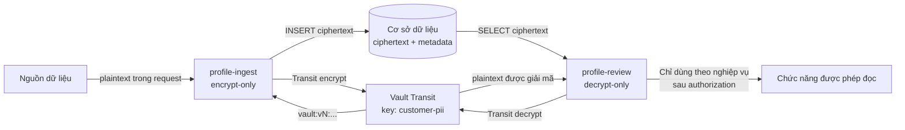
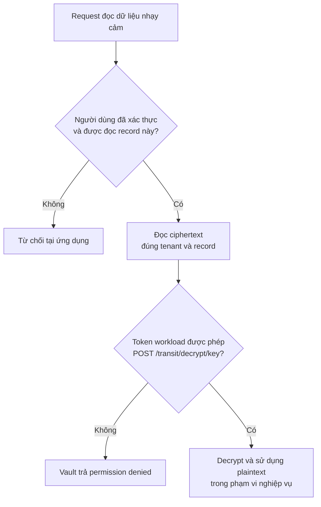

# Lưu ciphertext trong ứng dụng và phân tách quyền giải mã

Khi một ứng dụng Java cần bảo vệ dữ liệu nhạy cảm như số định danh, thông tin khách hàng hoặc nội dung hồ sơ, mã hóa chỉ là một phần của bài toán. Câu hỏi quan trọng không kém là **dữ liệu đã mã hóa được lưu ở đâu, ai được phép yêu cầu giải mã và quyền đó được thực thi ở lớp nào**.

Với **HashiCorp Vault Transit secrets engine**, ứng dụng có thể gửi plaintext đến Vault để mã hóa, nhận về ciphertext và tự lưu ciphertext trong cơ sở dữ liệu của mình. Vault quản lý khóa mã hóa và thực hiện phép toán mật mã; Vault Transit **không lưu các bản ghi dữ liệu mà ứng dụng đã gửi để mã hóa**. **Spring Vault** cung cấp `VaultTemplate`/`VaultOperations` và `VaultTransitOperations` để gọi các thao tác này từ Java.

Bài thuộc chương **Mã hóa Transit** của module `SPRING_VAULT`. Trọng tâm là thiết kế một luồng **ghi dữ liệu có quyền encrypt nhưng không có quyền decrypt**, đồng thời chỉ cấp quyền decrypt cho workload thực sự cần đọc thông tin gốc. Phạm vi bao gồm cách lưu ciphertext, Vault ACL, ví dụ Java, vòng đời khóa, kiểm thử tích hợp và xử lý lỗi.

## 1. Mục tiêu và ranh giới bảo mật

Giả sử hệ thống có hai workload:

- **`profile-ingest`**: nhận dữ liệu người dùng, mã hóa và lưu xuống database. Workload này có thể nhìn thấy *plaintext mới nhận ở thời điểm nhập*; nhưng không được sử dụng Transit để giải mã các ciphertext đã lưu.
- **`profile-review`**: thực hiện quy trình nghiệp vụ được phép đọc thông tin gốc, sau khi kiểm tra người dùng, tenant và đối tượng dữ liệu. Workload này được quyền gọi Transit decrypt.

Một vai trò Vault thứ ba, **`security-operator`**, quản lý khóa và rotation. Nó không cần dùng chung token với hai workload ứng dụng.



**Hai ranh giới phải được duy trì đồng thời:**

1. **Ranh giới khóa:** database không sở hữu khóa Transit; ứng dụng không đọc trực tiếp khóa gốc từ Vault. Nếu chỉ lộ bản sao database, kẻ tấn công chưa có khả năng giải mã chỉ nhờ ciphertext.
2. **Ranh giới quyền:** token/identity của `profile-ingest` chỉ có `transit/encrypt/...`; token/identity của `profile-review` mới có `transit/decrypt/...`. Quyền đọc ciphertext trong database **không đồng nghĩa** với quyền giải mã tại Vault.

Điều này **không** có nghĩa plaintext không bao giờ xuất hiện trong bộ nhớ ứng dụng. `profile-ingest` đã nhận plaintext đầu vào và `profile-review` phải nhận plaintext đầu ra để hoàn thành nghiệp vụ. Transit tập trung quyền sử dụng khóa, nhưng không tự bảo vệ được giá trị đã hiện diện trong request body, heap, log, cache, bản sao dữ liệu hay phản hồi API.

## 2. Cần lưu chính xác những gì?

### 2.1. Định dạng ciphertext của Transit

Sau khi mã hóa bằng khóa tên `customer-pii`, Vault trả về chuỗi có dạng:

```text
vault:v1:<base64-encoded-encrypted-payload>
```

Ví dụ trên minh họa **cấu trúc**, không phải ciphertext có thể giải mã. Tiền tố `vault:` xác định định dạng mã hóa Transit, phần `v1` là **phiên bản khóa Transit được dùng khi mã hóa**. Phần còn lại là dữ liệu mã hóa ở dạng phù hợp để truyền/lưu dưới dạng chuỗi.

Khi khóa được rotate, ciphertext mới có thể có tiền tố `vault:v2:...`. Không xóa `vault:vN:`, không tự cắt lấy phần Base64, không tự thay `v1` thành `v2`: Vault cần thông tin version đó để chọn khóa phù hợp khi decrypt.

**Phân biệt:** version trong `vault:v2:...` là *version của khóa Transit*. Nó không phải version bản ghi trong bảng dữ liệu hay version của KV secrets engine v2.

### 2.2. Lược đồ lưu trữ đề xuất

Ví dụ PostgreSQL:

```sql
CREATE TABLE protected_profiles (
    id UUID PRIMARY KEY,
    tenant_id VARCHAR(100) NOT NULL,
    ciphertext TEXT NOT NULL,
    transit_key VARCHAR(128) NOT NULL,
    created_at TIMESTAMPTZ NOT NULL DEFAULT CURRENT_TIMESTAMP
);

CREATE INDEX idx_protected_profiles_tenant
    ON protected_profiles (tenant_id);
```

| Cột | Mục đích | Cần lưu ý |
|---|---|---|
| `id` | ID bản ghi nghiệp vụ | Không chứa plaintext |
| `tenant_id` | Phân vùng và kiểm tra phạm vi truy cập | Lấy từ context xác thực; không tin mù quáng dữ liệu client gửi |
| `ciphertext` | Chuỗi `vault:vN:...` **nguyên vẹn** | Không đổi kiểu mã hóa hay cắt bớt tiền tố |
| `transit_key` | Tên khóa đã dùng, ví dụ `customer-pii` | Chỉ chọn trong danh sách key được phép, không chuyển thẳng path tùy ý của user cho Vault |
| `created_at` | Metadata vận hành | Không phải thời điểm tạo key version |

Ứng dụng thông thường **không cần** lưu thêm plaintext, raw encryption key, Vault token, giá trị plaintext dưới dạng Base64 hoặc kết quả decrypt đã cache. Base64 chỉ là mã hóa biểu diễn, không phải bảo vệ bí mật.

Nếu có nhu cầu tìm kiếm theo dữ liệu nhạy cảm, không dùng query dạng `WHERE ciphertext = ?` để suy ra hai plaintext giống nhau: Transit mặc định tạo ciphertext khác nhau cho các lần mã hóa cùng một plaintext. Phương án tìm kiếm có thể cần chỉ mục mù (blind index) dựa trên HMAC với khóa độc lập và đánh giá rò rỉ mẫu truy vấn. Không bật deterministic/convergent encryption chỉ để thuận tiện cho SQL nếu chưa phân tích rủi ro lộ sự trùng lặp.

### 2.3. Quy tắc lưu trữ ở tầng ứng dụng

- Ghi **ciphertext** vào transaction của database; trả về `id` thay vì trả lại plaintext.
- Lưu nguyên chuỗi `vault:vN:...` bằng cột text đủ dài, không coi nó là chuỗi Base64 thuần.
- Dùng kết nối TLS tới Vault và database; quản lý token riêng với dữ liệu được lưu.
- Không đưa plaintext vào log, URL, trace attributes, message queue, dead-letter queue, thông báo lỗi hay audit payload tùy biến.
- Chỉ giải mã khi luồng nghiệp vụ cần và đã được ủy quyền. Dùng xong thì tránh giữ plaintext ở cache hoặc trong response không cần thiết.
- Bảo vệ bản sao database, backup và file export theo mức độ nhạy cảm của metadata. Mã hóa không thay thế chính sách giữ/xóa dữ liệu và quyền database.

## 3. Phân tách quyền với Vault policies

Transit được mount ở `transit/`, còn khóa tên `customer-pii` được tạo trước bởi operator. API mã hóa/giải mã có đường dẫn **khác nhau**:

| Workload hoặc vai trò | Endpoint cần | Vault capability | Không cần |
|---|---|---|---|
| `profile-ingest` | `transit/encrypt/customer-pii` | `update` | `decrypt`, `keys`, `export` |
| `profile-review` | `transit/decrypt/customer-pii` | `update` | `encrypt`, `keys`, `export` |
| `ciphertext-migrator` (nếu có) | `transit/rewrap/customer-pii` | `update` | `decrypt` |
| `security-operator` | Các endpoint quản trị khóa theo nhiệm vụ | Cấp riêng theo quy trình vận hành | Không dùng token admin trong runtime ứng dụng |

Đối với Vault Transit, thao tác mã hóa và giải mã thường là HTTP `POST` nên capability dùng là **`update`**. Không cấp `read` rồi kỳ vọng đọc được plaintext từ `/decrypt/...`.

**Policy `profile-ingest` (encrypt-only):**

```hcl
# profile-ingest.hcl
path "transit/encrypt/customer-pii" {
  capabilities = ["update"]
}
```

**Policy `profile-review` (decrypt-only):**

```hcl
# profile-review.hcl
path "transit/decrypt/customer-pii" {
  capabilities = ["update"]
}
```

**Policy dành riêng cho công việc chuyển đổi ciphertext khi rotate khóa:**

```hcl
# ciphertext-migrator.hcl
path "transit/rewrap/customer-pii" {
  capabilities = ["update"]
}
```

Hai workload phải nhận **identity và token Vault độc lập**, chẳng hạn hai Kubernetes ServiceAccount được gắn với hai Vault Kubernetes auth roles, hoặc hai AppRole riêng. Token runtime chỉ nhận policy phù hợp. Nếu cả hai lớp Java chạy trong cùng một deployment dùng một `VaultTemplate` với token có cả `encrypt` và `decrypt`, sự phân tách trong mã nguồn chỉ mang tính tổ chức; **Vault không còn ngăn workload ghi gọi decrypt**.

Đồng thời cần phân tách quyền ở database: `profile-ingest` có quyền ghi dữ liệu cần thiết; `profile-review` có quyền đọc đúng tập bản ghi được ủy quyền. Đừng cấp cùng một tài khoản DB có quyền toàn bộ bảng cho mọi workload chỉ vì dữ liệu đã được mã hóa.

### AuthN và AuthZ ở hai tầng



Vault policy kiểm tra **identity của workload gọi Vault**, không tự biết người dùng cuối nào được phép xem bản ghi `id=...`. Spring Security, tenant isolation và ACL dữ liệu tại ứng dụng phải thực thi quyết định đó trước khi decrypt. Một token decrypt-only vẫn có thể giải mã nhiều ciphertext hợp lệ của cùng key nếu người gọi cung cấp được chúng; cần kiểm soát đường đọc DB và API nghiệp vụ.

## 4. Ví dụ quy trình và CLI thử nghiệm

Chỉ thực hành trên Vault thử nghiệm; dùng dữ liệu giả. Khi `transit/` chưa được mount, operator có thể tạo mount và khóa:

```bash
# Chỉ operator thực hiện; bỏ bước enable nếu transit/ đã có sẵn.
vault secrets enable -path=transit transit
vault write -f transit/keys/customer-pii
```

Mặc định Transit sử dụng khóa đối xứng phù hợp cho mã hóa/giải mã (thường là `aes256-gcm96`). Khóa nên được provision từ trước, trong quy trình quản trị, để runtime ứng dụng không cần quyền tạo khóa.

### 4.1. Mã hóa bằng identity writer

Phần `plaintext` gửi tới API Transit phải được **Base64-encode ở tầng HTTP**. Trong ví dụ, `aGVsbG8=` là Base64 của chuỗi UTF-8 `hello`:

```bash
# Terminal đang đăng nhập Vault với identity profile-ingest.
# Giá trị trả về ví dụ: vault:v1:...
CIPHERTEXT=$(vault write -field=ciphertext \
    transit/encrypt/customer-pii \
    plaintext=aGVsbG8=)

# Chỉ lưu biến ciphertext/giá trị đó vào database demo.
# Không chép plaintext hoặc token vào file output.
```

Ví dụ HTTP tương ứng:

```http
POST /v1/transit/encrypt/customer-pii
X-Vault-Token: <writer-token>
Content-Type: application/json

{"plaintext":"aGVsbG8="}
```

Phản hồi có trường `data.ciphertext` mang dạng `vault:vN:...`. **Writer không tự giải mã** ciphertext đó vì policy không cấp `transit/decrypt/customer-pii`.

### 4.2. Đọc ciphertext rồi giải mã bằng identity reader

Khi đọc từ database, reader lấy chính chuỗi ciphertext đã lưu rồi gọi:

```http
POST /v1/transit/decrypt/customer-pii
X-Vault-Token: <reader-token>
Content-Type: application/json

{"ciphertext":"vault:v1:<payload-thuc-te-do-vault-tra-ve>"}
```

Phản hồi `data.plaintext` chứa **Base64 của dữ liệu gốc**. Sau đó ứng dụng mới giải mã Base64 thành bytes UTF-8 hoặc dữ liệu nhị phân phù hợp.

Trong CLI thử nghiệm, đăng nhập bằng identity `profile-review` và thay `<ciphertext-that-exists>` bằng ciphertext thực tế đã lưu:

```bash
vault write -field=plaintext \
    transit/decrypt/customer-pii \
    'ciphertext=vault:v1:<ciphertext-that-exists>'
```

Output `plaintext` ở đây vẫn là Base64 (với chuỗi `hello` là `aGVsbG8=`). Chỉ decode trong môi trường lab được phép nhìn dữ liệu gốc. Không ghi output giải mã vào log của hệ thống production.

Thử **gọi decrypt bằng token writer** phải nhận lỗi `permission denied`. Ngược lại, thử gọi encrypt bằng token reader cũng phải bị từ chối nếu reader chỉ có policy `decrypt`. Những kiểm tra âm này chứng minh phân quyền đã hoạt động ở phía Vault, thay vì chỉ dựa vào việc service có/không có một method Java nào đó.

## 5. Spring Vault: ghi ciphertext và đọc có kiểm soát

Spring Vault cung cấp interface `VaultTransitOperations` qua `VaultOperations.opsForTransit("transit")`. API nhận `Plaintext` và trả về `Ciphertext`, phù hợp khi cần quy định rõ UTF-8.

Mẫu dưới đây minh họa **hai lớp được triển khai trong hai workload riêng**, mỗi workload cấu hình Spring Vault authentication độc lập theo policy tại mục 3. `JdbcTemplate` chỉ minh họa cách lưu/truy vấn PostgreSQL; kết nối DB cũng được phân quyền riêng.

### 5.1. Workload `profile-ingest` — chỉ mã hóa và lưu

```java
import java.nio.charset.StandardCharsets;
import java.util.Objects;
import java.util.UUID;

import org.springframework.jdbc.core.JdbcTemplate;
import org.springframework.stereotype.Service;
import org.springframework.vault.core.VaultOperations;
import org.springframework.vault.core.VaultTransitOperations;
import org.springframework.vault.support.Ciphertext;
import org.springframework.vault.support.Plaintext;

@Service
public class ProtectedProfileWriter {

    private static final String KEY = "customer-pii";

    private final VaultTransitOperations transit;
    private final JdbcTemplate database;

    // VaultOperations của deployment này dùng token encrypt-only.
    public ProtectedProfileWriter(
            VaultOperations vault,
            JdbcTemplate database) {
        this.transit = vault.opsForTransit("transit");
        this.database = database;
    }

    public UUID save(String authorizedTenantId, String sensitiveText) {
        Objects.requireNonNull(authorizedTenantId);
        Objects.requireNonNull(sensitiveText);

        // Mã hóa trước khi ghi DB; chọn charset rõ ràng.
        Plaintext bytes = Plaintext.of(sensitiveText, StandardCharsets.UTF_8);
        Ciphertext encrypted = transit.encrypt(KEY, bytes);

        UUID id = UUID.randomUUID();
        database.update(
            """
            INSERT INTO protected_profiles
                (id, tenant_id, ciphertext, transit_key)
            VALUES (?, ?, ?, ?)
            """,
            id,
            authorizedTenantId,
            encrypted.getCiphertext(),
            KEY
        );
        return id;
    }
}
```

`authorizedTenantId` phải do server suy ra từ identity đã xác thực và nghiệp vụ được ủy quyền, không lấy nguyên giá trị từ request để cho phép tùy ý ghi vào tenant khác.

**Bất biến quan trọng:** Cột `ciphertext` chỉ nhận kết quả `encrypted.getCiphertext()`, còn `sensitiveText` không đi vào database. `transit.encrypt(...)` có thể báo lỗi trước khi INSERT; trong trường hợp này không ghi bản ghi nhạy cảm ở dạng plaintext để "cứu" request.

### 5.2. Workload `profile-review` — kiểm tra quyền rồi giải mã

```java
import java.nio.charset.StandardCharsets;
import java.util.Objects;
import java.util.UUID;

import org.springframework.jdbc.core.JdbcTemplate;
import org.springframework.stereotype.Service;
import org.springframework.vault.core.VaultOperations;
import org.springframework.vault.core.VaultTransitOperations;
import org.springframework.vault.support.Ciphertext;
import org.springframework.vault.support.Plaintext;

@Service
public class ProtectedProfileReader {

    private static final String KEY = "customer-pii";

    private final VaultTransitOperations transit;
    private final JdbcTemplate database;
    private final ProfileAccessGuard accessGuard;

    // VaultOperations của deployment này dùng token decrypt-only.
    public ProtectedProfileReader(
            VaultOperations vault,
            JdbcTemplate database,
            ProfileAccessGuard accessGuard) {
        this.transit = vault.opsForTransit("transit");
        this.database = database;
        this.accessGuard = accessGuard;
    }

    public String readForAuthorizedPurpose(
            UUID recordId, String authenticatedUserId) {

        Objects.requireNonNull(recordId);
        Objects.requireNonNull(authenticatedUserId);

        // 1. Ứng dụng phải kiểm tra quyền user/tenant trên chính record.
        String authorizedTenantId =
                accessGuard.requireTenantForRead(authenticatedUserId, recordId);

        // 2. Đọc đúng ciphertext trong tenant đã được kiểm tra.
        String ciphertext = database.queryForObject(
            """
            SELECT ciphertext
            FROM protected_profiles
            WHERE id = ? AND tenant_id = ? AND transit_key = ?
            """,
            String.class,
            recordId,
            authorizedTenantId,
            KEY
        );

        // 3. Chỉ workload này có Vault token decrypt-only.
        Plaintext decrypted = transit.decrypt(KEY, Ciphertext.of(ciphertext));
        return decrypted.asString(StandardCharsets.UTF_8);
    }
}

// Hợp đồng kiểm tra quyền nghiệp vụ; implementation thuộc ứng dụng.
interface ProfileAccessGuard {
    // Ném exception nếu user không có quyền đọc record/tenant này.
    String requireTenantForRead(String userId, UUID recordId);
}
```

Ví dụ đặt một cổng `ProfileAccessGuard` để nhấn mạnh rằng **quyền đọc record của người dùng** là một kiểm tra riêng với **quyền `decrypt` của workload**. Trong ứng dụng thật, cổng này cần kiểm tra principal hiện tại do Spring Security cung cấp (không tin một `authenticatedUserId` tự khai từ JSON/body), tenant và quyền theo từng bản ghi trước khi cho phép xem plaintext.

Nếu dữ liệu không phải văn bản, giữ `byte[]` với `Plaintext.of(bytes)` và `decrypted.getPlaintext()`; không tự ép dữ liệu nhị phân sang `String` theo charset mặc định.

### Vì sao không thể chỉ tạo hai service trong cùng một JVM?

Giả sử `ProtectedProfileWriter` và `ProtectedProfileReader` được đóng gói vào cùng một Spring Boot process dùng một token có đủ quyền `encrypt` và `decrypt`. Khi đó, bất kỳ code nào trong process cũng có thể gọi `opsForTransit("transit").decrypt(...)` bằng token đó. Cách tổ chức class không tạo ra ranh giới security thật.

Để phân tách theo Vault ACL, cần **hai identity workload độc lập**: thường là hai deployment, hai Kubernetes ServiceAccount/AppRole và hai Spring Vault session tương ứng. Nếu bắt buộc chạy cùng một process, phải cấu hình các client/session khác nhau nhưng vẫn phải hiểu rằng ranh giới JVM dùng chung yếu hơn cách tách process và secret/token.

## 6. Điều gì xảy ra khi Vault bị lỗi?

Gọi Transit là một **phụ thuộc runtime**: chức năng cần plaintext sẽ không hoạt động được nếu Vault không truy cập được hoặc token hết hiệu lực. Thiết kế xử lý lỗi phải bảo đảm bí mật không vô tình lộ ra khi một request thất bại.

| Trường hợp | Hệ quả có thể gặp | Hướng xử lý |
|---|---|---|
| `403 permission denied` | Token writer gọi decrypt, policy sai hoặc role không khớp | Từ chối; ghi metric phân quyền; kiểm tra auth role/token policies |
| `400` vì ciphertext/context không hợp lệ | Dữ liệu bị cắt, sửa, dùng sai khóa hoặc thiếu context bắt buộc | Không trả plaintext; điều tra integrity và format bản ghi |
| `429` hoặc `5xx` | Vault bị giới hạn tải hay tạm lỗi | Retry có giới hạn, backoff và timeout; tránh bão request |
| Vault không kết nối được | Không thể encrypt/decrypt | Fail closed; không lưu plaintext vào DB làm phương án dự phòng |
| Không tìm thấy record trong DB | Không có ciphertext để decrypt | Trả trạng thái nghiệp vụ phù hợp, không tự tạo dữ liệu |
| DB INSERT thất bại sau khi encrypt | Vault đã thực hiện mã hóa nhưng record chưa được lưu | Báo lỗi lưu trữ; retry theo idempotency nghiệp vụ, không ghi plaintext |
| Token hết hạn/không gia hạn được | Request tới Transit thất bại | Xử lý lại authentication workload; không fallback sang root token |

Một lần mã hóa mới có thể tạo ciphertext khác dù plaintext giống hệt, nên không dùng `ciphertext` làm khóa idempotency. Dùng operation ID/record ID ở tầng nghiệp vụ. Nếu vận hành queue, chỉ đưa ciphertext vào queue hoặc dùng đường truyền/khả năng lưu tạm đã được thiết kế bảo mật; không đẩy plaintext vào dead-letter queue để xử lý sau.

### Logging và giám sát

Nên ghi nhận **thao tác, số lần gọi, độ trễ, HTTP status, mã lỗi, tên logical key đã được chuẩn hóa và correlation ID**. Không log body của `transit/encrypt` (chứa plaintext dạng Base64), body `transit/decrypt` response (chứa plaintext dạng Base64), hay Vault token.

Vault audit device hỗ trợ quan sát thao tác và policy tại phía Vault. Tuy nhiên, hệ thống logging/tracing/proxy của ứng dụng vẫn phải tự tránh ghi raw request/response; khả năng audit không tự động làm mọi integration trở nên an toàn. Cấu hình báo động khi workload encrypt-only bất ngờ gọi endpoint decrypt hoặc khi số lần decrypt tăng bất thường.

## 7. Rotation, rewrap và dữ liệu mã hóa tồn tại lâu dài

Quản trị viên có thể rotate khóa Transit:

```bash
# Chỉ chạy bằng identity operator đã được cấp quyền phù hợp.
vault write -f transit/keys/customer-pii/rotate
```

Sau rotation, các lần encrypt mới dùng version khóa mới (ví dụ `vault:v2:...`). Ciphertext `vault:v1:...` vẫn có thể giải mã **nếu Vault còn giữ version khóa cũ và chính sách `min_decryption_version` cho phép**. Không xóa hoặc vô hiệu hóa version khóa cũ khi vẫn còn dữ liệu cần đọc.

Để cập nhật ciphertext cũ lên version khóa mới **mà không đưa plaintext về ứng dụng**, có thể dùng endpoint `rewrap`:

```http
POST /v1/transit/rewrap/customer-pii
X-Vault-Token: <migrator-token>
Content-Type: application/json

{"ciphertext":"vault:v1:<payload-thuc-te>"}
```

Vault trả ciphertext mới với version hiện hành. Workload `ciphertext-migrator` ghi đè cột `ciphertext` của đúng bản ghi; cần kiểm soát tương tranh để không ghi đè một thay đổi mới hơn, ví dụ điều kiện `UPDATE ... WHERE ciphertext = <old-ciphertext>` cùng record ID, sau đó kiểm tra số hàng cập nhật.

Spring Vault hỗ trợ:

```java
VaultTransitOperations transit = vaultOperations.opsForTransit("transit");
String newCiphertext =
        transit.rewrap("customer-pii", oldCiphertext);
```

Token của migrator chỉ cần quyền `update` tại `transit/rewrap/customer-pii`, không cần decrypt. **Rewrap khác rotation**: rotation tạo version khóa mới; rewrap cập nhật các bản mã cũ sử dụng version mới. Hai bước có thể thực hiện theo thời gian khác nhau.

## 8. Context, dữ liệu đa tenant và giới hạn của mô hình

Transit có chế độ **derived key** sử dụng `context` để dẫn xuất khóa theo ngữ cảnh. Khi dùng chế độ này, bên encrypt và decrypt phải cung cấp **cùng giá trị context phù hợp**; ứng dụng cần lưu hoặc có khả năng tái tạo context theo quy tắc ổn định. Với Spring Vault, có thể truyền `VaultTransitContext` thông qua `Plaintext.with(...)` hoặc `Ciphertext.with(...)`.

Tuy nhiên, context **không thay thế cơ chế authorization**. Việc gắn `tenant-123` vào request mã hóa không tự chứng minh người gọi thuộc tenant đó; token decrypt có quyền trên cùng Transit key có thể gọi decrypt với context khác nếu bên ứng dụng cho phép. Cần kiểm soát tenant tại server, phân quyền DB và cân nhắc key riêng theo domain/tenant khi yêu cầu cô lập đủ mạnh.

Ngoài ra:

- **Không đồng nghĩa end-to-end encryption:** khi gọi decrypt, Vault trả plaintext cho workload đã được cấp quyền. Nếu workload hoặc token đó bị chiếm, dữ liệu có thể bị lộ.
- **Không mã hóa tự động mọi trường:** chỉ các giá trị được chủ động gửi qua Transit mới được bảo vệ bằng Transit. Các cột còn lại như email, tenant, trạng thái có thể tiết lộ thông tin dù payload đã mã hóa.
- **Không phải công cụ tìm kiếm trên plaintext:** deterministic encryption và convergent encryption có đánh đổi về việc lộ các mẫu trùng lặp; chỉ áp dụng sau khi đánh giá threat model.
- **Không dành cho luồng dữ liệu rất lớn theo cách gửi nguyên file:** nếu cần mã hóa dữ liệu lớn hoặc tốc độ cao, cân nhắc envelope encryption: mã hóa dữ liệu cục bộ bằng DEK, dùng Transit bảo vệ DEK và lưu encrypted DEK cùng ciphertext. Khi đó phải quản lý vòng đời DEK, bộ nhớ và phân quyền giải mã riêng.
- **Không ngăn lộ plaintext trước/sau Transit:** cần bảo vệ ingress, heap, response, clipboard, màn hình, cache và các hệ thống downstream.

## 9. Kịch bản kiểm thử tích hợp

Các kiểm thử quan trọng nhất nên chạy trên Vault thử nghiệm với **hai token thực sự độc lập**, database thử nghiệm và khóa Transit chuyên cho test.

| Kịch bản | Điều kiện | Kết quả cần xác minh |
|---|---|---|
| Writer lưu dữ liệu | Token encrypt-only, plaintext giả | DB chỉ có `vault:vN:...`; không có plaintext trong cột hoặc log |
| Writer thử decrypt | Token encrypt-only và ciphertext hợp lệ | Vault từ chối (thường `403`); ứng dụng không có plaintext |
| Reader decrypt | Token decrypt-only, user đã được ủy quyền | Đọc lại đúng byte/UTF-8 ban đầu |
| Reader thử encrypt | Token decrypt-only | Vault từ chối; xác nhận không có quyền encrypt ngoài ý muốn |
| User sai tenant | Token workload có decrypt, user thiếu quyền bản ghi | Ứng dụng từ chối **trước** khi gọi Vault decrypt |
| Ciphertext bị sửa | Chuỗi lưu DB bị cắt/sửa | Decrypt thất bại; không trả dữ liệu gốc hay log body |
| Token hết hạn | Phiên Vault không còn hợp lệ | Fail closed; không fallback sang plaintext hoặc token admin |
| Vault tạm gián đoạn | Endpoint Transit không khả dụng | Có lỗi được kiểm soát; không INSERT plaintext |
| Rotate khóa | Có ciphertext `v1` rồi rotate sang `v2` | Ciphertext mới có version mới; ciphertext cũ vẫn decrypt nếu policy cho phép |
| Rewrap | Migrator có `rewrap` nhưng không có `decrypt` | Ciphertext đổi version; vẫn decrypt đúng qua reader; migrator không nhận plaintext |

### Một bài thử phân quyền tối thiểu

1. Operator provision khóa `customer-pii` và áp chính xác hai policy ở mục 3.
2. Writer mã hóa chuỗi thử nghiệm, lưu nguyên ciphertext vào DB.
3. Với **writer token**, thử `transit/decrypt/customer-pii` và xác minh bị từ chối.
4. Với **reader token**, lấy ciphertext từ DB, decrypt và đối chiếu giá trị gốc.
5. Với reader token, thử `transit/encrypt/customer-pii` và xác minh bị từ chối.
6. Từ client chưa được ủy quyền, gọi API đọc record của tenant khác; xác minh không tạo Vault decrypt request.
7. Rotate và rewrap theo đúng vai trò, rồi xác minh dữ liệu cũ vẫn phục hồi được.

Không coi thử nghiệm thành công nếu hai service vẫn chia sẻ cùng token có quyền rộng. Kiểm tra **effective policies** của token đang chạy, bao gồm cả policy mặc định/được gắn thêm, vì việc viết hai file HCL riêng chưa đủ chứng minh quyền thực tế đã bị phân tách.

## 10. Các lỗi thiết kế thường gặp

| Lỗi | Vì sao nguy hiểm | Cách khắc phục |
|---|---|---|
| Lưu `plaintext` cạnh `ciphertext` để tra cứu nhanh | Làm mất phần lớn mục tiêu mã hóa DB | Chỉ lưu ciphertext; thiết kế truy vấn metadata/độc lập |
| Cho writer quyền cả `encrypt` lẫn `decrypt` | Writer có thể giải mã dữ liệu lịch sử nếu lấy được ciphertext | Tách workload identity và policy Vault |
| Dùng chung một Vault root/admin token | Mọi service có quyền quản trị và đọc quá mức | Xác thực theo workload, policy tối thiểu, token lifecycle rõ ràng |
| Dùng `tenant_id` trong DB nhưng bỏ qua kiểm tra user | Reader có thể giải mã record sai tenant | AuthZ theo principal và record trước Vault decrypt |
| Cắt bỏ `vault:vN:` khi lưu | Không còn đúng định dạng ciphertext Transit | Lưu nguyên chuỗi do Vault trả về |
| Cho phép client chỉ định arbitrary Transit key name | Có thể gọi nhầm key hoặc vượt ranh giới domain | Chỉ dùng key đã cấu hình và whitelist phía server |
| Log raw request/response Vault | Có thể lộ plaintext được Base64 hóa | Chỉ log status, latency, operation và correlation ID |
| Xóa khóa cũ ngay khi rotate | Ciphertext cũ không còn giải mã được | Rewrap, kiểm tra coverage, rồi mới đặt policy min version |
| Khi Vault lỗi thì ghi plaintext để xử lý sau | Tạo đường rò rỉ rõ ràng ngay lúc sự cố | Fail closed và retry có kiểm soát |

## 11. Câu hỏi tự kiểm tra

1. Nếu chỉ lộ bản sao database chứa `vault:v1:...` nhưng không có quyền Transit decrypt, kẻ tấn công có thêm rào cản nào? Những nguồn plaintext ngoài DB nào vẫn phải xem xét?
2. Vì sao phương thức `transit.decrypt(...)` có mặt trong thư viện Java không chứng minh workload được phép gọi decrypt?
3. Policy của workload chỉ ghi dữ liệu cần `update` trên endpoint nào? Có nên cấp `read` trên `transit/keys/...` không?
4. Vì sao phải kiểm tra người dùng và tenant trước khi gọi Vault, dù token của workload reader đã được phép decrypt?
5. Sau key rotation, điều kiện nào giúp một ciphertext `vault:v1:...` vẫn có thể giải mã?
6. Workload migrator sử dụng `rewrap` có cần nhận plaintext không? Khi cập nhật DB cần tránh race condition nào?
7. Nếu ứng dụng có chức năng tìm kiếm theo plaintext, vì sao so sánh trực tiếp hai ciphertext mặc định không đáng tin cậy?

**Điểm cần nhớ:** Ciphertext thuộc trách nhiệm lưu trữ của ứng dụng, còn khóa và thao tác mật mã thuộc trách nhiệm của Vault Transit. Cách giới hạn ai được giải mã nằm ở **Vault policy của identity workload** kết hợp với **authorization người dùng, tenant và bản ghi** tại ứng dụng.

## Tài liệu chính thức

- [HashiCorp Vault — Transit secrets engine](https://developer.hashicorp.com/vault/docs/secrets/transit)
- [HashiCorp Vault — Transit HTTP API](https://developer.hashicorp.com/vault/api-docs/secret/transit)
- [HashiCorp Vault — Encrypt data in transit](https://developer.hashicorp.com/vault/tutorials/encryption-as-a-service/eaas-transit)
- [HashiCorp Vault — Rewrapping data after key rotation](https://developer.hashicorp.com/vault/tutorials/encryption-as-a-service/eaas-transit-rewrap)
- [HashiCorp Vault — Envelope encryption](https://developer.hashicorp.com/vault/docs/secrets/transit/envelope-encryption)
- [Spring Vault — Vault secrets engines / Transit](https://docs.spring.io/spring-vault/reference/vault/vault-secret-engines.html)
- [Spring Vault — VaultTransitOperations API](https://docs.spring.io/spring-vault/reference/api/java/org/springframework/vault/core/VaultTransitOperations.html)
- [Spring Vault — Plaintext và Ciphertext value objects](https://docs.spring.io/spring-vault/reference/api/java/org/springframework/vault/support/Plaintext.html)
