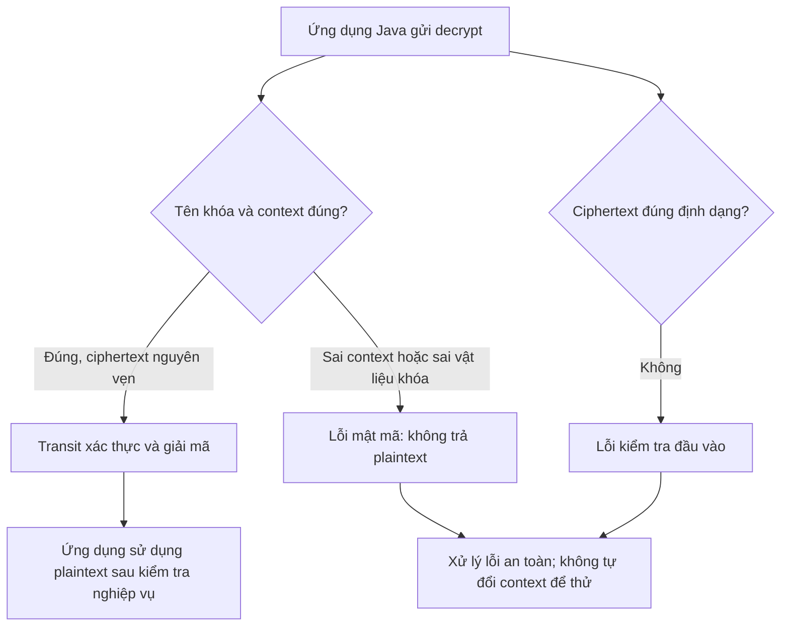
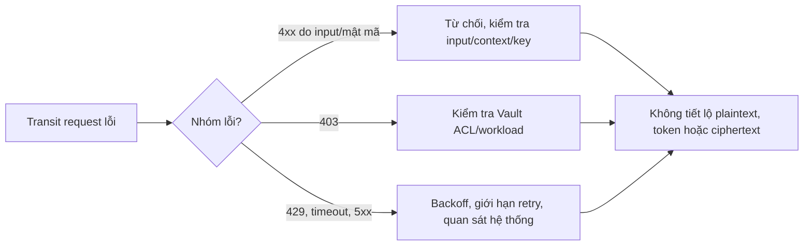

# Kiểm thử sai context, sai khóa và dữ liệu không hợp lệ trong Vault Transit

Khi một ứng dụng Java dùng **Spring Vault** và `VaultTemplate` để gọi **HashiCorp Vault Transit**, kiểm thử thành công của thao tác `encrypt`/`decrypt` mới chỉ xác nhận đường đi thông thường. Hệ thống còn phải chứng minh rằng ciphertext **không thể giải mã bằng context khác, khóa khác hoặc đầu vào bị sửa hỏng**. Đây là những kiểm thử âm (*negative tests*) quan trọng khi dữ liệu được phân chia theo người thuê (*tenant*), dịch vụ hoặc mục đích nghiệp vụ.

Bài học thuộc chương **Mã hóa Transit** tập trung vào cách dựng môi trường kiểm thử độc lập, xác định kết quả mong đợi, kiểm thử bằng Vault CLI và JUnit 5/Spring Vault, rồi phân loại lỗi để ứng dụng không xử lý sai các trường hợp bảo mật.

## 1. Hiểu rõ ba loại đầu vào phải kiểm thử

Transit là dịch vụ mật mã: ứng dụng gửi plaintext đã mã hóa Base64 đến endpoint `transit/encrypt/:name`, nhận ciphertext như `vault:v1:...` và tự lưu ciphertext. Khi giải mã, ứng dụng gửi ciphertext đến `transit/decrypt/:name` và nhận plaintext dưới dạng Base64.

Trong các thao tác này có ba khái niệm khác nhau:

| Đầu vào | Ý nghĩa | Điều phải kiểm chứng |
| --- | --- | --- |
| `context` | Giá trị Base64 dùng cho **key derivation** khi khóa có `derived=true` | Ciphertext được tạo với context A không giải mã thành công với context B. |
| Tên khóa `:name` | Xác định khóa logic bên trong Transit secrets engine | Ciphertext của khóa A không được giải mã bằng khóa B khác vật liệu khóa. |
| `plaintext` / `ciphertext` | Plaintext đầu vào phải ở dạng Base64; ciphertext đầu vào phải theo định dạng Transit hợp lệ | Đầu vào lỗi định dạng hoặc ciphertext bị thay đổi không được trả về plaintext giả hợp lệ. |

Với loại khóa **`aes256-gcm96` có `derived=true`**, Transit tạo khóa dẫn xuất từ vật liệu khóa và `context`. Khi giải mã với context khác, khóa dẫn xuất khác khiến kiểm tra xác thực của AES-GCM thất bại. Nếu dùng khóa **không bật `derived`**, phép thử đổi context không chứng minh được sự cách ly dữ liệu theo tenant; cần xem rõ chế độ khóa đã tạo.

`context` **không phải cơ chế cấp quyền**: biết hoặc đoán đúng context không được thay thế xác thực workload, kiểm tra tenant ở ứng dụng và Vault ACL. Tương tự, tiền tố `vault:v1:` chỉ là dấu hiệu định dạng và phiên bản, không phải chứng nhận ciphertext hợp lệ.



**Điểm cần phân biệt:** lỗi sai context, sai key và ciphertext bị giả mạo có thể cùng biểu hiện là lỗi giải mã/xác thực. Không dựa vào thông điệp lỗi để khẳng định chắc chắn nguyên nhân nào đã xảy ra, đặc biệt khi các phiên bản Vault hoặc thiết lập policy khác nhau.

## 2. Ma trận kiểm thử trước khi viết code

Sử dụng hai khóa độc lập `orders-a`, `orders-b`, đều có `derived=true`, cùng một kiểu `aes256-gcm96`. Dùng các context tổng hợp `tenant-A` và `tenant-B`, tránh dùng định danh khách hàng thật.

| Ca | Khóa gọi decrypt | Context khi decrypt | Ciphertext đầu vào | Kỳ vọng |
| --- | --- | --- | --- | --- |
| T01 – Đường đúng | `orders-a` | A | Encrypt bằng `orders-a`, context A | Thành công, plaintext khớp |
| T02 – Sai context | `orders-a` | B | Bản mã hợp lệ T01 | Bị từ chối; không trả plaintext |
| T03 – Thiếu context | `orders-a` | Không truyền | Bản mã hợp lệ T01 | Bị từ chối với khóa `derived=true` |
| T04 – Sai khóa | `orders-b` | A | Bản mã tạo bởi `orders-a` | Bị từ chối; không trả plaintext |
| T05 – Sai Base64 plaintext | `orders-a` (encrypt) | A | `plaintext="%%%"` | Encrypt bị từ chối |
| T06 – Sai Base64 context | `orders-a` (encrypt) | `%%%` | Plaintext Base64 hợp lệ | Encrypt bị từ chối |
| T07 – Ciphertext lỗi định dạng | `orders-a` | A | `not-a-vault-ciphertext` | Decrypt bị từ chối |
| T08 – Ciphertext bị cắt/sửa | `orders-a` | A | Bản mã không toàn vẹn | Decrypt bị từ chối |
| T09 – Thiếu ACL | `orders-a` | A | Ciphertext hợp lệ | Bị từ chối vì quyền truy cập |
| T10 – Đường đúng của khóa B | `orders-b` | A | Encrypt bằng `orders-b`, context A | Thành công, chứng minh B tồn tại và có quyền |

**T01 và T10 là tiền điều kiện quan trọng.** Nếu kết nối Vault lỗi, key B chưa tồn tại hoặc token không có quyền trên B, việc thấy T04 bị từ chối chưa chứng minh rằng Vault đã phát hiện sai khóa. Kiểm tra đường đúng và phân loại lỗi trước khi kết luận ca âm đạt.

Về mã HTTP, lỗi định dạng thường là **400**, thiếu quyền thường là **403**; đường dẫn không hợp lệ có thể là **404**. Mã chính xác và nội dung lỗi phụ thuộc endpoint/phiên bản/cấu hình. Lỗi kết nối, **429** hoặc **5xx** là sự cố hạ tầng hay giới hạn lưu lượng, không phải kết quả âm mật mã hợp lệ.

## 3. Chuẩn bị Transit test độc lập

Ví dụ chạy trên Bash/Linux, với Vault đã khởi động và đã đăng nhập. Hãy sử dụng Vault thử nghiệm riêng, token thử nghiệm ngắn hạn và mount riêng `transit-lab/`; không thực thi bằng khóa đang chứa dữ liệu sản xuất.

```bash
# Thực hiện một lần bằng danh tính quản trị Vault test.
vault secrets enable -path=transit-lab transit

# Hai key khác nhau nhưng cùng thuật toán và cùng chế độ derived.
vault write transit-lab/keys/orders-a type=aes256-gcm96 derived=true
vault write transit-lab/keys/orders-b type=aes256-gcm96 derived=true

# Xác minh metadata trước khi chạy test âm.
vault read transit-lab/keys/orders-a
vault read transit-lab/keys/orders-b
```

Ở metadata, kiểm tra `derived=true`, `type=aes256-gcm96` và khóa tồn tại. Khóa phải có vật liệu độc lập; không dùng cùng một key rồi thay tên biến Java để giả lập “sai khóa”.

Ví dụ Vault policy cho **test client** có quyền gọi encrypt/decrypt trên mount thử nghiệm:

```hcl
# Chỉ dành cho mount test được cô lập; áp dụng quyền tối thiểu hơn ở production.
path "transit-lab/encrypt/*" {
  capabilities = ["update"]
}

path "transit-lab/decrypt/*" {
  capabilities = ["update"]
}
```

Việc **tạo key** cần danh tính quản trị/provisioning riêng; ứng dụng dùng policy trên không cần quyền `transit-lab/keys/*`. Trong môi trường CI, nên tách token cấu hình key khỏi token thực thi test. Không ghi token vào mã nguồn, tài liệu bàn giao hay output của test.

### Chuẩn hóa context và plaintext

Các tham số `plaintext` và `context` dưới đây dùng Base64 **của byte UTF-8 gốc**. Chuẩn hóa giá trị trước khi mã hóa, bởi `tenant-A`, `Tenant-A` và `tenant-A ` là ba chuỗi byte khác nhau.

```bash
# Dữ liệu mô phỏng, không chứa bí mật.
CTX_A="$(printf '%s' 'tenant-A' | base64 | tr -d '\r\n')"
CTX_B="$(printf '%s' 'tenant-B' | base64 | tr -d '\r\n')"
PT_B64="$(printf '%s' 'order-demo-123' | base64 | tr -d '\r\n')"

CIPHER_A="$(vault write -field=ciphertext \
  transit-lab/encrypt/orders-a \
  plaintext="$PT_B64" context="$CTX_A")"

CIPHER_B="$(vault write -field=ciphertext \
  transit-lab/encrypt/orders-b \
  plaintext="$PT_B64" context="$CTX_A")"
```

Ở môi trường test mới tạo, ciphertext có dạng `vault:v1:...`, nhưng phiên bản thực tế có thể lớn hơn nếu đã xoay key. Không gán cứng kiểm thử cho `v1`.

## 4. Kiểm thử thành công trước, rồi thử sai context

Xác minh hai ciphertext được giải mã bằng chính key và context khi mã hóa:

```bash
vault write -field=plaintext transit-lab/decrypt/orders-a \
  ciphertext="$CIPHER_A" context="$CTX_A" | base64 --decode
# Kỳ vọng: order-demo-123

vault write -field=plaintext transit-lab/decrypt/orders-b \
  ciphertext="$CIPHER_B" context="$CTX_A" | base64 --decode
# Kỳ vọng: order-demo-123
```

Kiểm thử **T02 – sai context** sử dụng **cùng ciphertext và cùng tên khóa**, chỉ thay `CTX_A` thành `CTX_B`:

```bash
# Kỳ vọng lệnh trả exit code khác 0; không có plaintext hợp lệ.
vault write -field=plaintext transit-lab/decrypt/orders-a \
  ciphertext="$CIPHER_A" context="$CTX_B"
```

Với key `derived=true`, context B dẫn đến một khóa dẫn xuất khác và AES-GCM không thể xác thực ciphertext của context A. Đây là kết quả bảo mật mong đợi.

Kiểm thử **T03 – thiếu context**:

```bash
vault write -field=plaintext transit-lab/decrypt/orders-a \
  ciphertext="$CIPHER_A"
```

Một request decrypt không có `context` phải bị từ chối đối với key cần context để dẫn xuất khóa. Lưu ý “truyền chuỗi rỗng” và “không truyền field” là hai trường hợp dữ liệu khác nhau; quy ước validate của ứng dụng phải xét cả hai.

## 5. Kiểm thử sai khóa và ciphertext không hợp lệ

Với **T04 – sai khóa**, giữ nguyên ciphertext tạo từ `orders-a` và context A, nhưng gọi endpoint của `orders-b`:

```bash
vault write -field=plaintext transit-lab/decrypt/orders-b \
  ciphertext="$CIPHER_A" context="$CTX_A"
```

Hai key độc lập sẽ không giải mã/xác thực được bản mã của nhau. Nếu lệnh thành công ngoài dự kiến, cần điều tra ngay cách tạo key, cách chọn endpoint và việc bộ dữ liệu test có thật sự dùng hai ciphertext khác nhau.

Tiếp theo là các đầu vào không hợp lệ:

```bash
# T05: plaintext không phải Base64.
vault write transit-lab/encrypt/orders-a \
  plaintext="%%%" context="$CTX_A"

# T06: context không phải Base64.
vault write transit-lab/encrypt/orders-a \
  plaintext="$PT_B64" context="%%%"

# T07: chuỗi không đúng định dạng ciphertext Transit.
vault write transit-lab/decrypt/orders-a \
  ciphertext="not-a-vault-ciphertext" context="$CTX_A"

# T08: ciphertext bị cắt mất payload.
vault write transit-lab/decrypt/orders-a \
  ciphertext="vault:v1:" context="$CTX_A"
```

Các lệnh này được kỳ vọng **bị Vault từ chối**, nhưng mỗi trường hợp có thể sinh thông báo chi tiết khác nhau. Khi kiểm thử tự động, cần xác minh **request đã tới Vault, phản hồi thuộc nhóm lỗi đầu vào/mật mã**, không chỉ kiểm tra rằng bất kỳ exception nào cũng được ném ra.

Đối với việc sửa ngẫu nhiên một byte của payload ciphertext hợp lệ, AES-GCM phải từ chối xác thực. Kịch bản này khác với T07: T07 có thể bị chặn ngay ở bước phân tích định dạng, trong khi ciphertext đủ định dạng nhưng bị thay đổi có thể chỉ bị phát hiện khi kiểm tra tính toàn vẹn mật mã.

**Không giả định mọi “giá trị trống” đều không hợp lệ.** Ví dụ, chuỗi rỗng là chuỗi Base64 hợp lệ về mặt cú pháp; ứng dụng có thể cần quy định nghiệp vụ riêng cấm plaintext rỗng. Tương tự, ciphertext được giải mã thành byte bất kỳ không nhất thiết là UTF-8 hợp lệ: Vault xử lý byte, còn việc kiểm tra văn bản/JSON/số điện thoại thuộc trách nhiệm ứng dụng.

## 6. Kiểm thử bằng Spring Vault và JUnit 5

`VaultOperations` là giao diện chính của `VaultTemplate`. Các ví dụ sau dùng trực tiếp `vault.write(...)` để thấy rõ request/response Transit, không phụ thuộc vào một DTO đặc thù. Đây là **integration test**, yêu cầu hai key `orders-a`, `orders-b` đã được provisioning như mục 3.

Trong test, thiết lập `VAULT_ADDR` và `VAULT_TOKEN` qua biến môi trường hoặc secret store của CI. Token phải có quyền `update` trên cả endpoint `encrypt` và `decrypt` của hai key trong mount test.

```java
import static org.junit.jupiter.api.Assertions.*;

import java.net.URI;
import java.nio.charset.StandardCharsets;
import java.util.Base64;
import java.util.Map;

import org.junit.jupiter.api.BeforeAll;
import org.junit.jupiter.api.BeforeEach;
import org.junit.jupiter.api.Test;
import org.springframework.vault.authentication.TokenAuthentication;
import org.springframework.vault.client.VaultEndpoint;
import org.springframework.vault.core.VaultOperations;
import org.springframework.vault.core.VaultTemplate;
import org.springframework.vault.support.VaultResponse;

class TransitNegativeIntegrationTest {

    private static final String MOUNT = "transit-lab";
    private static final String KEY_A = "orders-a";
    private static final String KEY_B = "orders-b";
    private static VaultOperations vault;

    @BeforeAll
    static void connectToTestVault() {
        String address = requiredEnv("VAULT_ADDR");
        String token = requiredEnv("VAULT_TOKEN");
        vault = new VaultTemplate(
                VaultEndpoint.from(URI.create(address)),
                new TokenAuthentication(token));
    }

    @BeforeEach
    void verifyKeysAndTokenWork() {
        // Positive control cho từng test: Vault, token và cả hai key đều dùng được.
        assertEquals("probe", decrypt(KEY_A, "tenant-A",
                encrypt(KEY_A, "tenant-A", "probe")));
        assertEquals("probe", decrypt(KEY_B, "tenant-A",
                encrypt(KEY_B, "tenant-A", "probe")));
    }

    @Test
    void correctContextAndKeyCanDecrypt() {
        String ciphertext = encrypt(KEY_A, "tenant-A", "order-demo-123");
        assertEquals("order-demo-123", decrypt(KEY_A, "tenant-A", ciphertext));
    }

    @Test
    void wrongContextMustFail() {
        String ciphertext = encrypt(KEY_A, "tenant-A", "order-demo-123");
        assertThrows(RuntimeException.class,
                () -> decrypt(KEY_A, "tenant-B", ciphertext));
    }

    @Test
    void missingContextMustFailForDerivedKey() {
        String ciphertext = encrypt(KEY_A, "tenant-A", "order-demo-123");
        assertThrows(RuntimeException.class, () -> {
            vault.write(MOUNT + "/decrypt/" + KEY_A,
                    Map.of("ciphertext", ciphertext));
        });
    }

    @Test
    void wrongKeyMustFail() {
        String fromA = encrypt(KEY_A, "tenant-A", "order-demo-123");
        assertThrows(RuntimeException.class,
                () -> decrypt(KEY_B, "tenant-A", fromA));
    }

    @Test
    void invalidBase64PlaintextMustFail() {
        assertThrows(RuntimeException.class, () ->
                vault.write(MOUNT + "/encrypt/" + KEY_A,
                        Map.of("plaintext", "%%%",
                               "context", b64("tenant-A"))));
    }

    @Test
    void invalidContextEncodingMustFail() {
        assertThrows(RuntimeException.class, () ->
                vault.write(MOUNT + "/encrypt/" + KEY_A,
                        Map.of("plaintext", b64("probe"),
                               "context", "%%%")));
    }

    @Test
    void invalidCiphertextFormatMustFail() {
        assertThrows(RuntimeException.class, () ->
                vault.write(MOUNT + "/decrypt/" + KEY_A,
                        Map.of("ciphertext", "not-a-vault-ciphertext",
                               "context", b64("tenant-A"))));
    }

    private static String encrypt(String key, String context, String plaintext) {
        VaultResponse response = vault.write(
                MOUNT + "/encrypt/" + key,
                Map.of("plaintext", b64(plaintext), "context", b64(context)));
        return requiredField(response, "ciphertext");
    }

    private static String decrypt(String key, String context, String ciphertext) {
        VaultResponse response = vault.write(
                MOUNT + "/decrypt/" + key,
                Map.of("ciphertext", ciphertext, "context", b64(context)));
        String encoded = requiredField(response, "plaintext");
        return new String(Base64.getDecoder().decode(encoded),
                StandardCharsets.UTF_8);
    }

    private static String b64(String raw) {
        return Base64.getEncoder().encodeToString(
                raw.getBytes(StandardCharsets.UTF_8));
    }

    private static String requiredField(VaultResponse response, String field) {
        assertNotNull(response);
        assertNotNull(response.getData());
        Object value = response.getData().get(field);
        assertInstanceOf(String.class, value);
        return (String) value;
    }

    private static String requiredEnv(String name) {
        String value = System.getenv(name);
        if (value == null || value.isBlank()) {
            throw new IllegalStateException("Missing test environment: " + name);
        }
        return value;
    }
}
```

Ví dụ cố ý dùng `assertThrows(RuntimeException.class, ...)` để không phụ thuộc lớp exception cụ thể của từng phiên bản Spring Vault. **Trong bộ test chính thức, kiểm tra thêm nguyên nhân và HTTP status** để chỉ chấp nhận lỗi Vault dự kiến (chẳng hạn 400) và loại trừ 403, lỗi kết nối, timeout hoặc lỗi cấu hình làm kết quả âm dương tính giả. Đừng chuyển mọi `RuntimeException` thành “đã chặn tấn công thành công”.

Một cách tổ chức test ổn định hơn là tách hai tầng:

1. **Unit test** hàm ứng dụng chuẩn hóa tenant/context, encode Base64, kiểm tra input và ánh xạ response. Dùng mock `VaultOperations` để khẳng định đúng path/key/context được gửi.
2. **Integration test** gọi Vault thật trong môi trường cô lập để xác nhận tính chất mật mã: sai context, sai key và payload hỏng đều không trả về plaintext; đồng thời kiểm tra HTTP status/nhóm exception.

Không thể xác minh tính chất AES-GCM hoặc derived key chỉ bằng mock: mock chỉ xác nhận cách ứng dụng tạo request.

## 7. Test kết quả lỗi theo API contract, tránh dương tính giả

Giả sử test chỉ viết:

```java
assertThrows(Exception.class, () -> service.decrypt(ciphertext));
```

Phép thử này có thể “PASS” khi lỗi thực tế là `NullPointerException` ở ứng dụng, token Vault hết hạn, DNS không phân giải được hoặc Vault trả 500. Như vậy **chưa chứng minh** cơ chế bảo vệ context/key hoạt động.

Một phép kiểm thử âm đầy đủ nên chứng minh đồng thời:

- Vault test vẫn sẵn sàng và **positive control** giải mã được ciphertext hợp lệ.
- Request âm sử dụng **đúng key và context được định nghĩa trong ca thử**; chỉ thay đổi một biến mục tiêu.
- Server thực sự từ chối thao tác; ghi nhận nhóm lỗi HTTP/exception mà không rò rỉ dữ liệu.
- Ứng dụng không trả chuỗi plaintext, không tiếp tục xử lý đơn hàng và không âm thầm thử một key hoặc context khác.
- Sau thử âm, một positive control khác vẫn thành công để loại trừ outage xảy ra giữa chừng.

Ví dụ đặt tên bài test rõ nguyên nhân kỳ vọng: `wrongContextMustFail` hoặc `ciphertextTamperingMustFail`. Trong report, đừng ghi sai context là “403”: **403 biểu thị thiếu quyền**, còn sai context với key derived thường là lỗi xử lý mật mã/đầu vào phía Transit.

## 8. Phân biệt lỗi dữ liệu, lỗi quyền và lỗi hạ tầng

| Nhóm lỗi quan sát | Tình huống thường gặp | Cách xử lý trong Java |
| --- | --- | --- |
| HTTP 400 – request không hợp lệ | Base64 sai, ciphertext không đúng định dạng, context thiếu, xác thực mật mã thất bại | Từ chối thao tác; log mã lỗi an toàn; yêu cầu kiểm tra input/quy ước context. Không retry mù. |
| HTTP 403 – không có quyền | Token không được phép gọi `decrypt` hoặc `encrypt` trên path | Kiểm tra workload authentication, Vault ACL và đường dẫn; không tự nâng quyền. |
| HTTP 404 – endpoint/path không tồn tại | Sai mount `transit-lab`, sai route, engine không bật | Kiểm tra cấu hình deployment, đường dẫn và trạng thái mount. |
| HTTP 429 – giới hạn lưu lượng | Quá nhiều request đến Vault | Retry có giới hạn với backoff, giữ idempotency của nghiệp vụ. |
| HTTP 5xx / timeout | Sự cố Vault, mạng, proxy hoặc cluster | Ghi nhận lỗi hạ tầng; retry có giới hạn sau khi đánh giá an toàn và kiểm tra sức khỏe. |
| Lỗi parse sau decrypt | Byte plaintext không phù hợp schema/UTF-8/JSON nghiệp vụ | Giữ lỗi ở lớp ứng dụng; không đổ cho việc sai context của Vault. |

Spring Vault có thể bao bọc lỗi HTTP trong exception của thư viện. Khi xây dựng `VaultTemplate`/`VaultOperations`, bảo đảm không bỏ mất mã trạng thái/cause trong cơ chế xử lý lỗi tập trung. Với workload dùng AppRole, Kubernetes auth hoặc cơ chế phù hợp khác, kiểm thử 403 và token hết hạn là những ca riêng về **xác thực và vòng đời token**, không trộn vào ca sai ciphertext.



## 9. Thiết kế cách ly tenant và kiểm thử an toàn

Một mô hình thường gặp là ứng dụng dùng cùng một key logic có `derived=true`, rồi tạo context từ `tenantId` đã được xác thực. Những quy tắc sau giúp phép thử phản ánh đúng mô hình an toàn:

1. **Context phải được suy ra từ danh tính đã xác minh** (claim/token hoặc tenant scope do server kiểm soát), không đơn giản tin vào một trường `tenantId` do client tự gửi.
2. Cùng một quy tắc chuẩn hóa, charset và Base64 phải được áp dụng khi `encrypt`, `decrypt` và `rewrap`. Thay đổi chữ hoa/thường, encoding hoặc khoảng trắng có thể làm decrypt không thành công.
3. **Không thử tuần tự tất cả context hoặc tất cả key** để “cứu” thao tác thất bại. Cách này vừa lộ cấu trúc dữ liệu, vừa có thể phá vỡ ranh giới truy cập tenant.
4. Không coi việc decrypt thành công là đủ để ủy quyền đọc bản ghi. Ứng dụng vẫn phải xác minh chủ sở hữu và quyền truy cập bản ghi trước khi đưa plaintext vào nghiệp vụ.
5. Nếu cần chính sách tách tenant chặt hơn, cân nhắc key riêng theo phạm vi cùng ACL tương ứng, kết hợp kiểm tra quyền nghiệp vụ; `context` không tạo ra policy động của Vault.
6. Nếu ứng dụng hỗ trợ chuyển đổi key hoặc đổi quy ước context, xây dựng quy trình migration có kiểm kê, kiểm thử readback và rollback được kiểm soát; không tự động fallback sang cơ chế cũ trong luồng xử lý bình thường.

Các test nên dùng dữ liệu giả, key chỉ dành cho CI và vault thử nghiệm. Không kiểm thử sai khóa trên ciphertext bí mật của khách hàng thật. Đối với test đa tenant, nên có ít nhất hai tenant giả và xác minh tính bất biến: mọi lời gọi sai tenant đều thất bại trong khi mỗi tenant vẫn thực hiện được tác vụ hợp lệ.

## 10. Kiểm tra input ở ứng dụng trước khi gọi Vault

Vault vẫn cần tự xác thực ciphertext và kiểm tra mật mã, nhưng ứng dụng có thể phát hiện các lỗi hiển nhiên trước khi gửi request:

| Trường | Kiểm tra sơ bộ ở Java | Cảnh báo |
| --- | --- | --- |
| `keyName` | Chỉ chọn từ tập key/path do server cấu hình | Không ghép path Transit từ chuỗi client chưa kiểm soát. |
| `context` | Không null/blank theo contract; chuẩn hóa định danh rồi encode Base64 một lần | Không encode Base64 hai lần; không log context nếu chứa thông tin nhận diện. |
| `plaintext` | Kiểm tra giới hạn độ dài và schema nghiệp vụ trước khi encode Base64 | Giá trị byte rỗng có thể hợp lệ ở tầng mã hóa nhưng không hợp lệ cho nghiệp vụ. |
| `ciphertext` | Không null/blank; kiểm tra giới hạn kích thước và tiền tố cú pháp nếu cần | Tiền tố đúng không đảm bảo bản mã thật hoặc toàn vẹn. |
| Phản hồi decrypt | Giải mã Base64 và validate byte/charset/schema trước khi sử dụng | Không hiển thị dữ liệu chưa được xác minh trong UI/log. |

Ví dụ chuẩn hóa context trước khi mã hóa:

```java
import java.nio.charset.StandardCharsets;
import java.util.Base64;
import java.util.Objects;

public final class TransitContext {
    private TransitContext() {}

    public static String fromVerifiedTenantId(String verifiedTenantId) {
        Objects.requireNonNull(verifiedTenantId, "verifiedTenantId");
        if (verifiedTenantId.isBlank()) {
            throw new IllegalArgumentException("Tenant scope is missing");
        }
        // Chỉ truyền định danh đã được xác thực, theo định dạng canonical.
        byte[] bytes = verifiedTenantId.getBytes(StandardCharsets.UTF_8);
        return Base64.getEncoder().encodeToString(bytes);
    }
}
```

Đây là bước kiểm tra **tính hợp lệ và tính nhất quán của input**, không thay cho Vault ACL và xác thực AEAD. Việc quyết định `tenantId` có thuộc quyền của người gọi phải diễn ra ở tầng xác thực/ủy quyền của ứng dụng.

## 11. Quan sát, báo lỗi và bảo vệ dữ liệu khi test thất bại

Theo dõi kết quả integration test và production bằng các chỉ số có ích mà không ghi nội dung bí mật:

- Tỷ lệ thành công/thất bại của `encrypt` và `decrypt`, nhóm HTTP status, độ trễ và số lần retry.
- Số ca âm qua kiểm thử theo loại: wrong context, wrong key, invalid input, tampered ciphertext và unauthorized.
- Thời điểm xảy ra lỗi, định danh correlation/request ID không nhạy cảm, phiên bản ứng dụng và mount/key alias đã được phép hiển thị.
- Cảnh báo khi tỷ lệ lỗi giải mã tăng bất thường sau khi xoay key, thay đổi context normalization, release hoặc cập nhật Vault policy.

Không ghi `VAULT_TOKEN`, header `X-Vault-Token`, plaintext, ciphertext thực hoặc context nhạy cảm vào log. Khi cần tái hiện lỗi, sử dụng mẫu dữ liệu giả hoặc hash/ID chẩn đoán được tạo theo chính sách bảo mật.

Tại lớp API người dùng, tránh trả về thông báo chi tiết phân biệt “context của tenant X không khớp” hay “khóa Y tồn tại nhưng dữ liệu không đọc được”. Thông điệp công khai có thể là lỗi xử lý dữ liệu chung, trong khi hệ thống giám sát nội bộ giữ mã phân loại đã được làm sạch. Dữ liệu không giải mã được phải giữ ở trạng thái thất bại có kiểm soát, không được trả plaintext rỗng như kết quả thành công.

## 12. Bài thực hành và tiêu chí hoàn thành

Hãy thực hiện một bài test với hai key `derived=true` trong Vault test:

1. Tạo hai key độc lập; mã hóa và giải mã thành công với context A bằng **cả hai** key.
2. Với ciphertext của key A, thử lần lượt context B, không có context và key B; mỗi thao tác phải thất bại vì lý do phù hợp.
3. Gửi plaintext Base64 sai, context Base64 sai, ciphertext không đúng định dạng và ciphertext bị cắt; xác nhận không trường hợp nào trả về plaintext hợp lệ.
4. Dùng token chỉ có quyền encrypt để gọi decrypt hợp lệ; xác nhận lỗi quyền truy cập được tách khỏi lỗi mật mã.
5. Tạm thời mô phỏng Vault không sẵn sàng hoặc giới hạn lưu lượng trên môi trường kiểm thử; xác nhận test âm **không tính** 429/5xx/timeout là một kết quả mật mã thành công.
6. Chạy JUnit integration test; kiểm tra test report không làm lộ token, ciphertext hay plaintext thực.
7. Chạy lại các positive control sau những ca âm để chứng minh cả hai key vẫn hoạt động.

**Tiêu chí đạt:** chương trình chỉ trả plaintext khi dùng đúng key, đúng context và ciphertext hợp lệ; input sai bị từ chối; lỗi quyền được xử lý theo policy, lỗi hạ tầng được theo dõi riêng; không có cơ chế tự thử ngẫu nhiên key/context hoặc bỏ qua kiểm tra quyền nghiệp vụ.

## 13. Ghi nhớ

- **Sai context:** chỉ kiểm thử có ý nghĩa về dẫn xuất khóa khi key được cấu hình `derived=true`; context phải nhất quán từ encrypt đến decrypt.
- **Sai khóa:** cần hai key độc lập và một positive control cho mỗi key trước khi khẳng định thao tác dùng nhầm key đã bị chặn.
- **Dữ liệu không hợp lệ:** phân biệt Base64 lỗi, ciphertext sai định dạng và ciphertext bị sửa; đều không được trả plaintext thành công.
- **Kiểm thử âm:** exception bất kỳ chưa đủ; phải phân loại lỗi Vault với lỗi ACL và hạ tầng để tránh dương tính giả.
- **Spring Vault:** dùng `VaultOperations`/`VaultTemplate` để truyền đúng key, context và payload, đồng thời kiểm tra phản hồi, phân quyền workload và bảo vệ dữ liệu nhạy cảm.
