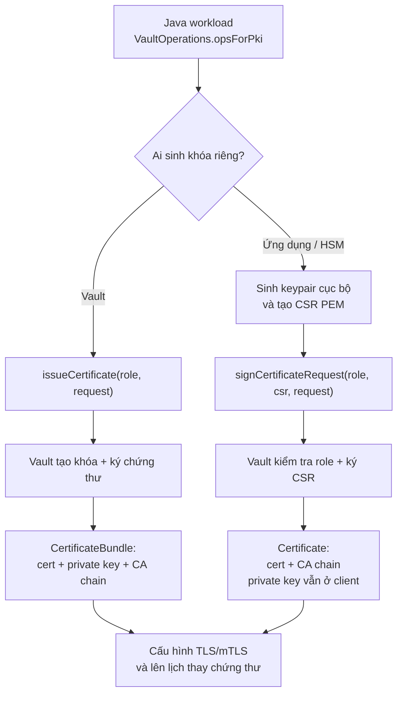

# VaultPkiOperations và các thao tác được hỗ trợ

**Chương:** Chứng thư PKI  
**Module:** SPRING_VAULT

## 1. Bài toán: ứng dụng Java lấy và vận hành chứng thư X.509

Khi triển khai HTTPS hoặc mutual TLS (mTLS) cho dịch vụ Java, mỗi workload cần chứng thư số X.509, khóa riêng tương ứng và chuỗi chứng thư CA tin cậy. Nếu cấp phát thủ công, đội vận hành phải tạo khóa, sinh CSR, chờ CA ký, phân phối chứng thư, theo dõi ngày hết hạn và xử lý thu hồi. **HashiCorp Vault PKI secrets engine** có thể đóng vai trò CA, phát hành chứng thư theo **role** và kiểm soát người gọi bằng cơ chế xác thực/policy của Vault.

Trong **Spring Vault**, ứng dụng Java sử dụng `VaultTemplate` thông qua giao diện `VaultOperations` và gọi `opsForPki()` hoặc `opsForPki("pki")` để nhận **`VaultPkiOperations`**. Đây là API mức cao cho các thao tác PKI phổ biến; nó dùng phiên Vault đã xác thực của ứng dụng và đóng gói các request/response HTTP thành kiểu Java.

Ví dụ xuyên suốt: workload `api.internal.example` cần chứng thư máy chủ có thời hạn ngắn để chạy HTTPS hoặc mTLS. Người vận hành đã chuẩn bị CA/issuer, cấu hình role `web-server` tại mount `pki`, cấp Vault policy cho identity của workload. Ứng dụng Java chỉ yêu cầu chứng thư đúng vai trò; không tự tạo CA và không có quyền quản trị PKI.

**Sau bài học, bạn có thể:**

1. Giải thích vai trò của `VaultPkiOperations`, mount path, role, CA/issuer và Vault token.
2. Đọc đúng chữ ký, kiểu trả về và ý nghĩa của các phương thức `issueCertificate`, `signCertificateRequest`, `revoke`, `getCrl` và `getIssuerCertificate`.
3. Chọn khi nào Vault sinh khóa riêng, khi nào ứng dụng sinh khóa và gửi CSR.
4. Xử lý `CertificateBundle`, `Certificate`, `KeyStore` và `InputStream` mà không làm lộ private key.
5. Phân quyền, theo dõi vòng đời chứng thư, kiểm thử tích hợp và xử lý lỗi trong môi trường Java.

## 2. Các khái niệm phải có trước khi gọi API

| Khái niệm | Ý nghĩa | Điểm cần nhớ |
| --- | --- | --- |
| **PKI secrets engine** | Mount cung cấp các khả năng CA và cấp chứng thư X.509 | Thường là `pki`, nhưng có thể mount ở `pki_int`, `team/pki`... |
| **Issuer / CA** | Thực thể ký và tạo chuỗi tin cậy cho chứng thư | PKI mount có thể quản lý nhiều issuer; cần issuer/default phù hợp. |
| **Role** | Chính sách phát hành: domain, SAN, TTL, key usage, loại khóa... | `roleName` là tên role **bên trong mount**, không phải Vault auth role. |
| **Certificate** | Chứng thư công khai có subject/SAN, serial, issuer, thời hạn, public key, chữ ký | Không chứa private key. |
| **Private key** | Khóa bí mật tương ứng public key trong chứng thư | Phải giữ kín, phân phối và lưu trữ an toàn. |
| **CSR** | Certificate Signing Request, chứa public key và thông tin đề xuất, được ký bằng private key | Vault ký CSR mà không cần nhận private key từ client. |
| **CRL** | Certificate Revocation List do CA phát hành | Bên kiểm tra TLS cần thực sự bật/triển khai cơ chế kiểm tra thu hồi. |
| **Vault identity/token** | Workload chứng thực với Vault để có quyền gọi endpoint | Quyền Vault và độ tin cậy TLS của chứng thư là hai việc độc lập. |

### Sơ đồ hai cách xin chứng thư



Ở cả hai nhánh, **role** quyết định yêu cầu nào được phép (ví dụ hostname và TTL). Tên role trong lời gọi API không thay thế Vault ACL: trước tiên token phải được phép gọi đúng endpoint, sau đó Vault mới kiểm tra các ràng buộc của role.

## 3. Khởi tạo VaultPkiOperations

Các ứng dụng Spring Boot thường được cấu hình bean `VaultOperations` từ Spring Vault/Spring Cloud Vault và cơ chế xác thực workload (Kubernetes, AppRole hoặc cơ chế phù hợp). Không cần hardcode Vault token trong mã. Khi đã có bean này:

```java
import org.springframework.stereotype.Service;
import org.springframework.vault.core.VaultOperations;
import org.springframework.vault.core.VaultPkiOperations;

@Service
public class PkiGateway {

    private final VaultPkiOperations pki;

    public PkiGateway(VaultOperations vaultOperations) {
        // PKI được mount tại "pki".
        this.pki = vaultOperations.opsForPki("pki");
    }

    public VaultPkiOperations operations() {
        return pki;
    }
}
```

`opsForPki()` là dạng tiện lợi khi mount mặc định là `pki`. `opsForPki("pki-int")` dùng mount `pki-int`; chuỗi truyền vào là **mount path**, không phải role name. Ví dụ `issueCertificate("web-server", request)` trên `opsForPki("pki")` tương ứng endpoint HTTP `POST /v1/pki/issue/web-server`.

Giả định môi trường đã tồn tại:

- PKI engine được enable và có issuer hợp lệ, có thể phát hành chứng thư.
- Role `web-server` được cấu hình cho tên DNS phù hợp (`api.internal.example`), TTL tối đa và giới hạn SAN.
- App/workload có Vault identity và policy cần thiết.
- Đường kết nối HTTPS từ ứng dụng đến Vault đã được xác thực bằng trust store thích hợp.

Các việc tạo root/intermediate CA, thiết lập issuer, vai trò, AIA/CRL URLs hay mount engine thường thuộc **quy trình quản trị**. `VaultPkiOperations` không trực tiếp cung cấp method chuyên dụng để thực hiện toàn bộ những thao tác quản trị đó.

## 4. Bản đồ đầy đủ các thao tác của VaultPkiOperations

| Phương thức | Vault HTTP API tương ứng | Kiểu trả về | Dùng khi |
| --- | --- | --- | --- |
| `issueCertificate(String roleName, VaultCertificateRequest request)` | `POST /pki/issue/:role` | `VaultCertificateResponse` chứa `CertificateBundle` | Vault sinh keypair và trả cert **kèm private key**. |
| `signCertificateRequest(String roleName, String csr, VaultCertificateRequest request)` | `POST /pki/sign/:role` | `VaultSignCertificateRequestResponse` chứa `Certificate` | Client đã tạo keypair/CSR, Vault chỉ ký và trả cert. |
| `revoke(String serialNumber)` | `POST /pki/revoke` | `void` | Thu hồi chứng thư dựa vào serial number; cần quyền nhạy cảm. |
| `getCrl(Encoding encoding)` | CRL endpoint của PKI mount, chẳng hạn `GET /pki/crl` | `InputStream`, **có thể null** | Đọc CRL ở dạng `PEM` hoặc `DER`. |
| `getIssuerCertificate(String issuer)` | `GET /pki/issuer/:issuer_ref/json` | `VaultIssuerCertificateRequestResponse` chứa `Certificate` | Lấy chứng thư CA issuer và chuỗi CA dạng object. |
| `getIssuerCertificate(String issuer, Encoding encoding)` | Endpoint lấy issuer theo định dạng `PEM`/`DER` | `InputStream` | Lấy dữ liệu chứng thư issuer theo định dạng thô. |

**Phiên bản API:** Các method `getIssuerCertificate(...)` có từ Spring Vault **3.1**; với phiên bản cũ hơn, hãy kiểm tra tài liệu API tương ứng. Các thao tác issue/sign/revoke/getCrl là phần cốt lõi của giao diện; từng phiên bản Spring Vault/Vault có thể khác hỗ trợ endpoint chi tiết.

### Những việc không có method chuyên dụng trong giao diện

`VaultPkiOperations` **không phải bảng điều khiển đầy đủ của PKI engine**. API này không cung cấp các phương thức mức cao riêng để tạo root CA, nhập/gỡ intermediate, tạo/sửa role, cấu hình mount/issuer, thiết lập auto-tidy, OCSP, phân phối CRL/AIA hoặc liệt kê mọi chứng thư. Khi cần các API đặc thù này, xem [Vault PKI HTTP API](https://developer.hashicorp.com/vault/api-docs/secret/pki) và dùng `VaultOperations.read(...)`, `write(...)`, `invoke(...)` hoặc client REST phù hợp theo tài liệu của phiên bản. Chỉ operator được trao những quyền quản trị tương ứng.

## 5. Cấp chứng thư: issueCertificate

### 5.1. Tạo yêu cầu bằng VaultCertificateRequest

`VaultCertificateRequest` là value object mô tả chứng thư cần cấp. Các trường phổ biến:

| Thuộc tính | Ví dụ Java | Ý nghĩa |
| --- | --- | --- |
| Common Name | `.commonName("api.internal.example")` | Tên chính của chứng thư; kiểm tra hostname TLS hiện đại chủ yếu dựa vào SAN. |
| Subject Alternative Names | `.withAltName("api.internal.example")` | DNS SAN cần thiết cho HTTPS. |
| IP SAN | `.withIpSubjectAltName("10.0.2.15")` | Khi TLS client xác thực bằng IP, nếu role cho phép. |
| URI SAN | `.withUriSubjectAltName("spiffe://example/ns/prod/sa/api")` | Có thể dùng trong nhận diện workload nếu role/PKI cho phép. |
| TTL | `.ttl(Duration.ofHours(12))` | Thời hạn *đề nghị*; role/issuer/Vault giới hạn thời hạn thực. |
| Output format | `.format("pem")` | Định dạng do API Vault hỗ trợ. |
| Private key format | `.privateKeyFormat("pkcs8")` | Định dạng private key trong phản hồi issue, theo hỗ trợ của Vault. |

Ví dụ trong Java:

```java
import java.time.Duration;

import org.springframework.vault.core.VaultPkiOperations;
import org.springframework.vault.support.CertificateBundle;
import org.springframework.vault.support.VaultCertificateRequest;
import org.springframework.vault.support.VaultCertificateResponse;

public CertificateBundle issueServerCertificate(VaultPkiOperations pki) {
    VaultCertificateRequest request = VaultCertificateRequest.builder()
        .commonName("api.internal.example")
        .withAltName("api.internal.example")
        .ttl(Duration.ofHours(12))
        .build();

    VaultCertificateResponse response =
        pki.issueCertificate("web-server", request);

    return response.getRequiredData();
}
```

`getRequiredData()` lấy dữ liệu bắt buộc và báo lỗi nếu không có phần `data` hợp lệ, tránh xử lý ngầm `null`. Phản hồi thực bao gồm `certificate` (PEM), `issuing_ca`, `ca_chain`, `serial_number` và **`private_key`** (cùng các metadata khác tùy cấu hình/phiên bản).

### 5.2. Làm việc với CertificateBundle

`CertificateBundle` kế thừa `Certificate` và có thêm **private key**. Nó hỗ trợ truy xuất chứng thư và tạo `KeyStore`:

```java
import java.security.KeyStore;
import java.security.cert.X509Certificate;

import org.springframework.vault.support.CertificateBundle;

public void inspectIssuedCertificate(CertificateBundle bundle)
        throws Exception {

    // Metadata không chứa private key.
    String serialNumber = bundle.getSerialNumber();
    X509Certificate certificate = bundle.getX509Certificate();
    X509Certificate issuerCertificate =
        bundle.getX509IssuerCertificate();

    certificate.checkValidity(); // Kiểm tra mốc thời gian NotBefore/NotAfter.

    // Dùng khi thư viện TLS yêu cầu KeyStore; KeyStore có private key.
    KeyStore keyStore = bundle.createKeyStore("tls-server");

    // Chuyển KeyStore vào cấu hình TLS an toàn và thiết kế cơ chế reload.
    // Không in, serialize hoặc đẩy keyStore/private key vào log.

    System.out.printf("Issued serial length=%d, notAfter=%s%n",
        serialNumber.length(), certificate.getNotAfter());

    // "issuerCertificate" phục vụ xây dựng chuỗi tin cậy, không đồng nghĩa
    // mọi CA có trong response đều được client tin cậy tự động.
}
```

Lời gọi `getPrivateKey()` hoặc `getPrivateKeySpec()` có thể truy cập trực tiếp khóa riêng. **Đây là dữ liệu bí mật thực sự**: hạn chế lưu ra đĩa, tránh ghi log/dump, kiểm soát quyền đọc, mã hóa lưu trữ nếu cần và sử dụng kho khóa/keystore an toàn. Kiểm tra certificate chain trước khi triển khai TLS; trust store của phía kết nối phải chứa trust anchor phù hợp, không nên tin mọi CA chỉ vì chúng xuất hiện trong phản hồi.

**Lưu ý:** `createKeyStore(...)` tạo cấu trúc Java `KeyStore` để phục vụ tích hợp. Tạo keystore chưa tự khởi động SSL server, chưa tự hot reload chứng thư và chưa tự phân phối certificate sang ứng dụng khác. Các bước đó cần cấu hình TLS của framework/server riêng.

## 6. Ký CSR: signCertificateRequest

Khi tổ chức yêu cầu private key **không được xuất khỏi host, HSM hoặc kho khóa ứng dụng**, chọn luồng **CSR**:

1. Ứng dụng/thiết bị tạo keypair trong môi trường sở hữu khóa.
2. Bên sở hữu khóa tạo CSR chuẩn PKCS#10 ở dạng PEM (gồm public key, thông tin nhận dạng và chữ ký bằng private key).
3. Gửi CSR và tham số đề nghị đến `signCertificateRequest(...)`.
4. Vault kiểm tra yêu cầu theo role rồi ký, trả về chứng thư và CA chain.
5. Ứng dụng ghép chứng thư đã ký với **private key vẫn được giữ cục bộ** để sử dụng TLS.

Ví dụ sử dụng CSR đã được sinh bằng một thư viện như Bouncy Castle hoặc công cụ `openssl`:

```java
import java.time.Duration;

import org.springframework.vault.core.VaultPkiOperations;
import org.springframework.vault.support.Certificate;
import org.springframework.vault.support.VaultCertificateRequest;
import org.springframework.vault.support.VaultSignCertificateRequestResponse;

public Certificate signCsr(VaultPkiOperations pki, String csrPem) {
    VaultCertificateRequest request = VaultCertificateRequest.builder()
        .commonName("api.internal.example")
        .ttl(Duration.ofHours(12))
        .build();

    VaultSignCertificateRequestResponse response =
        pki.signCertificateRequest("web-server", csrPem, request);

    Certificate signed = response.getRequiredData();

    // Chỉ có chứng thư + thông tin issuer, KHÔNG có private key.
    return signed;
}
```

`csrPem` phải là CSR thực có cấu trúc PEM, ví dụ bắt đầu bằng `-----BEGIN CERTIFICATE REQUEST-----`. Không truyền `-----BEGIN CERTIFICATE-----` (đó là chứng thư đã được ký). Khi tạo CSR có DNS SAN, cần kiểm tra SAN được yêu cầu/được ký và ràng buộc của role; tránh cho rằng mọi trường CSR đều được Vault sao chép mặc định.

### So sánh issue và sign

| Tiêu chí | `issueCertificate` | `signCertificateRequest` |
| --- | --- | --- |
| Ai tạo private key? | Vault PKI engine | Ứng dụng/HSM/thiết bị |
| Private key có được trả về trong response? | **Có**, nằm trong `CertificateBundle` | **Không**, response là `Certificate` |
| Input quan trọng nhất | Role + `VaultCertificateRequest` | Role + CSR PEM + `VaultCertificateRequest` |
| Bảo vệ khóa riêng | Phải bảo vệ khi nhận và lưu/triển khai | Không xuất khóa khỏi môi trường đã tạo |
| Ứng dụng phù hợp | Bootstrap chứng thư động đơn giản | Quy định key non-exportable, thiết bị có TPM/HSM |

Việc chọn một trong hai luồng phụ thuộc yêu cầu quản lý khóa, cơ chế tải TLS và công cụ vận hành của hệ thống.

## 7. Đọc issuer certificate: getIssuerCertificate

Từ Spring Vault 3.1, giao diện có hai overload:

```java
import java.io.InputStream;

import org.springframework.vault.core.VaultPkiOperations;
import org.springframework.vault.support.Certificate;
import org.springframework.vault.support.VaultIssuerCertificateRequestResponse;

public Certificate readDefaultIssuer(VaultPkiOperations pki) {
    VaultIssuerCertificateRequestResponse response =
        pki.getIssuerCertificate("default");

    return response.getRequiredData();
}

public byte[] readIssuerPem(VaultPkiOperations pki)
        throws java.io.IOException {

    try (InputStream stream = pki.getIssuerCertificate(
            "default", VaultPkiOperations.Encoding.PEM)) {
        return stream.readAllBytes();
    }
}
```

`"default"` là tham chiếu đến default issuer của PKI mount; ngoài ra có thể dùng issuer ID hoặc tên issuer do operator đã gán. Overload trả object cho phép đọc chứng thư/CA chain có cấu trúc; overload trả `InputStream` phù hợp lúc cần bytes ở định dạng **PEM** hoặc **DER**.

**PEM** là biểu diễn văn bản Base64 kèm marker (ví dụ `BEGIN CERTIFICATE`), còn **DER** là mã hóa nhị phân ASN.1. Cả hai biểu diễn có thể chứa cùng một chứng thư X.509; đây là **định dạng**, không phải hai kiểu thuật toán ký khác nhau.

Những dữ liệu này thường phục vụ việc xây dựng trust chain và kiểm tra issuer; **không** coi issuer certificate đồng nghĩa với private key của CA. Endpoint public cert có thể được truy cập theo cách khác với endpoint quản trị, và có thể tồn tại issuer chưa được đặt làm mặc định. Nếu chưa có default issuer hoặc role cấu hình sai issuer, cần phối hợp với operator giải quyết.

## 8. Đọc danh sách thu hồi: getCrl

`getCrl(VaultPkiOperations.Encoding.PEM/DER)` lấy **Certificate Revocation List** do CA phát hành từ PKI mount. Dạng trả về là `InputStream` nên đọc có kiểm soát và đóng stream sau khi dùng:

```java
import java.io.IOException;
import java.io.InputStream;
import java.security.cert.CRL;
import java.security.cert.CertificateFactory;

import org.springframework.vault.core.VaultPkiOperations;

public CRL readCrl(VaultPkiOperations pki) throws Exception {
    try (InputStream stream =
            pki.getCrl(VaultPkiOperations.Encoding.DER)) {

        if (stream == null) {
            throw new IOException("Vault PKI returned no CRL content");
        }

        return CertificateFactory.getInstance("X.509")
            .generateCRL(stream);
    }
}
```

Theo hợp đồng Java, `getCrl(...)` có thể trả **`null`** khi Vault phản hồi HTTP `204 No Content`. Việc truy xuất được CRL không đồng nghĩa với TLS client đã sử dụng CRL. Một bộ kiểm tra chứng thư muốn phát hiện bị thu hồi phải có **quy trình xác minh revocation** phù hợp: đọc đúng CRL của issuer, cập nhật theo `NextUpdate`, kiểm tra chữ ký/chains hoặc dùng OCSP nếu được hỗ trợ.

Trong Vault PKI mới, có thể có nhiều issuer, CRL theo issuer, full/delta CRL và cấu hình tự rebuild. `getCrl()` trỏ tới CRL mặc định/truyền thống của mount; nếu cần CRL cụ thể của issuer hoặc loại phân phối khác, dùng endpoint PKI HTTP tương ứng và theo sát cấu hình Vault. Không xem một CRL đã tải là bằng chứng đầy đủ cho mọi issuer hoặc mọi cluster.

## 9. Thu hồi chứng thư: revoke

Chứng thư nên được thu hồi trước hạn khi khóa bị lộ, workload bị loại bỏ hoặc cần dừng chấp nhận danh tính đó. Phương thức:

```java
import org.springframework.vault.core.VaultPkiOperations;

public void revokeIssuedCertificate(
        VaultPkiOperations pki, String serialNumber) {

    pki.revoke(serialNumber);
}
```

`serialNumber` nên lấy từ `Certificate.getSerialNumber()` hoặc record issuance đáng tin cậy, giữ nguyên định dạng serial Vault công bố (thường là hex ngăn bởi dấu `:`). `revoke` thao tác theo **serial**, không có tham số role, CSR hay private key.

**Phân quyền chặt chẽ:** endpoint `POST /pki/revoke` có thể thu hồi chứng thư của **người khác** nếu token có quyền gọi. Vì vậy, đừng cấp nó cho mọi workload chỉ vì workload đã có quyền `issue`. Tách quyền thu hồi vào service vận hành/identity riêng và xác minh lý do, serial, scope trước khi gọi.

Sau khi thu hồi, Vault cập nhật trạng thái chứng thư và cơ chế CRL/OCSP theo cấu hình. Tùy `auto_rebuild`, bản CRL công khai có thể chưa được tái tạo ngay. Hơn nữa, **client đã thiết lập TLS không nhất thiết tự ngắt kết nối**, và client không kiểm tra CRL/OCSP sẽ không tự biết chứng thư bị thu hồi. Revocation không thay thế việc rotate khóa bị lộ và khởi tạo kết nối mới bằng chứng thư lành.

## 10. Phân quyền Vault ACL cho từng luồng

Để workload chỉ được **xin chứng thư** theo role `web-server`, policy tối thiểu theo mục tiêu có thể là:

```hcl
# Gắn policy này vào identity của workload được phép xin cert.
path "pki/issue/web-server" {
  capabilities = ["update"]
}
```

Với workload tự sinh khóa và gửi CSR, cấp quyền **sign** tương ứng:

```hcl
path "pki/sign/web-server" {
  capabilities = ["update"]
}
```

Đọc issuer/CRL cần cấp quyền hoặc cấu hình truy cập phù hợp với endpoint/version và mô hình mạng thực tế. Nếu một endpoint cung cấp công khai chứng thư CA, tính công khai đó **không** cho phép suy ra endpoint quản trị có thể truy cập tự do. Ví dụ quyền thu hồi chỉ cho operator:

```hcl
# Role vận hành chuyên biệt; không gắn vào mọi application identity.
path "pki/revoke" {
  capabilities = ["update"]
}
```

Tách **Vault auth role** (AppRole/Kubernetes role, dùng để xác thực) và **PKI role** (ví dụ `web-server`, dùng để giới hạn chứng thư được cấp). Vault policy xác định endpoint được phép gọi; PKI role kiểm soát tên DNS/SAN, TTL, loại khóa và các thuộc tính chứng thư. Một service không tự được cấp wildcard DNS chỉ vì đã có quyền `pki/issue/web-server`: role vẫn có giới hạn.

### Certificate validity khác Vault token TTL

- **Token TTL:** xác định trong bao lâu workload có thể xác thực/gọi Vault; token có thể được gia hạn theo policy.
- **Certificate validity:** thời hạn X.509 từ `NotBefore` đến `NotAfter`; ký/cấp chứng thư mới khi gần hết hạn.
- **Vault lease:** metadata có thể đi kèm một số phản hồi PKI tùy Vault API/cấu hình, nhưng **không được mặc định** rằng gia hạn Vault token hay lease sẽ gia hạn trường `NotAfter` của chứng thư.
- **Revoke:** hành động đánh dấu cert không còn được tin cậy theo cơ chế revocation, khác với việc token truy cập Vault hết hạn.

Sự phân biệt này rất quan trọng khi xây dựng cơ chế xoay vòng tự động; quản lý token do Spring Vault đảm nhiệm không làm HTTPS/mTLS tự chuyển sang chứng thư mới.

## 11. Thiết kế tích hợp: cấp, kiểm tra và thay chứng thư an toàn

Với service `api.internal.example`, quy trình thực tế thường như sau:

1. Workload xác thực đến Vault theo cơ chế được cấu hình, nhận quyền gọi `pki/issue/web-server`.
2. Gọi `issueCertificate` với CN/SAN và TTL nằm trong role. Không để client cuối điều khiển tên cert tùy ý.
3. Nhận `CertificateBundle`, kiểm tra `X509Certificate.checkValidity()`, SAN, issuer chain và thời điểm `NotAfter`. Nếu dùng CSR, giữ private key ở môi trường client.
4. Đưa cert/key/chain vào nguồn TLS của server hoặc client dưới cơ chế bảo mật phù hợp; chỉ chuyển sang cấu hình mới khi vật liệu đầy đủ và xác minh thành công.
5. Lên lịch **cấp lại chứng thư mới trước `NotAfter`** với khoảng đệm cho lỗi Vault/network/rollout. Reload TLS/connection pool bằng API tương ứng với framework đang chạy; xác minh cert thật được phục vụ trên kết nối mới.
6. Giám sát ngày hết hạn, lỗi cấp phát, tỷ lệ request thất bại, chất lượng CA chain, CRL/OCSP và độ trễ API, tuyệt đối không log private key.
7. Nếu khóa nghi bị lộ, ngừng sử dụng, cấp chứng thư/khóa mới và thực hiện revoke qua kênh đã phân quyền. Lưu serial/issuer của cert cũ cho audit.

Giữa các phiên bản Vault, một số API issuer và cấu hình revocation có thể thay đổi. Dựa vào API của phiên bản chạy thực tế khi triển khai. Với tải lớn hoặc yêu cầu không ngắt kết nối, thiết kế renewal cần xử lý đồng thời các instance, kết nối TLS đang mở và bộ nhớ chứa key material.

## 12. Các lỗi thường gặp và hướng giải quyết

| Triệu chứng | Nguyên nhân điển hình | Hướng xử lý |
| --- | --- | --- |
| `403 permission denied` khi issue/sign/revoke | Token/identity không có quyền trên endpoint | Kiểm tra auth role, token policies, mount path và action `update`; không mở rộng quyền bừa bãi. |
| `404` hoặc không tìm thấy role | Sai tên mount, role hoặc issuer | Kiểm tra `opsForPki("...")` và tên role/issuer thực tế; không lẫn `pki` với `pki_int`. |
| Vault từ chối CN/SAN | Tên yêu cầu không nằm trong `allowed_domains`, sai DNS/IP hoặc role hạn chế SAN | Điều chỉnh yêu cầu đúng role; operator kiểm tra role nếu chính sách nghiệp vụ thay đổi. |
| Vault từ chối TTL | TTL vượt role/issuer max TTL, issuer sắp hết hạn, hoặc quy tắc hiệu lực của PKI | Yêu cầu TTL nhỏ hơn, đọc ngày hết hạn CA/issuer và cấu hình role. |
| `signCertificateRequest` báo CSR sai | Dữ liệu không phải CSR PEM hợp lệ, CSR bị cắt hoặc thuật toán không hỗ trợ | Sinh CSR PKCS#10 hợp lệ, xác minh bằng công cụ PKI trước khi gửi. |
| Cert cấp thành công nhưng HTTPS lỗi trust | Thiếu root/intermediate CA trong trust store hoặc server chưa gửi đầy đủ chain | Cấu hình trust anchor và chain đúng, kiểm tra hostname/SAN. |
| Cert còn hạn nhưng mTLS bị từ chối | Certificate usage/EKU/SAN không phù hợp, CRL/OCSP báo đã thu hồi hoặc client chưa tin issuer | Kiểm tra chi tiết TLS, role, chain, EKU, revocation và thời gian hệ thống. |
| `getCrl(...)` trả `null` | Vault phản hồi không có nội dung CRL | Xử lý nullable, kiểm tra cấu hình CRL/mount, không parse `null` như DER/PEM. |
| Đã revoke nhưng client vẫn chấp nhận cert | CRL chưa rebuild/cache chưa cập nhật hoặc client không kiểm tra revocation | Kiểm tra kiến trúc CRL/OCSP và tải lại trạng thái tại bên xác thực; không mặc định revoke có hiệu lực tức thời với mọi client. |
| Lặp issue sinh nhiều chứng thư | Retry khi timeout mà không xác định request trước đã thành công chưa | Quản lý issuance/serial trong ứng dụng, retry có kiểm soát và tránh nhân bản chứng thư ngoài ý muốn. |

**Ghi log:** chỉ nên ghi correlation ID, tên thao tác, role/issuer được phép hiển thị, thời gian phản hồi, loại lỗi và metadata không nhạy cảm. Tuyệt đối không ghi `CertificateBundle.getPrivateKey()`, CSR chứa dữ liệu nhận dạng nhạy cảm không cần thiết, Vault token, key store bytes hay toàn bộ response vào log. Các mã lỗi `4xx/5xx` có thể đến từ Vault server, reverse proxy hoặc cấu hình TLS đến Vault; kiểm tra nguồn lỗi thực tế.

## 13. Kiểm thử tích hợp với Vault

Có thể unit-test lớp nghiệp vụ bằng mock `VaultPkiOperations` để kiểm tra đúng role, CN/SAN, TTL và phân nhánh `issue`/`sign`; đó **không thay thế** kiểm thử với CA thật. Môi trường tích hợp nên dùng PKI mount và issuer/role riêng của test, token test có policy giới hạn, không tái sử dụng khóa CA sản xuất.

Ví dụ JUnit 5, giả sử test đã inject một `VaultPkiOperations pki` cấu hình test:

```java
import static org.junit.jupiter.api.Assertions.*;

import java.time.Duration;
import java.security.cert.X509Certificate;

import org.junit.jupiter.api.Test;
import org.springframework.beans.factory.annotation.Autowired;
import org.springframework.boot.test.context.SpringBootTest;
import org.springframework.vault.core.VaultOperations;
import org.springframework.vault.core.VaultPkiOperations;
import org.springframework.vault.support.CertificateBundle;
import org.springframework.vault.support.VaultCertificateRequest;

@SpringBootTest // Dùng cấu hình Vault riêng cho môi trường integration test.
class VaultPkiIntegrationTest {

    @Autowired
    private VaultOperations vaultOperations;

    @Test
    void issueReturnsUsableCertificateBundle() throws Exception {
        VaultPkiOperations pki = vaultOperations.opsForPki("pki");
        VaultCertificateRequest request =
            VaultCertificateRequest.builder()
                .commonName("api.internal.example")
                .withAltName("api.internal.example")
                .ttl(Duration.ofMinutes(30))
                .build();

        CertificateBundle bundle =
            pki.issueCertificate("web-server", request)
               .getRequiredData();

        assertNotNull(bundle.getPrivateKey());
        assertFalse(bundle.getPrivateKey().isBlank());
        assertNotNull(bundle.getSerialNumber());

        X509Certificate x509 = bundle.getX509Certificate();
        x509.checkValidity();
        assertNotNull(x509.getSubjectAlternativeNames());

        // Các assertion/cleanup bổ sung tùy policy và vòng đời test.
        // Không in private key, không ghi chứng thư test vào repository.
    }
}
```

Trong dự án thật, test cần nạp cấu hình Vault riêng cho môi trường kiểm thử, cung cấp bean `VaultOperations` và chuẩn bị mount/issuer/role trước khi chạy. Nếu PKI sandbox cho phép, bổ sung test ký CSR và so sánh public key của cert trả về với keypair đã tạo trước đó. Test revoke cần quyền **operator test** chuyên biệt và không được động đến chứng thư dùng chung của người khác.

**Checklist có thể kiểm chứng trong test:** (1) cấp chứng thư với CN/SAN hợp lệ thành công; (2) vượt domain/TTL bị từ chối; (3) issue trả private key, sign không trả private key; (4) trả đúng serial, issuer chain; (5) cert được TLS client của hệ thống tin cậy khi trust store phù hợp; (6) workload chỉ issue bị từ chối khi cố revoke; (7) CRL đọc ở dạng mong đợi; (8) sau rotate/reload, kết nối TLS mới phục vụ chứng thư mới.

## 14. Câu hỏi tự đánh giá

1. Sự khác nhau giữa `opsForPki("pki")` và `issueCertificate("web-server", request)` nằm ở đâu?
2. Khi nào nên chọn `signCertificateRequest` thay vì `issueCertificate`?
3. Vì sao `CertificateBundle` phải được bảo vệ cẩn thận hơn `Certificate`?
4. `getCrl(Encoding.DER)` trả loại Java nào và khi nào kết quả có thể là `null`?
5. `getIssuerCertificate("default")` lấy dữ liệu gì? Có lấy được private key CA không?
6. Vì sao chỉ cấp quyền `pki/issue/web-server` chưa cho phép cấp chứng thư cho mọi domain?
7. Sự khác nhau giữa token TTL, certificate `NotAfter` và revoke là gì?
8. Nếu revoke đã thành công nhưng TLS client vẫn chấp nhận chứng thư, bạn cần kiểm tra những gì?

**Gợi ý:** (1) Mount path và role là hai lớp khác nhau; (2) sign khi phải giữ khóa riêng phía client; (3) bundle chứa private key; (4) `InputStream` hoặc `null` nếu HTTP 204; (5) cert/chain của issuer, không có khóa riêng; (6) role vẫn áp giới hạn; (7) quyền gọi Vault, hiệu lực X.509 và trạng thái thu hồi độc lập; (8) CRL/OCSP, cache, client policy và kết nối đã thiết lập.

## Tài liệu tham khảo

- [Spring Vault — PKI secrets engine](https://docs.spring.io/spring-vault/reference/vault/vault-secret-engines.html): cấu hình `opsForPki`, yêu cầu chứng thư, `CertificateBundle` và revoke.
- [Spring Vault — VaultPkiOperations API](https://docs.spring.io/spring-vault/reference/api/java/org/springframework/vault/core/VaultPkiOperations.html): chữ ký chính xác của các method issue, sign, revoke, CRL và issuer.
- [Spring Vault — VaultCertificateRequest API](https://docs.spring.io/spring-vault/reference/api/java/org/springframework/vault/support/VaultCertificateRequest.html): các thuộc tính yêu cầu cấp chứng thư.
- [Spring Vault — CertificateBundle API](https://docs.spring.io/spring-vault/reference/api/java/org/springframework/vault/support/CertificateBundle.html): khóa riêng, certificate chain, `KeyStore` và `KeySpec`.
- [HashiCorp Vault — PKI HTTP API](https://developer.hashicorp.com/vault/api-docs/secret/pki): issuer, role, cấp/ký chứng thư, serial revocation, CRL/OCSP và cấu hình phiên bản Vault.
