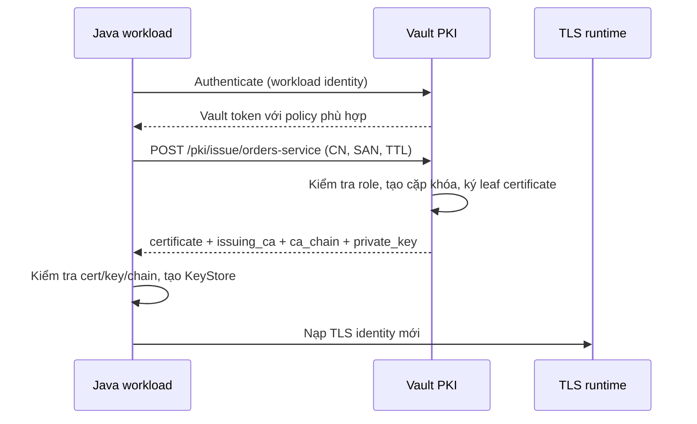

# Nhận chứng thư, chuỗi CA và khóa riêng khi được cấp

## 1. Bài toán và kết quả cần đạt

Trong **Spring Vault**, ứng dụng Java truy cập HashiCorp Vault thông qua `VaultTemplate` (giao diện `VaultOperations`), xác thực bằng danh tính workload và chỉ được gọi những endpoint mà Vault policy cho phép. **PKI secrets engine** là một ứng dụng quan trọng của mô hình này: dịch vụ xin chứng thư X.509 để dùng trong HTTPS, mTLS, kết nối cơ sở dữ liệu hoặc xác thực giữa các microservice. Bên cạnh việc **xin cấp** chứng thư, ứng dụng phải biết nhận, kiểm tra và phân phối đúng ba thành phần: **chứng thư đầu cuối (leaf certificate)**, **chuỗi chứng thư CA (CA chain)** và **khóa riêng (private key)**.

Ví dụ: dịch vụ `orders.service.internal` có một workload identity hợp lệ. Vault PKI đã được nhóm nền tảng cấu hình CA và role `orders-service`. Ứng dụng cần xin chứng thư ngắn hạn, lắp vào TLS identity của tiến trình và tự thay thế trước khi hết hạn.

Sau bài này, người học có thể:

- Đọc phản hồi `pki/issue/:role` và chỉ rõ dữ liệu nào là công khai, dữ liệu nào phải giữ bí mật.
- Phân biệt `certificate`, `issuing_ca`, `ca_chain`, `private_key` và metadata cấp phát.
- Nhận dữ liệu với `VaultPkiOperations.issueCertificate(...)` và `CertificateBundle` trong Java.
- Chuyển chứng thư/khóa sang `KeyStore`, lựa chọn trust anchor, kiểm tra tính hợp lệ và xử lý an toàn khóa riêng.
- Phân biệt trường hợp **Vault tạo khóa** (`issue`) với trường hợp **ứng dụng giữ khóa riêng và gửi CSR** (`sign`).

> **Phạm vi:** CA, issuer và PKI role đã được quản trị viên tạo sẵn. Bài tập trung vào **nhận và sử dụng kết quả khi được cấp**, không triển khai quy trình dựng root CA, intermediate CA hoặc cấu hình toàn bộ hệ thống PKI.

## 2. Một lần cấp chứng thư diễn ra như thế nào?



Ở endpoint `issue`, Vault tạo cặp khóa công khai/riêng cho chứng thư **đầu cuối** rồi ký chứng thư bằng issuer được chọn theo PKI role. Trong phản hồi, **khóa riêng của leaf certificate được gửi về client một lần và Vault không lưu lại khóa riêng đó để lấy lại sau**. Nếu đánh mất private key, không thể tái tạo nó từ chứng thư công khai hay truy vấn serial number; phải xin cặp khóa và chứng thư mới.

Điều này khác với private key của **CA/issuer** nằm trong hệ thống quản lý PKI. Ứng dụng nhận private key của chính leaf vừa cấp, **không được nhận private key của CA**.

### 2.1. Bốn phần dữ liệu cần hiểu

| Thành phần | Vai trò | Có phải bí mật? | Dùng ở đâu? |
| --- | --- | --- | --- |
| `certificate` | Chứng thư X.509 của dịch vụ, chứa public key, subject/SAN, serial, hạn sử dụng, chữ ký của issuer | Thường không; là thông tin công khai | Gửi cho bên đối tác trong TLS handshake, cùng với chain phù hợp |
| `private_key` | Khóa riêng ghép với public key trong `certificate`, dùng để chứng minh sở hữu danh tính | **Có, mức độ nhạy cảm cao** | Chỉ nạp vào identity/KeyStore của workload được cấp |
| `issuing_ca` | Chứng thư của CA trực tiếp đã ký leaf | Thông thường không | Hỗ trợ bên xác minh xây dựng chuỗi chứng thư |
| `ca_chain` | Danh sách chứng thư CA của issuer và các CA cấp trên mà Vault biết | Thông thường không | Phục vụ trình bày/kiểm tra đường dẫn chứng thực, không tự quyết định bên nào đáng tin |

Metadata thường đi cùng còn có `serial_number`, `expiration`, `private_key_type` và các trường ở lớp phản hồi Vault như `lease_id`, `lease_duration`, `renewable`. Giá trị tồn tại hay cách biểu diễn metadata phụ thuộc phiên bản Vault, format và cấu hình PKI role.

### 2.2. Public key không phải private key

Chứng thư đầu cuối chứa public key và thông tin định danh đã được issuer ký. Private key phù hợp với public key đó phải được giữ bí mật. Trong TLS, máy chủ cần cả **chứng thư và private key** để chứng minh danh tính; phía client xác minh chuỗi tin cậy và tên máy chủ bằng thông tin trong chứng thư. Chỉ nhận `certificate` mà không có private key sẽ không đủ tạo TLS server identity.

Ngược lại, chỉ có private key và leaf certificate mà thiếu intermediate phù hợp có thể khiến client không dựng được đường dẫn tới root CA tin cậy, dẫn đến lỗi handshake.

## 3. Phân biệt leaf, intermediate, root và trust anchor

Một hệ thống CA thông thường có cấu trúc:

```text
             Root CA (trust anchor đã tin cậy từ trước)
                         |
                         v
                Intermediate CA
                         |
                         v
      orders.service.internal (leaf certificate)
      + private key của workload orders
```

Một lần `issue` có thể trả:

```text
certificate  = leaf của orders.service.internal
issuing_ca   = chứng thư của Intermediate CA
ca_chain     = [Intermediate CA, Root CA]  (minh họa)
private_key  = private key của orders.service.internal
```

**Đừng nhầm “được Vault trả về” với “được tin cậy”.** Một máy khách TLS nên sở hữu trước tập CA gốc (trust anchors) đã được phê duyệt. Chuỗi CA server trình bày chỉ giúp máy khách dựng đường dẫn tới các trust anchor ấy. Không nên thêm vô điều kiện root CA nhận qua cùng response vào truststore của mọi client: như vậy đã mở rộng tập CA tin cậy theo dữ liệu do bên đối tác cung cấp.

Trên các phiên bản Vault có nhiều issuer, role có thể chọn issuer cụ thể. `issuing_ca` cho biết issuer trực tiếp đã ký chứng thư vừa cấp; `ca_chain` phản ánh chain do Vault cấu hình/biết tại thời điểm cấp. Trong thực tế chain có thể gồm một hoặc nhiều CA; một số cấu hình loại root tự ký khỏi `ca_chain` bằng `remove_roots_from_chain`. Không được suy ra rằng phần tử cuối hoặc đầu của mọi chain luôn là trust anchor đúng cho tất cả hệ thống.

**Phân biệt các kho chứng thư Java:**

- **Keystore của identity**: chứa private key của workload cùng leaf và certificate chain ứng với khóa đó; dùng bởi `KeyManager` của server hoặc mTLS client.
- **Truststore**: chứa chứng thư CA đã được tổ chức quyết định tin cậy; dùng bởi `TrustManager` để xác minh **phía đối tác**. Đây là chính sách tin cậy độc lập.
- **Certificate chain gửi trong handshake**: thường là leaf trước, tiếp theo là các intermediate cần thiết; root CA tự ký thường không cần gửi vì bên xác minh phải có root tin cậy riêng.

Một ứng dụng có thể đồng thời cần cả keystore (để tự giới thiệu danh tính) và truststore (để tin cậy dịch vụ khác).

## 4. Cấu trúc phản hồi khi gọi Vault PKI Issue API

Giả sử PKI secrets engine được mount tại `pki/` và role `orders-service` cho phép cấp chứng thư cho `orders.service.internal`. Request ở mức HTTP:

```http
POST /v1/pki/issue/orders-service HTTP/1.1
X-Vault-Token: <workload-token>
Content-Type: application/json

{
  "common_name": "orders.service.internal",
  "alt_names": "orders.service.internal",
  "ttl": "12h",
  "format": "pem",
  "private_key_format": "pkcs8"
}
```

Các giá trị CN, SAN, TTL và thuật toán phải đáp ứng **PKI role policy**. Nếu role không cho phép tên hoặc thời gian yêu cầu, Vault sẽ từ chối hoặc áp giới hạn theo cấu hình. Ví dụ minh họa dùng `format=pem` để nhận các trường dạng PEM dễ quan sát; ứng dụng production nên chọn định dạng tương thích cơ chế TLS và quản lý khóa đang dùng.

Phản hồi **rút gọn, chỉ mô tả cấu trúc**:

```json
{
  "lease_id": "",
  "renewable": false,
  "lease_duration": 0,
  "data": {
    "certificate": "<PEM leaf certificate>",
    "issuing_ca": "<PEM issuing CA certificate>",
    "ca_chain": [
      "<PEM intermediate CA certificate>",
      "<PEM root CA certificate>"
    ],
    "private_key": "<PEM private key - SECRET>",
    "private_key_type": "rsa",
    "serial_number": "39:dd:2e:90:...",
    "expiration": 1790000000
  }
}
```

Đây **không phải chứng thư, khóa hay timestamp thật**. Tùy cấu hình role, response có thể có `lease_id` và `lease_duration` khác giá trị minh họa. Trường `expiration` là thời điểm hết hạn dạng Unix epoch (giây) của chứng thư; nên kiểm tra thêm trực tiếp `notBefore`/`notAfter` từ X.509. Trường `serial_number` hữu ích để theo dõi hoặc thu hồi; không dùng serial để thay thế private key.

### 4.1. Trường nào là bắt buộc đối với ứng dụng?

Với luồng **Vault tạo khóa và cấp chứng thư** (`issue`), sau khi nhận response phải xác nhận:

1. `certificate` hiện diện, giải mã được thành X.509 và phù hợp tên dịch vụ cần phục vụ.
2. `private_key` hiện diện, giải mã được thành khóa phù hợp public key của leaf.
3. `issuing_ca`/`ca_chain` đủ để dựng chain đến CA đã được tổ chức chấp nhận.
4. Leaf còn hiệu lực, có mục đích phù hợp (ví dụ `serverAuth` cho TLS server, `clientAuth` cho mTLS client) và đúng DNS SAN/IP SAN.
5. TTL hữu dụng đủ dài để cài đặt và vận hành đến chu kỳ cấp lại tiếp theo; ứng dụng có kế hoạch thay chứng thư trước `notAfter`.

Chỉ kiểm tra HTTP 200 hoặc `private_key != null` chưa đủ để khẳng định chứng thư dùng được trong TLS.

### 4.2. Các format phản hồi

| `format` | Đặc điểm | Gợi ý sử dụng |
| --- | --- | --- |
| `pem` (mặc định) | Các chứng thư và private key ở dạng văn bản PEM với header/footer tương ứng | Dễ kiểm tra bằng OpenSSL, dễ map vào Spring Vault |
| `der` | Dữ liệu DER nhị phân được đưa qua JSON bằng Base64 | Dùng cho hệ thống yêu cầu DER; phải decode trước khi đưa vào parser |
| `pem_bundle` | Gộp private key, leaf và CA phù hợp trong trường `certificate` | Không giả định `private_key` vẫn là trường tách riêng trong parser |
| `pkcs12_bundle` | Bản lưu trữ PKCS#12 được Base64, gồm khóa riêng, leaf và chain của request `issue` | Thích hợp cho công cụ hỗ trợ PKCS#12; cần quản lý mật khẩu và tương thích thuật toán |
| `jks_bundle` | Tương tự nhưng theo định dạng keystore JKS | Chủ yếu dùng khi tích hợp hệ thống Java cũ; ưu tiên PKCS#12 nếu có thể |

Các API tiện ích kiểu `CertificateBundle` trong Spring Vault thuận tiện nhất với format mặc định và phần tử private key tách riêng. Nếu chọn output bundle nhị phân hay `pem_bundle`, hãy xác minh cách Spring Vault version hiện tại ánh xạ dữ liệu trước khi áp dụng; không tự giả định mọi định dạng đều có `getPrivateKey()`/encoding giống nhau.

## 5. Thực hành kiểm tra bằng Vault CLI

Để đọc phản hồi trên môi trường thử nghiệm, cần Vault đang chạy, CA/role đã được provision, và token của workload có quyền `pki/issue/orders-service`. Ví dụ dưới đây dùng Bash và `jq`:

```bash
# Chỉ chạy trong môi trường test, với dữ liệu không dùng cho production.
# jq lọc khóa riêng ra khỏi thông tin in lên màn hình.
vault write -format=json pki/issue/orders-service \
  common_name=orders.service.internal \
  alt_names=orders.service.internal \
  ttl=12h \
  format=pem \
  private_key_format=pkcs8 \
  | jq '{
      serial: .data.serial_number,
      expiration: .data.expiration,
      key_type: .data.private_key_type,
      has_leaf: (.data.certificate != null),
      has_private_key: (.data.private_key != null),
      ca_chain_length: (.data.ca_chain | length)
    }'
```

Lệnh này **thực sự phát hành một chứng thư mới**, không chỉ đọc metadata. Không gọi lặp lại trong vòng polling. Private key vẫn đi qua bộ nhớ của CLI và `jq`, dù không được in; không bật shell tracing (`set -x`), HTTP body logging hoặc lưu raw JSON vào các artifact log. Trong thực tế, nên tích hợp thẳng với Spring Vault và KeyStore trong bộ nhớ.

Nếu nhóm vận hành đã cung cấp file chứng thư thử nghiệm (PEM không chứa bí mật), có thể kiểm tra leaf:

```bash
openssl x509 -in leaf.pem -noout -subject -issuer -serial -dates
openssl x509 -in leaf.pem -noout -ext subjectAltName
```

Với trust anchor được phê duyệt trước và file CA trung gian:

```bash
openssl verify \
  -CAfile approved-root.pem \
  -untrusted intermediates.pem \
  leaf.pem
```

Đường dẫn PEM trên là **ví dụ của file kiểm thử đã được cấp hợp lệ**, không phải yêu cầu tạo hoặc xuất private key ra ổ đĩa. `openssl verify` kiểm tra đường dẫn chứng thư theo trust anchor được cung cấp; các kiểm tra hostname, EKU, CRL/OCSP và chính sách TLS còn phụ thuộc cách gọi và cấu hình bổ sung.

## 6. Nhận certificate bundle bằng Spring Vault

Spring Vault cung cấp `VaultOperations.opsForPki("pki")` để nhận `VaultPkiOperations`. Hàm `issueCertificate(roleName, request)` trả `VaultCertificateResponse`, trong đó `getRequiredData()` là `CertificateBundle`. Đây là API cấp cao giúp lấy certificate, issuer, CA chain và private key từ một lần cấp phát.

### 6.1. Ví dụ Java: đọc, kiểm tra và tạo keystore

Đoạn mã giả định `VaultOperations` đã được ứng dụng cấu hình bằng HTTPS, xác thực theo workload (AppRole, Kubernetes auth hoặc cơ chế tương đương) và session/token được Spring Vault quản lý. CA và role `orders-service` đã tồn tại. Java 17+ và phiên bản Spring Vault có hỗ trợ `CertificateBundle.getCaChain()`:

```java
import java.security.KeyStore;
import java.security.cert.X509Certificate;
import java.time.Duration;
import java.time.Instant;
import java.util.List;

import org.springframework.vault.core.VaultOperations;
import org.springframework.vault.core.VaultPkiOperations;
import org.springframework.vault.support.CertificateBundle;
import org.springframework.vault.support.VaultCertificateRequest;
import org.springframework.vault.support.VaultCertificateResponse;

public final class OrdersPkiIssuer {

    private final VaultPkiOperations pki;

    public OrdersPkiIssuer(VaultOperations operations) {
        this.pki = operations.opsForPki("pki");
    }

    public IssuedIdentity issue(char[] keyPassword) throws Exception {
        VaultCertificateRequest request = VaultCertificateRequest.builder()
                .commonName("orders.service.internal")
                .altNames(List.of("orders.service.internal"))
                .ttl(Duration.ofHours(12))
                .build();

        VaultCertificateResponse response =
                pki.issueCertificate("orders-service", request);
        CertificateBundle bundle = response.getRequiredData();

        X509Certificate leaf = bundle.getX509Certificate();
        X509Certificate issuer = bundle.getX509IssuerCertificate();
        leaf.checkValidity();

        if (leaf.getNotAfter().toInstant()
                .isBefore(Instant.now().plus(Duration.ofMinutes(30)))) {
            throw new IllegalStateException("Certificate lifetime too short");
        }

        String serial = bundle.getSerialNumber();
        List<String> caChainPem = List.copyOf(bundle.getCaChain());

        // KeyStore chứa khóa riêng của leaf và certificate chain.
        // keyPassword được cấp qua kênh bí mật, không hardcode.
        KeyStore identity = bundle.createKeyStore(
                "orders-tls", true, keyPassword);

        if (!identity.isKeyEntry("orders-tls")
                || identity.getCertificateChain("orders-tls") == null) {
            throw new IllegalStateException("Incomplete TLS identity");
        }

        return new IssuedIdentity(
                identity, serial, leaf.getNotAfter().toInstant(),
                issuer, caChainPem);
    }

    public record IssuedIdentity(
            KeyStore keyStore,
            String serialNumber,
            Instant expiresAt,
            X509Certificate issuingCa,
            List<String> caChainPem) {}
}
```

Trong ví dụ:

- `bundle.getX509Certificate()` trả leaf để kiểm tra X.509.
- `bundle.getX509IssuerCertificate()` trả certificate của issuer trực tiếp.
- `bundle.getCaChain()` trả các chứng thư CA dưới dạng danh sách PEM theo cấu hình của Vault.
- `bundle.getSerialNumber()` cung cấp serial để quản lý vòng đời.
- `bundle.createKeyStore("orders-tls", true, keyPassword)` tạo keystore chứa private key và certificate chain, phù hợp để sử dụng làm **TLS identity**.

Đoạn mã tập trung vào **cách nhận và truy cập dữ liệu**. Trước khi đưa chứng thư vào kết nối thật, phải bổ sung kiểm tra SAN/EKU, đường dẫn tới trust anchor đã được phê duyệt, kiểm tra cặp khóa và policy phù hợp; đồng thời xác định cách cập nhật TLS runtime mà không gây gián đoạn. `getX509Certificate().checkValidity()` chỉ kiểm tra khoảng hiệu lực `notBefore`–`notAfter`, **không tự xác minh** tên DNS, chữ ký, chain hoặc trạng thái thu hồi.

**Lấy khóa riêng khi cần:** `CertificateBundle.getPrivateKey()` trả private key dưới dạng chuỗi PEM/DER được diễn đạt theo encoding tương ứng; `getPrivateKeySpec()` trả `KeySpec` để tích hợp JCA. Việc trả khóa về `String` tạo bản sao khó xóa khỏi Java heap. Nếu mục tiêu chỉ là cài đặt TLS identity, ưu tiên tạo `KeyStore` trực tiếp và giảm các bản sao private key trong bộ nhớ.

### 6.2. Dùng KeyStore trong TLS của Java

Sau khi đã có keystore identity của workload và **truststore chứa CA gốc đã duyệt**, có thể kết nối với JSSE:

```java
import java.security.KeyStore;
import java.security.SecureRandom;
import javax.net.ssl.KeyManagerFactory;
import javax.net.ssl.SSLContext;
import javax.net.ssl.TrustManagerFactory;

public final class TlsContexts {

    public static SSLContext create(
            KeyStore workloadIdentity,
            char[] keyPassword,
            KeyStore approvedTrustAnchors) throws Exception {

        KeyManagerFactory keyManagers =
                KeyManagerFactory.getInstance(
                        KeyManagerFactory.getDefaultAlgorithm());
        keyManagers.init(workloadIdentity, keyPassword);

        TrustManagerFactory trustManagers =
                TrustManagerFactory.getInstance(
                        TrustManagerFactory.getDefaultAlgorithm());
        trustManagers.init(approvedTrustAnchors);

        SSLContext sslContext = SSLContext.getInstance("TLS");
        sslContext.init(
                keyManagers.getKeyManagers(),
                trustManagers.getTrustManagers(),
                new SecureRandom());
        return sslContext;
    }
}
```

`approvedTrustAnchors` phải được xây dựng từ CA gốc của tổ chức được chấp nhận **trước khi** tin cậy dịch vụ đối tác. Không dùng một trust manager chấp nhận mọi chứng thư hay bỏ hostname verification để vượt lỗi cấu hình. Với TLS server trong Spring Boot hoặc thư viện mạng cụ thể, cách nạp và thay `SSLContext` phụ thuộc server/client và cấu hình TLS đang sử dụng.

### 6.3. Nếu cần lưu PKCS#12 để tích hợp hệ thống cũ

`KeyStore` ở ví dụ trên ban đầu có thể giữ trong bộ nhớ. Nếu buộc phải xuất sang PKCS#12, cần có giải pháp lưu trữ bí mật với quyền truy cập tối thiểu, đường dẫn thuộc vùng secret volume, kiểm soát backups và xóa/rotate file cũ. Sau khi tạo `KeyStore`, có thể ghi bằng `KeyStore.store(OutputStream, password)` ở một lớp cấu hình chuyên trách; không nên mặc định xuất ra thư mục làm việc, classpath, Git hay log của ứng dụng.

Đối với REST API trực tiếp, `format=pkcs12_bundle` có thể trả archive được mã hóa Base64; tham số `pkcs12_password` và profile mã hóa phải tương thích runtime. Spring Vault API `CertificateBundle` ở trên được minh họa với `pem`, nên đây là **hai cách nhận dữ liệu khác nhau**, phải xử lý đúng format được chọn.

## 7. Trường hợp gửi CSR: không có khóa riêng trong phản hồi

Khi chính ứng dụng, HSM, Kubernetes CSR hoặc thiết bị sinh key pair và không muốn đưa private key qua mạng, nó tạo **Certificate Signing Request (CSR)** bằng khóa của mình rồi gửi tới Vault. Tại endpoint `POST /v1/pki/sign/:role`, Vault chỉ kiểm tra role/CSR và ký certificate. Phản hồi gồm `certificate`, `issuing_ca`, `ca_chain` và metadata, **không có `private_key`**; private key tiếp tục nằm ở nơi tạo CSR.

Trong Spring Vault:

```java
import org.springframework.vault.core.VaultPkiOperations;
import org.springframework.vault.support.Certificate;
import org.springframework.vault.support.VaultCertificateRequest;
import org.springframework.vault.support.VaultSignCertificateRequestResponse;

VaultSignCertificateRequestResponse signed = pki.signCertificateRequest(
        "orders-service",
        csrPem, // CSR PEM do workload tạo và bảo vệ private key tương ứng.
        VaultCertificateRequest.create("orders.service.internal"));

Certificate signedLeaf = signed.getRequiredData();
String pem = signedLeaf.getCertificate();
String issuerPem = signedLeaf.getIssuingCaCertificate();
```

Ở đây biến `pki` là một `VaultPkiOperations` đã cấu hình, còn `csrPem` là CSR thực. Ứng dụng phải ghép certificate được ký vào **chính private key đã tạo CSR**, không cố lấy private key từ `signedLeaf`. Mô hình CSR đặc biệt phù hợp khi khóa phải nằm trong HSM/TPM hoặc trong bộ nhớ của workload và không được truyền qua Vault.

| Tiêu chí | `pki/issue/:role` | `pki/sign/:role` |
| --- | --- | --- |
| Ai tạo private key của leaf? | Vault tại thời điểm issue | Workload hoặc thiết bị tạo CSR |
| Có trường `private_key` trả về? | Có với `format=pem`/DER thông thường | **Không** |
| Ứng dụng nhận gì? | Private key + leaf + issuer/chain | Leaf + issuer/chain; giữ khóa riêng tại chỗ |
| Rủi ro chính | Bí mật được truyền từ Vault đến ứng dụng | Quản lý an toàn khóa và CSR ở phía ứng dụng |
| Dùng khi | Dịch vụ cần cấp nhanh TLS identity từ Vault | Dịch vụ muốn private key không rời môi trường tạo khóa |

**Kết luận kỹ thuật:** Không thể sửa lỗi “`private_key` rỗng” của `sign` bằng cách gọi API lấy CA key. Đó là thiết kế đúng của luồng ký CSR.

## 8. Xử lý vòng đời chứng thư và vòng đời token

PKI certificate, Vault token và Vault lease là ba khái niệm khác nhau:

| Thuộc tính | Mục đích | Khi hết hạn hoặc bị thu hồi |
| --- | --- | --- |
| **X.509 `notAfter`** | Giới hạn thời gian hiệu lực danh tính TLS | Cần cấp lại certificate mới; không kéo dài chứng thư đã ký bằng cách renew token |
| **Vault token TTL** | Thời gian được phép gọi endpoint issue/sign/revoke theo policy | Cần workload auth/renew token để tiếp tục xin chứng thư |
| **Vault lease** (nếu PKI role tạo lease) | Cơ chế Vault quản lý secret/cert đã phát hành, có thể liên quan thu hồi | Không đồng nghĩa với khả năng kéo dài `notAfter`; certificate không “gia hạn tại chỗ” |

Theo cấu hình PKI role, `generate_lease` có thể tắt (thường là giá trị mặc định). Khi đó, response có thể không có lease hữu ích; ứng dụng **không nên suy ra thời điểm phải thay cert từ `lease_duration`**. Thay vào đó dựa trên `notAfter` và `notBefore` của leaf, hoặc `expiration` cùng kiểm tra X.509.

Quy trình vận hành phù hợp:

1. Khi khởi tạo, xác thực workload với Vault và xin certificate theo role.
2. Kiểm tra certificate, key, SAN, EKU, chain và hạn hiệu lực trước khi nạp.
3. Lắp identity mới vào TLS runtime; giữ cấu hình cũ hoạt động cho đến khi identity mới đã dùng được.
4. Chủ động cấp lại trước khi `notAfter`, có khoảng dự phòng đủ cho retry, sự cố Vault và lệch đồng hồ.
5. Theo dõi serial, thời điểm cấp, hạn và cảnh báo gần hết hạn **mà không ghi private key vào log/metric**.
6. Khi key lộ, certificate bị sai identity hoặc workload bị loại bỏ, thực hiện quy trình thu hồi bằng serial (nếu role lưu cert và chính sách cho phép), cập nhật CRL/OCSP và phân phối identity thay thế.

Thời gian certificate còn hiệu lực không đảm bảo nó chưa bị thu hồi; các client mTLS có thể cần tra CRL/OCSP tùy chính sách của hệ thống.

## 9. Quyền Vault và bảo vệ private key

Với ứng dụng chỉ cần `issue` certificate theo role có sẵn, Vault policy tối thiểu có thể là:

```hcl
path "pki/issue/orders-service" {
  capabilities = ["update"]
}
```

Endpoint issue dùng HTTP POST, nên `update` là capability thường cần; không cấp `sudo`, quyền quản trị root/intermediate, quyền tạo role, hoặc quyền `pki/issuer/:issuer_ref/issue/:role` nếu workload không có lý do chọn issuer khác với role. Các thao tác đọc CA chain công khai có thể cấu hình riêng; policy cho `sign` hoặc `revoke` chỉ thêm vào workload thực sự cần.

Đặt giới hạn `allowed_domains`, `allow_subdomains`, `allow_ip_sans`, `server_flag`, `client_flag`, TTL/max TTL và key type trên role để workload không thể xin cert cho tên không thuộc quyền quản lý. Tenant authorization và workload identity phải được kiểm soát trước khi gửi CN/SAN tới Vault.

Vì `pki/issue` trả private key:

- Không ghi nguyên HTTP response, `CertificateBundle`, `private_key`, PEM bundle hay keystore vào application logs/tracing, stdout, message queue hoặc bug report.
- Bảo vệ đường truyền Vault bằng TLS đúng CA, xác thực workload với token ngắn hạn, tách policy theo role/mount và không nhúng root token.
- Giảm thời gian private key nằm trong bộ nhớ, tránh truyền bí mật dưới dạng `String` qua nhiều tầng hoặc cache không có giới hạn.
- Nếu ghi keystore ra file, dùng storage dành cho secret, quyền file chặt, không sao lưu ngoài chính sách và có phương án xoay vòng/xóa chứng thư cũ.
- Tách **đường dẫn identity** và **đường dẫn trust**; dữ liệu từ `ca_chain` không tự cấp quyền trở thành CA tin cậy.
- Cân nhắc luồng **CSR/sign** khi private key buộc phải tồn tại ở thiết bị tạo hoặc HSM.

## 10. Những lỗi hay gặp khi nhận chứng thư

| Triệu chứng | Nguyên nhân thường gặp | Hướng xử lý |
| --- | --- | --- |
| `403 permission denied` | Token không được cấp `update` trên đúng `pki/issue/:role` | Kiểm tra workload auth, policy, mount và role |
| `400` về domain/SAN/TTL | `common_name`, SAN hoặc TTL vi phạm giới hạn role | Sửa request hoặc yêu cầu quản trị viên điều chỉnh role có kiểm soát |
| Không thấy `private_key` trong response | Đã gọi `sign`/CSR hoặc dùng bundle format không tách key | Kiểm tra đúng endpoint và format; với CSR dùng private key gốc |
| `CertificateBundle` parse lỗi | PEM/DER không khớp định dạng parser, response thiếu trường hoặc phiên bản client khác | Dùng `pem` cho ví dụ typed API; kiểm tra encoding và version Spring Vault |
| Java không tạo được TLS identity | Thiếu private key, leaf hoặc chain; key không tương ứng leaf | Kiểm tra cặp khóa, issuer chain, alias và format keystore |
| `PKIX path building failed` | Client không biết root tin cậy, thiếu intermediate hoặc issuer chain sai | Cài đúng approved root vào truststore, cung cấp intermediate cần thiết |
| `No subject alternative names matching` | SAN không chứa DNS/IP thực sự dùng để kết nối | Xin cert với SAN phù hợp, giữ hostname verification |
| `CertificateExpiredException` | Đã quá `notAfter` hoặc clock lệch đáng kể | Cấp mới sớm hơn, đồng bộ thời gian, rà soát lịch làm mới |
| Cert còn hạn nhưng handshake bị từ chối | EKU/key usage, signature algorithm, CRL/OCSP hoặc chính sách mTLS không phù hợp | Kiểm tra mục đích cert, trust chain và quy tắc bên xác minh |
| Sau restart không còn khóa | Response issue không được giữ an toàn; Vault không lưu lại leaf private key | Xin một cert mới và triển khai lại identity; không truy xuất private key từ serial |

Không retry vô hạn khi `403`, sai role hoặc SAN không hợp lệ. Với lỗi mạng, Vault tạm không sẵn sàng hoặc token hết hạn, thiết kế timeout, retry có backoff và cơ chế tái xác thực; tránh cấp mới hàng loạt do vòng lặp lỗi.

## 11. Bài thực hành và gợi ý kiểm thử tích hợp

**Điều kiện:** Một Vault dev/test cô lập, PKI CA và role thử nghiệm do người quản trị chuẩn bị, Spring Vault client được xác thực bằng workload identity thử nghiệm. Không tạo chứng thư cho domain production hay sử dụng private key thật trong bài tập.

1. Gọi `pki/issue/orders-service` bằng CN/SAN hợp lệ; trong Java lấy `response.getRequiredData()` và xác minh `getCertificate()`, `getPrivateKey()`, `getIssuingCaCertificate()`, `getCaChain()` có hình thức mong đợi. **Không in giá trị private key**.
2. Đọc `getX509Certificate()`: kiểm tra subject, SAN, serial, `notBefore`, `notAfter` và public-key algorithm; so với request và role.
3. Dựng KeyStore bằng `createKeyStore(...)`; xác nhận tồn tại một private-key entry, chain có leaf và intermediate phù hợp. Thử nạp `KeyManagerFactory` để kiểm tra format và password.
4. Dùng approved root CA riêng của test để kiểm tra path; thử truststore không chứa root và ghi nhận lỗi xác minh, sau đó bổ sung đúng root.
5. Tạo CSR với key pair nội bộ, gọi `pki/sign/:role` và kiểm tra response **không trả private key**. Xác nhận certificate mới khớp public key của CSR.
6. Thử request có CN/SAN ngoài policy hoặc TTL quá giới hạn và xác nhận Vault chặn.
7. Thử workload token thiếu quyền issue; xác nhận `403` và ứng dụng không đưa dữ liệu nhạy cảm vào log.
8. Dùng chứng thư thử nghiệm TTL ngắn, lên kế hoạch xin lại trước hạn; kiểm tra thay identity trong TLS runtime và việc đóng/giải phóng identity cũ.

Trong kiểm thử tích hợp nên kiểm tra hành vi thực của TLS handshake: server/client trình bày đúng leaf và chain, phía đối tác tin cậy root được duyệt, tên DNS đúng SAN, thời gian hiệu lực hợp lệ và private key tương ứng. **Chỉ kiểm thử object tồn tại** chưa chứng minh certificate dùng được.

## 12. Checklist triển khai

- [ ] PKI role giới hạn CN/SAN, TTL, key type, EKU và issuer theo chức năng workload.
- [ ] Ứng dụng xin chứng thư qua `VaultPkiOperations.issueCertificate(...)` với token tối thiểu.
- [ ] Phân biệt leaf, issuing CA, CA chain và private key; không nhầm private key leaf với CA key.
- [ ] Nhận response theo đúng `format` được chọn; với PEM dùng `CertificateBundle` để tạo KeyStore.
- [ ] Kiểm tra certificate còn hạn, DNS/IP SAN, EKU/key usage và chain đến trust anchor độc lập.
- [ ] Identity keystore và truststore có mục đích tách biệt; root tin cậy không được lấy theo quyết định mù từ response.
- [ ] Private key không xuất hiện trong log, trace, repo, command history hoặc bản sao lưu thiếu bảo vệ.
- [ ] Nếu dùng CSR/sign, private key nằm tại nơi tạo CSR và không được kỳ vọng trong response.
- [ ] Có cơ chế cấp lại và thay thế identity **trước khi** certificate hết hạn.
- [ ] Monitoring theo serial/hạn/loại lỗi; lỗi quyền và policy không bị retry vô hạn.

## Tài liệu tham khảo

- HashiCorp, [PKI secrets engine](https://developer.hashicorp.com/vault/docs/secrets/pki) — nguyên lý cấp chứng thư động.
- HashiCorp, [PKI HTTP API](https://developer.hashicorp.com/vault/api-docs/secret/pki) — `issue`, `sign`, `certificate`, `ca_chain`, `private_key`, `format`, `generate_lease`.
- Spring Vault, [Vault Secrets Engines — PKI](https://docs.spring.io/spring-vault/reference/vault/vault-secret-engines.html) — ví dụ `VaultPkiOperations` và `CertificateBundle`.
- Spring Vault, [VaultPkiOperations Java API](https://docs.spring.io/spring-vault/reference/api/java/org/springframework/vault/core/VaultPkiOperations.html) — issue/sign/revoke.
- Spring Vault, [CertificateBundle Java API](https://docs.spring.io/spring-vault/reference/api/java/org/springframework/vault/support/CertificateBundle.html) và [Certificate Java API](https://docs.spring.io/spring-vault/reference/api/java/org/springframework/vault/support/Certificate.html) — đọc leaf, CA chain, private key và tạo KeyStore.
